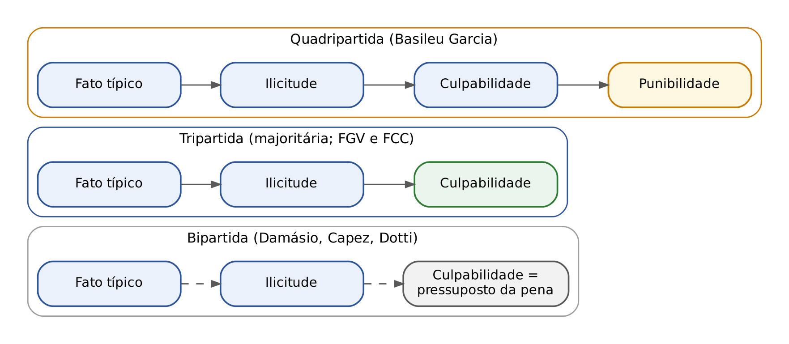
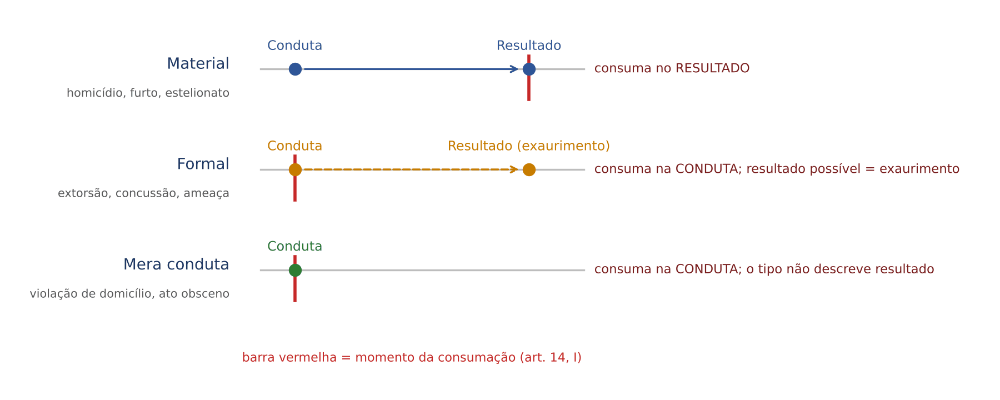
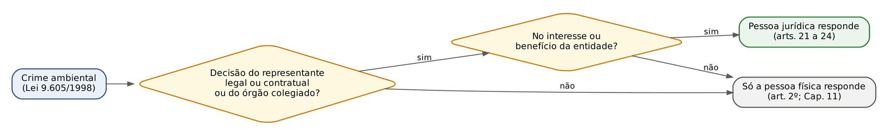

# CAPÍTULO 05 — TEORIA DO DELITO: CONCEITO, SISTEMAS, CLASSIFICAÇÃO DOS CRIMES, SUJEITOS E RESPONSABILIDADE PENAL DA PESSOA JURÍDICA

:::INCIDENCIA
Pontos: TRF5 p. 3 e 5; TJRS p. 3; TJSC p. 9 e 15. Nível B. Lote: 7 questões (FGV 6; 1 sem banca identificada).
O que mais cai: classificação quanto ao resultado (material, formal e mera conduta), enquadramento de crimes concretos em várias classificações ao mesmo tempo e responsabilidade penal da pessoa jurídica (dupla imputação, intranscendência, incorporação).
:::

## 05.1 Infração penal: crime e contravenção

### 05.1.1 O sistema dicotômico e o critério do art. 1º da Lei de Introdução

O Brasil adota o sistema dicotômico: infração penal é o gênero, do qual são espécies o crime (ou delito, sinônimos entre nós) e a contravenção penal (o sistema tricotômico, de outros países, separa crimes, delitos e contravenções). Não há diferença ontológica entre as espécies (Hungria chamava a contravenção de "crime anão"): a diferença é de grau, escolhida pelo legislador e revelada pela pena cominada.

:::LEI Decreto-Lei 3.914/1941 (Lei de Introdução ao Código Penal), art. 1º
Considera-se crime a infração penal que a lei comina pena de reclusão ou de detenção, quer isoladamente, quer alternativa ou cumulativamente com a pena de multa; contravenção, a infração penal a que a lei comina, isoladamente, pena de prisão simples ou de multa, ou ambas, alternativa ou cumulativamente.
:::

Na prática, olhe o preceito secundário: reclusão ou detenção, crime; prisão simples ou multa ISOLADA, contravenção.

:::PEGADINHA O art. 28 da Lei de Drogas
O porte de droga para consumo pessoal (art. 28 da Lei 11.343/2006) não comina reclusão, detenção nem prisão simples. Pelo art. 1º da LICP não seria crime nem contravenção, mas o STF entendeu que houve "despenalização", e não descriminalização: a LICP é lei ordinária e não vincula o legislador posterior, e a CF (art. 5º, XLVI) admite penas diversas da prisão. Depois, no Tema 506, o STF afastou a natureza penal do porte de maconha para uso próprio (Cap. 37).
:::

### 05.1.2 Diferenças de regime entre crime e contravenção

É o regime jurídico diferente que as bancas cobram; o detalhamento da LCP (Decreto-Lei 3.688/1941) está no Cap. 50.

| Aspecto | Crime | Contravenção penal |
|---|---|---|
| Pena privativa | Reclusão ou detenção | Prisão simples, sem rigor penitenciário, em semiaberto ou aberto (LCP, art. 6º) |
| Tentativa | Punível, em regra (art. 14, II, CP) | NÃO é punível (LCP, art. 4º) |
| Elemento subjetivo | Dolo; culpa só quando expressa (art. 18, parágrafo único) | Basta a ação ou omissão voluntária; dolo ou culpa só importam se a lei lhes atribuir efeito (LCP, art. 3º) |
| Extraterritorialidade | Admitida (art. 7º, CP) | NÃO: a LCP só se aplica à contravenção praticada no território nacional (LCP, art. 2º) |
| Erro de direito | Desconhecimento da lei é inescusável; só atenua (arts. 21 e 65, II, CP) | Ignorância ou errada compreensão da lei, se escusáveis, permitem deixar de aplicar a pena (LCP, art. 8º) |
| Limite de cumprimento | 40 anos (art. 75, CP) | 5 anos (LCP, art. 10) |
| Período de prova do *sursis* | 2 a 4 anos (4 a 6 no etário e no humanitário) | 1 a 3 anos (LCP, art. 11) |
| Ação penal | Pública incondicionada, condicionada ou privada | Pública incondicionada (LCP, art. 17) |
| Competência | Justiça Estadual, Federal, Eleitoral ou Militar | NUNCA Justiça Federal, nem por conexão com crime federal (art. 109, IV, CF; Súmula 38 do STJ), ressalvado o foro por prerrogativa de função; quase sempre menor potencial ofensivo (Cap. 25) |
| Reincidência | Crime anterior + crime posterior | Ver quadro abaixo |

:::ESQUEMA Reincidência entre crimes e contravenções (art. 63 do CP e art. 7º da LCP)
| Infração anterior (com trânsito em julgado) | Infração posterior | Reincidente? |
|---|---|---|
| Crime (no Brasil ou no estrangeiro) | Crime | Sim (art. 63, CP) |
| Crime (no Brasil ou no estrangeiro) | Contravenção | Sim (LCP, art. 7º) |
| Contravenção (no Brasil) | Contravenção | Sim (LCP, art. 7º) |
| Contravenção | Crime | NÃO: lacuna legal; nenhum dos dois dispositivos prevê; serve, no máximo, como antecedente |
| Contravenção no estrangeiro | Contravenção | NÃO: a LCP só considera a condenação anterior por contravenção praticada no Brasil |
A reincidência como agravante é desenvolvida no Cap. 14.
:::

## 05.2 Conceito de crime

### 05.2.1 Os três enfoques: formal, material e analítico

O Código Penal não define crime. A doutrina usa três enfoques complementares:

| Enfoque | Pergunta que responde | Conceito | Para que serve |
|---|---|---|---|
| Formal | O que a lei chama de crime? | Toda conduta descrita em lei penal incriminadora e sancionada com pena | Segurança jurídica: é a face da legalidade (Cap. 2) |
| Material | Por que aquilo é crime? | Comportamento humano que lesa ou expõe a perigo bens jurídicos relevantes para a convivência (ofensividade) | Orienta o legislador (o que pode ser criminalizado) e o juiz (tipicidade material, insignificância — Cap. 2) |
| Analítico (ou dogmático) | Quais são os elementos que o juiz deve verificar, e em que ordem? | Fato típico, ilícito e culpável (posição majoritária) | Método de decisão: é o roteiro da fundamentação da sentença |

### 05.2.2 O conceito analítico: bipartido, tripartido e quadripartido

O conceito analítico decompõe o crime em camadas sucessivas, cada uma pressupondo a anterior; é a mesma ordem da fundamentação de mérito da sentença.

- Tripartida (fato típico + ilicitude + culpabilidade): posição majoritária na doutrina (Bitencourt, Greco, Nucci, Regis Prado, Cirino, Zaffaroni e Pierangeli) e a adotada pela FGV e pela FCC. A culpabilidade é ELEMENTO do crime: sem ela, não há crime.
- Bipartida (fato típico + ilicitude): sustentada por Damásio de Jesus, René Ariel Dotti, Fernando Capez e, entre outros, por Mirabete. A culpabilidade é juízo de reprovação que recai sobre o autor, PRESSUPOSTO DE APLICAÇÃO DA PENA, e não requisito do crime. O argumento de texto é a linguagem do CP: nas excludentes de ilicitude diz "não há crime" (art. 23); nas de culpabilidade diz "é isento de pena" (arts. 26 e 28, § 1º). Crítica: a linguagem do Código não é argumento dogmático decisivo (10.1).
- Quadripartida (fato típico + ilicitude + culpabilidade + punibilidade): Basileu Garcia, minoritária. A crítica dominante: a punibilidade é CONSEQUÊNCIA do crime, não elemento. Prova: a prescrição extingue a punibilidade (art. 107, IV) sem apagar o crime, tanto que o fato continua servindo de antecedente da receptação (art. 108 — crime acessório; ver Cap. 21).

Duas outras construções aparecem em provas de magistratura:
- Teoria constitucionalista do delito (Luiz Flávio Gomes): crime é fato formal e materialmente típico e antijurídico; a culpabilidade é fundamento da pena, e a punibilidade (ameaça de pena) integra o conceito na condição de pressuposto. É variação da bipartida com tipicidade material.
- Roxin (funcionalismo teleológico): mantém tipo e ilicitude (reunidos no "injusto") e substitui a culpabilidade pela categoria "responsabilidade", que exige culpabilidade e necessidade preventiva da pena (05.3).

:::DICA Como a banca pergunta
"O que exclui a culpabilidade exclui o crime?" Para a tripartida, sim; para a bipartida, não (isenta de pena). Se o enunciado não indicar a corrente, responda pela tripartida. A FGV trata a culpabilidade como "terceiro elemento do conceito analítico" sem ressalvas (MP-RJ 2026, Q4088242, Cap. 10).
:::

:::SENTENCA O conceito analítico como roteiro da fundamentação e do dispositivo
Onde entra: no mérito, depois das preliminares. A fundamentação percorre, nesta ordem, materialidade e autoria (fato típico: conduta, nexo, resultado, tipicidade, dolo ou culpa), ilicitude (afastar as teses de justificação), culpabilidade (imputabilidade, potencial consciência, exigibilidade) e, por fim, a punibilidade (prescrição e outras causas extintivas, que na prática costumam ser examinadas como prejudicial antes do mérito).
O inciso do art. 386 do CPP deve corresponder à camada que falhou:
| Camada que falhou | Absolvição sumária (art. 397, CPP) | Absolvição na sentença (art. 386, CPP) |
|---|---|---|
| Tipicidade | III (fato evidentemente não constitui crime) | III (não constituir o fato infração penal) |
| Ilicitude | I (causa excludente da ilicitude) | VI (circunstâncias que excluam o crime) |
| Culpabilidade | II (excludente da culpabilidade, SALVO inimputabilidade) | VI (circunstâncias que isentem o réu de pena); inimputável: absolvição imprópria com medida de segurança (art. 386, parágrafo único, III; Cap. 19) |
| Punibilidade | IV (extinta a punibilidade) | Não absolve: declara extinta a punibilidade (art. 61 do CPP; art. 107 do CP) |
Redação-modelo: "Comprovada a legítima defesa, o fato, embora típico, não é ilícito, razão pela qual absolvo o réu com fundamento no art. 386, VI, do CPP."
Erro que a banca pune: absolver por "atipicidade" quem agiu em legítima defesa, ou "absolver" por prescrição (o correto é declarar extinta a punibilidade).
:::

## 05.3 Sistemas penais: onde fica cada elemento do crime

A história está no Cap. 1; a evolução da culpabilidade, em 10.1.2; as teorias da conduta, em 6.2. Aqui interessa só onde cada sistema aloja cada elemento, o que explica por que o erro de tipo exclui o dolo (art. 20) e o erro de proibição, a culpabilidade (art. 21).

| Sistema | Autores e época | Conduta | Tipo | Ilicitude | Culpabilidade |
|---|---|---|---|---|---|
| Causal-naturalista (clássico) | Liszt e Beling, virada do século XX | Movimento corporal voluntário que causa modificação no mundo | Puramente objetivo e descritivo, sem valoração | Formal: contrariedade à norma | Psicológica: dolo e culpa SÃO as espécies de culpabilidade; imputabilidade é pressuposto |
| Neoclássico (neokantista) | Mezger, Frank, Sauer, 1907 a 1930 | Comportamento humano valorado (inclui a omissão) | Admite elementos normativos e subjetivos especiais (descobertos por Mezger e Hegler) | Material: lesão ao bem jurídico | Psicológico-normativa: imputabilidade + dolo normativo (com consciência ATUAL da ilicitude) ou culpa + exigibilidade de conduta diversa |
| Finalista | Welzel, décadas de 1930 a 1960 | Atividade humana dirigida a um fim | Complexo: tipo objetivo + tipo subjetivo (DOLO NATURAL e CULPA migram para cá) | Contrariedade ao direito, com elementos subjetivos das justificantes | Normativa pura: imputabilidade + POTENCIAL consciência da ilicitude + exigibilidade |
| Funcionalismo teleológico (moderado) | Roxin, a partir de 1970 | Manifestação da personalidade | Tipo com imputação objetiva (criação e realização de risco proibido — Cap. 6) | Ponderação de interesses sociais | "Responsabilidade" = culpabilidade + necessidade preventiva da pena |
| Funcionalismo sistêmico (radical) | Jakobs, a partir de 1980 | Evitabilidade de um resultado; violação de um papel | Imputação objetiva do comportamento (risco permitido, confiança, proibição de regresso, competência da vítima) | Defraudação da expectativa normativa | Déficit de fidelidade ao Direito, definido pela necessidade de estabilizar a norma (prevenção geral positiva) |

A Reforma da Parte Geral de 1984 adotou a estrutura finalista: dolo e culpa estão no tipo (art. 18 e art. 20, que faz o erro de tipo excluir o dolo) e a culpabilidade é normativa pura, com potencial consciência da ilicitude (art. 21). A imputação objetiva não está no Código, mas é aplicada como filtro adicional da tipicidade pela doutrina e, pontualmente, pelo STJ (6.7).

:::ATENCAO Afirmação que a banca dá como certa
No finalismo, o dolo é NATURAL (consciência e vontade de realizar o tipo), sem a consciência da ilicitude; no neoclássico, é NORMATIVO (*dolus malus*). O funcionalismo não abandona tipo, ilicitude e culpabilidade: reorienta-os pelas finalidades da pena (Roxin) ou pela estabilização da norma (Jakobs).
:::

## 05.4 Classificação dos crimes

Os critérios de classificação NÃO são excludentes: o roubo é, ao mesmo tempo, comum, material, de dano, pluriofensivo, complexo, instantâneo, plurissubsistente, unissubjetivo e comissivo, e as questões pedem justamente essas combinações. Cada rótulo antecipa uma consequência prática (tentativa, prescrição, flagrante, corpo de delito, coautoria), indicada nas tabelas.

### 05.4.1 Quanto ao resultado naturalístico: material, formal e de mera conduta

O critério é o resultado NATURALÍSTICO (modificação do mundo exterior), não o jurídico, que existe em todo crime (6.4).

| Espécie | O tipo descreve resultado? | A consumação exige o resultado? | Exemplos | Reflexo |
|---|---|---|---|---|
| Material (ou causal) | Sim | SIM: consuma-se com o resultado | Homicídio (art. 121), furto (art. 155), estelionato (art. 171), estupro de vulnerável (art. 217-A, que exige o ato libidinoso efetivo) | Conduta sem resultado = tentativa; nexo causal relevante (art. 13) |
| Formal (de consumação antecipada) | Sim | NÃO: consuma-se com a conduta; o resultado, se vier, é mero exaurimento | Extorsão (art. 158; Súmula 96 do STJ — ver Cap. 29), extorsão mediante sequestro (art. 159), concussão (art. 316), ameaça (art. 147), corrupção de menores (art. 244-B do ECA; Súmula 500 do STJ — ver Cap. 42) | O exaurimento não muda o tipo, mas pode pesar na pena-base (consequências do crime) ou ser qualificadora/majorante quando a lei o diz (ex.: art. 317, § 1º) |
| De mera conduta (de simples atividade) | NÃO: o tipo só descreve o comportamento | Não há resultado a esperar | Violação de domicílio (art. 150), ato obsceno (art. 233), desobediência (art. 330), omissão de socorro (art. 135), porte ilegal de arma (Estatuto do Desarmamento) | Consumação com a conduta; tentativa só se a conduta for fracionável (05.4.5) |

A diferença entre formal e mera conduta está no TIPO: no formal, a lei menciona um resultado (a vantagem econômica na extorsão, o pagamento do resgate no art. 159) mas dispensa sua ocorrência; no de mera conduta, a lei nem sequer o menciona.

:::QUESTAO FGV 2026 — ENAM 2026.1 (Q4102468)
A partir do art. 14, I, do CP, pedia-se o par de espécies cuja consumação independe de resultado naturalístico. Gabarito: C, crimes de mera conduta e formais. Armadilhas: materiais (A e B) dependem do resultado; culposos (B e D) também são, em regra, crimes materiais (não há homicídio culposo sem morte); omissivo impróprio e qualificado pelo resultado (E) exigem resultado. Correlata: Q3692427 (ENAM 2025.2), errada a afirmação de que o crime formal exige resultado naturalístico (ver 6.4).
:::

:::QUESTAO FGV 2024 — ENAM 2024.2 (Q3058684)
Afirmativa correta sobre a teoria geral do crime. Gabarito: E, os crimes formais se consumam antes do resultado naturalístico descrito no tipo e por isso se chamam de consumação antecipada. Erros das demais: (A) crime de dano exige a LESÃO efetiva, não a ameaça; (B) o crime de mera conduta não tem resultado descrito; (C) o perigo concreto exige prova do PERIGO, não da lesão; (D) descreve o crime formal com o rótulo de material.
:::

:::QUESTAO FGV 2024 — TJ-AP — Analista Judiciário (Q2449091)
Na sentença, o juiz classifica, quanto ao resultado, três crimes que geram reincidência: extorsão, estupro de vulnerável e corrupção de menores (art. 244-B do ECA). Resposta: E, formal, material e formal. Fundamento: extorsão é formal (Súmula 96 do STJ); estupro de vulnerável exige a prática efetiva da conjunção carnal ou do ato libidinoso (material); corrupção de menores é formal, dispensando prova da efetiva corrupção (Súmula 500 do STJ). Armadilha: chamar a corrupção de menores de material, pela intuição de que seria preciso provar que o adolescente "se corrompeu". Gabarito oficial não recuperado na coleta; resposta conferida pela jurisprudência sumulada (ver nota).
:::

Correlata (Cap. 30): na FGV (TJ-MS 2025, Q3786409), a apropriação indébita previdenciária foi tratada como crime MATERIAL, que só se consuma com a constituição definitiva do crédito tributário, embora seja também omissivo próprio. As classificações se cruzam: "omissivo próprio" diz respeito à forma da conduta; "material", ao resultado.

### 05.4.2 Quanto à ofensa ao bem jurídico: dano e perigo; uniofensivo e pluriofensivo; crime vago

Crime de dano (ou de lesão) só se consuma com a efetiva lesão do bem jurídico (homicídio, furto); crime de perigo, com a mera exposição do bem a risco:

| Espécie de perigo | Conceito | Exemplos | O que a acusação precisa provar |
|---|---|---|---|
| Concreto | O perigo é elementar do tipo e precisa ser demonstrado no caso concreto, em relação a pessoa ou bem determinado | Perigo para a vida ou saúde de outrem (art. 132), incêndio (art. 250: "expondo a perigo"), direção sem habilitação "gerando perigo de dano" (art. 309 do CTB; Súmula 720 do STF — ver Cap. 43) | A conduta E a situação real de perigo |
| Abstrato (presumido) | O legislador presume o perigo da conduta; basta praticá-la | Porte ilegal de arma de fogo, inclusive desmuniciada (Cap. 39), tráfico de drogas (Cap. 37), embriaguez ao volante após a Lei 12.760/2012 (art. 306 do CTB), poluição do art. 54 da Lei 9.605/1998 na leitura do STJ | Só a conduta típica |
| Abstrato-concreto (de perigo hipotético ou de idoneidade) | Construção doutrinária intermediária: não se exige perigo efetivo, mas a conduta deve ser idônea a produzi-lo | Leitura proposta para alguns crimes ambientais e de trânsito | A aptidão da conduta para gerar perigo |

Outras divisões do perigo: individual (atinge pessoa determinada ou grupo determinado: arts. 130 a 137) x comum ou coletivo (atinge número indeterminado de pessoas: arts. 250 a 259); atual, iminente ou futuro (perigo atual é requisito do estado de necessidade, art. 24 — Cap. 9). A constitucionalidade do perigo abstrato está em 02.5.6.

Uniofensivo ofende um só bem jurídico (furto); pluriofensivo, mais de um (roubo: patrimônio e integridade física ou liberdade; latrocínio: patrimônio e vida).

Crime vago é o que tem por sujeito passivo ente sem personalidade, como a coletividade (ato obsceno, tráfico de drogas). Ver 05.5.2.

### 05.4.3 Quanto ao sujeito ativo: comum, próprio e de mão própria

| Espécie | Conceito | Exemplos | Coautoria | Participação | Autoria mediata |
|---|---|---|---|---|---|
| Comum (geral) | Pode ser praticado por qualquer pessoa | Homicídio, furto, estelionato | Sim | Sim | Sim |
| Próprio (especial) | O tipo exige qualidade ou condição especial do agente, mas o crime pode ser executado por interposta pessoa ou em conjunto com quem não a tem | Peculato (funcionário público), infanticídio (mãe em estado puerperal), corrupção passiva | SIM, inclusive do estranho, se ele conhece a qualidade do outro (art. 30: a elementar se comunica — 11.8) | Sim | Sim |
| De mão própria (de atuação pessoal ou de conduta infungível) | Só pode ser praticado pessoalmente pelo agente indicado no tipo; ninguém pode praticá-lo "por ele" | Falso testemunho e falsa perícia (art. 342), autoaborto (art. 124, primeira parte), deserção (crime militar) | NÃO, em regra | SIM: o STF e o STJ admitem a participação do advogado que induz ou instiga a testemunha a mentir | NÃO, em regra |

Crime funcional próprio x impróprio: Cap. 35. Crime bipróprio: o tipo exige qualidade especial tanto do sujeito ativo quanto do passivo (infanticídio: mãe e o próprio filho, nascente ou recém-nascido).

:::PEGADINHA Próprio x mão própria
O critério NÃO é "exigir qualidade especial" (ambos exigem), e sim a possibilidade de execução por outrem. Na FCC (SEFAZ-MT 2026, Q3947204, Cap. 34), estava errado dizer que a falsificação de selos ou papéis tributários é crime de mão própria por exigir atribuição funcional: é crime comum.
:::

### 05.4.4 Quanto ao número de agentes: unissubjetivo e plurissubjetivo

Unissubjetivo (concurso eventual) pode ser praticado por uma só pessoa; plurissubjetivo (concurso necessário) exige pluralidade de agentes, com condutas paralelas (associação criminosa, art. 288; milícia privada, art. 288-A), convergentes (bigamia) ou contrapostas (rixa). Desenvolvimento em 11.1.1.

Não confundir com o crime de participação necessária, em que o tipo exige a intervenção de outra pessoa que, porém, é sujeito passivo ou não é punida (rufianismo em relação à pessoa explorada): é unissubjetivo.

:::QUESTAO FGV 2024 — TJ-SC — Juiz Substituto (Q2386993)
Pedia-se a sequência que contivesse, nesta ordem, delito de mera atividade, de lesão, plurissubjetivo e pluriofensivo. Resposta: A, violação de domicílio, furto, rixa e roubo. Por que as outras falham: (B) injúria é formal e estelionato é uniofensivo; (C) assédio sexual é formal, incêndio é de perigo e apropriação indébita é unissubjetiva; (D) desobediência é de mera conduta, mas omissão de socorro é de perigo e não de lesão, e o tráfico de pessoas é unissubjetivo; (E) autoaborto ofende só a vida intrauterina. Gabarito oficial não recuperado na coleta; ver nota.
:::

### 05.4.5 Quanto ao número de atos: unissubsistente e plurissubsistente

Unissubsistente é o crime de ato único, não fracionável (injúria verbal, omissão de socorro); plurissubsistente, o de vários atos (homicídio a facadas, furto). Reflexo: unissubsistente NÃO admite tentativa (8.3.4). O critério é a CONDUTA, não o resultado: crime formal ou de mera conduta pode ser plurissubsistente e admitir tentativa (ameaça por carta interceptada; violação de domicílio interrompida na janela).

:::QUESTAO Banca não identificada na coleta (Q4083760)
Classificação do perigo de contágio venéreo (art. 130). Resposta pela doutrina majoritária: C, comum (qualquer pessoa contaminada; a contaminação é situação de fato, não qualidade jurídica), formal (consuma-se com a exposição, sem contágio), unissubjetivo (a vítima não é coautora) e plurissubsistente (o ato sexual é fracionável). Armadilhas: "plurissubjetivo" (D e E), por confundir o parceiro com coautor; "unissubsistente" (A e E). Gabarito oficial não recuperado; parte da doutrina classifica o crime como próprio (B). Ver nota.
:::

:::QUESTAO FGV 2024 — TJ-MT — Analista Judiciário (Q3114285)
Afirmativa correta sobre classificação. Resposta: D, unissubsistente é o crime cuja conduta não pode ser fracionada, consistindo num único ato. Erros: (A) no crime progressivo, o tipo mais grave contém implicitamente o menos grave, que DEVE ser necessariamente realizado para alcançar o resultado (crime de passagem — 03.5.4); (B) descreve o crime formal, não o material; (C) crime próprio é o que exige qualidade especial do agente, não o de conduta única; (E) crime transeunte é o que NÃO deixa vestígios (05.4.9). Gabarito oficial não recuperado na coleta; ver nota.
:::

### 05.4.6 Quanto à duração da consumação: instantâneo, permanente, instantâneo de efeitos permanentes e habitual

| Espécie | Conceito | Exemplos |
|---|---|---|
| Instantâneo | A consumação ocorre num momento determinado e se esgota nele | Furto, roubo, injúria, estupro |
| Permanente | A consumação se prolonga no tempo, por vontade do agente, que pode fazê-la cessar | Sequestro e cárcere privado (art. 148), extorsão mediante sequestro (art. 159), redução a condição análoga à de escravo (art. 149), "ter em depósito" ou "guardar" droga, posse ilegal de arma, ocultação de cadáver, associação criminosa, lavagem na modalidade ocultar (STF, AP 863) |
| Instantâneo de efeitos permanentes | Consuma-se num instante; os EFEITOS perduram independentemente da vontade do agente | Homicídio, bigamia (art. 235); para o terceiro que pratica a fraude, o estelionato previdenciário (22.6.1) |
| Habitual | Só se consuma com a reiteração de atos que revelem um estilo de vida; cada ato isolado é atípico | Curandeirismo (art. 284), exercício ilegal da medicina (art. 282), manter casa de prostituição (art. 229) |

Subdivisões:
- Permanente necessário x eventual: no necessariamente permanente, a permanência é essencial à consumação (sequestro: privar a liberdade por tempo juridicamente relevante); no eventualmente permanente, o crime é instantâneo, mas pode se prolongar no caso concreto, sem que isso mude a tipificação (usurpação de função pública, art. 328, exemplo usual da doutrina).
- Habitual próprio x profissional: o habitual próprio exige reiteração (curandeirismo); o crime profissional é o habitual praticado com intuito de lucro (rufianismo, art. 230). Não confundir crime habitual (um crime formado por vários atos) com habitualidade criminosa (vários crimes autônomos de quem faz do crime um meio de vida), que afasta a continuidade delitiva (Cap. 16) e a insignificância (Cap. 2).

:::ESQUEMA Reflexos práticos da duração da consumação
| Tema | Permanente | Instantâneo de efeitos permanentes | Habitual | Onde está |
|---|---|---|---|---|
| Termo inicial da prescrição | Dia em que cessou a permanência (art. 111, III) | Dia da consumação | Último ato da série (doutrina) | 22.6 |
| Prisão em flagrante | A qualquer tempo enquanto durar a permanência (art. 303 do CPP), o que legitima o ingresso em domicílio nas hipóteses aceitas pela jurisprudência | Só nas hipóteses do art. 302 do CPP, contadas da consumação | Controvertido: a maioria nega para o ato isolado; parte admite se, no momento, houver prova da habitualidade | 8.2 |
| Lei nova mais grave | Aplica-se se entrar em vigor antes da cessação da permanência (Súmula 711 do STF) | Não se aplica | Aplica-se aos atos posteriores que completem a habitualidade (doutrina) | 03.4.7 |
| Tentativa | Admite (crime plurissubsistente) | Admite | NÃO admite (majoritário) | 8.3.4 |
:::

### 05.4.7 Quanto à forma da conduta: comissivo e omissivo

Comissivo é o crime praticado por ação (fazer o que a norma proíbe). Omissivo próprio (puro) é aquele em que o próprio tipo descreve um não fazer (omissão de socorro, art. 135); omissivo impróprio (impuro, espúrio, promíscuo, comissivo por omissão) é o crime de resultado praticado por quem tinha o dever jurídico de evitá-lo (art. 13, § 2º). A distinção completa, com tentativa, culpa e os três deveres de garantidor, está em 6.8. Duas figuras residuais: crime de conduta mista (o tipo combina ação e omissão: apropriação de coisa achada, art. 169, parágrafo único, II) e crime omissivo por comissão (o agente, por ação, impede a ação devida por outrem), ambas tratadas em 6.8.2.

### 05.4.8 Quanto à estrutura do tipo

| Classificação | Conceito | Exemplo | Reflexo |
|---|---|---|---|
| Complexo (em sentido estrito) | Fusão de dois ou mais tipos penais em um só | Roubo (furto + constrangimento ilegal ou lesão), latrocínio (roubo + homicídio), extorsão mediante sequestro (extorsão + sequestro) | Resolve o conflito aparente (os tipos fundidos ficam absorvidos — 03.5); ação penal do crime complexo (art. 101 — Cap. 20) |
| De ação múltipla ou de conteúdo variado: tipo misto ALTERNATIVO | Vários núcleos ligados por "ou", qualquer deles basta, e a prática de mais de um no mesmo contexto é crime ÚNICO | Art. 33 da Lei 11.343/2006 (importar, exportar, ter em depósito, vender...), receptação (art. 180), art. 122 (induzir, instigar ou auxiliar) | Princípio da alternatividade: não há concurso de crimes entre os núcleos praticados no mesmo contexto contra o mesmo objeto (03.5.5); a pluralidade de núcleos pesa na pena-base |
| De ação múltipla: tipo misto CUMULATIVO | Vários núcleos, cada um constituindo infração autônoma, ainda que reunidos no mesmo artigo | Exemplo usual da doutrina: art. 208 (escarnecer de alguém por motivo de crença; impedir ou perturbar cerimônia; vilipendiar ato ou objeto de culto) | Praticar dois núcleos = concurso de crimes |
| De forma livre x de forma vinculada | Livre: qualquer meio de execução serve (homicídio). Vinculada: a lei descreve o meio (curandeirismo, art. 284, I a III: prescrever, usar gestos ou palavras, fazer diagnósticos) | — | Na forma vinculada, meio diverso do descrito torna o fato atípico |
| Qualificado pelo resultado | Ao crime básico a lei agrega um resultado que eleva a pena. Quatro combinações: dolo + dolo (latrocínio com dolo de matar), dolo + culpa (lesão corporal seguida de morte, art. 129, § 3º — o preterdoloso), culpa + culpa (incêndio culposo com morte, art. 258, segunda parte), culpa + dolo (homicídio culposo com omissão de socorro, art. 121, § 4º, na leitura de parte da doutrina) | — | Preterdolo e art. 19: 07.5 |
| Progressivo (de passagem) | O tipo mais grave contém implicitamente o menos grave, que precisa ser percorrido | Homicídio que passa pela lesão | Consunção (03.5.4); não confundir com progressão criminosa |
| Remetido | O tipo remete a outro para se completar | Uso de documento falso (art. 304: "fazer uso de qualquer dos papéis falsificados ou alterados, a que se referem os arts. 297 a 302") | A pena é a do crime a que remete |
| A prazo | A consumação ou a qualificação depende do decurso de um prazo previsto no tipo | Apropriação de coisa achada (art. 169, parágrafo único, II: 15 dias); lesão grave por incapacidade para as ocupações habituais por mais de 30 dias (art. 129, § 1º, I); sequestro por mais de 15 dias (art. 148, § 1º, III) | Prova do prazo (exame complementar no caso do art. 129, § 1º, I: art. 168, § 2º, do CPP) |
| De atentado (ou de empreendimento) | A tentativa é punida com a mesma pena do crime consumado, porque o tipo a descreve como núcleo | Evasão mediante violência contra a pessoa (art. 352: "evadir-se ou tentar evadir-se"); votar ou tentar votar mais de uma vez (art. 309 do Código Eleitoral) | NÃO se aplica a redução do art. 14, parágrafo único; a tentativa é o próprio tipo consumado (8.3.4) |

:::EXEMPLO Tipo misto alternativo na prática
A guarda em casa 200 g de cocaína, transporta-os no carro e vende 50 g a B, tudo no mesmo contexto. Responde por UM tráfico (art. 33 da Lei 11.343/2006), não por três, porque "ter em depósito", "transportar" e "vender" são núcleos alternativos do mesmo tipo e recaem sobre a mesma droga. Se, meses depois, A volta a vender outra partida, há dois crimes (concurso material ou continuidade, conforme o caso — Cap. 16).
:::

### 05.4.9 Outras classificações cobradas

Rótulos que só remetem a outros capítulos: crime exaurido (8.2), falho (tentativa perfeita, 8.3.3), quase-crime (arts. 17 e 31; 8.6 e 11.7.4), putativo (8.6.4), de ensaio (Súmula 145 do STF, 8.7), condicionado (Cap. 20), à distância, plurilocal e em trânsito (Cap. 4), multitudinário (art. 65, III, e; Cap. 14), de ímpeto e gratuito (Cap. 27), de opinião (Cap. 28), de colarinho branco (Cap. 1), de olvido (omissivo impróprio culposo por esquecimento; 6.8), hediondo, de menor potencial ofensivo, funcional, militar e eleitoral (Caps. 40, 25, 35, 51 e 48). Crime de responsabilidade não é crime: é infração político-administrativa (Lei 1.079/1950), salvo os do art. 1º do Decreto-Lei 201/1967. Os demais, que caem por si mesmos:

| Classificação | Conceito em uma linha | Onde se aprofunda |
|---|---|---|
| Crime transeunte x não transeunte (*delicta facti transeuntis* x *facti permanentis*) | Transeunte é o que NÃO deixa vestígios (injúria verbal); não transeunte é o que deixa (homicídio, dano) | Exame de corpo de delito obrigatório no não transeunte (art. 158 do CPP); suprível pela prova testemunhal se os vestígios desapareceram (art. 167 do CPP) |
| Crime obstáculo | Ato preparatório erigido em crime autônomo (associação criminosa, art. 288; petrechos para falsificação de moeda, art. 291) | 8.1 |
| Crime de mera suspeita | Punição pela suspeita despertada, sem prova de conduta (Manzini); o STF declarou não recepcionado o art. 25 da LCP (posse injustificada de instrumentos de furto) por ofensa à igualdade e à presunção de inocência (RE 583.523, repercussão geral) | Cap. 50 |
| Crime principal x acessório (parasitário ou de fusão) | O acessório pressupõe um crime anterior (receptação, lavagem, favorecimento real); a extinção da punibilidade do principal não se estende ao acessório (art. 108) | Caps. 21, 30 e 46 |
| Crime de resultado cortado x mutilado de dois atos | Ambos têm elemento subjetivo que vai além do tipo objetivo: no de resultado cortado, o resultado visado depende de terceiro ou do acaso (extorsão mediante sequestro: o pagamento do resgate); no mutilado de dois atos, depende de novo ato do próprio agente (falsificar moeda para depois pô-la em circulação) | 07.2.5 |
| Crime de acumulação (cumulativo) | A conduta isolada é inofensiva, mas se pune porque a soma de condutas iguais lesaria o bem coletivo (pesca de um peixe em período proibido); categoria discutida diante da ofensividade | Apostila de Ambiental |

:::PROCESSO Classificação e prova
Crime não transeunte exige exame de corpo de delito, direto ou indireto, e a confissão não o supre (art. 158 do CPP). Desaparecidos os vestígios, a prova testemunhal pode supri-lo (art. 167). No crime de perigo concreto, a denúncia precisa descrever a situação concreta de perigo; no de perigo abstrato, basta a conduta, e a falta de perícia sobre a potencialidade lesiva não leva à absolvição (exemplo: porte de arma desmuniciada — Cap. 39).
:::

:::SENTENCA Classificação na fundamentação
Onde entra: no tópico da materialidade e da tipicidade, quando a tese defensiva depende da classificação (tentativa x consumação; número de crimes; prescrição).
Redação-modelo: "A extorsão é crime formal (Súmula 96 do STJ), consumando-se com o constrangimento seguido da ação ou omissão da vítima, independentemente da obtenção da vantagem; por isso, rejeito o pedido de reconhecimento da tentativa." Outra: "Tratando-se de tipo misto alternativo, as condutas de ter em depósito e vender a mesma droga, no mesmo contexto, configuram crime único."
Erro que a banca pune: reconhecer tentativa em crime formal porque a vantagem não foi obtida; condenar por dois crimes quem praticou dois núcleos de tipo misto alternativo; contar a prescrição de crime permanente da data do início da conduta.
:::

## 05.5 Sujeitos do crime

### 05.5.1 Sujeito ativo

Sujeito ativo é quem pratica a conduta típica ou concorre para ela. Em regra, só o ser humano; a exceção constitucional é a pessoa jurídica nos crimes ambientais (05.6). O animal açulado pelo dono é instrumento.

Capacidade penal (aptidão para ser sujeito ativo) não se confunde com imputabilidade (capacidade de culpabilidade, art. 26 — Cap. 10): o doente mental que mata é sujeito ativo de um fato típico e ilícito, mas não é culpável; a pessoa com menos de 18 anos pratica ato infracional (art. 27 do CP; art. 103 do ECA). Os mortos não podem ser sujeitos ativos, e a morte do agente extingue a punibilidade (art. 107, I).

### 05.5.2 Sujeito passivo

Sujeito passivo é o titular do bem jurídico lesado ou ameaçado. O sujeito passivo constante (formal, mediato ou geral) é o Estado, presente em TODO crime; o eventual (material, imediato) é o titular concreto do bem (a pessoa morta, o dono da coisa). Nos crimes contra a Administração Pública, o Estado é as duas coisas.

| Situação | Pode ser sujeito passivo? | Observações |
|---|---|---|
| Pessoa jurídica | SIM, nos crimes compatíveis com sua natureza (furto, estelionato, dano, crimes contra a ordem tributária) | Nos crimes contra a honra, a posição tradicional admite a difamação (reputação da empresa) e nega a injúria (a PJ não tem honra subjetiva); a calúnia é admitida por parte da doutrina apenas quanto a crimes ambientais imputados à PJ (Cap. 28) |
| Coletividade, família, sociedade | Sim, como entes sem personalidade: crime vago | Ato obsceno, tráfico de drogas, crimes contra o sentimento religioso |
| Feto | Sim, no aborto (art. 124 a 127): é o titular da vida intrauterina; no aborto sem consentimento (art. 125) a gestante também é vítima | A interrupção da gestação de feto anencéfalo é atípica (ADPF 54 — ver Cap. 27) |
| Morto | NÃO: não é titular de direitos | Nos crimes contra o respeito aos mortos (arts. 209 a 212) e na calúnia contra os mortos (art. 138, § 2º), os sujeitos passivos são a coletividade e a família |
| Animal | NÃO: é objeto material | Nos maus-tratos (art. 32 da Lei 9.605/1998), o sujeito passivo é a coletividade (Cap. 49) |
| O próprio agente | NÃO: ninguém é sujeito passivo de crime próprio contra si (alteridade — Cap. 2) | A autolesão é atípica; na fraude para recebimento de seguro (art. 171, § 2º, V), quem se lesiona é sujeito ATIVO, e a vítima é a seguradora |

Simultaneidade: a mesma pessoa pode ser sujeito ativo e passivo no mesmo episódio, mas em relação a condutas diferentes. Na rixa (art. 137), cada contendor é sujeito ativo pela sua conduta e passivo pelas condutas dos outros.

:::ATENCAO Vítima, ofendido e prejudicado
Vítima ou ofendido é o sujeito passivo (o titular do bem). Prejudicado é quem sofre dano patrimonial ou moral em razão do crime sem ser titular do bem penalmente protegido (a família do morto no homicídio; a seguradora que indeniza o furto). A distinção tem reflexo processual: legitimidade para a ação civil *ex delicto* (art. 63 do CPP), para a habilitação como assistente (art. 268 do CPP: o ofendido e, na falta, o cônjuge, ascendente, descendente ou irmão) e para a fixação do valor mínimo de reparação (art. 387, IV, do CPP — Cap. 18). Objeto material x objeto jurídico: ver 02.5.4.
:::

## 05.6 Responsabilidade penal da pessoa jurídica

### 05.6.1 Base constitucional

:::LEI Constituição Federal, art. 225, § 3º
As condutas e atividades consideradas lesivas ao meio ambiente sujeitarão os infratores, pessoas físicas ou jurídicas, a sanções penais e administrativas, independentemente da obrigação de reparar os danos causados.
:::

A Constituição prevê ainda, no art. 173, § 5º, que a lei, "sem prejuízo da responsabilidade individual dos dirigentes da pessoa jurídica", estabelecerá a responsabilidade desta, sujeitando-a "às punições compatíveis com sua natureza", nos atos contra a ordem econômica e financeira e contra a economia popular. Esse dispositivo NUNCA foi regulamentado em matéria penal (a Lei 12.846/2013, Anticorrupção, criou responsabilidade objetiva da empresa, mas administrativa e civil). Resultado: no Brasil, a pessoa jurídica só comete crime AMBIENTAL (Lei 9.605/1998).

:::PEGADINHA "Por meio de pessoa jurídica"
O art. 11 da Lei 8.137/1990 diz que quem concorre para os crimes contra a ordem tributária, "inclusive por meio de pessoa jurídica", incide nas penas na medida de sua culpabilidade. Isso NÃO é responsabilidade penal da empresa: é a regra de que se pune a PESSOA FÍSICA que usa a empresa como instrumento (FGV 2024, CGM-BH, Q2387537, Cap. 45). Também não é pena da empresa a intervenção judicial e a dissolução compulsória da pessoa jurídica usada por organização criminosa ultraviolenta, previstas na Lei 15.358/2026 (arts. 10 e 11), que a própria lei qualifica como "medidas assecuratórias de natureza cautelar" (art. 10) e como medidas "patrimoniais e restritivas" posteriores à condenação das pessoas físicas (art. 11) (Cap. 46). Pela mesma razão, a suspensão por 180 dias da inscrição no CNPJ do estabelecimento constituído ou utilizado para a receptação, incluída pela mesma lei no art. 92, IV, do CP, é efeito da condenação, e não pena aplicada à empresa.
:::

### 05.6.2 O debate: *societas delinquere non potest*?

A máxima *societas delinquere non potest* (a sociedade não pode delinquir) resume a posição tradicional, ainda defendida por Bitencourt, Regis Prado e Cirino dos Santos. A contrária (Sérgio Salomão Shecaira e, hoje, a jurisprudência) sustenta que a Constituição fez escolha expressa.

| Argumento contrário (teoria da ficção, Savigny) | Resposta favorável (teoria da realidade ou orgânica, Gierke) |
|---|---|
| Falta capacidade de ação: a PJ não tem vontade nem consciência | A PJ tem vontade própria, formada pela decisão de seus órgãos; a ação é "institucional" |
| Falta capacidade de culpabilidade: não se pode reprovar quem não tem consciência da ilicitude | Culpabilidade social: reprova-se a falha de organização (defeito de organização) |
| As penas são personalíssimas; puni-la atingiria sócios inocentes (intranscendência) | Toda pena tem efeitos reflexos (a prisão do pai empobrece a família); a pena recai sobre a PJ |
| Leitura do art. 225, § 3º: "condutas" se referem às pessoas físicas (sanções penais) e "atividades" às jurídicas (sanções administrativas) | A Constituição falou em "infratores, pessoas físicas ou jurídicas" e "sanções penais e administrativas" sem distinguir; a Lei 9.605/1998 regulamentou expressamente |

Quanto ao modelo, o art. 3º adota a heterorresponsabilidade (por ricochete ou por empréstimo: a PJ responde pelo fato de pessoa física que decide por ela), e não a autorresponsabilidade (fato próprio da PJ, por defeito de organização).

:::DICA Como responder na prova objetiva
Para FGV e FCC: a responsabilidade penal da pessoa jurídica é constitucional e independe da responsabilização simultânea de pessoa física; ela NÃO viola o princípio da humanidade (ver a Q3951749 no Cap. 2) e está sujeita às garantias penais compatíveis com sua natureza (legalidade, intranscendência, devido processo). Alternativa que rejeita a denúncia contra a PJ por "falta de capacidade de ação e de culpabilidade" está ERRADA (Q3425288, abaixo).
:::

### 05.6.3 Requisitos legais: o art. 3º da Lei 9.605/1998

:::LEI Lei 9.605/1998, art. 3º
As pessoas jurídicas serão responsabilizadas administrativa, civil e penalmente conforme o disposto nesta Lei, nos casos em que a infração seja cometida por decisão de seu representante legal ou contratual, ou de seu órgão colegiado, no interesse ou benefício da sua entidade.
Parágrafo único. A responsabilidade das pessoas jurídicas não exclui a das pessoas físicas, autoras, co-autoras ou partícipes do mesmo fato.
:::

Dois requisitos cumulativos: (1) decisão de quem vincula a empresa (representante legal ou contratual, ou órgão colegiado), e não ato isolado de empregado subalterno; (2) interesse ou benefício da entidade, e não proveito exclusivo do dirigente contra a empresa.

:::EXEMPLO Aplicando o art. 3º
A diretoria da indústria Alfa decide, em ata, adiar a instalação do filtro exigido pela licença ambiental para economizar no trimestre; a fábrica lança efluentes no rio e causa mortandade de peixes (art. 54 da Lei 9.605/1998). (1) Decisão do órgão colegiado: sim. (2) Interesse ou benefício da entidade: sim (economia). Respondem a pessoa jurídica e, se provados dolo ou culpa e a contribuição de cada um, os diretores que votaram pela medida (art. 3º, parágrafo único, e art. 2º). Variante: o gerente da filial, por conta própria e para vender o filtro novo e embolsar o valor, desliga o equipamento. Falta o segundo requisito (e, em regra, o primeiro): só o gerente responde.
:::

### 05.6.4 A teoria da dupla imputação: ascensão e queda

Pela teoria da dupla imputação (imputação simultânea ou paralela), a denúncia contra a PJ só poderia ser recebida se imputasse o crime, ao mesmo tempo, a pessoa física que agiu em seu nome: sem ela, não haveria fato a imputar (art. 3º). O STJ a adotou durante anos.

:::JURIS STF, RE 548.181, Primeira Turma, j. 6/8/2013
Tese: o art. 225, § 3º, da Constituição não condiciona a responsabilização penal da pessoa jurídica à simultânea persecução da pessoa física. A exigência de dupla imputação esvazia o comando constitucional, sobretudo nas grandes corporações, em que a decisão se dilui em estruturas complexas e é difícil individualizar o responsável. O que se exige é demonstrar que o fato decorreu de decisão da estrutura da empresa (art. 3º), não condenar uma pessoa física identificada. Caso: vazamento de óleo de refinaria no Paraná; a ação penal prosseguiu contra a empresa, embora excluídos os dirigentes.
:::

Depois do precedente do STF, o STJ mudou de posição e passou a rejeitar a dupla imputação obrigatória (RMS 39.173, Quinta Turma, j. 6/8/2015, e julgados posteriores). Consequências:
- A denúncia pode ser oferecida só contra a PJ.
- A absolvição das pessoas físicas (por exemplo, por inexigibilidade de conduta diversa ou por falta de prova da autoria individual) não impede a condenação da PJ.
- O MP ainda precisa descrever, na denúncia, a decisão do órgão ou representante e o interesse ou benefício da entidade: o fim da dupla imputação não dispensa os requisitos do art. 3º.

### 05.6.5 Penas aplicáveis à pessoa jurídica

| Pena (Lei 9.605/1998) | Conteúdo | Observações |
|---|---|---|
| Multa (art. 21, I) | Calculada pelos critérios do CP; se ineficaz no máximo, pode ser aumentada até três vezes, considerado o valor da vantagem auferida (art. 18) | — |
| Restritivas de direitos (art. 22) | I suspensão parcial ou total de atividades; II interdição temporária de estabelecimento, obra ou atividade (funcionamento sem autorização ou em desacordo com ela); III proibição de contratar com o Poder Público e dele obter subsídios, subvenções ou doações | A proibição de contratar não pode exceder 10 anos (art. 22, § 3º) |
| Prestação de serviços à comunidade (art. 23) | Custeio de programas e projetos ambientais; execução de obras de recuperação de áreas degradadas; manutenção de espaços públicos; contribuições a entidades ambientais ou culturais públicas | — |
| Liquidação forçada (art. 24) | Se a PJ for constituída ou utilizada preponderantemente para permitir, facilitar ou ocultar crime ambiental, decreta-se sua liquidação forçada; seu patrimônio é considerado instrumento do crime e perdido em favor do Fundo Penitenciário Nacional | Chamada pela doutrina de "pena de morte" da pessoa jurídica |

As penas podem ser aplicadas isolada, cumulativa ou alternativamente (art. 21). A dosimetria e as demais regras dos crimes ambientais estão no Cap. 49 e na Apostila de Direito Ambiental (Cap. 8).

### 05.6.6 Questões especiais

Pessoa jurídica de direito público. A lei não excepciona, mas a maioria da doutrina nega a responsabilidade penal dos entes políticos, autarquias e fundações públicas (o Estado não pune a si mesmo; a pena recairia sobre a coletividade). Empresas estatais que exploram atividade econômica respondem (o RE 548.181 envolvia sociedade de economia mista).

Dissolução e incorporação. Enquanto a PJ dissolvida estiver em liquidação, ela subsiste (art. 51 do Código Civil) e pode continuar respondendo. Concluída a extinção, a situação se equipara à morte do agente.

:::JURIS STJ, REsp 1.977.172, Terceira Seção, j. 24/8/2022 (Informativo 746)
Tese: a incorporação da pessoa jurídica ré extingue a sua punibilidade, por aplicação analógica do art. 107, I, do CP (morte do agente), e a responsabilidade penal NÃO se transmite à incorporadora, em respeito ao princípio da intranscendência da pena (art. 5º, XLV, da CF), aplicável às pessoas jurídicas. Ressalvas do próprio julgado: a obrigação de reparar o dano e os efeitos civis seguem a sucessão empresarial, e a incorporação feita com fraude, para fugir à responsabilidade penal, pode ser desconsiderada.
:::

Habeas corpus. A orientação dominante no STF e no STJ é de que a pessoa jurídica não pode ser paciente de *habeas corpus*, porque não tem liberdade de locomoção a proteger; o meio de impugnar a persecução é o mandado de segurança (o próprio RMS 39.173 chegou ao STJ por essa via).

:::QUESTAO FGV 2025 — TRF 1ª Região — Juiz Federal Substituto (Q3425288)
Denúncia do MPF contra pessoa jurídica e dois dirigentes por poluição de rio interestadual. Gabarito: A, o juiz deve observar, no que couber, as garantias fundamentais, como a intranscendência da pena. Erros: (B) sanção criminal não se equipara a obrigação cível; (C) dupla imputação superada (RE 548.181); (D) o que não se transmite à incorporadora é a responsabilidade PENAL; os efeitos extrapenais, como o dever de reparar, transmitem-se (REsp 1.977.172); (E) a tese da falta de capacidade de ação e de culpabilidade foi rejeitada pela jurisprudência.
:::

:::PROCESSO A pessoa jurídica no processo penal
- Competência: crime ambiental é, em regra, da Justiça Estadual; é federal quando atinge bem, serviço ou interesse direto da União ou de suas entidades (art. 109, IV, CF), como o rio que banha mais de um Estado, bem da União (art. 20, III, CF), do caso da Q3425288 (Cap. 49).
- Citação e interrogatório: a PJ é citada na pessoa de seu representante legal e se faz representar no interrogatório por preposto; o preposto não pode ser obrigado a produzir prova contra a empresa.
- Benefícios: a PJ pode receber transação penal, suspensão condicional do processo e acordo de não persecução penal, quando cabíveis (Cap. 25); nos crimes ambientais, a transação depende da prévia composição do dano (art. 27 da Lei 9.605/1998).
:::

:::SENTENCA Condenação da pessoa jurídica
Onde entra: em capítulo próprio da fundamentação, separado do das pessoas físicas.
Roteiro: (1) materialidade do crime ambiental; (2) decisão do representante ou do órgão colegiado; (3) interesse ou benefício da entidade; (4) pena: escolha entre multa, restritivas e prestação de serviços, isolada ou cumulativamente, com fundamentação concreta; não se fixa regime, não há pena privativa a substituir.
Redação-modelo: "Demonstrado que o lançamento dos efluentes decorreu de deliberação da diretoria, registrada em ata, com o propósito de reduzir custos da empresa, estão presentes os requisitos do art. 3º da Lei 9.605/1998, independentemente da absolvição dos diretores, consoante o RE 548.181 do STF."
Erro que a banca pune: absolver a PJ só porque as pessoas físicas foram absolvidas; aplicar à PJ pena privativa de liberdade ou regime prisional.
:::

## 05.7 Resumo para revisão pré-prova

| Instituto | Regra | Exceções e detalhes | Fundamento |
|---|---|---|---|
| Infração penal | Gênero: crime (reclusão ou detenção) e contravenção (prisão simples ou multa isolada) | Art. 28 da Lei de Drogas: crime sem pena privativa (despenalização); maconha para uso: ilícito administrativo (Tema 506) | LICP, art. 1º |
| Contravenção | Tentativa impunível; sem extraterritorialidade; nunca Justiça Federal; limite de 5 anos; *sursis* de 1 a 3 anos; ação pública incondicionada | Contravenção anterior + crime posterior não gera reincidência | LCP, arts. 2º, 4º, 7º, 8º, 10, 11 e 17; CF, art. 109, IV; Súmula 38 STJ |
| Conceito analítico | Tripartido: fato típico, ilícito e culpável (majoritário; FGV e FCC) | Bipartido: culpabilidade é pressuposto da pena; quadripartido: inclui punibilidade (minoritário) | Doutrina; arts. 23 e 26 CP |
| Absolvição e camadas | Atipicidade: art. 386, III; ilicitude ou culpabilidade: art. 386, VI | Inimputável: absolvição imprópria; punibilidade: extinção, não absolvição | CPP, arts. 386 e 397 |
| Sistemas | Causalista: dolo e culpa na culpabilidade; neoclássico: dolo normativo; finalista: dolo natural no tipo, culpabilidade normativa pura; Roxin: responsabilidade; Jakobs: estabilização da norma | CP de 1984 seguiu a estrutura finalista | CP, arts. 18, 20 e 21 |
| Material, formal, mera conduta | Material consuma com o resultado; formal com a conduta (resultado = exaurimento); mera conduta não tem resultado descrito | Extorsão e corrupção de menores: formais; estupro de vulnerável: material | CP, art. 14, I; Súmulas 96 e 500 STJ |
| Dano x perigo | Dano exige lesão; perigo concreto exige prova do perigo; abstrato presume | Perigo abstrato é constitucional | Doutrina; Cap. 2 |
| Comum, próprio, mão própria | Próprio admite coautoria do estranho (art. 30); mão própria não admite coautoria, mas admite participação | Falso testemunho: advogado partícipe; bipróprio: infanticídio | CP, arts. 29 e 30 |
| Uni x plurissubsistente | Unissubsistente não admite tentativa | Formal e mera conduta podem ser plurissubsistentes | CP, art. 14, II |
| Permanente | Prescrição da cessação; flagrante a qualquer tempo; lei mais grave anterior à cessação se aplica | Instantâneo de efeitos permanentes: tudo conta da consumação | CP, art. 111, III; CPP, art. 303; Súmula 711 STF |
| Habitual | Reiteração reveladora de estilo de vida; ato isolado atípico | Não admite tentativa (majoritário); flagrante controvertido | Doutrina |
| Tipo misto alternativo x cumulativo | Alternativo: vários núcleos no mesmo contexto = crime único; cumulativo: concurso | Tráfico e receptação: alternativos | Doutrina; alternatividade |
| Transeunte x não transeunte | Não transeunte deixa vestígios e exige corpo de delito | Prova testemunhal supre se os vestígios desapareceram | CPP, arts. 158 e 167 |
| Sujeito passivo | Constante (Estado) e eventual (titular do bem) | PJ pode ser vítima; morto e animal não; feto sim; crime vago: coletividade | Doutrina |
| Responsabilidade penal da PJ | Só em crimes ambientais; decisão do representante ou colegiado + interesse ou benefício da entidade | Art. 173, § 5º, CF não regulamentado; Lei 12.846 é administrativa e civil | CF, art. 225, § 3º; Lei 9.605, art. 3º |
| Dupla imputação | Superada: PJ pode ser processada e condenada sem a pessoa física | Os requisitos do art. 3º continuam exigíveis | RE 548.181 STF; RMS 39.173 STJ |
| Penas da PJ | Multa, restritivas (suspensão, interdição, proibição de contratar até 10 anos), prestação de serviços, liquidação forçada | Sem pena privativa nem regime | Lei 9.605, arts. 18, 21 a 24 |
| Incorporação da PJ | Extingue a punibilidade (analogia ao art. 107, I); não transmite a pena à incorporadora | Efeitos civis e reparação transmitem-se | REsp 1.977.172 STJ; CF, art. 5º, XLV |

## 05.8 Artigos de lei incidentes

- Constituição Federal: arts. 5º, XLV e XLVI; 20, III; 109, IV; 173, § 5º; 225, § 3º.
- Decreto-Lei 3.914/1941 (Lei de Introdução ao Código Penal): art. 1º.
- Código Penal: arts. 13; 14; 18; 19; 20; 21; 23; 26; 27; 29; 30; 63; 65, III, e; 101; 107, I e IV; 108; 111, III; 121, § 4º; 124; 129, § 1º, I, e § 3º; 130; 135; 137; 147; 148, § 1º, III; 150; 158; 159; 169, parágrafo único, II; 171, § 2º, V; 208; 217-A; 233; 235; 250; 258; 284; 288; 288-A; 304; 316; 317, § 1º; 328; 342; 352.
- Decreto-Lei 3.688/1941 (LCP): arts. 2º, 3º, 4º, 6º, 7º, 8º, 10, 11, 17 e 25.
- Código de Processo Penal: arts. 63; 70; 71; 158; 167; 168, § 2º; 268; 302; 303; 313; 386, III e VI, e parágrafo único, III; 387, IV; 397.
- Lei 9.605/1998: arts. 2º, 3º, 18, 21, 22, 23, 24, 27 e 54.
- Lei 8.137/1990: art. 11.
- Lei 11.343/2006: arts. 28 e 33.
- Lei 8.069/1990 (ECA): arts. 103 e 244-B.
- Lei 9.503/1997 (CTB): arts. 306 e 309.
- Lei 4.737/1965 (Código Eleitoral): art. 309.
- Lei 15.358/2026: arts. 10 e 11 (medidas contra a pessoa jurídica, por remissão).
- Código Civil: art. 51.

## 05.9 Julgados, temas e súmulas do capítulo

- STF, RE 548.181 (Primeira Turma, j. 6/8/2013): responsabilidade penal da PJ independe da imputação simultânea de pessoa física; fim da dupla imputação.
- STJ, RMS 39.173 (Quinta Turma, j. 6/8/2015): STJ adere ao abandono da dupla imputação.
- STJ, REsp 1.977.172 (Terceira Seção, j. 24/8/2022, Informativo 746): incorporação extingue a punibilidade da PJ; intranscendência aplicável à PJ.
- STF, RE 583.523 (Plenário, repercussão geral): art. 25 da LCP não recepcionado; crime de mera suspeita.
- STF, AP 863: lavagem na modalidade ocultar é crime permanente (exemplo de classificação).

Remissões a outros capítulos: Súmula 96 do STJ (Cap. 29); Súmula 500 do STJ (Cap. 42); Súmula 711 do STF (Cap. 3); Súmula 145 do STF (Cap. 8); Súmula 720 do STF (Cap. 43); Súmula 38 do STJ (Cap. 50); Tema 506 do STF (Cap. 37); ADPF 54 (Cap. 27); HC 104.410 e perigo abstrato (Cap. 2); Jurisprudência em Teses, ed. 87, tese 7 (Cap. 6); JT ed. 57, tese 9 (Cap. 11).

:::NOTA Notas de verificação
- Questões: Chrome desconectado (três tentativas); enunciados das 7 questões recuperados de registro local da classificação. Gabarito oficial disponível só para Q4102468 (C), Q3425288 (A) e Q3058684 (E); para Q2449091 (E), Q2386993 (A), Q3114285 (D) e Q4083760 (C) a resposta é dedução: CONFERIR. Banca e prova de Q2449091, Q2386993 e Q3114285 identificadas por busca na internet; a de Q4083760, não. Em Q4083760, parte da doutrina chama o art. 130 de crime próprio (alternativa B).
- Drive: Mapeamento FGV; IURIS 2025 (só infração penal, sujeito ativo e PJ; a classificação não veio na leitura truncada); Sinopse TJSC 2026 (PJ, perigo abstrato); Cadernos Sistematizados (sujeito passivo). Bitencourt: posição sobre a PJ indicada de memória.
- Texto literal conferido no Planalto em 15/10/2026: art. 1º da LICP; art. 225, § 3º, e art. 173, § 5º, da CF; Lei 9.605/1998, arts. 3º, 18 e 21 a 24 (paráfrases conferem com o texto).
- Lei 15.358/2026 (24/3/2026): conferida no Planalto em 15/10/2026. Os arts. 10 e 11 tratam de intervenção judicial (medida assecuratória cautelar) e de dissolução compulsória da PJ (medida patrimonial e restritiva após a condenação), sem responsabilidade penal da PJ. CORREÇÃO: diferentemente do que constava desta nota, a lei ALTERA a Parte Geral do CP (art. 33 da lei: arts. 91, 91-A, § 5º, e 92, IV e § 3º, além de 121, 129, 147-C, 148, 155, 157, 158, 159 e 180); não altera, porém, os dispositivos estudados neste capítulo.
- Conferir: relator e ressalvas (fraude na incorporação; transmissão da obrigação de reparar) do REsp 1.977.172; número do precedente do STF sobre PJ como paciente de *habeas corpus* (não citado por cautela); exemplos doutrinários de tipo misto cumulativo (art. 208) e de crime eventualmente permanente (art. 328).
:::
