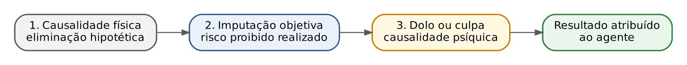
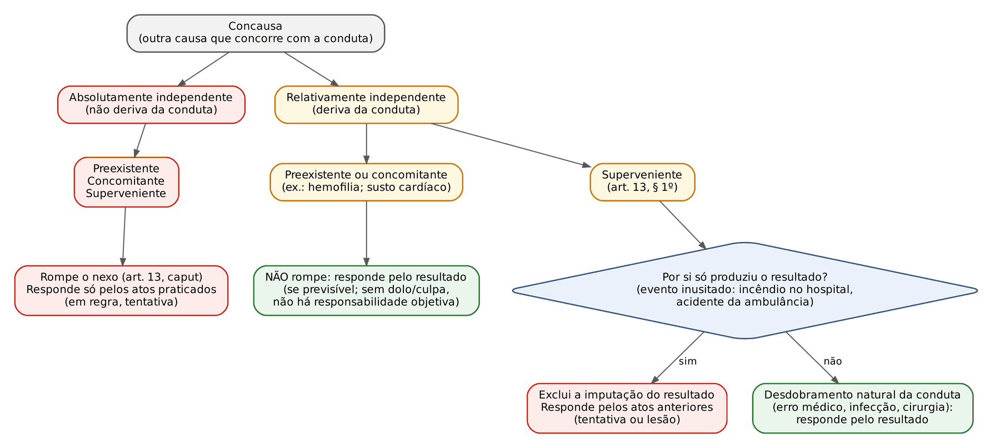
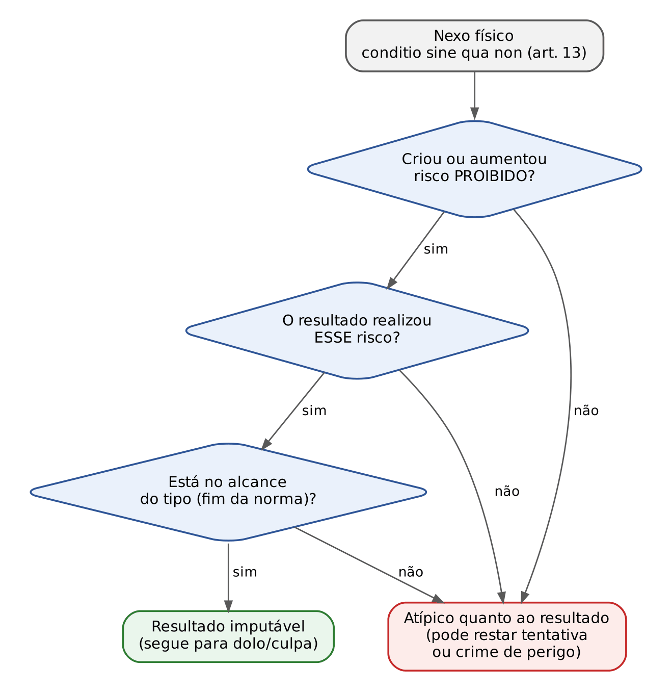
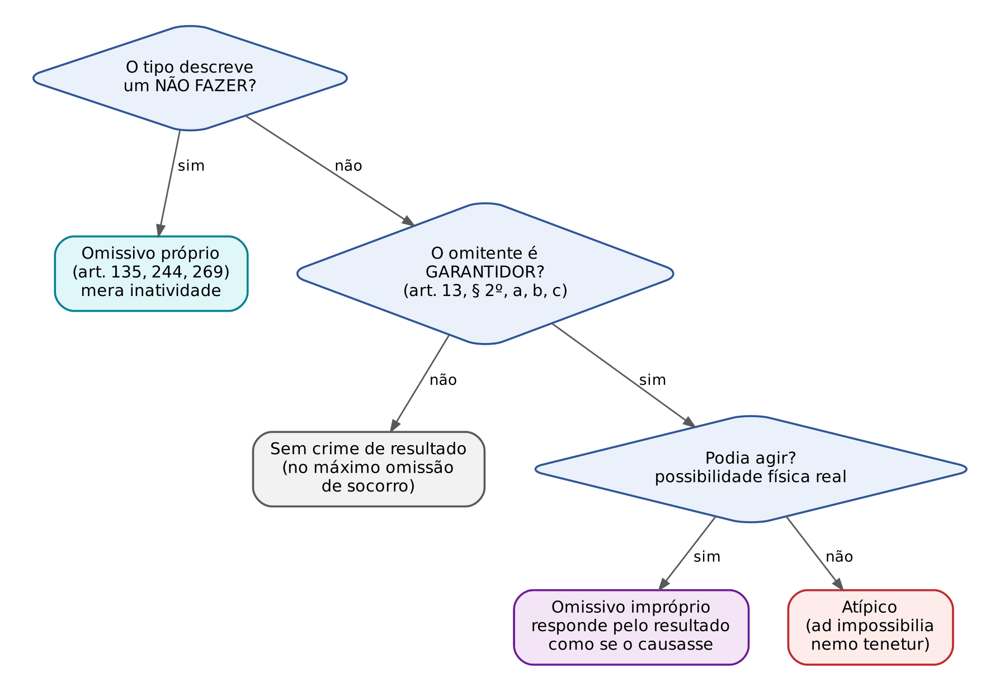

# CAPÍTULO 06 — FATO TÍPICO I: CONDUTA, RESULTADO, NEXO DE CAUSALIDADE, IMPUTAÇÃO OBJETIVA E CRIMES OMISSIVOS

:::INCIDENCIA
TRF5 p. 3; TJRS p. 3; TJSC p. 10. Nível A. Lote: 12 questões (FGV 11, FCC 1).
O que mais cai: caso narrado de concausa superveniente (incêndio no hospital, raio, erro de enfermagem) para decidir entre crime consumado e tentado; critérios da imputação objetiva de Roxin (risco proibido, realização do risco, alcance do tipo); posição de garantidor do art. 13, § 2º.
:::

| Subtema | FGV | FCC | Padrão de cobrança |
|---|---|---|---|
| Concausas e art. 13, § 1º | 4 | 1 | Caso com vítima socorrida que morre por evento posterior: consumado ou tentado? Literalidade do § 1º ("por si só", "os fatos anteriores imputam-se") |
| Imputação objetiva | 5 | 0 | Identificar o raciocínio de Roxin entre teorias vizinhas (Jakobs, Zaffaroni, domínio do fato, teoria social); risco permitido do médico; morte da vítima em fuga |
| Omissão (art. 13, § 2º) | 2 | 0 | Quem é garantidor; omissivo próprio x impróprio; "omissão espúria" |
| Teorias da ação | 1 | 0 | Associar conceito de ação ao autor (alternativa-distratora) |

## 06.1 Onde estamos: o fato típico e os quatro filtros do resultado

No conceito analítico de crime adotado pela maioria (fato típico, ilícito e culpável — ver Cap. 5), o fato típico é o primeiro degrau. Nos crimes materiais ele tem quatro elementos: conduta, resultado naturalístico, nexo de causalidade e tipicidade. Nos crimes formais e de mera conduta bastam conduta e tipicidade, porque não se exige resultado naturalístico para a consumação. Este capítulo trata dos três primeiros elementos e das omissões; a tipicidade propriamente dita, o dolo e a culpa estão no Cap. 7.

Para o leitor que vem do cível, a melhor imagem é a da responsabilidade civil: também lá se pergunta se houve conduta, dano e nexo causal. A diferença está no rigor dos filtros. No penal não basta que o agente tenha "dado causa" em sentido físico; é preciso que o resultado lhe seja atribuível juridicamente e que ele o tenha querido ou devido prever. Por isso a doutrina atual trabalha com filtros sucessivos.

- Filtro 1, causalidade física: a conduta foi condição do resultado? (art. 13, *caput*, teoria da equivalência dos antecedentes).
- Filtro 2, imputação objetiva: a conduta criou um risco proibido, e foi esse risco que se realizou no resultado? (construção doutrinária, ver 6.7; o próprio art. 13, § 1º, já é um filtro normativo para as causas supervenientes).
- Filtro 3, causalidade psíquica: o agente agiu com dolo ou culpa em relação ao resultado? (arts. 18 e 19; Cap. 7). Sem dolo nem culpa não há crime: o Direito Penal brasileiro não admite responsabilidade penal objetiva.

:::DICA
Quase toda questão sobre nexo causal se resolve perguntando, nessa ordem: (1) sem a conduta o resultado teria ocorrido como ocorreu? (2) a causa posterior é desdobramento normal do risco criado ou um evento novo e inusitado? (3) o agente quis ou podia prever o resultado? Se a resposta (2) for "evento novo", o agente responde só pelo que já fez — normalmente tentativa.
:::

## 06.2 Conduta: conceito e teorias da ação

Conduta é o comportamento humano (ação ou omissão) voluntário, dirigido a uma finalidade e exteriorizado. Seus elementos, na leitura finalista majoritária, são: vontade (controle psíquico do movimento ou da inércia), finalidade (direção a um fim), exteriorização (o pensamento não é punível: *cogitationis poenam nemo patitur*) e consciência. Faltando a voluntariedade, não há conduta e, portanto, não há fato típico (ver 6.3).

A pergunta "o que é ação?" gerou as teorias da ação. A banca costuma cobrar a associação entre a definição e o autor, colocando definições de outras teorias como distratoras.

| Teoria | Autores de referência | O que é ação | Dolo e culpa ficam em | Crítica que cai em prova |
|---|---|---|---|---|
| Causal-naturalista (clássica) | Franz von Liszt, Ernst von Beling | Movimento corporal voluntário que causa modificação no mundo exterior | Culpabilidade (teoria psicológica) | Não explica a omissão (inércia não é movimento) nem a tentativa (sem olhar o dolo não se sabe que crime foi tentado) |
| Neokantiana (neoclássica, causal-valorativa) | Edmund Mezger, Reinhard Frank | Comportamento humano voluntário, agora valorado (o tipo passa a ter elementos normativos e subjetivos) | Culpabilidade (psicológico-normativa) | Mantém o núcleo causal; dolo continua fora do tipo |
| Finalista | Hans Welzel | Exercício de atividade final: o homem prevê consequências e dirige o curso causal a um fim ("a finalidade é vidente, a causalidade é cega") | Tipo (dolo natural e culpa); culpabilidade normativa pura | Explica mal a culpa inconsciente e a omissão; prevalece no CP pós-1984 |
| Social | Hans-Heinrich Jescheck, Johannes Wessels | Comportamento humano socialmente relevante, dominado ou dominável pela vontade | Tipo (na versão majoritária) | Vagueza: a "relevância social" é juízo de tipicidade, não de ação |
| Jurídico-penal | Francisco de Assis Toledo (entre nós) | Comportamento humano dominado ou dominável pela vontade, dirigido à lesão ou ao perigo de lesão de um bem jurídico, ou à causação de uma lesão previsível | Tipo | Aproxima-se da social; pouca autonomia |
| Funcionalista teleológica | Claus Roxin | Manifestação da personalidade: tudo o que pode ser atribuído ao ser humano como centro anímico-espiritual | Tipo | Conceito amplo, mais "filtro negativo" do que definição |
| Funcionalista sistêmica | Günther Jakobs | Causação individualmente evitável do resultado (o agente se torna competente por ele) | Tipo | Normativização extrema; ação vira atribuição |
| Negativa | Rolf Herzberg | Não evitação evitável do resultado, estando o agente na posição de garante | Tipo | Une ação e omissão sob a ideia de omissão |
| Significativa | Tomás Vives Antón; entre nós, Paulo César Busato | Não é fato natural, mas sentido: o comportamento significa algo segundo as regras sociais (como um "jogo de linguagem") | Pretensão de relevância e de ilicitude | Pouco difundida em prova; cobrada como "teoria que vê a ação como expressão de sentido" |

:::DOUTRINA Qual teoria o CP adotou?
A posição amplamente majoritária (Bitencourt, Greco, Masson, Cunha) é que a Reforma de 1984 adotou o finalismo: o art. 20 diz que o erro sobre elemento do tipo "exclui o dolo", o que só faz sentido se o dolo estiver no tipo; o art. 18 define o crime doloso e o culposo pela estrutura da conduta. Isso não impede o uso de categorias funcionalistas (imputação objetiva, princípio da confiança) como complemento da tipicidade, que é o que a doutrina e o STJ fazem.
:::

:::QUESTAO FGV 2025 — ENAM 2025.1 (Q3362382)
A FGV pediu o raciocínio próprio da imputação objetiva de Roxin. Gabarito B: o resultado só se imputa ao tipo objetivo se o agente criou perigo para o bem jurídico não coberto por risco permitido. As distratoras eram ideias corretas de outras teorias: finalidade do Direito Penal como preservação da vigência da norma (Jakobs — funcionalismo sistêmico); tipicidade conglobante (Zaffaroni — ver Cap. 7); domínio do fato como possibilidade de continuar ou interromper a execução (teoria do domínio do fato — ver Cap. 11); e ação como conduta socialmente relevante, dominada ou dominável pela vontade (teoria social). Armadilha: todas as alternativas são "verdadeiras" em abstrato; só uma corresponde ao autor e ao instituto pedidos.
:::

## 06.3 Ausência de conduta

Se o movimento corporal não é dominado pela vontade, o ser humano funciona como mera massa mecânica: não há conduta, logo não há fato típico. A consequência prática é forte: o fato é atípico, e não apenas desculpado. As hipóteses clássicas:

| Hipótese | O que é | Exemplo | Efeito | Cuidado |
|---|---|---|---|---|
| Coação física irresistível (*vis absoluta*) | Força física que elimina a vontade do coagido | A, mais forte, segura a mão de B e o obriga a apertar o gatilho | Exclui a conduta de B (atípico para ele); responde quem coagiu, como autor direto | NÃO confundir com coação MORAL irresistível (*vis compulsiva*, art. 22): há conduta, mas exclui a culpabilidade (ver Cap. 10) |
| Atos reflexos | Reação motora automática a estímulo fisiológico, sem passar pelo controle da vontade | Choque elétrico faz o braço atingir terceiro; espirro súbito | Ausência de conduta | Se o reflexo era previsível e o agente se colocou na situação, a conduta relevante é a anterior (culposa ou dolosa) |
| Sonambulismo e hipnose | Estados em que a pessoa age sem consciência | Sonâmbulo derruba vaso sobre visitante | Ausência de conduta (para a hipnose, há quem trate como inimputabilidade; a posição dominante é ausência de ação) | Quem se deixa hipnotizar para cometer o crime responde pela conduta anterior |
| Estados de inconsciência | Desmaio, crise epiléptica, convulsão | Motorista sofre convulsão súbita e atropela pedestre | Ausência de conduta no momento do fato | Epiléptico que, sabendo do risco, dirige sem medicação responde por culpa na conduta de dirigir (a conduta anterior é voluntária) |
| Caso fortuito e força maior | Eventos imprevisíveis ou inevitáveis que fogem ao domínio da vontade | Pneu novo estoura e o carro invade a calçada | Afasta a conduta voluntária ou, na leitura de parte da doutrina, a culpa | Depende de prova; a manutenção deficiente do veículo pode reabrir a culpa |

:::PEGADINHA
Não excluem a conduta: (a) atos automáticos ou habituais (trocar marcha, frear), porque são dominados ou domináveis pela vontade; (b) reações explosivas de "curto-circuito" emocional (o agente agride no calor da discussão), que são conduta e, quando muito, interessam à dosimetria; (c) a embriaguez, ainda que completa, que se resolve na culpabilidade pela *actio libera in causa* (ver Cap. 10). A banca troca "coação física" por "coação moral" para ver se o candidato confunde atipicidade com exclusão da culpabilidade.
:::

:::EXEMPLO Onde está a conduta?
Caio, epiléptico, sabe que está sem medicação há uma semana e tem crises frequentes. Mesmo assim pega o carro, sofre uma crise ao volante e mata um pedestre. No momento do atropelamento não há conduta (convulsão). Mas há conduta anterior voluntária: dirigir sabendo do risco. Essa conduta, violadora do dever de cuidado e com resultado previsível, fundamenta o homicídio culposo na direção de veículo (art. 302 do CTB — ver Cap. 43). Se a crise fosse a primeira da vida de Caio, sem nenhum aviso, não haveria conduta relevante nem culpa: fato atípico.
:::

A responsabilidade penal da pessoa jurídica (que não tem vontade em sentido psicológico) é tratada no Cap. 5.

## 06.4 Resultado: naturalístico e jurídico

A palavra "resultado" tem dois sentidos, e a banca brinca com eles.

| | Resultado naturalístico | Resultado jurídico (normativo) |
|---|---|---|
| Conceito | Modificação no mundo exterior provocada pela conduta, perceptível pelos sentidos | Lesão ou exposição a perigo do bem jurídico protegido |
| Existe sempre? | NÃO. Só nos crimes materiais é exigido para a consumação; nos formais pode ocorrer, mas é dispensável; nos de mera conduta não existe | SIM. Todo crime tem resultado jurídico (princípio da ofensividade — ver Cap. 2) |
| Exemplo | A morte no homicídio; a diminuição patrimonial no furto | No porte de arma (mera conduta), o perigo à incolumidade pública |

O art. 13, *caput*, começa dizendo "o resultado, de que depende a existência do crime". A expressão revela que o nexo de causalidade só tem relevância nos crimes que dependem de resultado naturalístico, isto é, nos crimes materiais (e nos omissivos impróprios, que são sempre crimes de resultado). Nos crimes formais e de mera conduta, a consumação ocorre com a conduta, e a discussão sobre causalidade perde objeto. A classificação completa (material, formal, mera conduta, dano, perigo) está no Cap. 5; os momentos consumativos, no Cap. 8.

:::ATENCAO
Correlata: a FGV cobrou no ENAM 2026.1 (Q4102468) quais crimes se consumam independentemente de resultado naturalístico: formais e de mera conduta. E no ENAM 2025.2 (Q3692427), a alternativa que dizia que nos crimes formais a consumação exige resultado naturalístico estava errada. Ver Cap. 5.
:::

## 06.5 Relação de causalidade: a teoria da equivalência dos antecedentes

:::LEI CP, art. 13, caput e § 1º
Art. 13 - O resultado, de que depende a existência do crime, somente é imputável a quem lhe deu causa. Considera-se causa a ação ou omissão sem a qual o resultado não teria ocorrido.
§ 1º - A superveniência de causa relativamente independente exclui a imputação quando, por si só, produziu o resultado; os fatos anteriores, entretanto, imputam-se a quem os praticou.
:::

### 06.5.1 A regra geral: conditio sine qua non

O *caput* adota a teoria da equivalência dos antecedentes causais (ou da *conditio sine qua non*), formulada por Maximilian von Buri a partir de John Stuart Mill: é causa todo antecedente sem o qual o resultado não teria ocorrido como ocorreu. Todas as condições se equivalem; não se pergunta qual foi a "mais importante".

Para saber se algo é condição, usa-se o procedimento de eliminação hipotética, atribuído ao sueco Thyrén: suprime-se mentalmente o fato; se o resultado desaparece (ou muda), o fato é causa; se o resultado permanece igual, não é.

:::PASSO Eliminação hipotética de Thyrén
1. Liste os antecedentes do resultado concreto (a morte de B, naquele lugar e naquela hora, daquela forma).
2. Suprima mentalmente um antecedente por vez.
3. O resultado, tal como ocorreu, desapareceria? Se sim, é causa. Se não, não é.
4. Para cada antecedente que é causa, passe ao filtro normativo (imputação objetiva e § 1º) e ao filtro subjetivo (dolo ou culpa).
:::

:::EXEMPLO Thyrén aplicado
A quer matar B. Compra o revólver na loja de C, toma café na padaria de D, vai até a casa de B e atira. B morre.
- Suprimir o disparo de A: B não morre naquele momento. O disparo é causa.
- Suprimir a venda da arma por C: sem aquela arma, aquele disparo não existiria. A venda é causa (física).
- Suprimir o café na padaria: A atiraria do mesmo modo. O café não é causa.
- Os pais de A (que o geraram) também são causa no plano físico: é o famoso "regresso ao infinito".
Conclusão: no plano físico, A, C e os pais de A são causa. Quem resolve o excesso não é a causalidade, mas os filtros seguintes: C e os pais não agiram com dolo nem culpa em relação à morte (filtro psíquico); e vender arma de forma regular é risco permitido (filtro da imputação objetiva — ver 6.7).
:::

A crítica clássica à equivalência é justamente o regresso ao infinito (*regressus ad infinitum*). A doutrina tradicional responde que o limite está no dolo e na culpa (causalidade psíquica). A doutrina moderna acrescenta a imputação objetiva, que corta antes, ainda no tipo objetivo.

### 06.5.2 Casos-limite da fórmula

- Causalidade alternativa (ou dupla causalidade): A e B, sem saber um do outro, colocam cada um dose letal de veneno no café de C, que morre. Suprimida a dose de A, C morre pela dose de B, e vice-versa: a fórmula de Thyrén diria que nenhuma é causa, o que é absurdo. A solução majoritária é corrigir a fórmula (eliminação global: suprimidas ambas, o resultado desaparece) e imputar o homicídio consumado aos dois.
- Autoria colateral e autoria incerta: dois atiradores sem liame subjetivo; se se sabe qual tiro matou, um responde por homicídio consumado e o outro por tentativa; se não se sabe, ambos por tentativa (*in dubio pro reo*). O tema é do Cap. 11.
- Causa hipotética ou de reserva: A mata C com um tiro minutos antes de C embarcar num avião que vai cair. A é causa da morte concreta (o resultado se considera como ocorreu, com suas circunstâncias de tempo e modo), e o curso causal hipotético é irrelevante.

### 06.5.3 Outras teorias da causalidade

| Teoria | Ideia | Onde aparece no CP |
|---|---|---|
| Equivalência dos antecedentes (*conditio sine qua non*) | Toda condição é causa | Regra geral (art. 13, *caput*) |
| Causalidade adequada (Johannes von Kries) | Causa é só a condição idônea, segundo a experiência comum, a produzir o resultado; cursos anômalos não são causa | Exceção: art. 13, § 1º (concausa superveniente que "por si só" produz o resultado) |
| Relevância jurídica (Mezger) | Entre as condições, só importam as juridicamente relevantes à luz do tipo | Precursora da imputação objetiva; sem previsão expressa |
| Imputação objetiva (Roxin, Jakobs) | Não é teoria da causalidade, mas da imputação: acrescenta critérios normativos à causalidade física | Construção doutrinária e jurisprudencial (ver 6.7) |

:::DICA Ponte com o Direito Civil
No cível, a causalidade é a do dano direto e imediato ou da causalidade adequada (art. 403 do CC), justamente para limitar a indenização. O STJ reafirmou essa diferença ao julgar caso de infecção hospitalar em recém-nascido prematuro, observando que a equivalência dos antecedentes é a teoria do Direito Penal (STJ, REsp 2.069.914/DF, 4ª Turma, Rel. Min. Marco Buzzi, j. 6/6/2023, Info 778). No penal, o ponto de partida é o inverso do cível: a causalidade é amplíssima, e quem restringe são o § 1º, a imputação objetiva e o dolo ou a culpa.
:::

## 06.6 Concausas: absolutamente e relativamente independentes

Concausa é qualquer causa que concorre com a conduta do agente para o resultado. Classificam-se por dois critérios combinados:

- Quanto à origem: absolutamente independente (tem origem totalmente diversa da conduta; aconteceria do mesmo jeito sem ela) ou relativamente independente (só produz o resultado porque se somou à conduta; deriva dela ou com ela se combina).
- Quanto ao momento: preexistente (antes da conduta), concomitante (ao mesmo tempo) ou superveniente (depois).

| Espécie | Exemplo clássico | Solução | Fundamento |
|---|---|---|---|
| Absolutamente independente preexistente | A dá um tiro em B, que morre não pelo tiro, mas por veneno que C lhe dera horas antes | A responde por tentativa de homicídio | Eliminada a conduta de A, B morreria igual: não é causa (art. 13, *caput*) |
| Absolutamente independente concomitante | A envenena B; no mesmo instante, um lustre despenca e mata B por traumatismo | A responde por tentativa | Idem |
| Absolutamente independente superveniente | A envenena B; antes de o veneno agir, C mata B a tiros | A responde por tentativa; C, por homicídio consumado | Idem |
| Relativamente independente preexistente | A dá um golpe de faca leve em B, hemofílico, que morre de hemorragia | A responde pelo resultado morte, SE conhecia a hemofilia ou ela era previsível (ver abaixo) | Sem o golpe, B não morreria: há nexo (art. 13, *caput*); o filtro é o dolo ou a culpa |
| Relativamente independente concomitante | A atira em B; no exato momento, B sofre um infarto fulminante provocado pelo susto | A responde por homicídio consumado (se tinha dolo de matar) | Há nexo físico; o susto é desdobramento previsível do ataque |
| Relativamente independente superveniente que NÃO produz por si só o resultado | A esfaqueia B; B morre durante a cirurgia necessária para tratar a facada, ou por infecção do ferimento | A responde pelo resultado (homicídio consumado) | O evento posterior está na linha de desdobramento natural da conduta |
| Relativamente independente superveniente que POR SI SÓ produz o resultado | A atira em B; a ambulância que leva B ao hospital capota e B morre do acidente; ou o hospital pega fogo e B morre queimado | A responde só pelos atos praticados (tentativa de homicídio, ou lesão corporal se não havia dolo de matar) | Art. 13, § 1º: o evento é inusitado, rompe a linha de desdobramento (causalidade adequada) |

:::ATENCAO Hemofilia e a vedação da responsabilidade objetiva
O exemplo da hemofilia é cobrado de forma simplificada ("responde pelo resultado"). A forma correta de raciocinar é em duas etapas: (1) há nexo causal, porque a concausa preexistente relativamente independente não rompe a causalidade; (2) o resultado só é atribuído se coberto pelo dolo ou pela culpa. Se A queria matar, homicídio consumado. Se A queria apenas ferir e a hemofilia era conhecida ou previsível, lesão corporal seguida de morte (art. 129, § 3º — preterdolo, ver Cap. 7). Se A queria ferir e a doença era absolutamente imprevisível, responde só pela lesão, pois o art. 19 exige ao menos culpa no resultado agravador.
:::

### 06.6.1 O ponto central: o que significa "por si só"

A expressão "por si só" não quer dizer que a causa superveniente seja totalmente independente (se fosse, seria absolutamente independente e resolvida pelo *caput*). Significa que, embora o evento posterior só tenha acontecido porque a vítima foi colocada naquela situação pela conduta (estava na ambulância ou no hospital por causa do tiro), ele não é consequência normal e previsível daquele tipo de agressão. É um risco novo, que a conduta não criou, e que sozinho produziu o resultado. A doutrina resume: rompe o nexo o que está fora da "linha de desdobramento físico ou anatomopatológico" da conduta.

| Rompe o nexo (responde por tentativa ou pelos atos anteriores) | NÃO rompe (responde pelo resultado) |
|---|---|
| Acidente com a ambulância | Complicação da cirurgia necessária para tratar o ferimento |
| Incêndio, desabamento ou inundação do hospital | Infecção do próprio ferimento (posição dominante na doutrina) |
| Morte por raio, temporal ou ataque de terceiro na via | Broncopneumonia decorrente da imobilização prolongada causada pela lesão |
| Erro grosseiro e alheio ao tratamento da lesão (ex.: troca de medicamento que causa choque anafilático, na leitura da FGV) | Erro médico na própria intervenção exigida pela lesão (há divergência: parte da doutrina vê aí causa que rompe o nexo) |

:::DOUTRINA Infecção hospitalar e erro médico
A doutrina majoritária (Greco, Masson, Cunha) considera a infecção hospitalar desdobramento normal do ferimento que obrigou a internação: o agente responde pelo resultado. Há posição minoritária que vê na infecção hospitalar, sobretudo quando decorrente de falha grave do hospital, causa que por si só produz o resultado. Quanto ao erro médico, o critério mais seguro é o da imputação objetiva: se o erro está dentro do risco típico criado pela lesão (a cirurgia era necessária e deu errado), o resultado continua sendo obra do agressor; se o erro cria risco completamente novo e alheio (aplicar medicamento trocado, sem relação com a lesão), o resultado passa a ser obra de quem errou, e o agressor responde pelo que já fez. Na prova objetiva, siga o enunciado: a FGV tem tratado a troca de medicação como causa que por si só produz o resultado (Q2386992, abaixo).
:::

:::QUESTAO FGV 2026 — TJ-BA — Juiz Substituto (Q4083749)
Com intenção de matar, o agente atira e, por erro de pontaria, atinge a vítima em região não letal; ela é levada ao hospital e morre num incêndio do nosocômio. Gabarito A: homicídio tentado. O incêndio é causa superveniente relativamente independente que por si só produziu o resultado (art. 13, § 1º): a vítima só estava ali por causa do tiro, mas morrer queimada não é desdobramento de um ferimento não letal. Armadilha: alternativas de homicídio qualificado (nada no enunciado indica qualificadora) e de homicídio consumado (ignora o § 1º). Embora o tema da questão seja classificado como "causas absolutamente independentes", a classificação correta do incêndio é a de concausa RELATIVAMENTE independente superveniente; o resultado prático (tentativa) é o mesmo.
No mesmo sentido: FGV 2024 — TJ-RJ — Residência (Q2375303): a vítima, baleada e caída, é atingida por um raio e morre. Gabarito B: a causa superveniente produziu por si só o resultado, afastando a responsabilidade pela morte e subsistindo a tentativa. Doutrinariamente, o raio pode ser lido como causa absolutamente independente (cairia de qualquer modo) ou relativamente independente (a vítima estava caída ali por causa do tiro); em ambas as leituras o agente responde por tentativa. Erradas: a alternativa que mandava responder pelo resultado "se o tiro mataria de qualquer maneira" (causa hipotética não substitui a causa real) e a que excluía toda responsabilidade (os atos anteriores imputam-se a quem os praticou).
:::

:::QUESTAO FGV 2024 — TJ-SC — Juiz Substituto (Q2386992)
Agressora desfere facadas na namorada com intenção de matar, por inconformismo com o fim do relacionamento; a vítima é hospitalizada e morre porque o enfermeiro, por descuido, troca a medicação e lhe aplica substância que provoca choque anafilático. Gabarito B: tentativa de feminicídio para a agressora e homicídio culposo para o enfermeiro. A troca de medicamento é risco novo, alheio às facadas, que por si só produziu a morte (art. 13, § 1º); o enfermeiro, por negligência, causou a morte (art. 121, § 3º). Armadilhas: responder por feminicídio consumado (ignora o § 1º); imputar dolo ao enfermeiro (o enunciado diz "por descuido"); desclassificar para lesão corporal (a agressora tinha dolo de matar).
Atualização: desde a Lei 14.994/2024 (vigente a partir de 10/10/2024), o feminicídio é crime autônomo (art. 121-A do CP, reclusão de 20 a 40 anos), e não mais qualificadora do art. 121. Hoje a capitulação seria art. 121-A c/c art. 14, II, do CP (ver Cap. 27).
:::

:::QUESTAO FGV 2024 — TJ-MT — Oficial de Justiça (Q3114511)
Questão de literalidade do art. 13. Gabarito E: a omissão é penalmente relevante quando o omitente tinha o dever e a possibilidade de agir para evitar o resultado (paráfrase fiel do § 2º). As demais adulteravam o texto: diziam que a causa superveniente relativamente independente NÃO exclui a imputação quando por si só produz o resultado (inverte o § 1º); que exclui a imputação dos fatos anteriores (o § 1º diz o contrário); que causa é só a "ação" (o *caput* diz "ação ou omissão"); e que a concausa absolutamente independente não exclui a relação de causalidade (exclui, pelo *caput*).
No mesmo sentido: FCC 2025 — DPE-RS — Defensor Público (Q3387029), gabarito D: havendo superveniência de causa relativamente independente que por si só produziu o resultado, exclui-se a imputação, mas o agente responde pelos fatos anteriores. As demais alternativas dessa questão são tratadas em 6.7 e 6.8.
:::

:::EXEMPLO O que está em jogo na pena: consumado x tentado
Homicídio simples (art. 121, *caput*): reclusão de 6 a 20 anos. Suponha pena-base e intermediária no mínimo legal, 6 anos.
- Se a concausa NÃO rompe o nexo: homicídio consumado, pena de 6 anos (regime inicial semiaberto, pelo art. 33, § 2º, b, se primário).
- Se a concausa rompe o nexo (§ 1º): homicídio tentado. Na terceira fase, a pena diminui de 1/3 a 2/3 (art. 14, parágrafo único), conforme o caminho percorrido no *iter criminis* (ver Cap. 8 e Cap. 15).
  - Redução máxima (2/3): 6 anos = 72 meses; 72 ÷ 3 = 24 meses; 72 − 48 = 24 meses = 2 anos.
  - Redução mínima (1/3): 72 ÷ 3 = 24 meses; 72 − 24 = 48 meses = 4 anos.
- Numa tentativa cruenta em que a vítima chegou a ser internada com ferimento grave, a tendência é a redução mínima (iter quase completo): 4 anos, o que permite regime inicial aberto ao réu não reincidente (art. 33, § 2º, c); a substituição por restritivas de direitos, porém, é vedada pela violência à pessoa (art. 44, I; ver Cap. 17).
A diferença entre "consumado" e "tentado" pode, portanto, ser de 6 anos para 2 a 4 anos. Por isso a tese de concausa superveniente é a principal defesa técnica nesses casos.
:::

:::PROCESSO
A prova do nexo causal nos crimes que deixam vestígios é pericial: exame de corpo de delito, direto ou indireto, indispensável e não suprível pela confissão (art. 158 do CPP), normalmente o laudo de exame cadavérico com a causa da morte. Quando a defesa alega concausa (infecção, erro médico), o ponto se resolve com quesitos ao perito sobre a causa *mortis* e sua relação com a lesão inicial. No Júri, a quesitação separa a materialidade e a letalidade (se os ferimentos causaram a morte) da autoria (art. 483 do CPP); a tese de causa superveniente que por si só produziu o resultado é apresentada nesse ponto, e, afastado o nexo, os jurados apreciam a tentativa.
:::

:::SENTENCA Como a concausa aparece na sentença
Onde entra: na fundamentação do mérito, após a materialidade e antes da autoria ou junto dela (tópico "do nexo causal" ou "da tipificação"). O que fundamentar: (1) qual foi a causa *mortis* segundo o laudo; (2) se a causa posterior está na linha de desdobramento da conduta ou é evento novo; (3) a consequência (consumação ou tentativa), com a capitulação correta (art. 121 c/c art. 14, II).
Redação-modelo: "O laudo cadavérico atesta que a vítima faleceu em razão de queimaduras sofridas no incêndio do hospital, e não do ferimento produzido pelo disparo, que não atingiu órgão vital. Trata-se de causa superveniente relativamente independente que, por si só, produziu o resultado (art. 13, § 1º, do CP), razão pela qual o réu responde pelos atos praticados, isto é, pelo homicídio na forma tentada."
Erro comum punido: condenar por crime consumado apenas porque "sem o tiro a vítima não estaria no hospital" (aplicação pura da *conditio*, esquecendo o § 1º); ou, no extremo oposto, absolver, esquecendo que os fatos anteriores continuam imputáveis.
:::

## 06.7 Imputação objetiva

### 06.7.1 Para que serve e onde se encaixa

A teoria da imputação objetiva não substitui a causalidade: ela a pressupõe e acrescenta um juízo normativo. Pergunta não "quem causou?", mas "a quem se pode atribuir juridicamente este resultado como obra sua?". Sua função é restringir o tipo objetivo, eliminando já ali (antes do dolo e da culpa) resultados que, embora causados fisicamente, não são expressão de um risco proibido criado pelo agente. Resultado prático: o fato é atípico quanto ao resultado. Atenção: se havia dolo, pode subsistir tentativa; e pode subsistir crime de perigo.

A teoria tem raízes em Karl Larenz e Richard Honig, mas a versão cobrada é a de Claus Roxin (a partir de 1970), com a variante de Günther Jakobs. No Brasil, não há previsão legal expressa; a doutrina a aceita como complemento da tipicidade, e o STJ a aplica em casos pontuais.

### 06.7.2 Roxin: os três níveis

| Nível | Pergunta | Exclui a imputação quando... | Exemplo |
|---|---|---|---|
| 1. Criação de risco não permitido | A conduta criou ou aumentou um risco juridicamente proibido para o bem jurídico? | (a) há diminuição do risco | A desvia a pedra que atingiria a cabeça de B, que é atingido no ombro: A diminuiu o risco, não há lesão imputável |
| | | (b) o risco é juridicamente irrelevante (ausência de risco relevante) | Sobrinho convence o tio rico a passear na floresta durante tempestade, esperando que um raio o mate; o raio mata. Mandar alguém passear não cria risco juridicamente relevante |
| | | (c) o risco é permitido | Dirigir dentro das regras; o médico que opera segundo a *lex artis*; o atleta que aplica golpe permitido pelas regras do esporte; vender arma regularmente |
| 2. Realização do risco no resultado | Foi exatamente ESSE risco proibido que se concretizou no resultado? | (a) curso causal anômalo ou imprevisível | A fere B, que morre no acidente da ambulância: o risco criado (ferimento) não é o que se realizou (acidente de trânsito) |
| | | (b) o resultado está fora do fim de proteção da norma de cuidado | Dois ciclistas andam à noite sem farol; o da frente colide com outro ciclista que vinha em sentido contrário. A norma que exige farol protege o próprio ciclista, não visa evitar acidentes de terceiros causados por outro |
| | | (c) comportamento alternativo conforme o direito: o resultado ocorreria mesmo com a conduta correta | Caminhoneiro ultrapassa ciclista a distância menor que a regulamentar; o ciclista, embriagado, cai sob as rodas, e a perícia indica que cairia mesmo com distância correta |
| 3. Alcance do tipo (âmbito de proteção do tipo) | O tipo penal se destina a impedir esse resultado, nessas circunstâncias? | (a) autocolocação dolosa em risco pela vítima | A entrega heroína a B, adulto e consciente, que se injeta e morre por overdose: o risco foi assumido pela própria vítima (o fornecimento pode configurar outro crime, como tráfico, mas o homicídio não é imputável) |
| | | (b) heterocolocação consentida em risco, quando equiparável à autocolocação | Passageiro insiste que o motorista acelere em estrada perigosa; ambos sabem do risco, o passageiro o controla tanto quanto o motorista |
| | | (c) atribuição a âmbito de responsabilidade alheio | Bombeiro morre ao combater incêndio culposamente provocado por A: o risco profissional é do âmbito do bombeiro e do Estado, não de A |

:::DOUTRINA Comportamento alternativo conforme o direito: evitabilidade x incremento do risco
No exemplo do caminhoneiro, há duas soluções. Pela teoria da evitabilidade (majoritária na Alemanha e no Brasil), se é certo ou provável que o resultado ocorreria mesmo com a conduta correta, não há imputação (*in dubio pro reo*). Pela teoria do incremento do risco, defendida por Roxin, basta que a conduta proibida tenha aumentado o risco em relação à conduta permitida; a dúvida não aproveita ao agente. Em prova, a resposta segura é: se o resultado se verificaria mesmo com a observância do cuidado devido, NÃO há imputação.
Correlata: FGV 2024 — CGM-BH (Q2387541), cuja alternativa D dizia que, pela imputação objetiva, o agente é punido por culpa ainda que o evento se verificasse com a diligência devida — errada, exatamente por esse motivo (tema central da questão: dolo e culpa, Cap. 7).
:::

:::QUESTAO FGV 2026 — ENAM 2026.1 (Q4102462)
Médico, em cirurgia de emergência, segue todos os protocolos e a *lex artis*; o paciente morre de complicação rara e imprevisível. Gabarito A: a conduta criou risco juridicamente permitido, e o resultado decorrente de complicação imprevisível não lhe pode ser imputado. Armadilhas: (B) "risco não permitido, mas socialmente tolerado" (contraditório: o que exclui é ser permitido); (C) "risco relevante, mas resultado fora do âmbito de proteção da norma" (pula a etapa decisiva: o risco já era permitido); (D) responsabilizar pela equivalência dos antecedentes (confunde causalidade física com imputação); (E) estado de necessidade (a questão é de tipicidade; não se chega à ilicitude).
Em sintonia, o STJ, em caso de lesão atribuída a médico em parto de urgência, afirmou que a decisão médica tomada em contexto de urgência, necessária para a segurança da parturiente e do recém-nascido, deve ser respeitada, deixando a discussão para a esfera civil (STJ, 5ª Turma, processo em segredo de justiça, Rel. p/ acórdão Min. Joel Ilan Paciornik, j. 27/8/2024, Informativo de Jurisprudência n. 24 — Edição Extraordinária).
:::

:::QUESTAO FGV 2025 — TJ-MS — Juiz Substituto (Q3786376)
O agente, com intenção de matar, atira contra duas pessoas e as encurrala junto a uma avenida movimentada. Uma delas, fugindo dos disparos, atravessa sem cautela e morre atropelada. Depois de quatro disparos sem acertar ninguém, o agente para voluntariamente de atirar; a outra vítima sofre parada cardiorrespiratória e morre imediatamente. Gabarito B: responde pela morte do que fugiu, de forma consumada, pela imputação objetiva. O raciocínio: o ataque armado criou risco proibido; a fuga desesperada da vítima, inclusive atravessando a avenida, é reação previsível e está dentro do risco criado (não é autocolocação livre em risco, porque a vítima não escolheu se arriscar: foi forçada pelo ataque). Logo o atropelamento é realização do risco.
Quanto à segunda vítima, as alternativas eram todas inadequadas: a de homicídio consumado "pela causalidade adequada" usa teoria que o CP só adota para a causa superveniente (aqui a concausa é concomitante); a de "homicídio tentado por desistência voluntária" contradiz a própria desistência, cujo efeito é responder só pelos atos já praticados (art. 15 — ver Cap. 8). A banca não exigiu definir a responsabilidade pela segunda morte; numa sentença, ela demandaria prova pericial do nexo entre o ataque e a parada cardíaca e da previsibilidade (ver nota de verificação).
:::

### 06.7.3 Jakobs: imputação objetiva do comportamento

Jakobs parte de outra premissa: o Direito Penal protege a vigência da norma, e cada pessoa ocupa papéis sociais (motorista, padeiro, médico) com expectativas definidas. Só responde quem viola o seu papel. Seus quatro institutos:

| Instituto | Ideia | Exemplo |
|---|---|---|
| Risco permitido | Contatos sociais arriscados mas tolerados pela sociedade não geram imputação | Tráfego viário; atividades industriais regulamentadas |
| Princípio da confiança | Quem age corretamente pode confiar que os demais também agirão corretamente | Motorista que avança no sinal verde confia que o outro parará no vermelho; cirurgião confia na esterilização feita pela equipe (o princípio é desenvolvido no Cap. 7, a propósito da culpa) |
| Proibição de regresso | Quem pratica conduta estereotipada, inócua e própria do seu papel não responde pelo uso criminoso que outro faz dela | O taxista que leva o passageiro ao local onde ele comete um crime; o padeiro que vende pão que o cliente envenena |
| Competência (ou capacidade) da vítima | A vítima que se coloca em risco ou consente responde pelo que lhe acontece; também os infortúnios são da vítima | Quem participa voluntariamente de atividade perigosa |

:::PEGADINHA Ações neutras não são "sempre" atípicas
Ações neutras (cotidianas, profissionais) que contribuem para o crime de outrem, como vender ferramenta, transportar, prestar serviço bancário, em regra não são puníveis (proibição de regresso). Mas essa é uma regra com exceções: para Roxin, se o vendedor sabe que o comprador vai usar o objeto para cometer o crime (conhece a decisão criminosa), a ação perde o sentido neutro e pode ser participação punível. Por isso é FALSO dizer que a participação por ações neutras é sempre atípica (Q4289362, abaixo).
:::

:::QUESTAO FGV 2026 — DPE-RJ — Defensor Público (Q4289362)
Três afirmativas sobre funcionalismo e imputação objetiva. Gabarito E (V – V – F). (I) Verdadeira: a imputação objetiva não abandonou os elementos do tipo comissivo doloso do finalismo (conduta, resultado, nexo, dolo), mas lhes acrescentou os critérios do risco. (II) Verdadeira: apesar das variantes, há três elementos comuns, que são criação ou aumento de risco, proibição do risco e realização do risco no resultado. (III) Falsa: a participação por ações neutras NÃO é "sempre" atípica (ver PEGADINHA acima). Armadilha: o advérbio absoluto na terceira assertiva.
No mesmo sentido: FGV 2025 — ENAM 2025.2 (Q3692427), gabarito D: a imputação objetiva exige que a conduta tenha criado risco proibido relevante e que o resultado esteja dentro do alcance da norma. As erradas: crime formal exigir resultado naturalístico (ver 6.4); omissivo próprio depender de dolo específico (ver 6.8); erro de tipo inevitável permitir punição culposa (o inevitável exclui dolo e culpa — Cap. 7); crime impossível ser tentativa punível (art. 17 — Cap. 8). Observação técnica: a alternativa D fala em requisitos "para a configuração do nexo causal"; a rigor, a imputação objetiva não integra o nexo físico, mas o complementa (nexo normativo). A banca usou "nexo causal" em sentido amplo.
:::

:::QUESTAO FCC 2025 — DPE-RS — Defensor Público (Q3387029), alternativa B
Na mesma questão do art. 13, § 1º (gabarito D, ver 6.6), a alternativa B dizia que, pela imputação objetiva, "na qual o nexo de causalidade é relativizado", o vendedor que vende legalmente arma de fogo pode responder pelo homicídio posterior se sabia da intenção do comprador, porque "assumiu um risco juridicamente relevante". Foi considerada errada. Fundamento mais seguro: a imputação objetiva não relativiza o nexo causal (acrescenta filtro normativo), e o fundamento da eventual punição do vendedor que conhece o plano não é "assumir risco", mas a participação dolosa no crime alheio (art. 29 — ver Cap. 11). O tema é controvertido, e a alternativa mistura conceitos; na dúvida, a banca considerou certa a literalidade do § 1º.
:::

### 06.7.4 Imputação objetiva x causalidade adequada x imputação subjetiva

| | Causalidade adequada | Imputação objetiva | Dolo e culpa |
|---|---|---|---|
| Natureza | Teoria causal (filtra causas pela experiência) | Teoria normativa de atribuição | Elemento subjetivo do tipo |
| Pergunta | A condição era idônea a produzir o resultado? | O risco era proibido e foi ele que se realizou, dentro do alcance do tipo? | O agente quis ou podia prever o resultado? |
| No CP | Art. 13, § 1º (só para causa superveniente) | Sem previsão expressa | Arts. 18 e 19 |
| Efeito | Exclui a imputação do resultado (subsiste o que já foi feito) | Atipicidade objetiva quanto ao resultado | Atipicidade (ou desclassificação para culposo) |

A grande vantagem prática da imputação objetiva aparece nos crimes culposos, em que não há dolo para filtrar: é ela que explica por que o fabricante regular de automóveis não responde por todos os acidentes, ou por que o médico que seguiu a *lex artis* não responde pela complicação imprevisível.

:::JURIS STJ, HC 46.525/MT, 5ª Turma
Caso da morte de estudante afogado em piscina durante festa universitária, após consumir drogas e ser jogado na água por colegas; denunciados os organizadores por homicídio culposo. O STJ trancou a ação penal: ainda que se admitisse o nexo físico, não se pode imputar o resultado a quem não criou risco proibido, e a vítima teve comportamento que fugia ao esperado (autocolocação em risco e confiança), além da inépcia da denúncia genérica (art. 41 do CPP). É o precedente mais citado de aplicação expressa da imputação objetiva pelo STJ.
:::

:::SENTENCA Imputação objetiva na sentença
Onde entra: no exame da tipicidade, antes do dolo ou da culpa; aparece sobretudo em crimes culposos (trânsito, erro médico, acidentes de trabalho) e em teses defensivas de autocolocação em risco. Fundamente com fatos: qual norma de cuidado foi violada, por que o resultado é a realização desse risco, por que não há conduta alternativa lícita que evitaria o resultado.
Redação-modelo (absolvição): "Ainda que a conduta do acusado integre a cadeia causal, a perícia demonstra que o procedimento observou os protocolos técnicos aplicáveis, de modo que não houve criação de risco juridicamente desaprovado. Ausente a imputação objetiva do resultado, o fato é atípico (art. 386, III, do CPP)."
Erro comum: tratar a imputação objetiva como excludente de ilicitude ou de culpabilidade; o fundamento absolutório correto é a atipicidade (art. 386, III, do CPP).
:::

## 06.8 Crimes omissivos

### 06.8.1 A omissão causa alguma coisa?

Fisicamente, não: do nada, nada surge (*ex nihilo nihil fit*). Quem fica parado diante do afogamento não "empurra" a vítima para o fundo. Por isso o CP adotou a teoria normativa da omissão: a omissão só é penalmente relevante quando o Direito impõe um dever de agir e o omitente, podendo, não age. O nexo, aqui, não é físico, mas normativo (ou "nexo de evitação"): pergunta-se se a ação devida, caso realizada, teria evitado o resultado. É um juízo hipotético inverso ao de Thyrén: em vez de suprimir mentalmente a conduta, acrescenta-se mentalmente a ação omitida.

:::LEI CP, art. 13, § 2º
§ 2º - A omissão é penalmente relevante quando o omitente devia e podia agir para evitar o resultado. O dever de agir incumbe a quem:
a) tenha por lei obrigação de cuidado, proteção ou vigilância;
b) de outra forma, assumiu a responsabilidade de impedir o resultado;
c) com seu comportamento anterior, criou o risco da ocorrência do resultado.
:::

### 06.8.2 Omissivos próprios x omissivos impróprios

| | Omissivo próprio (puro) | Omissivo impróprio (comissivo por omissão, impuro, espúrio ou promíscuo) |
|---|---|---|
| Onde está a omissão | No próprio tipo penal, que descreve um "não fazer" (deixar de prestar, deixar de comunicar, deixar de recolher) | Não está no tipo: o tipo descreve um fazer com resultado (matar, lesionar), e o art. 13, § 2º, estende a punição a quem, sendo garantidor, não impediu o resultado (tipicidade por norma de extensão — adequação típica mediata) |
| Sujeito ativo | Qualquer pessoa a quem o tipo se dirige (crime comum, em regra) | Somente o garantidor (crime próprio) |
| Resultado naturalístico | Dispensado: crime de mera conduta (a ocorrência do resultado pode ser majorante, como no art. 135, parágrafo único) | Exigido: o garantidor responde pelo resultado como se o tivesse causado por ação |
| Tentativa | NÃO admite (crime unissubsistente: ou se omite, ou não) | Admite (a mãe deixa de alimentar o bebê para matá-lo; vizinhos socorrem a criança: tentativa de homicídio) |
| Modalidade culposa | Em regra, não | Admite (a babá distraída que deixa a criança se afogar responde por homicídio culposo) |
| Exemplos | Omissão de socorro (art. 135), abandono material (art. 244), omissão de notificação de doença (art. 269), apropriação indébita previdenciária (art. 168-A) | Homicídio, lesão, estupro de vulnerável praticados por omissão do garantidor |

:::ATENCAO Terminologia que a FGV usa
"Omissivo espúrio", "promíscuo", "impuro" e "comissivo por omissão" são sinônimos de omissivo IMPRÓPRIO. Não confundir com:
- Crime omissivo por comissão: o agente, por ação, impede que outrem pratique a ação devida (ex.: A destrói o telefone para que B não chame a ambulância). Figura doutrinária, de pouca autonomia.
- Crime de conduta mista: o tipo combina ação e omissão (apropriação de coisa achada, art. 169, parágrafo único, II: achar a coisa e deixar de restituí-la no prazo).
:::

:::QUESTAO FGV 2024 — MPE-GO — Promotor de Justiça Substituto (Q2367575)
Três assertivas. Gabarito D (apenas II). (I) Falsa: chamou de "omissivo espúrio" o crime em que a omissão está descrita no tipo e que não admite tentativa nem forma culposa; essa é a descrição do omissivo PRÓPRIO; o espúrio é o impróprio. (II) Verdadeira, segundo a banca: o agente esfaqueia a vítima para matá-la e, em seguida, dispara na cabeça para assegurar o resultado; a banca qualificou o homicídio como exemplo de crime de passagem, aquele em que, para atingir o crime mais grave, o agente passa necessariamente pela lesão menos grave (classificação e consunção: ver Caps. 3 e 5). (III) Falsa: dizia que o dever de agir se origina "somente" da lei e da assunção de responsabilidade, omitindo a ingerência (alínea c). Armadilha: o advérbio "somente" e a troca de rótulos.
:::

O dolo do omissivo próprio é genérico: basta a consciência da situação típica e a vontade de não agir. A alternativa que exigia "dolo específico" para a relevância penal da omissão própria foi considerada errada pela FGV (Q3692427, ver 6.7.3). No mesmo sentido, o STJ afirma que a apropriação indébita previdenciária, crime omissivo próprio, dispensa dolo específico (Jurisprudência em Teses, ed. 87, tese 7); o crime em si, inclusive sua natureza material para fins de consumação, é tratado no Cap. 30.

### 06.8.3 Estrutura do omissivo impróprio: os cinco requisitos

Para condenar alguém por crime comissivo por omissão, a sentença precisa demonstrar, um a um:

1. Situação típica: perigo concreto para o bem jurídico (a criança está se afogando; o filho está sendo abusado).
2. Posição de garantidor: o omitente se enquadra numa das alíneas do § 2º.
3. Poder agir: possibilidade física real de agir (estava presente, sabia do perigo, tinha meios). Ninguém é obrigado ao impossível (*ad impossibilia nemo tenetur*). O garantidor não pode, porém, invocar o perigo inerente à sua função (art. 24, § 1º: não pode alegar estado de necessidade quem tinha o dever legal de enfrentar o perigo — ver Cap. 9).
4. Evitabilidade (nexo de evitação): a ação devida teria evitado o resultado com probabilidade próxima da certeza. Se houver dúvida razoável de que a ação salvaria a vítima, o resultado não se imputa (*in dubio pro reo*); se havia dolo, pode subsistir tentativa.
5. Dolo ou culpa: o garantidor quer ou aceita o resultado (homicídio doloso por omissão) ou não o evita por descuido previsível (homicídio culposo por omissão).

### 06.8.4 As três fontes do dever de garantidor

| Alínea | Fonte | Exemplos | Cuidado |
|---|---|---|---|
| a) Dever legal | Obrigação de cuidado, proteção ou vigilância imposta por lei em sentido amplo (CF, CC, ECA, estatutos funcionais) | Pais em relação aos filhos (poder familiar: art. 1.634 do CC e art. 22 do ECA); tutor e curador; policial diante de crime em flagrante (art. 301 do CPP); bombeiro; diretor de presídio em relação ao preso | O mero parentesco não basta: irmão não é garantidor do irmão pela alínea a. Entre cônjuges, a doutrina diverge quanto a extrair dever de garantia do dever de mútua assistência (art. 1.566, III, do CC) |
| b) Assunção da responsabilidade | O agente assume, de fato, a proteção do bem, por contrato ou não | Babá; enfermeira particular; salva-vidas contratado; guia de montanha; quem se oferece para cuidar da criança do vizinho | O que importa é a assunção fática: a babá com contrato nulo continua garantidora; o fim do contrato não desobriga quem continua no posto |
| c) Ingerência (comportamento anterior) | Quem, com conduta precedente, cria o risco de resultado passa a ter o dever de impedi-lo | Quem joga, por brincadeira, colega que não sabe nadar na piscina; quem acende fogueira na mata e vai embora; o motorista que fecha o trânsito e deixa a vítima presa | Prevalece que a conduta anterior pode ser lícita ou ilícita, mas deve ser concretamente perigosa |

:::JURIS STJ, HC 603.195/PR, 5ª Turma, Rel. Min. Ribeiro Dantas, j. 6/10/2020 (Info 681)
Irmã mais velha que, sabendo que o marido abusava sexualmente da irmã criança, continuou a recebê-la em casa e a deixá-la sozinha com ele responde por estupro de vulnerável por omissão imprópria. O parentesco entre irmãos não gera dever legal (alínea a), mas a ré assumiu a responsabilidade ao levar a criança para sua casa sem a mãe (alínea b) e criou o risco ao não denunciar o agressor e continuar a deixá-la sozinha com ele (alínea c).
:::

:::QUESTAO FGV 2026 — TJ-GO — Juiz Substituto (Q3966672)
Médica, a caminho do próprio casamento, vê transeunte atropelado em estado gravíssimo e, para não atrapalhar as núpcias, limita-se a ligar para os bombeiros; o socorro chega 15 minutos depois e a vítima morre. Gabarito A: ela não se omitiu, porque, ao acionar o socorro, atendeu a uma das condutas que afastam o tipo do art. 135 (que pune quem deixa de prestar assistência "ou" não pede o socorro da autoridade pública). As erradas: ser médica não a torna garantidora de todos (não estava de plantão nem assumiu o atendimento), de modo que não há omissão imprópria; e ela não criou o risco (não atropelou ninguém), logo não há ingerência. Ponto discutível: parte relevante da doutrina sustenta que pedir socorro à autoridade só basta quando a assistência direta é impossível ou arriscada, ou quando o pedido é o meio mais eficaz; o simples transtorno das núpcias não é "risco pessoal". A banca seguiu a leitura literal do tipo (ver nota de verificação). Lembre: se fosse a motorista que atropelou, a omissão de socorro seria a do CTB (art. 304 ou causa de aumento do art. 302 — ver Cap. 43).
:::

:::QUESTAO FCC 2025 — DPE-RS — Defensor Público (Q3387029), alternativas C e E
Erradas: (C) dizer que, nos omissivos impróprios, a responsabilidade é afastada quando a conduta do garantidor é culposa (o omissivo impróprio admite forma culposa, se o tipo a prevê, como no homicídio); (E) dizer que os omissivos próprios admitem fracionamento da conduta e tentativa (são unissubsistentes). Gabarito D, comentado em 6.6.
:::

### 06.8.5 Questões conexas

- Pena: no Brasil, quem responde por omissão imprópria recebe a mesma pena do crime comissivo; não há redução facultativa como a do § 13 do Código Penal alemão. Isso reforça a exigência de demonstrar todos os requisitos com rigor.
- Concurso de pessoas: é possível participação em crime omissivo próprio (quem instiga outro a não socorrer) e discute-se coautoria entre omitentes; ver Cap. 11 (a FCC considerou errada a afirmação de que os omissivos próprios não admitem participação — Q3387032).
- Tempo e lugar do crime omissivo: o tempo é o da omissão (art. 4º, teoria da atividade); a alternativa da FCC que deslocava o momento do omissivo impróprio para o do resultado estava errada (Q3387028 — ver Cap. 3). Para o lugar, a ubiquidade (art. 6º) considera tanto o lugar da omissão quanto o do resultado (Cap. 4).
- Erro sobre a posição de garantidor: o erro sobre os pressupostos fáticos da posição (não sabia que a criança na piscina era seu filho) é erro de tipo; o erro sobre a existência do dever (sabe que é o pai, mas acha que não tem obrigação de agir) é erro de mandamento, espécie de erro de proibição (Caps. 7 e 10).

:::SENTENCA Omissão imprópria na sentença
Onde entra: na tipicidade, com capitulação que indique a norma de extensão (ex.: "art. 217-A c/c art. 13, § 2º, a, do CP"). O que fundamentar: os cinco requisitos (6.8.3), com destaque para a alínea da posição de garantidor, a possibilidade concreta de agir e a evitabilidade. A denúncia precisa descrever esses elementos; se não os descreve, há inépcia (art. 41 do CPP).
Redação-modelo: "A ré, genitora da vítima, ocupava posição de garantidora (art. 13, § 2º, a, do CP) e, ciente dos abusos praticados pelo companheiro, tinha plena possibilidade de impedi-los, seja afastando a filha do convívio com o agressor, seja comunicando os fatos às autoridades, o que com toda probabilidade teria evitado a reiteração dos atos."
Erro comum punido na dosimetria: aplicar à mãe condenada por omissão imprópria a causa de aumento do art. 226, II (ascendente). O STJ reconheceu *bis in idem*, porque a condição de mãe já foi o fundamento da posição de garantidora que permitiu a imputação (STJ, 6ª Turma, HC 683.176, Rel. Min. Sebastião Reis Júnior, j. 7/12/2021).
:::

## 06.9 Resumo para revisão pré-prova

| Instituto | Regra | Exceções e detalhes | Fundamento |
|---|---|---|---|
| Conduta | Comportamento humano voluntário, finalista, exteriorizado; ação ou omissão | Teorias: causal (Liszt, Beling), neokantiana (Mezger), finalista (Welzel — adotada pelo CP), social (Jescheck), funcionalistas (Roxin: manifestação da personalidade; Jakobs: causação evitável), significativa (Vives Antón) | Arts. 18 e 20 |
| Ausência de conduta | Exclui o fato típico | Coação física (não a moral, que exclui culpabilidade), atos reflexos, sonambulismo, hipnose, inconsciência, caso fortuito; a conduta anterior voluntária pode fundamentar culpa | Doutrina; art. 22 (coação moral) |
| Resultado | Naturalístico só nos crimes materiais; jurídico em todos | Nexo causal só importa nos crimes materiais e nos omissivos impróprios | Art. 13, *caput* |
| Causalidade | Equivalência dos antecedentes; eliminação hipotética de Thyrén | Regresso ao infinito limitado por dolo, culpa e imputação objetiva; causalidade alternativa: ambos respondem | Art. 13, *caput* |
| Concausa absolutamente independente | Rompe o nexo; responde pelos atos praticados | Preexistente, concomitante ou superveniente: mesma solução | Art. 13, *caput* |
| Concausa relativamente independente preexistente ou concomitante | Não rompe; responde pelo resultado | Desde que haja dolo ou culpa quanto ao resultado (hemofilia desconhecida e imprevisível: só lesão) | Arts. 13, *caput*, e 19 |
| Concausa relativamente independente superveniente | Se por si só produziu o resultado: exclui a imputação, subsistem os atos anteriores (tentativa) | Não rompem: cirurgia, infecção do ferimento, broncopneumonia; rompem: ambulância, incêndio no hospital, troca de medicação (FGV) | Art. 13, § 1º (causalidade adequada) |
| Imputação objetiva (Roxin) | Risco proibido + realização do risco + alcance do tipo | Exclusões: diminuição do risco, risco irrelevante ou permitido, curso anômalo, fim de proteção da norma, comportamento alternativo conforme o direito, autocolocação, heterocolocação consentida, âmbito de responsabilidade alheio | Doutrina; STJ, HC 46.525/MT |
| Imputação objetiva (Jakobs) | Violação do papel social | Risco permitido, confiança, proibição de regresso, competência da vítima; ações neutras não são sempre atípicas | Doutrina |
| Omissivo próprio | Omissão no tipo; mera conduta; sem tentativa; em regra sem culpa | Dolo genérico; admite participação | Ex.: arts. 135, 168-A, 244, 269 |
| Omissivo impróprio | Garantidor responde pelo resultado | Requisitos: situação típica, garantidor, poder agir, evitabilidade, dolo ou culpa; admite tentativa e culpa; pena igual à do comissivo | Art. 13, § 2º |
| Garantidor | Lei (a), assunção (b), ingerência (c) | Parentesco entre irmãos não basta para a alínea a; assunção é fática; aumento do art. 226, II, para a mãe garantidora é *bis in idem* | HC 603.195/PR; HC 683.176 |

## 06.10 Artigos de lei incidentes

- Código Penal: arts. 4º e 6º (tempo e lugar do crime, por remissão); art. 13, *caput*, §§ 1º e 2º; art. 14, II, e parágrafo único (tentativa, por remissão); art. 15 (desistência voluntária, por remissão); arts. 18, 19, 20 e 22 (dolo, culpa, preterdolo, erro de tipo e coação moral, por remissão); art. 24, § 1º; art. 121, § 3º; art. 121-A (feminicídio, Lei 14.994/2024); art. 129, § 3º; art. 135; art. 168-A; art. 169, parágrafo único, II; art. 217-A c/c art. 226, II; art. 244; art. 269.
- Código de Processo Penal: art. 41 (inépcia); art. 158 (exame de corpo de delito); art. 301 (dever de prender em flagrante); art. 386, III (fato atípico); art. 483 (quesitação no Júri).
- Código Civil: art. 403 (causalidade no cível, para contraste); art. 1.566, III; art. 1.634.
- ECA (Lei 8.069/1990): art. 22.
- Código de Trânsito Brasileiro (Lei 9.503/1997): arts. 302 e 304 (por remissão).

## 06.11 Julgados, temas e súmulas do capítulo

- STJ, HC 46.525/MT, 5ª Turma: morte de estudante em festa; ausência de risco proibido e autocolocação em risco; trancamento da ação penal por homicídio culposo.
- STJ, 5ª Turma, processo em segredo de justiça, j. 27/8/2024 (Informativo de Jurisprudência n. 24, Edição Extraordinária): decisão médica de urgência no parto, dentro da técnica, não gera imputação penal.
- STJ, HC 603.195/PR, 5ª Turma, j. 6/10/2020 (Info 681): irmã garantidora pelas alíneas b e c responde por estupro de vulnerável por omissão.
- STJ, HC 683.176, 6ª Turma, j. 7/12/2021: mãe garantidora condenada por omissão imprópria; aumento do art. 226, II, é *bis in idem*.
- STJ, REsp 2.069.914/DF, 4ª Turma, j. 6/6/2023 (Info 778): no cível vale a causalidade adequada; a equivalência dos antecedentes é a teoria penal (contraste).
- STJ, Jurisprudência em Teses, ed. 87, tese 7: apropriação indébita previdenciária é omissivo próprio e dispensa dolo específico (só a natureza omissiva; o crime é do Cap. 30).

Remissões: princípio da confiança na culpa e erro sobre o nexo causal (Cap. 7); tentativa, desistência voluntária e consumação (Cap. 8); autoria colateral, incerta e participação em omissão (Cap. 11); natureza material do art. 168-A (Cap. 30); feminicídio (Cap. 27); crimes de trânsito (Cap. 43).

:::NOTA Notas de verificação
- Conferido no Planalto (14/10/2026): redação vigente dos arts. 13, 14 e 135 do CP; os boxes LEI transcrevem o art. 13 conforme o texto compilado.
- Questões: as 12 do lote (FGV 11, FCC 1) foram usadas; correlatas citadas por número: Q4102468, Q3692427, Q2387541, Q3387032, Q3387028, Q3786409 (esta última só pela natureza do art. 168-A, remetida ao Cap. 30).
- Gabaritos discutíveis: Q3966672 (bastar o pedido de socorro à autoridade quando a médica podia assistir sem risco pessoal — a banca seguiu a literalidade do art. 135); Q3786376 (a resposta sobre a segunda vítima, morta por parada cardíaca, não foi exigida, e nenhuma alternativa a resolvia bem); Q3387029, alternativa B (a punição do vendedor de arma que conhece o plano é tema controvertido de ações neutras); Q2367575, assertiva II (o rótulo "crime de passagem" para o homicídio precedido de facada é uso da banca; parte da doutrina falaria em progressão criminosa ou consunção).
- Q2386992 é anterior à Lei 14.994/2024; a atualização (feminicídio como crime autônomo, art. 121-A, pena de 20 a 40 anos) foi registrada no box e deve ser conferida com o Cap. 27.
- HC 46.525/MT: as fontes consultadas divergem quanto ao relator e à data (uma base indica julgamento em 2014, Rel. Min. Moura Ribeiro; a referência doutrinária usual aponta julgamento em 2006, Rel. Min. Arnaldo Esteves Lima). Por isso o relator e a data foram omitidos; confirmar no site do STJ antes de citar na íntegra.
- STJ, Informativo de Jurisprudência n. 24 (Edição Extraordinária): processo em segredo de justiça, sem número; dados extraídos do Radar de Editais.
- Atribuição da teoria jurídico-penal da ação a Francisco de Assis Toledo e da teoria significativa a Vives Antón e Busato segue a doutrina de manuais (Masson, Cunha); não conferida nas obras originais.
- Não foi localizado, nas fontes consultadas, precedente penal recente do STJ com número seguro sobre infecção hospitalar como concausa; a solução foi apresentada como posição doutrinária majoritária, sem citar julgado.
- Fontes do Drive: Mapeamento FGV (lido; Teoria do Crime representa cerca de 5% das questões de magistratura e MP mapeadas), Caderno Dizer o Direito (HC 603.195/PR) e Sinopse TJSC 2026 (HC 683.176 e HC 603.195/PR). Os PDFs de Bitencourt, Cadernos Sistematizados e IURIS retornaram apenas as páginas iniciais (sumário), sem o trecho do tema; a doutrina foi redigida a partir do conhecimento consolidado dos manuais de referência.
:::
