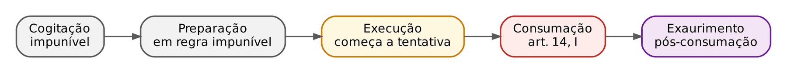
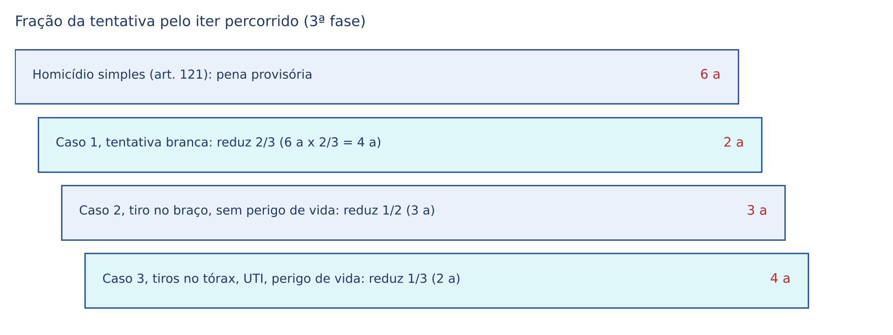
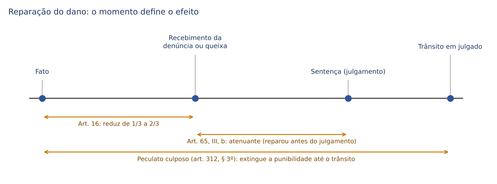
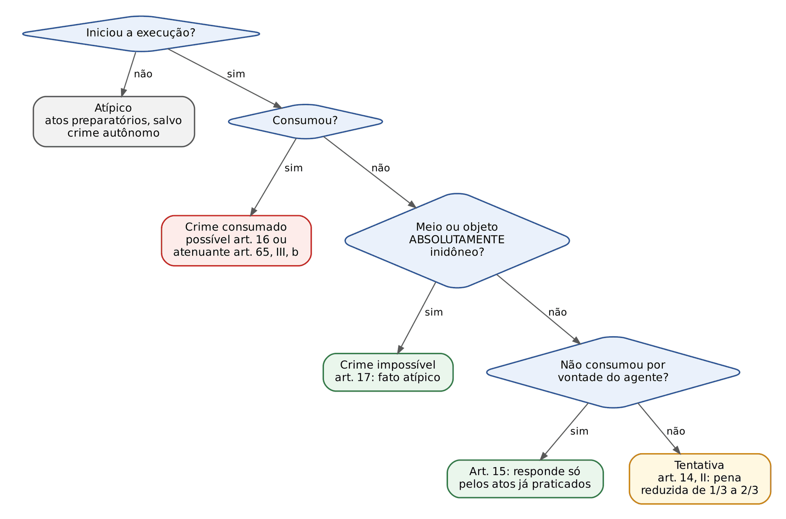

# CAPÍTULO 08 — ITER CRIMINIS: CONSUMAÇÃO, TENTATIVA, DESISTÊNCIA VOLUNTÁRIA, ARREPENDIMENTO EFICAZ E POSTERIOR, CRIME IMPOSSÍVEL E FLAGRANTE PROVOCADO

:::INCIDENCIA
TRF5 p. 3; TJRS p. 3; TJSC p. 14. Nível A. Lote: 16 questões (FGV 15, FCC 1).
O que mais cai: caso concreto para classificar desistência voluntária x arrependimento eficaz x arrependimento posterior x tentativa (e a natureza de cada um), crime impossível por meio ou objeto e flagrante preparado x esperado.
:::

| Subtema | FGV | FCC | Padrão de cobrança |
|---|---|---|---|
| Desistência voluntária e arrependimento eficaz | 9 | 0 | Caso com tiros e munição sobrando; arrependimento "ineficaz"; voluntariedade x espontaneidade; natureza (não é causa de diminuição) |
| Arrependimento posterior | 4 | 1 | Furto com restituição antes da denúncia; roubo com reparação (NÃO cabe art. 16); "causa de diminuição" x "atenuante" |
| Crime impossível e flagrante | 3 | 0 | Arma desmuniciada; sistema bancário fora do ar; cédulas marcadas pela polícia (flagrante esperado) |
| Tentativa e consumação | 1 | 0 | Fuga ao ouvir sirene: tentativa, e não desistência |

## 08.1 O caminho do crime (*iter criminis*)

*Iter criminis* (latim: "caminho do crime") é a sequência de etapas que o crime doloso percorre, da ideia na cabeça do agente até depois do resultado. A utilidade prática é saber a partir de QUE momento o Direito Penal intervém e com QUE intensidade: a etapa alcançada define se o fato é atípico, tentado ou consumado, e (dentro da tentativa) quanto a pena diminui. Só o crime doloso tem *iter criminis*; no culposo o agente não planeja o resultado, de modo que não há "caminho" rumo a ele (por isso o culposo não admite tentativa: ver 8.3.4).

| Etapa | O que é | Exemplo (A quer matar B) | Relevância penal |
|---|---|---|---|
| Cogitação | Ideação, deliberação interna | A pensa em matar B | Impunível sempre (*cogitationis poenam nemo patitur*): o pensamento não é crime |
| Preparação (atos preparatórios) | Atos que tornam possível a execução, sem ainda atacar o bem jurídico | A compra o revólver, estuda a rotina de B, espera na esquina | Em regra impunível; exceção quando a lei transforma o ato preparatório em crime autônomo |
| Execução (atos executórios) | Ataque ao bem jurídico, início da realização do tipo | A aponta e dispara contra B | Daqui em diante já há, no mínimo, tentativa |
| Consumação | Reunião de todos os elementos do tipo (art. 14, I) | B morre | Crime consumado: pena cheia |
| Exaurimento | Fatos posteriores à consumação, que esgotam a lesão | (no homicídio não há; ver exemplos abaixo) | Não muda a tipicidade; pode influir na pena |

Atos preparatórios punidos como crime autônomo (os chamados crimes-obstáculo): a lei antecipa a tutela e pune, por si só, condutas que seriam mera preparação de outro delito. Exemplos cobráveis: associação criminosa (art. 288 do CP), petrechos para falsificação de moeda (art. 291 do CP), porte ilegal de arma (Lei 10.826/2003) e os atos preparatórios de terrorismo (art. 5º da Lei 13.260/2016, com pena do crime consumado diminuída de 1/4 até a metade). Nesses casos o agente não responde por "tentativa" do crime-fim, mas pelo crime autônomo consumado.

Exaurimento: o crime já se consumou e ocorre algo a mais. Na corrupção passiva (art. 317), crime formal que se consuma com a solicitação, o recebimento posterior da propina é exaurimento; se, em consequência da vantagem, o funcionário retarda ou pratica o ato com infração de dever, a lei transforma o exaurimento em majorante (art. 317, § 1º). Na extorsão mediante sequestro (art. 159), o recebimento do resgate é exaurimento. Regra prática para a sentença: o exaurimento não altera o enquadramento típico nem desloca a consumação, mas pode pesar como consequência do crime no art. 59 (Cap. 13) ou como majorante quando a lei o prevê, sem *bis in idem* (dupla valoração do mesmo fato).

:::PEGADINHA
Arrependimento eficaz só é possível ANTES da consumação. Em crime formal ou de mera conduta, a consumação ocorre com a própria conduta: a desistência posterior chega tarde. Na FGV (AL-TO 2024, Q2457303), quem preencheu requerimento com dado falso em órgão ambiental já consumou a falsidade ideológica (crime formal), ainda que a autorização tenha sido cancelada antes do corte da vegetação; as alternativas de "arrependimento eficaz" e "desistência voluntária" estavam erradas. No mesmo sentido, a corrupção ativa se consuma com a mera oferta, ainda que recusada (ALERJ 2026, Q3880808).
:::

### 08.1.1 Onde termina a preparação e começa a execução

É a fronteira mais importante do capítulo: antes dela o fato é (em regra) atípico; depois dela há tentativa punível. O art. 14, II, fala em "iniciada a execução", mas não diz o que é iniciar. A doutrina propõe critérios:

| Teoria | Critério | Exemplo: ladrão escala o muro da casa para furtar | Observação |
|---|---|---|---|
| Subjetiva | Basta a exteriorização do plano criminoso; preparação e execução se equivalem | Tentativa | Pune demais; não adotada |
| Objetivo-formal ou lógico-formal (Beling) | A execução começa com a prática do verbo nuclear do tipo ("matar", "subtrair") | Preparação (ainda não tocou na coisa) | Majoritária na doutrina brasileira; ponto de partida do STJ |
| Objetivo-material (Frank) | Também são executórios os atos imediatamente anteriores ao verbo que, pela visão de um terceiro, já colocam o bem em perigo | Tentativa | Amplia a tentativa |
| Objetivo-individual (Welzel, Zaffaroni) | Atos imediatamente anteriores ao verbo, segundo o plano concreto do autor | Depende do plano: se o plano era entrar e furtar já, tentativa | Combina plano e proximidade temporal |
| Hostilidade ao bem jurídico (Mayer; Hungria) | Executório é o ato que ataca efetivamente o bem jurídico | Discutível | Critério material, pouco preciso |

Posição do STJ: parte da teoria objetivo-formal, mas há oscilação nos casos de fronteira, e a banca de magistratura conhece os dois julgados abaixo.

:::JURIS STJ, 5ª Turma, AREsp 974.254-TO, j. 21/9/2021 (Info 711)
Dois agentes, armados, romperam o cadeado e destruíram a fechadura da porta de uma casa para roubá-la, mas fugiram ao avistar a viatura antes de entrar. Aplicando a teoria objetivo-formal, o STJ entendeu que eram meros atos preparatórios do roubo (não houve violência ou grave ameaça contra pessoa nem início da subtração). Afastou-se a tentativa de roubo circunstanciado; subsistiu o que fosse crime autônomo (no caso, o porte da arma).
:::

:::JURIS STJ, 5ª Turma, AgRg no REsp 2.255.737-MG, j. 7/4/2026 (Info 887)
Quem começa a romper o obstáculo para furtar e é impedido por circunstância alheia à vontade pratica tentativa de furto qualificado, e não ato preparatório. A Turma afirmou aplicar a teoria objetivo-formal "de maneira temperada": atos periféricos, anteriores ao verbo "subtrair", configuram início de execução quando revelam de forma inequívoca a agressão ao bem jurídico, com risco imediato e relevante.
:::

:::DICA
Como conciliar os dois julgados na prova: no furto qualificado pelo rompimento de obstáculo (art. 155, § 4º, I), a própria qualificadora descreve a destruição do obstáculo como modo de execução, o que justifica tratar o rompimento como começo da execução do furto qualificado. No roubo, o núcleo exige violência ou grave ameaça à pessoa; romper o cadeado de uma casa vazia ainda não ataca a pessoa. Em questão objetiva, se a banca pedir "a teoria adotada pelo STJ", a resposta segura continua sendo a objetivo-formal; se descrever rompimento de obstáculo no furto, a resposta é tentativa.
:::

:::SENTENCA
Onde entra: na fundamentação da tipicidade, antes da dosimetria. Se a defesa sustenta "atos meramente preparatórios", enfrente a tese indicando qual ato concreto realizou (ou não) o núcleo do tipo. Redação-modelo: "O rompimento do cadeado do portão, com o propósito declarado de subtrair os bens que guarneciam a residência, constitui início de execução do furto qualificado (art. 155, § 4º, I, c/c art. 14, II, do CP), pois a destruição do obstáculo integra o próprio modo de execução descrito na qualificadora." Erro que a banca pune: condenar por tentativa sem identificar o ato executório, ou absolver por "preparação" sem verificar se o ato já configura crime autônomo (porte de arma, associação, dano).
:::

## 08.2 Consumação

Pelo art. 14, I, o crime está consumado "quando nele se reúnem todos os elementos de sua definição legal". O momento consumativo varia conforme a estrutura do tipo, e é exatamente essa variação que as bancas exploram. A classificação dos crimes (material, formal, de mera conduta etc.) é do Cap. 5; aqui interessa só QUANDO cada um se consuma e o que isso significa para a tentativa.

| Espécie | Consuma-se quando | Exemplo | Admite tentativa? |
|---|---|---|---|
| Material | Ocorre o resultado naturalístico exigido pelo tipo | Homicídio (morte), furto (inversão da posse) | Sim |
| Formal (de consumação antecipada) | Pratica-se a conduta; o resultado previsto é dispensável (se vier, é exaurimento) | Extorsão (Súmula 96 do STJ — ver Cap. 29), corrupção passiva e ativa | Sim, se plurissubsistente (ex.: carta extorsiva interceptada) |
| De mera conduta | Pratica-se a conduta; o tipo nem descreve resultado | Violação de domicílio (art. 150) | Em regra sim, se fracionável |
| Permanente | Consuma-se com a conduta, e a consumação se prolonga no tempo enquanto o agente quiser | Sequestro (art. 148), extorsão mediante sequestro, "ter em depósito" droga | Sim |
| Habitual | Com a reiteração de atos que revelem o estilo de vida | Curandeirismo (art. 284), casa de prostituição (art. 229) | Não (majoritário) |
| Omissivo próprio | No momento em que o agente deixa de agir quando devia | Omissão de socorro (art. 135) | Não |
| Omissivo impróprio (comissivo por omissão) | Com o resultado naturalístico | Mãe que deixa de alimentar o filho para matá-lo | Sim |
| Qualificado pelo resultado | Com a produção do resultado agravador | Lesão corporal seguida de morte (art. 129, § 3º) | Depende: no preterdoloso, não |
| Culposo | Com o resultado naturalístico involuntário | Homicídio culposo | Não (salvo culpa imprópria) |

Consequências práticas da consumação permanente: (i) cabe prisão em flagrante enquanto durar a permanência (art. 303 do CPP), o que legitima o ingresso em domicílio nas hipóteses aceitas pela jurisprudência (tema processual); (ii) a prescrição só corre da cessação da permanência (art. 111, III — ver Cap. 22); (iii) lei mais grave que entra em vigor durante a permanência se aplica (Súmula 711 do STF — ver Cap. 3).

Furto e roubo como exemplo de consumação material: o STJ adota a teoria da *amotio* ou *apprehensio*: basta a inversão da posse, ainda que breve, seguida de perseguição imediata, sendo dispensável a posse mansa e pacífica (Temas 934 e 916 do STJ e Súmula 582 do STJ — ver Cap. 29). O limite dessa tese, útil para entender a diferença entre tentativa e consumação, foi desenhado em 2026:

:::JURIS STJ, 5ª Turma, AgRg no AgRg no AREsp 3.063.890-MS, j. 3/3/2026 (Info 886)
O agente surpreendido ainda no interior do estabelecimento, com os bens que pretendia subtrair acondicionados na mochila, demonstra apenas o *iter criminis* percorrido, e não a efetiva inversão da posse: há tentativa de furto. O STJ fez a distinção (*distinguishing*) em relação ao Tema 934: a dispensa da posse mansa e pacífica não dispensa que a coisa tenha saído da esfera de vigilância e disponibilidade da vítima.
:::

:::PROCESSO Consumação e tentativa no processo penal
Competência: em regra, lugar da consumação; na tentativa, lugar do último ato de execução (art. 70 do CPP). Prescrição antes do trânsito: corre do dia da consumação; na tentativa, do dia em que cessou a atividade criminosa (art. 111, I e II, do CP — ver Cap. 22). Benefícios: para saber se cabe suspensão condicional do processo (pena mínima de até 1 ano), aplica-se à pena mínima a redução MÁXIMA da tentativa (2/3); para saber se a infração é de menor potencial ofensivo (pena máxima de até 2 anos), aplica-se à pena máxima a redução MÍNIMA (1/3). Detalhes e súmulas no Cap. 25.
:::

## 08.3 Tentativa

### 08.3.1 Conceito, elementos e natureza

:::LEI Código Penal, art. 14
Art. 14 - Diz-se o crime:
I - consumado, quando nele se reúnem todos os elementos de sua definição legal;
II - tentado, quando, iniciada a execução, não se consuma por circunstâncias alheias à vontade do agente.
Parágrafo único - Salvo disposição em contrário, pune-se a tentativa com a pena correspondente ao crime consumado, diminuída de um a dois terços.
:::

Elementos da tentativa (todos cumulativos):

- início da execução (8.1.1);
- não consumação;
- por circunstâncias ALHEIAS à vontade do agente (é isso que a separa da desistência voluntária e do arrependimento eficaz: ver 8.4);
- dolo de consumação: o agente quer o crime completo. Não existe "dolo de tentar"; o dolo da tentativa é idêntico ao do crime consumado.

Natureza jurídica: a tentativa não é um crime autônomo. O tipo do homicídio descreve "matar alguém"; quem dispara e erra não matou ninguém. A conduta só se torna típica pela combinação do tipo da parte especial com o art. 14, II, que funciona como norma de extensão temporal da figura típica (amplia o tipo para alcançar fatos anteriores à consumação). Fala-se em adequação típica mediata ou indireta (no crime consumado a adequação é imediata). Consequência prática para a sentença: a capitulação da tentativa SEMPRE combina os dois dispositivos, por exemplo "art. 121, § 2º, IV, c/c art. 14, II, do CP".

### 08.3.2 Fundamento da punibilidade: por que punir quem não lesou

| Teoria | Fundamento | Consequência para a pena | Adoção |
|---|---|---|---|
| Objetiva (realística ou dualista) | Pune-se pelo perigo efetivo que a conduta causou ao bem jurídico; como o perigo é menor que a lesão, a pena deve ser menor | Pena da tentativa menor que a do consumado | REGRA do CP (art. 14, parágrafo único) |
| Subjetiva (voluntarística ou monista) | Pune-se pela vontade contrária ao Direito, que é a mesma no tentado e no consumado | Mesma pena | Exceção: crimes de atentado ou de empreendimento |
| Sintomática | Pune-se pela periculosidade revelada pelo agente | Pena conforme a periculosidade; pune até tentativa inidônea | Não adotada |
| Da impressão (objetivo-subjetiva) | Pune-se a vontade contrária ao Direito quando abala a confiança da coletividade na ordem jurídica | — | Doutrina alemã; não adotada |

A ressalva "salvo disposição em contrário" do parágrafo único abre espaço para os crimes de atentado ou de empreendimento, em que o tipo pune igualmente a forma tentada e a consumada, sem redução: evasão mediante violência contra a pessoa ("evadir-se ou tentar evadir-se", art. 352 do CP) e "votar ou tentar votar mais de uma vez" (art. 309 do Código Eleitoral). Nesses tipos não se aplica o art. 14, II; a tentativa já é o próprio crime consumado. Há também tipos especiais que punem tentativa com pena própria, como os atos preparatórios de terrorismo citados em 8.1.

### 08.3.3 Espécies de tentativa

| Espécie | Definição | Exemplo |
|---|---|---|
| Perfeita, acabada ou crime falho | O agente esgota todos os atos executórios que tinha à disposição e, mesmo assim, o resultado não ocorre | A descarrega o revólver em B, que é salvo pela cirurgia |
| Imperfeita, inacabada ou propriamente dita | O agente é interrompido DURANTE a execução, sem esgotar os meios, por fator externo | A dispara uma vez e é desarmado por um policial |
| Branca ou incruenta | O objeto material não é atingido | Todos os tiros erram B |
| Cruenta ou vermelha | O objeto material é atingido, mas o resultado não ocorre | B é ferido e sobrevive |
| Inidônea, impossível ou quase-crime | Meio ou objeto absolutamente inidôneos: não é tentativa punível | Ver crime impossível (8.6) |
| Abandonada ou qualificada | O agente, voluntariamente, interrompe a execução ou impede o resultado | Ver desistência voluntária e arrependimento eficaz (8.4) |

As classificações se combinam: a tentativa pode ser perfeita e branca (descarregou a arma e errou todos os tiros), imperfeita e cruenta (feriu B com o primeiro tiro e foi desarmado), e assim por diante. A distinção perfeita x imperfeita é a mesma que separa arrependimento eficaz e desistência voluntária, só que lá a interrupção é voluntária.

### 08.3.4 Infrações que não admitem tentativa

| Infração | Por que não admite | Atenção |
|---|---|---|
| Crime culposo | Não há vontade dirigida ao resultado; logo, não há resultado "pretendido" que deixe de ocorrer | Exceção doutrinária: culpa imprópria (descriminante putativa por erro evitável, art. 20, § 1º, parte final): o agente quer o resultado, mas responde a título de culpa por política criminal (ver Cap. 7 e 10) |
| Crime preterdoloso | O resultado agravador é culposo, e culpa não admite tentativa | Se o resultado agravador puder ser doloso (crimes qualificados pelo resultado não preterdolosos, como o latrocínio), a tentativa é possível (latrocínio tentado — ver Cap. 29) |
| Contravenção penal | O art. 4º da LCP declara que "não é punível a tentativa de contravenção" | A tentativa é logicamente possível, mas juridicamente impunível |
| Omissivo próprio | Ou o agente se omite (consumou) ou age (não há crime); não há fracionamento | O omissivo impróprio admite (Q3387029 e Q2367575, citadas abaixo) |
| Unissubsistente | A conduta se esgota num único ato: praticado o ato, consumou | Injúria verbal; ameaça verbal. Se escrita (plurissubsistente), admite |
| Habitual | Ou há reiteração (consumou) ou há ato isolado (atípico) | Corrente minoritária admite em situações excepcionais |
| De atentado ou empreendimento | A tentativa já é tipificada como consumação | Art. 352 do CP; art. 309 do Código Eleitoral |
| Estupro de vulnerável, segundo o STJ | Qualquer ato libidinoso já consuma o delito | STJ, 5ª Turma, REsp 2.172.883-SP, j. 10/12/2024 (Info 837) — detalhes no Cap. 31 |

Dolo eventual e tentativa: no dolo eventual o agente não quer diretamente o resultado, mas assume o risco de produzi-lo (art. 18, I). Uma corrente sustenta a incompatibilidade (não se pode "tentar" o que não se quer). A posição majoritária na doutrina (Greco, Masson, Sanches) e a jurisprudência do STJ admitem a tentativa com dolo eventual, porque o CP equiparou as duas formas de dolo: o caso típico é o "racha" ou a direção em velocidade extrema que atinge a vítima sem matá-la, com pronúncia por homicídio tentado. Para a prova objetiva: a tentativa é compatível com o dolo eventual.

:::QUESTAO FCC 2025 — DPE-RS — Defensor Público (Q3387029); FGV 2024 — MPE-GO — Promotor (Q2367575)
Cobrou-se a tentativa nas espécies de crimes. Na FCC, era errada a alternativa segundo a qual os omissivos próprios "admitem a tentativa". Na FGV, a assertiva I chamava de "omissivo espúrio" o crime cuja omissão está descrita no próprio tipo e o dava como insuscetível de tentativa: errada, porque omissivo espúrio (ou promíscuo) é sinônimo de omissivo IMPRÓPRIO, que admite tentativa; quem tem a omissão descrita no tipo é o omissivo próprio.
:::

### 08.3.5 Quanto diminuir: a fração da tentativa

O parágrafo único do art. 14 manda diminuir de 1/3 a 2/3. Qual fração escolher? O critério pacífico no STJ é ÚNICO e objetivo: a distância percorrida no *iter criminis*, isto é, a maior ou menor proximidade da consumação. Quanto mais perto o agente chegou do resultado, MENOR a redução (1/3); quanto mais longe, MAIOR a redução (2/3). Não se usam aqui as circunstâncias judiciais do art. 59 (culpabilidade, antecedentes, motivos), que já foram valoradas na primeira fase; usá-las de novo seria *bis in idem*.

Indicadores concretos de proximidade da consumação que a jurisprudência aceita: se a vítima foi atingida (cruenta x branca); a sede e a gravidade das lesões (região vital, perigo de vida atestado em laudo, internação em UTI); o número de golpes ou disparos; se o agente esgotou os meios (tentativa perfeita fica, em regra, mais perto da consumação); no patrimônio, se a coisa chegou a ser apreendida ou removida.

:::JURIS STJ, 5ª Turma, AgRg no HC 731.845, Rel. Min. Olindo Menezes, j. 13/9/2022
No homicídio, a tentativa branca ou incruenta enseja a redução no patamar máximo de 2/3. Leia com cuidado: a orientação não é automática em todos os casos (o perigo concreto pode ser alto mesmo sem ferimento, como no disparo que passa rente à cabeça), mas a ausência de lesão é o indicador mais forte de afastamento da consumação, e reduzir menos que 2/3 na tentativa branca exige fundamentação concreta.
:::

Onde a conta é feita: na TERCEIRA fase da dosimetria, porque a tentativa é causa de diminuição de pena (minorante) com fração variável. Ela incide sobre a pena provisória (resultado da segunda fase) e, por ser causa de diminuição, pode levar a pena abaixo do mínimo legal, ao contrário das atenuantes (Súmula 231 do STJ — ver Cap. 14). A ordem de aplicação quando há várias causas de aumento e diminuição e o roteiro completo estão no Cap. 15; aqui fica a tese e um exemplo isolado.

:::EXEMPLO Calculando a tentativa de homicídio simples (só a 3ª fase)
Dados: homicídio simples (pena de 6 a 20 anos). Suponha que a pena-base e a pena provisória ficaram no mínimo: 6 anos. Três cenários de tentativa:
- Caso 1 (tentativa branca: os dois tiros erraram a vítima, que nada sofreu). Muito longe da consumação: redução máxima de 2/3. Conta: 6 anos = 72 meses; 72 x 2/3 = 48 meses de redução; 72 − 48 = 24 meses. Pena definitiva: 2 anos.
- Caso 2 (um tiro no braço, lesão leve, sem perigo de vida). Distância intermediária: redução de 1/2. Conta: 72 x 1/2 = 36 meses; 72 − 36 = 36 meses. Pena definitiva: 3 anos.
- Caso 3 (três tiros no tórax, cirurgia de urgência, UTI, laudo atestando perigo de vida). Muito perto da consumação: redução mínima de 1/3. Conta: 72 x 1/3 = 24 meses; 72 − 24 = 48 meses. Pena definitiva: 4 anos.
Com pena provisória "quebrada" (ex.: 7 anos e 6 meses = 90 meses, redução de 2/3): 90 x 2/3 = 60 meses; 90 − 60 = 30 meses = 2 anos e 6 meses. Se a divisão gerar fração de dia, ela é desprezada (art. 11 do CP).
Dica de conta: reduzir 2/3 é o mesmo que ficar com 1/3 da pena; reduzir 1/3 é ficar com 2/3. Trabalhe sempre em meses (ou em dias, quando a pena tiver dias).
:::

:::SENTENCA
Onde entra: 3ª fase. O que fundamentar: a fração escolhida com base em dados concretos do *iter* (lesões, laudo, número de disparos, perigo de vida), nunca com fórmulas genéricas ("considerando o caso concreto") nem com circunstâncias do art. 59. Redação-modelo: "Na terceira fase, reconhecida a tentativa (art. 14, II, do CP), reduzo a pena em 1/3, fração mínima, porque o réu esteve muito próximo da consumação: atingiu a vítima com três disparos no tórax, que exigiram cirurgia de urgência e internação em UTI, com perigo de vida atestado no laudo de fl. X." Erros que a banca pune: fixar 1/3 sem fundamentação (o STJ reforma para 2/3); usar a gravidade abstrata do crime ou os maus antecedentes para escolher a fração; esquecer de capitular "c/c art. 14, II"; aplicar a redução na segunda fase.
:::

:::PROCESSO Júri e tentativa
Nos crimes dolosos contra a vida, a tentativa é reconhecida pelos jurados (sustentada a tentativa, formula-se quesito próprio, respondido após o da autoria: art. 483, § 5º, do CPP), mas a FRAÇÃO é escolhida pelo juiz presidente, na sentença, com o mesmo critério do *iter* percorrido. Desclassificada a tentativa pelos jurados (ex.: reconhecem que o réu desistiu voluntariamente), o juiz presidente julga a infração residual (lesão corporal).
:::

## 08.4 Desistência voluntária e arrependimento eficaz (art. 15)

:::LEI Código Penal, art. 15
Art. 15 - O agente que, voluntariamente, desiste de prosseguir na execução ou impede que o resultado se produza, só responde pelos atos já praticados.
:::

### 08.4.1 A lógica: a "ponte de ouro"

Imagine o agente que já iniciou a execução: ele já tem, nas mãos, uma tentativa punível. Se a lei o punisse por tentativa de qualquer forma, ele não teria nenhum incentivo para parar; ao contrário, seria "melhor" ir até o fim. O art. 15 oferece-lhe uma saída premiada: se ele próprio, voluntariamente, interromper a execução ou impedir o resultado, não responderá pela tentativa do crime que buscava, mas apenas pelo que já tiver praticado. É a imagem de Franz von Liszt: a lei constrói uma "ponte de ouro" para a retirada do agente. O fundamento é político-criminal: proteger a vítima (vale mais evitar o resultado do que punir a tentativa).

Por isso a doutrina chama os dois institutos de tentativa abandonada ou qualificada: estão presentes os dois primeiros elementos da tentativa (execução iniciada e não consumação), mas falta o terceiro; a não consumação NÃO decorre de circunstância alheia, e sim da vontade do próprio agente.

### 08.4.2 As duas figuras

| | Desistência voluntária | Arrependimento eficaz |
|---|---|---|
| Momento | Durante a execução, ANTES de esgotá-la (corresponde à tentativa imperfeita) | Depois de esgotada a execução, ANTES da consumação (corresponde à tentativa perfeita) |
| Conduta do agente | Em regra omissiva: deixa de prosseguir | Necessariamente comissiva: age para impedir o resultado |
| Fórmula | "Posso prosseguir, mas não quero" | "Já fiz tudo, mas desfaço" |
| Exemplo | A dispara uma vez, erra, tem mais balas e vai embora | A ministra veneno a B e, arrependido, dá-lhe o antídoto a tempo |
| Requisitos | Voluntariedade + não consumação | Voluntariedade + eficácia (o resultado é efetivamente evitado) |
| Efeito | Responde só pelos atos já praticados | Responde só pelos atos já praticados |
| Cabimento | Crimes plurissubsistentes em geral | Só crimes materiais (nos formais e de mera conduta, esgotada a execução, já houve consumação) |

Arrependimento "ineficaz": se o agente esgota a execução, tenta salvar a vítima, mas o resultado ocorre mesmo assim, NÃO há arrependimento eficaz. A eficácia é requisito: o art. 15 fala em quem "impede que o resultado se produza". O agente responde pelo crime consumado; o esforço para socorrer pode valer como atenuante genérica (art. 65, III, b: "procurado, por sua espontânea vontade e com eficiência, logo após o crime, evitar-lhe ou minorar-lhe as consequências"), mas não afasta a tipicidade.

### 08.4.3 Voluntariedade não é espontaneidade

O art. 15 exige que a desistência ou o arrependimento sejam VOLUNTÁRIOS, e não espontâneos. Voluntário é o ato livre, não coagido por fator externo que impeça o prosseguimento; espontâneo é o que nasce de iniciativa íntima do agente. A desistência é válida mesmo que a ideia tenha vindo de outra pessoa (a vítima suplica, a mãe pede, o comparsa sugere), desde que o agente pudesse prosseguir e escolhesse não prosseguir. Os motivos também são irrelevantes: remorso, medo de punição futura abstrata, vergonha, piedade ou até uma vantagem oferecida pela vítima.

Critério prático: a fórmula de Frank. Pergunte-se o que o agente diria a si mesmo:

- "posso prosseguir, mas não quero" → desistência voluntária (art. 15);
- "quero prosseguir, mas não posso" → tentativa (art. 14, II).

Situações-limite:

| Situação | Solução | Fundamento |
|---|---|---|
| O agente para porque ouve uma sirene e acredita que a polícia chegou | Tentativa | A interrupção decorreu de fator externo percebido como obstáculo (ainda que fosse imaginário) |
| O agente para porque a vítima, chorando, implora | Desistência voluntária | Podia prosseguir; o pedido não o impedia |
| A vítima oferece dinheiro para não morrer e o agente aceita | Desistência voluntária | Podia matar e escolheu não matar; o motivo é irrelevante (pode haver outro crime pelo recebimento, conforme o caso) |
| O agente para porque o alarme disparou | Tentativa (majoritário) | O alarme cria risco concreto e iminente de prisão, fator externo |
| O agente suspende a execução para retomá-la em melhor ocasião (adiamento) | Não há desistência | A desistência deve ser definitiva quanto àquele fato; se retoma, responde pelo crime; se é preso antes, tentativa |
| O agente desiste porque percebe que a coisa tem valor ínfimo ou não é a que procurava | Discutível; prevalece tentativa | O motivo da interrupção é a frustração do plano, não uma escolha livre |

:::QUESTAO FGV 2025 — ENAM 2025.1 (Q3362375)
Caso: Ricardo, com um pedaço de pau, ameaçou a vítima, que já estendia a mão com o dinheiro; ao ouvir uma sirene e supor que fosse a polícia, mandou a vítima guardar o dinheiro e fugiu (era uma ambulância). Gabarito: A — tentativa de roubo próprio. Armadilha: as alternativas de desistência voluntária e de arrependimento eficaz. Pela fórmula de Frank, ele queria prosseguir mas acreditou que não podia: a causa foi externa (ainda que putativa). Não houve consumação porque o dinheiro não chegou a ser apreendido pelo agente (sobre a consumação do roubo, ver Cap. 29).
:::

:::QUESTAO FGV 2024 — Câmara de Fortaleza — Advogado (Q2450549)
Pediu-se a definição legal de desistência voluntária. Gabarito: C — o agente desiste de prosseguir na execução por deliberação própria, "mesmo que não espontânea". Armadilhas: "desiste antes de ingressar na execução" (isso é preparação impunível, não desistência); "empreende todos os atos e impede o resultado" (isso é arrependimento eficaz); "responde apenas por culpa" (o art. 15 manda responder pelos atos já praticados, dolosos ou não).
:::

### 08.4.4 Efeito: "só responde pelos atos já praticados"

O agente não responde pela tentativa do crime pretendido, mas responde pelo crime que os atos já realizados configurarem por si sós. O exemplo clássico: A quer matar B, dispara, atinge-o no braço e, podendo continuar, vai embora. Não há tentativa de homicídio; há lesão corporal, cuja gravidade depende do resultado efetivo (leve, grave, gravíssima). Se os atos praticados não forem típicos por si (tiros que não atingem ninguém), pode subsistir apenas um crime residual (disparo de arma de fogo em via pública, art. 15 da Lei 10.826/2003 — ver Cap. 39), ou nada.

:::QUESTAO FGV 2025 — SEFAZ-PR — Auditor Fiscal (Q3363377)
Caso: Fábio, querendo matar João, acerta-lhe a mão com um disparo; acalma-se e, havendo munição, deixa de atirar e vai embora, sabendo que João sobreviveria. Gabarito: E — desistência voluntária. Armadilhas: "arrependimento eficaz" (Fábio não esgotou a execução nem praticou ato para salvar a vítima) e "causa de diminuição da tentativa". Responde pela lesão corporal efetivamente causada. No mesmo sentido: FGV 2024 — TCE-PA (Q2611619: dois disparos que erram a namorada, munição restante, o agente para e pede perdão; gabarito: o *iter* se iniciou e foi interrompido por desistência voluntária) e FGV 2024 — ENAM reaplicação (Q2507058: a defesa dos inconfidentes que alegasse abandono do movimento já iniciado, por decisão dos próprios agentes e sem repressão, sustentaria desistência voluntária).
:::

:::QUESTAO FGV 2024 — TJ-AP — Analista Judiciário (Q2442324)
Caso: Caio atinge João no braço e na perna; ao apontar a arma para o rosto da vítima, lembra-se dos ensinamentos da mãe e foge, sem o último disparo; laudo atesta perigo de vida. Gabarito: B — lesão corporal de natureza grave, em razão da desistência voluntária. A conta do "atos já praticados": as lesões geraram perigo de vida, o que qualifica a lesão como grave (art. 129, § 1º, II — ver Cap. 28). Armadilhas: "homicídio tentado" (a desistência elimina a tentativa) e "arrependimento posterior" (instituto de crimes sem violência).
:::

:::QUESTAO FGV 2026 — TJ-PR — Juiz Substituto (Q3898926)
Caso: Lúcio atira em Mário, sente remorso com quatro projéteis ainda na arma, chama o socorro, mas Mário morre dias depois exclusivamente em razão dos ferimentos. Gabarito: C — homicídio consumado, sem prejuízo de atenuante genérica. É o arrependimento ineficaz: o art. 15 exige que o resultado seja impedido. Armadilhas: "desistência voluntária" (o resultado ocorreu), "arrependimento posterior" (crime com violência e momento errado) e "crime impossível" (o meio era eficacíssimo). O socorro pode configurar a atenuante do art. 65, III, b.
:::

:::QUESTAO FGV 2024 — ENAM 2024.2 (Q3058680)
Caso triplo: Caio aciona a arma desmuniciada; Tício atira, compadece-se e leva a vítima ao hospital, mas ela morre; Mévio rende a vítima, aceita 50.000 (cinquenta mil) reais para não matá-la e é preso minutos depois. Gabarito: B — crime impossível (Caio: meio absolutamente ineficaz, ver 8.6), homicídio doloso consumado (Tício: arrependimento ineficaz) e desistência voluntária (Mévio: podia matar e escolheu não matar; a motivação econômica não retira a voluntariedade). A prisão posterior de Mévio é irrelevante para o homicídio, porque a desistência já ocorrera.
:::

:::QUESTAO FGV 2024 — ENAM reaplicação (Q2507057)
Assertivas sobre os três institutos. Gabarito: B (só a II correta). I errada: espontaneidade não é requisito (basta voluntariedade) e o "esgotamento da atividade executória" é marca do arrependimento eficaz, não da desistência. II correta: esgotamento da execução, impedimento do resultado e voluntariedade são os requisitos do arrependimento eficaz. III errada: no arrependimento posterior, a celeridade da reparação serve para dosar a fração, mas a reparação NÃO exclui a punibilidade em nenhuma hipótese prevista no art. 16.
:::

### 08.4.5 Natureza jurídica e reflexo no concurso de pessoas

Há duas posições, e a escolha tem consequência prática no concurso de agentes:

| Corrente | Tese | Consequência para o partícipe |
|---|---|---|
| Causa de exclusão da tipicidade (da adequação típica da tentativa) | Se a não consumação decorre da vontade do agente, falta elemento do art. 14, II; não há tentativa típica | Pela acessoriedade limitada, o partícipe também não responde pela tentativa (o fato principal não é típico como tentativa) |
| Causa pessoal de extinção (ou de isenção) da punibilidade (Hungria; Zaffaroni) | A tentativa existiu, mas o Estado renuncia a punir, por política criminal, quem se retirou | O benefício é pessoal: não aproveita ao partícipe que não desistiu |

Em prova objetiva, a FGV costuma tratar a desistência e o arrependimento eficaz como hipóteses em que o agente "só responde pelos atos já praticados", sem reduzir pena: o erro mais frequente nas alternativas é chamá-los de "causa de diminuição" ou de "atenuante" (ver Q3781270, em 8.5.6). Quando o concurso de pessoas está em jogo, o que se exige é verificar QUEM desistiu: o coautor que se retira sem neutralizar a contribuição já dada e sem impedir que os demais consumem o crime responde pelo crime consumado pelos outros (a desistência de um precisa ser eficaz em relação ao todo), tema desenvolvido no Cap. 11.

:::SENTENCA
Onde entra: na tipicidade (é tese de desclassificação). Reconhecida a desistência ou o arrependimento eficaz, o juiz NÃO condena por tentativa com redução: desclassifica para o crime correspondente aos atos praticados (ex.: de tentativa de homicídio para lesão corporal grave), o que pode mudar competência, rito e benefícios (lesão leve dolosa: menor potencial ofensivo e ação pública condicionada à representação, art. 88 da Lei 9.099/1995, salvo violência doméstica). Redação-modelo: "Embora o acusado dispusesse de outros quatro cartuchos íntegros e a vítima estivesse ao seu alcance, cessou voluntariamente os disparos e deixou o local, conforme narrado pela própria ofendida; configurada a desistência voluntária (art. 15 do CP), responde apenas pela lesão corporal efetivamente produzida." Erro punido: aplicar fração de 1/3 a 2/3 como se fosse tentativa; tratar o arrependimento ineficaz como arrependimento eficaz.
:::

## 08.5 Arrependimento posterior (art. 16)

:::LEI Código Penal, art. 16
Art. 16 - Nos crimes cometidos sem violência ou grave ameaça à pessoa, reparado o dano ou restituída a coisa, até o recebimento da denúncia ou da queixa, por ato voluntário do agente, a pena será reduzida de um a dois terços.
:::

### 08.5.1 O que é e por que existe

Diferentemente do art. 15, aqui o crime JÁ SE CONSUMOU. O arrependimento posterior não evita o crime; premia quem, depois da consumação, recompõe o patrimônio da vítima rapidamente. A finalidade é estimular a reparação do dano (dimensão restaurativa da pena) e desafogar o processo. Por isso a natureza jurídica é de causa obrigatória de diminuição de pena (minorante), aplicada na terceira fase, com fração variável de 1/3 a 2/3. Não extingue a punibilidade e não exclui a tipicidade.

### 08.5.2 Requisitos

| Requisito | Conteúdo | Pontos de prova |
|---|---|---|
| Crime sem violência ou grave ameaça à PESSOA | A violência contra a coisa não impede (furto com rompimento de obstáculo, dano) | Roubo e extorsão estão excluídos. Crime culposo com resultado violento: a doutrina majoritária admite (a violência que a lei exclui é a dolosa), mas o STJ negou no homicídio culposo de trânsito (ver 8.5.4) |
| Reparação do dano ou restituição da coisa | Deve ser INTEGRAL para o STJ | O STF já admitiu reparação da parte principal (ver 8.5.3) |
| Até o recebimento da denúncia ou queixa | Marco: a decisão de recebimento, não o oferecimento | Reparação posterior, antes do julgamento: só atenuante do art. 65, III, b |
| Ato voluntário do agente | Livre, ainda que não espontâneo (pode ser sugerido pelo advogado ou motivado pelo medo de ser descoberto) | Restituição por apreensão policial NÃO é ato do agente; a reparação feita por terceiro em nome do agente (familiar) é aceita pela doutrina majoritária |

Âmbito: o art. 16 não está limitado aos crimes contra o patrimônio, mas exige um crime com dano reparável ou coisa restituível, isto é, com efeitos patrimoniais. Aplica-se, por exemplo, ao peculato doloso (sem violência), ao estelionato, à apropriação indébita e ao furto de energia elétrica. Quanto a este, a 3ª Seção do STJ decidiu que o pagamento do débito antes da denúncia não extingue a punibilidade (energia é remunerada por tarifa, e não por tributo), mas pode ensejar o arrependimento posterior (RHC 101.299-RS, j. 13/3/2019, Info 645 — ver Cap. 29). O mesmo vale para a apropriação indébita (STJ, 5ª Turma, HC 452.163-RS, j. 19/2/2019).

### 08.5.3 Reparação integral ou parcial

| Corte | Posição |
|---|---|
| STJ | Exige reparação INTEGRAL do dano ou restituição integral da coisa, antes do recebimento da denúncia; parcelamento com pagamento de uma parcela não basta (5ª Turma, EDcl no AgRg no REsp 1.540.140-RS, j. 22/11/2016; AgRg no AREsp 1.399.240-MG, j. 5/2/2019) |
| STF | 1ª Turma, HC 165.312, Rel. Min. Marco Aurélio, j. 14/4/2020 (Info 973): basta a reparação da parte principal do dano antes da denúncia, ainda que juros e correção sejam pagos depois; a extensão da reparação influirá na fração |

Para a prova: a regra é a reparação integral (posição do STJ e da doutrina majoritária); se a questão mencionar o precedente do STF, aceite a reparação substancial. A reparação parcial que não preencha o art. 16 ainda pode ser valorada como atenuante (art. 65, III, b) se completada antes do julgamento.

### 08.5.4 Hipóteses discutidas na jurisprudência

:::JURIS STJ, 6ª Turma, REsp 1.561.276-BA, Rel. Min. Sebastião Reis Júnior, j. 28/6/2016 (Info 590)
O arrependimento posterior é inaplicável ao homicídio culposo na direção de veículo automotor (art. 302 do CTB). O instituto pressupõe crime patrimonial ou com efeitos patrimoniais; a vida é bem jurídico irreparável, e a indenização paga à família da vítima não reconstitui o bem lesado. A composição civil pode, quando muito, ser considerada na dosimetria.
:::

:::JURIS STJ, REsp 1.242.294-PR, j. 18/11/2014
Os crimes contra a fé pública, como a moeda falsa (art. 289 do CP), são incompatíveis com o arrependimento posterior: o bem jurídico é a fé pública, e não o patrimônio de quem recebeu a cédula, de modo que ressarcir o tomador não repara o dano ao bem tutelado.
:::

Extensão aos coautores: a reparação integral é circunstância objetiva (diz respeito ao fato, e não à pessoa do agente) e, por isso, comunica-se aos coautores e partícipes (art. 30 do CP — ver Cap. 11). Reparado o dano por um dos agentes, todos se beneficiam; a fração de cada um, porém, pode variar conforme a atuação individual na reparação (STJ, 6ª Turma, REsp 1.187.976-SP, Rel. Min. Sebastião Reis Júnior, j. 7/11/2013). Há precedente antigo em sentido contrário (circunstância pessoal), hoje minoritário.

### 08.5.5 A fração: celeridade e voluntariedade

Como na tentativa, a fração do art. 16 não se escolhe pelas circunstâncias do art. 59. O critério reconhecido pela jurisprudência e pela doutrina é a celeridade da reparação (quanto mais rápida, maior a redução) combinada com a voluntariedade (a reparação que parte do próprio agente, sem provocação, merece mais que a reparação obtida depois de intimado pela autoridade policial) e, segundo parte da jurisprudência, a extensão da reparação. Exemplo: furto de 2.000 (dois mil) reais; restituição integral no dia seguinte, por iniciativa própria, antes de qualquer investigação: 2/3. Restituição meses depois, já no curso do inquérito e após o indiciamento: 1/3.

:::EXEMPLO Furto qualificado com arrependimento posterior (3ª fase)
Dados: furto qualificado pelo rompimento de obstáculo (art. 155, § 4º, I; pena de 2 a 8 anos). Pena provisória fixada em 2 anos e 6 meses (30 meses). O réu restituiu integralmente a coisa, voluntariamente, dez dias após o fato, antes do inquérito.
Passo 1: identificar a causa de diminuição: art. 16 (crime sem violência à pessoa; a violência contra o obstáculo não impede).
Passo 2: escolher a fração pela celeridade e voluntariedade: restituição quase imediata e espontânea: 2/3.
Passo 3: conta: 30 meses x 2/3 = 20 meses de redução; 30 − 20 = 10 meses.
Pena definitiva: 10 meses de reclusão (abaixo do mínimo legal, o que é possível porque se trata de causa de diminuição, e não de atenuante).
Se houvesse também tentativa e outra minorante, a ordem e o modo de aplicação (cascata) seguem o Cap. 15.
:::

### 08.5.6 Reparação do dano: os regimes especiais

Em várias situações a lei confere à reparação um efeito MAIS forte ou diferente do art. 16. Essas regras especiais prevalecem sobre a regra geral:

| Hipótese | Efeito | Limite temporal | Fundamento |
|---|---|---|---|
| Regra geral (crime sem violência ou grave ameaça) | Reduz a pena de 1/3 a 2/3 | Até o recebimento da denúncia ou queixa | Art. 16 do CP |
| Reparação após o recebimento | Atenuante genérica | Antes do julgamento | Art. 65, III, b, do CP |
| Peculato CULPOSO | Extingue a punibilidade; se posterior à sentença irrecorrível, reduz de metade a pena imposta | Até o trânsito em julgado | Art. 312, § 3º, do CP (ver Cap. 35) |
| Estelionato por emissão de cheque sem fundos (art. 171, § 2º, VI) | Pagamento antes do recebimento da denúncia extingue a punibilidade; depois, não obsta a ação penal | Até o recebimento da denúncia | Súmula 554 do STF (interpretação *a contrario sensu*) e Súmula 246 do STF (sem fraude, não há crime) — ver Cap. 30 |
| Crimes contra a ordem tributária e previdenciários | Pagamento integral extingue a punibilidade | Regime próprio das leis especiais | Lei 10.684/2003, art. 9º; Lei 12.382/2011 — ver Cap. 45 |
| Infrações de menor potencial ofensivo de ação privada ou pública condicionada | Composição civil homologada acarreta renúncia ao direito de queixa ou representação | Audiência preliminar | Art. 74, parágrafo único, da Lei 9.099/1995 — ver Cap. 25 |
| Crimes com violência ou grave ameaça | Não cabe art. 16; só a atenuante | Antes do julgamento | Art. 65, III, b |

Súmula 554 do STF: "O pagamento de cheque emitido sem provisão de fundos, após o recebimento da denúncia, não obsta ao prosseguimento da ação penal." Lida a contrario, a jurisprudência extraiu que o pagamento ANTES do recebimento da denúncia extingue a punibilidade (ou, segundo a leitura do STF, afasta a justa causa por evidenciar ausência de fraude). A súmula é aplicável só à fraude do cheque sem fundos (art. 171, § 2º, VI); ao estelionato comum aplica-se o art. 16. Atenção à mudança de 2019: o estelionato passou a ser, em regra, de ação pública condicionada à representação (art. 171, § 5º — ver Cap. 30).

:::QUESTAO FGV 2024 — AL-TO — Analista Legislativo (Q2457703)
Caso: João furta 1.000 (mil) reais de casa vazia, sem violência, e, tocado pelo esforço dos pais, restitui o valor antes de qualquer investigação. Gabarito: A — arrependimento posterior, causa de diminuição de pena. Armadilhas: "arrependimento eficaz" (o furto já estava consumado; não há resultado a impedir) e "atenuante" (o art. 16 é minorante da terceira fase). No mesmo sentido: FGV 2024 — TJ-AP — Execução de Mandados (Q2449092: restituição de 20.000 (vinte mil) reais antes de inquérito; gabarito B — responde pelo crime com redução de um a dois terços; erradas as alternativas que diziam que ele "não responderá por qualquer crime").
:::

:::QUESTAO FCC 2025 — TRF4 — Oficial de Justiça Avaliador Federal (Q3562223)
Caso: roubo armado à agência da Caixa; um dos agentes repara voluntariamente o dano antes do recebimento da denúncia. Gabarito: E — circunstância que atenua a pena. Armadilha: as alternativas de arrependimento posterior (com frações certas ou erradas). O roubo é cometido com violência ou grave ameaça à pessoa, o que afasta o art. 16 por inteiro; resta a atenuante do art. 65, III, b (reparação do dano antes do julgamento).
:::

:::QUESTAO FGV 2024 — ENAM 2024.2 (Q3058676)
Caso: Marcela, empregada de empresa terceirizada, subtrai obra de arte da repartição valendo-se do acesso facilitado; ao saber que as câmeras a filmaram e que as autoridades foram acionadas, restitui a peça antes do recebimento da denúncia. Gabarito: A — redução pelo arrependimento posterior. Pontos-chave: (i) voluntariedade não é espontaneidade: o medo de ser descoberta não retira a voluntariedade do ato; (ii) as câmeras não tornam o crime impossível (Súmula 567 do STJ, ver 8.6.3); (iii) a restituição no peculato doloso NÃO extingue a punibilidade: a extinção é exclusiva do peculato culposo (art. 312, § 3º), daí o erro da alternativa E; (iv) a discussão sobre se a empregada de terceirizada é funcionária pública por equiparação (art. 327, § 1º — ver Cap. 35) não altera a resposta, pois o art. 16 se aplica tanto ao furto quanto ao peculato.
:::

:::QUESTAO FGV 2025 — CGE-SP — Auditor (Q3781270)
Pediu-se a natureza e o efeito dos três institutos. Gabarito: E — na desistência voluntária e no arrependimento eficaz, o agente só responde pelos atos já praticados; o arrependimento posterior é causa de diminuição de 1/3 a 2/3. Armadilha: trocar os efeitos ou chamar os institutos de "atenuantes genéricas" com redução de 1/6 (a fração de 1/6 é apenas a referência jurisprudencial para atenuantes — ver Cap. 14 — e não se aplica aqui).
:::

### 08.5.7 Quadro comparativo dos três institutos

| | Desistência voluntária | Arrependimento eficaz | Arrependimento posterior |
|---|---|---|---|
| Dispositivo | Art. 15, 1ª parte | Art. 15, 2ª parte | Art. 16 |
| Fase do *iter* | Execução em curso | Execução esgotada, antes da consumação | Depois da consumação |
| Conduta | Abster-se de prosseguir | Agir para impedir o resultado | Reparar o dano ou restituir a coisa |
| Crimes | Dolosos plurissubsistentes, com ou sem violência | Dolosos materiais, com ou sem violência | Sem violência ou grave ameaça à pessoa, com dano reparável |
| Requisito subjetivo | Voluntariedade | Voluntariedade | Voluntariedade |
| Requisito de resultado | Não consumação | Eficácia: o resultado não ocorre | Reparação integral (STJ) até o recebimento da denúncia ou queixa |
| Natureza | Exclusão da tipicidade da tentativa ou causa pessoal de isenção de pena (divergência) | Idem | Causa obrigatória de diminuição de pena |
| Efeito | Responde só pelos atos já praticados | Responde só pelos atos já praticados | Redução de 1/3 a 2/3 (3ª fase) |
| Critério da fração | Não há fração | Não há fração | Celeridade e voluntariedade da reparação |
| Se falhar | Tentativa (se a interrupção foi involuntária) | Crime consumado + atenuante do art. 65, III, b | Reparação tardia: atenuante do art. 65, III, b |

:::SENTENCA
Onde entra: 3ª fase. O que fundamentar: (i) natureza do crime (sem violência ou grave ameaça à pessoa); (ii) a prova da reparação integral e da data, em confronto com a data da decisão de recebimento da denúncia; (iii) a voluntariedade; (iv) a fração, pela celeridade e voluntariedade. Redação-modelo: "Reconheço o arrependimento posterior (art. 16 do CP): o furto foi cometido sem violência ou grave ameaça, e o réu restituiu integralmente o bem à vítima, por iniciativa própria, dois dias após o fato e antes mesmo da instauração do inquérito (termo de restituição de fl. X). Diante da celeridade e da espontaneidade, reduzo a pena em 2/3." Erros que a banca pune: aplicar o art. 16 a roubo; aplicar a atenuante e o art. 16 ao mesmo tempo pela mesma reparação (*bis in idem*); confundir o marco temporal (oferecimento x recebimento); tratar a restituição por apreensão policial como ato voluntário do réu.
:::

## 08.6 Crime impossível (art. 17)

:::LEI Código Penal, art. 17
Art. 17 - Não se pune a tentativa quando, por ineficácia absoluta do meio ou por absoluta impropriedade do objeto, é impossível consumar-se o crime.
:::

### 08.6.1 Conceito e teorias

Crime impossível (também chamado tentativa inidônea, inadequada ou quase-crime) é a situação em que o agente inicia a execução com dolo, mas a consumação era desde o início IMPOSSÍVEL, porque o meio empregado jamais poderia produzir o resultado ou porque o objeto sobre o qual recai a conduta não podia sofrê-lo. Como o bem jurídico nunca correu perigo, o CP não pune nem a tentativa. A natureza jurídica é de causa de exclusão da tipicidade (o fato é atípico); a sentença é absolutória com base no art. 386, III, do CPP ("não constituir o fato infração penal").

| Teoria | O que importa | Pune o crime impossível? |
|---|---|---|
| Sintomática | A periculosidade revelada pelo agente | Sim (pode aplicar medida de segurança) |
| Subjetiva | A vontade criminosa exteriorizada | Sim, com a pena da tentativa |
| Objetiva pura | Qualquer inidoneidade (absoluta ou relativa) afasta a punição | Não, nem na inidoneidade relativa |
| Objetiva temperada ou intermediária | Só a inidoneidade ABSOLUTA afasta a punição; a relativa gera tentativa | Não, se absoluta; tentativa, se relativa |

O CP adotou a teoria objetiva temperada: é o que se extrai das palavras "ineficácia absoluta" e "absoluta impropriedade".

### 08.6.2 As duas hipóteses e a fronteira com a tentativa

| | Absoluta (crime impossível, atípico) | Relativa (tentativa punível) |
|---|---|---|
| Meio | Arma de brinquedo para matar; arma desmuniciada; açúcar como veneno; "simpatia" para matar | Revólver com munição velha que falhou; dose de veneno insuficiente para aquela vítima; arma que travou |
| Objeto | Matar quem já está morto; manobras abortivas em mulher que não está grávida; furtar o bolso de quem nada tinha | Furtar o bolso esquerdo, vazio, quando a carteira estava no direito; vítima que não estava em casa naquele momento, mas morava lá |

Teste: abstratamente e por qualquer ângulo, aquele meio poderia produzir o resultado? Aquele objeto poderia sofrê-lo? Se a resposta é "nunca", a inidoneidade é absoluta; se é "podia, mas, por acidente, não produziu", é relativa e há tentativa. A aferição é feita depois do fato (*ex post*), à luz de todas as circunstâncias concretas.

:::QUESTAO FGV 2026 — TJ-MS — Outorga de Delegações (Q3914512)
Caso: escrevente preenche os dados, confirma e envia a transferência de 10.000 (dez mil) reais da conta judicial para a sua, mas o sistema bancário estava inoperante para manutenção naquele dia, o que ele desconhecia. Gabarito: C — crime impossível por ineficácia absoluta do meio. Armadilhas: "ineficácia relativa" (B), "objeto absolutamente impróprio" (E: o dinheiro existia; o problema estava no meio) e "atipicidade por ausência de dolo" (A: o dolo existia). Observação: o gabarito é discutível, porque um sistema temporariamente fora do ar se aproxima da falha acidental de um meio normalmente idôneo (inidoneidade relativa, como a arma que trava); para a FGV, porém, naquele momento o meio era incapaz de produzir o resultado de qualquer modo. Registre-se a posição da banca.
:::

:::QUESTAO FGV 2025 — ENAM 2025.2 (Q3692427)
Questão de teoria geral do crime cujo gabarito foi outra alternativa; uma das erradas afirmava que o crime impossível "configura tentativa punível, desde que demonstrada a intenção do agente". Errada: isso seria a teoria subjetiva; o CP adotou a objetiva temperada (art. 17: "não se pune a tentativa").
:::

### 08.6.3 Sistemas de vigilância e a Súmula 567 do STJ

A pergunta clássica: o furto em supermercado vigiado por câmeras e seguranças é crime impossível? A vigilância torna o furto MAIS difícil, mas não impossível: o meio (a subtração) continua idôneo, e o objeto (a mercadoria) continua próprio. A falha da vigilância é sempre possível, e a experiência mostra que furtos em estabelecimentos vigiados se consumam todos os dias.

:::JURIS STJ, Súmula 567 e Tema 924 (REsp 1.385.621-MG)
Súmula 567: "Sistema de vigilância realizado por monitoramento eletrônico ou por existência de segurança no interior de estabelecimento comercial, por si só, não torna impossível a configuração do crime de furto." O Tema 924 fixou a mesma tese em recurso repetitivo. A expressão "por si só" é a chave: a vigilância não basta, mas pode haver crime impossível se, no caso concreto, o monitoramento for de tal ordem que exclua por completo qualquer possibilidade de consumação (situação excepcional, a ser demonstrada).
:::

Em regra, portanto, o agente flagrado pela vigilância responde por tentativa de furto (ou por furto consumado, se chegou a ter a posse da coisa fora da esfera de vigilância — ver 8.2 e Cap. 29). A insignificância é tema diverso (Cap. 2).

### 08.6.4 Crime impossível x delito putativo

No delito putativo (ou crime imaginário) o agente acredita estar cometendo um crime que, na realidade, não existe. A distinção do crime impossível é sutil e foi incluída expressamente no ponto 14 do TJSC:

| Espécie | O agente imagina | Exemplo | Solução |
|---|---|---|---|
| Delito putativo por erro de proibição (erro de proibição às avessas) | Que a conduta, que ele conhece bem, é proibida, quando a lei não a proíbe | Irmãos adultos que mantêm relação sexual consentida crendo que o incesto é crime | Fato atípico: não há norma incriminadora |
| Delito putativo por erro de tipo (erro de tipo às avessas) | Que está presente uma elementar do tipo que, na verdade, falta | Vender talco supondo que é cocaína; manobras abortivas em mulher que não está grávida | Atípico; na prática, confunde-se com o crime impossível por impropriedade do objeto, e é por esse ângulo (art. 17) que a jurisprudência o resolve |
| Delito putativo por obra do agente provocador (crime de ensaio, de experiência ou flagrante preparado) | Que está cometendo um crime real, quando, na verdade, atua num cenário montado pela autoridade, que de antemão impediu a consumação | Policial se passa por comprador e induz alguém que nunca vendeu droga a vender-lhe um pacote, com a prisão já armada | Atípico (Súmula 145 do STF): ver 8.7 |

Síntese: no crime impossível, o tipo existe, mas o meio ou o objeto impedem a consumação; no delito putativo por erro de proibição, o tipo nem existe; no delito putativo por obra do agente provocador, o tipo existe, mas a consumação foi tornada impossível pela autoridade que induziu o fato.

## 08.7 Flagrante provocado e intervenção predisposta da autoridade

### 08.7.1 A Súmula 145 do STF

:::JURIS STF, Súmula 145 (13/12/1963)
"Não há crime, quando a preparação do flagrante pela polícia torna impossível a sua consumação."
:::

A súmula exige DOIS elementos cumulativos: (i) a provocação ou indução do agente ao crime pela autoridade (ou por particular a seu serviço), que cria a vontade criminosa ou a oportunidade para ela; e (ii) precauções que tornam impossível a consumação. O fundamento é duplo: há crime impossível (art. 17), porque a consumação nunca foi possível, e há obra do agente provocador, que viola a lealdade estatal ao fabricar o delito que depois reprime. Se a polícia apenas provoca, mas não impede a consumação, a súmula não se aplica literalmente; se a polícia apenas aguarda, sem provocar, não há flagrante preparado.

### 08.7.2 As espécies de flagrante que interessam ao direito material

| Espécie | O que acontece | Consequência |
|---|---|---|
| Preparado ou provocado (crime de ensaio) | A autoridade induz o agente e, ao mesmo tempo, toma providências que impedem a consumação | Crime impossível: fato atípico (Súmula 145 do STF); prisão ilegal, a ser relaxada |
| Esperado | A autoridade, informada de que o crime vai ocorrer, apenas aguarda e intervém no início da execução ou após a consumação, sem induzir ninguém | Flagrante válido; responde por tentativa ou crime consumado, conforme o caso |
| Forjado, fabricado ou maquinado | A autoridade (ou particular) cria provas de um crime que não existiu (ex.: "planta" droga no carro do suspeito) | Não há crime do "preso"; quem forjou responde por crime (abuso de autoridade, denunciação caluniosa, fraude processual, conforme o caso) |
| Diferido, retardado ou ação controlada | A autoridade, já diante de crime em andamento, retarda a intervenção para colher provas ou atingir mais envolvidos | Válido, nos termos da lei: Lei 12.850/2013, art. 8º (organização criminosa, com comunicação prévia ao juiz); Lei 11.343/2006, art. 53, II (com autorização judicial) |
| Agente policial disfarçado (Lei 13.964/2019) | O policial, sem se identificar, adquire droga ou arma de quem já tinha conduta criminosa preexistente | Crime autônomo e válido: venda ou entrega a agente policial disfarçado, "quando presentes elementos probatórios razoáveis de conduta criminal preexistente" (art. 33, § 1º, IV, da Lei 11.343/2006; arts. 17, § 2º, e 18, parágrafo único, da Lei 10.826/2003) |

Crimes permanentes e de ação múltipla: se, antes da provocação, o agente já trazia consigo, guardava ou tinha em depósito a droga ou a arma, o crime JÁ ESTAVA CONSUMADO em modalidade anterior, que nada teve de provocado. A provocação policial pode tornar impossível apenas a venda simulada, mas não apaga o crime preexistente. Foi o que a FGV cobrou (TJ-PE 2024, Q3117544): o traficante que vendeu ao policial disfarçado já havia consumado o tráfico ao adquirir e manter em depósito os 500 (quinhentos) pinos com fim comercial; erradas as alternativas "não cometeu crime por flagrante preparado/esperado" e a que situava a consumação na venda ao policial. A figura do agente disfarçado, inserida pelo Pacote Anticrime, positivou esse raciocínio.

:::QUESTAO FGV 2026 — TJ-BA — Juiz Substituto (Q4083756)
Caso: Tício instala "chupa-cabra" em caixa eletrônico; a polícia, que já o monitorava por interceptação autorizada, pede ao banco que abasteça o terminal com cédulas identificáveis; Tício saca o dinheiro e é preso ao sair da agência pela equipe que o aguardava. Gabarito: E — furto qualificado tentado; o monitoramento não tornou o crime impossível (meio idôneo, cédulas válidas, ainda que marcadas), e houve flagrante esperado. Armadilhas: (A) "arrependimento eficaz" por circunstâncias alheias (contradição em termos); (B) desistência voluntária depois de efetuado o saque (tarde demais: só se desiste antes de esgotar a execução e, no caso, ainda haveria responsabilidade); (C) "delito putativo por obra do agente provocador" (a polícia não induziu Tício, apenas o esperou); (D) crime impossível por "ineficácia absoluta do objeto" (a categoria nem existe: ineficácia é do meio, impropriedade é do objeto). Observação: a classificação como tentativa, e não como consumação, é discutível diante do Tema 934 do STJ (basta a posse de fato, ainda que breve); a FGV considerou que o dinheiro, sob vigilância policial constante e preso o agente na saída, não deixou a esfera de disponibilidade da vítima. Siga o gabarito, mas registre a divergência.
:::

:::PROCESSO Flagrante preparado no processo penal
Reconhecido o flagrante preparado, a prisão é ilegal e deve ser relaxada (art. 5º, LXV, da CF; art. 310, I, do CPP). Na denúncia, a hipótese autoriza rejeição por atipicidade manifesta (art. 395, II e III, do CPP) ou absolvição sumária (art. 397, III, do CPP: o fato narrado evidentemente não constitui crime). No mérito, absolvição pelo art. 386, III, do CPP. Já o flagrante esperado é válido e não gera nulidade; a discussão nele é apenas se houve tentativa ou consumação. Ação controlada sem a comunicação ou autorização exigida em lei não gera, por si, atipicidade: o debate é de licitude da prova (tema do processo penal).
:::

:::SENTENCA
Onde entra: preliminar de mérito ou primeira tese do mérito (tipicidade). Redação-modelo: "Não se trata de flagrante preparado: os policiais não induziram o acusado à prática delitiva, limitando-se a aguardar, a partir das informações obtidas nas interceptações autorizadas, a execução do crime que ele já havia planejado e iniciado; o flagrante foi esperado, e o meio empregado era idôneo, de modo que inaplicável a Súmula 145 do STF." Erros que a banca pune: chamar de preparado todo flagrante em que a polícia sabia antecipadamente do crime; aplicar a Súmula 145 ao traficante que já tinha a droga em depósito; absolver por crime impossível em furto vigiado por câmeras (Súmula 567 do STJ).
:::

## 08.8 Resumo para revisão pré-prova

| Instituto | Regra | Exceções e detalhes | Fundamento |
|---|---|---|---|
| *Iter criminis* | Cogitação → preparação → execução → consumação → exaurimento; pune-se a partir da execução | Atos preparatórios típicos como crimes autônomos (arts. 288 e 291 do CP; art. 5º da Lei 13.260/2016); só crimes dolosos têm *iter* | Art. 14 do CP |
| Preparação x execução | Teoria objetivo-formal (verbo nuclear) | STJ "temperado": romper obstáculo no furto é tentativa (2026); romper cadeado de casa para roubar é preparação (2021) | AgRg no REsp 2.255.737; AREsp 974.254 |
| Consumação | Todos os elementos do tipo | Material: resultado; formal: conduta; permanente: prolonga-se (flagrante, prescrição, Súmula 711); exaurimento não altera o tipo | Art. 14, I |
| Tentativa | Execução iniciada + não consumação + circunstâncias alheias + dolo | Norma de extensão (adequação típica mediata): capitular "c/c art. 14, II" | Art. 14, II |
| Fundamento | Teoria objetiva (pena menor) | Subjetiva nos crimes de atentado (art. 352 do CP; art. 309 do CE) | Art. 14, parágrafo único |
| Espécies | Perfeita/imperfeita; branca/cruenta; inidônea (= art. 17); abandonada (= art. 15) | Combinam-se entre si | Doutrina |
| Não admitem | Culposo, preterdoloso, contravenção, omissivo próprio, unissubsistente, habitual, atentado | Culpa imprópria admite; dolo eventual admite; estupro de vulnerável não (STJ) | Art. 4º da LCP |
| Fração da tentativa | 1/3 a 2/3, pelo *iter* percorrido (proximidade da consumação) | Tentativa branca tende a 2/3; nunca pelo art. 59; 3ª fase; pode ir abaixo do mínimo | Art. 14, parágrafo único |
| Desistência voluntária | Interrompe a execução podendo prosseguir: responde pelos atos praticados | Voluntária, não espontânea; fórmula de Frank; adiamento não é desistência | Art. 15, 1ª parte |
| Arrependimento eficaz | Esgota a execução e impede o resultado | Se o resultado ocorre: crime consumado + atenuante do art. 65, III, b; não cabe em crime formal | Art. 15, 2ª parte |
| Natureza do art. 15 | Exclusão da tipicidade da tentativa ou causa pessoal de isenção (divergência) | Não é causa de diminuição nem atenuante | Doutrina |
| Arrependimento posterior | Sem violência ou grave ameaça à pessoa + reparação integral + até o recebimento + voluntário: reduz 1/3 a 2/3 | Fração pela celeridade e voluntariedade; comunica-se aos coautores; não cabe em homicídio culposo de trânsito nem em moeda falsa; STF aceitou reparação da parte principal | Art. 16; REsp 1.187.976; REsp 1.561.276; REsp 1.242.294; HC 165.312 |
| Reparação tardia ou crime violento | Atenuante genérica | Antes do julgamento | Art. 65, III, b |
| Regimes especiais | Peculato culposo extingue até o trânsito; cheque sem fundos pago antes da denúncia; tributários | Prevalecem sobre o art. 16 | Art. 312, § 3º; Súmula 554 do STF |
| Crime impossível | Ineficácia absoluta do meio ou impropriedade absoluta do objeto: atípico | Relativa = tentativa; teoria objetiva temperada | Art. 17 |
| Vigilância | Não torna, por si só, o furto impossível | Excepcionalmente, se excluir totalmente a consumação | Súmula 567 do STJ; Tema 924 |
| Delito putativo | Crime só na imaginação do agente | Por erro de proibição, de tipo ou por obra do agente provocador | Doutrina; Súmula 145 do STF |
| Flagrante preparado | Indução + impossibilidade de consumação: não há crime | Esperado e diferido são válidos; forjado não é crime do preso; agente disfarçado é crime autônomo; crime permanente preexistente subsiste | Súmula 145 do STF; Lei 11.343, art. 33, § 1º, IV; Lei 12.850, art. 8º |

## 08.9 Artigos de lei incidentes

- Código Penal: art. 11 (desprezo das frações de dia); 14 (consumação e tentativa); 15 (desistência voluntária e arrependimento eficaz); 16 (arrependimento posterior); 17 (crime impossível); 18, I (dolo eventual); 20, § 1º (culpa imprópria); 30 (comunicabilidade); 65, III, b (atenuante da reparação); 111, I a III (termo inicial da prescrição); 155, § 4º, I; 171, § 2º, VI, e § 5º; 288; 291; 312, § 3º; 317, § 1º; 352.
- Código de Processo Penal: arts. 70 (competência na tentativa); 302 e 303 (flagrante; crime permanente); 310, I; 386, III; 395; 397, III; 483, § 5º.
- Constituição Federal: art. 5º, LXV.
- Lei das Contravenções Penais (Decreto-Lei 3.688/1941): art. 4º.
- Código Eleitoral (Lei 4.737/1965): art. 309.
- Lei 11.343/2006: art. 33, § 1º, IV; art. 53, II.
- Lei 10.826/2003: arts. 15, 17, § 2º, e 18, parágrafo único.
- Lei 12.850/2013: art. 8º.
- Lei 13.260/2016: art. 5º.
- Lei 9.099/1995: art. 74, parágrafo único.
- Lei 10.684/2003: art. 9º.

## 08.10 Julgados, temas e súmulas do capítulo

- Súmula 145 do STF: flagrante preparado com consumação impossibilitada não é crime.
- Súmula 567 do STJ e Tema 924 do STJ: vigilância não torna, por si só, o furto impossível.
- Súmula 554 do STF: pagamento do cheque sem fundos após o recebimento da denúncia não obsta a ação penal.
- STJ, AREsp 974.254-TO (Info 711): romper cadeado de casa para roubar é ato preparatório (objetivo-formal).
- STJ, AgRg no REsp 2.255.737-MG (Info 887): romper obstáculo para furtar é tentativa (objetivo-formal temperada).
- STJ, AgRg no AgRg no AREsp 3.063.890-MS (Info 886): flagrado com os bens na mochila dentro da loja: furto tentado.
- STJ, AgRg no HC 731.845: tentativa branca de homicídio justifica redução de 2/3.
- STJ, REsp 2.172.883-SP (Info 837): estupro de vulnerável não admite tentativa.
- STJ, REsp 1.187.976-SP: arrependimento posterior estende-se aos coautores.
- STJ, REsp 1.561.276-BA (Info 590): arrependimento posterior inaplicável ao homicídio culposo de trânsito.
- STJ, REsp 1.242.294-PR: arrependimento posterior incompatível com crimes contra a fé pública (moeda falsa).
- STJ, EDcl no AgRg no REsp 1.540.140-RS: arrependimento posterior exige reparação integral.
- STF, HC 165.312 (Info 973): basta reparar a parte principal do dano antes da denúncia.
- STJ, RHC 101.299-RS (Info 645) e HC 452.163-RS: pagamento no furto de energia e na apropriação indébita não extingue a punibilidade; cabe art. 16.

Remissões a outros capítulos: Súmula 711 do STF (Cap. 3); Súmula 96 do STJ, Súmula 582 do STJ e Temas 916 e 934 do STJ (Cap. 29); Súmula 246 do STF (Cap. 30); Súmula 231 do STJ (Cap. 14); roteiro de aplicação das causas de diminuição (Cap. 15); benefícios na tentativa (Cap. 25); indulto e reparação do dano no Decreto 12.338/2024 (Cap. 21).

:::NOTA Notas de verificação
- Conferidos no Planalto (14/10/2026): arts. 14 a 17, 65 e 312 do CP; art. 33 da Lei 11.343/2006. Conferidos no Planalto em 15/10/2026: art. 4º da LCP, art. 352 do CP, art. 309 do Código Eleitoral, arts. 17, § 2º, e 18, parágrafo único, da Lei 10.826/2003, art. 5º da Lei 13.260/2016 (pena do consumado diminuída de um quarto até a metade) e art. 483, § 5º, do CPP (quesito respondido após o segundo, o da autoria ou participação); as paráfrases conferem com o texto.
- Julgados conferidos em fontes secundárias (Dizer o Direito, Estratégia, Damásio, Evinis Talon, Sinopse TJSC 2026): AREsp 974.254; AgRg no REsp 2.255.737 (5ª Turma, 7/4/2026, Info 887; relator não identificado); REsp 1.561.276; HC 165.312 do STF; EDcl no AgRg no REsp 1.540.140; REsp 1.187.976; RHC 101.299; HC 452.163; REsp 2.172.883; Info 886. A turma do REsp 1.242.294-PR (moeda falsa) não foi confirmada (provavelmente 6ª Turma); o número do informativo não foi indicado. AgRg no HC 731.845 veio do Radar (5ª ou 6ª Turma não confirmada; relator Olindo Menezes integrava a 6ª Turma).
- Afirmações doutrinárias sem citação de página (Bitencourt e IURIS lidos só em parte: o arquivo do IURIS no Drive veio truncado antes do capítulo do *iter criminis*; o Caderno Sistematizado e o Código Penal Coordenado não foram abertos). Atribuições de teorias a autores (Beling, Frank, Welzel/Zaffaroni, Mayer/Hungria, Liszt) seguem a doutrina corrente; conferir se for citar em peça.
- Gabaritos discutíveis: Q3914512 (sistema fora do ar tratado como ineficácia absoluta do meio) e Q4083756 (tentativa, e não consumação, apesar do saque, frente ao Tema 934). Explicados nos boxes.
- Questões: 16 do lote, todas utilizadas (FGV 15, FCC 1); correlatas citadas: Q2457303, Q3880808, Q3387029, Q2367575, Q3692427, Q3117544. Mapeamento FGV lido (só lista de questões, sem análise específica do tema).
- Não se encontrou alteração legislativa de 2024 a 2026 nos arts. 14 a 17 do CP.
:::
