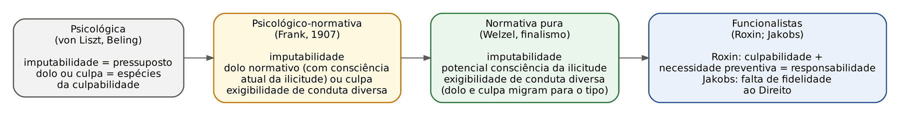
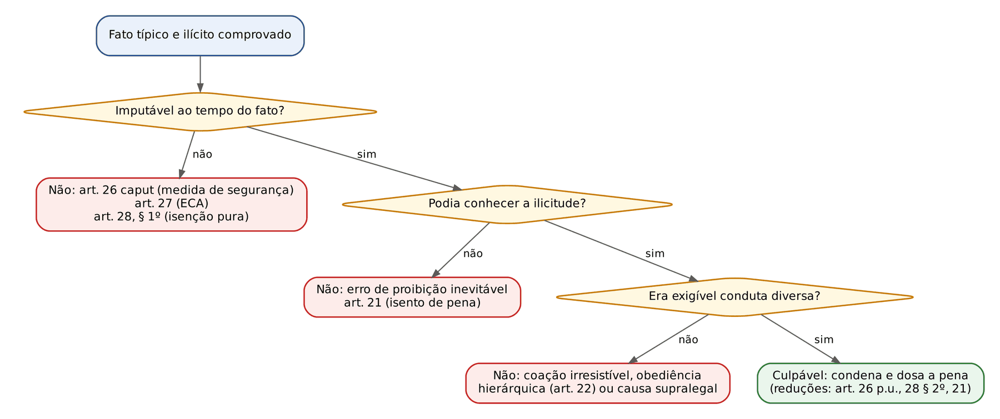
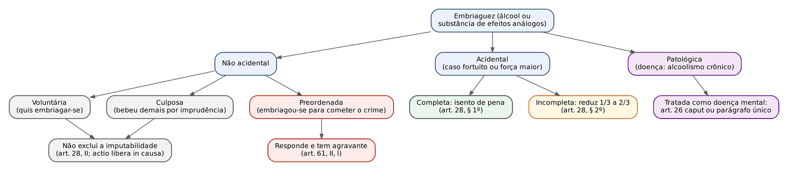
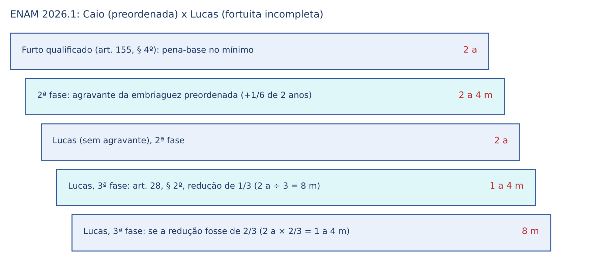
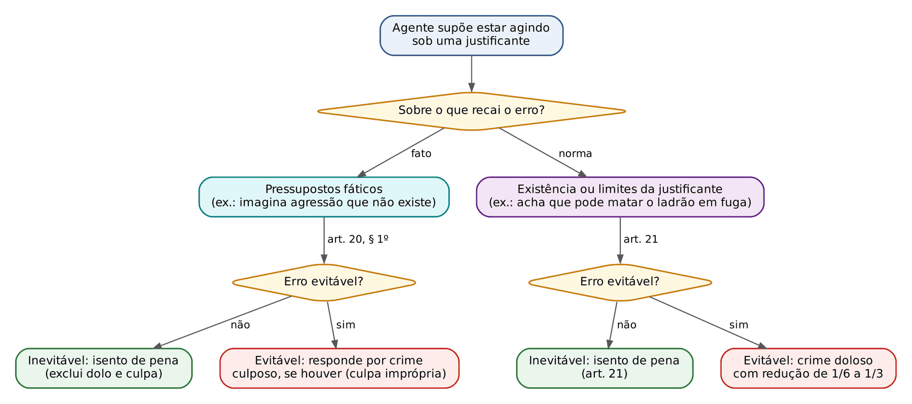

# CAPÍTULO 10 — CULPABILIDADE: IMPUTABILIDADE, EMBRIAGUEZ, ERRO DE PROIBIÇÃO, DESCRIMINANTES PUTATIVAS E INEXIGIBILIDADE DE CONDUTA DIVERSA

:::INCIDENCIA
TRF5 p. 3 e 4; TJRS p. 3; TJSC p. 13. Nível A. Lote: 27 questões (FGV 25, FCC 2).
O que mais cai: efeitos de cada espécie de embriaguez; inimputabilidade x semi-imputabilidade (natureza de dirimente e fração de 1/3 a 2/3); descriminante putativa por erro sobre os pressupostos fáticos (teoria limitada, crime culposo se o erro é evitável); obediência a ordem manifestamente ilegal; causas supralegais de inexigibilidade.
:::

| Subtema | FGV | FCC | Padrão de cobrança |
|---|---|---|---|
| Imputabilidade (doença mental, semi-imputabilidade, diagnóstico x perícia) | 12 | 0 | Caso com laudo; pergunta se é isenção (dirimente) ou redução de 1/3 a 2/3; provas de perito psiquiatra perguntam se o diagnóstico basta |
| Embriaguez | 6 | 0 | Classificar a embriaguez (fortuita, culposa, preordenada) e dar o efeito exato |
| Descriminantes putativas | 6 | 0 | Vulto, mão no bolso, arma de brinquedo: erro de tipo permissivo; evitável gera crime culposo |
| Emoção e paixão | 1 | 0 | Literalidade do art. 28, I |
| Inexigibilidade (coação, obediência, supralegais) | 2 | 1 | Ordem manifestamente ilegal não exclui a culpabilidade; existem causas supralegais |
| Teorias da culpabilidade (vulnerabilidade) | 0 | 1 | Zaffaroni: esforço pessoal para a vulnerabilidade |

## 10.1 Culpabilidade: conceito, evolução e elementos

### 10.1.1 O que é a culpabilidade e para que serve

Depois de verificar que o fato é típico (Caps. 6 e 7) e ilícito (Cap. 9), o juiz ainda pergunta: é possível REPROVAR pessoalmente este agente por ter agido assim? Culpabilidade é esse juízo de reprovação (censurabilidade) que recai sobre o autor de um fato típico e ilícito, porque ele podia ter agido conforme o Direito e não agiu. A tipicidade e a ilicitude olham para o FATO; a culpabilidade olha para o AUTOR naquele fato.

Para o civilista, a analogia útil é a da capacidade e da vontade no negócio jurídico: um contrato pode ter objeto lícito e forma prescrita (o "fato" está perfeito) e ainda assim não vincular quem não tinha discernimento ou quem foi coagido. No Penal, a pergunta equivalente é se o agente tinha capacidade de compreensão (imputabilidade), se podia saber que aquilo era proibido (potencial consciência da ilicitude) e se era razoável exigir dele outro comportamento (exigibilidade de conduta diversa).

A palavra "culpabilidade" aparece com três sentidos diferentes, e a banca explora a confusão:

| Sentido | Onde opera | O que significa |
|---|---|---|
| Princípio da culpabilidade | Limite ao legislador e ao juiz (Cap. 2) | Não há pena sem dolo ou culpa; veda a responsabilidade penal objetiva e o Direito Penal do autor |
| Culpabilidade como elemento (ou pressuposto) do crime | Teoria do delito (este capítulo) | Juízo de reprovação composto de imputabilidade, potencial consciência da ilicitude e exigibilidade de conduta diversa; se ausente, o réu é absolvido |
| Culpabilidade como circunstância judicial | Primeira fase da dosimetria (art. 59; Cap. 13) | GRAU de reprovabilidade da conduta já reconhecida como culpável; serve para elevar a pena-base |

:::JURIS STJ, Jurisprudência em Teses, ed. 26, tese 3
A culpabilidade normativa (imputabilidade, consciência da ilicitude e exigibilidade de conduta diversa) não se confunde com a circunstância judicial da culpabilidade do art. 59, que mede o grau de reprovabilidade da conduta. Consequência prática: não se eleva a pena-base dizendo que "o réu agiu com culpabilidade, pois era imputável e tinha consciência da ilicitude" — isso é apenas afirmar que há crime. A valoração negativa exige dado concreto que torne a conduta mais censurável que o normal do tipo (ver Cap. 13).
:::

Funções da culpabilidade: (a) FUNDAMENTO da pena — sem reprovação não há pena (pode haver medida de segurança, que se funda na periculosidade, não na culpabilidade); (b) LIMITE da pena — a pena não pode ultrapassar a medida da culpabilidade, ainda que razões preventivas recomendassem mais (art. 29, caput: cada concorrente responde "na medida de sua culpabilidade").

Posição na teoria do crime (detalhes no Cap. 5): para a corrente tripartida (majoritária na doutrina e adotada pela FGV), crime é fato típico, ilícito e culpável; para a bipartida (Damásio, Dotti, Capez), a culpabilidade é mero pressuposto de aplicação da pena. O CP ajuda a segunda leitura na linguagem: nas excludentes de ilicitude diz "não há crime" (art. 23), mas nas excludentes de culpabilidade diz "é isento de pena" (arts. 21, 26, 28, § 1º) ou "só é punível o autor da coação ou da ordem" (art. 22). Nas questões, a fórmula segura é: "isento de pena, por ausência de culpabilidade" — e nunca "exclui a ilicitude" ou "exclui a tipicidade".

:::DICA Vocabulário que a banca usa como sinônimo
Causas que excluem a culpabilidade = dirimentes = exculpantes = causas de isenção de pena (no sentido do CP). Causas que excluem a ilicitude = justificantes = descriminantes = causas de exclusão da antijuridicidade. A alternativa que chama a inimputabilidade de "causa justificante" ou de "excludente de ilicitude" está errada (Q2457704 e Q3592869, ver 10.2.2).
:::

### 10.1.2 Evolução dogmática: das teorias psicológicas à normativa pura

Cada teoria responde de modo diferente à pergunta "o que está dentro da culpabilidade?". Saber em que gaveta cada teoria coloca o dolo é o que se cobra.

| Teoria | Sistema | Conteúdo da culpabilidade | Crítica principal |
|---|---|---|---|
| Psicológica (von Liszt, Beling) | Causalista clássico | Vínculo psicológico entre autor e fato; dolo e culpa SÃO as espécies de culpabilidade; imputabilidade é pressuposto | Não explica a culpa inconsciente (sem vínculo psicológico) nem por que o coagido, que age com dolo, não é punido |
| Psicológico-normativa ou normativa complexa (Frank, 1907; Goldschmidt; Freudenthal) | Neokantismo | Imputabilidade + dolo ou culpa + exigibilidade de conduta diversa (normalidade das circunstâncias); o dolo é "normativo": inclui a consciência ATUAL da ilicitude | Mistura objeto da valoração (dolo) com a valoração (reprovação) |
| Normativa pura (Welzel) | Finalismo | Imputabilidade + POTENCIAL consciência da ilicitude + exigibilidade de conduta diversa; dolo (natural, sem consciência da ilicitude) e culpa migram para o fato típico | É a adotada pela Reforma de 1984 e cobrada como regra |
| Funcionalistas (Roxin; Jakobs) | Funcionalismo | Roxin: "responsabilidade" = culpabilidade (capacidade de motivação pela norma) + necessidade preventiva da pena; Jakobs: culpabilidade como falta de fidelidade ao Direito, definida pelas necessidades de prevenção geral positiva | Jakobs é criticado por funcionalizar o indivíduo; Roxin é a referência moderna |

Dois detalhes que caem. Primeiro: na teoria psicológico-normativa, o dolo é normativo ("dolus malus"), carregando a consciência atual da ilicitude; no finalismo, o dolo é natural (consciência e vontade de realizar o tipo) e a consciência da ilicitude passa a ser POTENCIAL e fica na culpabilidade. É por isso que, no CP atual, o erro de proibição não exclui o dolo, mas a culpabilidade (10.4). Segundo: o normativismo puro também separa o objeto da valoração (a conduta dolosa, no tipo) da valoração do objeto (a reprovação, na culpabilidade).

### 10.1.3 Conceito material, culpabilidade do fato e culpabilidade por vulnerabilidade

O conceito FORMAL diz quais elementos compõem a culpabilidade; o conceito MATERIAL procura o fundamento do juízo de reprovação. As respostas clássicas: o "poder agir de outro modo" (livre-arbítrio, Welzel), criticado por ser indemonstrável; a "dirigibilidade normativa" ou capacidade de motivação pela norma (Roxin); e a falta de fidelidade ao Direito (Jakobs). Na prova, basta saber que o conceito material explica POR QUE se reprova, e que a referência majoritária no Brasil é a capacidade de agir de outro modo nas circunstâncias concretas.

Culpabilidade do FATO x culpabilidade do AUTOR: o Direito Penal democrático reprova o agente pelo que ele FEZ, não pelo que ele É (modo de vida, personalidade, "periculosidade" abstrata). A culpabilidade do autor (ou "de caráter", "pela condução de vida", Mezger) é incompatível com o princípio da culpabilidade; resquícios dela aparecem na reincidência e em circunstâncias judiciais como personalidade e conduta social, o que explica as críticas da doutrina a esses institutos (Cap. 13 e 14).

Co-culpabilidade (Zaffaroni e Pierangeli): o Estado e a sociedade, ao negarem a certas pessoas oportunidades de educação, trabalho e renda, compartilham a responsabilidade pelo crime delas; daí a proposta de atenuar a pena, no Brasil, pela atenuante inominada do art. 66 do CP. A jurisprudência do STJ, em regra, não aplica a co-culpabilidade de forma genérica (pobreza não é, por si, causa de atenuação), exigindo circunstância concreta que tenha influído no crime. Fala-se ainda em "co-culpabilidade às avessas", para criticar a punição mais branda de crimes de pessoas de alta renda (ex.: extinção da punibilidade pelo pagamento do tributo) ou a criminalização de condutas típicas de excluídos (ex.: a antiga contravenção de mendicância, revogada em 2009).

A culpabilidade por VULNERABILIDADE é a reformulação do próprio Zaffaroni (Direito Penal Brasileiro, com Batista, Alagia e Slokar): todos estão em algum grau de vulnerabilidade ao poder punitivo seletivo; quem é selecionado a partir de um estado de vulnerabilidade baixo (o "bom cidadão") só o é porque fez grande esforço pessoal para se colocar em situação vulnerável; quem já estava em alta vulnerabilidade (estereótipo do criminoso) precisou de pouco esforço. A culpabilidade pelo ato continua sendo o limite máximo, e a culpabilidade por vulnerabilidade funciona como um segundo filtro, redutor: o juiz deve diminuir a reprovação na medida em que o esforço pessoal do agente foi pequeno. Não autoriza aumento da pena acima da culpabilidade do ato.

:::QUESTAO FCC 2026 — DPE-MT — Defensor Público (Q3954629)
Pediu-se a assertiva correta sobre a culpabilidade por vulnerabilidade. Gabarito: B — a teoria LIMITA a culpabilidade de ato, usando como critério de distribuição do poder de contenção das agências judiciais o esforço pessoal do agente para se colocar em situação de vulnerabilidade.
Armadilhas: (A) ela não suprime o conceito normativo de culpabilidade, soma-se a ele; (C) ela nunca legitima AUMENTO de pena para quem partiu de baixa vulnerabilidade; (E) não é culpabilidade de autor — continua partindo do ato praticado.
:::

### 10.1.4 Elementos e roteiro de verificação

Pela teoria normativa pura, a culpabilidade tem três elementos, verificados nesta ordem. A ausência de qualquer um deles afasta a culpabilidade (dirimente); a sua diminuição pode apenas reduzir a pena.

| Elemento | Causas que o EXCLUEM (isenção de pena) | Causas que o DIMINUEM (redução de pena) |
|---|---|---|
| Imputabilidade | Doença mental ou desenvolvimento mental incompleto ou retardado (art. 26, caput); menoridade (art. 27); embriaguez completa por caso fortuito ou força maior (art. 28, § 1º) | Semi-imputabilidade (art. 26, parágrafo único): 1/3 a 2/3; embriaguez incompleta por caso fortuito ou força maior (art. 28, § 2º): 1/3 a 2/3 |
| Potencial consciência da ilicitude | Erro de proibição inevitável (art. 21, caput, primeira parte) | Erro de proibição evitável: 1/6 a 1/3 (art. 21, caput, parte final) |
| Exigibilidade de conduta diversa | Coação moral irresistível e obediência hierárquica a ordem não manifestamente ilegal (art. 22); causas supralegais | Coação resistível e cumprimento de ordem de superior: atenuantes (art. 65, III, c) |

:::PASSO Como decidir se o réu é culpável
1. Só entre na culpabilidade depois de afirmar tipicidade e ilicitude. Se faltar tipicidade (ex.: erro de tipo invencível) ou ilicitude (ex.: legítima defesa real), a absolvição tem outro fundamento e o raciocínio para ali.
2. Imputabilidade: idade na data do fato (art. 27); laudo de sanidade mental quando houver dúvida (art. 149 do CPP); embriaguez e sua origem.
3. Potencial consciência da ilicitude: o agente sabia ou podia saber, com esforço razoável, que a conduta era proibida? Se não podia, erro inevitável; se podia, erro evitável com redução.
4. Exigibilidade: havia coação, ordem hierárquica ou situação extraordinária que tornasse inexigível outra conduta?
5. Defina o efeito: absolvição própria (art. 386, VI, do CPP), absolvição imprópria com medida de segurança (art. 386, parágrafo único, III, do CPP — só no inimputável do art. 26, caput) ou condenação com redução na terceira fase.
:::

:::QUESTAO FGV 2025 — TJ-GO — Residente Jurídico (Q3345951)
Três réus: Caio agiu para salvar direito próprio de perigo atual que não provocou (texto do art. 24); João, sob coação moral irresistível; Lucas, por desenvolvimento mental incompleto, não era INTEIRAMENTE capaz de entender. Gabarito: D (F – V – F).
Armadilhas: Caio está em ESTADO DE NECESSIDADE, não em legítima defesa (a banca copiou o art. 24 e chamou de legítima defesa); a coação irresistível exclui a culpabilidade (correto); Lucas, "não inteiramente capaz", é SEMI-imputável (art. 26, parágrafo único) e tem só redução de pena, não isenção. Atenção à palavra "inteiramente": no caput o agente é "inteiramente incapaz"; no parágrafo único, "não era inteiramente capaz".
:::

## 10.2 Imputabilidade

### 10.2.1 Conceito, momento e critérios

Imputabilidade é a capacidade de culpabilidade: aptidão para entender o caráter ilícito do fato (momento intelectivo) e de determinar-se de acordo com esse entendimento (momento volitivo). O CP não a define positivamente; diz quando ela falta. A regra, portanto, é a imputabilidade; a inimputabilidade precisa ser demonstrada.

A imputabilidade é aferida "ao tempo da ação ou da omissão" (arts. 26 e 28, § 1º), em harmonia com a teoria da atividade quanto ao tempo do crime (art. 4º; Cap. 3). A doença mental que surge DEPOIS do fato não afasta a culpabilidade; tem reflexos processuais (suspensão do processo, art. 152 do CPP) ou de execução (art. 41 do CP e art. 183 da LEP; Cap. 19).

Critérios legislativos para definir a inimputabilidade:

| Critério | O que basta | Onde o CP usa |
|---|---|---|
| Biológico | A causa (doença, idade), sem indagar se afetou o entendimento no caso concreto | Menoridade (art. 27): presunção absoluta para quem tem menos de 18 anos |
| Psicológico | O efeito (incapacidade de entender ou de se determinar), qualquer que seja a causa | Não adotado como regra; é a lógica parcial da embriaguez acidental (exige incapacidade, mas a causa é a embriaguez fortuita) |
| Biopsicológico (misto) | Causa biológica + efeito psicológico + nexo entre ambos, ao tempo do fato | Regra do CP: art. 26 (doença mental) e art. 28, § 1º (embriaguez acidental) |

:::PEGADINHA Diagnóstico não é sentença
Pelo critério biopsicológico, NÃO basta ter um diagnóstico (esquizofrenia, transtorno bipolar, Alzheimer, pedofilia); é preciso que, AO TEMPO DO FATO e EM RAZÃO da doença, o agente estivesse inteiramente incapaz (isenção) ou parcialmente incapaz (redução) de entender ou de se autodeterminar. Por isso a FGV, em provas para psiquiatras e analistas, considera erradas as alternativas com "automaticamente", "sempre", "por si só" ou "no máximo semi-imputável" (Q3337265, Q3337250, Q3337249, Q3401935). E, ao contrário, a idade avançada NÃO gera inimputabilidade (alternativa D de Q3401935): o que importa é a demência, não os 75 anos.
:::

### 10.2.2 Inimputabilidade por doença mental ou desenvolvimento mental incompleto ou retardado

:::LEI Código Penal, art. 26
Art. 26. É isento de pena o agente que, por doença mental ou desenvolvimento mental incompleto ou retardado, era, ao tempo da ação ou da omissão, inteiramente incapaz de entender o caráter ilícito do fato ou de determinar-se de acordo com esse entendimento.
Parágrafo único. A pena pode ser reduzida de um a dois terços, se o agente, em virtude de perturbação de saúde mental ou por desenvolvimento mental incompleto ou retardado não era inteiramente capaz de entender o caráter ilícito do fato ou de determinar-se de acordo com esse entendimento.
:::

Os três requisitos do caput são cumulativos:

- Causal (biológico): doença mental (expressão ampla, abrangendo psicoses, demências, epilepsia em crise, alcoolismo crônico patológico e dependência química grave) ou desenvolvimento mental incompleto (quem ainda não completou a maturação psíquica — exemplo doutrinário clássico: o surdo-mudo sem instrução que não se comunica com o meio) ou retardado (oligofrenias, deficiência intelectual).
- Cronológico: a incapacidade deve existir no momento da conduta. Quem tem doença cíclica pode ser imputável num "intervalo lúcido".
- Consequencial (psicológico): INTEIRA incapacidade de entender o caráter ilícito OU (basta uma das duas) de determinar-se de acordo com esse entendimento. Um cleptomaníaco pode entender que furtar é proibido e, ainda assim, não conseguir se conter: falha o momento volitivo.

Sobre os indígenas, a doutrina antiga os enquadrava como "desenvolvimento mental incompleto"; essa leitura é hoje rejeitada por discriminatória. A diversidade cultural se resolve, quando for o caso, pelo erro de proibição culturalmente condicionado (10.4.3), não pela inimputabilidade. Transtornos de personalidade (inclusive o antissocial, a psicopatia) em regra NÃO excluem a imputabilidade, pois o agente entende o caráter ilícito e conserva, ao menos em parte, a autodeterminação; podem, conforme a perícia, levar à semi-imputabilidade.

:::QUESTAO FGV 2024 — AL-TO — Analista Legislativo (Q2457704)
José, por esquizofrenia, era inteiramente incapaz de entender o caráter ilícito ao esfaquear a vítima. Gabarito: E — é isento de pena, pela inimputabilidade, causa DIRIMENTE.
Armadilhas: (A) fração "de um sexto a dois terços" não existe; (B) redução de 1/3 a 2/3 é para quem "não era inteiramente capaz"; (C) e (D) chamam a inimputabilidade de excludente de ilicitude ou justificante.
No mesmo sentido: Q3592869 (FGV 2025 — TJ-SC — Juiz Leigo: difamação por agente inteiramente incapaz; gabarito E, "excludente da culpabilidade").
:::

:::QUESTAO FGV 2026 — HU Brasil — Psicoterapia (Q4319732)
Esquizofrênico que abandonou o tratamento planejou meticulosamente uma emboscada contra o vizinho, que julgava parte de um complô para "roubar sua mente"; a perícia, oito meses depois, encontrou-o compensado, e os familiares relataram vozes e pensamento desorganizado nas semanas anteriores. Gabarito: A — preenche os critérios de inimputabilidade, porque o delírio comprometeu a autodeterminação quanto àquele ato, independentemente da capacidade de planejamento instrumental.
Armadilhas: planejamento lógico não prova imputabilidade (o delírio pode orientar um plano bem executado); a perícia tardia não impede o exame retrospectivo, que se apoia em relatos e prontuários; e a interrupção voluntária do tratamento não foi tratada como *actio libera in causa*. Este último ponto é discutível em doutrina, mas o gabarito segue a orientação de que o art. 28, II, e a *actio libera in causa* se referem à embriaguez, não à doença mental.
:::

Na mesma prova de psiquiatria, a FGV perguntou qual condição NÃO pode levar à inimputabilidade por alienação mental e apontou o transtorno de personalidade antissocial (Q3856243, gabarito D), em contraste com esquizofrenia, transtorno delirante, depressão maior grave e fuga dissociativa — quadros que, conforme o caso, podem suprimir o entendimento ou a autodeterminação.

:::PROCESSO Incidente de insanidade mental e absolvição imprópria
- Havendo dúvida sobre a integridade mental do acusado, o juiz determina o exame médico-legal, de ofício ou a requerimento do MP, do defensor, do curador ou de familiares; pode ser ordenado ainda no inquérito (art. 149 e § 1º do CPP). O processo fica suspenso, salvo diligências urgentes, e nomeia-se curador (art. 149, § 2º).
- O reconhecimento da inimputabilidade ou da semi-imputabilidade depende da prévia instauração do incidente e do exame médico-legal; documentos médicos avulsos não bastam (STJ, REsp 1.802.845/RS, j. 23/6/2020, Info 675). O juiz, porém, não fica vinculado ao laudo e pode rejeitá-lo fundamentadamente (art. 182 do CPP).
- Se a doença sobreveio ao fato, o processo fica suspenso até o restabelecimento (art. 152 do CPP).
- Comprovada a inimputabilidade do art. 26, caput, o juiz ABSOLVE (art. 386, VI) e aplica medida de segurança (art. 386, parágrafo único, III) — a chamada absolvição imprópria (Cap. 19). Antes, porém, deve examinar as teses que levariam à absolvição própria (inexistência do fato, negativa de autoria, legítima defesa), pois são mais favoráveis.
- No Júri, o juiz só absolve sumariamente o inimputável quando a inimputabilidade for a ÚNICA tese defensiva (art. 415, parágrafo único, do CPP); havendo outra tese (ex.: legítima defesa), o caso vai aos jurados, que podem absolvê-lo sem medida de segurança.
:::

:::SENTENCA Absolvição imprópria
Onde entra: depois de afirmar materialidade, autoria, tipicidade e ilicitude, e de rejeitar as teses de absolvição própria. O dispositivo deve mencionar a causa (art. 386, caput, do CPP).
Redação-modelo: "Comprovados a materialidade e a autoria de fato típico e ilícito, o laudo de fls. demonstra que o acusado, por esquizofrenia paranoide, era, ao tempo da ação, inteiramente incapaz de entender o caráter ilícito do fato, o que o isenta de pena (art. 26, caput, do CP). Absolvo-o, com fundamento no art. 386, VI, do CPP, e aplico-lhe medida de segurança de [internação ou tratamento ambulatorial], nos termos do art. 386, parágrafo único, III, do CPP, e do art. 97 do CP."
Erro que a banca pune: condenar o inimputável e "substituir" a pena por medida de segurança (isso é técnica do semi-imputável, art. 98) ou absolver sem enfrentar autoria e materialidade.
:::

### 10.2.3 Semi-imputabilidade (imputabilidade diminuída)

O semi-imputável é IMPUTÁVEL: há crime e há culpabilidade, apenas diminuída. Por isso ele é CONDENADO, e a pena é reduzida de 1/3 a 2/3 (art. 26, parágrafo único). A lei fala em "perturbação de saúde mental" (quadro menos grave que a doença mental) ou desenvolvimento mental incompleto ou retardado que deixa o agente "não inteiramente capaz".

Três regras de aplicação:

- Natureza: causa de diminuição de pena, aplicada na TERCEIRA fase da dosimetria (Cap. 15), e pode, portanto, levar a pena abaixo do mínimo legal.
- "Pode ser reduzida": reconhecida a semi-imputabilidade, a redução é direito do réu (posição amplamente majoritária); o "pode" se refere à graduação da fração. A fração segue o GRAU de comprometimento indicado pela perícia: quanto maior a perturbação, maior a redução.
- Sistema vicariante: se o condenado necessitar de especial tratamento curativo, a pena privativa de liberdade JÁ REDUZIDA pode ser substituída por internação ou tratamento ambulatorial (art. 98). Nunca se aplicam pena e medida de segurança juntas (o "duplo binário" foi abolido em 1984). Detalhes no Cap. 19.

:::EXEMPLO Cálculo da redução por semi-imputabilidade
B pratica roubo simples (art. 157, caput: 4 a 10 anos). Pena-base no mínimo (4 anos), sem agravantes ou atenuantes. Laudo: semi-imputável.
Passo 1 — converta em meses: 4 anos = 48 meses.
Passo 2 — redução mínima (1/3): 48 ÷ 3 = 16 meses; 48 − 16 = 32 meses = 2 anos e 8 meses.
Passo 3 — redução máxima (2/3): 48 × 2/3 = 32 meses; 48 − 32 = 16 meses = 1 ano e 4 meses.
Passo 4 — escolha fundamentada: laudo aponta comprometimento "acentuado" da autodeterminação → 2/3 → pena definitiva de 1 ano e 4 meses.
Se houvesse também tentativa (redução de 1/3 a 2/3, art. 14, parágrafo único), as duas diminuições incidiriam em cascata, a segunda sobre o resultado da primeira (Cap. 15): 1 ano e 4 meses (16 meses) − 1/3 (5 meses e 10 dias) = 10 meses e 20 dias.
:::

:::QUESTAO FGV 2026 — PC-PI — Perito Médico Legista e Psiquiatria (Q3856231)
Pediu-se a consequência para quem "não era inteiramente capaz". Gabarito: B — a pena "pode ser reduzida em dois terços".
Armadilha: a resposta é incompleta (a lei diz "de um a dois terços"), mas é a única compatível com o art. 26, parágrafo único; as demais negam a redução ou inventam fração de 1/4. Em prova, escolha a alternativa "menos errada" quando a banca recorta o texto legal.
:::

:::QUESTAO FGV 2026 — MPE-RJ — Promotor de Justiça Substituto (Q4088245)
Tales, com transtorno afetivo bipolar e sem a medicação, embriagou-se voluntariamente e, dominado por intensa emoção, matou o sócio; o laudo atestou que ele não era inteiramente incapaz de entender e tinha a autodeterminação reduzida pela associação entre transtorno e embriaguez. Gabarito: C — semi-imputável, condenado com redução de 1/3 a 2/3.
Armadilhas: (A) emoção não é causa supralegal de exclusão (art. 28, I); (B) embriaguez voluntária completa não exclui a culpabilidade; (D) a embriaguez voluntária e a emoção não impedem que o transtorno mental, comprovado pela perícia, gere semi-imputabilidade; (E) "relativamente inimputável" não é absolvido: é condenado (absolvição imprópria é só para o inimputável).
:::

### 10.2.4 Menoridade penal

:::LEI Código Penal, art. 27, e Constituição Federal, art. 228
Art. 27. Os menores de 18 (dezoito) anos são penalmente inimputáveis, ficando sujeitos às normas estabelecidas na legislação especial.
CF, art. 228. São penalmente inimputáveis os menores de dezoito anos, sujeitos às normas da legislação especial.
:::

Aqui o critério é puramente BIOLÓGICO e a presunção é ABSOLUTA: não importa se o adolescente de 17 anos é maduro, casado, emancipado ou universitário. Para o civilista: a emancipação (art. 5º, parágrafo único, do CC) não antecipa a imputabilidade penal. O adolescente que pratica fato descrito como crime comete ATO INFRACIONAL (art. 103 do ECA) e fica sujeito a medidas socioeducativas; a criança (até 12 anos incompletos), apenas a medidas de proteção (Cap. 42).

Regras de aplicação:

- Momento: a idade é aferida na data da conduta (teoria da atividade). O agente torna-se imputável no primeiro instante do dia em que completa 18 anos, independentemente da hora do nascimento.
- Crime permanente: se a conduta se prolonga e o agente completa 18 anos durante a permanência (ex.: extorsão mediante sequestro com a vítima ainda em cativeiro), responde pelo crime, pois pratica atos após a maioridade.
- Crime cujo resultado ocorre após os 18 (disparo aos 17 anos, morte da vítima após o aniversário): não responde, porque vale o momento da conduta.
- Prova da idade: documento hábil (Súmula 74 do STJ — ver Cap. 14, onde se trata também da atenuante da idade inferior a 21 anos).
- Medida de segurança NÃO se aplica ao adolescente (Q3453259, alternativa C, errada): a resposta estatal é a do ECA.

A redução da maioridade por emenda constitucional é debatida (há quem sustente que o art. 228 é cláusula pétrea, por veicular direito individual, e quem negue); a questão é política e não foi resolvida pelo STF. Para prova objetiva basta saber das duas posições.

### 10.2.5 Emoção e paixão

Emoção é perturbação intensa e passageira do ânimo (ira, medo, susto); paixão é estado emocional duradouro e crônico (ciúme, ódio, amor obsessivo). Nenhuma delas exclui a imputabilidade (art. 28, I), porque o CP quer que as pessoas controlem seus impulsos. Mas a emoção tem reflexos na pena, e a banca cobra a diferença das fórmulas:

| Instituto | Fórmula legal | Exigências | Natureza |
|---|---|---|---|
| Homicídio privilegiado (art. 121, § 1º) e lesão privilegiada (art. 129, § 4º) | "sob o DOMÍNIO de violenta emoção, LOGO EM SEGUIDA a injusta provocação da vítima" | Domínio + imediatidade + provocação injusta | Causa de diminuição (1/6 a 1/3), terceira fase (Caps. 27 e 28) |
| Atenuante genérica (art. 65, III, c) | "sob a INFLUÊNCIA de violenta emoção, provocada por ato injusto da vítima" | Mera influência; não exige reação imediata | Atenuante, segunda fase (Cap. 14) |
| Emoção ou paixão patológica | Quadro que configura doença ou perturbação mental | Laudo | Art. 26, caput ou parágrafo único |
| Emoção ou paixão comum | Art. 28, I | — | Irrelevante para a imputabilidade |

:::QUESTAO FGV 2024 — Câmara dos Deputados — Consultor Legislativo (Q2513039)
Perguntou-se o que NÃO exclui a imputabilidade. Gabarito: D — a emoção ou a paixão (literalidade do art. 28, I). As demais (doença mental, desenvolvimento mental incompleto ou retardado, embriaguez completa fortuita, menoridade) excluem.
No mesmo sentido: Q3086952 (alternativa E errada: emoção e paixão não excluem a culpabilidade nem geram, por si, semi-imputabilidade) e Q3453259 (alternativa B errada: a provocação da vítima e a forte emoção não isentam de pena).
:::

## 10.3 Embriaguez

### 10.3.1 Conceito, graus e espécies

Embriaguez é a intoxicação aguda e transitória causada pelo álcool ou por substância de efeitos análogos (drogas, medicamentos psicoativos). A medicina legal descreve três fases: excitação (desinibição), depressão (confusão, descoordenação) e sono ou coma. Para o Direito Penal, interessa se ela é COMPLETA (supressão da capacidade de entender ou de se autodeterminar, fases de depressão e sono) ou INCOMPLETA (redução dessa capacidade, fase de excitação), e, sobretudo, qual a sua ORIGEM.

:::LEI Código Penal, art. 28, II, e §§ 1º e 2º
Art. 28. Não excluem a imputabilidade penal: [...] II - a embriaguez, voluntária ou culposa, pelo álcool ou substância de efeitos análogos.
§ 1º É isento de pena o agente que, por embriaguez completa, proveniente de caso fortuito ou força maior, era, ao tempo da ação ou da omissão, inteiramente incapaz de entender o caráter ilícito do fato ou de determinar-se de acordo com esse entendimento.
§ 2º A pena pode ser reduzida de um a dois terços, se o agente, por embriaguez, proveniente de caso fortuito ou força maior, não possuía, ao tempo da ação ou da omissão, a plena capacidade de entender o caráter ilícito do fato ou de determinar-se de acordo com esse entendimento.
:::

| Espécie | Como ocorre | Exemplo | Efeito penal |
|---|---|---|---|
| Voluntária (intencional) | O agente quer embriagar-se (não necessariamente cometer crime) | Vai ao bar "para beber até cair" | Não exclui nem reduz a imputabilidade (art. 28, II), completa ou incompleta |
| Culposa | Não quer embriagar-se, mas bebe imprudentemente além da conta | Excede-se no brinde e fica completamente embriagado | Idem: responde normalmente |
| Preordenada | Embriaga-se PARA cometer o crime (criar coragem, garantir álibi de descontrole) | Bebe para ter ânimo de matar o desafeto | Responde e incide a AGRAVANTE do art. 61, II, l |
| Acidental por caso fortuito | Ignora a natureza ou o efeito da substância, ou a reação imprevisível com medicamento | Toma suco "batizado"; mistura imprevisível de remédio e álcool | Completa: isento de pena (art. 28, § 1º); incompleta: redução de 1/3 a 2/3 (§ 2º) |
| Acidental por força maior | É forçado a ingerir | Obrigado sob ameaça de arma a beber | Idem |
| Patológica | Alcoolismo crônico, dependência que configura doença mental | Delirium tremens | Tratada como doença mental: art. 26, caput (medida de segurança) ou parágrafo único |

Diferença decisiva entre o art. 26 e o art. 28, § 1º: o inimputável por doença mental recebe absolvição IMPRÓPRIA, com medida de segurança, porque é perigoso; o embriagado acidental recebe absolvição PRÓPRIA, sem medida alguma, porque o episódio é transitório e não revela periculosidade.

Quanto a drogas ilícitas, a Lei 11.343/2006 tem regra própria, com a mesma estrutura: isenção de pena para quem, em razão de dependência ou de efeito de droga proveniente de caso fortuito ou força maior, era inteiramente incapaz ao tempo do fato (art. 45), e redução de 1/3 a 2/3 para a capacidade apenas diminuída (art. 46). A diferença é que a DEPENDÊNCIA está expressamente equiparada ao caso fortuito, com encaminhamento a tratamento (Cap. 37).

### 10.3.2 A *actio libera in causa*

Se o embriagado voluntário, no momento do crime, não tinha capacidade de entender, por que é punido? A resposta tradicional é a teoria da *actio libera in causa* ("ação livre na causa"): a imputabilidade não é examinada no momento da conduta, mas no momento ANTERIOR, em que o agente, livre e consciente, decidiu beber. Quem se coloca livremente em estado de inimputabilidade responde pelo que fizer nesse estado.

A teoria nasceu para os casos de embriaguez PREORDENADA (o agente já decidiu, sóbrio, cometer o crime e usa o próprio corpo embriagado como instrumento — algo próximo de uma autoria mediata de si mesmo). O CP de 1940 a estendeu a TODA embriaguez voluntária ou culposa, o que gera a crítica central: no motorista que bebe numa festa sem pensar em crime algum e, horas depois, agride alguém, não há vínculo psicológico (dolo ou culpa) entre o momento livre (beber) e o fato praticado — a punição se aproxima da responsabilidade penal objetiva. Por isso parte da doutrina (Zaffaroni e Pierangeli, Juarez Cirino dos Santos, Bitencourt com ressalvas) propõe restringir a *actio libera in causa* aos casos em que, no momento de beber, o resultado era ao menos PREVISÍVEL, respondendo o agente por dolo se o previu e quis, por culpa se era previsível, e não respondendo se imprevisível.

Para a prova objetiva: a lei adotou a *actio libera in causa* em sentido amplo; a embriaguez voluntária ou culposa, ainda que completa, não exclui a imputabilidade; as críticas existem e são cobradas como "a teoria pode conduzir à responsabilidade penal objetiva".

:::JURIS STJ, AREsp 2.835.056-MG, Quinta Turma, j. 20/5/2025 (Info 851)
A embriaguez voluntária e o ânimo exaltado do réu não afastam o dolo específico (intenção de ofender pela raça ou cor) exigido pela injúria racial (art. 2º-A da Lei 7.716/1989). A tese vale para qualquer crime: embriaguez voluntária não exclui o dolo nem a imputabilidade (art. 28, II), e a emoção não exclui a imputabilidade (art. 28, I). O crime em si é tratado no Cap. 41; a FGV cobrou exatamente essa tese em Q4088268 (MPE-RJ 2026).
:::

:::PEGADINHA Embriaguez e dolo eventual no trânsito
Não confunda: o art. 28 trata da IMPUTABILIDADE. Saber se o motorista embriagado agiu com dolo eventual ou culpa consciente é questão do TIPO (Cap. 7), e o STJ entende que a embriaguez, por si só, não autoriza presumir dolo eventual (Q3453257, ch. 7; Q3387035, Cap. 27).
:::

### 10.3.3 Questões sobre embriaguez

:::QUESTAO FGV 2024 — TJ-SC — Juiz Substituto (Q3049378)
Elisa, sob medicação psiquiátrica incompatível com álcool, pergunta ao garçom se o coquetel tem álcool; pela resposta confusa em meio à música alta, entende que não, mas a bebida tinha vodca; a combinação suprime totalmente seu entendimento e ela se despe na pista de dança. Gabarito: C — cometeu o crime de ato obsceno (fato típico e ilícito), porém fica ISENTA DE PENA.
Fundamento: embriaguez acidental por caso fortuito (ela ignorava a natureza da bebida e tomou cuidado razoável ao perguntar), completa → art. 28, § 1º. A conduta é dolosa no sentido finalista (quis tirar a roupa), daí estar errada a alternativa B ("ausência de dolo"). Também está errada a E: não há medida de segurança, pois o caso não é de doença mental.
Armadilha: o fato de ela saber que não podia misturar álcool e remédio poderia sugerir embriaguez culposa; a banca entendeu que o erro sobre o conteúdo da bebida, induzido pela informação do garçom, foi inevitável. Se ela tivesse bebido sem perguntar, a resposta seria A.
:::

:::QUESTAO FGV 2026 — ENAM 2026.1 (Q4102460)
Lucas e Caio cometem furto qualificado; Lucas, por embriaguez de caso fortuito, NÃO possuía a PLENA capacidade de entender; Caio estava em embriaguez preordenada. Gabarito: A — Caio responde com a agravante; Lucas responde, com redução de 1/3 a 2/3.
Fundamento: "não possuía a plena capacidade" = embriaguez fortuita INCOMPLETA (§ 2º), não isenção (§ 1º, que exige inteira incapacidade, alternativa C errada). A preordenada agrava (art. 61, II, l), não é neutra (B e E erradas) e não se estende a Lucas (D errada), porque é circunstância pessoal.
:::

:::EXEMPLO Refazendo as contas da questão da ENAM (furto qualificado: 2 a 8 anos)
Caio: pena-base no mínimo, 2 anos (24 meses). Segunda fase: agravante de 1/6 (fração usual do STJ para cada agravante; Cap. 14): 24 ÷ 6 = 4 meses → 2 anos e 4 meses. Sem causas de aumento ou diminuição → pena definitiva de 2 anos e 4 meses.
Lucas: pena-base de 2 anos, sem agravantes. Terceira fase: redução do art. 28, § 2º. Com 1/3: 24 ÷ 3 = 8 meses → 1 ano e 4 meses. Com 2/3: 24 × 2/3 = 16 meses → 8 meses. A escolha da fração depende do grau de comprometimento demonstrado.
Note que a agravante entra na SEGUNDA fase e não pode levar a pena acima do máximo; a redução entra na TERCEIRA e pode levá-la abaixo do mínimo.
:::

:::QUESTAO FGV 2026 — TRF2 — Juiz Federal Substituto (Q3996827)
João, passageiro, em embriaguez completa CULPOSA pelo álcool, dá um soco em policial rodoviário federal durante a abordagem. Gabarito: E — poderá responder criminalmente pela conduta, sem aumento nem diminuição em razão da embriaguez.
Fundamento: art. 28, II. A embriaguez culposa, ainda que completa, não isenta (C e D erradas), não diminui (B errada) e não é causa de aumento (A errada); só a preordenada agrava.
:::

:::QUESTAO FGV 2025 — TJ-TO — Juiz Substituto (Q3453259)
Várias teses defensivas para João, que quebrou uma vitrine. Gabarito: E — a embriaguez preordenada agrava a pena.
Armadilhas: (A) embriaguez completa só exclui a imputabilidade se acidental; (B) emoção provocada não isenta; (C) adolescente de 17 anos é inimputável, mas não recebe medida de segurança (ECA); (D) quem "não era inteiramente capaz" é semi-imputável e tem só redução.
No mesmo sentido, quanto à preordenada como agravante e não atenuante: Q3086952 (alternativa A errada); correlatas de outros capítulos: Q3345947 (Cap. 15) e Q4037434 (Cap. 14).
:::

:::QUESTAO FGV 2026 — PC-PI — Perito Médico Legista (Q3850381)
Gabarito: B — é isento de pena quem, por embriaguez COMPLETA proveniente de caso fortuito ou força maior, era incapaz de entender. Armadilhas: (D) preordenada não isenta; (E) "embriaguez acidental" sem a palavra "completa" é insuficiente; (C) preordenada não é "intoxicação forçada".
No mesmo sentido: Q3856228 (gabarito C, "embriaguez involuntária" exclui a imputabilidade — redação imprecisa, pois a lei exige também que seja completa; a alternativa A, dependentes químicos do álcool, remete à embriaguez patológica, tratada pelo art. 26 e não pelo art. 28). Contraste com Q3086952, alternativa B, considerada ERRADA pela mesma banca: "a embriaguez involuntária isenta o réu de pena" — falta a exigência de ser completa. Moral: em questão de "única correta", a expressão incompleta pode ser aceita; em questão com alternativa mais precisa, ela é tratada como errada.
:::

:::SENTENCA Embriaguez na sentença
Embriaguez voluntária ou culposa: enfrente a tese defensiva em uma frase, sem levá-la à dosimetria: "A embriaguez voluntária não exclui a imputabilidade (art. 28, II, do CP), nem afasta o dolo, que se extrai das circunstâncias objetivas da conduta."
Embriaguez preordenada: exige PROVA de que o agente bebeu para cometer o crime; não se presume do simples consumo. Entra na segunda fase como agravante (art. 61, II, l).
Embriaguez acidental completa: absolvição própria (art. 386, VI, do CPP, que menciona expressamente o § 1º do art. 28), sem medida de segurança. Incompleta: condenação com redução na terceira fase, com a fração justificada.
:::

## 10.4 Potencial consciência da ilicitude e erro de proibição

### 10.4.1 Consciência atual x potencial; teorias do dolo e da culpabilidade

Para ser reprovado, o agente precisa ter podido saber que sua conduta era proibida. Não se exige conhecimento técnico da lei (artigo, pena), mas a "valoração paralela na esfera do profano" (Mezger): o leigo deve poder perceber, segundo o padrão médio de sua comunidade, que aquilo é contrário ao Direito. E não se exige consciência ATUAL; basta a POTENCIAL: se o agente podia, com esforço razoável, conhecer a ilicitude, é culpável (ainda que com redução se não a conhecia).

Onde colocar a consciência da ilicitude gerou quatro teorias, com efeitos diferentes sobre os erros:

| Teoria | Onde está a consciência da ilicitude | Efeito do erro de proibição | Descriminantes putativas |
|---|---|---|---|
| Extremada (estrita) do dolo | No dolo (consciência atual) | Exclui o dolo; se evitável, culpa | Igual ao erro de proibição |
| Limitada do dolo (Mezger) | No dolo, mas presumida em quem tem "cegueira jurídica" | Igual, salvo hostilidade ao Direito | Idem |
| Extremada (estrita) da culpabilidade (Welzel) | Na culpabilidade (potencial) | Exclui ou reduz a culpabilidade; dolo intacto | TODAS são erro de proibição (indireto) |
| Limitada da culpabilidade | Na culpabilidade (potencial) | Exclui ou reduz a culpabilidade | Erro sobre os pressupostos FÁTICOS = erro de tipo permissivo (art. 20, § 1º); erro sobre existência ou limites = erro de proibição (art. 21) |

O CP adotou a teoria LIMITADA da culpabilidade, como afirma a Exposição de Motivos da Parte Geral de 1984 (item 17 — confira a numeração na nota de verificação) e como se extrai da colocação das descriminantes putativas como parágrafo do artigo do erro de TIPO (art. 20, § 1º). A diferença entre as duas teorias da culpabilidade só aparece nas descriminantes putativas fáticas (10.5).

### 10.4.2 Desconhecimento da lei x erro sobre a ilicitude do fato

:::LEI Código Penal, art. 21
Art. 21. O desconhecimento da lei é inescusável. O erro sobre a ilicitude do fato, se inevitável, isenta de pena; se evitável, poderá diminuí-la de um sexto a um terço.
Parágrafo único. Considera-se evitável o erro se o agente atua ou se omite sem a consciência da ilicitude do fato, quando lhe era possível, nas circunstâncias, ter ou atingir essa consciência.
:::

O artigo parece contraditório (o desconhecimento da lei é inescusável, mas o erro sobre a ilicitude escusa), e a chave é distinguir:

- Desconhecimento da LEI: ignorar o texto legal, o número do artigo, a pena. É inescusável (ninguém se exime alegando não conhecer a lei — também art. 3º da LINDB). Tem só efeito de ATENUANTE genérica (art. 65, II).
- Erro sobre a ILICITUDE DO FATO: o agente conhece (ou não) a lei, mas acredita que a SUA conduta concreta é permitida, por falsa compreensão do que o Direito proíbe. É escusável se inevitável.

Exemplo: o agricultor sabe que existe uma "lei ambiental", mas, por informação errada de um técnico do órgão estadual, acredita que pode suprimir aquela vegetação: erro sobre a ilicitude. O comerciante que nunca leu o Código de Defesa do Consumidor, mas sabe que vender produto vencido como bom é errado: desconhecimento da lei, irrelevante (no máximo atenuante).

Nas contravenções, a Lei das Contravenções Penais tem regra própria: no caso de ignorância ou errada compreensão da lei, quando escusáveis, a pena pode deixar de ser aplicada (art. 8º do Decreto-Lei 3.688/1941; Cap. 50).

### 10.4.3 Modalidades do erro de proibição

| Modalidade | Em que consiste | Exemplo |
|---|---|---|
| Direto | Erro sobre a norma PROIBITIVA: o agente acha que a conduta não é proibida, ou interpreta mal o seu alcance | Quem acha coisa perdida e fica com ela supondo que "achado não é roubado" (art. 169, parágrafo único, II); quem acredita que pode reter a coisa do devedor inadimplente até ser pago |
| Indireto (erro de permissão) | O agente sabe que a conduta é em regra proibida, mas supõe uma causa de justificação que não existe ou cujos LIMITES extrapola | Credor que acha estar autorizado a se apossar de bens do devedor (justificante inexistente); proprietário que supõe poder matar o ladrão que foge com um objeto de pouco valor (limite da legítima defesa) |
| Mandamental | Erro sobre a norma MANDAMENTAL nos crimes omissivos: o agente sabe da situação de perigo, mas supõe não ter o dever de agir | Pessoa que vê alguém ferido e acredita que só o médico tem o dever de socorrer; garantidor que supõe que seu dever cessou |

Fala-se ainda em erro de proibição CULTURALMENTE CONDICIONADO (Zaffaroni): o agente, por pertencer a cultura diversa, internalizou valores que o impedem de compreender a proibição (ex.: indígena não integrado, comunidades tradicionais). Não é inimputabilidade; é erro de proibição, em regra inevitável.

:::JURIS STJ, AgRg no AREsp 2.389.611-MG, Quinta Turma, j. 12/3/2024 (Info 807)
Em caso de estupro de vulnerável (art. 217-A), o STJ manteve absolvição de jovem de 20 anos, trabalhador rural de pouca escolaridade, que se relacionou com adolescente de 12 anos com aceitação inicial da família, do que nasceu uma filha, reconhecendo ausência de culpabilidade por erro de proibição, somada à proteção integral da criança nascida da relação. É aplicação excepcional (*distinguishing*) da Súmula 593 e do Tema 918 do STJ, que tornam irrelevante o consentimento da vítima (Cap. 31). Interessa aqui como exemplo de erro de proibição admitido pelo STJ a partir das condições pessoais do agente; não o generalize.
:::

### 10.4.4 Erro inevitável x evitável e o cálculo da redução

Inevitável (escusável, invencível): nem um homem prudente, nas mesmas condições, teria atingido a consciência da ilicitude → isenção de pena (absolvição pelo art. 386, VI, do CPP). Evitável (inescusável, vencível): era possível, nas circunstâncias, atingir a consciência (art. 21, parágrafo único) → condenação por crime DOLOSO, com redução de 1/6 a 1/3, na terceira fase. A evitabilidade é aferida pelas condições concretas do agente (instrução, meio social, se tinha razão para duvidar e meios de se informar). Quem exerce atividade regulada tem o dever de se informar sobre as regras dela: o empresário do ramo não alega erro sobre norma básica da sua atividade.

:::EXEMPLO Redução por erro de proibição evitável
C pratica crime com pena de 1 a 4 anos; pena fixada, nas duas primeiras fases, em 1 ano e 6 meses (18 meses). Reconhecido erro de proibição evitável.
Com 1/6: 18 ÷ 6 = 3 meses → 1 ano e 3 meses.
Com 1/3: 18 ÷ 3 = 6 meses → 1 ano.
Critério da fração: quanto mais próximo da inevitabilidade (mais difícil era conhecer a ilicitude), maior a redução (1/3); erro grosseiro → 1/6.
Compare as frações para não trocá-las: erro de proibição evitável = 1/6 a 1/3; semi-imputabilidade e embriaguez fortuita incompleta = 1/3 a 2/3.
:::

### 10.4.5 Erro de tipo x erro de proibição

O erro de tipo (detalhado no Cap. 7) recai sobre a REALIDADE: o agente não sabe o que faz (pega o celular alheio pensando ser o seu). O erro de proibição recai sobre a VALORAÇÃO jurídica: o agente sabe exatamente o que faz, mas pensa que é permitido. Fórmula de memorização: no erro de tipo, o agente "não sabe o que faz"; no erro de proibição, "sabe o que faz, mas acha que pode".

| Critério | Erro de tipo essencial (art. 20, caput) | Erro de proibição (art. 21) |
|---|---|---|
| Objeto do erro | Elementos do tipo (realidade fática ou elementos normativos) | Ilicitude da conduta (proibição) |
| Elemento afetado | Dolo (fato típico) | Potencial consciência da ilicitude (culpabilidade) |
| Inevitável | Exclui dolo e culpa: fato atípico | Isenta de pena: exclui a culpabilidade |
| Evitável | Exclui o dolo; responde por culpa, se houver tipo culposo | Responde pelo crime DOLOSO com redução de 1/6 a 1/3 |
| Sentença | Art. 386, III ("não constituir o fato infração penal") | Art. 386, VI ("isentem o réu de pena") |

Correlatas de outros capítulos com a mesma distinção: Q3692428 (ENAM 2025.2, Cap. 7: erro de tipo = falsa noção da realidade; erro de proibição = falsa noção da ilicitude) e Q3387031 (DPE-RS 2025, Cap. 7).

:::PEGADINHA Elemento normativo do tipo
Erro sobre elemento normativo do tipo ("coisa ALHEIA", "documento", "funcionário público") é erro de TIPO, embora envolva conceito jurídico: quem leva a coisa que, por equívoco sobre a partilha, supõe ser sua, erra sobre o "alheia" e não comete furto. Já quem sabe que a coisa é alheia, mas pensa que pode levá-la como garantia da dívida, erra sobre a proibição.
:::

## 10.5 Descriminantes putativas

### 10.5.1 As três situações de erro sobre uma justificante

"Putativo" vem de *putare* (supor, imaginar). Descriminante putativa é a causa de justificação que existe apenas na cabeça do agente: ele supõe agir em legítima defesa, estado de necessidade, estrito cumprimento do dever legal ou exercício regular de direito, mas a situação justificante não existe. A ilicitude objetiva PERMANECE (não há justificante real; por isso a vítima do putativamente defendido pode reagir em legítima defesa real — tema do Cap. 9), e a discussão é o que fazer com o erro.

O erro pode recair sobre três objetos:

- Pressupostos FÁTICOS da justificante: o agente imagina uma situação de fato que, se existisse, tornaria a ação legítima (o vulto põe a mão no bolso e ele imagina uma arma). É o art. 20, § 1º.
- EXISTÊNCIA da justificante: o agente conhece a situação real, mas supõe existir uma norma permissiva que não existe (acha que a lei permite "lavar a honra" agredindo o difamador). Erro de proibição indireto (art. 21).
- LIMITES da justificante: o agente conhece a situação e a justificante, mas supõe que ela vai além do que vai (acha que a legítima defesa da propriedade autoriza matar o ladrão que foge). Erro de proibição indireto (art. 21).

:::LEI Código Penal, art. 20, § 1º
§ 1º É isento de pena quem, por erro plenamente justificado pelas circunstâncias, supõe situação de fato que, se existisse, tornaria a ação legítima. Não há isenção de pena quando o erro deriva de culpa e o fato é punível como crime culposo.
:::

### 10.5.2 Teoria limitada x teoria extremada da culpabilidade

As duas teorias só divergem quanto ao erro sobre os pressupostos fáticos:

| Erro sobre | Teoria limitada (adotada pelo CP) | Teoria extremada (Welzel) |
|---|---|---|
| Pressupostos fáticos | Erro de TIPO permissivo: inevitável exclui dolo e culpa; evitável exclui o dolo e o agente responde por crime CULPOSO, se previsto (art. 20, § 1º) | Erro de proibição indireto: inevitável isenta; evitável = crime DOLOSO com redução de 1/6 a 1/3 |
| Existência da justificante | Erro de proibição indireto (art. 21) | Erro de proibição indireto (art. 21) |
| Limites da justificante | Erro de proibição indireto (art. 21) | Erro de proibição indireto (art. 21) |

Natureza do art. 20, § 1º. Há uma tensão no texto: está no artigo do erro de tipo e prevê punição por culpa (lógica de erro de tipo), mas diz "é isento de pena" (linguagem de exclusão da culpabilidade). Por isso parte da doutrina (Luiz Flávio Gomes, inspirado em Jescheck, e, em leitura próxima, Bitencourt) fala em erro *sui generis* ou "teoria que remete às consequências jurídicas": o dolo do tipo permanece, mas o agente recebe a consequência do erro de tipo. Para a prova, guarde as três formulações aceitas e o que as une: o erro sobre a situação fática, se inevitável, leva à absolvição; se evitável, à punição a título de CULPA.

Culpa imprópria. Quando o erro evitável sobre os pressupostos fáticos leva à punição por crime culposo, fala-se em culpa imprópria (por extensão, por assimilação ou por equiparação): a conduta é, na realidade, dolosa (o agente QUIS atirar), mas é punida como culposa por política criminal. Daí a peculiaridade, cobrada com frequência: a culpa imprópria ADMITE TENTATIVA (o agente atira para matar o suposto agressor e erra o alvo: tentativa de homicídio punida com a pena do homicídio culposo reduzida). O tema é retomado no Cap. 7 (espécies de culpa).

:::EXEMPLO Legítima defesa putativa evitável
D, ameaçado de morte por E, vê E caminhar rapidamente em sua direção à noite e levar a mão ao bolso; dispara e o mata. E buscava o celular para iluminar o caminho. A perícia e as testemunhas mostram que a iluminação permitia ver que E não estava armado e que D atirou sem qualquer cautela.
Passo 1 — sobre o que foi o erro? Sobre a situação de fato (supôs agressão iminente): art. 20, § 1º.
Passo 2 — era evitável? Sim (um homem prudente teria percebido).
Passo 3 — consequência: exclui o dolo; há tipo culposo de homicídio (art. 121, § 3º: detenção de 1 a 3 anos) → D responde por homicídio culposo.
Passo 4 — reflexos: pena mínima de 1 ano admite suspensão condicional do processo (art. 89 da Lei 9.099/1995) e ANPP (Cap. 25); a competência deixa de ser do Júri se a desclassificação ocorrer antes da pronúncia (Cap. 26).
Se o crime fosse dano (art. 163), que não tem forma culposa, o erro evitável levaria à impunidade.
:::

:::QUESTAO FGV 2026 — MPE-RJ — Promotor de Justiça Substituto (Q4088242)
É o caso do EXEMPLO acima: Tício mata o vizinho Mévio (que já o ameaçara) ao vê-lo levar a mão ao bolso; o erro era evitável. Gabarito: A — descriminante putativa sobre pressupostos fáticos; pela teoria limitada, erro de tipo permissivo, que exclui o dolo e permite a punição por crime culposo.
Armadilhas: (B) aplica a teoria EXTREMADA (erro de proibição indireto, crime doloso com redução de 1/6 a 1/3); (C) não é erro acidental; (D) "homicídio doloso com pena atenuada" contraria o art. 20, § 1º; (E) mistura excesso exculpante com coação moral.
Correlata: Q3898924 (FGV 2026 — TJ-PR, Cap. 7), com a mesma tese no segundo disparo.
:::

:::QUESTAO FGV 2025 — TRF6 — Juiz Federal Substituto (Q3742365)
Policial federal, sob disparos vindos da mata durante operação contra garimpo ilegal, atira na direção dos tiros sem ver os alvos e mata um garimpeiro; foi denunciado por homicídio CULPOSO e alega legítima defesa putativa. Gabarito: D — poderá ser absolvido se o erro sobre a situação justificante era escusável, ainda que o perigo fosse apenas suposto.
Fundamento: denúncia por crime culposo é coerente com a tese de erro evitável; se o réu provar que o erro era "plenamente justificado pelas circunstâncias", fica isento também da culpa. Armadilhas: (A) a legítima defesa putativa não exclui a ILICITUDE; (C) a putatividade é relevante justamente para afastar a culpa; (B) o estado de necessidade não exige bens de valor idêntico.
:::

:::QUESTAO FGV 2025 — ENAM 2025.1 (Q3362378)
José, ameaçado nas semanas anteriores, dispara contra um vulto que parecia sacar uma arma; era o vizinho com uma correspondência. Gabarito: A — descriminante putativa, com exclusão do DOLO.
Armadilhas: (B) não há legítima defesa real; (C) legítima defesa putativa "com exclusão da culpabilidade" é a resposta da teoria extremada; (D) erro de tipo permissivo não exclui a ilicitude.
:::

:::QUESTAO FGV 2024 — ENAM 2024.2 (Q3058679)
Aloysio, 81 anos, em bairro violento, sonolento por remédio, atira no homem armado que arromba o portão à noite; era o eletricista que voltara para o reparo. Gabarito: B — isenção de pena em razão da legítima defesa putativa.
Comparação com Q3362378: aqui a banca usou a LITERALIDADE do art. 20, § 1º ("é isento de pena"); lá, a consequência dogmática da teoria limitada ("exclui o dolo"). As duas estão certas; o que está errado é dizer que exclui a ilicitude ou que se trata de homicídio doloso.
No mesmo sentido: Q2360677 (FGV 2024 — PC-SC — Delegado: idoso atira na perna do vizinho embriagado e armado que entrou em seu quintal à noite; gabarito E, "isento de pena, em razão da descriminante putativa por erro de tipo inevitável") e Q3395866 (FGV 2025 — DPE-RO: policial atira em adolescente com arma de paintball; gabarito A, "erro de tipo permissivo").
:::

:::DICA Como escolher a alternativa em descriminante putativa fática
Procure, nesta ordem: (1) "erro de tipo permissivo" ou "descriminante putativa"; (2) consequência: "exclui o dolo" ou "isento de pena" (inevitável) / "crime culposo, se previsto" (evitável). Elimine: "exclui a ilicitude", "legítima defesa real", "crime doloso com redução de 1/6 a 1/3" (teoria extremada), "inexigibilidade de conduta diversa". Se a questão mencionar expressamente a teoria extremada, aí sim responda como erro de proibição.
:::

:::SENTENCA Descriminante putativa na sentença
Onde entra: na análise do mérito, após a autoria e a materialidade; examine primeiro se a justificante era REAL (art. 25) e, só se não era, a putativa.
Inevitável: "O acusado, por erro plenamente justificado pelas circunstâncias, supôs agressão iminente, de modo que está isento de pena (art. 20, § 1º, do CP). Absolvo-o com fundamento no art. 386, VI, do CPP."
Evitável: o juiz singular desclassifica para a forma culposa (ou condena por ela, se a denúncia já a imputava, como em Q3742365), observando os arts. 383 e 384 do CPP (*emendatio* e *mutatio libelli*, Cap. 26).
Erro comum: absolver pela legítima defesa "real" quando o próprio relato mostra que a agressão não existia.
:::

## 10.6 Exigibilidade de conduta diversa

### 10.6.1 Fundamento

O Direito só pode exigir o comportamento conforme a norma de quem age em circunstâncias NORMAIS. Em situações anormais, em que o homem médio também cederia, a reprovação desaparece (Frank, Goldschmidt, Freudenthal). O CP prevê duas hipóteses legais (art. 22); a doutrina e a jurisprudência admitem hipóteses supralegais.

:::LEI Código Penal, art. 22
Art. 22. Se o fato é cometido sob coação irresistível ou em estrita obediência a ordem, não manifestamente ilegal, de superior hierárquico, só é punível o autor da coação ou da ordem.
:::

### 10.6.2 Coação moral irresistível

A coação do art. 22 é a MORAL (*vis compulsiva*): grave ameaça que vicia a vontade, mas não a elimina — o coagido ainda escolhe. A coação FÍSICA irresistível (*vis absoluta*: alguém segura a mão do outro e aperta o gatilho) elimina a própria conduta, e o fato é atípico para o coagido, que é mero instrumento (Cap. 6).

Requisitos da coação moral irresistível:

- Ameaça grave, de mal sério e iminente, dirigida ao coagido ou a pessoa a ele ligada (filho sequestrado);
- Irresistibilidade, medida pelo padrão do homem médio nas circunstâncias do coagido;
- Origem humana: a ameaça vem de uma pessoa (o coator). Perigo derivado de fato da natureza é tema de estado de necessidade;
- Inevitabilidade por outro meio (não havia como pedir socorro à autoridade).

Consequências: o coagido é isento de pena (exclusão da culpabilidade); o coator responde pelo crime praticado como AUTOR MEDIATO (Cap. 11), com a agravante do art. 62, II ("coage ou induz outrem à execução material do crime"), e ainda pelo crime contra o coagido — tortura, se a coação se der com violência ou grave ameaça causando sofrimento físico ou mental "para provocar ação ou omissão de natureza criminosa" (art. 1º, I, b, da Lei 9.455/1997; Cap. 40), ou constrangimento ilegal (art. 146), em concurso.

| Coação | Natureza | Coagido | Coator |
|---|---|---|---|
| Física irresistível | Exclui a conduta | Fato atípico | Autor (imediato, usando o corpo do outro) |
| Moral irresistível | Exclui a culpabilidade (art. 22) | Isento de pena | Autor mediato + agravante do art. 62, II + crime contra o coagido |
| Moral resistível | Não exclui nada | Responde, com ATENUANTE (art. 65, III, c) | Responde (coautor ou partícipe), com agravante do art. 62, II |

:::PROCESSO Ônus da prova das dirimentes
A coação, como as demais causas de exclusão da culpabilidade, deve ser provada por quem a alega (art. 156 do CPP), mas a "fundada dúvida" sobre a sua existência também absolve (art. 386, VI, parte final, do CPP). A simples alegação, sem nenhum elemento de prova, não basta.
:::

### 10.6.3 Obediência hierárquica

Requisitos para a dirimente:

- Relação de subordinação de DIREITO PÚBLICO (hierarquia funcional administrativa ou militar). Não se aplica a relações privadas (patrão e empregado, pai e filho, líder religioso e fiel): nelas, o máximo é a coação moral, se houver ameaça;
- Ordem emanada de superior competente;
- Ordem NÃO MANIFESTAMENTE ilegal: ilegal, mas com aparência de legalidade aos olhos do subordinado médio. Se a ordem for LEGAL, o subordinado age em estrito cumprimento do dever legal (exclui a ilicitude; Cap. 9); se for MANIFESTAMENTE ilegal, ambos respondem;
- Estrita obediência: o subordinado não pode exceder os limites da ordem; o excesso é imputado a ele.

| Ordem | Subordinado | Superior |
|---|---|---|
| Legal | Estrito cumprimento do dever legal (sem crime) | Sem crime |
| Ilegal, não manifestamente | Isento de pena (art. 22) | Responde como autor mediato |
| Manifestamente ilegal | Responde, com atenuante (art. 65, III, c: "em cumprimento de ordem de autoridade superior") | Responde, com agravante (art. 62, III: determina a cometer o crime alguém sujeito à sua autoridade) |

No Código Penal Militar a disciplina é própria (Cap. 51).

:::QUESTAO FCC 2026 — SEFAZ-SP — Auditor Fiscal (Q3917716)
Auditor recém-empossado recebe ordem urgente do superior para inserir dados que sabia falsos em certidão fiscal, a fim de viabilizar benefício tributário indevido, com a insinuação de "consequências" se não cumprisse; ele adultera e junta o documento ao processo. Gabarito: B — cumprimento de ordem MANIFESTAMENTE ilegal, que não exclui a culpabilidade; há crime de falsidade.
Armadilhas: (A) não há erro de proibição — ele SABIA que as informações eram falsas; (C) a vaga insinuação de "consequências" não é coação irresistível, e a hierarquia, por si, não coage; (D) a ordem não era "formalmente válida", era manifestamente criminosa; (E) culpa consciente é conceito do tipo culposo, sem pertinência.
Relevância para o candidato à SEFAZ/SC: o enunciado é típico de prova fiscal; a responsabilidade do superior (autor mediato ou coautor, conforme o caso) e a tipificação exata da falsidade são temas dos Caps. 11, 34 e 35.
:::

### 10.6.4 Causas supralegais de inexigibilidade

Como a exigibilidade de conduta diversa é princípio geral da culpabilidade, a doutrina majoritária (Assis Toledo, Bitencourt, Greco) e a jurisprudência admitem que o juiz reconheça a inexigibilidade fora das hipóteses do art. 22, por analogia *in bonam partem*. Hipóteses mais citadas:

- Estado de necessidade exculpante: pela teoria diferenciadora (Cap. 9), quando se sacrifica bem de valor MAIOR que o salvo (ou igual, para quem assim entende), não há justificante, mas pode haver inexigibilidade. O CP adotou a teoria unitária no art. 24, e essa via supralegal cobre a lacuna; o CPM adota a diferenciadora.
- Dificuldades financeiras graves da empresa nos crimes de não recolhimento de tributos e contribuições descontados (apropriação indébita previdenciária, art. 168-A; art. 2º, II, da Lei 8.137/1990): a crise financeira COMPROVADA, que tornou impossível o recolhimento, pode excluir a culpabilidade; a defesa tem o ônus de prová-la (STJ, AgRg no AREsp 299.662/PB, DJe 23/9/2015). Mera dificuldade de caixa ou preferência por pagar fornecedores não basta (Caps. 30 e 45).
- Cláusula de consciência: o agente, por convicção religiosa ou filosófica séria, deixa de cumprir dever cuja violação não afeta direito fundamental alheio de modo grave (ex.: recusa a transfusão em si mesmo). A doutrina exclui a hipótese quando a omissão atinge vida de terceiro (pais que recusam transfusão no filho em risco de morte).
- Desobediência civil: atos de protesto, não violentos, públicos e voltados a mudar norma ou política injusta (ocupações simbólicas); parte da doutrina a inclui entre as supralegais, outra a trata pela insignificância ou pela adequação social.
- Excesso exculpante por medo, susto ou perturbação de ânimo na legítima defesa (Cap. 9).

:::QUESTAO FGV 2024 — TJ-MT — Juiz Substituto (Q3086952)
Assertivas sobre a disciplina penal da culpabilidade. Gabarito: D — são admitidas situações supralegais de inexigibilidade de conduta diversa.
Armadilhas: (A) embriaguez preordenada é agravante; (B) embriaguez involuntária só isenta se completa; (C) coação resistível é ATENUANTE, não agravante (a agravante é para o coator, art. 62, II); (E) emoção e paixão não excluem a culpabilidade.
:::

:::PEGADINHA Necessidade econômica: justificante ou exculpante?
O furto famélico (subtrair alimento para saciar fome atual e extrema) é tratado como ESTADO DE NECESSIDADE, excludente da ilicitude, e não como inexigibilidade de conduta diversa (correlata: Q4289361, DPE-RJ 2026, Cap. 9). E a mera dificuldade financeira pessoal não autoriza crimes como falsificar currículo ou estelionato (correlata: Q4012631, DPE-MA 2026, Cap. 34). A inexigibilidade supralegal econômica, na jurisprudência, aparece quase só nos crimes tributários e previdenciários de não recolhimento.
:::

:::JURIS STJ, Jurisprudência em Teses, ed. 176, tese 12
Nos crimes do art. 2º, II, da Lei 8.137/1990 (deixar de recolher tributo descontado ou cobrado), é possível a exclusão da culpabilidade por inexigibilidade de conduta diversa se ficar comprovada nos autos a crise financeira da empresa. O ônus da prova é da defesa, e a crise deve ser grave, contemporânea aos fatos e não causada pela própria gestão temerária (Cap. 45).
:::

:::SENTENCA Dirimentes do art. 22 e supralegais
Redação-modelo (acolhimento): "A prova oral demonstra que o acusado praticou o fato sob grave ameaça de morte dirigida a seu filho, então em poder do corréu, sem possibilidade de recorrer à autoridade, situação em que não lhe era exigível conduta diversa. Isento-o de pena (art. 22 do CP) e o absolvo com fundamento no art. 386, VI, do CPP."
Redação-modelo (rejeição): "A alegada crise financeira não foi comprovada por documentos contábeis contemporâneos aos fatos, ônus que incumbia à defesa (art. 156 do CPP); a mera dificuldade de caixa não torna inexigível o recolhimento do tributo descontado."
Erro comum: reconhecer a coação e esquecer de examinar a responsabilidade do coator, ou tratar como coação irresistível a simples pressão hierárquica.
:::

## 10.7 Resumo para revisão pré-prova

| Instituto | Regra | Exceções e detalhes | Fundamento |
|---|---|---|---|
| Culpabilidade | Juízo de reprovação do autor de fato típico e ilícito; fundamento e limite da pena | Não confundir com a circunstância judicial do art. 59 | Teoria normativa pura; JT 26, tese 3 |
| Teorias | Psicológica (dolo e culpa são espécies); psicológico-normativa (Frank: dolo normativo + exigibilidade); normativa pura (Welzel: imputabilidade, potencial consciência, exigibilidade) | Funcionalismo: Roxin (responsabilidade), Jakobs (fidelidade ao Direito) | Doutrina |
| Vulnerabilidade | Limita a culpabilidade de ato conforme o esforço pessoal para a vulnerabilidade | Nunca aumenta a pena | Zaffaroni |
| Inimputabilidade (art. 26, caput) | Doença mental ou DMIR + inteira incapacidade de entender ou de se autodeterminar, ao tempo do fato | Critério biopsicológico; diagnóstico não basta; exige incidente de insanidade; juiz não vinculado ao laudo | Art. 26; arts. 149 e 182 do CPP; REsp 1.802.845 |
| Efeito na sentença | Absolvição imprópria com medida de segurança | Teses de absolvição própria antes; no Júri, sumária só se for tese única | Art. 386, VI e p.u., III, e art. 415, p.u., do CPP |
| Semi-imputabilidade | Condena com redução de 1/3 a 2/3 (terceira fase), conforme grau de perturbação | Ou substitui a pena reduzida por medida de segurança (vicariante) | Arts. 26, p.u., e 98 |
| Menoridade | Menos de 18 anos na data da conduta: inimputável (critério biológico, presunção absoluta) | Emancipação irrelevante; crime permanente que alcança os 18 anos: responde; sem medida de segurança (ECA) | Art. 27; CF, art. 228; Súmula 74 do STJ (Cap. 14) |
| Emoção e paixão | Não excluem a imputabilidade | Privilégio (domínio + logo em seguida) e atenuante (influência); patológicas: art. 26 | Art. 28, I; arts. 121, § 1º, 129, § 4º, 65, III, c |
| Embriaguez voluntária ou culposa | Não exclui nem reduz, mesmo completa | *Actio libera in causa*; crítica: responsabilidade objetiva | Art. 28, II; Info 851 do STJ |
| Embriaguez preordenada | Responde com agravante | Exige prova da finalidade | Art. 61, II, l |
| Embriaguez acidental | Completa: isento de pena (absolvição própria, sem medida de segurança); incompleta: 1/3 a 2/3 | Caso fortuito (ignorância da substância ou do efeito) ou força maior (coação a beber) | Art. 28, §§ 1º e 2º; art. 386, VI, do CPP |
| Embriaguez patológica e drogas | Patológica = doença mental | Drogas: regra própria, com dependência equiparada | Art. 26; arts. 45 e 46 da Lei 11.343 |
| Desconhecimento da lei | Inescusável | Atenuante; nas contravenções, perdão judicial se escusável | Arts. 21 e 65, II; LCP, art. 8º |
| Erro de proibição | Inevitável: isento de pena; evitável: crime doloso com redução de 1/6 a 1/3 | Direto, indireto (existência ou limites da justificante), mandamental; culturalmente condicionado | Art. 21; Info 807 do STJ |
| Erro de tipo x de proibição | Tipo: não sabe o que faz (exclui o dolo); proibição: sabe o que faz, acha que pode (exclui ou reduz a culpabilidade) | Elemento normativo do tipo = erro de tipo | Arts. 20 e 21 |
| Teoria adotada | Limitada da culpabilidade | Extremada: toda putativa é erro de proibição | Art. 20, § 1º; Exposição de Motivos |
| Putativa fática | Inevitável: isento de pena (exclui dolo e culpa); evitável: crime culposo, se previsto (culpa imprópria, admite tentativa) | Ilicitude permanece; "isento de pena" e "exclui o dolo" são aceitos pela FGV | Art. 20, § 1º |
| Putativa sobre existência ou limites | Erro de proibição indireto | Redução de 1/6 a 1/3 se evitável | Art. 21 |
| Coação moral irresistível | Coagido isento; coator autor mediato, com agravante, mais tortura ou constrangimento ilegal | Física = exclui a conduta; resistível = atenuante | Arts. 22, 62, II, 65, III, c; Lei 9.455, art. 1º, I, b |
| Obediência hierárquica | Ordem não manifestamente ilegal, relação de direito público, estrita obediência: só o superior responde | Ordem legal = estrito cumprimento do dever; manifestamente ilegal = ambos respondem (atenuante e agravante) | Arts. 22, 62, III, 65, III, c |
| Supralegais | Admitidas: estado de necessidade exculpante, crise financeira comprovada em crimes tributários, cláusula de consciência, desobediência civil, excesso exculpante | Ônus da defesa; furto famélico é estado de necessidade | JT 176, tese 12; AgRg no AREsp 299.662 |
| Dispositivo absolutório | Dirimentes e putativas: art. 386, VI, do CPP | Erro de tipo inevitável: art. 386, III; inimputável: + medida de segurança | CPP, art. 386 |

## 10.8 Artigos de lei incidentes

- Constituição Federal: art. 228.
- Código Penal: arts. 4º; 20, caput e § 1º; 21; 22; 26; 27; 28; 29, caput; 61, II, l; 62, II e III; 65, II e III, c; 66; 97; 98; 121, § 1º; 129, § 4º.
- Código de Processo Penal: arts. 149 a 152; 156; 182; 386, III e VI, e parágrafo único, III; 415, parágrafo único.
- Lei 11.343/2006: arts. 45 e 46.
- Lei 9.455/1997: art. 1º, I, b.
- Lei 8.137/1990: art. 2º, II (inexigibilidade por crise financeira).
- Decreto-Lei 3.688/1941 (LCP): art. 8º.
- Lei 8.069/1990 (ECA): arts. 103 e 104.

## 10.9 Julgados, temas e súmulas do capítulo

- STJ, Jurisprudência em Teses, ed. 26, tese 3 — culpabilidade normativa não se confunde com a circunstância judicial do art. 59.
- STJ, REsp 1.802.845/RS, j. 23/6/2020 (Info 675) — inimputabilidade e semi-imputabilidade exigem incidente de insanidade e exame médico-legal.
- STJ, AREsp 2.835.056-MG, Quinta Turma, j. 20/5/2025 (Info 851) — embriaguez voluntária e ânimo exaltado não afastam o dolo.
- STJ, AgRg no AREsp 2.389.611-MG, Quinta Turma, j. 12/3/2024 (Info 807) — erro de proibição reconhecido em caso excepcional pelas condições pessoais do agente.
- STJ, Jurisprudência em Teses, ed. 176, tese 12 — crise financeira comprovada como inexigibilidade nos crimes do art. 2º, II, da Lei 8.137/1990.
- STJ, AgRg no AREsp 299.662/PB, DJe 23/9/2015 — ônus da defesa de provar a crise financeira.

Remissões a outros capítulos: Súmula 74 do STJ (Cap. 14); Súmula 593 e Tema 918 do STJ (Cap. 31); medida de segurança e sistema vicariante (Cap. 19); circunstância judicial da culpabilidade (Cap. 13); culpa imprópria e erro de tipo (Cap. 7); excesso exculpante e teoria diferenciadora do estado de necessidade (Cap. 9).

:::NOTA Notas de verificação
- Conferidos no Planalto em 14/10/2026: CP, arts. 20, 21, 22, 26, 27, 28, 61, 62, 65, 66, 97 e 98 (art. 65, I, tem redação da Lei 15.160/2025 e o art. 61, II, ganhou a alínea m pela Lei 15.159/2025, sem reflexo neste capítulo); CPP, arts. 149, 151, 152 e 386. Conferidos também no Planalto em 15/10/2026: CF, art. 228; CPP, arts. 182 e 415, parágrafo único; LCP, art. 8º; Lei 11.343, arts. 45 e 46 (não alterados pela Lei 15.358/2026, que mexeu só no art. 40-A); Lei 9.455, art. 1º, I, b. Transcrições e paráfrases conferem com o texto.
- Exposição de Motivos da Parte Geral (1984): a afirmação de adoção da teoria limitada da culpabilidade é pacífica; o número do item (17) não foi conferido na fonte.
- REsp 1.802.845/RS (Info 675): órgão julgador e relator não conferidos. JT 176, tese 12: texto lido na Sinopse TJSC 2026 com marca d'água sobreposta; redação reconstituída e não conferida no site do STJ.
- AgRg no AREsp 2.389.611-MG: confira se houve posterior orientação da Terceira Seção restringindo o *distinguishing* da Súmula 593 (não verificado).
- Gabaritos discutíveis: Q3856231 (a lei diz "de um a dois terços"; a banca aceitou "dois terços"); Q3856228 ("embriaguez involuntária" sem a exigência de ser completa); Q4319732 (a interrupção voluntária do tratamento poderia ser discutida à luz da *actio libera in causa*; a banca não a considerou); Q3049378 (fronteira entre embriaguez fortuita e culposa). Nas putativas fáticas, a FGV aceita tanto "exclui o dolo" (Q3362378) quanto "isento de pena" (Q3058679, Q2360677); a alternativa que diz "exclui a culpabilidade" só é correta se a questão adotar a teoria extremada.
- O banco atribui Q3086952 a "TJ-MT 2024 — Juiz Substituto"; o mapeamento FGV do Drive lista enunciado idêntico como TJMG 2024, questão 41. Mantida a identificação do banco.
- Fontes do Drive lidas: Mapeamento FGV (índice), Sinopse TJSC 2026 (trechos), Caderno Dizer o Direito (trechos), IURIS Parte Geral (o trecho lido não alcançou o capítulo de culpabilidade). Bitencourt e o CP Coordenado não foram lidos; a doutrina foi exposta conforme posições consolidadas dos autores citados.
:::
