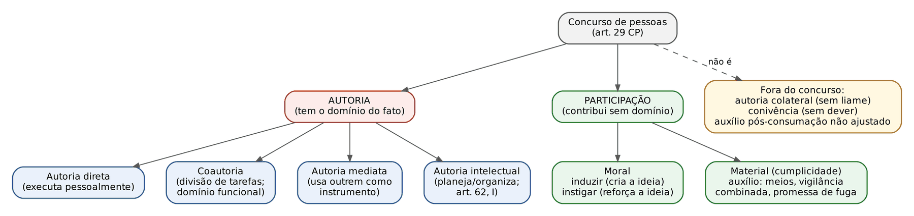
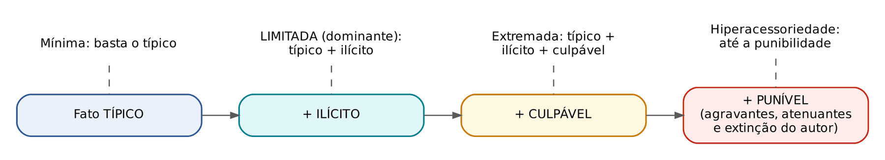
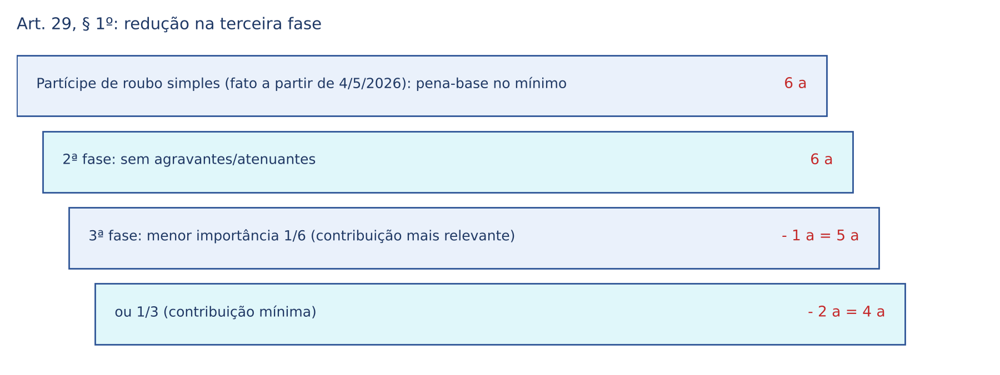
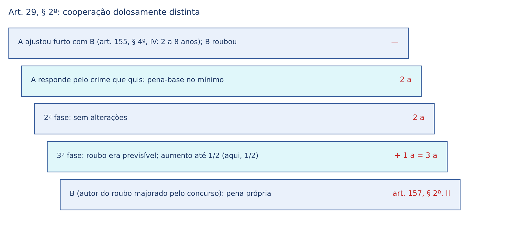
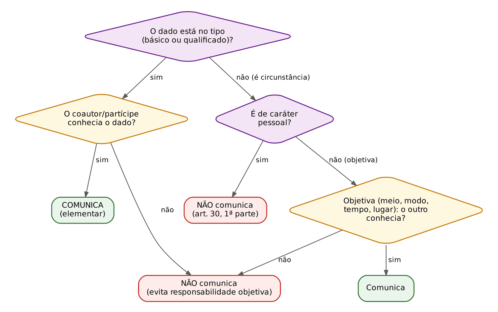

# CAPÍTULO 11 — CONCURSO DE PESSOAS: TEORIAS, AUTORIA E PARTICIPAÇÃO, DOMÍNIO DO FATO, COMUNICABILIDADE E PUNIBILIDADE

:::INCIDENCIA
Pontos: TRF5 p. 5; TJRS p. 3; TJSC p. 16. Nível A. Lote: 14 questões (FGV 13, FCC 1), além de dezenas de questões de crimes em espécie que embutem o tema.
O que mais cai: distinção autor x partícipe em caso concreto (inclusive autoria mediata e colateral), literalidade dos arts. 29 a 31, teoria da acessoriedade limitada, cooperação dolosamente distinta e comunicabilidade de elementares (peculato, infanticídio, feminicídio, paga).
:::

| Subtema | FGV | FCC | Padrão de cobrança |
|---|---|---|---|
| Requisitos e teorias (monista temperada, liame subjetivo) | 4 | 0 | Afirmativas I-II-III; "monista estrita" é a armadilha |
| Autoria mediata, colateral e incerta | 4 | 1 | Caso narrativo: quem é instrumento, quem responde por tentativa |
| Participação, acessoriedade e art. 31 | 3 | 0 | Partícipe de inimputável; insignificância e excludente do autor |
| Art. 29, §§ 1º e 2º | 3 | 1 | Natureza de causa de diminuição; fração 1/6 a 1/3; "até metade" |
| Art. 30 (comunicabilidade) | 2 | 0 | Literalidade: "salvo quando elementares" |

## 11.1 O que é concurso de pessoas e por que o Código precisa de uma regra para ele

Os tipos penais da Parte Especial são escritos, em regra, para UMA pessoa que realiza o verbo: "matar alguém", "subtrair coisa alheia móvel". Quem apenas empresta a arma, vigia a rua ou convence o executor não "mata" nem "subtrai". Sem uma regra adicional, essas condutas seriam atípicas. O art. 29 do CP é essa regra: uma norma de extensão (ou de ampliação) que alarga o tipo para alcançar todos os que, de qualquer modo, concorrem para o crime. Por isso a doutrina fala em adequação típica mediata (ou indireta) na participação: o fato do partícipe só se encaixa no tipo pela ponte do art. 29, do mesmo modo que a tentativa se encaixa pela ponte do art. 14, II (ver Cap. 8).

Para o civilista, a analogia útil é a da solidariedade passiva com direito de regresso graduado: todos respondem pelo mesmo fato, mas a pena de cada um é medida pela sua culpabilidade. Essa é exatamente a fórmula do caput: "na medida de sua culpabilidade".

:::LEI Código Penal, arts. 29 a 31
Art. 29 - Quem, de qualquer modo, concorre para o crime incide nas penas a este cominadas, na medida de sua culpabilidade.
§ 1º - Se a participação for de menor importância, a pena pode ser diminuída de um sexto a um terço.
§ 2º - Se algum dos concorrentes quis participar de crime menos grave, ser-lhe-á aplicada a pena deste; essa pena será aumentada até metade, na hipótese de ter sido previsível o resultado mais grave.
Art. 30 - Não se comunicam as circunstâncias e as condições de caráter pessoal, salvo quando elementares do crime.
Art. 31 - O ajuste, a determinação ou instigação e o auxílio, salvo disposição expressa em contrário, não são puníveis, se o crime não chega, pelo menos, a ser tentado.
:::

### 11.1.1 Concurso eventual e concurso necessário

| Critério | Crime monossubjetivo (concurso eventual) | Crime plurissubjetivo (concurso necessário) |
|---|---|---|
| Número de agentes exigido pelo tipo | Um só basta; o concurso é eventual | O tipo exige dois ou mais |
| Precisa do art. 29 para punir os executores? | Sim, para o partícipe | NÃO: a pluralidade já está no tipo |
| Exemplos | Homicídio, furto, estupro | Associação criminosa (art. 288: três ou mais), rixa (art. 137), bigamia (art. 235) |
| Subespécies | — | Condutas paralelas (auxílio mútuo: associação criminosa), convergentes (bigamia) e contrapostas (rixa) |

O art. 29 continua útil nos crimes plurissubjetivos apenas para alcançar o PARTÍCIPE (quem, sem integrar a associação, instiga sua formação). Mas para os próprios integrantes ele é dispensável: foi isso que a FCC cobrou ao considerar errada a afirmação de que os crimes plurissubjetivos "exigem" a norma de extensão (Q3387032, alternativa D; ver box em 11.4.3).

Há ainda os crimes de concurso necessário em que só um dos agentes é punido (crimes "de encontro" com sujeito impunível, como o rufianismo em relação à pessoa explorada). Não confunda com as exceções pluralistas (11.2), em que AMBOS são punidos, mas por tipos diferentes.

## 11.2 Teorias: um crime para todos ou um crime para cada um?

Quando várias pessoas contribuem para o mesmo resultado, a lei precisa decidir se há um único crime (com vários concorrentes) ou tantos crimes quantos forem os agentes.

| Teoria | Ideia central | No CP |
|---|---|---|
| Monista (unitária, igualitária) | Um só crime para todos os concorrentes | REGRA (art. 29, caput) |
| Dualista | Um crime para os autores e outro para os partícipes | Não adotada (Manzini é a referência histórica) |
| Pluralista | Cada agente pratica um crime próprio, pois cada conduta é autônoma | Adotada por EXCEÇÃO, em tipos específicos e no § 2º do art. 29 |

O Código adotou a teoria monista TEMPERADA (mitigada, matizada): todos respondem pelo mesmo crime, mas (a) a pena é individualizada pela culpabilidade de cada um (caput), (b) o partícipe de menor importância tem redução (§ 1º) e (c) quem quis crime menos grave responde pelo crime que quis (§ 2º). Também se diz que o CP, embora monista, distingue autor e partícipe (sistema diferenciador), ao contrário do sistema unitário puro do Código de 1940, que não fazia essa distinção.

:::QUESTAO FGV 2024 — ENAM — 1º Exame Nacional da Magistratura, reaplicação (Q2507053)
Três afirmativas: (I) o CP adota a teoria monista "estrita"; (II) na cooperação dolosamente distinta todos respondem solidariamente pelo fato mais grave; (III) a participação pode ocorrer da cogitação à consumação, mas só tem relevância penal se o autor ingressar na execução, salvo disposição em contrário. Gabarito: C (apenas III).
Armadilhas: I é falsa porque a teoria é monista TEMPERADA; II inverte o § 2º (cada um responde pelo crime que quis); III reproduz a lógica do art. 31 (ver 11.7.4).
:::

### 11.2.1 Exceções pluralistas: quando a lei separa os concorrentes em tipos diferentes

Em alguns casos o legislador, deliberadamente, cria um tipo para cada lado da mesma operação, normalmente porque quer graduar penas diferentes. Aí não se aplica o art. 29: cada um responde pelo seu tipo.

| Fato único | Quem | Tipo |
|---|---|---|
| Aborto consentido | Gestante que consente | Art. 124 (detenção de 1 a 3 anos) |
| | Terceiro que provoca com consentimento | Art. 126 (reclusão de 1 a 4 anos) |
| Corrupção | Funcionário que solicita, recebe ou aceita promessa | Corrupção passiva, art. 317 |
| | Particular que oferece ou promete | Corrupção ativa, art. 333 |
| Falso testemunho mediante suborno | Testemunha, perito etc. que mente | Art. 342 |
| | Quem dá ou promete a vantagem | Art. 343 |
| Bigamia | Casado que contrai novo casamento | Art. 235, caput |
| | Não casado que casa com pessoa casada, sabendo | Art. 235, § 1º (pena menor) |
| Contrabando e descaminho | Funcionário que facilita com infração de dever | Art. 318 |
| | Quem pratica o contrabando ou descaminho | Arts. 334 e 334-A |
| Desvio subjetivo no concurso | Quem quis crime menos grave | Art. 29, § 2º (11.7.3) |

:::PEGADINHA Corrupção ativa e passiva não dependem uma da outra
Por serem tipos autônomos, pode haver corrupção passiva sem ativa (o funcionário solicita e o particular recusa) e ativa sem passiva (o particular oferece e o funcionário recusa). Se fosse concurso de pessoas, a punição de um dependeria do fato do outro. Detalhes dos tipos no Cap. 35.
:::

:::ATENCAO Contratar crime a integrante de associação criminosa (Lei 15.245/2025)
A Lei 15.245/2025 acrescentou ao art. 288 um § 2º que pune com a pena do caput quem, de qualquer modo, solicita ou contrata o cometimento de crime a integrante de associação criminosa, independentemente da pena do crime contratado. Não se trata de exceção pluralista (o mandante continua partícipe ou coautor do crime contratado), mas de crime AUTÔNOMO somado a ele. Foi o fundamento do gabarito da questão FGV 2026 — TJ-BA — Juiz Substituto (Q4083750): empresário que contrata atiradores de associação criminosa para matar rival responde pelo homicídio e pelo art. 288 (alternativa B). Análise do tipo no Cap. 33.
:::

## 11.3 Requisitos do concurso de pessoas

A doutrina majoritária (Bitencourt, Greco, Masson, Sanches) aponta quatro requisitos. Convém memorizá-los porque a FGV pergunta qual deles é "essencial" e monta casos em que um deles falta.

| Requisito | O que significa | Se faltar |
|---|---|---|
| 1. Pluralidade de agentes e de condutas | Ao menos duas pessoas, cada uma com conduta própria (ação ou omissão) | Não há concurso; há crime de um só |
| 2. Relevância causal de cada conduta | A contribuição precisa ter influído no fato (causalidade física ou psíquica) | Participação inócua é impunível |
| 3. Liame subjetivo (vínculo psicológico) | Consciência de que se contribui para a obra comum | Autoria colateral (cada um responde pelo seu ato) |
| 4. Identidade de infração | Todos respondem, em regra, pelo mesmo crime | Exceções pluralistas e art. 29, § 2º |

Alguns autores acrescentam a existência de fato punível (o crime precisa ser ao menos tentado: art. 31), que pode ser lida como desdobramento da relevância causal.

### 11.3.1 Liame subjetivo não é acordo prévio

O vínculo psicológico exige apenas que o concorrente SAIBA e QUEIRA aderir à conduta alheia. Não precisa de ajuste prévio, nem de reciprocidade: basta a adesão unilateral. A clássica ilustração: a empregada doméstica, com raiva do patrão, deixa a porta aberta para que o ladrão que ronda a casa entre; o ladrão nem sabe da ajuda. Ela é partícipe do furto (auxílio material), embora o autor ignore a contribuição. O inverso não vale: se ninguém sabe do outro, não há liame algum (autoria colateral, 11.4.5).

Por isso a coautoria pode surgir no curso da execução (coautoria sucessiva, 11.4.2) e o acordo pode ser tácito, revelado por gestos, como no caso cobrado pela FGV a seguir.

:::QUESTAO FGV 2024 — PC-SC — Delegado (Q2360683)
Três torcedores avistam um rival; um deles faz gestos indicando que os três o persigam e agridam, o que fazem a socos e pontapés. Gabarito: B (lesão corporal em concurso de pessoas).
Armadilha: a alternativa de "autoria colateral" ignora que o liame pode ser tácito e instantâneo; associação criminosa e organização criminosa exigem estabilidade e permanência, ausentes num encontro fortuito (Caps. 33 e 46).
:::

:::QUESTAO FGV 2024 — Câmara dos Deputados — Consultor Legislativo, reaplicação (Q2513041)
Pergunta qual é requisito essencial da coautoria. Gabarito: B (liame subjetivo entre os agentes).
Armadilhas: não se exige inimputabilidade de ninguém, nem atuação em TODAS as fases do iter (o coautor pode ingressar só na execução), e o "dolo colateral" é justamente a ausência de concurso.
:::

### 11.3.2 Até quando alguém pode ingressar no concurso?

Até a consumação. Contribuição posterior só é participação se tiver sido PROMETIDA antes ou durante a execução (a promessa reforça a decisão do autor, o que é instigação ou auxílio psíquico). Ajuda posterior não ajustada é crime autônomo: favorecimento pessoal (art. 348), favorecimento real (art. 349) ou receptação (art. 180), conforme o caso (Cap. 36 e Cap. 30). Nos crimes permanentes, como a consumação se prolonga, é possível aderir enquanto durar a permanência (quem passa a vigiar o cativeiro na extorsão mediante sequestro em andamento é coautor do art. 159).

:::EXEMPLO Mesmo ato, enquadramentos diferentes
A rouba um carro. B guarda o carro na garagem dele.
- B tinha prometido, antes do roubo, guardar o carro: partícipe do roubo (o autor agiu contando com o esconderijo).
- B só soube depois e aceitou guardar para ajudar A a não perder o proveito: favorecimento real (art. 349).
- B comprou o carro sabendo da origem: receptação (art. 180).
:::

## 11.4 Autoria

Antes de saber quem é partícipe, é preciso saber quem é autor: o partícipe é definido por exclusão (quem concorre sem ser autor). O CP não define autor; a definição vem da doutrina, por meio de teorias.

| Teoria | Quem é autor | Partícipe | Crítica principal |
|---|---|---|---|
| Restritiva objetivo-formal (Beling) | Quem realiza o verbo nuclear do tipo | Quem concorre de outro modo | Não explica a autoria mediata nem o chefe que só dá ordens |
| Restritiva objetivo-material | Quem dá a contribuição objetivamente mais importante | Quem contribui de forma menos relevante | Critério vago; confunde autoria com gravidade |
| Extensiva (subjetiva ou causal) | Todo aquele que dá causa ao resultado; o partícipe é apenas quem age com "vontade de partícipe" (*animus socii*) e não com *animus auctoris* | Definido pela vontade | Subjetivismo extremo (caso da banheira: a irmã que afogou o bebê foi tida como partícipe) |
| Domínio do fato (Welzel; Roxin) | Quem tem o controle final sobre o se e o como do crime | Quem colabora sem esse controle | Não se aplica a crimes culposos, de dever e de mão própria (11.4.1) |

Qual o CP adota? A leitura tradicional é a de que a Reforma de 1984 adotou a teoria restritiva objetivo-formal, temperada pela teoria do domínio do fato para explicar a autoria mediata e a autoria intelectual. A doutrina atual (Greco, Masson, Sanches) e a jurisprudência do STF e do STJ utilizam amplamente o domínio do fato como critério complementar. Em prova, a resposta mais segura é: restritiva, complementada pelo domínio do fato.

:::DICA A banca escolhe a teoria pelo gabarito
A FGV oscila. Em caso de divisão de tarefas, se o enunciado chama de "partícipe" quem não praticou o verbo (ex.: quem só distraiu a vítima), está aplicando a objetivo-formal; se chama de "coautor", está aplicando o domínio funcional do fato. Leia todas as alternativas: em regra só uma é compatível com alguma das teorias (veja Q3848987 em 11.5).
:::

### 11.4.1 Teoria do domínio do fato

Formulada por Hans Welzel (1939), como derivação do finalismo, e desenvolvida sistematicamente por Claus Roxin (*Täterschaft und Tatherrschaft*, 1963). Autor é a figura central do acontecimento: quem tem o domínio final do fato, isto é, pode decidir se o crime acontece, como acontece e até quando prossegue. O partícipe é figura lateral: contribui, mas o fato não está nas suas mãos.

Roxin distingue três formas de domínio, que correspondem às três formas de autoria:

| Forma de domínio | Corresponde a | Exemplo |
|---|---|---|
| Domínio da AÇÃO | Autoria direta (imediata): quem executa pessoalmente | A atira em C |
| Domínio da VONTADE | Autoria mediata: quem domina a vontade de um executor que age como instrumento, por erro, coação ou inserido num aparato organizado de poder | A engana a enfermeira, que aplica veneno pensando ser remédio |
| Domínio FUNCIONAL do fato | Coautoria: divisão de tarefas, em que cada contribuição é essencial ao plano comum e pode, ao ser retirada, frustrar o crime | No roubo a banco, A rende o vigia, B esvazia o cofre, C dirige o carro da fuga combinada |

Limites da teoria (muito cobrados):

- Crimes culposos: não há domínio final de um resultado que não se quer. Nos culposos vale um conceito unitário (extensivo) de autor: todo aquele que viola o dever de cuidado e causa o resultado é autor (11.6).
- Crimes de dever (*Pflichtdelikte*), segundo Roxin: nos delitos em que o tipo pressupõe a violação de um dever especial (crimes funcionais, por exemplo), autor é quem viola o dever, não quem domina o fato. Quem domina sem ter o dever é partícipe.
- Crimes de mão própria (falso testemunho, por exemplo): só o titular pode executar; não cabe coautoria nem autoria mediata (salvo hipóteses de coação, discutidas), mas cabe participação.

#### Aparatos organizados de poder

Para punir como AUTOR o chefe que, de longe, ordena crimes executados por subordinados plenamente responsáveis (o caso Eichmann, os disparos no Muro de Berlim), Roxin concebeu a autoria mediata por domínio da organização. Requisitos clássicos: (a) estrutura hierárquica rígida (poder de mando); (b) fungibilidade dos executores (se um se recusa, outro cumpre a ordem, de modo que o resultado não depende da vontade do executor individual); (c) atuação do aparato desvinculada do ordenamento jurídico (*Rechtsgelöstheit*). Parte da doutrina acrescenta (d) a elevada disposição do executor ao fato. Particularidade: o executor também é punido como autor direto, de modo que há "autor por trás do autor" (o homem de trás é autor mediato, apesar de o executor ser plenamente culpável). A teoria foi aplicada no julgamento de Alberto Fujimori, no Peru, e pelo BGH alemão no caso do Muro de Berlim.

Zaffaroni fala em autoria de escritório para designar a aplicação dessa ideia a organizações criminosas não estatais (máfias, facções): o "homem de escritório" que transmite e organiza ordens dentro de uma estrutura com executores fungíveis. Em prova, autoria de escritório é tratada como espécie de autoria mediata.

#### A AP 470 e a crítica de Roxin

No julgamento da AP 470 (o "mensalão", STF, Plenário, 2012), a teoria do domínio do fato foi invocada para fundamentar a condenação de dirigentes que não executaram pessoalmente os atos. O episódio gerou intensa crítica doutrinária, e o próprio Roxin, em entrevista concedida no Brasil em 2012, afirmou que a teoria não autoriza condenar alguém apenas pela posição hierárquica: o chefe só é autor se efetivamente emitiu a ordem ou dominou o fato; "dever saber" não basta; e o domínio do fato não é instrumento para suprir falta de prova. Ou seja: a teoria serve para QUALIFICAR como autor (e não partícipe) quem comprovadamente participou; NÃO serve para responsabilizar quem não se provou ter participado.

:::JURIS STJ, REsp 1.854.893, j. 8/9/2020 (Info 681)
Sexta Turma, Rel. Min. Rogerio Schietti Cruz. A teoria do domínio do fato não basta, por si só, para imputar um crime: a acusação deve descrever, no plano fático, o vínculo entre a conduta do acusado e o resultado. A condição de sócio, diretor ou administrador não gera presunção de autoria (vedação da responsabilidade penal objetiva). No caso (sonegação fiscal, art. 1º, II, da Lei 8.137/1990), a delegação de tarefas contábeis sem fiscalização aproximava-se da culpa, não prevista no tipo, e a ré foi absolvida.
:::

:::PROCESSO Denúncia em crimes societários e de autoria coletiva
A individualização da conduta é exigência do art. 41 do CPP. O STF e o STJ admitem, em crimes societários e multitudinários, narrativa menos pormenorizada (denúncia "geral"), desde que se descreva o vínculo mínimo de cada acusado com o fato; é inepta a denúncia "genérica", que imputa o crime a alguém só por figurar no contrato social ou no cargo. Na prática: a tese do domínio do fato pode ser usada pela acusação, mas exige base fática concreta. Na sentença, o juiz deve enfrentar separadamente a autoria de cada réu.
:::

:::QUESTAO FGV 2025 — ENAM 2025.1 (Q3362382) — correlata, classificada no Cap. 6
Homenagem a Roxin: pediu o raciocínio próprio da imputação objetiva. Uma das alternativas erradas trazia uma definição de domínio do fato ("possibilidade de continuar ou interromper a execução"), que é correta em si, mas pertence à teoria da autoria, não à imputação objetiva. Gabarito: B (criação de risco não permitido). Lição: não confunda os dois legados de Roxin.
:::

### 11.4.2 Coautoria

Coautoria é a autoria compartilhada: duas ou mais pessoas, ligadas pelo liame subjetivo, dividem a execução ou o domínio funcional do fato. Cada coautor responde pelo todo, inclusive pelo que o outro executou dentro do plano comum (princípio da imputação recíproca).

- Coautoria direta (ou executiva parcial): todos praticam atos de execução, iguais (A e B golpeiam a vítima) ou distintos (A segura, B esfaqueia).
- Coautoria funcional: um dos coautores não realiza ato executivo típico, mas sua tarefa é essencial ao plano (o motorista da fuga combinada, o "vigia" do roubo). Pela teoria objetivo-formal seriam partícipes; pelo domínio funcional, coautores. A jurisprudência do STJ trata com frequência o motorista e o vigia, em divisão de tarefas, como coautores, o que afasta a redução do art. 29, § 1º (ver 11.7.2).
- Coautoria sucessiva: o coautor adere ao fato depois de iniciada a execução e antes da consumação. Responde só pelo que ocorre a partir da adesão (não responde pela lesão que o primeiro causou antes de ele chegar, salvo se dela se aproveitar conscientemente, ponto controvertido).
- Coautoria em crimes próprios: é possível, desde que um dos coautores reúna a qualidade especial e o outro a conheça (o particular é coautor de peculato com o funcionário; art. 30, ver 11.8). Nos crimes de mão própria, não cabe coautoria.

:::QUESTAO FGV 2025 — TRF6 — Juiz Federal (Q3742364) — correlata, classificada no Cap. 37
Esquema de tráfico internacional pelo porto: um sócio da exportadora coordenava a logística (navios e rotas) e um funcionário escondia a droga nos contêineres. Gabarito: D (ambos coautores do tráfico internacional, pois concorreram de forma relevante para a execução do núcleo). Lição: quem coordena a operação tem domínio funcional, ainda que não toque na droga; a alternativa que puniria só quem praticou "atos executórios" aplica mal a teoria restritiva.
:::

### 11.4.3 Autoria mediata

Autor mediato é quem realiza o crime servindo-se de outra pessoa como instrumento. O executor (autor imediato) não tem domínio do fato, ou porque não sabe o que faz, ou porque não é livre, ou porque não é culpável. ATENÇÃO: autoria mediata NÃO é concurso de pessoas, porque falta liame subjetivo entre homem de trás e instrumento (o instrumento não adere conscientemente a um projeto criminoso comum). O autor mediato responde sozinho pelo crime; o instrumento, em regra, não responde (ou responde só por culpa, se houver erro vencível e previsão culposa).

| Hipótese | Base legal | Quem responde |
|---|---|---|
| Uso de inimputável (doente mental, criança, adolescente sem discernimento) | Art. 26 e art. 27; art. 62, III | O homem de trás, como autor; o inimputável recebe medida de segurança (ou medida socioeducativa) |
| Coação moral irresistível | Art. 22, 1ª parte | Só o coator (o coagido é isento de pena por inexigibilidade de conduta diversa) |
| Obediência hierárquica a ordem não manifestamente ilegal | Art. 22, 2ª parte | Só o superior; se a ordem for manifestamente ilegal, ambos respondem (subordinado com atenuante do art. 65, III, c) |
| Erro determinado por terceiro | Art. 20, § 2º | O terceiro que provocou o erro; o enganado só responde se agiu com culpa e houver tipo culposo |
| Erro de proibição provocado | Art. 21 | Quem induziu o erro |
| Aparatos organizados de poder | Construção doutrinária (11.4.1) | Homem de trás e executor (exceção: há concurso) |

A coação FÍSICA irresistível não gera autoria mediata, mas autoria direta: o coagido sequer pratica conduta (é mero objeto), de modo que quem coage é o único a agir (Cap. 6).

Limites: não há autoria mediata em crimes de mão própria (o advogado não pode "mentir como testemunha" por intermédio de outrem), nem nos culposos. Para os crimes de mão própria, Zaffaroni propõe a figura do autor por determinação, que pune quem determina o fato sem poder ser autor dele; no Brasil, o tratamento usual é a participação.

:::EXEMPLO Autoria mediata x participação: o que muda se o executor sabe
A entrega a B uma seringa dizendo ser vitamina; B aplica em C, que morre. A é autor mediato de homicídio; B não responde (ou responde por homicídio culposo, se o erro era evitável). Agora imagine que B sabe que é veneno e aplica mesmo assim: A deixa de ser autor mediato e passa a ser partícipe (auxílio material) ou coautor do homicídio doloso praticado por B, que é autor direto.
:::

:::QUESTAO FGV 2024 — Câmara de Fortaleza-CE — Advogado (Q2450546)
José aproveita a falta de discernimento de João, portador de doença mental, e determina que ele pratique conduta típica e ilícita. Gabarito: E (João sujeito a medida de segurança como executor; José sujeito a pena como autor mediato).
Armadilhas: não há autoria colateral nem concurso "sem distinção de consequências"; inimputabilidade não impede a imposição de medida de segurança ao executor (Cap. 19).
:::

:::QUESTAO FGV 2024 — EBSERH — Advogado (Q3248777)
Namorada simula, aos gritos, estar sendo roubada; um transeunte, crendo na agressão injusta, atira no namorado e o fere gravemente. Gabarito: B (ela é autora mediata, valeu-se de terceiro sem responsabilidade).
Fundamento: erro determinado por terceiro (art. 20, § 2º) que gerou legítima defesa putativa no transeunte (Cap. 10). Armadilha: dizer que o transeunte responde por culpa "ainda que invencível" o erro; erro invencível exclui dolo e culpa.
:::

:::QUESTAO FCC 2025 — DPE-RS — Defensor Público (Q3387032)
Afirmativas sobre concurso de pessoas. Gabarito: E (a cooperação dolosamente distinta é exceção à teoria unitária adotada pelo CP).
Erros das demais: (A) autoria colateral NÃO tem unidade de desígnios; (B) crimes omissivos próprios ADMITEM participação (11.6); (C) autoria mediata NÃO é forma de concurso de pessoas e não pressupõe unidade de desígnios; (D) crimes plurissubjetivos dispensam a norma de extensão para os seus integrantes (11.1.1).
:::

### 11.4.4 Autoria intelectual e o mandante

Autor intelectual é quem planeja, organiza ou dirige o crime sem executá-lo. Pela teoria objetivo-formal, seria partícipe (instigador ou determinador); pelo domínio do fato, é autor quando domina o plano e a execução depende de suas decisões. O mandante do homicídio mercenário, por exemplo, é chamado ora de partícipe (instigação por determinação), ora de autor intelectual; a resposta ao caso concreto, porém, não muda o crime: ambos respondem pelo mesmo homicídio, e quem organiza ou dirige recebe a agravante do art. 62, I (Cap. 14).

A posição de mandante ganhou relevância com a discussão sobre a comunicabilidade da qualificadora da paga (11.8.3) e com o novo § 2º do art. 288 (11.2.1).

### 11.4.5 Autoria colateral, incerta e desconhecida

Autoria colateral (ou parelha, imprópria): dois ou mais agentes, SEM liame subjetivo, dirigem condutas ao mesmo resultado, ao mesmo tempo. Como falta o vínculo, não há concurso: cada um responde pelo que causou.

Autoria incerta: espécie de autoria colateral em que não se consegue apurar qual das condutas produziu o resultado. Como não é possível atribuir o resultado a nenhum deles, aplica-se o *in dubio pro reo*: ambos respondem por tentativa (cada um tentou e não se prova que consumou).

Autoria desconhecida (ou ignorada): não se sabe QUEM praticou o crime. É problema de prova e de investigação (arquivamento do inquérito), não de teoria do concurso.

:::EXEMPLO Autoria colateral x coautoria: a diferença é o liame
A e B, sem se conhecerem, emboscam C e disparam ao mesmo tempo. A perícia revela que só o tiro de A matou.
- Sem liame: A responde por homicídio consumado; B, por tentativa de homicídio (autoria colateral).
- Se não se apurar de quem foi o tiro letal: os dois respondem por tentativa (autoria incerta).
- Se A e B tivessem combinado a emboscada: ambos respondem por homicídio consumado (coautoria; imputação recíproca), pouco importa de quem foi o projétil.
:::

:::QUESTAO FGV 2026 — TJ-PR — Juiz Substituto (Q3898927)
Alberto contrata Bruno para matar Daniel. Caio, por conta própria e sem saber de nada, também decide matar Daniel. Bruno e Caio disparam simultaneamente, sem um saber do outro; só um projétil matou e não se apura qual. Gabarito: E (Alberto responde por participação em homicídio tentado; Bruno e Caio, como autores, por tentativa, em autoria colateral com resultado incerto).
Raciocínio passo a passo: (1) entre Bruno e Caio não há liame: autoria colateral; (2) não se sabe quem matou: autoria incerta, logo tentativa para ambos; (3) Alberto está ligado só a Bruno; como o partícipe segue o fato principal (acessoriedade, 11.5.3), se Bruno responde por tentativa, Alberto também.
Armadilhas: (A) e (D) tratam como concurso o que é colateral e usam mal "autoria mediata" (Bruno é plenamente responsável); (C) dá consumação a Bruno sem prova de que seu tiro matou.
:::

## 11.5 Participação

Partícipe é quem concorre para o crime alheio sem realizar o verbo típico e sem ter o domínio do fato. A participação é sempre acessória: não existe por si; depende de um fato principal praticado pelo autor.

### 11.5.1 Espécies

| Espécie | Conduta | Momento | Exemplo |
|---|---|---|---|
| Moral: induzimento (determinação) | Faz nascer na mente do autor a ideia criminosa que ele não tinha | Antes da resolução | A sugere a B, que nunca pensara nisso, matar o sócio para ficar com a empresa |
| Moral: instigação | Reforça ou estimula ideia que o autor já tinha | Antes ou durante a execução | B comenta que quer matar o sócio; A o encoraja e diz que é a hora certa |
| Material: auxílio (cumplicidade) | Facilita materialmente a execução: fornece meios, informações, vigia sem domínio, promete esconderijo | Antes ou durante (posterior só se prometido antes) | A empresta a arma; A informa o horário em que a casa fica vazia |

Requisitos da participação (além dos gerais do 11.3): (a) dolo de participar, isto é, vontade de contribuir para o crime de outrem (não existe participação culposa em crime doloso); (b) eficácia causal da contribuição: a ajuda precisa ter influído no fato, ainda que só psicologicamente; (c) que o autor ao menos inicie a execução (art. 31). A arma emprestada que o autor nem usou e da qual nem precisou para se encorajar é participação inócua: impunível.

:::QUESTAO FGV 2024 — Câmara de Fortaleza-CE — Advogado (Q2450547)
José, dono legal de uma arma, conta à companheira Maria onde a guarda. Sem ele saber, Maria entrega a arma ao amante, Pedro, para que mate o irmão de José, que ameaçava expor o caso. Pedro mata. Gabarito: C (José não cometeu crime; Maria é partícipe do homicídio cometido por Pedro).
Raciocínio: José não teve dolo nem vínculo (falta liame e voluntariedade de contribuir); Maria prestou auxílio material doloso; Pedro executou, é autor direto. Maria não é autora imediata (não executou) nem autora colateral (há liame com Pedro).
:::

:::QUESTAO FGV 2026 — PC-PI — Delegado (Q3848987)
Dois amigos combinam furtar um celular: João distrairia o dono enquanto Carlos pegaria o aparelho. O dono reage e imobiliza João, mas Carlos foge com o telefone. Gabarito oficial: B (João responde como partícipe do furto, pois auxiliou na execução, ainda que sem vantagem direta).
Comentário: o gabarito aplica a teoria objetivo-formal (João não praticou "subtrair"). Pelo domínio funcional, João seria coautor; de todo modo, ambos respondem por furto consumado (qualificado pelo concurso de pessoas, art. 155, § 4º, IV, Cap. 29). Armadilhas: (A) exigir que cada um "consiga executar sua parte" ignora a imputação recíproca; (C) e (E) fracionam a consumação, quando o crime é um só (teoria monista). O enunciado tem redação confusa (quem foi surpreendido e quem foi imobilizado); ver nota de verificação.
:::

### 11.5.2 Formas especiais de participação

- Participação em cadeia (participação da participação): A induz B a instigar C, que executa. A e B são partícipes.
- Participação sucessiva: o mesmo autor é instigado por várias pessoas, sucessivamente, sem ajuste entre elas. Todos são partícipes.
- Participação por omissão: só é possível para quem tem o DEVER JURÍDICO de agir (garante, art. 13, § 2º, Cap. 6) e, podendo, se omite para que o crime alheio aconteça. O vigilante que, combinado com os ladrões, deixa o portão aberto e não aciona o alarme concorre para o furto. Se o garante quer o resultado e domina a possibilidade de evitá-lo, parte da doutrina o trata como autor do crime comissivo por omissão.
- Conivência (participação negativa ou *crimen silentii*): quem, sem dever jurídico de agir, assiste ao crime e nada faz, ou não o comunica à autoridade. É IMPUNÍVEL, salvo se configurar crime próprio (omissão de socorro, art. 135, por exemplo). O vizinho que vê o furto e se cala não é partícipe; o vigilante contratado que se cala, combinado com o ladrão, é.
- Desistência do partícipe: o partícipe só se livra se neutralizar a sua contribuição antes da consumação (retomar a arma emprestada, convencer o autor a desistir) ou impedir o resultado. Se o autor executa mesmo assim, valendo-se da contribuição já prestada, o partícipe responde. A desistência voluntária e o arrependimento eficaz do AUTOR (art. 15) aproveitam ao partícipe, porque o fato principal deixa de ser tentado (Cap. 8).

:::QUESTAO FGV 2024 — TJ-SC — Juiz Substituto (Q2386996) — correlata, classificada no Cap. 31
Mãe acorda de madrugada, flagra o padrasto mantendo relação sexual com a filha de 12 anos, assiste alguns segundos e volta a dormir. Gabarito: C (estupro de vulnerável, com a causa de aumento do concurso de pessoas).
Lição para este capítulo: a mãe é garante (art. 13, § 2º, a) e, podendo agir, omitiu-se; responde pelo crime por omissão em concurso com o executor. Não é mera conivência, porque há dever jurídico. A majorante específica (art. 226) é tratada no Cap. 31.
:::

### 11.5.3 Teorias da acessoriedade

Se a participação depende do fato principal, até que ponto o fato do autor precisa estar completo para que o partícipe seja punido? Quatro respostas:

| Teoria | Exige do fato principal | Consequência prática | Avaliação |
|---|---|---|---|
| Mínima | Apenas tipicidade | Pune o partícipe ainda que o autor aja em legítima defesa | Rejeitada: puniria quem colabora com conduta lícita |
| LIMITADA | Tipicidade e ilicitude | Pune o partícipe ainda que o autor seja inculpável (inimputável, erro de proibição) | DOMINANTE no Brasil (Bitencourt, Greco, Masson, Sanches) |
| Extremada (máxima) | Tipicidade, ilicitude e culpabilidade | Não puniria quem instiga um inimputável a matar | Criaria lacunas, resolvidas só pela autoria mediata |
| Hiperacessoriedade | Tudo isso e mais a punibilidade | Agravantes, atenuantes e extinção da punibilidade do autor alcançariam o partícipe | Rejeitada: contraria o art. 30 e a individualização |

A teoria limitada tem um ponto cego que a FGV explora: se alguém induz um inimputável, normalmente será AUTOR MEDIATO (domina a vontade de quem não entende), e não partícipe. A teoria limitada explica a punição do partícipe quando o inimputável age com algum domínio próprio do fato (o adolescente de 17 anos que planeja o roubo e recebe ajuda de um adulto), ou quando o autor é inculpável por razão que o partícipe desconhece.

:::QUESTAO FGV 2024 — TJ-PE — Juiz Substituto (Q3117541)
Adalberto é partícipe em três cenários: (I) o autor, inimputável, comete crime contra a vida e recebe medida de segurança; (II) o autor furta bem de valor irrelevante e se aplica a insignificância; (III) o autor age em estrito cumprimento do dever legal, tese acolhida. Pela acessoriedade limitada, Adalberto responde em qual? Gabarito: A (só em I).
Raciocínio: (I) o fato do autor é típico e ilícito; falta só culpabilidade, irrelevante para a teoria limitada; (II) insignificância exclui a tipicidade material (Cap. 2): sem fato típico, não há o que acessar; (III) estrito cumprimento exclui a ilicitude (Cap. 9).
:::

## 11.6 Concurso de pessoas nos crimes culposos e omissivos

### 11.6.1 Crimes culposos

| Pergunta | Resposta majoritária no Brasil | Razão |
|---|---|---|
| Cabe coautoria em crime culposo? | SIM | Dois agentes, com liame quanto à conduta descuidada (não quanto ao resultado), violam juntos o dever de cuidado. Ex.: dois operários, de comum acordo, arremessam uma viga do andaime sem olhar, e ela mata um pedestre |
| Cabe participação em crime culposo? | NÃO | Nos culposos vale o conceito unitário de autor: quem contribui para a violação do dever de cuidado é autor. O passageiro que instiga o motorista a correr é coautor do homicídio culposo de trânsito, não partícipe |
| Cabe participação dolosa em crime culposo, ou culposa em crime doloso? | NÃO há concurso | Falta homogeneidade do elemento subjetivo. Cada um responde pelo seu crime (o doloso, eventualmente como autor mediato) |

O liame subjetivo, nos culposos, liga as CONDUTAS (todos sabem que estão agindo juntos de forma arriscada), nunca o resultado, que ninguém quis. Parte da doutrina (de matriz finalista estrita, como Welzel, e entre nós autores como Nilo Batista) rejeita até a coautoria culposa, tratando cada um como autor colateral; na prova objetiva, prevalece a admissão da coautoria.

:::QUESTAO FGV 2024 — ENAM 2024.2 (Q3058674) — correlata, classificada no Cap. 28
Médico, por descuido, prescreve medicamento ao qual o paciente era alérgico; o enfermeiro percebe o erro e, querendo a morte do vizinho desafeto, aplica o remédio; o paciente quase morre e é salvo. Gabarito: E (médico responde por lesão corporal culposa; enfermeiro, por tentativa de homicídio doloso; não há concurso de agentes).
Lição: culpa de um e dolo do outro não formam concurso. O enfermeiro aproveitou-se do descuido alheio sem qualquer vínculo; cada um responde pela própria conduta.
:::

### 11.6.2 Crimes omissivos

- Omissivos próprios (art. 135, omissão de socorro; art. 269, omissão de notificação de doença): a PARTICIPAÇÃO é admitida (quem instiga o médico a não notificar é partícipe). A coautoria é controvertida: para uma corrente, se várias pessoas combinam não socorrer, há coautoria; para outra (Nilo Batista, Juarez Tavares), cada omitente descumpre o próprio dever e é autor isolado. Em prova, a afirmação "crimes omissivos próprios não admitem participação" é FALSA (FCC, Q3387032).
- Omissivos impróprios (comissivos por omissão, art. 13, § 2º): cabe participação por ação (A instiga a mãe a não alimentar o bebê) e cabe concurso entre garantes. A fronteira entre autoria e participação do garante omisso é controvertida; ver 11.5.2 e Cap. 6.

:::QUESTAO FGV 2024 — Câmara dos Deputados — Consultor Legislativo, reaplicação (Q2513052) — correlata, classificada no Cap. 40
Policial tortura preso enquanto outro, que tinha o dever de evitar, nada faz. Gabarito: B (ambos praticam tortura, o primeiro por ação e o segundo por omissão). A Lei 9.455/1997 tem tipo próprio para a omissão de quem tinha o dever de evitar ou apurar (art. 1º, § 2º), com pena menor, o que é outra exceção pluralista (Cap. 40).
:::

## 11.7 Punibilidade no concurso de pessoas

### 11.7.1 "Na medida de sua culpabilidade" (caput)

A expressão, introduzida em 1984, impõe que a pena de cada concorrente seja dosada separadamente. Na sentença, isso significa: dosimetria INDIVIDUAL para cada réu, nas três fases (Caps. 13 a 15). Circunstâncias judiciais como culpabilidade, antecedentes e motivos podem e devem divergir entre corréus. Um mesmo dado objetivo (consequências do crime) normalmente vale para todos.

:::SENTENCA Dosimetria de corréus
Onde entra: depois da fundamentação comum sobre materialidade, o juiz examina a autoria de CADA réu (quem fez o quê, se coautor ou partícipe), e depois faz uma dosimetria por réu, em tópicos separados.
Redação-modelo: "Comprovado que o réu B. atuou como vigia, em divisão de tarefas previamente ajustada e essencial ao êxito da subtração, reconheço-o como coautor, afastando a minorante do art. 29, § 1º, do CP."
Erro que a banca pune: dosimetria "conjunta" ("fixo a pena de ambos os réus em..."), sem análise individual; ou transportar para o corréu circunstância pessoal (reincidência, confissão, menoridade relativa) do outro.
:::

### 11.7.2 Participação de menor importância (art. 29, § 1º)

Natureza jurídica: causa de DIMINUIÇÃO de pena, aplicada na TERCEIRA fase da dosimetria (Q3114282). Por ser causa de diminuição, pode levar a pena abaixo do mínimo legal, ao contrário das atenuantes (Súmula 231 do STJ — ver Cap. 14).

Pontos centrais:

- Só se aplica ao PARTÍCIPE, nunca ao coautor. O texto fala em "participação"; o coautor, por definição, tem domínio funcional, logo sua contribuição nunca é "de menor importância". É entendimento firme do STJ, que por isso costuma negar a minorante ao motorista ou ao vigia que agem em divisão de tarefas.
- "Menor importância" é contribuição de pouca relevância causal para o resultado (o partícipe que apenas indica o endereço da vítima, já conhecido pelos autores), aferida no caso concreto.
- O texto diz "pode", mas a doutrina majoritária entende que, presente o requisito, a redução é direito subjetivo do réu; o "pode" refere-se à fração, que o juiz escolhe entre 1/6 e 1/3 conforme o grau de contribuição (quanto menor a contribuição, maior a redução).
- Não confundir com a atenuante do art. 65, III, e, nem com a figura do partícipe por menor importância em leis especiais.

:::QUESTAO FGV 2024 — TJ-MT — Analista Judiciário (Q3114282)
Natureza jurídica da participação de menor importância. Gabarito: B (causa de diminuição de pena). Armadilhas: não exclui tipicidade, ilicitude ou culpabilidade (o partícipe é condenado) e não é qualificadora.
No mesmo sentido, quanto à fração: Q2513043 (alternativas que falam em redução "de um décimo" ou em exclusão da pena estão erradas; a fração é de 1/6 a 1/3).
:::

:::EXEMPLO Calculando a redução, passo a passo
Caso 1, conta redonda. A emprestou a B uma touca ninja para um roubo simples praticado em junho de 2026 (art. 157, caput: 6 a 10 anos, pela Lei 15.397/2026). Pena-base de A no mínimo: 6 anos. Segunda fase sem alterações: 6 anos.
- Redução mínima (1/6): 6 anos = 72 meses; 72 ÷ 6 = 12 meses; 72 − 12 = 60 meses = 5 anos.
- Redução máxima (1/3): 72 ÷ 3 = 24 meses; 72 − 24 = 48 meses = 4 anos.
- Fato anterior a 4/5/2026: vale a pena antiga, de 4 a 10 anos (a lei mais grave não retroage): 48 meses − 8 = 3 anos e 4 meses (1/6) ou 48 − 16 = 2 anos e 8 meses (1/3).
Caso 2, com dias. Pena intermediária de 2 anos e 11 meses (35 meses); redução de 1/6.
- 35 ÷ 6 = 5,833 meses = 5 meses e 0,833 × 30 = 25 dias. Redução: 5 meses e 25 dias.
- Pena: 2 anos e 11 meses − 5 meses e 25 dias = 2 anos, 5 meses e 5 dias (35 meses = 34 meses e 30 dias; 34 meses e 30 dias − 5 meses e 25 dias = 29 meses e 5 dias).
- Se a divisão gerasse fração de dia, ela seria desprezada (art. 11 do CP).
:::

### 11.7.3 Cooperação dolosamente distinta (art. 29, § 2º)

Também chamada desvio subjetivo de conduta ou participação em crime menos grave. Hipótese: os concorrentes combinam um crime, mas um deles, no curso da execução, pratica crime diverso e mais grave, que não estava no plano. A regra é de justiça elementar: ninguém responde por dolo que não teve.

Duas situações:

| Situação | Consequência para quem quis o crime menos grave |
|---|---|
| Resultado mais grave IMPREVISÍVEL | Pena do crime que quis, sem aumento |
| Resultado mais grave PREVISÍVEL (mas não aceito) | Pena do crime que quis, AUMENTADA ATÉ METADE (causa de aumento, 3ª fase) |
| Resultado mais grave PREVISTO e ACEITO (dolo eventual) | Não é § 2º: responde pelo crime mais grave, em concurso |

O executor do crime mais grave responde normalmente por ele. Repare que o "até metade" não tem piso expresso; a fração é fixada pelo grau de previsibilidade. Repare também que, para quem quis o crime menos grave, o § 2º é uma exceção pluralista: há dois crimes para um mesmo fato (FCC, Q3387032, gabarito E).

:::EXEMPLO Cooperação dolosamente distinta, passo a passo
A e B combinam furtar uma residência que supunham vazia; A fica no carro. B encontra o morador, ameaça-o com uma faca que A não sabia que ele levava e subtrai os bens.
1. Crime que A quis: furto qualificado pelo concurso de pessoas (art. 155, § 4º, IV: 2 a 8 anos).
2. Pena-base no mínimo: 2 anos. Segunda fase sem alterações: 2 anos.
3. Terceira fase: era previsível que alguém estivesse em casa e houvesse confronto? O juiz entendeu que sim, em grau elevado: aumento de 1/2. 2 anos × 1/2 = 1 ano. Pena: 3 anos.
4. B responde por roubo majorado pelo concurso de agentes e pelo emprego de arma branca (art. 157, § 2º, II e VII; Cap. 29).
Se A soubesse da faca e tivesse aceitado o risco de violência, não haveria § 2º: A responderia pelo roubo.
:::

:::PEGADINHA Roubo armado que termina em morte
Se o comparsa SABIA que o outro levava arma de fogo para o roubo, a morte da vítima é, no mínimo, resultado previsto e assumido; a jurisprudência do STF e do STJ é firme em que todos respondem pelo latrocínio, ainda que só um tenha disparado. Não se aplica o § 2º. Foi a armadilha da alternativa E da questão FGV 2024 — MPE-GO — Promotor (Q2367568, classificada no Cap. 29): o vigia que ajustou "furto", mas sabia que o executor estava armado, não está em cooperação dolosamente distinta.
:::

:::QUESTAO FGV 2024 — PC-SC — Psicólogo Policial Civil (Q2365383)
João aceita fornecer comida, mediante pagamento diário, a sequestradores e à vítima durante o cativeiro; o plano era libertar a vítima em até uma semana, mesmo sem resgate. Os sequestradores, porém, matam a vítima. Gabarito: D (João responde pelo sequestro, mas não pela morte).
Raciocínio: fornecer comida ao cativeiro, sabendo do sequestro, é auxílio material à extorsão mediante sequestro (crime permanente: adesão durante a permanência). Quanto à morte, João quis participar de crime menos grave (art. 159, caput); aplica-se o § 2º. Se a morte fosse previsível, a pena do art. 159, caput, seria aumentada até metade, o que NÃO equivale a responder pela morte (alternativas B, C e E erradas). Não cabe "morte culposa" em concurso, porque o resultado é imputado só ao executor.
:::

:::QUESTAO FGV 2024 — Prefeitura de Caraguatatuba-SP — Procurador (Q2346694) — correlata, classificada no Cap. 29
Servidor ajusta com conhecido roubador a subtração furtiva de computadores da repartição; na saída, o roubador, que portava arma, ameaça o vigilante para garantir a posse. Gabarito: C (o roubador responde por roubo impróprio; o servidor, por peculato, com aumento em razão da ação do comparsa).
Lição: o servidor queria crime menos grave (peculato-furto, art. 312, § 1º) e responde por ele, com o aumento "até metade" do § 2º pela previsibilidade (o comparsa era "conhecido roubador"). Gabarito discutível quanto à ausência de comunicação da condição funcional ao particular; ver 11.8 e nota de verificação.
:::

### 11.7.4 Casos de impunibilidade (art. 31)

Ajuste (acordo), determinação, instigação e auxílio, por si sós, não são puníveis se o crime não chega, ao menos, a ser TENTADO. É a aplicação, ao concurso, da regra geral de que atos preparatórios não são puníveis (Cap. 8). Se A empresta a arma e B desiste antes de iniciar a execução, ninguém responde por homicídio.

"Salvo disposição expressa em contrário": quando a própria lei transforma o ajuste ou a instigação em crime autônomo. Exemplos: associação criminosa (art. 288: o simples associar-se já é crime), incitação ao crime (art. 286), induzimento, instigação ou auxílio a suicídio ou a automutilação (art. 122: a instigação é o próprio núcleo), associação para o tráfico (art. 35 da Lei 11.343/2006), organização criminosa (art. 2º da Lei 12.850/2013) e atos preparatórios de terrorismo (art. 5º da Lei 13.260/2016).

:::QUESTAO FGV 2024 — Câmara dos Deputados — Consultor Legislativo, reaplicação (Q2513043)
Literalidade dos arts. 29 a 31. Gabarito: D (salvo quando elementares do tipo, as circunstâncias e condições pessoais não se comunicam).
Erros: a menor importância reduz de 1/6 a 1/3, não "de um décimo" nem exclui a pena; quem quis crime menos grave recebe a pena dele, não "redução pela metade"; ajuste, instigação e auxílio NÃO são puníveis se não houver ao menos tentativa (art. 31).
:::

:::QUESTAO FGV 2024 — Prefeitura de São José dos Campos-SP — Procurador (Q3888046)
Três afirmativas: (I) a pena do crime mais grave se aplica a todos, mesmo a quem quis crime menos grave; (II) quem concorre incide nas penas na medida de sua culpabilidade; (III) circunstâncias pessoais sempre se comunicam. Gabarito: D (só II). I contraria o § 2º; III inverte o art. 30 (a regra é a INCOMUNICABILIDADE, com exceção das elementares).
:::

### 11.7.5 Outros reflexos do concurso na pena

- Agravantes do art. 62 (quem promove, organiza ou dirige; quem coage ou induz; quem instiga subordinado ou não punível; quem age mediante paga): aplicam-se na segunda fase — ver Cap. 14.
- Concurso de pessoas como qualificadora ou majorante de crimes específicos (furto, art. 155, § 4º, IV; roubo, art. 157, § 2º, II; estupro coletivo, art. 226, IV, a; Lei de Drogas etc.): ver capítulos dos crimes (Caps. 29, 31 e 37). Lembre que essas figuras, em regra, se satisfazem com a mera participação e contam inimputáveis no cômputo dos agentes.
- Multidão delinquente (crimes multitudinários: linchamentos, saques, brigas de torcida): todos respondem pelo crime, cada um na medida de sua conduta; quem age sob influência de multidão em tumulto que não provocou tem a atenuante do art. 65, III, e; quem lidera recebe a agravante do art. 62, I.
- Colaboração premiada e delação de coautores e partícipes (Lei 12.850/2013, art. 41 da Lei 11.343/2006, Lei 8.137/1990 e Lei 7.492/1986): ver Caps. 37, 45, 46 e 47.

:::PROCESSO Reflexos processuais do concurso
- Competência: há continência quando duas ou mais pessoas são acusadas pela mesma infração (art. 77, I, do CPP), o que impõe, em regra, processo e julgamento conjuntos (art. 79), com possibilidade de separação facultativa (art. 80).
- Extensão do recurso: a decisão do recurso interposto por um réu aproveita aos outros, se fundada em motivos que não sejam de caráter exclusivamente pessoal (art. 580 do CPP). É o art. 30 do CP projetado no processo.
- Prescrição: as causas interruptivas comunicam-se aos coautores e partícipes, exceto as dos incisos V e VI do art. 117 (art. 117, § 1º, do CP — ver Cap. 22).
:::

## 11.8 Comunicabilidade das circunstâncias e condições (art. 30)

### 11.8.1 Os três conceitos que o art. 30 combina

- Elementar: dado que integra o tipo (básico ou qualificado). Se for retirado, o fato deixa de ser aquele crime: ou vira outro crime (atipicidade relativa) ou fica atípico (atipicidade absoluta). Ex.: "funcionário público" no peculato; "a própria mãe, sob a influência do estado puerperal" no infanticídio.
- Circunstância: dado acessório que NÃO altera o tipo, só aumenta ou diminui a pena (agravantes, atenuantes, majorantes, minorantes, privilégios). Retirado, o crime continua o mesmo.
- Condição de caráter pessoal: qualidade ou relação permanente do agente, que existe independentemente do crime (reincidência, parentesco com a vítima, condição de funcionário, idade).

E a divisão que decide o caso: circunstâncias pessoais (subjetivas: motivos, relações com a vítima, condições do agente) x circunstâncias objetivas (reais: meio, modo, tempo, lugar, qualidade da vítima).

A regra extraída do art. 30, com a interpretação doutrinária consolidada:

| Dado | Comunica-se? | Requisito |
|---|---|---|
| Circunstância ou condição PESSOAL não elementar | NÃO | — |
| Circunstância OBJETIVA | SIM | Que tenha entrado na esfera de conhecimento do concorrente |
| ELEMENTAR, pessoal ou objetiva | SIM | Que o concorrente a CONHEÇA (sem conhecimento, haveria responsabilidade objetiva) |

A exigência de conhecimento não está escrita no art. 30, mas decorre da culpabilidade (art. 19 e princípio da responsabilidade subjetiva). Foi exatamente o erro da alternativa D da questão FGV 2024 — ENAM 2024.2 (Q3058683, classificada no Cap. 35), que afirmava comunicar-se a condição de funcionário ao particular na concussão "independentemente da ciência".

### 11.8.2 Tabela de casos

| Situação | Natureza do dado | Solução |
|---|---|---|
| Particular ajuda funcionário a desviar bem que este detém em razão do cargo, sabendo da condição | "Funcionário público" é elementar do peculato | Ambos respondem por PECULATO (STJ, Jurisprudência em Teses, ed. 57, tese 9) |
| Particular ignora que o comparsa é funcionário | Elementar desconhecida | Particular responde pelo crime comum (apropriação indébita ou furto); funcionário, por peculato |
| Terceiro auxilia ou executa, junto com a mãe em estado puerperal, a morte do recém-nascido | "Própria mãe" e "estado puerperal" são elementares do infanticídio | Posição majoritária: terceiro responde por INFANTICÍDIO (art. 123), se sabia das condições; minoria (por razões de justiça) defende homicídio para o terceiro. Se o terceiro executa e a mãe só auxilia, a doutrina majoritária mantém infanticídio para ambos |
| Executor contratado pelo ex-marido mata a mulher por razões da condição do sexo feminino | Elementar do feminicídio (art. 121-A, § 1º) | Ambos respondem por FEMINICÍDIO: comunicação EXPRESSA no art. 121-A, § 3º (Lei 14.994/2024) |
| Corréu de receptação qualificada que não é comerciante nem dono do estabelecimento | "No exercício de atividade comercial" (art. 180, § 1º) é elementar do tipo qualificado | Comunica-se (STJ, AgRg no AREsp 2.712.504, Info 863) |
| Ocupante de cargo em comissão comete crime funcional com particular | Art. 327, § 2º é causa de AUMENTO (circunstância pessoal), não elementar | NÃO se comunica ao particular (STJ, AgRg no REsp 1.789.273) |
| Mandante de homicídio mercenário | Paga ou promessa de recompensa (art. 121, § 2º, I): qualificadora ligada ao motivo do executor | NÃO se comunica automaticamente ao mandante (STJ, EAREsp 1.322.867, Info 860) |
| Comparsa de quem mata por relevante valor moral | Privilégio (art. 121, § 1º) é circunstância pessoal (motivo) | NÃO se comunica |
| Corréu de réu reincidente | Condição pessoal | NÃO se comunica (Q3453260, Cap. 14) |
| Comparsa de quem usa veneno ou emboscada, sabendo do meio | Qualificadora objetiva (meio ou modo) | Comunica-se |
| Coautor de roubo em que o comparsa usa arma de fogo, sabendo dela | Majorante objetiva | Comunica-se |
| Coautor de homicídio por motivo torpe do comparsa | Motivo é circunstância pessoal | NÃO se comunica automaticamente; depende de o próprio coautor agir pelo mesmo motivo |

:::JURIS STJ, Jurisprudência em Teses, ed. 57, tese 9
"A elementar do crime de peculato se comunica aos coautores e partícipes estranhos ao serviço público." Fundamento: art. 30 c/c art. 29 e art. 312 do CP. É a base da tese de que o particular pode ser coautor ou partícipe de crime funcional, desde que saiba da qualidade do funcionário (Cap. 35).
:::

:::JURIS STJ, AgRg no AREsp 2.712.504, j. 9/9/2025 (Info 863)
Quinta Turma, Rel. Min. Joel Ilan Paciornik. Os elementos típicos da receptação qualificada (art. 180, § 1º) comunicam-se por força de lei aos corréus, ainda que não sejam proprietários do estabelecimento nem exerçam atividade comercial. A teoria monista impõe que, em delito qualificado, todos concorrem para o mesmo crime, sendo dispensável que cada um realize pessoalmente todas as elementares.
:::

:::JURIS STJ, EAREsp 1.322.867, j. 13/8/2025 (Info 860)
Terceira Seção, Rel. Min. Antonio Saldanha Palheiro. A qualificadora do homicídio praticado mediante paga ou promessa de recompensa (art. 121, § 2º, I) NÃO se comunica automaticamente ao mandante: a qualificação da conduta do mandante depende do exame concreto dos seus próprios motivos. Por se tratar de embargos de divergência, o julgado uniformizou a orientação das Turmas (havia acórdãos que tratavam a paga como elementar do tipo qualificado, comunicável a ambos).
:::

:::JURIS STJ, AgRg no REsp 1.789.273, j. 25/8/2020
Quinta Turma, Rel. Min. Felix Fischer. A causa de aumento do art. 327, § 2º (ocupante de cargo em comissão ou função de direção) não se comunica ao *extraneus*: o art. 30 alcança só as elementares, constantes da figura básica ou qualificada; a majorante, fixada em fração sobre a pena, é circunstância de caráter pessoal ligada à maior culpabilidade do ocupante do cargo.
:::

:::DICA Qualificadora é elementar ou circunstância?
Para o art. 30, a doutrina majoritária trata as qualificadoras como elementares do tipo derivado (o tipo qualificado tem pena própria, como um novo tipo), e por isso as comunica quando conhecidas, se forem de natureza objetiva. As qualificadoras SUBJETIVAS (motivo torpe, fútil, paga) seguem a lógica dos motivos, que são pessoais por natureza: em regra NÃO se comunicam. O julgado da paga (Info 860) consolidou essa leitura.
:::

:::QUESTAO FGV 2026 — MPE-GO — Promotor de Justiça Substituto (Q3865761) — correlata, classificada no Cap. 27
Ex-marido, inconformado com a pensão, contrata executor que mata a ex-esposa na frente do filho do casal. Gabarito: C (ambos respondem por feminicídio, com a causa de aumento da presença do descendente).
Lição para este capítulo: violência doméstica e familiar é razão da condição do sexo feminino (art. 121-A, § 1º, I), elementar que o § 3º manda comunicar ao coautor ou partícipe. Erro da alternativa A: dizer que a "circunstância pessoal" não se comunica; a lei a tornou comunicável. Depois da Lei 14.994/2024, o feminicídio é crime autônomo, não mais "homicídio qualificado" (alternativas B e E).
:::

:::PEGADINHA Infanticídio: os três cenários
1. Mãe, em estado puerperal, mata o filho sozinha: infanticídio.
2. Mãe executa e terceiro auxilia, sabendo do estado puerperal: ambos infanticídio (comunicação da elementar).
3. Terceiro executa a pedido da mãe puerperal: o terceiro "mata", mas o tipo exige que a mãe mate. A corrente majoritária (Hungria em sua posição final, Damásio, Masson, Greco) aplica o art. 30 e dá infanticídio para ambos; há quem sustente homicídio para o terceiro e participação em infanticídio para a mãe. Em prova objetiva, prevalece infanticídio para os dois. Detalhes do tipo no Cap. 27.
:::

:::SENTENCA Comunicabilidade na fundamentação
Onde entra: na tipificação (capitulação) de cada réu, antes da dosimetria; e, depois, na dosimetria de cada um (agravantes e majorantes pessoais).
Redação-modelo: "A condição de funcionário público do corréu A., elementar do peculato, era de pleno conhecimento do réu B., que com ele ajustou o desvio; comunica-se, pois, a B. (art. 30 do CP), que responde como coautor do art. 312, caput. Não se lhe estende, contudo, a majorante do art. 327, § 2º, de caráter pessoal."
Erro que a banca pune: comunicar a reincidência, a confissão ou a menoridade relativa de um réu ao outro; ou comunicar a elementar sem fundamentar o conhecimento do corréu.
:::

## 11.9 Pessoa jurídica e concurso de pessoas

O TRF5 inclui no mesmo ponto a responsabilidade penal da pessoa jurídica. A disciplina (art. 225, § 3º, da CF; art. 3º da Lei 9.605/1998; superação da teoria da dupla imputação pelo STF e pelo STJ) está no Cap. 5. Para este capítulo, basta registrar: a punição da pessoa jurídica não exclui a das pessoas físicas autoras, coautoras ou partícipes do mesmo fato (art. 3º, parágrafo único, da Lei 9.605/1998), e a imputação ao dirigente segue as regras deste capítulo, inclusive a vedação de responsabilizá-lo apenas pelo cargo (11.4.1).

## 11.10 Resumo para revisão pré-prova

| Instituto | Regra | Exceções e detalhes | Fundamento |
|---|---|---|---|
| Natureza do art. 29 | Norma de extensão: adequação típica mediata do partícipe | Dispensável para os integrantes de crime plurissubjetivo | Art. 29 |
| Teoria adotada | Monista temperada: um crime, pena pela culpabilidade de cada um | Exceções pluralistas: 124 x 126; 317 x 333; 342 x 343; 235 caput x § 1º; 318 x 334; art. 29, § 2º | Art. 29, caput e § 2º |
| Requisitos | Pluralidade de condutas; relevância causal; liame subjetivo; identidade de infração | Liame dispensa acordo prévio (adesão unilateral basta); ingresso até a consumação (no permanente, durante a permanência) | Doutrina |
| Autor | Restritiva objetivo-formal, complementada pelo domínio do fato | Domínio do fato não vale para culposos, crimes de dever e de mão própria; não supre prova (REsp 1.854.893) | Doutrina; STJ |
| Formas de domínio (Roxin) | Ação (autor direto), vontade (autor mediato), funcional (coautor) | Aparatos organizados de poder: hierarquia, fungibilidade, desvinculação do Direito; executor também é autor | Doutrina |
| Autoria mediata | Uso de instrumento: inimputável, coação moral irresistível, ordem não manifestamente ilegal, erro provocado | Não é concurso; coação física = autoria direta; impossível em mão própria | Arts. 20, § 2º, 22, 26, 62, III |
| Coautoria | Divisão de tarefas com imputação recíproca | Sucessiva: responde a partir da adesão; em crime próprio, se conhece a qualidade | Art. 29 |
| Autoria colateral e incerta | Sem liame: cada um responde pelo que causou | Incerta: ambos por tentativa (*in dubio pro reo*) | Doutrina |
| Participação | Moral (induzir, instigar) ou material (auxiliar) | Exige dolo e eficácia causal; posterior só se prometida antes | Art. 29 |
| Conivência | Impunível sem dever jurídico de agir | Garante que se omite concorre por omissão | Art. 13, § 2º |
| Acessoriedade | LIMITADA: fato do autor típico e ilícito | Partícipe de inimputável responde; insignificância ou excludente do autor beneficiam o partícipe | Doutrina |
| Culposos | Admitem coautoria, não participação | Doloso + culposo: sem concurso | Doutrina |
| Omissivos próprios | Admitem participação | Coautoria controvertida | Doutrina |
| Menor importância | Causa de diminuição de 1/6 a 1/3, na 3ª fase | Só partícipe; nunca coautor; pode ir abaixo do mínimo | Art. 29, § 1º |
| Cooperação dolosamente distinta | Pena do crime que quis | Aumento até metade se previsível; se previsto e aceito, responde pelo mais grave | Art. 29, § 2º |
| Impunibilidade | Sem tentativa, ajuste, instigação e auxílio não são puníveis | Salvo crime autônomo: 288, 286, 122, Lei 11.343, art. 35 etc. | Art. 31 |
| Comunicabilidade | Pessoais não se comunicam; elementares e objetivas sim, se conhecidas | Feminicídio: comunicação expressa; paga não se comunica automaticamente ao mandante; art. 327, § 2º não se comunica | Art. 30; art. 121-A, § 3º |
| Contratar crime a associação criminosa | Crime autônomo além do crime contratado | Lei 15.245/2025 | Art. 288, § 2º |

## 11.11 Artigos de lei incidentes

- Código Penal: arts. 13, § 2º; 19; 20, § 2º; 21; 22; 26; 29, caput, §§ 1º e 2º; 30; 31; 62; 65, III, c e e; 117, § 1º; 121, §§ 1º e 2º, I; 121-A, §§ 1º e 3º; 122; 123; 124; 126; 180, § 1º; 235, caput e § 1º; 286; 288, § 2º; 312; 317; 318; 327, § 2º; 333; 342; 343.
- Código de Processo Penal: arts. 41; 77, I; 79; 80; 580.
- Lei 9.455/1997: art. 1º, § 2º.
- Lei 9.605/1998: art. 3º, parágrafo único.

## 11.12 Julgados, temas e súmulas do capítulo

- STF, AP 470 (Plenário, 2012) — domínio do fato invocado para dirigentes; crítica de Roxin.
- STJ, REsp 1.854.893 (Info 681) — domínio do fato não dispensa descrição do nexo; cargo não presume autoria.
- STJ, Jurisprudência em Teses, ed. 57, tese 9 — elementar do peculato comunica-se ao particular.
- STJ, AgRg no AREsp 2.712.504 (Info 863) — elementares da receptação qualificada comunicam-se aos corréus.
- STJ, EAREsp 1.322.867 (Info 860) — qualificadora da paga não se comunica automaticamente ao mandante.
- STJ, AgRg no REsp 1.789.273 — majorante do art. 327, § 2º não se comunica ao *extraneus*.

Remissões a outros capítulos: Súmula 231 do STJ (Cap. 14); agravantes do art. 62 e reincidência (Cap. 14); concurso de pessoas como qualificadora do furto e majorante do roubo, inclusive com inimputável (Cap. 29); latrocínio e coautor (Cap. 29); estupro coletivo e art. 226 (Cap. 31); art. 288, § 2º (Cap. 33); crimes funcionais e particular (Cap. 35); responsabilidade penal da pessoa jurídica (Cap. 5); art. 117, § 1º (Cap. 22); colaboração premiada (Cap. 46).

:::NOTA Notas de verificação
- Conferidos no Planalto (14/10/2026): arts. 29, 30, 31, 62, 65, 121-A (inclusive § 3º, comunicação expressa no feminicídio), 123, 124, 126, 235, 288 (§ 2º pela Lei 15.245/2025), 312, 317, 318, 327, 342 e 343 do CP. Lei 9.455/1997, art. 1º, § 2º (omissão: detenção de um a quatro anos), e Lei 9.605/1998, art. 3º, conferidos no Planalto em 15/10/2026; as paráfrases conferem com o texto.
- Julgados: REsp 1.854.893 conferido em fonte secundária (Info 681). EAREsp 1.322.867 (Info 860), AgRg no REsp 1.789.273 e AgRg no AREsp 2.712.504 (Info 863) conferidos no caderno do Dizer o Direito e no Radar; a frase sobre o exame dos motivos do mandante é inferência do enunciado, conferir no inteiro teor. A entrevista de Roxin sobre a AP 470 foi citada sem data precisa (2012).
- Afirmações sem número de julgado (registrar antes de citar): coautoria do motorista/vigia e inaplicabilidade do art. 29, § 1º ao coautor; latrocínio para o comparsa ciente da arma; admissão de participação do advogado em falso testemunho (não incluída no texto); denúncia geral x genérica.
- Drive: lidos o mapeamento FGV (integral), o caderno do Dizer o Direito e a Sinopse TJSC 2026 (busca por palavra-chave). Cadernos Sistematizados, IURIS vol. 5 e Sinopse vieram truncados pelo conector (cerca de 250 mil caracteres); as seções de concurso de pessoas de Cadernos e IURIS não foram alcançadas. Bitencourt e CP Coordenado não foram lidos (mesma limitação); doutrina citada pela posição consagrada dos autores.
- Revisão de 15/10/2026: o Caso 1 do exemplo do art. 29, § 1º, foi refeito com a pena do roubo da Lei 15.397/2026 (6 a 10 anos, fatos a partir de 4/5/2026), conforme o quadro do Cap. 29; a figura ch11_calc.png foi regenerada.
- Gabaritos discutíveis: Q3848987 (a banca chamou de partícipe quem distraía a vítima em divisão de tarefas; pelo domínio funcional seria coautor; o enunciado também troca quem foi surpreendido e quem foi imobilizado). Q2346694 (deixa sem explicar por que a condição funcional do servidor não se comunicaria ao particular; o gabarito se sustenta pelo desvio subjetivo do art. 29, § 2º). Q3898927 qualifica o mandante como partícipe, e não autor intelectual; não altera a solução.
:::
