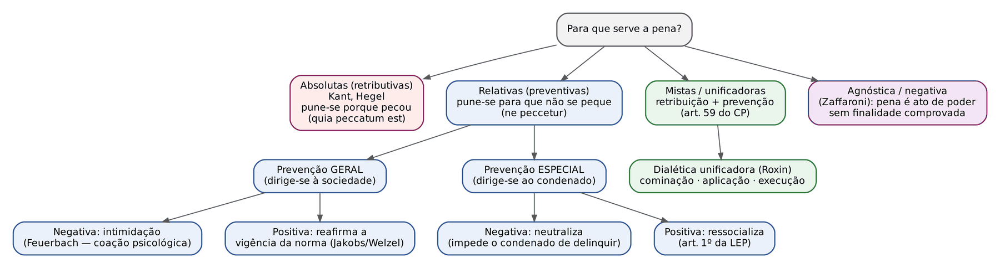
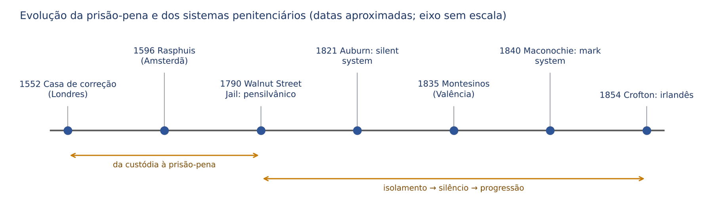
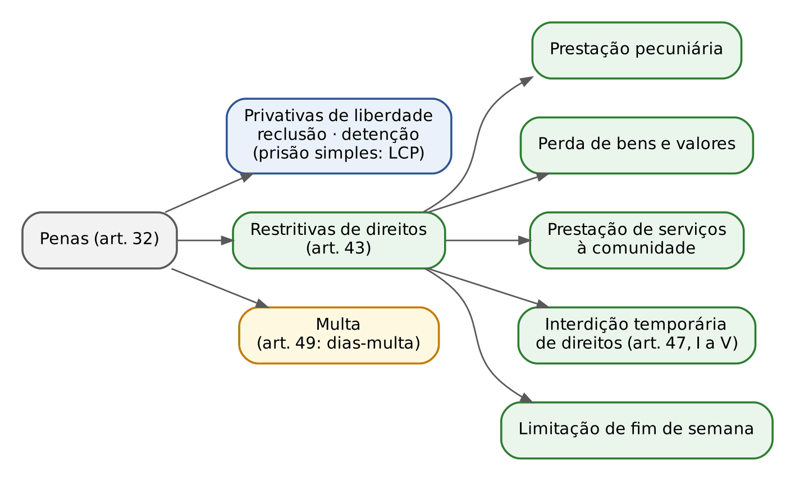
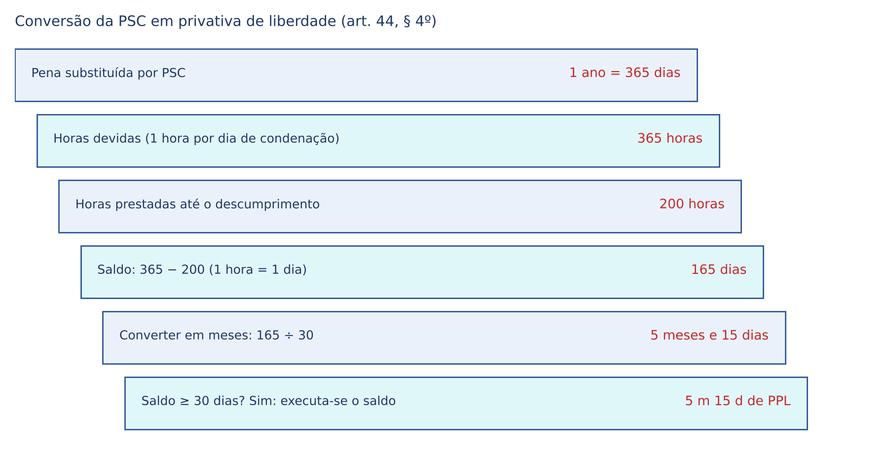
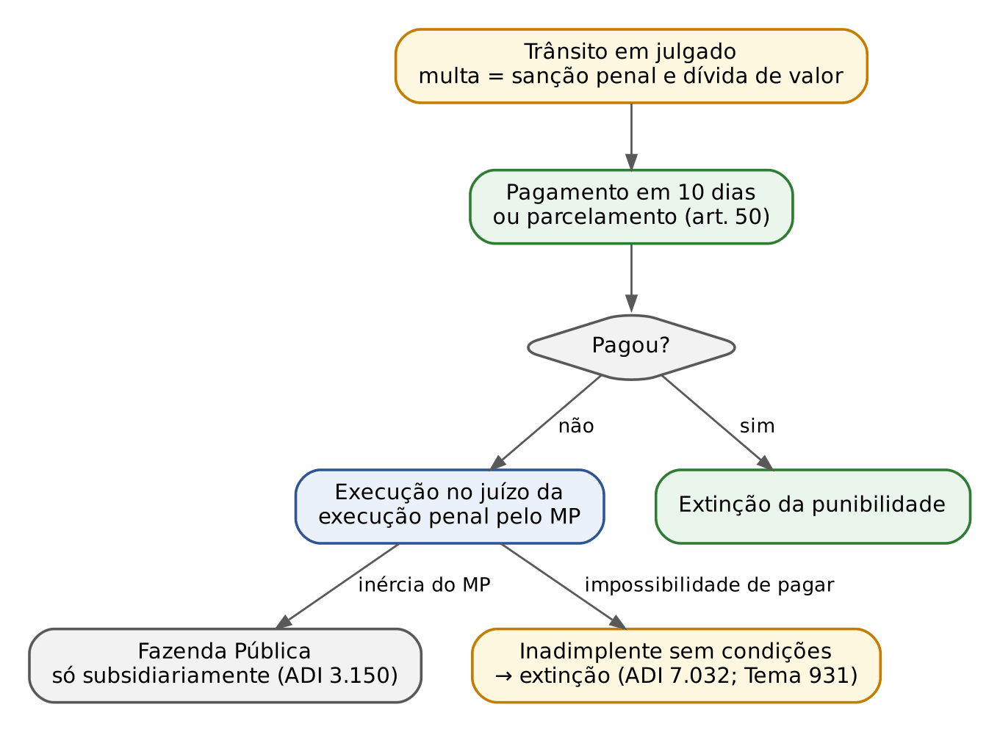

# CAPÍTULO 12 — TEORIA DA PENA E PENAS EM ESPÉCIE: FINALIDADES, SISTEMAS PENITENCIÁRIOS, PRIVATIVAS DE LIBERDADE, RESTRITIVAS DE DIREITOS E MULTA

:::INCIDENCIA
Pontos: TRF5 p. 6; TJRS p. 1, 4; TJSC p. 19, 20, 25, 26. Nível A; lote de 19 questões (FGV 15, FCC 4), mais correlatas de outros capítulos.
O que mais cai: pena de multa depois da Lei 13.964/2019 (execução no juízo da execução penal, legitimidade do MP, inadimplemento e extinção da punibilidade), literalidade das restritivas de direitos (arts. 45 a 48) e regras dos regimes (arts. 33 a 36).
:::

| Subtema | FGV | FCC | Padrão de cobrança |
|---|---|---|---|
| Multa: natureza, execução, inadimplemento, concurso | 8 | 1 | jurisprudência (ADI 3.150, ADI 7.032, Tema 931) e art. 51 literal |
| Privativas de liberdade: reclusão x detenção, regras dos regimes, estabelecimentos | 5 | 1 | letra dos arts. 33 a 36 e 39, com troca de palavras ("salvo", "isolamento", "em comum") |
| Restritivas de direitos em espécie | 1 | 1 | letra dos arts. 45 e 48 (horas, teto, beneficiário) |
| Teorias e finalidades da pena; penas constitucionais | 2 | 0 | ressocialização na LEP; rol do art. 5º, XLVII, da CF |
| História da prisão e sistemas penitenciários | 0 | 1 | casas de correção e de trabalho; isolamento x silêncio x progressão |

## 12.1 A pena: conceito, características e limites constitucionais

### 12.1.1 Conceito

Pena é a sanção penal imposta pelo Estado, por meio do devido processo legal, ao autor culpável de uma infração penal, consistente na privação ou restrição de um bem jurídico (liberdade, patrimônio, direitos). Ao lado da medida de segurança (Cap. 19), é uma das duas espécies de sanção penal. A diferença essencial: a pena tem como pressuposto a culpabilidade e olha para o fato praticado; a medida de segurança tem como pressuposto a periculosidade do inimputável (ou semi-imputável) e olha para o tratamento.

Para o leitor civilista, a comparação útil é com a responsabilidade civil: a indenização mede-se pelo dano (art. 944 do CC); a pena mede-se pela culpabilidade do agente e pela necessidade preventiva, podendo existir sem dano algum (crime tentado, crime de perigo) e não se transmitindo aos herdeiros.

### 12.1.2 Características e princípios aplicáveis

Os princípios são estudados no Cap. 2; aqui interessa como cada um se projeta sobre a pena.

| Característica | Conteúdo | Fundamento |
|---|---|---|
| Legalidade e anterioridade | só há pena cominada em lei anterior ao fato | art. 5º, XXXIX, CF; art. 1º do CP |
| Personalidade (intranscendência) | a pena não passa da pessoa do condenado; a obrigação de reparar o dano e a perda de bens podem alcançar sucessores até o limite do patrimônio transferido | art. 5º, XLV, CF |
| Individualização | em três momentos: legislativo (cominação), judicial (dosimetria — Caps. 13 a 15) e executório (LEP) | art. 5º, XLVI, CF |
| Proporcionalidade | proibição do excesso e da proteção deficiente | implícito |
| Humanidade | vedação de penas cruéis, de morte (salvo guerra declarada), perpétuas, de trabalhos forçados e de banimento | art. 5º, XLVII, CF |
| Inderrogabilidade | aplicada a pena, deve ser cumprida, salvo as exceções legais (prescrição, perdão judicial, indulto, sursis etc.) | lei |

A personalidade explica duas consequências cobradas: a morte do condenado extingue a punibilidade, inclusive a multa (art. 107, I, do CP — Cap. 21), e a multa NÃO pode ser cobrada dos herdeiros, embora a lei a chame de "dívida de valor" (ver 12.7.2).

:::LEI Constituição Federal, art. 5º, XLVI e XLVII
XLVI - a lei regulará a individualização da pena e adotará, entre outras, as seguintes: a) privação ou restrição da liberdade; b) perda de bens; c) multa; d) prestação social alternativa; e) suspensão ou interdição de direitos;
XLVII - não haverá penas: a) de morte, salvo em caso de guerra declarada, nos termos do art. 84, XIX; b) de caráter perpétuo; c) de trabalhos forçados; d) de banimento; e) cruéis;
:::

:::PEGADINHA Rol do inciso XLVI x rol do inciso XLVII
O rol de penas PERMITIDAS (XLVI) é exemplificativo ("entre outras"); o de penas PROIBIDAS (XLVII) é taxativo quanto à vedação expressa. "Degredo" não consta do XLVII (constava de Constituições anteriores), e "prestação de contas" ou "reparação do dano" não são penas constitucionais. A proibição de trabalhos forçados NÃO impede o trabalho obrigatório do preso (art. 31 da LEP), que é remunerado e conta para remição: trabalho forçado é o imposto como castigo, sem remuneração e sob coação física.
:::

:::QUESTAO FGV 2024 — Prova de nível superior (Q2564207)
Pedia-se o par "pena permitida / pena proibida expressamente" pela CF. Gabarito: A (privação de liberdade e trabalhos forçados). Armadilhas: "multa e degredo" (degredo não está no rol expresso do XLVII), "trabalhos forçados e suspensão de direitos" (ordem invertida), "prestação de contas e caráter perpétuo" (prestação de contas não é pena).
:::

## 12.2 Teorias da pena: para que se pune?

### 12.2.1 O problema

A pergunta "por que e para que o Estado pune?" divide as teorias em três grandes grupos. O critério de classificação é simples: as absolutas olham para o PASSADO (o crime cometido) e dispensam qualquer utilidade futura; as relativas olham para o FUTURO (evitar crimes); as mistas combinam ambas. A fórmula latina que as bancas usam vem de Sêneca, via Grotius: *punitur quia peccatum est* (pune-se porque pecou — absolutas) x *punitur ne peccetur* (pune-se para que não se peque — relativas).

### 12.2.2 Teorias absolutas ou retributivas

A pena é um fim em si mesma: retribui o mal do crime com o mal da pena, restaurando a justiça. Para Kant, a pena é imperativo categórico; o homem não pode ser usado como meio para fins alheios (por isso a pena não pode servir à prevenção), e o célebre exemplo da ilha que se dissolve — mesmo a sociedade se dissolvendo, o último assassino deveria ser executado — mostra a retribuição pura. Para Hegel, a retribuição é dialética: o crime é a negação do direito, e a pena é a negação da negação, que reafirma o direito (retribuição jurídica, não moral).

Mérito que se reconhece: a ideia de proporcionalidade (a pena não pode ir além da culpabilidade). Críticas: não explica por que o Estado deve punir quando a pena não tem utilidade, e parte de um livre-arbítrio indemonstrável.

### 12.2.3 Teorias relativas ou preventivas

A pena é instrumento para evitar crimes futuros. Divide-se conforme o destinatário da mensagem preventiva.

| Vertente | Destinatário | Ideia central | Autores de referência | Crítica principal |
|---|---|---|---|---|
| Prevenção geral negativa | a coletividade | intimidação: a ameaça e a imposição da pena dissuadem potenciais infratores (coação psicológica) | Feuerbach, Beccaria, Bentham | risco de terror penal: penas exemplares e desproporcionais; o condenado vira instrumento |
| Prevenção geral positiva | a coletividade | reafirmação da confiança na vigência da norma; integração e fidelidade ao Direito | Welzel (ético-social); Jakobs (sistêmica — fundamentadora); Roxin e Mir Puig (limitadora) | a versão fundamentadora (Jakobs) legitima qualquer pena que estabilize o sistema |
| Prevenção especial negativa | o condenado | neutralização (inocuização): enquanto preso, não delinque | von Liszt (para os incorrigíveis) | trata o homem como perigo a conter |
| Prevenção especial positiva | o condenado | ressocialização, correção, reeducação | von Liszt (Programa de Marburgo, 1882), escola positiva, correcionalismo | legitima intervenção ilimitada na personalidade; fracasso empírico da prisão |

Von Liszt resumiu a prevenção especial em três frentes conforme o tipo de delinquente: correção do corrigível, intimidação do que não precisa de correção e inocuização do incorrigível.

:::DICA Como não confundir "positiva" e "negativa"
Negativa = a pena atua por meio de um mal (medo, isolamento). Positiva = a pena atua construindo algo (confiança na norma, reintegração). Geral = sociedade; especial = o próprio condenado. Monte a matriz 2 x 2 e as alternativas se resolvem sozinhas.
:::

### 12.2.4 Teorias mistas ou unificadoras e a teoria dialética de Roxin

As teorias mistas reúnem retribuição e prevenção. A versão mais cobrada é a teoria unificadora dialética de Claus Roxin, que distribui as finalidades pelos três momentos da pena:

- cominação legal: prevenção geral (a lei protege bens jurídicos, ameaçando);
- aplicação judicial: prevenção geral e especial, limitadas pela culpabilidade (a culpabilidade funciona como TETO — a pena não pode ultrapassá-la, mas pode ficar abaixo dela se as necessidades preventivas o permitirem);
- execução: prevenção especial positiva (ressocialização).

Roxin rejeita a retribuição como fundamento: a culpabilidade é só o limite. Por isso ele é classificado por parte da doutrina como "preventivista" e não como "eclético puro". Bitencourt adota a prevenção geral positiva limitadora, próxima de Roxin e de Mir Puig.

### 12.2.5 Teorias deslegitimadoras: agnóstica (Zaffaroni) e abolicionismo

Zaffaroni (com Batista, Alagia e Slokar) propõe a teoria agnóstica ou negativa: as funções declaradas da pena não se comprovam empiricamente; a pena é ato de poder político, que o Direito Penal não consegue legitimar, apenas conter. Daí a função do juiz como redutor de danos do poder punitivo. O abolicionismo (Hulsman, Christie, Mathiesen) vai além e propõe substituir o sistema penal por modelos de solução de conflitos; o garantismo de Ferrajoli justifica a pena como mal menor, com dupla prevenção geral negativa: prevenir delitos e prevenir reações informais e desproporcionais (vingança privada). Os modelos de política criminal (abolicionismo, garantismo, direito penal mínimo e máximo, justiça restaurativa) estão no Cap. 1.

### 12.2.6 E o Brasil?

O Código Penal adota teoria mista: o art. 59 manda o juiz fixar a pena "conforme seja necessário e suficiente para reprovação e prevenção do crime" — reprovação é a face retributiva; prevenção, a preventiva (geral e especial). Na execução, prevalece a prevenção especial positiva: o art. 1º da LEP fala em proporcionar condições para a "harmônica integração social do condenado e do internado". Também refletem o fim preventivo especial a progressão de regime, a remição e o livramento condicional (Cap. 24).

:::QUESTAO FGV 2026 — PC-PI — Oficial Investigador (Q3846865)
Itens sobre ressocialização: (I) matriz positivista, correção do delinquente para prevenir delitos; (II) a criminologia crítica a teria ressignificado como norte para penas justas e harmonização social; (III) a LEP refere expressamente a reintegração como objetivo. Gabarito: E (I e III). Armadilha do item II: a criminologia crítica é justamente a maior CRÍTICA da ideologia ressocializadora, que vê como legitimação da seletividade do sistema (Cap. 1).
:::

:::SENTENCA Onde as finalidades aparecem na sentença
Não há capítulo próprio sobre "teoria da pena" na sentença. As finalidades aparecem como critério da dosimetria (art. 59: "necessário e suficiente para reprovação e prevenção") e na escolha da pena quando o tipo comina pena alternativa (ver 12.4.3). Redação-modelo: "Fixo a pena-base no mínimo legal, por se mostrar necessária e suficiente à reprovação e prevenção do crime (art. 59 do CP)". Erro comum: invocar "gravidade abstrata" ou "necessidade de exemplo à sociedade" (prevenção geral pura) para exasperar a pena — a banca trata como fundamentação inidônea.
:::

## 12.3 Sistemas penitenciários

### 12.3.1 Da prisão-custódia à prisão-pena

Até o século XVI, a prisão era predominantemente custódia: lugar onde se aguardava o julgamento e a pena real (morte, açoites, galés, mutilações). A prisão como pena autônoma nasce com as casas de correção e de trabalho, ligadas à transformação econômica da Idade Moderna (mendicância e vagabundagem nas cidades, necessidade de disciplinar mão de obra):

- casa de correção de Bridewell, em Londres (por volta de 1552): primeira instituição de detenção sem caráter de custódia cautelar, para disciplinar e reformar vagabundos e pequenos delinquentes pelo trabalho e pela disciplina;
- casas de trabalho holandesas, em Amsterdã (Rasphuis, 1596, para homens; Spinhuis, para mulheres): trabalho obrigatório (raspar madeira para tintura), com fins de correção e de aproveitamento econômico;
- Hospício de San Michele, em Roma (1703), para jovens, com isolamento noturno e trabalho diurno — antecedente do sistema celular.

No século XVIII, os reformadores humanizaram a execução: Beccaria (proporcionalidade, utilidade da pena), John Howard (*The State of Prisons*, 1777: higiene, separação de presos, trabalho, inspeção — por isso é considerado o pai da ciência penitenciária) e Jeremy Bentham (pena com fins preventivos e o panóptico, modelo arquitetônico de vigilância permanente).

:::QUESTAO FCC 2025 — DPE-AM — Defensor Público (Q3531590)
Perspectiva histórica da pena de prisão. Gabarito: C — as casas de correção foram o primeiro tipo de instituição de detenção sem finalidade de custódia cautelar, voltada a disciplinar e reformar os internos pelo trabalho. Armadilhas: atribuir às casas de correção finalidade educacional moderna para adolescentes (ensino, tratamento psicológico); dizer que as casas de trabalho serviam à produção em larga escala para a burguesia; e apontar os "hospitais" franceses como a primeira instituição de internamento que originou o cárcere do século XIX.
:::

### 12.3.2 Os grandes sistemas

| Sistema | Origem | Características | Críticas |
|---|---|---|---|
| Pensilvânico, filadélfico, belga ou celular (*solitary system*) | Walnut Street Jail, Filadélfia (1790), sob influência dos quakers; depois Eastern Penitentiary (1829) | isolamento celular absoluto, dia e noite; leitura da Bíblia; trabalho, quando admitido, na própria cela; arrependimento pela meditação | loucura e embrutecimento; custo alto; não prepara para a vida social |
| Auburniano (*silent system*) | prisão de Auburn, Nova York (por volta de 1818 a 1821); Elam Lynds | isolamento noturno; trabalho em COMUM durante o dia, sob regra do SILÊNCIO absoluto; disciplina rígida, castigos corporais | silêncio antinatural; motivação econômica (produtividade do trabalho) |
| Progressivo inglês ou *mark system* | Alexander Maconochie, ilha de Norfolk (Austrália), por volta de 1840 | pena medida pelo trabalho e pela boa conduta (marcas/vales), não só pelo tempo; três períodos: isolamento celular, trabalho em comum com silêncio, liberdade condicional | — |
| Progressivo irlandês | Walter Crofton, Irlanda (por volta de 1853 a 1854) | acrescenta ao inglês uma fase intermediária: prisões intermediárias (trabalho ao ar livre, sem vigilância rígida); quatro fases: isolamento, trabalho em comum com silêncio, prisão intermediária e livramento condicional | — |
| Sistema de Montesinos | Manuel Montesinos, presídio de Valência, Espanha (a partir de 1835) | respeito à dignidade do preso, autoridade moral do diretor, trabalho remunerado como instrumento de reabilitação, redução de castigos; antecipa saídas e confiança | — |

Pensilvânico e auburniano têm em comum o isolamento noturno e a crença na disciplina como instrumento de correção; diferem no regime diurno (cela individual x trabalho em comum silencioso). Os progressivos trazem a ideia decisiva: a pena se cumpre em etapas, e o comportamento do preso abrevia ou facilita sua passagem à liberdade.

:::ESQUEMA Palavra-chave de cada sistema
Pensilvânico = isolamento total. Auburniano = trabalho em comum + silêncio. Inglês = marcas (vales). Irlandês = prisão intermediária + livramento condicional. Montesinos = dignidade e trabalho reabilitador.
:::

### 12.3.3 O sistema adotado no Brasil

O Brasil adota o sistema progressivo: as penas privativas de liberdade "deverão ser executadas em forma progressiva, segundo o mérito do condenado" (art. 33, § 2º, do CP; art. 112 da LEP). A doutrina majoritária aponta a filiação ao modelo irlandês, por conter regime semiaberto (função análoga à prisão intermediária), aberto e livramento condicional; há quem fale em sistema progressivo "à brasileira", mitigado, porque não há isolamento celular obrigatório inicial. Resquícios dos modelos clássicos: o isolamento durante o repouso noturno no regime fechado (art. 34, § 1º — herança auburniana) e o exame criminológico de classificação (art. 34, caput). A progressão é vedada por saltos (Súmula 491 do STJ — ver Cap. 24).

:::DICA Ligação com a letra do CP
Quando a banca pede o "sistema adotado", responda "progressivo". Quando pede a regra do regime fechado, lembre que o isolamento é só NOTURNO, e o trabalho diurno é EM COMUM (art. 34, §§ 1º e 2º): a assertiva que fala em isolamento diurno descreve o sistema pensilvânico, não o CP.
:::

## 12.4 Classificação e espécies de pena

### 12.4.1 O art. 32 do CP

As penas são: privativas de liberdade, restritivas de direitos e de multa (art. 32). A Reforma de 1984 extinguiu as antigas penas acessórias (perda de função pública, interdições de direitos), que se transformaram em efeitos da condenação (art. 92 — Cap. 18) ou em penas restritivas de direitos autônomas (art. 47).

### 12.4.2 Classificações doutrinárias úteis

| Critério | Espécies | Observação |
|---|---|---|
| Bem jurídico atingido | corporais (proibidas), privativas de liberdade, restritivas de direitos, pecuniárias, infamantes (proibidas) | a CF veda as cruéis e as de banimento |
| Modo de cominação | principais (cominadas no tipo) x substitutivas (aplicadas no lugar da cominada) | restritivas de direitos e multa vicariante são substitutivas |
| Autonomia | autônomas x acessórias | não há mais penas acessórias no CP; as restritivas são autônomas (art. 44, caput) |
| Forma de cominação no preceito secundário | isolada (só uma pena), cumulativa ("reclusão e multa"), alternativa ("detenção ou multa") | a alternatividade gera dever de escolher e fundamentar (12.4.3) |

### 12.4.3 Cominação alternativa: a escolha deve ser fundamentada

Quando o preceito secundário prevê pena privativa de liberdade OU multa (ex.: ameaça, art. 147 — "detenção, de um a seis meses, ou multa"), a primeira decisão do juiz, antes mesmo da dosimetria, é escolher a espécie (art. 59, I: "as penas aplicáveis dentre as cominadas"). A opção pela privativa de liberdade exige fundamentação concreta nas circunstâncias judiciais.

:::JURIS STJ, AgRg no AREsp 2.808.209-SC, j. 4/11/2025 (Informativo 880)
A escolha da pena privativa de liberdade, quando o tipo prevê alternativamente a multa, deve ser fundamentada, considerando as circunstâncias judiciais do caso concreto. Fixar a detenção sem justificar por que a multa não basta é nulidade parcial da dosimetria.
:::

:::SENTENCA Escolha da espécie de pena
Onde entra: no início da dosimetria (art. 59, I), antes da pena-base. Redação-modelo: "Sendo a pena cominada alternativamente, opto pela privativa de liberdade, porque a culpabilidade acentuada e as circunstâncias do crime, acima analisadas, revelam que a multa isolada não seria suficiente à reprovação e prevenção do delito". Erro comum: aplicar automaticamente a detenção, ou aplicar as duas penas quando a cominação é alternativa (cumulação sem previsão legal, que viola a própria cominação).
:::

:::QUESTAO FGV 2024 — PC-SC — Psicólogo Policial Civil (Q2365385)
Três afirmações: (I) a multa não é pena; (II) o trabalho do preso será sempre remunerado, salvo trabalhos forçados; (III) o tempo de prisão provisória no estrangeiro computa-se na pena privativa de liberdade. Gabarito: B (só III — art. 42, detração). Armadilhas: a multa é espécie de pena (art. 32, III); o art. 39 diz que o trabalho do preso será "sempre remunerado" sem exceção, e trabalhos forçados são vedados pela CF.
:::

## 12.5 Penas privativas de liberdade

### 12.5.1 Reclusão, detenção e prisão simples

O CP conhece duas penas privativas de liberdade para crimes: reclusão e detenção. A prisão simples é a pena privativa das contravenções (art. 5º, I, e art. 6º da LCP — Cap. 50). A Reforma de 1984 manteve a distinção, embora a doutrina a critique como pouco significativa na prática; para a prova, porém, as diferenças são numerosas e cobradas.

:::LEI Código Penal, art. 33, caput e § 1º
Art. 33 - A pena de reclusão deve ser cumprida em regime fechado, semi-aberto ou aberto. A de detenção, em regime semi-aberto, ou aberto, salvo necessidade de transferência a regime fechado.
§ 1º - Considera-se: a) regime fechado a execução da pena em estabelecimento de segurança máxima ou média; b) regime semi-aberto a execução da pena em colônia agrícola, industrial ou estabelecimento similar; c) regime aberto a execução da pena em casa de albergado ou estabelecimento adequado.
:::

| Aspecto | Reclusão | Detenção | Prisão simples (LCP) |
|---|---|---|---|
| Regime INICIAL possível | fechado, semiaberto ou aberto | semiaberto ou aberto (NUNCA fechado no início) | semiaberto ou aberto |
| Regime fechado por regressão | sim | sim ("salvo necessidade de transferência a regime fechado") | não: cumprida sem rigor penitenciário, em estabelecimento especial ou seção especial (art. 6º da LCP) |
| Pena superior a 8 anos | começa no fechado (art. 33, § 2º, "a") | começa no semiaberto (o fechado é vedado no início) | não ocorre (máximo de 5 anos — art. 10 da LCP) |
| Ordem de cumprimento no concurso | executa-se primeiro (art. 69, caput, parte final; art. 76) | depois da reclusão | — |
| Medida de segurança para inimputável (art. 97) | internação, como regra legal | o juiz pode optar por tratamento ambulatorial | — |
| Incapacidade para o poder familiar, tutela ou curatela (art. 92, II) | só nos crimes dolosos punidos com RECLUSÃO contra filho, descendente, tutelado, curatelado, outro titular do mesmo poder familiar ou contra a mulher por razões da condição do sexo feminino | não gera esse efeito | — |
| Interceptação telefônica | admitida | vedada se o fato for punido, no máximo, com detenção (art. 2º, III, da Lei 9.296/1996) | vedada |
| Estabelecimento do regime fechado | penitenciária (art. 87 da LEP) | penitenciária, se regredir | — |

Pontos que NÃO diferenciam mais as espécies (pegadinhas de alternativas antigas): a fiança pela autoridade policial depende hoje apenas da pena máxima não superior a 4 anos (art. 322 do CPP, redação da Lei 12.403/2011), e não da espécie; prazos prescricionais, sursis e substituição por restritivas também não distinguem reclusão de detenção. Quanto à medida de segurança, a regra literal do art. 97 é flexibilizada pela jurisprudência do STJ, que admite tratamento ambulatorial mesmo em crime punido com reclusão, à luz da proporcionalidade (Cap. 19).

:::EXEMPLO Detenção com pena alta
A é condenado por dois crimes punidos com detenção, em concurso material, a 9 anos no total, sendo primário. Pela quantidade (superior a 8 anos), um condenado à reclusão iniciaria no fechado; mas, sendo DETENÇÃO, o regime inicial máximo é o semiaberto (art. 33, caput, segunda parte). Se A, já no semiaberto, praticar falta grave, poderá regredir ao fechado — é a "necessidade de transferência". As regras completas de fixação do regime inicial (quantidade, reincidência, art. 59, Súmulas 718 e 719 do STF e 440 do STJ) estão no Cap. 17.
:::

:::QUESTAO FGV 2026 — TJ-PA — Juiz Substituto (Q3951756)
Afirmações sobre reclusão, detenção e multa. Gabarito: C — o condenado a detenção superior a 8 anos deve começar, em regra, no semiaberto. Erros das demais: a doença mental superveniente SUSPENDE a execução da multa (art. 52); o condenado a detenção pode cumprir pena no fechado por regressão; a multa é executada no juízo da execução penal, não no fazendário (art. 51); e a impossibilidade econômica comprovada não obsta a extinção da punibilidade (12.7.6).
:::

:::QUESTAO FCC 2025 — DPE-RS — Defensor Público (Q3387030)
Gabarito: C — o CP prevê semiaberto e aberto para a detenção e consigna expressamente o fechado em caso de necessidade de transferência. Armadilhas: (B) negar ao preso do fechado os benefícios previdenciários (o art. 39 os garante a todo preso que trabalha); (D) afirmar que a multa não se suspende por doença mental (art. 52 diz o contrário); (A) termo inicial da prescrição em crimes contra crianças e adolescentes (é tema do Cap. 22, e a regra do art. 111, V, refere-se a crimes contra a dignidade sexual ou violência contra criança e adolescente, contando-se da data em que a vítima completar 18 anos, salvo se já proposta a ação); (E) sentença estrangeira gera reincidência (art. 63 — Cap. 14).
:::

### 12.5.2 Os regimes de cumprimento: conceito, estabelecimento e trabalho

O regime é o modo de execução da pena privativa de liberdade, definido pelo grau de restrição e pelo estabelecimento. A sentença fixa o regime INICIAL (art. 33, § 3º, e art. 59, III — Cap. 17); a execução movimenta o condenado entre os regimes por progressão e regressão (Cap. 24). Aqui interessam as regras de cada regime, que as bancas cobram pela letra dos arts. 34 a 36.

| Regime | Estabelecimento (CP e LEP) | Trabalho | Trabalho externo | Outras regras |
|---|---|---|---|---|
| Fechado | segurança máxima ou média; penitenciária (art. 87 da LEP), cela individual com área mínima de 6 m² (art. 88 da LEP) | no período DIURNO, EM COMUM dentro do estabelecimento, conforme aptidões ou ocupações anteriores (art. 34, §§ 1º e 2º) | admissível SOMENTE em serviços ou obras públicas (art. 34, § 3º; art. 36 da LEP), com cautelas contra fuga e autorização da direção (art. 37 da LEP) | exame criminológico de classificação no início (art. 34, caput); ISOLAMENTO durante o repouso noturno (art. 34, § 1º) |
| Semiaberto | colônia agrícola, industrial ou similar (art. 91 da LEP); alojamento coletivo admitido (art. 92 da LEP) | EM COMUM durante o período diurno, na colônia (art. 35, § 1º) | admissível, sem a restrição a obras públicas; também frequência a cursos supletivos profissionalizantes, de segundo grau ou superior (art. 35, § 2º) | aplica-se o exame criminológico do art. 34, caput (art. 35, caput) |
| Aberto | casa do albergado ou estabelecimento adequado (art. 93 da LEP): centro urbano, sem obstáculos físicos contra fuga (art. 94 da LEP) | FORA do estabelecimento e SEM vigilância: trabalhar, frequentar curso ou outra atividade autorizada (art. 36, § 1º) | é a própria essência do regime | baseia-se na autodisciplina e no senso de responsabilidade (art. 36, caput); recolhimento no período noturno e nos dias de folga |

:::LEI Código Penal, art. 34, §§ 1º a 3º, e art. 36, § 2º
Art. 34, § 1º - O condenado fica sujeito a trabalho no período diurno e a isolamento durante o repouso noturno.
§ 2º - O trabalho será em comum dentro do estabelecimento, na conformidade das aptidões ou ocupações anteriores do condenado, desde que compatíveis com a execução da pena.
§ 3º - O trabalho externo é admissível, no regime fechado, em serviços ou obras públicas.
Art. 36, § 2º - O condenado será transferido do regime aberto, se praticar fato definido como crime doloso, se frustrar os fins da execução ou se, podendo, não pagar a multa cumulativamente aplicada.
:::

:::PEGADINHA Três trocas de palavras que a FGV repete
1) "Isolamento" é só no repouso NOTURNO do regime fechado; no semiaberto não há isolamento. 2) "Recolhimento durante o período noturno e nos dias de folga" é expressão do regime ABERTO (art. 36, § 1º), não do fechado nem do semiaberto. 3) No fechado, o trabalho externo é admitido APENAS em serviços ou obras públicas — a assertiva que diz "salvo em serviços ou obras públicas" inverte a regra.
:::

:::QUESTAO FGV 2026 — PC-PI — Delegado de Polícia (Q3848976)
Condenado por peculato e associação criminosa, em regime inicial fechado. Itens: (I) trabalho diurno e isolamento no repouso noturno; (II) trabalho em comum dentro do estabelecimento, conforme aptidões; (III) trabalho externo admissível por ato do diretor, "salvo em serviços ou obras públicas". Gabarito: D (I e II). O item III inverte o art. 34, § 3º.
No mesmo sentido: FGV 2025 — TJ-ES — Cartórios (Q3520639): o regime em que o trabalho externo só é admissível em serviços ou obras públicas é o fechado, com trabalho diurno e isolamento noturno (gabarito E); as alternativas trocavam o regime ou atribuíam ao fechado o "recolhimento noturno e nos dias de folga", próprio do aberto.
:::

:::QUESTAO FGV 2024 — TJ-MT — Analista Judiciário (Q3114283)
A casa do albergado destina-se às penas privativas de liberdade de reclusão ou detenção, em regime aberto (gabarito C). Armadilha: a alternativa "restritivas de direitos, em regime aberto" — é verdade que a casa do albergado também recebe a limitação de fim de semana (art. 93 da LEP), mas restritiva de direitos não se cumpre "em regime"; regime é categoria exclusiva da pena privativa de liberdade.
:::

A falta de vaga no estabelecimento adequado não autoriza manter o condenado em regime mais gravoso (Súmula Vinculante 56 — ver Cap. 23); na falta de casa do albergado, a solução jurisprudencial é a prisão domiciliar, com ou sem monitoração (Cap. 24). Também é vedado impor restritiva de direitos como condição especial do aberto (Súmula 493 do STJ — ver Cap. 17).

### 12.5.3 Regime especial, direitos do preso e trabalho

As mulheres cumprem pena em estabelecimento próprio, observados os deveres e direitos inerentes à sua condição pessoal (art. 37; art. 5º, XLVIII e L, da CF). O preso conserva todos os direitos não atingidos pela perda da liberdade (art. 38): só a liberdade de locomoção e o que dela decorre necessariamente são afetados; o voto, por exemplo, fica suspenso pela condenação definitiva (art. 15, III, da CF), não pela prisão em si. O rol de direitos e deveres está nos arts. 38 a 43 da LEP (Cap. 23).

O trabalho do preso "será sempre remunerado, sendo-lhe garantidos os benefícios da Previdência Social" (art. 39). É dever (art. 31 da LEP) e direito (art. 41, II, da LEP), não se sujeita à CLT e tem remuneração mínima de três quartos do salário mínimo (art. 29 da LEP — a constitucionalidade desse piso e a destinação do produto ficam no Cap. 23). O preso provisório não é obrigado a trabalhar (art. 31, parágrafo único, da LEP).

### 12.5.4 Superveniência de doença mental e detração

Se sobrevém doença mental ao condenado, ele é recolhido a hospital de custódia e tratamento psiquiátrico ou outro estabelecimento adequado (art. 41); se a doença for duradoura, a pena pode ser convertida em medida de segurança na execução (art. 183 da LEP — Caps. 19 e 24). Atenção ao paralelo com a multa: sobrevindo doença mental, a execução da multa fica SUSPENSA (art. 52 — 12.7.5).

Detração é o cômputo, na pena privativa de liberdade e na medida de segurança, do tempo de prisão provisória (no Brasil ou no estrangeiro), de prisão administrativa e de internação em hospital de custódia (art. 42). É como o abatimento, na condenação final, de um pagamento antecipado: o Estado já privou o réu da liberdade e não pode cobrar duas vezes pelo mesmo tempo. O uso da detração na sentença para fixar o regime (art. 387, § 2º, do CPP), a detração do recolhimento noturno imposto como cautelar (Tema 1.155 do STJ) e a detração por prisão em outro processo estão no Cap. 17.

## 12.6 Penas restritivas de direitos

### 12.6.1 Natureza: autônomas e substitutivas

As penas restritivas de direitos (PRD) são autônomas e substituem as privativas de liberdade (art. 44, caput). Duas ideias, que parecem contraditórias, convivem nessa frase:

- substitutivas: em regra, NÃO estão cominadas nos tipos penais; o juiz fixa primeiro a pena privativa de liberdade (com toda a dosimetria) e, depois, se presentes os requisitos do art. 44, a troca por uma ou duas restritivas (art. 54). Exceções em leis especiais, que cominam restritivas diretamente: art. 28 da Lei 11.343/2006 (Cap. 37), suspensão ou proibição da habilitação no CTB (Cap. 43), Lei 9.605/1998 (Apostila de Direito Ambiental) e Lei 13.869/2019 (Cap. 44);
- autônomas: depois da substituição, a restritiva não é acessório da privativa nem condição de outro benefício; executa-se por si mesma, e só volta a ser prisão pela conversão (12.6.7).

Os REQUISITOS da substituição (pena não superior a 4 anos sem violência ou grave ameaça, ou crime culposo; não reincidência em crime doloso, com a exceção do § 3º; suficiência pelas circunstâncias judiciais), a regra de quantas restritivas aplicar (art. 44, § 2º: até 1 ano, multa ou uma restritiva; acima de 1 ano, uma restritiva e multa ou duas restritivas) e as vedações jurisprudenciais (Súmula 588 do STJ) estão no Cap. 17. Aqui se estudam as restritivas em espécie, sua execução e sua conversão.

Duração: as penas dos incisos III a VI do art. 43 — limitação de fim de semana, prestação de serviços, interdição temporária — têm a MESMA duração da privativa substituída, ressalvada a faculdade de abreviar a prestação de serviços (art. 55 c/c art. 46, § 4º). A prestação pecuniária e a perda de bens não se medem em tempo, mas em valor.

Execução: só depois do trânsito em julgado (Súmula 643 do STJ: a execução da pena restritiva de direitos depende do trânsito em julgado da condenação), no juízo da execução penal, que designa a entidade, intima o condenado e fiscaliza (arts. 147 a 155 da LEP). Em qualquer fase, o juiz da execução pode, motivadamente, ALTERAR A FORMA de cumprimento da prestação de serviços e da limitação de fim de semana, ajustando-as às condições pessoais do condenado (art. 148 da LEP) — mas não pode trocar uma restritiva por outra.

:::JURIS STJ, AgRg no AREsp 2.783.936-SP, j. 11/2/2025 (Informativo 841)
Transitada em julgado a condenação a prestação de serviços à comunidade, o juiz da execução só pode alterar a forma de cumprimento (art. 148 da LEP), ajustando-a às condições do condenado e da entidade; é vedado substituir a pena aplicada por outra modalidade (por exemplo, trocar a prestação de serviços por prestação pecuniária), sob pena de ofensa à coisa julgada.
:::

### 12.6.2 Prestação pecuniária

Consiste no pagamento em dinheiro à vítima, a seus dependentes ou a entidade pública ou privada com destinação social, de importância fixada pelo juiz entre 1 e 360 salários mínimos (art. 45, § 1º). O valor pago é deduzido de eventual condenação em ação de reparação civil, SE coincidentes os beneficiários. Havendo aceitação do beneficiário, a prestação pecuniária pode consistir em prestação de outra natureza (art. 45, § 2º) — por exemplo, entrega de cestas básicas ou prestação de mão de obra.

Para o civilista, a prestação pecuniária é a sanção penal mais próxima da indenização: tem finalidade reparatória e, por isso, abate-se da condenação cível. Mas continua sendo pena, e seu descumprimento injustificado leva à conversão em prisão (12.6.7). A destinação dos valores a entidades segue regulamentação do CNJ (prioridade a entidades com finalidade social, por meio de conta judicial vinculada).

Na violência doméstica e familiar contra a mulher, é vedada a aplicação de penas de cesta básica ou outras de prestação pecuniária, bem como a substituição que implique o pagamento isolado de multa (art. 17 da Lei 11.340/2006 — Cap. 38); a vedação mais ampla da própria substituição em crimes com violência ou grave ameaça contra a mulher está na Súmula 588 do STJ (Cap. 17).

| Ponto | Prestação pecuniária (art. 45, § 1º) | Multa (art. 49) |
|---|---|---|
| Natureza | pena restritiva de direitos (substitutiva) | pena de multa (cominada ou substitutiva) |
| Beneficiário | vítima, dependentes ou entidade com destinação social | fundo penitenciário |
| Cálculo | 1 a 360 salários mínimos, fixados diretamente | dias-multa: 10 a 360 dias x valor de 1/30 a 5 salários mínimos |
| Dedução da indenização civil | sim, se coincidentes os beneficiários | não |
| Descumprimento | converte-se em privativa de liberdade | NÃO se converte em prisão; executa-se como dívida de valor |
| Pode ser de outra natureza | sim, com aceitação do beneficiário | não |

### 12.6.3 Perda de bens e valores

É a perda, em favor do Fundo Penitenciário Nacional (ressalvada a legislação especial), de bens e valores pertencentes ao condenado, tendo como TETO — o que for maior — o montante do prejuízo causado OU do provento obtido pelo agente ou por terceiro em consequência do crime (art. 45, § 3º).

Não confundir com o confisco do art. 91, II (instrumentos e produto do crime — efeito automático da condenação, Cap. 18). A perda de bens e valores é PENA, recai sobre o patrimônio LÍCITO do condenado e só existe se o juiz a escolher na substituição. Exemplo: B, sem antecedentes, furta 10.000 (dez mil) reais de um estabelecimento e obtém lucro de 15.000 (quinze mil) reais revendendo os bens; condenado a 2 anos, com substituição, a perda de bens pode alcançar até 15.000 (quinze mil) reais, porque o teto é o MAIOR entre o prejuízo (10.000) e o provento (15.000).

:::QUESTAO FCC 2026 — DPE-MA — Defensor Público (Q4012635)
Gabarito: B — a prestação pecuniária paga à vítima é deduzida da reparação civil se coincidentes os beneficiários e, aceitando o beneficiário, pode ter natureza diversa (art. 45, §§ 1º e 2º). Erros das demais: (A) o teto da perda de bens é o MAIOR entre prejuízo e provento, não só o prejuízo; (C) até 1 ano cabe substituição por multa OU por uma restritiva (art. 44, § 2º); (D) não há execução provisória de restritiva de direitos (Súmula 643 do STJ); (E) a conversão respeita saldo mínimo de 30 dias (art. 44, § 4º).
:::

### 12.6.4 Prestação de serviços à comunidade ou a entidades públicas

Aplicável às condenações SUPERIORES a 6 meses de privação de liberdade (art. 46, caput). Consiste na atribuição de tarefas GRATUITAS, em entidades assistenciais, hospitais, escolas, orfanatos e congêneres, ou em programas comunitários ou estatais (§§ 1º e 2º), conforme as aptidões do condenado, à razão de UMA HORA de tarefa POR DIA de condenação, fixadas de modo a não prejudicar a jornada normal de trabalho (§ 3º). Se a pena substituída for superior a 1 ano, o condenado pode cumprir em menor tempo, nunca inferior à METADE da pena privativa fixada (§ 4º).

A LEP complementa: o juiz da execução designa a entidade, intima o condenado e pode alterar a forma de execução conforme a jornada de trabalho (art. 149); o trabalho tem duração de 8 horas semanais, aos sábados, domingos e feriados ou em dias úteis (art. 149, § 1º); a execução começa no primeiro comparecimento (art. 149, § 2º); a entidade envia relatório mensal e comunica faltas (art. 150).

:::EXEMPLO Quantas horas e em quanto tempo?
C é condenado a 2 anos de reclusão, substituídos por prestação de serviços e prestação pecuniária.
Passo 1 — horas devidas: 2 anos = 730 dias (365 x 2); à razão de 1 hora por dia de condenação, C deve 730 horas.
Passo 2 — ritmo ordinário: 730 horas em 730 dias equivalem a cerca de 7 horas por semana (730 ÷ 104 semanas ≈ 7). A LEP fala em 8 horas semanais; na prática, a vara ajusta a carga para que o total de horas coincida com o tempo da pena.
Passo 3 — abreviação (art. 46, § 4º): como a pena é superior a 1 ano, C pode concluir em menos tempo, mas nunca em menos da metade, isto é, 1 ano (365 dias). Para cumprir as 730 horas em 1 ano, precisaria de cerca de 14 horas semanais (730 ÷ 52 ≈ 14).
Se a pena fosse de 1 ano exatamente, NÃO caberia abreviação (o § 4º exige pena "superior a um ano"); se fosse de 5 meses, NÃO caberia prestação de serviços (exige pena superior a 6 meses).
:::

### 12.6.5 Interdição temporária de direitos

São cinco modalidades (art. 47), de mesma duração da pena substituída:

| Inciso | Interdição | Quando cabe | Execução |
|---|---|---|---|
| I | proibição do exercício de cargo, função ou atividade pública, bem como de mandato eletivo | crime cometido no exercício do cargo, com violação dos deveres a ele inerentes (art. 56) | a autoridade baixa ato em 24 horas do recebimento do ofício, e a execução começa a partir dele (art. 154, § 1º, da LEP) |
| II | proibição do exercício de profissão, atividade ou ofício que dependam de habilitação especial, de licença ou autorização do poder público | crime cometido no exercício da profissão, com violação dos deveres a ela inerentes (art. 56) | apreensão dos documentos habilitantes (art. 154, § 2º, da LEP) |
| III | suspensão de autorização ou de habilitação para dirigir veículo | crimes culposos de trânsito (art. 57) | apreensão dos documentos (art. 154, § 2º, da LEP) |
| IV | proibição de frequentar determinados lugares | não há restrição legal específica; deve guardar relação com o crime | fiscalização pela autoridade, com comunicação ao juízo |
| V | proibição de inscrever-se em concurso, avaliação ou exame públicos (Lei 12.550/2011) | vocação natural para as fraudes em certames (art. 311-A — Cap. 34), sem restrição expressa | comunicação à autoridade competente |

Três cuidados. Primeiro: a interdição do inciso I é TEMPORÁRIA e é pena; a perda do cargo do art. 92, I, é DEFINITIVA e é efeito da condenação (Cap. 18). Segundo: o inciso II exige atividade que DEPENDA de habilitação, licença ou autorização estatal, e a interpretação é restritiva — o STJ afastou a proibição imposta a instrutor de hipismo, atividade que não exige habilitação estatal (Informativo de Jurisprudência n. 30, Edição Extraordinária, Sexta Turma, j. 29/10/2025, processo em segredo de justiça). Terceiro: nos crimes de trânsito do CTB, a suspensão ou proibição de obter habilitação é pena própria, cominada no tipo e regulada nos arts. 292 a 296 do CTB, o que torna residual o inciso III c/c art. 57 do CP (Cap. 43).

O descumprimento é comunicado ao juiz pela autoridade ou por qualquer prejudicado (art. 155 da LEP), e o exercício injustificado do direito interditado gera conversão (art. 181, § 3º, da LEP).

### 12.6.6 Limitação de fim de semana

:::LEI Código Penal, art. 48
Art. 48 - A limitação de fim de semana consiste na obrigação de permanecer, aos sábados e domingos, por 5 (cinco) horas diárias, em casa de albergado ou outro estabelecimento adequado.
Parágrafo único - Durante a permanência poderão ser ministrados ao condenado cursos e palestras ou atribuídas atividades educativas.
:::

Na LEP: o juiz da execução intima o condenado do local, dias e horário (art. 151); a execução começa no primeiro comparecimento; o estabelecimento envia relatório mensal (art. 153); nos casos de violência doméstica e familiar contra a criança, o adolescente e a mulher, o juiz pode determinar comparecimento obrigatório do agressor a programas de recuperação e reeducação (art. 152, parágrafo único, redação da Lei 14.344/2022).

:::QUESTAO FGV 2026 — TJ-MS — Analista Judiciário (Q3856348)
Definição da limitação de fim de semana. Gabarito: A — 5 horas DIÁRIAS, aos sábados e domingos, em casa de albergado ou estabelecimento adequado, onde PODERÃO ser ministrados cursos e palestras. As alternativas erradas trocavam três elementos: "5 horas" sem "diárias", "12 horas", "colônia agrícola" e o verbo "deverão" (a lei diz "poderão").
:::

| PRD | Base legal | Medida | Destino ou local | Particularidade cobrada |
|---|---|---|---|---|
| Prestação pecuniária | art. 45, §§ 1º e 2º | 1 a 360 salários mínimos | vítima, dependentes ou entidade social | deduz-se da indenização civil se coincidentes os beneficiários; outra natureza com aceitação |
| Perda de bens e valores | art. 45, § 3º | teto: o MAIOR entre prejuízo e provento | Fundo Penitenciário Nacional (salvo lei especial) | recai sobre bens lícitos; não é o confisco do art. 91 |
| Prestação de serviços | art. 46; arts. 149 e 150 da LEP | 1 hora por dia de condenação | entidades assistenciais, hospitais, escolas, programas | só para pena superior a 6 meses; gratuita; abreviação até a metade se pena superior a 1 ano |
| Interdição temporária | arts. 47, 56 e 57; arts. 154 e 155 da LEP | mesma duração da pena substituída | — | cinco modalidades; incisos I e II exigem violação de deveres; III só crimes culposos de trânsito |
| Limitação de fim de semana | art. 48; arts. 151 a 153 da LEP | 5 horas diárias aos sábados e domingos | casa do albergado ou estabelecimento adequado | cursos e palestras PODERÃO ser ministrados |

:::SENTENCA Como redigir a substituição
Onde entra: depois da fixação da pena definitiva e do regime inicial (Cap. 17). Fixe SEMPRE o regime inicial antes de substituir: é o regime que valerá se a restritiva for convertida. Especifique as penas escolhidas e seus parâmetros, deixando ao juízo da execução a designação da entidade. Redação-modelo: "Presentes os requisitos do art. 44 do CP, substituo a pena privativa de liberdade por duas restritivas de direitos: prestação de serviços à comunidade, à razão de uma hora de tarefa por dia de condenação, em entidade a ser designada pelo juízo da execução, e prestação pecuniária de 2 (dois) salários mínimos em favor da vítima". Erros comuns que a banca pune: aplicar prestação de serviços a pena de até 6 meses; fixar a prestação pecuniária em dias-multa ou destiná-la ao fundo penitenciário; impor interdição do art. 47, II, a atividade que não depende de habilitação estatal; esquecer o regime.
:::

### 12.6.7 Conversão da restritiva em privativa de liberdade

A substituição é um voto de confiança, e a conversão é a consequência do seu descumprimento. Há duas hipóteses no CP:

- descumprimento injustificado da restrição imposta (art. 44, § 4º): converte-se a restritiva em privativa; no cálculo da pena a executar, deduz-se o tempo cumprido da restritiva, respeitado o SALDO MÍNIMO de 30 dias de detenção ou reclusão;
- superveniência de condenação a pena privativa de liberdade por outro crime (art. 44, § 5º): o juiz da execução DECIDE sobre a conversão, podendo deixar de aplicá-la se for possível ao condenado cumprir a pena substitutiva anterior (conversão facultativa).

O art. 181 da LEP detalha as hipóteses por espécie: a prestação de serviços converte-se se o condenado não for encontrado (lugar incerto, ou desatender intimação por edital), não comparecer ou recusar-se injustificadamente, praticar falta grave ou sofrer condenação a privativa de liberdade cuja execução não tenha sido suspensa; a limitação de fim de semana, se não comparecer, recusar a atividade ou ocorrer as hipóteses "a", "d" e "e" do § 1º; a interdição, se exercer injustificadamente o direito interditado ou ocorrer as hipóteses "a" e "e".

Como a lei fala em descumprimento "injustificado", a conversão exige prévia oportunidade de justificação ao condenado (contraditório e ampla defesa); a forma do incidente e o recurso cabível (agravo em execução) estão no Cap. 24. A conversão em sentido inverso (privativa em restritiva durante a execução — art. 180 da LEP) também está no Cap. 24.

:::EXEMPLO Conversão com saldo e com saldo inferior a 30 dias
Caso 1 — D foi condenado a 1 ano de reclusão, regime aberto, substituído por prestação de serviços. Pena em dias: 365; horas devidas: 365. Cumpriu 200 horas e abandonou a entidade sem justificativa. Saldo: 365 − 200 = 165 horas, que correspondem a 165 dias de pena (cada hora cumprida equivale a um dia de condenação). Convertendo: 165 ÷ 30 = 5 meses e 15 dias. Como o saldo é superior a 30 dias, D cumprirá 5 meses e 15 dias de reclusão, no regime fixado na sentença (aberto).
Caso 2 — mesma condenação, mas D cumpriu 350 horas antes de abandonar. Saldo: 365 − 350 = 15 dias. Como o saldo é INFERIOR a 30 dias, aplica-se o mínimo legal: D cumprirá 30 dias de reclusão (art. 44, § 4º, parte final).
Caso 3 — prestação pecuniária parcialmente paga: a doutrina e a prática admitem a dedução proporcional do valor pago (se pagou metade, deduz-se metade da pena substituída), respeitado o mesmo saldo mínimo de 30 dias.
:::

:::PEGADINHA O que NÃO se converte
A multa — cominada ou substitutiva — NUNCA se converte em privativa de liberdade (art. 51, com a redação da Lei 9.268/1996 e da Lei 13.964/2019). Se a pena privativa foi substituída por "uma restritiva e multa", o descumprimento da restritiva leva à conversão; o não pagamento da multa leva só à execução como dívida de valor (12.7).
:::

Correlata: FGV 2026 (Q3966670, Cap. 22) explora a prescrição da pretensão executória depois do abandono da prestação de serviços pela metade, com cálculo pelo restante da pena (art. 113).

## 12.7 Pena de multa

### 12.7.1 Conceito e sistemas de cominação

A pena de multa consiste no pagamento ao fundo penitenciário da quantia fixada na sentença e calculada em dias-multa (art. 49). É pena patrimonial: atinge o patrimônio do condenado, e não sua liberdade.

Os sistemas de cominação conhecidos pela doutrina são:

| Sistema | Como funciona | Onde aparece |
|---|---|---|
| Quantia fixa (tarifada) | a lei estabelece mínimo e máximo em moeda | redação original do CP de 1940; defasa-se com a inflação |
| Dias-multa (escandinavo ou sueco) | duas operações: número de dias (gravidade) x valor de cada dia (capacidade econômica) | CP desde 1984 (arts. 49 e 60); a doutrina aponta o Código Criminal do Império (1830) como precursor; Lei de Drogas (art. 43), com limites próprios (Cap. 37) |
| Proporcional | percentual sobre o dano, o lucro ou o valor do negócio | crimes em licitações: multa não inferior a 2% do valor do contrato (art. 337-P do CP — Cap. 48) |

O sistema de dias-multa é o que melhor realiza a igualdade material: o rico e o pobre recebem o mesmo número de dias pela mesma gravidade, mas pagam valores diferentes porque cada dia vale conforme a renda.

:::LEI Código Penal, art. 49 e art. 60, § 1º
Art. 49 - A pena de multa consiste no pagamento ao fundo penitenciário da quantia fixada na sentença e calculada em dias-multa. Será, no mínimo, de 10 (dez) e, no máximo, de 360 (trezentos e sessenta) dias-multa.
§ 1º - O valor do dia-multa será fixado pelo juiz não podendo ser inferior a um trigésimo do maior salário mínimo mensal vigente ao tempo do fato, nem superior a 5 (cinco) vezes esse salário.
§ 2º - O valor da multa será atualizado, quando da execução, pelos índices de correção monetária.
Art. 60, § 1º - A multa pode ser aumentada até o triplo, se o juiz considerar que, em virtude da situação econômica do réu, é ineficaz, embora aplicada no máximo.
:::

:::EXEMPLO Os limites da multa em salários mínimos (SM)
Mínimo absoluto: 10 dias-multa x 1/30 SM = 10/30 = 1/3 do salário mínimo do tempo do fato.
Máximo ordinário: 360 dias-multa x 5 SM = 1.800 salários mínimos.
Máximo com o triplo do art. 60, § 1º: 1.800 x 3 = 5.400 salários mínimos.
Caso comum: 20 dias-multa no valor unitário mínimo = 20 x 1/30 = 2/3 de um salário mínimo vigente ao tempo do fato, corrigido monetariamente na execução.
O critério para chegar ao número de dias (proporcionalidade com a pena privativa ou com as circunstâncias do art. 59) e a incidência das causas de aumento e diminuição sobre a multa estão no Cap. 15.
:::

Dois detalhes de letra: o valor é calculado sobre o MAIOR salário mínimo vigente AO TEMPO DO FATO (não da sentença), e a atualização monetária ocorre "quando da execução". O STJ fixa o termo inicial da correção na data do fato, porque é nesse momento que o valor-base é definido.

:::QUESTAO FGV 2026 — TRF2 — Juiz Federal Substituto (Q3996828)
Roubo em agência da CEF, condenação a pena privativa e multa. Gabarito: B — pagamento ao fundo penitenciário, dia-multa entre 1/30 do maior salário mínimo vigente ao tempo do fato e 5 vezes esse salário. Armadilhas: destinar a multa à vítima ou à municipalidade (isso é prestação pecuniária ou nada), fixar o dia-multa entre 1 e 10 salários mínimos, ou vincular o valor ao dano sofrido pela vítima (critério da indenização, não da multa).
:::

### 12.7.2 Natureza jurídica: sanção penal que se executa como dívida de valor

A Lei 9.268/1996 deu nova redação ao art. 51 e passou a considerar a multa, depois do trânsito em julgado, "dívida de valor", aplicando-lhe as normas da dívida ativa da Fazenda Pública. Duas consequências imediatas: (a) acabou a conversão da multa em detenção (os §§ 1º e 2º do art. 51 foram revogados); (b) abriu-se a discussão sobre quem executa e onde.

Por cerca de duas décadas prevaleceu no STJ que a execução era fiscal, pela Procuradoria da Fazenda, na vara de execuções fiscais (Súmula 521 do STJ). O quadro mudou com o STF:

:::JURIS STF, ADI 3.150, j. 13/12/2018 (embargos de declaração julgados em 2020)
A multa continua sendo SANÇÃO CRIMINAL: a expressão "dívida de valor" do art. 51 apenas define o rito de cobrança, não muda a natureza da pena (art. 5º, XLVI, "c", da CF). Por isso, o Ministério Público tem legitimidade PRIORITÁRIA para executá-la perante o juízo da execução penal; a Fazenda Pública atua apenas subsidiariamente, se o MP permanecer inerte (o voto condutor fixou o prazo de 90 dias após intimação). Nos embargos, o STF modulou os efeitos, preservando a legitimidade concorrente da Fazenda nas execuções já iniciadas ou encerradas até o trânsito em julgado da ADI.
:::

A Lei 13.964/2019 (Pacote Anticrime) positivou a orientação: transitada em julgado a sentença, a multa será executada "perante o juiz da execução penal" e considerada dívida de valor, aplicando-se as normas da dívida ativa "inclusive no que concerne às causas interruptivas e suspensivas da prescrição" (art. 51, redação atual). A Súmula 521 do STJ ficou superada.

:::ESQUEMA O que a natureza penal da multa implica
- Não passa aos herdeiros (art. 5º, XLV, da CF); a morte extingue a punibilidade também quanto à multa.
- Pode ser objeto de indulto, se o decreto presidencial o previr (Cap. 21).
- A condenação só a multa gera reincidência (Cap. 14), embora não impeça o sursis (art. 77, § 1º — Cap. 17).
- Não cabe *habeas corpus* contra condenação só a multa ou em processo por infração cuja única pena cominada seja a multa (Súmula 693 do STF), porque a multa nunca se converterá em prisão.
- Seu inadimplemento repercute na execução penal (progressão, extinção da punibilidade — 12.7.6 e Cap. 24).
:::

:::QUESTAO FGV 2025 — TJ-SC — Juiz Substituto (Q3324267)
Interpretação do art. 51 pelos Tribunais Superiores. Gabarito: E — o inadimplemento da multa, após cumprida a pena privativa ou restritiva, não obsta a extinção da punibilidade, ante a hipossuficiência do condenado (Tema 931 do STJ). Erros das demais: (A) "dívida de valor" não retira a natureza de sanção criminal; (B) a execução não é no juízo cível, mas no da execução penal; (C) a Fazenda não tem legitimidade privativa (ADI 3.150); (D) a multa não se converte em prisão.
No mesmo sentido: FGV 2025 — MPE-RJ — Promotor (Q3532451), gabarito E: a multa é sanção criminal, com primazia do MP na execução, e em certas situações seu inadimplemento não obsta a extinção da punibilidade. Erraram as alternativas que negavam a natureza penal, atribuíam a execução à Fazenda ou tratavam a pena como "todo monolítico" cujo inadimplemento SEMPRE obsta a extinção.
:::

### 12.7.3 Multa substitutiva (vicariante) e multa cumulada

A multa pode ser aplicada independentemente de cominação na parte especial quando substitui a privativa de liberdade (art. 58, parágrafo único). Há dois dispositivos sobre essa multa vicariante, com limites diferentes:

- art. 44, § 2º (Lei 9.714/1998): na condenação igual ou inferior a 1 ano, a substituição pode ser feita por multa; acima de 1 ano, por uma restritiva e multa;
- art. 60, § 2º (redação de 1984): substituição por multa da pena não superior a 6 meses.

O art. 60, § 2º, continua no texto compilado do Planalto, mas a doutrina majoritária o considera tacitamente derrogado pelo art. 44, § 2º, lei posterior que regulou inteiramente a matéria com limite mais amplo (1 ano). Os requisitos e a escolha entre multa e restritiva na sentença ficam no Cap. 17.

Em leis especiais que cominam cumulativamente pena privativa e multa, é vedada a substituição da prisão por multa (Súmula 171 do STJ): o legislador quis as duas sanções, e trocar a prisão por outra multa esvaziaria a cumulação.

No concurso de crimes, as multas são aplicadas distinta e integralmente (art. 72): somam-se mesmo no concurso formal, sem exasperação. A discussão sobre a aplicação do art. 72 ao crime continuado está no Cap. 16.

:::QUESTAO FGV 2025 — ENAM 2025.2 (Q3692433)
Gabarito: D — ainda que reconhecido o concurso formal perfeito, as penas de multa de cada crime devem ser somadas (art. 72). Erros: (A) multa de valor inferior ao piso de ajuizamento das execuções fiscais não se torna inexequível nem autoriza, só por isso, a extinção da punibilidade — trata-se de sanção penal executada pelo MP; (B) a multa cumulada com privativa prescreve no mesmo prazo desta (art. 114, II — Cap. 22); (C) em lei especial com multa cumulativa, a substituição por multa é vedada (Súmula 171 do STJ); (E) a multa não se converte em prisão.
No mesmo sentido, quanto ao art. 72: FCC 2026 — DPE-BA — Defensor (Q4037436), gabarito A (multa somada no concurso formal). Erros: (B) a multa isolada prescreve em 2 anos pelo CP (art. 114, I), não pelos prazos do CTN; (C) não há aumento de 1/6 a 2/3 sobre a multa no concurso formal; (D) a condenação pelo art. 28 da Lei de Drogas não gera reincidência nem, segundo o STJ, maus antecedentes (Cap. 37); (E) a multa pode ser indultada (Cap. 21). Correlata: FGV 2024 (Q3058678, Cap. 16).
:::

### 12.7.4 Pagamento, parcelamento e desconto

A multa deve ser paga em 10 dias depois do trânsito em julgado; a requerimento do condenado e conforme as circunstâncias, o juiz pode permitir o pagamento em parcelas mensais (art. 50, caput). A cobrança pode ser feita mediante desconto no vencimento ou salário quando a multa for aplicada isoladamente, cumulativamente com restritiva de direitos ou quando concedido o sursis (art. 50, § 1º), sem incidir sobre os recursos indispensáveis ao sustento do condenado e da família (§ 2º).

A LEP detalha: desconto entre 1/10 e 1/4 da remuneração (art. 168, I); o pedido de parcelamento deve ser feito até o término do prazo de 10 dias da citação, e o juiz pode determinar diligências sobre a real situação econômica e ouve o MP antes de fixar as prestações (art. 169); impontualidade ou melhora da situação econômica revogam o parcelamento (art. 169, § 2º); se a multa é cumulada com privativa de liberdade, pode ser descontada da remuneração do trabalho do preso enquanto esta é executada (art. 170).

Repercussões no cumprimento da privativa: o condenado que, podendo, não paga a multa cumulativa é transferido do regime aberto (art. 36, § 2º), e o STF considera que o inadimplemento DELIBERADO da multa impede a progressão de regime, salvo comprovada impossibilidade (Cap. 24; correlata FGV 2026, Q4289375).

### 12.7.5 Execução, suspensão e prescrição

:::PROCESSO Rito da execução da multa
Transitada em julgado a condenação, extrai-se certidão da sentença (título executivo judicial) e o Ministério Público requer, em autos apartados no juízo da execução penal, a citação do condenado para, em 10 dias, pagar ou nomear bens à penhora (art. 164 da LEP); sem pagamento, procede-se à penhora, seguindo-se a lei processual civil quanto à constrição e à expropriação (art. 164, §§ 1º e 2º). Inércia do MP: a Fazenda Pública pode executar subsidiariamente (ADI 3.150). A multa não se converte em prisão em nenhuma hipótese.
:::

Suspensão: é suspensa a execução da multa se sobrevém ao condenado doença mental (art. 52); retomada quando cessar a doença.

Prescrição: o prazo é o do CP — 2 anos quando a multa for a única cominada ou aplicada; o mesmo prazo da privativa quando cominada ou aplicada cumulativamente (art. 114). As causas interruptivas e suspensivas, porém, são as da legislação da dívida ativa (art. 51, parte final). Cálculos e linhas do tempo: Cap. 22.

:::PEGADINHA "Prazo do CP, causas da dívida ativa"
A FGV costuma trocar as duas metades. Correto: o PRAZO da prescrição da multa vem do art. 114 do CP; as CAUSAS INTERRUPTIVAS E SUSPENSIVAS, na execução, vêm das normas da dívida ativa da Fazenda Pública (art. 51). Assertiva que diz "observar-se-ão as causas interruptivas e suspensivas previstas no Código Penal" está ERRADA; assertiva que submete a multa aos prazos do CTN também está ERRADA.
:::

### 12.7.6 Inadimplemento da multa e extinção da punibilidade

O problema prático: o condenado cumpre toda a pena privativa (ou restritiva), mas não paga a multa. A punibilidade pode ser declarada extinta?

A orientação passou por três fases no STJ (Tema 931). Na primeira (2015), o inadimplemento não impedia a extinção, porque a multa seria mera dívida de valor. Depois da ADI 3.150, o STJ revisou a tese (2021) para afirmar que a multa, sanção penal, obstava a extinção — salvo comprovada impossibilidade de pagamento. Na revisão de 2024, preocupado com o encarceramento de pessoas pobres e com a eternização da execução, o STJ facilitou a extinção com base na simples alegação de hipossuficiência:

:::JURIS STJ, Tema 931, REsp 2.090.454-SP e REsp 2.024.901-SP, Terceira Seção, j. 20/2/2024
O inadimplemento da pena de multa, após cumprida a pena privativa de liberdade ou restritiva de direitos, não obsta a extinção da punibilidade, ante a alegada hipossuficiência do condenado, salvo se diversamente entender o juiz competente, em decisão suficientemente motivada, que indique concretamente a possibilidade de pagamento da sanção pecuniária.
:::

Um mês depois, o STF julgou a ação de controle concentrado sobre a nova redação do art. 51:

:::JURIS STF, ADI 7.032, Plenário, j. 22/3/2024 (Informativo 1129)
Interpretação conforme ao art. 51 do CP: a multa aplicada cumulativamente com a privativa de liberdade, em regra, impede a extinção da punibilidade enquanto não paga; EXCEÇÃO: se o condenado COMPROVAR a impossibilidade de pagá-la, ainda que de forma parcelada, o juiz da execução pode declarar extinta a punibilidade com base nos elementos dos autos.
:::

A diferença entre as duas teses está no ônus: no Tema 931, basta ALEGAR a hipossuficiência, cabendo ao juiz demonstrar concretamente a capacidade de pagamento para negar a extinção; na ADI 7.032, o condenado deve COMPROVAR a impossibilidade, inclusive de pagamento parcelado. A decisão do STF tem eficácia vinculante, e a Quinta Turma do STJ já exigiu a demonstração concreta da impossibilidade de pagamento, ainda que parcelado (AgRg no REsp 2.096.649-CE, j. 18/2/2025 — Informativo de Jurisprudência n. 27, Edição Extraordinária); decisões monocráticas do STJ afastaram a presunção de hipossuficiência pelo simples fato de o condenado ser assistido pela Defensoria Pública.

:::DICA Como responder na prova objetiva
1) Assertiva no formato da tese do Tema 931 ("não obsta a extinção, ante a hipossuficiência do condenado") tem sido dada como CORRETA pela FGV em 2025 e 2026 (TJSC, TRF1, MPGO, DPE-PE). 2) Assertiva de que o inadimplemento obsta a extinção "mesmo comprovada a impossibilidade econômica" é sempre ERRADA. 3) Em questão discursiva ou de sentença, exponha as duas teses e prefira a do STF (comprovação da impossibilidade, ainda que de forma parcelada), por sua eficácia vinculante, registrando que a hipossuficiência pode ser aferida pelos elementos dos autos.
:::

:::QUESTAO FGV 2026 — MPE-GO — Promotor de Justiça Substituto (Q3865759)
Gabarito: B — a hipossuficiência autoriza a extinção da punibilidade se, cumprida a privativa, a multa for inadimplida. Erros: (A) não cabe *habeas corpus* contra condenação só a multa (Súmula 693 do STF); (C) a Fazenda não tem legitimidade exclusiva (ADI 3.150); (D) o prazo é do CP, mas as causas interruptivas e suspensivas são as da dívida ativa (art. 51); (E) o VALOR do dia-multa observa a situação econômica do réu (art. 60), não as circunstâncias do art. 59, que orientam o NÚMERO de dias (Cap. 15).
:::

:::QUESTAO FGV 2025 — TRF1 — Juiz Federal Substituto (Q3425289)
Gabarito: B — cumprida a privativa, o inadimplemento da multa não obsta a extinção da punibilidade para o condenado economicamente hipossuficiente. Erros: (A) a correção monetária conta-se da data do fato, não da sentença; (C) o desconto em vencimento ou salário é expressamente admitido (art. 50, § 1º); (D) as causas interruptivas e suspensivas são as da dívida ativa; (E) Súmula 693 do STF.
:::

:::QUESTAO FGV 2025 — DPE-PE — Defensor Público (Q3390858)
Condenado a 1 ano e 2 meses de reclusão, substituídos por restritiva já cumprida, com multa pendente e assistido pela Defensoria. Gabarito: A — alegada a hipossuficiência, o inadimplemento não obsta a extinção (Tema 931). Erros: (B) o desconto em salário é admitido; (C) a multa cumulativa prescreve no prazo da privativa (art. 114, II), não em 2 anos; (D) o juízo da execução penal é o competente (art. 51); (E) a multa, sanção penal, não passa aos herdeiros.
:::

:::SENTENCA A multa na sentença condenatória
Onde entra: no dispositivo, ao lado da privativa, quando o tipo a comina cumulativamente (ou na escolha, quando alternativa). A multa cominada é OBRIGATÓRIA: a pobreza do réu não autoriza isentá-lo, apenas fixar o valor unitário no mínimo (1/30 do salário mínimo); a impossibilidade de pagamento será examinada na execução. Redação-modelo: "Fixo a pena de multa em 10 (dez) dias-multa, no valor unitário de 1/30 do maior salário mínimo vigente ao tempo do fato, considerada a modesta situação econômica do réu (art. 60 do CP), corrigido monetariamente na execução". O cálculo do número de dias e o roteiro completo estão no Cap. 15. Erros comuns: deixar de aplicar a multa cominada; fixar o valor do dia-multa com base nas circunstâncias do art. 59; referir o salário mínimo da data da sentença; "converter" multa em prisão ou condicionar a ela a liberdade.
:::

## 12.8 Resumo para revisão pré-prova

| Instituto | Regra | Exceções e detalhes | Fundamento |
|---|---|---|---|
| Penas permitidas e proibidas | rol exemplificativo de permitidas; vedadas morte, perpétua, trabalhos forçados, banimento e cruéis | morte em guerra declarada; trabalho do preso não é trabalho forçado | art. 5º, XLVI e XLVII, CF |
| Personalidade da pena | não passa do condenado | reparação do dano e perdimento alcançam sucessores até o limite da herança; multa NÃO | art. 5º, XLV, CF |
| Teorias absolutas | retribuição (*quia peccatum est*) | Kant (imperativo categórico), Hegel (negação da negação) | doutrina |
| Teorias relativas | prevenção (*ne peccetur*) geral (negativa: intimidação; positiva: vigência da norma) e especial (negativa: neutralização; positiva: ressocialização) | Feuerbach; Jakobs; von Liszt | doutrina |
| Teorias mistas | retribuição + prevenção; Roxin: dialética, culpabilidade como teto | Zaffaroni: teoria agnóstica | art. 59 CP; art. 1º LEP |
| Sistemas penitenciários | pensilvânico (isolamento total); auburniano (trabalho em comum + silêncio); progressivos (inglês: marcas; irlandês: prisão intermediária + livramento); Montesinos | Brasil: progressivo, de matriz irlandesa | art. 33, § 2º, CP; art. 112 LEP |
| Espécies de pena | privativas, restritivas, multa | não há mais penas acessórias | art. 32 CP |
| Cominação alternativa | escolha da espécie deve ser fundamentada | — | art. 59, I; Info 880 STJ |
| Reclusão | regime inicial fechado, semiaberto ou aberto | executada primeiro no concurso; efeito do art. 92, II; interceptação | arts. 33, 69, 76 e 92 CP |
| Detenção | regime inicial semiaberto ou aberto | fechado só por regressão; acima de 8 anos inicia no semiaberto | art. 33 CP |
| Prisão simples | semiaberto ou aberto, sem rigor penitenciário | nem por regressão vai ao fechado; máximo de 5 anos | arts. 6º e 10 LCP |
| Regime fechado | segurança máxima ou média; trabalho diurno em comum; isolamento noturno | trabalho externo só em serviços ou obras públicas; exame criminológico de classificação | art. 34 CP |
| Regime semiaberto | colônia agrícola, industrial ou similar; trabalho em comum diurno | trabalho externo e cursos admitidos | art. 35 CP |
| Regime aberto | casa do albergado; autodisciplina; trabalho fora sem vigilância; recolhimento noturno e nas folgas | regride se crime doloso, frustrar fins ou não pagar multa podendo | art. 36 CP |
| Trabalho do preso | sempre remunerado, com previdência | piso de 3/4 do salário mínimo na LEP | art. 39 CP; art. 29 LEP |
| Doença mental superveniente | PPL: HCTP; multa: execução suspensa | conversão em medida de segurança (art. 183 LEP) | arts. 41 e 52 CP |
| Detração | computa prisão provisória (Brasil ou exterior), administrativa e internação | aplicação na sentença: Cap. 17 | art. 42 CP |
| PRD: natureza | autônomas e substitutivas; mesma duração da PPL (incisos III a VI) | PSC abreviável; pecuniárias medem-se em valor; execução só após trânsito | arts. 44, 54 e 55 CP; Súmula 643 STJ |
| Prestação pecuniária | 1 a 360 SM à vítima, dependentes ou entidade social | deduz da indenização se coincidentes beneficiários; outra natureza com aceitação; vedada na violência doméstica | art. 45, §§ 1º e 2º, CP; art. 17 Lei 11.340 |
| Perda de bens e valores | em favor do FUNPEN | teto: o MAIOR entre prejuízo e provento | art. 45, § 3º, CP |
| Prestação de serviços | pena superior a 6 meses; 1 hora por dia de condenação; gratuita | pena superior a 1 ano: abreviação até a metade; juiz da execução só ajusta a forma | art. 46 CP; arts. 148 a 150 LEP; Info 841 STJ |
| Interdição temporária | cargo público; profissão regulamentada; habilitação para dirigir; lugares; concursos | I e II: violação de deveres; III: culposos de trânsito; II: interpretação restritiva | arts. 47, 56, 57 CP; arts. 154 e 155 LEP |
| Limitação de fim de semana | 5 horas diárias, sábados e domingos, casa do albergado | cursos e palestras PODERÃO ser ministrados | art. 48 CP; arts. 151 a 153 LEP |
| Conversão da PRD | descumprimento injustificado: converte, deduzindo o cumprido, saldo mínimo de 30 dias | nova condenação: conversão facultativa; oitiva prévia | art. 44, §§ 4º e 5º, CP; art. 181 LEP |
| Multa: cálculo | 10 a 360 dias-multa; dia de 1/30 a 5 SM do tempo do fato | até o triplo; correção desde o fato | arts. 49 e 60 CP |
| Multa: natureza | sanção penal executada como dívida de valor | não passa aos herdeiros; indultável; não cabe HC | art. 51 CP; ADI 3.150; Súmula 693 STF |
| Multa: execução | MP, no juízo da execução penal | Fazenda subsidiária; nunca se converte em prisão | art. 51 CP; art. 164 LEP |
| Multa: pagamento | 10 dias do trânsito; parcelamento; desconto em salário (1/10 a 1/4) | não pode atingir o indispensável ao sustento | art. 50 CP; arts. 168 a 170 LEP |
| Multa: prescrição | prazo do CP (2 anos ou o da PPL cumulada) | causas interruptivas e suspensivas da dívida ativa | arts. 51 e 114 CP |
| Multa vicariante | até 1 ano (art. 44, § 2º) | art. 60, § 2º tido por derrogado; vedada se lei especial comina multa cumulativa | Súmula 171 STJ |
| Multa no concurso | aplicada distinta e integralmente (soma) | crime continuado: Cap. 16 | art. 72 CP |
| Inadimplemento e extinção | hipossuficiência não obsta extinção | Tema 931: basta alegar; ADI 7.032: comprovar impossibilidade, ainda que parcelada | Tema 931 STJ; ADI 7.032 |

## 12.9 Artigos de lei incidentes

- Constituição Federal: art. 5º, XLV, XLVI, XLVII, XLVIII e L; art. 15, III.
- Código Penal: arts. 32 a 52 (espécies, regimes, direitos do preso, trabalho, doença mental, detração, restritivas de direitos e multa); arts. 53 a 58 (cominação); art. 59, I e IV; art. 60; art. 69, caput; art. 72; art. 76; art. 92, I e II; art. 97; art. 114; art. 337-P.
- Lei de Execução Penal (Lei 7.210/1984): art. 1º; arts. 29 e 31; arts. 87, 88, 91 a 95; arts. 147 a 155; arts. 164 a 170; arts. 180 e 181; art. 183.
- Lei das Contravenções Penais (Decreto-Lei 3.688/1941): arts. 5º, 6º e 10.
- Lei 9.296/1996: art. 2º, III.
- Lei 11.340/2006: art. 17.
- Código de Processo Penal: art. 322.
- Lei 9.268/1996 e Lei 13.964/2019 (redações do art. 51 do CP); Lei 9.714/1998 (restritivas de direitos); Lei 12.550/2011 (art. 47, V).

## 12.10 Julgados, temas e súmulas do capítulo

- STF, ADI 3.150 (j. 13/12/2018): multa é sanção penal; legitimidade prioritária do MP, subsidiária da Fazenda.
- STF, ADI 7.032 (j. 22/3/2024): inadimplemento da multa obsta a extinção, salvo comprovada impossibilidade de pagamento, ainda que parcelado.
- STJ, Tema 931 (revisão de 20/2/2024): alegada hipossuficiência, o inadimplemento da multa não obsta a extinção da punibilidade.
- STJ, AgRg no REsp 2.096.649-CE (j. 18/2/2025): hipossuficiência exige demonstração concreta da impossibilidade de pagar, ainda que parcelado.
- Súmula 693 do STF: não cabe *habeas corpus* contra condenação só a multa.
- Súmula 521 do STJ: execução da multa pela Fazenda — superada (ADI 3.150 e Lei 13.964/2019).
- Súmula 171 do STJ: lei especial com multa cumulativa veda substituição da prisão por multa.
- Súmula 643 do STJ: execução de restritiva de direitos só após o trânsito em julgado.
- STJ, AgRg no AREsp 2.783.936-SP (Info 841): juiz da execução só ajusta a forma da prestação de serviços, não a substitui.
- STJ, Informativo de Jurisprudência n. 30 (Edição Extraordinária), Sexta Turma, j. 29/10/2025: art. 47, II, só para atividade que dependa de habilitação estatal.
- STJ, AgRg no AREsp 2.808.209-SC (Info 880): escolha da privativa, na cominação alternativa, exige fundamentação concreta.

Remissões: Súmulas 718 e 719 do STF, Súmulas 269, 440 e 493 do STJ, Súmula 588 do STJ, Tema 1.155 do STJ e Tema 972 do STF (Cap. 17); Súmula 491 do STJ e Súmula Vinculante 56 (Caps. 23 e 24); prescrição da multa (Cap. 22); indulto da multa (Cap. 21); art. 72 e crime continuado (Cap. 16); cálculo da multa (Cap. 15).

:::NOTA Notas de verificação
- Conferidos no Planalto (14/10/2026): arts. 32 a 55, 58, 60 e 92 do CP e arts. 1º, 29, 31, 87, 88, 91 a 95, 148 a 155, 164, 168 a 170 e 181 da LEP. O texto compilado do art. 43 exibe o inciso III como "limitação de fim de semana" (redação de 1984), repetida no inciso VI; na redação da Lei 9.714/1998 o inciso III foi vetado — o rol vigente tem cinco espécies. O art. 60, § 2º, permanece no texto compilado; sua derrogação tácita pelo art. 44, § 2º, é posição doutrinária.
- Conferidos no Planalto em 15/10/2026: art. 5º, XLVI e XLVII, da CF; arts. 33, 34, 36, § 2º, 48, 49, 56, 57, 60, § 1º, e 111, V (redação da Lei 14.344/2022), do CP; arts. 6º (redação da Lei 6.416/1977) e 10 da LCP; art. 2º, III, da Lei 9.296/1996; art. 17 da Lei 11.340/2006. Boxes e paráfrases conferem com o texto.
- ADI 7.032 (22/3/2024) e Tema 931 revisado (20/2/2024): conferidos em fontes secundárias (Informativo STF 1129; informativo do STJ 803). O prazo de 90 dias para a atuação subsidiária da Fazenda (ADI 3.150) e as datas das fases anteriores do Tema 931 (2015 e 2021) não foram conferidos no inteiro teor. O cancelamento formal da Súmula 521 do STJ não foi confirmado; tratada como superada.
- Afirmações sem número de julgado (conferir antes de usar em peça): termo inicial da correção monetária da multa na data do fato (STJ); inadimplemento deliberado da multa e progressão (STF, execução penal da AP 470); tratamento ambulatorial em crime punido com reclusão (STJ); condenação pelo art. 28 da Lei 11.343 e maus antecedentes (STJ); dedução proporcional na conversão de prestação pecuniária parcialmente paga; regulamentação do CNJ sobre destinação da prestação pecuniária (Resolução CNJ 154/2012, número não conferido).
- Datas dos sistemas penitenciários são aproximadas e variam entre autores (Bitencourt, Tratado e Falência da Pena de Prisão). A filiação do Brasil ao modelo irlandês é posição doutrinária majoritária, não texto legal.
- Gabaritos: a tese do Tema 931 ("basta a alegação") convive com a ADI 7.032 ("comprovação"); as questões do lote (Q3324267, Q3425289, Q3865759, Q3390858) seguiram a redação do Tema 931 — ver DICA em 12.7.6. Questões 2026 posteriores podem cobrar a exigência de comprovação.
- Fontes do Drive: Mapeamento FGV (lido); Bitencourt, Tratado vol. 1 (sumário e parte inicial; o texto disponível foi truncado antes do capítulo de sistemas penitenciários); sumário de Bitencourt, Falência da Pena de Prisão (via busca). Sinopse TJSC, IURIS, Cadernos Sistematizados e Dizer o Direito não foram consultados.
:::
