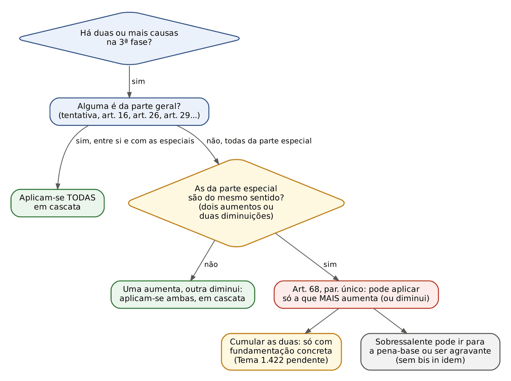
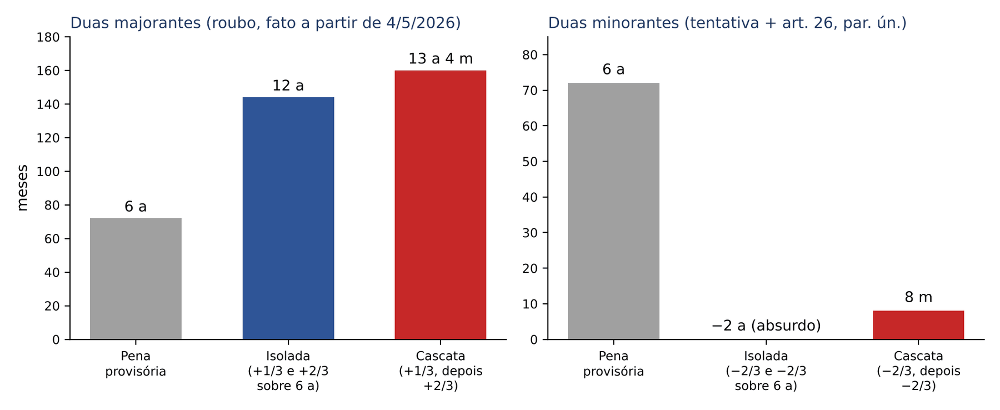
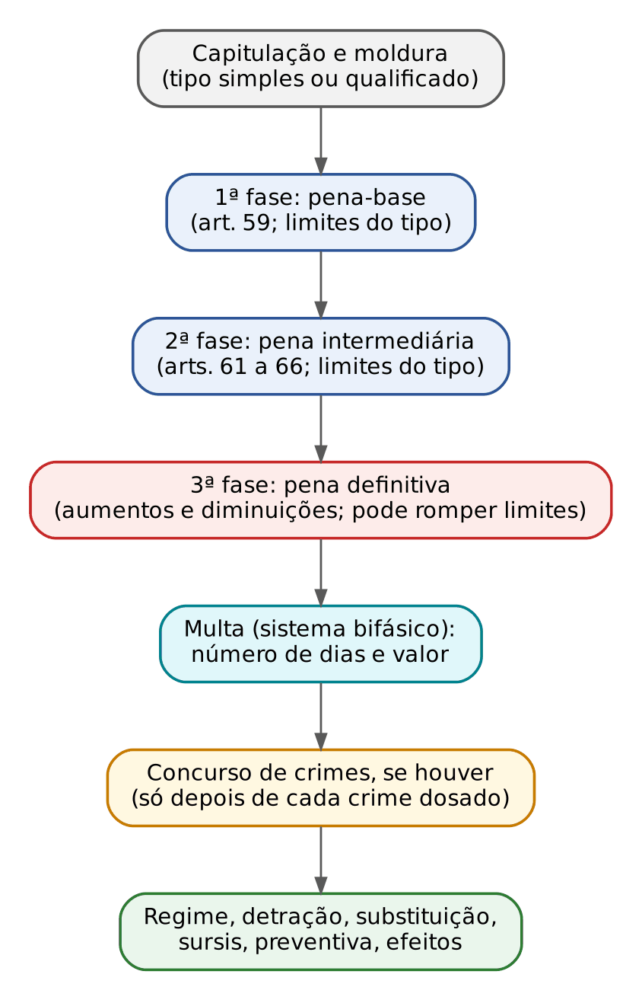
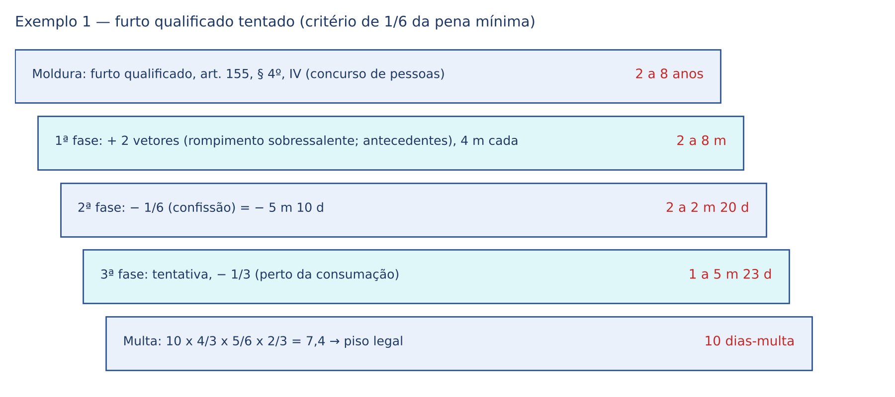
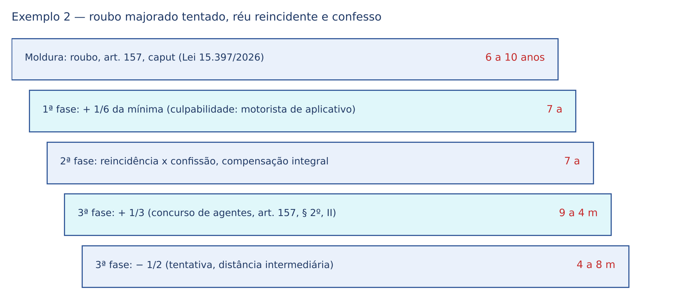
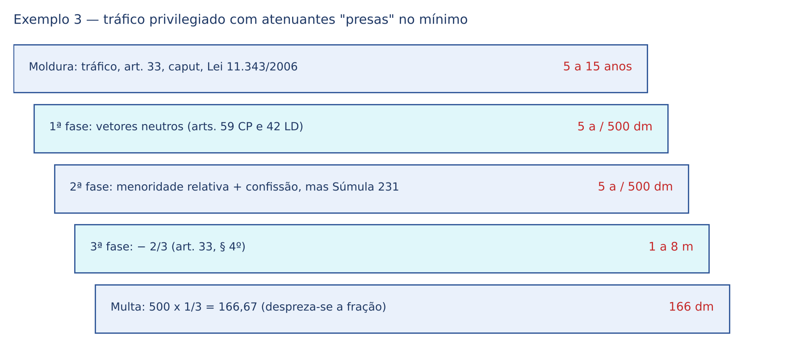
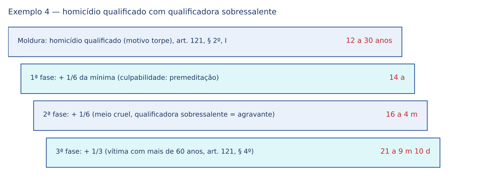
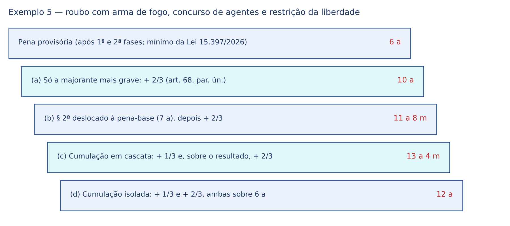

# CAPÍTULO 15 — DOSIMETRIA III: TERCEIRA FASE (CAUSAS DE AUMENTO E DE DIMINUIÇÃO), FIXAÇÃO DA MULTA E ROTEIROS COMPLETOS DE CÁLCULO

:::INCIDENCIA
TRF5 p. 6; TJRS p. 4; TJSC p. 18, 26 e 27. Nível A+ (lote: 5 questões — FGV 4, FCC 1; correlatas citadas dos Caps. 13, 14, 29 e 37).
O que mais cai: majorante x qualificadora x agravante; art. 68, parágrafo único (concurso de causas da parte especial); Súmula 443 do STJ; aplicação em cascata (Tema 1.422 pendente); frações da tentativa e das demais minorantes; multa bifásica. Na prova de sentença, é a fase em que mais se erra a conta.
:::

## 15.1 A terceira fase: o que são causas de aumento e de diminuição

### 15.1.1 Conceito e razão de ser

Causas de aumento (também chamadas majorantes) e causas de diminuição (minorantes) são circunstâncias que a própria lei associa a uma FRAÇÃO de aumento ou de redução da pena: "aumenta-se de 1/3", "reduz-se de 1/6 a 2/3", "aplica-se em dobro". É essa marca que as identifica. Agravantes e atenuantes não têm fração na lei (a jurisprudência é que usa 1/6 como referência — ver Cap. 14); qualificadoras não têm fração, mas uma moldura nova (ver 15.1.3).

A lógica é a da técnica legislativa. Quando o legislador quer que um dado pese de modo PREVISÍVEL e intenso, ele mesmo diz o quanto: o roubo cometido com arma de fogo é sempre 2/3 mais grave; a tentativa é sempre de 1/3 a 2/3 menos grave. Como a medida vem da lei, e não do juiz, as causas de aumento e de diminuição podem levar a pena ALÉM do máximo ou AQUÉM do mínimo cominados no tipo. É exatamente o contrário do que ocorre nas duas primeiras fases, presas à moldura (Tema 190 do STJ — ver Cap. 13; Súmula 231 do STJ — ver Cap. 14).

:::ESQUEMA A terceira fase em quatro frases
1. Incide sobre a pena PROVISÓRIA (o resultado da 2ª fase), nunca sobre a pena mínima abstrata.
2. Só entram dados que a lei associa a uma fração (fixa ou variável).
3. Pode romper o mínimo e o máximo do tipo.
4. A fração variável é escolhida por critério PRÓPRIO de cada causa (o *iter* na tentativa, a celeridade no arrependimento posterior, o grau da perturbação na semi-imputabilidade), e não pelas circunstâncias do art. 59, já gastas na 1ª fase.
:::

O item 4 merece destaque porque é o erro mais punido nas sentenças reformadas: usar os maus antecedentes ou a "gravidade do crime" para escolher a fração da tentativa ou do tráfico privilegiado é valorar duas vezes o mesmo dado (*bis in idem*, isto é, dupla punição pelo mesmo fato ou pela mesma circunstância). O critério de cada causa está no quadro de 15.4.

### 15.1.2 Classificações úteis

| Critério | Espécies | Exemplos |
|---|---|---|
| Localização | Gerais (parte geral do CP) x especiais (parte especial e leis penais especiais) | Gerais: tentativa (art. 14, parágrafo único), arrependimento posterior (art. 16), semi-imputabilidade (art. 26, parágrafo único), participação de menor importância (art. 29, § 1º). Especiais: majorantes do roubo (art. 157, §§ 2º, 2º-A e 2º-B), repouso noturno no furto (art. 155, § 1º), tráfico privilegiado (art. 33, § 4º, da Lei 11.343/2006) |
| Quantidade | Fração fixa x fração variável | Fixa: 1/2 no furto noturno (1/3 para fatos anteriores a 4/5/2026); 2/3 na arma de fogo do roubo; dobro na arma de uso restrito. Variável: 1/3 a 2/3 na tentativa; 1/6 a 2/3 no art. 40 da Lei de Drogas; 1/3 até metade no § 2º do roubo |
| Efeito | Aumento x diminuição | — |
| Redação | "Aumenta-se", "reduz-se" (obrigatória) x "pode" | No "pode" (arts. 26, parágrafo único, e 29, § 1º), presentes os requisitos, a redução é direito do réu; a margem do juiz está na escolha da fração (ver Caps. 10 e 11) |

Uma observação sobre a classificação por localização: o critério é onde está a NORMA, não o crime. A tentativa de roubo tem uma causa geral (tentativa) e, se houver arma, uma especial (art. 157, § 2º-A, I). A distinção é decisiva para o art. 68, parágrafo único (15.3.2), que só limita o concurso de causas da parte ESPECIAL.

### 15.1.3 Qualificadora, majorante, agravante: a tabela que resolve metade das questões

As três figuras "pioram" a pena, mas atuam em lugares diferentes e de modos diferentes. Confundi-las gera erro em cadeia no cálculo.

| | Qualificadora | Causa de aumento (majorante) | Agravante |
|---|---|---|---|
| Como a lei redige | Novo preceito secundário: "Pena: reclusão, de 12 a 30 anos" | Fração: "a pena aumenta-se de 1/3 até metade" | Rol sem fração: "são circunstâncias que sempre agravam a pena..." |
| Onde está | Parte especial e leis especiais (tipo derivado) | Parte geral, parte especial e leis especiais | Arts. 61 e 62 do CP (e algumas leis especiais) |
| Fase | Antes da 1ª: escolhe a moldura de partida | 3ª | 2ª |
| Pode romper mínimo e máximo? | Ela própria troca os limites | SIM | NÃO |
| Sobre o que incide | — (é ponto de partida) | Pena provisória | Pena-base |
| Exemplo no homicídio | Motivo torpe (art. 121, § 2º, I): 12 a 30 anos | Vítima com mais de 60 anos (art. 121, § 4º, parte final): + 1/3 | Crime contra ascendente (art. 61, II, "e") |
| Exemplo no furto | Rompimento de obstáculo (art. 155, § 4º, I): 2 a 8 anos | Repouso noturno (art. 155, § 1º): + 1/2 (antes de 4/5/2026, + 1/3) | Reincidência (art. 61, I) |
| Exemplo no roubo | Lesão grave (art. 157, § 3º, I): 7 a 18 anos | Arma de fogo (art. 157, § 2º-A, I): + 2/3 | Vítima com mais de 60 anos (art. 61, II, "h") |

Do lado da diminuição, a mesma lógica: o privilégio em sentido estrito cria nova moldura menor ou troca a espécie de pena (no furto privilegiado, o juiz pode substituir a reclusão por detenção, reduzir de 1/3 a 2/3 ou aplicar só a multa — art. 155, § 2º, que mistura técnicas); a minorante é uma fração (a "forma privilegiada" do homicídio, art. 121, § 1º, é na verdade causa de diminuição de 1/6 a 1/3, aplicada na 3ª fase); a atenuante não tem fração e não rompe o mínimo.

:::PEGADINHA "Homicídio privilegiado" e "tráfico privilegiado" não são privilégios em sentido técnico
Ambos são CAUSAS DE DIMINUIÇÃO (art. 121, § 1º: 1/6 a 1/3; art. 33, § 4º, da Lei 11.343/2006: 1/6 a 2/3). Atuam na 3ª fase, sobre a pena provisória, e podem levar a pena abaixo do mínimo. O nome "privilegiado" é tradicional, não técnico. Questão que diga que o § 1º do art. 121 "fixa nova pena mínima" está errada.
:::

:::PASSO Como identificar a natureza de um dado do enunciado (versão da 3ª fase)
1. O dispositivo fala em fração, dobro ou triplo? É causa de aumento ou de diminuição: 3ª fase.
2. O dispositivo traz "Pena: reclusão, de X a Y"? É qualificadora (ou privilégio com moldura própria): define o ponto de partida.
3. O dado está nos arts. 61, 62, 65 ou 66? Agravante ou atenuante: 2ª fase.
4. O mesmo dado aparece em duas categorias (ex.: idade da vítima como majorante do art. 121, § 4º, e como agravante do art. 61, II, "h")? Aplica-se só a norma ESPECIAL (a majorante), e o dado não volta em outra fase.
:::

:::QUESTAO FGV 2025 — TJ-GO — Residente Jurídico (Q3345947)
Caso: roubo com arma de fogo cometido por réu primário em embriaguez preordenada, que confessou em juízo. Três afirmações: a embriaguez daria uma atenuante na 2ª fase; a confissão daria uma causa de diminuição na 3ª fase; a pena-base atende aos oito vetores do art. 59. Gabarito oficial: B (F – F – V).
Armadilhas: a embriaguez preordenada é AGRAVANTE (art. 61, II, "l" — Cap. 10), não atenuante; a confissão é ATENUANTE (art. 65, III, "d"), atua na 2ª fase e não tem fração legal, logo não é minorante (15.1.3). A arma de fogo, não mencionada nas afirmações, seria a majorante do § 2º-A, I, na 3ª fase.
No mesmo sentido (situar cada dado na fase certa): Q2489736 (FGV 2024, TJ-MS; gabarito E: consequências na 1ª fase, reincidência na 2ª, arma na 3ª — comentada no Cap. 13, 13.2.2). Correlata: Q3028646 (Cap. 14: reincidência na 2ª fase, causa de aumento na 3ª).
:::

### 15.1.4 Catálogo das causas mais cobradas

| Causa | Fração | Natureza | Onde a teoria está |
|---|---|---|---|
| Tentativa (art. 14, parágrafo único) | − 1/3 a 2/3 | Geral, variável | Cap. 8 (8.3.5) |
| Arrependimento posterior (art. 16) | − 1/3 a 2/3 | Geral, variável | Cap. 8 (8.5) |
| Erro de proibição evitável (art. 21, parte final) | − 1/6 a 1/3 | Geral, variável | Cap. 10 (10.4.4) |
| Excesso no estado de necessidade com sacrifício razoável exigível (art. 24, § 2º) | − 1/3 a 2/3 | Geral, variável | Cap. 9 |
| Semi-imputabilidade (art. 26, parágrafo único) | − 1/3 a 2/3 | Geral, variável | Cap. 10 (10.2.3) |
| Embriaguez acidental incompleta (art. 28, § 2º) | − 1/3 a 2/3 | Geral, variável | Cap. 10 |
| Participação de menor importância (art. 29, § 1º) | − 1/6 a 1/3 | Geral, variável | Cap. 11 (11.7.2) |
| Cooperação dolosamente distinta com resultado mais grave previsível (art. 29, § 2º) | + até metade | Geral, variável | Cap. 11 (11.7.3) |
| Homicídio privilegiado (art. 121, § 1º) | − 1/6 a 1/3 | Especial, variável | Cap. 27 |
| Homicídio doloso contra pessoa com menos de 14 ou mais de 60 anos (art. 121, § 4º, parte final) | + 1/3 | Especial, fixa | Cap. 27 |
| Furto durante o repouso noturno (art. 155, § 1º) | + 1/2 (Lei 15.397/2026; fatos anteriores a 4/5/2026: + 1/3) | Especial, fixa | Cap. 29 |
| Roubo: concurso de agentes, transporte de valores, restrição da liberdade, arma branca e outras (art. 157, § 2º) | + 1/3 até metade | Especial, variável | Cap. 29 |
| Roubo: arma de fogo; explosivo (art. 157, § 2º-A) | + 2/3 | Especial, fixa | Cap. 29 |
| Roubo: arma de fogo de uso restrito ou proibido (art. 157, § 2º-B) | dobro | Especial, fixa | Cap. 29 |
| Crimes contra a dignidade sexual (art. 226; art. 234-A) | frações próprias | Especial | Cap. 31 |
| Funcionário em cargo em comissão ou de direção (art. 327, § 2º) | + 1/3 | Especial, fixa | Cap. 35 |
| Tráfico privilegiado (art. 33, § 4º, da Lei 11.343/2006) | − 1/6 a 2/3 | Especial, variável | Cap. 37 |
| Majorantes do tráfico (art. 40 da Lei 11.343/2006) | + 1/6 a 2/3 | Especial, variável | Cap. 37 |
| Colaboração do art. 41 da Lei 11.343/2006 | − 1/3 a 2/3 | Especial, variável | Cap. 37 |

Duas operações que NÃO são causas de aumento da 3ª fase, embora usem frações: a exasperação do concurso formal próprio (art. 70) e a do crime continuado (art. 71). Elas são aplicadas DEPOIS que cada crime foi dosado nas três fases, sobre as penas definitivas (Cap. 16). Também não é causa de aumento o aumento da multa "até o triplo" do art. 60, § 1º, que só mexe no valor do dia-multa (15.5.4).

## 15.2 A matemática da dosimetria: como converter frações em anos, meses e dias

Esta seção existe porque a maior parte dos erros de cálculo não é jurídica, é aritmética. O método abaixo resolve qualquer conta de dosimetria sem calculadora sofisticada.

### 15.2.1 As três regras de conversão

1. Converta tudo para MESES (e, se a conta "quebrar", para DIAS). Use 1 ano = 12 meses e 1 mês = 30 dias; por consequência, 1 ano = 360 dias para fins de cálculo. É a convenção da prática forense e dos tribunais para as frações (a contagem de prazos penais pelo calendário comum, art. 10 do CP, é outra coisa: serve para contar o tempo de cumprimento e os prazos, não para dividir a pena).
2. Faça a operação no número inteiro de meses ou de dias e só no fim converta de volta: 64 meses = 5 anos e 4 meses; 800 dias = 2 anos, 2 meses e 20 dias.
3. Despreze as frações de dia (art. 11 do CP). Não se arredonda para cima: 533,33 dias viram 533 dias; 18,75 dias viram 18 dias.

Para converter decimais de mês em dias, multiplique a parte decimal por 30: 5,333 meses = 5 meses e (0,333 x 30) 10 dias; 9,6 meses = 9 meses e 18 dias; 4,5 meses = 4 meses e 15 dias.

### 15.2.2 Tabela de conversão das frações mais usadas

Valores já convertidos e com frações de dia desprezadas. Para penas que não estão na tabela, some linhas (a fração de 7 anos é a fração de 6 anos mais a de 1 ano).

| Pena | 1/6 | 1/5 | 1/4 | 1/3 | 1/2 | 2/3 |
|---|---|---|---|---|---|---|
| 1 ano | 2 meses | 2 meses e 12 dias | 3 meses | 4 meses | 6 meses | 8 meses |
| 2 anos | 4 meses | 4 meses e 24 dias | 6 meses | 8 meses | 1 ano | 1 ano e 4 meses |
| 3 anos | 6 meses | 7 meses e 6 dias | 9 meses | 1 ano | 1 ano e 6 meses | 2 anos |
| 4 anos | 8 meses | 9 meses e 18 dias | 1 ano | 1 ano e 4 meses | 2 anos | 2 anos e 8 meses |
| 5 anos | 10 meses | 1 ano | 1 ano e 3 meses | 1 ano e 8 meses | 2 anos e 6 meses | 3 anos e 4 meses |
| 6 anos | 1 ano | 1 ano, 2 meses e 12 dias | 1 ano e 6 meses | 2 anos | 3 anos | 4 anos |
| 8 anos | 1 ano e 4 meses | 1 ano, 7 meses e 6 dias | 2 anos | 2 anos e 8 meses | 4 anos | 5 anos e 4 meses |
| 10 anos | 1 ano e 8 meses | 2 anos | 2 anos e 6 meses | 3 anos e 4 meses | 5 anos | 6 anos e 8 meses |
| 12 anos | 2 anos | 2 anos, 4 meses e 24 dias | 3 anos | 4 anos | 6 anos | 8 anos |
| 15 anos | 2 anos e 6 meses | 3 anos | 3 anos e 9 meses | 5 anos | 7 anos e 6 meses | 10 anos |
| 20 anos | 3 anos e 4 meses | 4 anos | 5 anos | 6 anos e 8 meses | 10 anos | 13 anos e 4 meses |

:::DICA O "truque do fator": aumentar ou reduzir numa única multiplicação
Em vez de calcular a fração e depois somar ou subtrair, multiplique a pena pelo FATOR correspondente:
| Operação | Fator | Operação | Fator |
|---|---|---|---|
| + 1/6 | x 7/6 | − 1/6 | x 5/6 |
| + 1/5 | x 6/5 | − 1/5 | x 4/5 |
| + 1/4 | x 5/4 | − 1/4 | x 3/4 |
| + 1/3 | x 4/3 | − 1/3 | x 2/3 |
| + 1/2 | x 3/2 | − 1/2 | x 1/2 |
| + 2/3 | x 5/3 | − 2/3 | x 1/3 |
| dobro | x 2 | triplo | x 3 |
Exemplo: pena provisória de 4 anos e 8 meses (56 meses), aumento de 1/3 e depois redução de 1/2: 56 x 4/3 x 1/2 = 37,33 meses = 37 meses e 10 dias = 3 anos, 1 mês e 10 dias. Reduzir 2/3 é ficar com 1/3 da pena; reduzir 1/3 é ficar com 2/3. O fator também mostra, de relance, por que a ordem das operações em cascata não muda o resultado (a multiplicação é comutativa — 15.3.4).
:::

### 15.2.3 Os erros aritméticos que a banca explora

:::PEGADINHA Quatro contas erradas que parecem certas
1. "1/3 de 5 anos = 1 ano e 3 meses." ERRADO: 5 anos = 60 meses; 60 ÷ 3 = 20 meses = 1 ano e 8 meses. O erro é dividir só os "anos" (5 ÷ 3 = 1,66) e tratar o decimal como meses.
2. "1/6 de 2 anos e 8 meses = 4 meses e 8 dias." ERRADO: 2 anos e 8 meses = 32 meses; 32 ÷ 6 = 5,333 meses = 5 meses e 10 dias.
3. "A tentativa reduz 1/3 da pena MÍNIMA do tipo." ERRADO: a fração incide sobre a pena provisória (o resultado da 2ª fase), qualquer que seja ela.
4. "18,75 dias arredondam para 19 dias." ERRADO: frações de dia são desprezadas (art. 11): 18 dias.
:::

:::EXEMPLO Uma conta com dias do começo ao fim
Pena provisória: 2 anos, 2 meses e 20 dias. Redução de 1/3 (tentativa).
Passo 1 — converta em dias: 2 anos = 720 dias; 2 meses = 60 dias; total 720 + 60 + 20 = 800 dias.
Passo 2 — aplique o fator: reduzir 1/3 = multiplicar por 2/3; 800 x 2/3 = 533,33 dias.
Passo 3 — despreze a fração de dia (art. 11): 533 dias.
Passo 4 — volte para anos, meses e dias: 533 − 360 = 173 dias (1 ano); 173 = 5 x 30 + 23 (5 meses e 23 dias). Pena: 1 ano, 5 meses e 23 dias.
Conferência pelo caminho "fração e subtração": 1/3 de 800 = 266,67 dias; 800 − 266,67 = 533,33; desprezada a fração, 533 dias. Mesmo resultado.
:::

Uma questão de técnica: as frações de dia se desprezam no resultado de cada operação que o juiz DECLARA na sentença (pena-base, pena intermediária, pena definitiva). Quem carrega a fração até o fim e só então a despreza pode chegar a resultado 1 dia diferente. A diferença é irrelevante juridicamente, desde que o critério seja coerente; nas contas desta apostila, despreza-se a fração ao fim de cada fase.

## 15.3 Quando há mais de uma causa: concurso de causas de aumento e de diminuição

É aqui que a terceira fase fica difícil. Três perguntas precisam ser respondidas, NESTA ordem: (1) todas as causas presentes incidem, ou o juiz pode aplicar só uma (art. 68, parágrafo único)? (2) As que incidem são calculadas em cascata ou isoladamente sobre a mesma base? (3) Importa a ordem (aumentos antes ou depois das diminuições)?

### 15.3.1 O mapa das combinações

| Situação | Exemplo | Solução |
|---|---|---|
| Duas ou mais causas da parte GERAL | Tentativa + semi-imputabilidade | Incidem TODAS, sucessivamente. O art. 68, parágrafo único, não se aplica |
| Uma causa geral + uma especial | Tentativa + arma de fogo no roubo | Incidem AMBAS. O parágrafo único só trata do concurso entre causas da parte especial |
| Uma causa de aumento + uma de diminuição, ambas especiais | Majorante do art. 40 + tráfico privilegiado (art. 33, § 4º) | Incidem AMBAS: o parágrafo único compara causas do MESMO sentido (aumento com aumento, diminuição com diminuição) |
| Duas ou mais causas de AUMENTO da parte especial | Arma de fogo (§ 2º-A, I) + concurso de agentes (§ 2º, II) no roubo | Art. 68, parágrafo único: o juiz PODE limitar-se a um só aumento, prevalecendo o que MAIS aumente; pode cumular, com fundamentação concreta (15.3.2) |
| Duas ou mais causas de DIMINUIÇÃO da parte especial | Hipótese rara (ex.: colaboração do art. 41 e tráfico privilegiado, ambos da Lei de Drogas) | Art. 68, parágrafo único: pode aplicar só a que MAIS diminua |
| Várias hipóteses no MESMO dispositivo | Concurso de agentes e restrição da liberdade (incisos II e V do § 2º do art. 157) | Não é concurso de causas: é UMA causa com vários fundamentos e UMA fração (1/3 até metade). A quantidade de hipóteses não basta para elevar a fração (Súmula 443 — 15.3.5) |

Atenção ao último caso, que a banca usa para confundir: os incisos do § 2º do art. 157 formam uma causa só, com uma fração variável; o § 2º-A (2/3) e o § 2º-B (dobro) são causas DIFERENTES. O mesmo raciocínio vale para os incisos do art. 40 da Lei de Drogas, que compartilham a fração de 1/6 a 2/3 (ver Cap. 37, 37.6.5).

### 15.3.2 Art. 68, parágrafo único: "pode limitar-se a um só aumento"

O texto (transcrito no Cap. 13, 13.3.1) diz que, no concurso de causas de aumento ou de diminuição previstas na parte especial, "pode o juiz limitar-se a um só aumento ou a uma só diminuição, prevalecendo, todavia, a causa que mais aumente ou diminua". Quatro leituras resolvem as questões:

1. Abrangência. "Parte especial" abrange as leis penais especiais, por identidade de razão (é a leitura da doutrina majoritária e a aplicada pelo STJ, por exemplo, ao concurso entre o art. 40 e o art. 40-A da Lei de Drogas — ver Cap. 37). As causas da parte geral ficam FORA: sempre incidem.
2. "Pode": é faculdade do juiz. Ele pode aplicar só uma OU todas. Não há direito do réu a que se aplique apenas uma.
3. "Prevalecendo a que mais aumente": se o juiz optar por um só aumento, é obrigatório escolher o MAIOR. Não pode, por benevolência, aplicar a menor fração e descartar a maior.
4. Cumulação: aplicar todas as majorantes da parte especial é possível, mas exige fundamentação CONCRETA, baseada em dados dos autos que mostrem gravidade especial do caso. Sem isso, prevalece a causa mais grave, sozinha.

:::JURIS STJ, EREsp 2.206.873-SP, Terceira Seção, Rel. Min. Joel Ilan Paciornik, j. 11/3/2026 (Informativo 882)
Roubo com concurso de agentes e restrição da liberdade da vítima (art. 157, § 2º, II e V) e com emprego de arma de fogo (§ 2º-A, I). O tribunal de origem aplicou só o aumento de 1/3, "por ser mais favorável ao réu". A Terceira Seção corrigiu: no concurso de causas de aumento da parte especial, o juiz pode limitar-se a um só aumento, mas deve prevalecer a causa que MAIS aumente (no caso, os 2/3 da arma de fogo). A cumulação continua possível, desde que fundamentada concretamente. Lição para a sentença: a opção pelo "aumento único" nunca pode recair sobre a fração menor.
:::

:::QUESTAO FGV 2026 — ENAC — Exame Nacional dos Cartórios (Q4130172)
Caso: roubo com concurso de agentes, restrição da liberdade da vítima por cerca de 2 horas e arma de fogo; o juiz, invocando o art. 68, parágrafo único, aplica só um aumento e escolhe o de 1/3, "por ser o mais benéfico ao réu". Gabarito oficial: A (decisão incorreta: optando por uma só majorante, deve incidir a mais gravosa, os 2/3 da arma de fogo).
Armadilhas: "ampla discricionariedade" para escolher qualquer majorante (B) e *favor rei* como critério de escolha (D) contrariam a parte final do parágrafo único e o EREsp 2.206.873 (caso praticamente idêntico); dizer que o dispositivo VEDA a aplicação de um só aumento (C) inverte a faculdade. Com pena provisória de 4 anos, a opção correta pelo aumento único daria 48 x 5/3 = 80 meses = 6 anos e 8 meses (outras soluções no Exemplo 5, 15.7.5).
:::

E a majorante que "sobrou"? Se o juiz aplica apenas a causa mais grave na 3ª fase, a outra não precisa ser desprezada. A Terceira Seção do STJ admite deslocar a majorante sobressalente para a 1ª fase (como circunstância judicial, em regra "circunstâncias do crime") ou para a 2ª fase (se corresponder a uma agravante), desde que o mesmo dado não seja contado duas vezes (HC 463.434-MT, Rel. Min. Reynaldo Soares da Fonseca, j. 25/11/2020). É a mesma lógica da qualificadora sobressalente (Cap. 13, 13.6). O que NÃO pode: usar a majorante na 3ª fase e, ao mesmo tempo, na pena-base.

:::ATENCAO Três caminhos legítimos, um caminho proibido
Diante de duas majorantes da parte especial, o juiz pode: (a) aplicar só a mais grave; (b) aplicar só a mais grave e deslocar a outra para a pena-base (ou para a 2ª fase, se houver agravante correspondente); (c) cumular as duas na 3ª fase, fundamentando concretamente. Proibido: (d) escolher a menos grave; (e) usar a mesma majorante em duas fases. O Exemplo 5 (15.7.5) faz a conta das três opções.
:::

### 15.3.3 Como calcular quando várias causas incidem: cascata x incidência isolada

Há dois métodos possíveis:

- Aplicação sucessiva, em cascata (ou "juros sobre juros"): a primeira fração incide sobre a pena provisória; a segunda, sobre o RESULTADO da primeira; e assim por diante.
- Incidência isolada (ou "juros simples"): todas as frações incidem sobre a MESMA pena provisória, e os resultados se somam ou se subtraem.

Para as causas de DIMINUIÇÃO, a cascata é a solução amplamente dominante na doutrina e na jurisprudência, por uma razão matemática irrespondível: na incidência isolada, duas reduções de 2/3 eliminariam mais do que a pena inteira (2/3 + 2/3 = 4/3), gerando pena negativa ou zero.

Para as causas de AUMENTO, a cascata é a prática majoritária das sentenças e foi admitida pelas Turmas criminais do STJ, mas a questão foi afetada ao rito dos repetitivos:

:::JURIS STJ, Tema 1.422 (REsp 2.238.446-SC, REsp 2.238.451-SC e REsp 2.238.448-SC), Rel. Min. Sebastião Reis Júnior — PENDENTE
Questão afetada em 24/3/2026: "definir se, em caso de concurso de majorantes, segundo o art. 68 do Código Penal, é admissível ou não a aplicação cumulativa, sucessiva (ou em cascata) das causas de aumento no cálculo da terceira fase da dosimetria da pena". Na sessão de início do julgamento (noticiada em 3/9/2026), o relator propôs teses no sentido de que a aplicação cumulativa siga o critério SUCESSIVO (cada fração sobre o resultado da anterior) e de que o juiz possa limitar-se a uma só causa, com fundamentação concreta; o julgamento foi suspenso por pedido de vista. Até a data de fechamento deste capítulo, não havia tese fixada. Os argumentos contrários (Defensorias): a cascata funcionaria como "juros compostos" e faria a primeira majorante ser punida de novo pela segunda.
:::

:::EXEMPLO As duas contas lado a lado
Majorantes. Roubo praticado a partir de 4/5/2026; pena provisória no mínimo, 6 anos (72 meses); arma de fogo (+ 2/3) e concurso de agentes (+ 1/3), cumuladas.
- Isolada: 1/3 de 72 = 24 meses; 2/3 de 72 = 48 meses; 72 + 24 + 48 = 144 meses = 12 anos.
- Cascata: 72 x 4/3 = 96 meses; 96 x 5/3 = 160 meses = 13 anos e 4 meses.
- Diferença: 1 ano e 4 meses a mais na cascata.
- Fato anterior a 4/5/2026 (mínimo de 4 anos, 48 meses): isolada, 48 + 16 + 32 = 96 meses = 8 anos; cascata, 48 x 4/3 x 5/3 = 106,67 meses = 8 anos, 10 meses e 20 dias.
Minorantes. Homicídio simples tentado, réu semi-imputável; pena provisória de 6 anos (72 meses); tentativa (− 2/3) e semi-imputabilidade (− 2/3).
- Isolada: 72 − 48 − 48 = − 24 meses. Absurdo: pena negativa.
- Cascata: 72 x 1/3 = 24 meses; 24 x 1/3 = 8 meses. Pena definitiva: 8 meses.
:::

:::DICA Para a prova, enquanto o Tema 1.422 não for julgado
Prova objetiva: (a) minorantes em cascata é a resposta segura; (b) majorantes: o juiz pode aplicar só a mais grave (art. 68, parágrafo único) ou cumular com fundamentação concreta, e a cumulação, quando feita, tem sido calculada em cascata. Prova de sentença: aplique a cascata, explicite o método ("as frações incidem de forma sucessiva, cada qual sobre o resultado da anterior") e, se cumular majorantes da parte especial, fundamente com dados do caso. Acompanhe o julgamento: se o STJ adotar a incidência isolada para majorantes, a conta muda.
:::

### 15.3.4 A ordem: aumentos antes ou depois das diminuições?

O art. 68, *caput*, fala em "causas de diminuição e de aumento", nessa ordem. Parte da doutrina extrai daí que as diminuições vêm primeiro; outra parte (e a prática majoritária das sentenças e dos acórdãos) aplica primeiro os aumentos e depois as diminuições, seguindo a lógica de "piorar e depois abrandar". O ponto que resolve o debate é aritmético:

- Em cascata, a ordem NÃO altera o resultado, porque cada operação é uma multiplicação por um fator (4/3, 2/3...) e a multiplicação é comutativa: 48 x 4/3 x 1/2 = 48 x 1/2 x 4/3 = 32 meses.
- A ordem só altera o resultado (a) se alguém misturar métodos (uma causa em cascata, outra isolada) ou (b) por causa do desprezo das frações de dia em cada etapa, com diferença máxima de 1 dia.

:::EXEMPLO A única diferença possível: um dia
Pena provisória de 1 ano, 1 mês e 10 dias (400 dias); aumento de 1/3 e diminuição de 1/3.
- Aumento primeiro: 400 x 4/3 = 533,33 → 533 dias; 533 x 2/3 = 355,33 → 355 dias = 11 meses e 25 dias.
- Diminuição primeiro: 400 x 2/3 = 266,67 → 266 dias; 266 x 4/3 = 354,67 → 354 dias = 11 meses e 24 dias.
- Conta exata (sem desprezar no meio): 400 x 8/9 = 355,56 → 355 dias.
Conclusão: a ordem só "pesa" pelo arredondamento. Escolha uma ordem, declare-a e mantenha-a. A recomendação desta apostila: aumentos primeiro, diminuições depois, desprezando a fração de dia apenas no resultado final da 3ª fase.
:::

:::PEGADINHA "A ordem de aplicação das causas na terceira fase pode levar a resultados muito diferentes"
Só é verdade se o método não for o da cascata. Em cascata, o resultado é o mesmo em qualquer ordem (salvo o dia do arredondamento). O que pode mudar muito o resultado é o MÉTODO (cascata x isolada — 15.3.3) e a OPÇÃO do art. 68, parágrafo único (uma só majorante x cumulação).
:::

:::QUESTAO FGV 2024 — TJ-SC — Juiz Substituto (Q3049371)
Caso: incêndio (art. 250 do CP); pena provisória de 3 anos; na 3ª fase, majorante de 1/3 (casa habitada, art. 250, § 1º, II, "a") e minorante de 1/3 (tentativa). Gabarito oficial: C (2 anos e 8 meses, em cascata).
Conta: 36 meses x 4/3 = 48 meses; 48 x 2/3 = 32 meses = 2 anos e 8 meses. Na ordem inversa, 36 x 2/3 = 24; 24 x 4/3 = 32 meses: mesmo resultado (15.3.4).
Armadilhas: (A) "3 anos, porque as frações se compensam" — 1/3 a mais e 1/3 a menos NÃO se anulam, pois a segunda fração incide sobre base diferente (fator 4/3 x 2/3 = 8/9); (B) e (D) "preponderância" de uma das causas — não há preponderância na 3ª fase: ambas incidem (uma é geral, outra especial, e são de sentidos opostos — 15.3.1); (E) 1 ano — conta sem base legal.
No mesmo sentido: Q4012637 (FCC 2026, DPE-MA; gabarito D: no concurso entre causas de aumento e de diminuição não há compensação, mas aplicação sucessiva). Nessa questão, as demais alternativas também ensinam: (A) a tentativa incruenta (ou branca, em que a vítima não é atingida) NÃO impõe automaticamente a redução máxima — a fração segue a proximidade da consumação (15.4); (B) mentir no interrogatório não eleva a pena-base (Cap. 13); (C) roubo com simulacro envolve grave ameaça e impede a substituição (art. 44, I — Cap. 17); (E) quatro agentes e violência excessiva são dados concretos que autorizam fração acima da mínima na 3ª fase (Súmula 443, 15.3.5).
:::

### 15.3.5 Súmula 443 do STJ: o número de majorantes não é fundamento

:::JURIS STJ, Súmula 443 (Terceira Seção, 28/4/2010)
"O aumento na terceira fase de aplicação da pena no crime de roubo circunstanciado exige fundamentação concreta, não sendo suficiente para a sua exasperação a mera indicação do número de majorantes."
:::

O contexto: o § 2º do art. 157 prevê aumento "de 1/3 até metade". Antes da súmula, muitos juízes usavam uma tabela aritmética: uma majorante, 1/3; duas, 3/8; três, 5/12; quatro ou mais, metade. O STJ rejeitou o automatismo, porque ele ignora a GRAVIDADE CONCRETA de cada hipótese: duas majorantes de pouca relevância no caso podem justificar só 1/3; uma única, de gravidade incomum (ex.: vítima mantida por 6 horas no porta-malas), pode justificar fração maior.

:::EXEMPLO O que a súmula proíbe e o que permite
Roubo com concurso de agentes e restrição da liberdade da vítima (art. 157, § 2º, II e V), praticado a partir de 4/5/2026; pena provisória de 6 anos (72 meses).
- Errado: "Presentes duas majorantes, aumento a pena em 3/8." Fundamentação apenas numérica. 72 x 3/8 = 27 meses; pena de 8 anos e 3 meses. O tribunal reduz para 1/3: 72 + 24 = 96 meses = 8 anos.
- Certo: "Aumento a pena em 1/2, porque a vítima foi mantida amarrada no porta-malas por cerca de seis horas, sob ameaça constante, período muito superior ao necessário à subtração, e três agentes atuaram com divisão de tarefas que anulou qualquer possibilidade de reação." 72 x 3/2 = 108 meses = 9 anos.
- Também certo: aplicar 1/3 sem justificar a fração mínima (quem fica no mínimo não precisa explicar por que não subiu).
- Fato anterior a 4/5/2026 (pena provisória de 4 anos, 48 meses): 3/8 levaria a 5 anos e 6 meses, reduzidos a 5 anos e 4 meses (1/3); a fração de 1/2, fundamentada, a 6 anos.
:::

A súmula foi editada para o roubo, mas sua razão vale para todas as majorantes de fração variável: no art. 40 da Lei de Drogas, por exemplo, o STJ também exige fundamentação concreta para passar de 1/6, sem bastar a contagem de incisos (Cap. 37, 37.6.5). Questão correlata: Q3425284 (FGV 2025, TRF1, Juiz Federal — Cap. 29), alternativa E errada por afirmar que a multiplicidade de majorantes, por si só, justifica fração acima da mínima.

:::PEGADINHA Majorante do roubo em outro crime
"No furto qualificado pelo concurso de agentes, o juiz pode aplicar, por analogia e proporcionalidade, a majorante do roubo." ERRADO: seria analogia *in malam partem* (Súmula 442 do STJ — ver Cap. 29). Pela mesma razão, não se "importa" a fração de uma majorante de um crime para outro.
:::

### 15.3.6 Bis in idem na terceira fase

O mesmo dado não pode ser causa de aumento e, ao mesmo tempo, qualificadora, agravante ou circunstância judicial. Casos típicos:

| Situação | Solução |
|---|---|
| Homicídio doloso contra vítima com mais de 60 anos | Aplica-se a majorante do art. 121, § 4º (norma especial); NÃO a agravante do art. 61, II, "h" |
| Roubo com emprego de arma de fogo | A arma não pode elevar a pena-base ("circunstâncias do crime") se já é majorante; pode, se deslocada como sobressalente e não aplicada na 3ª fase (15.3.2) |
| Tráfico com quantidade expressiva | A quantidade usada na pena-base não pode modular a fração do § 4º (Tema 712 do STF — ver Cap. 37) |
| Crimes sexuais: relação de autoridade ou parentesco | Majorante do art. 226, II, e agravante do art. 61, II, "f": cumulam-se, salvo se presente apenas a relação de autoridade (Tema 1.215 do STJ — ver Cap. 31) |
| Arma branca no roubo (fatos entre a Lei 13.654/2018 e a Lei 13.964/2019) | Não era majorante no período; podia elevar a pena-base (Tema 1.110 do STJ — ver Cap. 13) |

## 15.4 As causas de diminuição que mais aparecem na sentença: fração e critério de escolha

A teoria de cada instituto está no seu capítulo próprio. Aqui interessa o que a sentença precisa: a fração, o critério que a justifica e o erro que o tribunal corrige.

| Causa | Fração | Critério da fração (o que fundamentar) | Erro que a banca pune |
|---|---|---|---|
| Tentativa (art. 14, II) | 1/3 a 2/3 | Distância percorrida no *iter criminis*: quanto mais perto da consumação, MENOR a redução (Cap. 8, 8.3.5) | Escolher a fração por antecedentes, culpabilidade ou "gravidade do crime"; fixar 1/3 sem dado concreto; reduzir pouco na tentativa branca sem justificar |
| Arrependimento posterior (art. 16) | 1/3 a 2/3 | Celeridade e voluntariedade da reparação (Cap. 8, 8.5.5) | Usar circunstâncias do art. 59; aplicar a crime com violência ou grave ameaça à pessoa |
| Semi-imputabilidade (art. 26, parágrafo único) | 1/3 a 2/3 | Grau da perturbação apontado na perícia (Cap. 10, 10.2.3) | Negar a redução reconhecida a semi-imputabilidade; somar pena e medida de segurança |
| Erro de proibição evitável (art. 21) | 1/6 a 1/3 | Grau de evitabilidade do erro (Cap. 10, 10.4.4) | Tratá-lo como atenuante (sem romper o mínimo) |
| Participação de menor importância (art. 29, § 1º) | 1/6 a 1/3 | Grau de relevância causal da contribuição (Cap. 11, 11.7.2) | Aplicar ao coautor; confundir com a atenuante |
| Homicídio privilegiado (art. 121, § 1º) | 1/6 a 1/3 | Intensidade do valor moral ou social, ou da emoção e da injusta provocação (Cap. 27) | Aplicar também a atenuante do art. 65, III, "c", pelo mesmo fato (o STJ veda a cumulação — Cap. 27) |
| Tráfico privilegiado (art. 33, § 4º, da Lei 11.343/2006) | 1/6 a 2/3 | Natureza e quantidade da droga e demais circunstâncias, se NÃO usadas na pena-base; sem dado negativo, 2/3 (Cap. 37, 37.4.3) | Usar a mesma quantidade na 1ª e na 3ª fase (Tema 712 do STF); graduar a fração pela reincidência ou pelos antecedentes, que não modulam a fração: se presentes, impedem a própria minorante, por falta de requisito (Cap. 37) |

Duas regras transversais completam o quadro:

- Reconhecida a causa de diminuição, a redução é OBRIGATÓRIA, mesmo onde a lei diz "pode": o juiz só escolhe a fração (Caps. 10 e 11).
- Não há Súmula 231 na 3ª fase: as minorantes levam a pena abaixo do mínimo e as majorantes acima do máximo do tipo. O teto de 40 anos (art. 75) é limite de CUMPRIMENTO, não de aplicação (Cap. 16, 16.10).

:::PROCESSO Causas de aumento e de diminuição fora da sentença
Denúncia e correlação: a majorante precisa estar descrita na denúncia (fato e circunstâncias — art. 41 do CPP); reconhecê-la sem descrição viola a correlação, salvo pelo caminho do art. 384 do CPP (*mutatio libelli*, isto é, aditamento quando surge fato novo na instrução). Causas de diminuição podem ser reconhecidas de ofício.
Júri: majorantes e minorantes são quesitadas aos jurados (art. 483, IV e V, do CPP), mas a FRAÇÃO é escolhida pelo juiz presidente, com fundamentação, na sentença.
Prescrição e benefícios: para a prescrição pela pena em abstrato, considera-se a causa de aumento pela fração MÁXIMA e a de diminuição pela MÍNIMA (o pior cenário — Cap. 22); para a suspensão condicional do processo e a transação, as majorantes e minorantes também entram no cálculo da pena mínima ou máxima (Súmulas 243 do STJ e 723 do STF — ver Cap. 25), e o ANPP manda considerar as causas de aumento e de diminuição aplicáveis ao caso (art. 28-A, § 1º, do CPP — Cap. 25).
:::

## 15.5 A pena de multa na sentença: o cálculo bifásico

Conceito, natureza, sistemas de cominação, limites em salários mínimos, pagamento, execução, prescrição e inadimplemento estão no Cap. 12 (12.7). Aqui fica só o que o juiz faz NA SENTENÇA para chegar ao número final.

### 15.5.1 As duas etapas

A multa é calculada em duas operações independentes, cada uma com seu critério (sistema bifásico, ou dos dias-multa):

| Etapa | O que se fixa | Limites | Critério |
|---|---|---|---|
| 1ª | NÚMERO de dias-multa | 10 a 360 (art. 49, *caput*; leis especiais podem ter limites próprios, como os 500 a 1.500 do art. 33 da Lei de Drogas) | Gravidade do fato e circunstâncias do agente: as mesmas que orientaram a pena privativa (15.5.2) |
| 2ª | VALOR de cada dia-multa | 1/30 a 5 vezes o maior salário mínimo vigente AO TEMPO DO FATO (art. 49, § 1º); até o triplo se ineficaz (art. 60, § 1º) | Situação econômica do réu (art. 60, *caput*) |

A separação é a razão de ser do sistema: o NÚMERO mede a culpabilidade (dois réus com o mesmo crime e as mesmas circunstâncias recebem o mesmo número de dias); o VALOR ajusta a pena à capacidade econômica (o rico paga mais por dia). Misturar os critérios é o erro clássico: aumentar o número de dias porque o réu é rico ou fixar o valor do dia-multa acima do mínimo porque o crime foi grave.

:::JURIS STJ, REsp 1.535.956-RS, Rel. Min. Maria Thereza de Assis Moura, j. 1/3/2016
A pena de multa é fixada em duas fases: na primeira, o número de dias-multa, considerando as circunstâncias judiciais do art. 59; na segunda, o valor de cada dia-multa, pela situação econômica do réu. É ilegal fixar o dia-multa acima do piso (no caso, em um salário mínimo) sem apreciação concreta das condições econômico-financeiras do réu na sentença ou no acórdão; nessa hipótese, o valor é reduzido ao mínimo de 1/30.
:::

### 15.5.2 Quantos dias-multa? As duas correntes

A lei não diz como transformar a gravidade em número de dias. Formaram-se duas orientações, ambas encontradas em julgados do STJ:

- Corrente 1 (circunstâncias judiciais): o número de dias-multa é fixado pelas circunstâncias do art. 59 (como no precedente acima), e as causas de aumento e de diminuição incidem depois sobre esse número. As agravantes e atenuantes não interferem.
- Corrente 2 (proporcionalidade com a pena privativa): o número de dias-multa deve guardar proporção com a pena privativa de liberdade, percorrendo as TRÊS fases. Na prática, aplicam-se aos 10 dias-multa (ou ao mínimo do tipo, na lei especial) as mesmas frações usadas na pena privativa. É o método mais usado nas sentenças, porque é simples e coerente, e é o que o enunciado cobrado no Cap. 13 (13.3.4, questão Q3179523) pressupõe ao falar em "critério trifásico" também na multa.

O que os tribunais efetivamente controlam é a PROPORCIONALIDADE: a multa não pode estar no mínimo enquanto a pena privativa está muito acima dele, nem o contrário, sem explicação. Qualquer método que preserve essa coerência, explicitado na sentença, tende a ser mantido.

:::EXEMPLO Mesmo caso, duas correntes
Estelionato contra o INSS (art. 171, *caput*, c/c § 3º: reclusão de 1 a 5 anos, e multa; aumento de 1/3 por ser a vítima entidade de direito público). Pena-base com dois vetores negativos (circunstâncias e consequências); réu reincidente; nenhuma atenuante.
Pena privativa (critério de 1/6 da mínima):
- 1ª fase: 12 meses + 2 x 2 meses = 16 meses = 1 ano e 4 meses.
- 2ª fase: + 1/6 (reincidência): 16 x 7/6 = 18,67 meses = 18 meses e 20 dias = 1 ano, 6 meses e 20 dias (560 dias).
- 3ª fase: + 1/3: 560 x 4/3 = 746,67 → 746 dias = 2 anos e 26 dias.
Multa pela corrente 1 (circunstâncias judiciais + causas da 3ª fase):
- 10 dias-multa + 2 x (1/6 de 10) = 13,33; x 4/3 = 17,78 → 17 dias-multa.
Multa pela corrente 2 (mesmas frações das três fases):
- 10 x 4/3 (1ª fase) x 7/6 (2ª fase) x 4/3 (3ª fase) = 20,74 → 20 dias-multa.
Frações de dia-multa desprezam-se, aqui ao final da conta. Há ainda quem transponha por regra de três a posição da pena dentro da moldura (de 1 a 5 anos) para a moldura da multa (de 10 a 360 dias); o método gera números bem maiores (neste caso, perto de 100 dias-multa) e é menos usado. Na sentença, diga qual critério adota.
:::

### 15.5.3 Causas de aumento e de diminuição na multa e os limites de 10 e 360

As causas de aumento e de diminuição incidem também sobre o número de dias-multa, porque modificam "a pena" do crime, e a multa é pena (a tentativa de furto tem multa menor que o furto consumado). O Cap. 37 mostra o efeito no tráfico privilegiado: 500 dias-multa reduzidos de 2/3 viram 166 (ver também 15.7.3).

Ponto controvertido: as frações podem levar o número abaixo de 10 ou acima de 360 dias-multa? O art. 58, *caput*, diz que a multa prevista em cada tipo tem "os limites fixados no art. 49", e a orientação mais segura (e a mais encontrada nas sentenças) trata 10 e 360 como limites ABSOLUTOS da espécie de pena: as minorantes não levam abaixo de 10, e as majorantes não ultrapassam 360 — para a multa ineficaz diante da riqueza do réu, a lei já tem a válvula própria, o triplo do VALOR (art. 60, § 1º). Há posição doutrinária que admite romper os limites por simetria com a pena privativa. Na prova objetiva, a questão costuma não chegar a esse detalhe; na sentença, respeite o piso de 10 e registre a fundamentação.

:::ATENCAO Os limites da lei especial são outros
O piso de 10 dias-multa é o da espécie de pena (art. 49). Os mínimos próprios de cada tipo da lei especial (500 dias-multa no tráfico, por exemplo) funcionam como "mínimo da moldura", e as minorantes os rompem, como rompem o mínimo da pena privativa: daí os 166 dias-multa do tráfico privilegiado.
:::

### 15.5.4 O valor do dia-multa

O critério é a situação econômica do réu, e apenas ela (art. 60, *caput*: "principalmente"). Na falta de prova sobre renda e patrimônio, o valor fica no MÍNIMO (1/30 do maior salário mínimo vigente ao tempo do fato). Para subir, a sentença precisa apontar o dado concreto: renda declarada no interrogatório, patrimônio apurado, natureza da atividade.

Uma referência útil para a proporção é a renda diária: o dia-multa representa, grosso modo, quanto o réu pode pagar por dia de "pena". Exemplo: réu empresário com renda mensal comprovada de 30.000 (trinta mil) reais; fixar o dia-multa em 1 salário mínimo é proporcional e fundamentado. Se a multa, mesmo no máximo de 5 salários mínimos por dia, for ineficaz diante da riqueza do réu, o juiz pode aumentá-la até o TRIPLO (art. 60, § 1º) — aumento que incide sobre o valor, não sobre o número de dias.

:::PEGADINHA Pobreza não isenta da multa
"Por ser o réu assistido pela Defensoria Pública, deixo de aplicar a pena de multa." ERRADO: a multa cominada é obrigatória; a pobreza leva o valor do dia-multa ao mínimo, e a eventual impossibilidade de pagamento é examinada na execução (ADI 7.032 e Tema 931 — ver Cap. 12). Também ERRADO: fixar o número de dias no mínimo por ser o réu pobre (número mede gravidade; valor mede capacidade econômica).
:::

### 15.5.5 Multa no concurso de crimes e nas leis especiais

No concurso material e no formal (próprio ou impróprio), cada crime tem sua multa calculada e as multas se SOMAM (art. 72); no crime continuado, o STJ fixa uma só multa, exasperada pela fração da continuidade (Cap. 16, 16.7). Na Lei de Drogas, o número de dias-multa segue os limites de cada tipo e o art. 42, e o valor pode ser aumentado até o décuplo (art. 43 — Cap. 37, 37.7.4). Multa substitutiva (art. 44, § 2º) e a vedação da Súmula 171 do STJ: Caps. 12 e 17.

:::SENTENCA A multa, do número ao valor
Onde entra: logo depois da pena privativa definitiva de cada crime, antes do concurso de crimes (se houver) e do regime.
Redação-modelo (corrente 2): "Guardada a proporcionalidade com a pena privativa de liberdade e aplicadas as mesmas frações das três fases, fixo a pena de multa em 20 (vinte) dias-multa. À míngua de elementos sobre a capacidade econômica do réu, que se declarou desempregado, fixo o valor unitário no mínimo legal de 1/30 do maior salário mínimo vigente ao tempo do fato, corrigido monetariamente na execução (arts. 49, § 1º, e 60 do CP)."
Erros que a banca pune: valor acima do mínimo sem análise econômica; número de dias fixado pela renda; multa no mínimo com pena privativa muito acima do mínimo, sem explicação; esquecer a multa cominada; somar multas no crime continuado contra a orientação do STJ (Cap. 16).
:::

:::QUESTAO Questão de fixação elaborada para esta apostila (não é questão de banca) — multa
Afirmações sobre a fixação da multa: (I) o número de dias-multa deve considerar a situação econômica do réu; (II) a tentativa reduz também a multa; (III) o valor do dia-multa é calculado sobre o salário mínimo vigente à data da sentença; (IV) o aumento do art. 60, § 1º, incide sobre o valor do dia-multa e vai até o triplo. Corretas: II e IV. A I inverte as etapas (situação econômica define o VALOR); a III troca a data (é o salário mínimo do tempo do FATO, corrigido na execução — Cap. 12).
:::

## 15.6 O roteiro completo: do tipo penal ao dispositivo

O Cap. 13 (13.3.4) mostrou a ordem das decisões na parte da sentença dedicada à pena. Este roteiro detalha a conta, fase a fase, e diz onde cada instituto dos Caps. 13 a 17 entra.

:::PASSO Roteiro de dosimetria para a prova de sentença (um réu, um crime de cada vez)
1. Capitulação e moldura. Identifique o tipo (simples, qualificado ou privilegiado com moldura própria). Havendo duas ou mais qualificadoras, uma define a moldura; as demais vão para a 2ª fase, se houver agravante correspondente, ou para a 1ª, como circunstância judicial (Cap. 13, 13.6). Escreva a moldura: "pena de 2 a 8 anos de reclusão, e multa".
2. 1ª fase (Cap. 13). Percorra os oito vetores do art. 59 na ordem legal; para cada negativo, o dado concreto; escolha e explicite o critério (1/6 da mínima ou 1/8 do intervalo); fixe a pena-base dentro da moldura.
3. 2ª fase (Cap. 14). Liste agravantes e atenuantes; resolva o concurso entre elas (preponderância, compensação reincidência x confissão — Tema 585); aplique a fração (referência de 1/6, sobre a pena-base); respeite os limites da moldura (Súmula 231).
4. 3ª fase (este capítulo). Liste TODAS as causas de aumento e de diminuição, classificando-as em gerais e especiais; resolva o art. 68, parágrafo único (só para as especiais do mesmo sentido); escolha cada fração variável pelo critério próprio, com dado concreto; aplique em cascata (aumentos, depois diminuições); despreze frações de dia; declare a pena definitiva.
5. Multa (15.5). Número de dias (corrente adotada, explicitada) e valor do dia-multa (situação econômica).
6. Concurso de crimes (Cap. 16). Só depois de dosar cada crime: soma (concurso material e formal impróprio) ou exasperação (formal próprio e continuidade), conferindo o teto do art. 70, parágrafo único; multas pelo art. 72 (ou multa única exasperada, na continuidade).
7. Regime inicial, com detração do art. 387, § 2º, do CPP; substituição por restritivas ou *sursis* (Cap. 17).
8. Preventiva ou direito de recorrer em liberdade; valor mínimo de reparação (art. 387, IV, do CPP); efeitos da condenação (Caps. 18 e 26).
:::

:::SENTENCA Redação-modelo da 3ª fase
"Na terceira fase, incide a causa de aumento do art. 157, § 2º-A, I, do Código Penal (emprego de arma de fogo), razão pela qual elevo a pena em 2/3, totalizando 6 (seis) anos e 8 (oito) meses de reclusão. Incide, também, a causa de diminuição da tentativa (art. 14, II), cuja fração fixo em 1/2, porque o réu chegou a anunciar o assalto e a apontar a arma, mas foi contido antes de tocar nos bens da vítima, a meio caminho da consumação; aplicada sobre a pena já aumentada, resulta em 3 (três) anos e 4 (quatro) meses de reclusão, que torno definitiva à míngua de outras causas modificadoras."
Erros que a banca pune: aplicar a fração sobre a pena mínima e não sobre a provisória; não dizer o critério da fração variável; aplicar a minorante antes da 2ª fase; esquecer de declarar o resultado final ("torno definitiva").
:::

## 15.7 Exemplos completos de dosimetria, do enunciado à pena definitiva

Os cinco exemplos seguem o roteiro de 15.6. Convenções: 2ª fase pela referência de 1/6 sobre a pena-base (teoria no Cap. 14); 1ª fase pelo critério de 1/6 da pena mínima, com a variante de 1/8 do intervalo quando a diferença for didática (Cap. 13, 13.7); 3ª fase em cascata, aumentos antes das diminuições; frações de dia desprezadas ao fim de cada fase; multa pela corrente 2 (mesmas frações), com fração de dia-multa desprezada no fim e piso de 10.

### 15.7.1 Exemplo 1 — Furto qualificado tentado, com qualificadora sobressalente, maus antecedentes e confissão

Enunciado: A e B, em 10/2/2025, durante o dia, romperam o cadeado do depósito de uma loja de materiais de construção e separaram ferramentas em sacos, junto à porta. Foram surpreendidos pelo vigilante antes de sair do depósito. A tem uma condenação definitiva por receptação, por fato de 2014, com pena extinta em 2017 (mais de 5 anos antes do novo fato: não gera reincidência, mas gera maus antecedentes — Cap. 13, 13.5.2). A confessou em juízo. Dosimetria de A.

| Fase | Dado | Operação | Resultado |
|---|---|---|---|
| Moldura | Duas qualificadoras: concurso de pessoas (art. 155, § 4º, IV) e rompimento de obstáculo (§ 4º, I) | Uma qualifica (IV); a outra (I) não tem agravante correspondente e vai para a pena-base | 2 a 8 anos, e multa |
| 1ª | Circunstâncias do crime (rompimento) e antecedentes: dois vetores | 1/6 de 24 meses = 4 meses; x 2 = 8 meses | 2 anos e 8 meses (32 meses) |
| 2ª | Atenuante da confissão (art. 65, III, "d") | 32 x 5/6 = 26,67 meses = 26 meses e 20 dias | 2 anos, 2 meses e 20 dias (800 dias) |
| 3ª | Tentativa: ferramentas já separadas junto à porta, flagrante no último passo antes da saída — perto da consumação, 1/3 | 800 x 2/3 = 533,33 → 533 dias | 1 ano, 5 meses e 23 dias |
| Multa | Mesmas frações | 10 x 4/3 x 5/6 x 2/3 = 7,4 | 10 dias-multa (piso), no valor mínimo |

Variante pelo critério de 1/8 do intervalo: intervalo de 6 anos (72 meses); 1/8 = 9 meses por vetor; dois vetores = 18 meses; pena-base de 3 anos e 6 meses (42 meses); confissão: 42 x 5/6 = 35 meses; tentativa: 35 x 2/3 = 23,33 meses = 1 ano, 11 meses e 10 dias. A escolha do critério da 1ª fase mudou a pena final em quase 6 meses: por isso o critério deve ser declarado.

Pontos de atenção: (a) a qualificadora sobressalente NÃO pode ser usada também para escolher a fração da tentativa; (b) não incide a majorante do repouso noturno (o fato foi de dia e, de todo modo, o STJ não a admite no furto qualificado — ver Cap. 29); (c) o regime e a substituição (pena inferior a 4 anos, réu não reincidente, mas com vetores negativos) são decididos com os critérios do Cap. 17.

### 15.7.2 Exemplo 2 — Roubo majorado tentado, réu reincidente e confesso

Enunciado: C e D, em junho de 2026, abordaram motorista de aplicativo no início da corrida, anunciaram o assalto mediante grave ameaça (sem arma) e exigiram a chave e o celular. A vítima arremessou a chave para fora do carro e acionou o botão de emergência do aplicativo; os agentes ainda procuravam a chave quando a polícia chegou. Nada foi subtraído. C é reincidente (uma condenação anterior por furto) e confessou. Dosimetria de C.

| Fase | Dado | Operação | Resultado |
|---|---|---|---|
| Moldura | Roubo simples (art. 157, *caput*, na redação da Lei 15.397/2026) | — | 6 a 10 anos, e multa |
| 1ª | Culpabilidade negativa: vítima escolhida por ser motorista de aplicativo em atividade laboral, ciente de sua vulnerabilidade (STJ, REsp 2.245.209, Informativo 886 — Cap. 13) | 1/6 de 72 meses = 12 meses | 7 anos (84 meses) |
| 2ª | Reincidência (agravante) e confissão (atenuante) | Compensação integral (Tema 585 do STJ — Cap. 14): nada muda | 7 anos (2.520 dias) |
| 3ª (aumento) | Concurso de agentes (art. 157, § 2º, II), única majorante, sem gravidade especial | 2.520 x 4/3 = 3.360 dias | 9 anos e 4 meses |
| 3ª (diminuição) | Tentativa: grave ameaça já exercida, mas nenhum bem chegou às mãos dos agentes — distância intermediária, 1/2 | 3.360 x 1/2 = 1.680 dias | 4 anos e 8 meses |
| Multa | Mesmas frações | 10 x 7/6 x 4/3 x 1/2 = 7,8 | 10 dias-multa (piso), no valor mínimo |

Conferência da ordem: diminuindo primeiro, 2.520 x 1/2 = 1.260; 1.260 x 4/3 = 1.680 dias. Mesmo resultado (cascata).

Tempo do crime: se o mesmo fato tivesse sido praticado antes de 4/5/2026, valeria a moldura antiga de 4 a 10 anos (a lei mais grave não retroage): 1ª fase, 48 + 8 = 56 meses (1.680 dias); 2ª fase, 1.680 dias; 3ª fase, 1.680 x 4/3 = 2.240 dias (6 anos, 2 meses e 20 dias) e 2.240 x 1/2 = 1.120 dias = 3 anos, 1 mês e 10 dias. Se C fosse multirreincidente, a compensação seria apenas proporcional, prevalecendo a reincidência (Tema 585 — Cap. 14), e a pena intermediária subiria.

Por que não é roubo consumado: o roubo se consuma com a inversão da posse, ainda que breve (Súmula 582 do STJ — ver Cap. 29). Aqui não houve posse de nenhum bem. Se C tivesse chegado a pegar o celular e fosse preso logo depois, o crime estaria consumado e não haveria redução.

Regime: pena superior a 4 anos e réu reincidente: fechado (a alínea "b" do art. 33, § 2º, só socorre o não reincidente, e a Súmula 269 do STJ não alcança penas acima de 4 anos — Cap. 17). Com a pena antiga (3 anos, 1 mês e 10 dias), a escolha seria entre semiaberto e fechado, pela Súmula 269 e pelo vetor negativo.

### 15.7.3 Exemplo 3 — Tráfico privilegiado com atenuantes "presas" no mínimo

Enunciado: E, com 20 anos na data do fato, primário, de bons antecedentes, foi preso vendendo porções de maconha (50 gramas no total) em via pública; nada indica dedicação a atividades criminosas ou integração a organização criminosa. Confessou. Dosimetria.

| Fase | Dado | Operação | Resultado |
|---|---|---|---|
| Moldura | Tráfico (art. 33, *caput*, da Lei 11.343/2006) | — | 5 a 15 anos, e 500 a 1.500 dias-multa |
| 1ª | Arts. 59 do CP e 42 da Lei de Drogas sem vetor negativo (quantidade modesta) | — | 5 anos e 500 dias-multa |
| 2ª | Menoridade relativa (art. 65, I) e confissão (art. 65, III, "d") | Pena-base já no mínimo: as atenuantes não reduzem (Súmula 231 do STJ — Cap. 14) | 5 anos |
| 3ª | Tráfico privilegiado (art. 33, § 4º): requisitos presentes; sem dado negativo para modular a fração: 2/3 | 60 x 1/3 = 20 meses | 1 ano e 8 meses |
| Multa | Mesma fração | 500 x 1/3 = 166,67 | 166 dias-multa, no valor mínimo |

Lição principal: as atenuantes ficaram "presas" no mínimo, mas a minorante não. É o contraste entre a 2ª e a 3ª fase em uma só conta. E a multa ficou abaixo dos 500 dias-multa do tipo, porque a minorante rompe o mínimo da moldura própria da lei especial (15.5.3).

Variante (quantidade expressiva usada na 1ª fase): se a pena-base tivesse sido elevada para 5 anos e 10 meses pela quantidade (art. 42), as duas atenuantes operariam: 70 meses menos 1/6 por atenuante (70 x 5/6 x 5/6 = 48,6 meses) levariam a pena abaixo do mínimo, e por isso ela pararia em 5 anos (Súmula 231); na 3ª fase, a fração do § 4º teria de ser a MÁXIMA (2/3), porque a quantidade já foi usada (Tema 712 do STF — Cap. 37): mesma pena final de 1 ano e 8 meses. Regime e substituição: Súmula Vinculante 59 (Cap. 37, 37.4.5).

### 15.7.4 Exemplo 4 — Homicídio qualificado com qualificadora sobressalente e majorante

Enunciado: F, por três semanas, estudou a rotina do vizinho G, de 67 anos, e comprou um facão para matá-lo, querendo ficar com o terreno de G, que lhe fora prometido em testamento. Matou-o com dezenas de golpes desferidos lentamente, causando sofrimento intenso e desnecessário. Os jurados reconheceram as qualificadoras do motivo torpe (art. 121, § 2º, I) e do meio cruel (§ 2º, III) e a causa de aumento da idade da vítima (§ 4º), constantes da pronúncia; o MP sustentou em plenário a agravante e a premeditação. Dosimetria pelo juiz presidente.

| Fase | Dado | Operação | Resultado |
|---|---|---|---|
| Moldura | Motivo torpe qualifica; meio cruel é sobressalente | Meio cruel tem agravante correspondente (art. 61, II, "d"): vai para a 2ª fase | 12 a 30 anos |
| 1ª | Culpabilidade: premeditação por três semanas, que não é elementar nem pressuposto das qualificadoras reconhecidas (Tema 1.318 do STJ — Cap. 13) | 1/6 de 12 anos = 2 anos | 14 anos (168 meses) |
| 2ª | Agravante do meio cruel. A agravante da vítima com mais de 60 anos (art. 61, II, "h") NÃO incide: o dado é a majorante do § 4º | 168 x 7/6 = 196 meses | 16 anos e 4 meses (5.880 dias) |
| 3ª | Majorante: vítima com mais de 60 anos (art. 121, § 4º, parte final), + 1/3 | 5.880 x 4/3 = 7.840 dias | 21 anos, 9 meses e 10 dias |

Variante pelo critério de 1/8 na 1ª fase: intervalo de 18 anos (216 meses); 1/8 = 27 meses; pena-base de 14 anos e 3 meses (171 meses); 2ª fase: 171 x 7/6 = 199,5 meses = 199 meses e 15 dias (5.985 dias); 3ª fase: 5.985 x 4/3 = 7.980 dias = 22 anos e 2 meses (7.980 = 22 x 360 + 60).

Pontos de atenção: (a) no Júri, a agravante só entra se debatida em plenário (Cap. 14) e a majorante precisa ter sido quesitada (art. 483, V, do CPP); (b) a idade da vítima não pode pesar duas vezes; (c) crime hediondo (Cap. 40): regime inicial fechado pelo *quantum* (art. 33, § 2º, "a", do CP — Cap. 17); (d) se as duas qualificadoras fossem usadas, uma para a moldura e outra também na pena-base, haveria *bis in idem*.

### 15.7.5 Exemplo 5 — Roubo com duas majorantes da parte especial: as três soluções possíveis

Enunciado: H e I, em julho de 2026, invadiram uma residência com um revólver municiado (apreendido e periciado), renderam a família e mantiveram todos amarrados num quarto por cerca de cinco horas, enquanto esvaziavam a casa. H é primário, sem antecedentes; nenhuma circunstância judicial negativa além das ligadas às próprias majorantes; sem agravantes ou atenuantes. Dosimetria de H. Pena provisória: 6 anos (72 meses), mínimo do roubo na redação da Lei 15.397/2026.

Causas da 3ª fase: concurso de agentes e restrição da liberdade (§ 2º, II e V — uma causa, 1/3 até metade) e arma de fogo (§ 2º-A, I — outra causa, 2/3). Ambas da parte especial e de aumento: incide o art. 68, parágrafo único.

| Opção | Raciocínio | Conta | Pena definitiva |
|---|---|---|---|
| (a) Só a mais grave | Art. 68, parágrafo único; prevalece a arma (EREsp 2.206.873) | 72 x 5/3 = 120 meses | 10 anos |
| (b) A mais grave + sobressalente na pena-base | § 2º deslocado para "circunstâncias do crime" (HC 463.434): pena-base de 6 anos + 1/6 da mínima = 7 anos (2.520 dias); 3ª fase só com a arma | 2.520 x 5/3 = 4.200 dias | 11 anos e 8 meses |
| (c) Cumulação em cascata, fundamentada | Cinco horas de restrição e ação coordenada justificam cumular; § 2º em 1/3 (sem fundamentação para fração maior) | 2.160 x 4/3 = 2.880 dias; 2.880 x 5/3 = 4.800 dias | 13 anos e 4 meses |
| (d) Cumulação isolada | Ambas as frações sobre 6 anos (método discutido no Tema 1.422) | 72 + 24 + 48 = 144 meses | 12 anos |
| Proibido | Aplicar só o § 2º (1/3), "por ser mais favorável"; usar a arma na pena-base E na 3ª fase | — | — |

Multa pela corrente 2: (a) 10 x 5/3 = 16,67 → 16 dias-multa; (b) 10 x 7/6 x 5/3 = 19,44 → 19; (c) 10 x 4/3 x 5/3 = 22,2 → 22.

Repare no reflexo prático: com o mínimo de 6 anos, todas as opções passam de 8 anos (regime fechado obrigatório — art. 33, § 2º, "a" — Cap. 17). Tempo do crime: para fato anterior a 4/5/2026, a pena provisória seria de 4 anos (48 meses), e os resultados, (a) 6 anos e 8 meses, (b) 7 anos, 9 meses e 10 dias, (c) 8 anos, 10 meses e 20 dias e (d) 8 anos; nas opções (a) e (b), a pena ficava entre 4 e 8 anos (semiaberto possível ao primário), e na (c) passava de 8 anos: a escolha do método na 3ª fase decidia o regime. Roubo com emprego de arma de fogo e roubo com restrição da liberdade são hediondos (Cap. 40).

:::SENTENCA Fundamentando a cumulação (opção c)
"Presentes duas causas de aumento previstas na parte especial (art. 157, § 2º, II e V, e § 2º-A, I), deixo de limitar-me a um só aumento (art. 68, parágrafo único, do CP) porque as circunstâncias concretas revelam gravidade que extrapola a de um roubo armado comum: a família foi mantida amarrada por cerca de cinco horas, período muito superior ao necessário à subtração, por dois agentes em ação coordenada. Aplico, assim, o aumento do § 2º na fração mínima de 1/3 e, sobre o resultado, o de 2/3 do § 2º-A, I, de forma sucessiva."
Se o juiz não tiver dados concretos para justificar a cumulação, a opção segura é (a) ou (b).
:::

## 15.8 Os erros de dosimetria que a banca e os tribunais mais punem

| Erro | Por que está errado | Correção |
|---|---|---|
| Aplicar a causa de aumento ou de diminuição sobre a pena MÍNIMA do tipo | A 3ª fase incide sobre a pena provisória | Calcule sobre o resultado da 2ª fase |
| Recusar-se a reduzir abaixo do mínimo na 3ª fase | A Súmula 231 é só da 2ª fase | Minorantes e majorantes rompem os limites |
| Escolher a fração da tentativa (ou do § 4º) pelos antecedentes ou pela gravidade do crime | *Bis in idem*: o art. 59 já foi usado; cada causa tem critério próprio | *Iter criminis* na tentativa; celeridade no art. 16; grau de perturbação no art. 26 |
| Elevar a fração do § 2º do roubo só pelo número de majorantes | Súmula 443 do STJ | Fundamentação concreta |
| Aplicar a majorante menos grave invocando o art. 68, parágrafo único | Deve prevalecer a que mais aumenta | Aplicar a maior ou cumular fundamentadamente |
| Aplicar o art. 68, parágrafo único, a causas da parte geral | O dispositivo só trata das causas da parte especial | Todas as gerais incidem |
| Calcular minorantes de forma isolada | Pode gerar pena zero ou negativa | Cascata |
| Usar a mesma circunstância como agravante e majorante (idade da vítima no homicídio) | *Bis in idem* | Só a majorante (norma especial) |
| Tratar a exasperação do concurso formal ou da continuidade como causa de aumento da 3ª fase | Ela vem depois, sobre as penas definitivas | Dose cada crime e só então aplique o art. 70 ou 71 (Cap. 16) |
| Arredondar frações de dia para cima | Art. 11 manda desprezar | Truncar |
| Converter decimais de ano diretamente em meses ("1,66 ano = 1 ano e 6 meses") | 0,66 ano = 8 meses | Trabalhe em meses e dias |
| Fixar o valor do dia-multa acima do mínimo sem dado econômico | Art. 60; fundamentação | Valor mínimo ou dado concreto |
| Não declarar o resultado de cada fase | Impede o controle do cálculo | "Fixo a pena-base...", "torno-a provisória...", "torno-a definitiva..." |

## 15.9 Resumo para revisão pré-prova

| Instituto | Regra | Exceções e detalhes | Fundamento |
|---|---|---|---|
| Causas de aumento e de diminuição | Frações previstas em lei; 3ª fase; incidem sobre a pena provisória | Podem romper o mínimo e o máximo do tipo | Art. 68 CP |
| Qualificadora x majorante x agravante | Nova moldura x fração x rol sem fração | Qualificadora define a partida; majorante na 3ª; agravante na 2ª | Arts. 61, 68 e tipos derivados |
| "Homicídio privilegiado" e "tráfico privilegiado" | São causas de diminuição | 1/6 a 1/3 e 1/6 a 2/3 | Art. 121, § 1º, CP; art. 33, § 4º, LD |
| Fração variável | Critério próprio de cada causa | Nunca as circunstâncias do art. 59 | Vedação do *bis in idem* |
| Redução com "pode" | Reconhecida a causa, a redução é obrigatória | O juiz escolhe só a fração | Arts. 26, parágrafo único, e 29, § 1º |
| Concurso de causas gerais | Todas incidem | Também com as especiais | Art. 68 CP |
| Concurso de causas especiais do mesmo sentido | Pode aplicar só uma, a que MAIS aumente ou diminua | Cumulação com fundamentação concreta | Art. 68, parágrafo único; EREsp 2.206.873 |
| Majorante sobressalente | Pode ir para a pena-base ou para a 2ª fase | Sem contar o mesmo dado duas vezes | HC 463.434 (Terceira Seção) |
| Incisos do mesmo parágrafo | Uma causa só, uma fração | Número de incisos não basta para elevar a fração | Súmula 443 STJ |
| Método | Cascata (cada fração sobre o resultado da anterior) | Majorantes: Tema 1.422 pendente; minorantes: cascata pacífica | Art. 68 CP |
| Ordem | Indiferente em cascata (multiplicação comutativa) | Até 1 dia de diferença pelo art. 11; prática: aumentos antes | Art. 68 CP |
| Conversão | Trabalhar em meses e dias; 1 mês = 30 dias | Frações de dia desprezadas | Art. 11 CP |
| Concurso formal e continuidade | Não são 3ª fase: vêm depois de cada crime dosado | Multas: art. 72 (continuado: multa única exasperada) | Arts. 70 a 72 CP (Cap. 16) |
| Multa: etapas | Número (10 a 360) pela gravidade; valor (1/30 a 5 SM) pela situação econômica | Até o triplo do valor se ineficaz | Arts. 49 e 60 CP |
| Multa: número de dias | Corrente 1: art. 59; corrente 2: proporcional às três fases | Tribunais controlam a proporcionalidade | REsp 1.535.956 |
| Multa e causas da 3ª fase | Incidem também sobre o número de dias | Piso de 10 tratado como absoluto (posição prudente); lei especial: mínimo do tipo é rompido | Arts. 49 e 58 CP |
| Valor do dia-multa | Mínimo, salvo dado econômico concreto | Pobreza não isenta da multa | Art. 60 CP; ADI 7.032 (Cap. 12) |
| Reflexos processuais | Majorante descrita na denúncia; no Júri, quesitada; fração pelo juiz | Prescrição em abstrato: aumento máximo, diminuição mínima | Arts. 41, 384 e 483 CPP; Cap. 22 |

## 15.10 Artigos de lei incidentes

- Código Penal: art. 11 (frações de dia); art. 14, II e parágrafo único (tentativa); art. 16 (arrependimento posterior); art. 21 (erro de proibição evitável); art. 24, § 2º; art. 26, parágrafo único (semi-imputabilidade); art. 28, § 2º; art. 29, §§ 1º e 2º; arts. 49 e 58 a 60 (multa); arts. 61 e 65 (por remissão); art. 68, *caput* e parágrafo único; arts. 70 a 72 (por remissão); art. 121, §§ 1º, 2º e 4º; art. 155, §§ 1º, 2º e 4º; art. 157, §§ 2º, 2º-A e 2º-B; art. 171, § 3º; art. 226 e art. 327, § 2º (por remissão).
- Código de Processo Penal: art. 41 (descrição das circunstâncias na denúncia); art. 384 (*mutatio libelli*); art. 387 (sentença condenatória); art. 483, IV e V (quesitos sobre causas de diminuição e de aumento no Júri); art. 28-A, § 1º (ANPP e causas de aumento e de diminuição).
- Lei 11.343/2006: art. 33, *caput* e § 4º; art. 40; art. 41; art. 42; art. 43 (por remissão ao Cap. 37).

## 15.11 Julgados, temas e súmulas do capítulo

- Súmula 443 do STJ: no roubo circunstanciado, o aumento exige fundamentação concreta; o número de majorantes não basta.
- STJ, EREsp 2.206.873-SP (Terceira Seção, Informativo 882): optando por um só aumento (art. 68, parágrafo único), prevalece a causa que mais aumenta; cumulação exige fundamentação concreta.
- Tema 1.422 do STJ (pendente): admissibilidade da aplicação cumulativa e em cascata das majorantes.
- STJ, HC 463.434-MT (Terceira Seção): majorante sobressalente pode ser deslocada para a 1ª ou a 2ª fase.
- STJ, REsp 1.535.956-RS: multa em duas fases; valor acima do mínimo exige análise concreta da situação econômica.
- Art. 68, parágrafo único, do CP: concurso de causas da parte especial (aplicação desenvolvida neste capítulo).

Remissões a outros capítulos: Tema 190 do STJ, Tema 1.318 do STJ, Tema 1.110 do STJ, REsp 2.245.209 e critérios de 1/6 e 1/8 na pena-base (Cap. 13); Súmula 231 do STJ, Tema 585 do STJ e agravantes no Júri (Cap. 14); Súmula 659 do STJ, art. 72 e multa no crime continuado (Cap. 16); Súmula 269 do STJ e regime (Cap. 17); Súmulas 243 e 723 e ANPP (Cap. 25); fração da tentativa e AgRg no HC 731.845 (Cap. 8); Súmulas 442 e 582 do STJ e Tema 1.087 do STJ (Cap. 29); Tema 1.215 do STJ (Cap. 31); art. 327, § 2º (Cap. 35); Tema 712 do STF, Tema 1.154 do STJ, Súmula Vinculante 59 e art. 40 da Lei de Drogas (Cap. 37); ADI 7.032 e Tema 931 do STJ (Cap. 12).

:::NOTA Notas de verificação
Questões (segunda passagem, 15/10/2026, pelo arquivo local bank_local.json): as 5 questões do lote foram lidas, todas com gabarito oficial no arquivo e sem divergência com a resposta fundamentada. Inseridas em 3 boxes: Q3345947 em 15.1.3 (no mesmo sentido Q2489736, cujo box completo permanece no Cap. 13, substituindo o parágrafo-remissão anterior); Q4130172 em 15.3.2; Q3049371 em 15.3.4 (no mesmo sentido Q4012637, com as armadilhas das demais alternativas). Correlatas citadas sem box: Q3028646 (Cap. 14) e Q3425284 (Cap. 29, em 15.3.5). Lote com menos de 8 questões: sem Mapa de cobrança. Removidos 2 dos 3 itens de fixação próprios (concurso de minorantes e duas majorantes do roubo), redundantes com Q3049371 e Q4130172; mantido o da multa, tema sem questão no lote. Conferidos no Planalto em 15/10/2026: alínea "l" do art. 61, II (embriaguez preordenada) e art. 250, § 1º, II, "a" ("em casa habitada ou destinada a habitação", aumento de um terço).
Planalto: acesso bloqueado nesta sessão (proxy e WebFetch). Nenhum dispositivo foi transcrito literalmente, salvo a Súmula 443 (texto do Radar); frações e redações dos arts. 14, 16, 21, 24, 26, 28, 29, 49, 58, 60, 68, 121, 155, 157 e 171 foram parafraseadas de memória com alta segurança, mas não conferidas na redação vigente. Conferido no Planalto em 15/10/2026: o art. 121, § 4º, parte final, segue vigente (aumento de 1/3 no homicídio doloso contra menor de 14 ou maior de 60 anos, redação da Lei 10.741/2003); o art. 157, § 4º, incluído pela Lei 15.358/2026, manda aplicar "em triplo a pena prevista no caput", "desprezadas as demais causas de aumento", quando a violência ou grave ameaça é cometida por integrante de organização criminosa ultraviolenta, grupo paramilitar ou milícia privada no contexto do art. 2º do marco legal (há ainda o § 5º, latrocínio nesse contexto, reclusão de 20 a 40 anos); não tratado no texto — ver Cap. 46.
Revisão de 15/10/2026 (Lei 15.397/2026): repouso noturno passou a + 1/2 nas tabelas; os exemplos da cascata, da Súmula 443 e os Exemplos 2 e 5 de 15.7 foram refeitos com o roubo de 6 a 10 anos (fatos a partir de 4/5/2026), com a conta antiga indicada para fatos anteriores; regeneradas as figuras ch15_cascata.png, ch15_ex2_roubo.png e ch15_ex5_roubo_majorantes.png. Penas e fração do § 1º do art. 155 conferidas no Planalto em 15/10/2026 (Lei 15.397, de 30/4/2026, DOU de 4/5/2026, vigência na publicação; furto 1 a 6, repouso noturno + metade, furto qualificado 2 a 8, roubo 6 a 10; §§ 2º-A e 2º-B do art. 157 inalterados: 2/3 e dobro).
Tema 1.422 do STJ: segundo notícias de 3 a 10/9/2026 (MPSC, Conjur), o julgamento começou com voto do relator pela aplicação sucessiva e foi suspenso por pedido de vista; não se localizou tese até 14/10/2026. Conferir antes da publicação.
EREsp 2.206.873: classe processual (EREsp) conforme o Informativo 882 registrado no Radar; uma fonte secundária o identifica como REsp. Conferir. HC 463.434-MT: data de julgamento (25/11/2020) e informativo citados de memória; a fonte secundária consultada indica publicação do acórdão em 18/12/2020.
Posições adotadas e discutíveis: (a) a ordem "aumentos antes das diminuições" como recomendação, não como regra legal; (b) o piso de 10 dias-multa como limite absoluto após as minorantes (há divergência; ver 15.5.3); (c) a apresentação das duas correntes sobre o número de dias-multa sem citar número de acórdão para a corrente 2. Doutrina: o Bitencourt (Tratado) e o Caderno Sistematizado não foram lidos nesta sessão; atribuições doutrinárias foram mantidas genéricas.
:::
