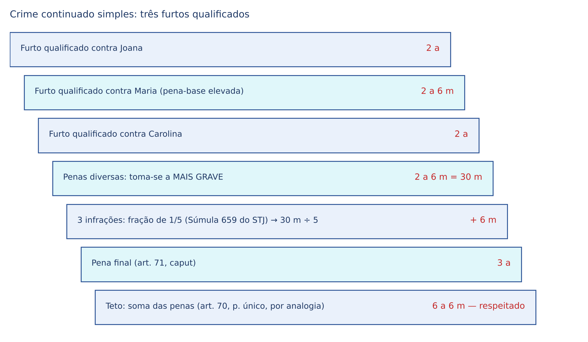
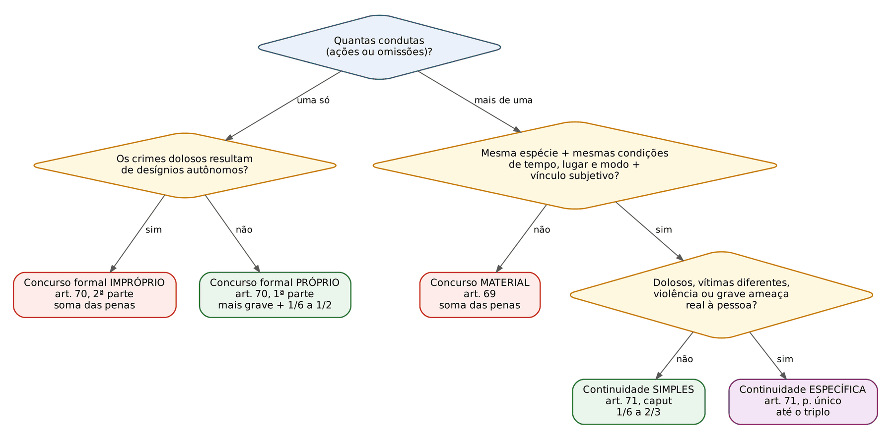
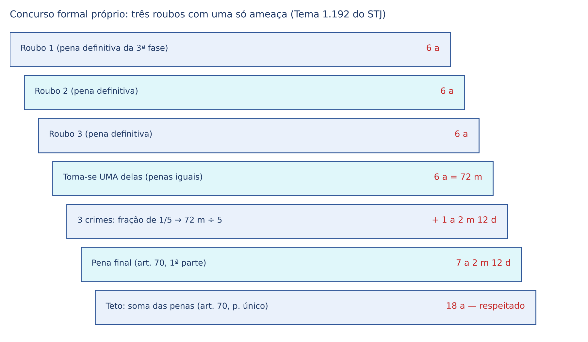
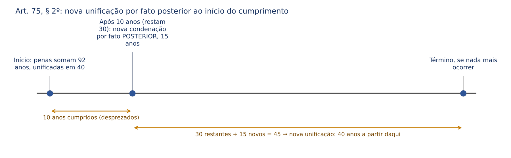

# CAPÍTULO 16 — CONCURSO DE CRIMES, ERRO NA EXECUÇÃO, RESULTADO DIVERSO DO PRETENDIDO E LIMITE DE CUMPRIMENTO DAS PENAS

:::INCIDENCIA
TRF5 p. 6; TJRS p. 4; TJSC p. 17. Nível A. Lote: 18 questões (FGV 14, FCC 4).
O que mais cai: identificar, num caso narrado, se há concurso material, formal (próprio ou impróprio) ou crime continuado, e escolher a fração pelo número de crimes; depois, multa no concurso, roubo contra várias vítimas (Tema 1.192 do STJ) e art. 75.
:::

| Subtema | FGV | FCC | Padrão |
|---|---|---|---|
| Identificar a espécie de concurso em caso concreto | 9 | 2 | Narrativa com várias condutas; alternativas combinam espécie + regra de pena |
| Fração do crime continuado pelo número de crimes | 3 | 1 | 3 furtos = 1/5; 5 furtos = 1/3 (Súmula 659 do STJ) |
| Requisitos e limites da continuidade (espécie, 30 dias, roubo x extorsão) | 1 | 2 | Afirmações "segundo o STJ" |
| Concurso formal: roubo contra várias vítimas; próprio x impróprio | 2 | 2 | Tema 1.192; desígnios autônomos |
| Multa no concurso (art. 72) | 2 | 0 | Soma no concurso formal, inclusive próprio |
| Erro na execução com duplo resultado | 1 | 0 | Tentativa dolosa + crime culposo em concurso formal |
| Limite de 40 anos e unificação (art. 75) | 1 | 0 | Literalidade dos §§ 1º e 2º |

## 16.1 Unidade e pluralidade de crimes: o problema e os sistemas de solução

### 16.1.1 Quando há "concurso de crimes"

Há concurso de crimes quando o MESMO agente pratica DOIS OU MAIS crimes e todos serão julgados (ou unificados na execução). O instituto não trata de várias pessoas praticando um crime (isso é concurso de pessoas, Cap. 11), mas de uma pessoa respondendo por vários crimes. A pergunta que o Código responde nos arts. 69 a 71 é puramente de política criminal: como somar, ou não somar, as penas?

Antes de chegar ao concurso, o juiz precisa saber se há realmente pluralidade de crimes. Há situações em que vários atos formam UM só crime, e o concurso não existe:

- crime único com pluralidade de atos: subtrair, numa mesma ocasião, vários objetos da mesma vítima é um só furto; o tipo misto alternativo praticado com mais de um verbo no mesmo contexto (vender e transportar a mesma droga) é crime único;
- conflito aparente de normas (especialidade, subsidiariedade, consunção, alternatividade): o crime-meio absorvido não entra em concurso (ver Cap. 3);
- crime permanente: a conduta se prolonga no tempo, mas o crime é um só (sequestro que dura dez dias);
- crime habitual: a reiteração é elemento do tipo (exercício ilegal da medicina, art. 282); vários atos formam um só crime;
- crime complexo: o legislador já fundiu dois tipos em um (roubo = furto + ameaça ou violência; latrocínio = roubo + morte; ver Cap. 29).

:::PEGADINHA Crime único x concurso formal
Ofender, num mesmo contexto, vários funcionários públicos é um só desacato, porque o bem jurídico é a Administração Pública, que é uma só (orientação do STJ). Já o roubo, com uma só ameaça, contra o patrimônio de vítimas diferentes é concurso formal, porque são vários patrimônios atingidos (ver 16.3.4). O critério é o número de bens jurídicos lesados, não o número de pessoas presentes.
:::

### 16.1.2 Os sistemas de aplicação da pena

A doutrina (Bitencourt, Masson, Greco) costuma apontar quatro sistemas. O Código Penal brasileiro usa dois deles.

| Sistema | Como funciona | Onde o CP usa |
|---|---|---|
| Cúmulo material | Somam-se as penas de todos os crimes | Concurso material (art. 69); concurso formal impróprio (art. 70, 2ª parte); multa (art. 72) |
| Exasperação | Aplica-se a pena do crime mais grave, aumentada de uma fração | Concurso formal próprio (art. 70, 1ª parte); crime continuado (art. 71) |
| Absorção | Aplica-se só a pena do crime mais grave, sem aumento | Não adotado no concurso (lembra a consunção, que é outro instituto) |
| Cúmulo jurídico | A pena final é maior que a do crime mais grave, mas menor que a soma, fixada livremente pelo juiz | Não adotado |

A lógica do CP é simples: quem praticou vários crimes por condutas distintas e independentes merece a soma; quem, com uma só conduta e um só propósito, produziu vários resultados (concurso formal próprio), ou quem praticou crimes em série que revelam um plano único (crime continuado), merece tratamento menos severo, por isso a exasperação. E a exasperação NUNCA pode resultar em pena maior que a soma (art. 70, parágrafo único, o chamado concurso material benéfico, ver 16.6.3).

:::DOUTRINA Natureza jurídica do crime continuado
Três teorias: (a) unidade real (os vários crimes seriam, na verdade, um só, pela unidade de intenção); (b) ficção jurídica (são vários crimes, mas a lei os trata como um só para fins de pena; origem em Carrara); (c) unidade jurídica ou mista (formam um terceiro crime, de concurso). O CP adotou a teoria da FICÇÃO JURÍDICA (Bitencourt, Masson): os crimes continuam sendo vários e autônomos para tudo o que não seja a aplicação da pena. Daí decorrem consequências cobradas: a prescrição corre isoladamente para cada crime (art. 119; Súmula 497 do STF, ver 16.9) e a lei mais grave vigente antes da cessação da continuidade se aplica a toda a série (Súmula 711 do STF — ver Cap. 3).
:::

## 16.2 Concurso material (art. 69)

:::LEI Código Penal, art. 69
Art. 69 - Quando o agente, mediante mais de uma ação ou omissão, pratica dois ou mais crimes, idênticos ou não, aplicam-se cumulativamente as penas privativas de liberdade em que haja incorrido. No caso de aplicação cumulativa de penas de reclusão e de detenção, executa-se primeiro aquela.
§ 1º - Na hipótese deste artigo, quando ao agente tiver sido aplicada pena privativa de liberdade, não suspensa, por um dos crimes, para os demais será incabível a substituição de que trata o art. 44 deste Código.
§ 2º - Quando forem aplicadas penas restritivas de direitos, o condenado cumprirá simultaneamente as que forem compatíveis entre si e sucessivamente as demais.
:::

### 16.2.1 Requisitos e espécies

Dois requisitos: (a) PLURALIDADE DE CONDUTAS (mais de uma ação ou omissão); (b) PLURALIDADE DE CRIMES. O concurso material é a regra "residual": se há várias condutas e NÃO estão presentes os requisitos da continuidade (art. 71), a solução é a soma.

- Homogêneo: crimes idênticos (dois homicídios em dias e lugares diferentes, sem vínculo).
- Heterogêneo: crimes diversos (homicídio e, depois, ocultação do cadáver).

A expressão "idênticos ou não" do art. 69 é a base da classificação; o mesmo vale para o concurso formal (art. 70).

:::QUESTAO FGV 2024 — TJ-SC — Oficial de Justiça (Q2515589)
Caso: homicídio doloso seguido de ocultação de cadáver, mediante mais de uma ação; o juiz somou as penas. Gabarito: E (concurso material).
Armadilha: as alternativas de continuidade (simples e específica) e de concurso formal. Não há continuidade porque os crimes não são da mesma espécie (ver 16.4.3); não há concurso formal porque há duas condutas.
No mesmo sentido: FGV 2024 — TJ-AP — Analista (Q2442331): roubo com faca e, quilômetros depois, homicídio de um desafeto encontrado por acaso; gabarito E (concurso material, penas cumulativas). Crimes de espécies diferentes, sem vínculo entre si: soma.
:::

### 16.2.2 Ordem de execução e regras complementares

- Reclusão antes de detenção (art. 69, caput, parte final); de modo mais amplo, no concurso de infrações executa-se primeiro a pena mais grave (art. 76). Exemplo: 6 anos de reclusão por homicídio e 2 meses de detenção por lesão culposa: cumpre-se primeiro a reclusão.
- Substituição (art. 69, § 1º): se por um dos crimes a pena privativa não foi substituída nem suspensa, NÃO cabe substituição pelas restritivas nos demais. A razão é prática: quem vai para a prisão por um crime não tem como cumprir prestação de serviços pelo outro.
- Restritivas de direitos (art. 69, § 2º): se forem aplicadas várias, cumprem-se simultaneamente as compatíveis (prestação pecuniária e limitação de fim de semana) e sucessivamente as incompatíveis (duas prestações de serviços em horários conflitantes).
- Regime inicial e substituição: considera-se o TOTAL das penas somadas (art. 111 da LEP; ver Cap. 17).

:::PEGADINHA A soma de penas não é concurso material de "processos"
O concurso material se reconhece na sentença quando os crimes são julgados juntos (conexão, art. 76 do CPP). Se foram julgados em processos diferentes, a soma é feita pelo juízo da execução (art. 66, III, a, da LEP; art. 111 da LEP). E o juiz da execução PODE reconhecer a continuidade entre crimes julgados em processos distintos (ver 16.9.3), mas NÃO pode alterar o concurso material ou formal reconhecido na mesma sentença transitada em julgado.
:::

### 16.2.3 Casos de concurso material reconhecidos pelo STJ

| Situação | Solução | Fundamento |
|---|---|---|
| Embriaguez ao volante (art. 306 do CTB) e lesão corporal culposa na direção (art. 303) | Concurso material | Momentos consumativos distintos e bens jurídicos diversos (STJ, REsp 2.198.744-MG, Info 860) |
| Embriaguez ao volante (art. 306) e direção sem habilitação (art. 309) | Concurso material, quando demonstradas ações distintas | STJ, AgRg no HC 749.440-SC, j. 23/8/2022 |
| Roubo e, no mesmo contexto, extorsão (obrigar a vítima a entregar cartão e senha) | Concurso material | Condutas distintas e desígnios autônomos; espécies diferentes (STF, HC 190.909, 1ª Turma; ver 16.4.3) |
| Roubo e latrocínio | Concurso material (não há continuidade) | Espécies diferentes (Jurisprudência em Teses do STJ, ed. 51, tese 12) |
| Apropriação indébita previdenciária (art. 168-A) e sonegação de contribuição previdenciária (art. 337-A) | Concurso material | Tema 1.353 do STJ (ver 16.4.3) |

Para o tráfico de drogas com arma de fogo (concurso material ou majorante do art. 40, IV, da Lei 11.343/2006), ver Cap. 37.

## 16.3 Concurso formal (art. 70)

:::LEI Código Penal, art. 70
Art. 70 - Quando o agente, mediante uma só ação ou omissão, pratica dois ou mais crimes, idênticos ou não, aplica-se-lhe a mais grave das penas cabíveis ou, se iguais, somente uma delas, mas aumentada, em qualquer caso, de um sexto até metade. As penas aplicam-se, entretanto, cumulativamente, se a ação ou omissão é dolosa e os crimes concorrentes resultam de desígnios autônomos, consoante o disposto no artigo anterior.
Parágrafo único - Não poderá a pena exceder a que seria cabível pela regra do art. 69 deste Código.
:::

### 16.3.1 Requisitos

(a) UMA SÓ CONDUTA (ação ou omissão); (b) DOIS OU MAIS CRIMES. "Uma conduta" não significa um único movimento corporal: é a unidade de comportamento num mesmo contexto, dirigido por uma decisão. Uma rajada de metralhadora é uma ação; o ladrão que, com uma só ameaça, recolhe os pertences de todos os passageiros de um ônibus pratica uma ação.

Classificações:

- homogêneo (crimes idênticos: dois homicídios culposos num acidente) ou heterogêneo (crimes diversos: homicídio culposo e lesão culposa no mesmo acidente);
- PRÓPRIO (perfeito, normal) ou IMPRÓPRIO (imperfeito, anormal), conforme haja ou não desígnios autônomos. Esta é a classificação que decide a pena.

### 16.3.2 Próprio x impróprio: os "desígnios autônomos"

"Desígnio autônomo" é a intenção dirigida a CADA um dos resultados. Se o agente, com uma só conduta, quer (ou aceita) produzir cada um dos crimes como objetivo próprio, a unidade da conduta é só aparente na perspectiva da culpabilidade, e o CP manda somar. Se há um só propósito e os demais resultados vêm por culpa, ou como desdobramento de um dolo único, aplica-se a exasperação.

| | Concurso formal próprio (art. 70, 1ª parte) | Concurso formal impróprio (art. 70, 2ª parte) |
|---|---|---|
| Elemento subjetivo | Um só desígnio; resultados culposos, ou dolosos sem autonomia de propósitos | Conduta DOLOSA e crimes resultantes de desígnios autônomos |
| Pena | A mais grave (ou uma delas, se iguais) + 1/6 a 1/2 | Soma das penas (sistema do art. 69) |
| Exemplo | Motorista imprudente atropela e mata duas pessoas (dois homicídios culposos) | Agente coloca bomba para matar o desafeto, sabendo que morrerão todos os presentes |

Pontos cobrados:

- Só existe concurso formal impróprio se a conduta for DOLOSA. Crimes culposos em concurso formal são sempre concurso formal próprio.
- Desígnios autônomos abrangem o dolo direto (inclusive o de segundo grau, a consequência necessária do meio escolhido) e também o DOLO EVENTUAL. O STJ afirmou que os desígnios autônomos se referem a qualquer forma de dolo (AgRg no AREsp 2.521.343-SP, j. 17/9/2024, Info 827) e que o dolo eventual reconhecido pelo júri quanto a cada vítima justifica o concurso formal impróprio, vinculando as instâncias superiores (AgRg no REsp 2.052.416-SC, j. 20/8/2025, Info 860). A distinção entre próprio e impróprio está no elemento subjetivo (Jurisprudência em Teses do STJ, ed. 23, tese 2).
- O caso clássico de concurso formal impróprio com dolo direto de segundo grau é o da bomba: o agente quer matar uma pessoa (dolo direto de primeiro grau) e sabe que as demais morrerão necessariamente (dolo direto de segundo grau). Há uma ação e vários homicídios dolosos, com soma.
- Exceção legal de 2026: nos crimes contra as instituições democráticas (Capítulo II do Título XII, arts. 359-L e 359-M), quando inseridos no mesmo contexto, a pena é aplicada "ainda que existente desígnio autônomo, na forma do concurso formal próprio" do art. 70, primeira parte, vedado o cúmulo da segunda parte do art. 70 e do art. 69 (art. 359-M-A, incluído pela Lei 15.402, de 8/5/2026, em vigor na publicação; conferido no Planalto em 15/10/2026). Detalhes e exemplo no Cap. 36.

:::QUESTAO FGV 2024 — TJ-MT — Oficial de Justiça (Q3114513)
Caso: bomba colocada no salão do condomínio para matar o vizinho inimigo; vinte pessoas morrem, inclusive ele. Gabarito: B (concurso formal de crimes).
Armadilha: "crime multitudinário" (crime praticado por multidão em tumulto, que é outra coisa) e "concurso material". A banca pediu apenas o gênero; na sentença, porém, o concurso seria formal IMPRÓPRIO (dolo de segundo grau quanto às demais vítimas), com soma das penas.
:::

:::QUESTAO FGV 2024 — PC-SC — Delegado (Q2360681)
Caso em três condutas: Klaus aciona gás letal e mata intencionalmente dez prisioneiros numa cela; Thomas dispara contra um prisioneiro e o projétil, por acidente, mata também outra pessoa; Mark persegue e executa oito prisioneiros, um em cada cela. Gabarito: A (Klaus, concurso formal imperfeito; Thomas, concurso formal perfeito; Mark, pode se amoldar ao concurso material).
Fundamento: Klaus tem uma ação e desígnios autônomos (impróprio, soma); Thomas tem uma ação e o segundo resultado é acidental (aberratio ictus com duplo resultado, art. 73, 2ª parte, que remete ao art. 70, 1ª parte; ver 16.8); Mark tem várias ações. A banca escreveu "pode se amoldar" porque, em tese, a continuidade específica também seria discutível (ver 16.4.7).
:::

### 16.3.3 A fração de aumento no concurso formal próprio

O art. 70 prevê aumento de 1/6 até a metade sem dizer o critério. O STJ fixou que o aumento se dá de acordo com o NÚMERO DE INFRAÇÕES (Jurisprudência em Teses do STJ, ed. 23, tese 4), com a seguinte escala, que vale como orientação consolidada:

| Número de crimes | Fração (concurso formal) |
|---|---|
| 2 | 1/6 |
| 3 | 1/5 |
| 4 | 1/4 |
| 5 | 1/3 |
| 6 ou mais | 1/2 |

:::DICA Memorize uma escada só
A escada do concurso formal e a do crime continuado são IGUAIS até cinco crimes (1/6, 1/5, 1/4, 1/3). Elas se separam a partir de seis: no formal, 6 ou mais = 1/2 (o teto do art. 70); no continuado, 6 = 1/2 e 7 ou mais = 2/3 (o teto do art. 71). Quem decora a escada do continuado acerta as duas, desde que lembre que o formal para em 1/2.
:::

### 16.3.4 Roubo contra várias vítimas: Tema 1.192 do STJ

:::JURIS STJ, Tema 1.192 (REsp 1.960.300-GO, 3ª Seção, j. 8/10/2025, Info 868)
Tese: o cometimento de crimes de roubo mediante uma única conduta e sem desígnios autônomos contra o patrimônio de diferentes vítimas, ainda que da mesma família, configura concurso formal de crimes (art. 70 do CP).
Por que importa: afasta duas soluções que aparecem nas alternativas. Não é crime único (são patrimônios distintos; Jurisprudência em Teses do STJ, ed. 23, tese 1, e ed. 51, tese 5) e não é concurso material (há uma só conduta). E a circunstância de as vítimas serem da mesma família (marido e mulher, por exemplo) não unifica os patrimônios. O número de roubos corresponde ao número de patrimônios efetivamente atingidos, não ao número de pessoas ameaçadas: se quatro pessoas são ameaçadas, mas só se subtrai o bem de uma delas, há um roubo.
:::

:::QUESTAO FCC 2026 — DPE-MT — Defensor Público (Q3954632)
Pergunta direta sobre a tese do Tema 1.192. Gabarito: E (concurso formal próprio).
Armadilha: "concurso formal impróprio" (o enunciado diz "sem desígnios autônomos") e "crime único" (a mesma família não unifica patrimônios).
No mesmo sentido (correlatas, roubo em concurso formal): FGV 2024 — TJ-SC — Analista (Q2515310) e FGV 2025 — TJ-MS — Juiz (Q3786371).
:::

:::QUESTAO FCC 2025 — TRF4 — Oficial de Justiça (Q3562224)
Caso: servidor, numa única ocasião, aproveita a saída de três colegas, abre as bolsas de cada uma e subtrai dinheiro e cartões, levando tudo numa bolsa ao fim do dia. Gabarito: E (três furtos em concurso formal perfeito, pena de um só aumentada de 1/6 até a metade).
Armadilha: "concurso formal perfeito, 1/6 a 2/3" (fração do crime continuado) e "crime continuado, 1/6 até a metade" (fração do formal). A banca trocou as frações de propósito.
Observação: o gabarito é discutível. Abrir três bolsas, uma após a outra, pode ser lido como três ações (o que levaria à continuidade, com 1/5). A FCC considerou o contexto único de subtração como uma só conduta. Em prova objetiva, siga o gabarito; numa sentença, fundamente a unidade ou pluralidade de condutas.
:::

Outros casos de concurso formal reconhecidos pelo STJ: o médico que, no exercício irregular da medicina, prescreve droga pratica, em tese, o art. 282 do CP em concurso formal com o art. 33 da Lei 11.343/2006 (Jurisprudência em Teses do STJ, ed. 131, tese 19); a extração de recurso mineral sem autorização configura, em concurso formal, o crime contra o patrimônio da União (art. 2º da Lei 8.176/1991) e o crime ambiental (art. 55 da Lei 9.605/1998), porque os bens jurídicos são distintos (ed. 23, tese 3). No latrocínio com uma subtração e várias mortes, o STJ vê concurso formal impróprio (ed. 51, tese 15), enquanto o STF tende ao crime único (ver Cap. 29).

:::SENTENCA Concurso formal na sentença
Onde entra: depois de fixada a pena definitiva de CADA crime (as três fases para cada um), em tópico próprio ("Do concurso de crimes").
O que fundamentar: (a) a unidade de conduta; (b) a ausência (ou presença) de desígnios autônomos, com base na prova; (c) a fração, pelo número de crimes.
Redação-modelo: "Os três roubos foram praticados mediante uma só ação, sem desígnios autônomos, contra patrimônios distintos (Tema 1.192 do STJ), razão pela qual aplico a regra do art. 70, primeira parte, do CP. Sendo idênticas as penas, tomo uma delas e a aumento de 1/5, fração correspondente ao número de infrações, totalizando 7 anos, 2 meses e 12 dias de reclusão."
Erro que a banca pune: aplicar a fração sobre a pena-base, antes das demais fases; escolher a fração sem motivação; reconhecer o concurso formal impróprio sem apontar o dolo em relação a cada resultado.
:::

## 16.4 Crime continuado (art. 71)

:::LEI Código Penal, art. 71
Art. 71 - Quando o agente, mediante mais de uma ação ou omissão, pratica dois ou mais crimes da mesma espécie e, pelas condições de tempo, lugar, maneira de execução e outras semelhantes, devem os subseqüentes ser havidos como continuação do primeiro, aplica-se-lhe a pena de um só dos crimes, se idênticas, ou a mais grave, se diversas, aumentada, em qualquer caso, de um sexto a dois terços.
Parágrafo único - Nos crimes dolosos, contra vítimas diferentes, cometidos com violência ou grave ameaça à pessoa, poderá o juiz, considerando a culpabilidade, os antecedentes, a conduta social e a personalidade do agente, bem como os motivos e as circunstâncias, aumentar a pena de um só dos crimes, se idênticas, ou a mais grave, se diversas, até o triplo, observadas as regras do parágrafo único do art. 70 e do art. 75 deste Código.
:::

### 16.4.1 A razão de ser

Imagine o caixa de uma loja que, durante duas semanas, retira 100 (cem) reais por dia do caixa, sempre do mesmo modo. Pela regra do art. 69, seriam catorze furtos somados, com pena que poderia superar a de um homicídio. O crime continuado existe para evitar essa desproporção: a série de crimes semelhantes, ligados entre si, é tratada como se fosse um crime só, com a pena aumentada. Por isso se diz que é uma ficção jurídica de política criminal, favorável ao réu (ver 16.1.2).

### 16.4.2 Requisitos e a teoria adotada

Requisitos objetivos (estão no texto da lei):

1. pluralidade de condutas (mais de uma ação ou omissão; se houver uma só, o caso é de concurso formal);
2. pluralidade de crimes da MESMA ESPÉCIE (16.4.3);
3. condições semelhantes de tempo, lugar, maneira de execução "e outras semelhantes" (16.4.4).

Requisito subjetivo (criação doutrinária e jurisprudencial): UNIDADE DE DESÍGNIOS, ou vínculo subjetivo entre os crimes, isto é, os crimes posteriores devem decorrer de um plano ou de um aproveitamento das mesmas circunstâncias, e não de decisões independentes.

Há duas teorias sobre esse último ponto:

- teoria objetiva pura: bastam os requisitos objetivos; a Exposição de Motivos da Parte Geral de 1984 declarou ter adotado esse critério;
- teoria objetivo-subjetiva (mista): exige também a unidade de desígnios. É a adotada pelo STJ e pelo STF: para a continuidade são imprescindíveis os requisitos objetivos e o subjetivo, a unidade de desígnios ou vínculo subjetivo entre os eventos (Jurisprudência em Teses do STJ, ed. 17, tese 1).

:::ATENCAO Para a prova
Afirmação "o CP adotou a teoria objetiva pura" pode ser dada como correta se a questão se referir à Exposição de Motivos ou ao texto da lei. Afirmação "segundo o STJ, exige-se unidade de desígnios" é correta. Leia o comando: "segundo a lei" x "segundo a jurisprudência".
:::

### 16.4.3 "Crimes da mesma espécie"

Para o STJ, crimes da mesma espécie são os previstos no MESMO TIPO PENAL, que protegem o mesmo bem jurídico, pouco importando se simples, privilegiados, qualificados, consumados ou tentados. Furto simples e furto qualificado são da mesma espécie; roubo e extorsão, embora do mesmo gênero (crimes patrimoniais com violência ou grave ameaça), não são. Parte da doutrina (Bitencourt, Greco) defende conceito mais amplo, de crimes que ofendem o mesmo bem jurídico com estrutura semelhante (o que admitiria, por exemplo, roubo e extorsão), mas essa posição é minoritária nos tribunais.

| Combinação | Continuidade? | Fundamento |
|---|---|---|
| Furto simples e furto qualificado | Sim | Mesmo tipo (art. 155) |
| Roubo e extorsão | NÃO | Espécies diversas, ainda que no mesmo contexto (STJ, HC 435.792/SP, j. 24/5/2018; STF, 1ª Turma, no mesmo sentido) |
| Roubo e latrocínio | NÃO | Espécies diversas (Jurisprudência em Teses do STJ, ed. 51, tese 12) |
| Apropriação indébita previdenciária (art. 168-A) e sonegação de contribuição previdenciária (art. 337-A) | NÃO | Tema 1.353 do STJ |
| Estupro e o antigo atentado violento ao pudor | Sim (ou crime único, conforme o contexto) | Lei 12.015/2009 fundiu os tipos (ed. 17, teses 8 a 10) |
| Crimes contra a vida | Sim | Súmula 605 do STF superada pela reforma de 1984 (16.4.7) |

:::JURIS STJ, Tema 1.353 (REsp 2.094.362-SP e REsp 2.078.417-SP, 3ª Seção, j. 10/6/2026, Info 892)
Tese: é inviável reconhecer a continuidade delitiva entre os delitos de apropriação indébita previdenciária (art. 168-A) e de sonegação de contribuição previdenciária (art. 337-A), por se tratarem de espécies diversas que descrevem condutas típicas distintas, embora sejam do mesmo gênero.
Consequência: concurso material entre os dois grupos de condutas (cada grupo, internamente, pode ser continuado). Acórdão publicado, com recurso extraordinário pendente segundo o Radar.
:::

:::QUESTAO FCC 2026 — DPE-MT — Defensor Público (Q3954635)
Afirmações sobre a continuidade delitiva. Gabarito: A (é inadmitida no furto de energia elétrica mediante fraude).
Por que as outras estão erradas: (B) a perseguição (art. 147-A) é crime habitual, e a reiteração é elemento do tipo, não continuidade; (C) o STJ NÃO admite continuidade entre roubo e extorsão; (D) o limite de 30 dias é construção jurisprudencial e flexível, não "previsão legal" (16.4.4); (E) mesma espécie não é "mesmo capítulo" do Código, mas o mesmo tipo penal.
Sobre o gabarito: a FCC partiu da leitura de que a subtração de energia por fraude ou ligação clandestina, enquanto perdura, é um só crime de execução prolongada (tratado por parte da doutrina, como Nucci, como permanente), não uma série de furtos. A jurisprudência não é uniforme (há julgados de tribunais estaduais aplicando o art. 71 a furtos de energia em períodos distintos), o que registramos na nota.
:::

### 16.4.4 Condições de tempo, lugar e modo de execução

São indicadores objetivos de que os crimes posteriores são continuação do primeiro.

- Tempo: a jurisprudência usa como parâmetro o intervalo de até 30 DIAS entre um crime e outro. Em regra, não se reconhece continuidade entre crimes com intervalo superior (Jurisprudência em Teses do STJ, ed. 17, tese 2). O parâmetro é FLEXÍVEL: o STJ admitiu, excepcionalmente, intervalo maior quando a grande quantidade de crimes com o mesmo modo de agir revelou ritmo contínuo e unidade de desígnios (REsp 2.194.002-MS, 6ª Turma, j. 25/2/2026, Info 880: 47 condutas de contrabando de cigarros em dois períodos). Nos crimes tributários de apuração mensal, cada período é uma infração, e a sucessão mensal é tratada como continuidade (STJ, REsp 2.204.207-PE, 5ª Turma, j. 6/5/2026: doze meses de declarações zeradas).
- Lugar: a mesma cidade, ou comarcas limítrofes ou próximas (ed. 17, tese 3).
- Modo de execução: o mesmo *modus operandi*; modos de execução diversos afastam a continuidade (ed. 17, tese 4). Exemplo: um furto por arrombamento e, dias depois, um furto mediante fraude eletrônica não são continuados.
- "Outras semelhantes": aproveitamento da mesma oportunidade ou relação (o empregado que subtrai do mesmo patrão; o servidor que desvia do mesmo órgão).

:::EXEMPLO Pluralidade de vítimas não impede a continuidade simples
Caso (STJ, REsp 2.270.023-SC, 5ª Turma, j. 15/9/2026, Info 903): vereador exigia que quatro servidores comissionados de seu gabinete devolvessem, todo mês, parte do salário ("rachadinha"); foram 87 repasses em pelo menos dois anos. O juiz reconheceu um crime continuado por servidor, mas somou os quatro, por ver habitualidade. O STJ manteve UM só crime continuado de peculato-desvio para todos os repasses.
Lições: (1) vítimas diferentes não afastam, por si sós, a continuidade (o que muda com vítimas diferentes é apenas a POSSIBILIDADE da continuidade específica, se houver violência ou grave ameaça, 16.4.7); (2) a habitualidade que afasta a continuidade exige condutas autônomas e dolo renovado de forma independente, não a simples repetição prolongada dentro do mesmo esquema; (3) com 87 crimes, a fração seria a máxima, 2/3.
No mesmo sentido (correlata): FGV 2024 — TRF1 — Analista (Q3037166), peculato em continuidade delitiva.
:::

### 16.4.5 Continuidade x habitualidade criminosa

Não há crime continuado quando configurada a habitualidade delitiva ou a reiteração criminosa (Jurisprudência em Teses do STJ, ed. 17, tese 5). O criminoso habitual, que faz do crime seu meio de vida, não pratica crimes que são "continuação" um do outro: cada crime é uma nova decisão, e ele merece a soma. A diferença é de prova e de fundamentação.

| Crime continuado | Habitualidade criminosa |
|---|---|
| Série ligada por um plano ou pelo aproveitamento das mesmas circunstâncias | Crimes autônomos; dolo renovado a cada fato |
| Benefício (exasperação) | Concurso material (soma) |
| Exemplo: empregado que desvia do caixa da mesma empresa por três semanas | Exemplo: "profissional" de furtos de veículos em bairros diversos ao longo de um ano |

:::PEGADINHA Continuidade não é habitualidade para o ANPP
O mero reconhecimento de crime continuado NÃO prova a "conduta criminal habitual" que impede o acordo de não persecução penal (art. 28-A, § 2º, II, do CPP); o STJ exigiu elementos concretos de que o crime se incorporou ao modo de vida do agente (AREsp 2.406.856-SP, 5ª Turma, j. 8/10/2024, Info 829). Requisitos do ANPP: ver Cap. 25.
:::

### 16.4.6 A fração de aumento: número de infrações (Súmula 659 do STJ)

:::JURIS STJ, Súmula 659
A fração de aumento em razão da prática de crime continuado deve ser fixada de acordo com o número de delitos cometidos, aplicando-se 1/6 pela prática de duas infrações, 1/5 para três, 1/4 para quatro, 1/3 para cinco, 1/2 para seis e 2/3 para sete ou mais infrações.
Por que o critério é só o número: a continuidade é um benefício cuja medida depende de quanto o agente se afastou do "crime único". Circunstâncias judiciais já foram valoradas na pena-base de cada crime; usá-las de novo para escolher a fração seria *bis in idem*.
:::

| Número de crimes | 2 | 3 | 4 | 5 | 6 | 7 ou mais |
|---|---|---|---|---|---|---|
| Fração (continuidade simples) | 1/6 | 1/5 | 1/4 | 1/3 | 1/2 | 2/3 |

Quando não se sabe exatamente quantos crimes foram praticados, mas o longo período e a recorrência indicam sete ou mais, aplica-se a fração máxima. O STJ fixou isso para o estupro de vulnerável: é possível aplicar a fração de 2/3 ainda que não haja delimitação precisa do número de atos, desde que o longo período e a recorrência permitam concluir que houve sete ou mais repetições (Tema 1.202, REsps 2.029.482-RJ e 2.050.195-RJ, 3ª Seção, j. 17/10/2023, Info 792).

:::EXEMPLO Crime continuado com penas diferentes (passo a passo)
Lucas pratica, na mesma rua e na mesma noite, três furtos qualificados por escalada (art. 155, § 4º, II: 2 a 8 anos), contra Joana, Maria e Carolina.
Passo 1: dosimetria de CADA furto, nas três fases. Joana: 2 anos. Maria: a pena-base foi elevada pelas consequências (prejuízo expressivo), chegando a 2 anos e 6 meses. Carolina: 2 anos.
Passo 2: penas diversas, toma-se a MAIS GRAVE: 2 anos e 6 meses = 30 meses.
Passo 3: três infrações, fração de 1/5: 30 ÷ 5 = 6 meses.
Passo 4: pena final = 30 + 6 = 36 meses = 3 anos de reclusão.
Passo 5: conferência do teto (concurso material benéfico, 16.6.3): soma = 2 a + 2 a 6 m + 2 a = 6 anos e 6 meses; 3 anos é menor, logo vale a exasperação.
Variante com penas iguais (todas de 2 anos): 24 meses + 1/5 (4 meses e 24 dias: 24 ÷ 5 = 4,8 meses; 0,8 mês = 24 dias) = 2 anos, 4 meses e 24 dias.
:::

:::QUESTAO FGV 2025 — PC-MG — Delegado (Q3171399)
Caso: três furtos em residências vizinhas da mesma rua, mediante escalada, durante o repouso noturno, com idêntico modo de agir. Gabarito: A (continuidade delitiva, pena de um só crime aumentada de 1/5).
Armadilha: frações de 1/4 e 1/6 e a hipótese de concurso formal (há três ações).
No mesmo sentido: FGV 2024 — TJ-AP — Analista (Q2449093): três furtos sucessivos no mesmo parque, mesmo modo; gabarito A (continuidade, 1/5).
:::

:::QUESTAO FGV 2026 — TJ-RJ — Analista Judiciário (Q3878294)
Caso: cinco furtos em cinco farmácias de Niterói, nas mesmas condições de tempo, lugar e modo. Gabarito: B (continuidade delitiva, pena de um só aumentada de um terço).
Conta: 5 infrações = 1/3. A alternativa C ("metade") corresponde a seis crimes; a alternativa A traz a fração certa, mas a espécie errada (concurso formal impróprio exigiria uma só conduta, e somaria as penas).
:::

:::QUESTAO FCC 2025 — DPE-SP — Analista (Q3304093)
Afirmações conceituais sobre o crime continuado. Gabarito: C (pena de um só dos crimes, se idênticas, ou a mais grave, se diversas, aumentada de 1/6 a 2/3).
Armadilhas: (A) troca "mais de uma ação" por "uma só ação" (seria concurso formal); (B) a pena aplicada é a do crime MAIS GRAVE, não a do mais leve; (D) a continuidade cabe em crimes com violência e em crimes hediondos (o parágrafo único trata justamente dos violentos); (E) não existe redutor do crime continuado culposo.
:::

:::DICA Frações de dia (art. 11 do CP)
Quando a conta gera fração de dia, despreza-se a fração. Exemplo: pena de 4 anos, 4 meses e 10 dias = 1.570 dias (1 ano = 360 dias para o cálculo; 1 mês = 30). Um sexto: 1.570 ÷ 6 = 261,67 dias; desprezam-se os 0,67: 261 dias = 8 meses e 21 dias. Pena final: 4 a 4 m 10 d + 8 m 21 d = 5 anos, 1 mês e 1 dia. O método de converter tudo em dias é o mais seguro para a prova de sentença.
:::

### 16.4.7 Crime continuado específico (art. 71, parágrafo único)

Requisitos cumulativos, além dos do caput: (a) crimes DOLOSOS; (b) contra VÍTIMAS DIFERENTES; (c) cometidos com VIOLÊNCIA ou GRAVE AMEAÇA À PESSOA.

Consequências: o juiz PODE aumentar a pena de um dos crimes até o TRIPLO, considerando as circunstâncias judiciais (culpabilidade, antecedentes, conduta social, personalidade, motivos e circunstâncias), com dois limites: a soma das penas (art. 70, parágrafo único) e o limite de cumprimento (art. 75).

Pontos de prova:

- A Súmula 605 do STF ("não se admite continuidade delitiva nos crimes contra a vida") está SUPERADA desde a reforma de 1984, que criou exatamente o parágrafo único para os crimes dolosos violentos, inclusive homicídios (STF, 2ª Turma, HC 93.367-RJ, j. 11/3/2008). Alternativa que diga "não se admite continuidade em crimes contra a vida" está ERRADA (Q3966671, A; Q3058678, A, ver 16.5).
- Na continuidade específica, o critério da fração NÃO é só o número de crimes: a lei manda considerar as circunstâncias judiciais do art. 59. A orientação do STJ é combinar o número de infrações com essas circunstâncias, fundamentadamente.
- A violência exigida é a REAL. No estupro de vulnerável com violência presumida (art. 217-A) contra vítimas diferentes, NÃO cabe a continuidade específica, mas a simples (STJ, HC 232.709/SP, 5ª Turma, j. 25/10/2016; AgRg no AREsp 2.165.385/MG, j. 5/9/2023, Info 786). E tampouco cabe o concurso material, se presentes os requisitos do art. 71, caput (STJ, REsp 1.602.771/MG, 6ª Turma, j. 17/10/2017).

:::EXEMPLO Continuidade específica e o teto da soma
Caio pratica, em três noites seguidas de junho de 2026, no mesmo bairro e do mesmo modo, três roubos com arma branca contra vítimas diferentes. Penas definitivas (roubo de 6 a 10 anos, Lei 15.397/2026, + 1/3 pela arma branca): 9 anos e 4 meses no roubo 1 (pena-base de 7 anos por um vetor negativo; 84 meses × 4/3 = 112 meses), 8 anos no roubo 2 e 8 anos no roubo 3 (72 meses × 4/3 = 96 meses).
Passo 1: crimes dolosos, vítimas diferentes, grave ameaça real: cabe o parágrafo único.
Passo 2: pena mais grave: 9 a 4 m = 112 meses.
Passo 3: fração escolhida pelo juiz. Pelo número (três crimes), a continuidade simples daria 1/5 (112 + 22,4 = 134,4 meses = 11 anos, 2 meses e 12 dias). Na específica, considerando culpabilidade intensa e motivos reprováveis, o juiz dobra: 112 × 2 = 224 meses = 18 anos e 8 meses.
Passo 4: teto da soma: 9 a 4 m + 8 a + 8 a = 25 anos e 4 meses (304 meses). 18 a 8 m é inferior: vale.
Variante: se o juiz triplicasse (112 × 3 = 336 meses = 28 anos), a pena superaria a soma (25 a 4 m); aplicar-se-ia, então, 25 anos e 4 meses (art. 71, parágrafo único, parte final, c/c art. 70, parágrafo único).
Tempo do crime: para roubos anteriores a 4/5/2026, cada pena individual parte da moldura antiga (4 a 10 anos), porque a lei mais grave não retroage; o método das quatro etapas é o mesmo.
:::

### 16.4.8 Concorrência entre concurso formal e crime continuado

Pode ocorrer que, dentro de uma série continuada, algum dos episódios seja, ele próprio, um concurso formal (por exemplo, o agente pratica três roubos em dias seguidos e, num deles, atinge com uma só ameaça duas vítimas). Regra do STJ: aplica-se SOMENTE o aumento da continuidade, computando-se todos os crimes para a escolha da fração, porque somar as duas frações seria *bis in idem* (STJ, HC 162.987/DF, 5ª Turma, j. 1/10/2013). Exceção: nos crimes fiscais em que, com uma só conduta, se sonegam vários tributos (concurso formal) e a conduta se repete por vários exercícios (continuidade), o STJ admitiu cumular os dois aumentos (AgRg no REsp 2.018.231-MG, 5ª Turma, j. 30/10/2023).

## 16.5 Como identificar a espécie de concurso: roteiro e casos das bancas

:::PASSO Roteiro para classificar o concurso em caso concreto
1. Há realmente vários crimes, ou crime único (mesmo patrimônio, crime habitual, permanente, complexo, consunção)?
2. Conte as CONDUTAS, e não os resultados. Uma conduta: concurso formal; várias: material ou continuado.
3. Se for uma conduta: a conduta é dolosa e o agente quis (ou assumiu o risco de) cada resultado? Sim: formal impróprio (soma). Não: formal próprio (exasperação de 1/6 a 1/2, pelo número de crimes).
4. Se forem várias condutas: os crimes são do mesmo tipo penal, com mesmas condições de tempo (em regra até 30 dias), lugar e modo, e há vínculo subjetivo (não habitualidade)? Não: concurso material. Sim: continuidade.
5. Na continuidade: crimes dolosos, vítimas diferentes, violência ou grave ameaça REAL? Sim: específica (até o triplo). Não: simples (1/6 a 2/3, pelo número).
6. Em casos com vários grupos de fatos, classifique CADA grupo e, entre os grupos, verifique se há concurso material.
:::

:::QUESTAO FGV 2026 — TJ-BA — Juiz Substituto (Q4083757)
Caso com três grupos de fatos de um mesmo agente, num só dia: (i) com uma única ação, aciona o alarme de incêndio do shopping e o tumulto causa lesões leves em dois funcionários; (ii) em seguida, furta três lojas, sucessivamente, do mesmo modo e no mesmo contexto; (iii) na fuga, numa ação dolosa única, destrói um carro e danifica o portão. Gabarito: C (concurso formal quanto às lesões, continuidade quanto aos furtos e concurso formal quanto aos danos).
Fundamento: grupo (i), uma ação e dois resultados: formal; grupo (ii), três ações, mesma espécie, mesmas condições: continuidade (1/5); grupo (iii), uma ação e dois danos: formal. Entre os três grupos (crimes de espécies diferentes, por condutas distintas), a sentença aplicaria o concurso material.
Armadilha: a alternativa E fala em "formal impróprio" para os danos; o enunciado não dá elementos de desígnios autônomos (a ação dolosa é única, com dolo unitário de fuga), por isso a banca ficou com o formal sem qualificativo.
:::

:::QUESTAO FGV 2026 — TJ-PR — Juiz Substituto (Q3898929)
Caso: quatro estelionatos por transferências fraudulentas, entre março e abril, em dias distintos, mesma conta e mesmo modo, contra vítimas diferentes; dias depois, numa blitz, o agente, "imbuído de desígnios autônomos", dispara contra dois policiais e os lesiona. Gabarito: E (estelionatos em continuidade; lesões em concurso formal impróprio).
Fundamento: o intervalo pouco superior a 30 dias, com o mesmo modo, não impede a continuidade (parâmetro flexível, 16.4.4); vítimas diferentes não a afastam (16.4.4). Quanto às lesões, a banca tomou os disparos como uma só ação, e a expressão "desígnios autônomos" no enunciado decide pelo impróprio.
Observação: "efetuou disparos", no plural, permitiria discutir pluralidade de ações (concurso material ou continuidade específica). Na prova objetiva, a palavra-chave "desígnios autônomos" é o sinal da banca.
:::

:::QUESTAO FGV 2025 — TRF6 — Juiz Federal (Q3742366)
Caso: três fraudes em licitação e três corrupções ativas, em datas diversas, em Recife, Goiânia e Belém, entre março e julho de 2023, cada certame com contrato e valores distintos. Gabarito: C (concurso material: condutas autônomas, pluralidade de ações e desígnios, contextos distintos de tempo e lugar).
Armadilha: a alternativa A (continuidade "pela mesma vítima", a União). Mesmo sujeito passivo não basta: faltam as condições de lugar (três capitais distantes) e de tempo (meses), e fraude em licitação e corrupção ativa não são da mesma espécie. A alternativa B confunde unidade de resolução com unidade de conduta.
:::

## 16.6 A pena no concurso de crimes: roteiro e exemplos resolvidos

### 16.6.1 Ordem das operações

A regra de ouro: primeiro se individualiza a pena de CADA crime, completa, nas três fases (pena-base, intermediária e definitiva; ver Caps. 13 a 15); só DEPOIS se aplica a regra do concurso. A fração do concurso formal ou da continuidade não é causa de aumento da terceira fase de um crime: é uma operação posterior, que reúne as penas já definitivas.

Por que a ordem importa: (a) cada crime pode ter circunstâncias diferentes (um roubo com arma, outro sem; uma vítima idosa, outra não), e o juiz precisa saber qual é a pena MAIS GRAVE; (b) a prescrição será calculada sobre a pena de cada crime, sem o acréscimo (16.9.1), e o tribunal precisa dela; (c) a comparação com a soma (concurso material benéfico) exige as penas individuais.

:::PASSO Roteiro na sentença
1. Dosimetria completa de cada crime (três fases), em itens separados ("Fato 1 — roubo contra A").
2. Classificação do concurso, com fundamentação fática (16.5).
3. Concurso material ou formal impróprio: some as penas privativas; indique a ordem de execução se houver reclusão e detenção.
4. Concurso formal próprio ou continuidade: tome a pena mais grave (ou uma delas, se iguais) e aplique a fração, justificando pelo número de crimes (ou, na continuidade específica, pelo número e pelas circunstâncias judiciais).
5. Confira o teto do art. 70, parágrafo único (a exasperação não pode superar a soma).
6. Multas: some-as no concurso material e no formal; no continuado, uma só multa exasperada (16.7).
7. Só então: regime inicial, detração, substituição e sursis, considerando a pena total (Cap. 17).
:::

### 16.6.2 Exemplos resolvidos

:::EXEMPLO Concurso material (soma)
Jonas, com uma faca, rouba os pertences de uma idosa; dois quilômetros depois, encontra um desafeto e o mata (caso da Q2442331).
Roubo majorado pelo emprego de arma branca (art. 157, § 2º, VII): pena-base no mínimo, 4 anos; segunda fase sem alteração (a idade da vítima geraria a agravante do art. 61, II, h, que aqui deixamos de lado para isolar o cálculo do concurso); terceira fase, + 1/3: 48 meses + 16 meses = 64 meses = 5 anos e 4 meses.
Homicídio simples (art. 121, caput): 6 anos.
Concurso material: 5 a 4 m + 6 a = 11 anos e 4 meses de reclusão. Regime inicial pelo total (superior a 8 anos: fechado; ver Cap. 17).
(Pena do roubo anterior à Lei 15.397/2026, porque o caso é o da questão de 2024; para roubo praticado a partir de 4/5/2026, mínimo de 6 anos: 72 + 24 = 96 meses = 8 anos, e total de 14 anos.)
:::

:::EXEMPLO Concurso formal próprio homogêneo
Com uma única ameaça, em agosto de 2026, o agente subtrai o celular de três passageiros de um carro (três patrimônios: Tema 1.192). Cada roubo simples, sem circunstâncias, fica no mínimo de 6 anos (Lei 15.397/2026). Para simplificar, deixa-se de lado a majorante do celular (art. 157, § 2º, IX — Cap. 29).
Penas iguais: toma-se uma, 6 anos = 72 meses. Três crimes: 1/5. 72 ÷ 5 = 14,4 meses = 1 ano, 2 meses e 12 dias (0,4 × 30 = 12).
Pena final: 7 anos, 2 meses e 12 dias. Teto (soma de 18 anos) respeitado.
Variante sem a escada do STJ (pela fração mínima, 1/6, que alguns juízes usavam sempre): 72 + 12 = 84 meses = 7 anos. Essa solução está ERRADA à luz da orientação atual: o aumento deve corresponder ao número de crimes (16.3.3).
Fato anterior a 4/5/2026 (mínimo de 4 anos): 48 + 9,6 meses = 4 anos, 9 meses e 18 dias.
:::

:::EXEMPLO Concurso formal impróprio (soma)
O agente dispara uma rajada contra um grupo, querendo matar A e B, que morrem. Uma ação, dois homicídios dolosos, desígnios autônomos. Penas definitivas: 12 anos por cada homicídio qualificado. Pena total: 24 anos (soma, art. 70, segunda parte). Nada de fração.
:::

### 16.6.3 Concurso material benéfico (art. 70, parágrafo único)

A exasperação foi criada para beneficiar. Se, no caso concreto, a pena exasperada ficar MAIOR que a soma, aplica-se a soma. Isso acontece quando um crime grave concorre com um crime de pena muito pequena.

:::EXEMPLO Quando a soma é mais favorável
Thomas atira em A para matá-lo; acerta A e, por erro de pontaria, fere levemente B, que estava atrás (art. 73, segunda parte: concurso formal próprio entre homicídio doloso e lesão corporal culposa).
Homicídio simples: 6 anos de reclusão. Lesão corporal culposa (art. 129, § 6º): pena mínima de 2 meses de detenção.
Exasperação: 6 anos + 1/6 (dois crimes) = 72 meses + 12 meses = 7 anos.
Soma: 6 anos + 2 meses = 6 anos e 2 meses.
Como 7 anos > 6 anos e 2 meses, aplica-se a regra do art. 69: 6 anos de reclusão e 2 meses de detenção, executando-se primeiro a reclusão.
:::

O parágrafo único do art. 70 vale também para a continuidade específica (o próprio art. 71, parágrafo único, manda observá-lo) e, segundo a doutrina majoritária, por identidade de razão, para a continuidade simples.

:::QUESTAO FGV 2024 — ENAM 2024.2 (Q3058678)
Afirmações sobre concurso de crimes. Gabarito: C (somam-se as penas no concurso formal impróprio, quando dois ou mais crimes resultam de uma só ação ou omissão, necessariamente dolosa, com desígnios autônomos).
Por que as outras estão erradas: (A) admite-se continuidade em crimes contra a vida (16.4.7); (B) a prescrição NÃO é calculada sobre a soma, mas sobre cada pena isolada (art. 119; 16.9.1); (D) a multa não é exasperada no concurso formal próprio, mas aplicada distinta e integralmente (art. 72; 16.7); (E) inverte o concurso material benéfico: é a pena EXASPERADA que não pode superar a soma, e não o contrário.
:::

## 16.7 Multa no concurso de crimes (art. 72)

:::LEI Código Penal, art. 72
Art. 72 - No concurso de crimes, as penas de multa são aplicadas distinta e integralmente.
:::

"Distinta e integralmente" significa: cada crime tem sua multa calculada (dias-multa e valor do dia-multa, ver Caps. 12 e 15), e as multas são SOMADAS, sem exasperação. Vale para o concurso material e para o concurso formal, PRÓPRIO ou IMPRÓPRIO. A razão histórica é que a multa é sanção patrimonial, sem os problemas de proporcionalidade temporal que a exasperação pretende resolver.

No CRIME CONTINUADO, porém, o STJ entende que o art. 72 não se aplica: como a lei trata a série como um crime único por ficção, fixa-se UMA multa, à qual se aplica a mesma fração da continuidade (STJ, AgRg no REsp 1.843.797-SP, 5ª Turma, j. 5/3/2020). Há doutrina em sentido contrário (soma das multas também na continuidade, pela literalidade do art. 72), e houve divergência antiga nos tribunais; para a prova, prevalece a posição do STJ.

| Espécie | Pena privativa | Multa |
|---|---|---|
| Concurso material | Soma | Soma (art. 72) |
| Concurso formal impróprio | Soma | Soma (art. 72) |
| Concurso formal próprio | Exasperação (1/6 a 1/2) | Soma (art. 72) — NÃO se exaspera |
| Crime continuado | Exasperação (1/6 a 2/3 ou até o triplo) | Uma multa exasperada pela mesma fração (STJ) |

:::QUESTAO FGV 2026 — TJ-GO — Juiz Substituto (Q3966671)
Afirmações "à luz da jurisprudência consolidada do STJ". Gabarito: B (as multas, no concurso formal próprio ou impróprio, devem ser somadas).
Por que as outras estão erradas: (A) cabe continuidade em crimes dolosos contra a vida (16.4.7); (C) é possível usar maus antecedentes e reincidência se baseados em condenações DIFERENTES (ver Cap. 14); (D) inquéritos e ações em curso não servem nem para antecedentes nem para personalidade (Súmula 444 do STJ — ver Cap. 13); (E) detração por prisão em outro processo (ver Cap. 17).
No mesmo sentido (correlatas, multa somada no concurso formal): FGV 2025 — ENAM (Q3692433), alternativa D; FCC 2026 — DPE-BA (Q4037436), alternativa A.
:::

:::SENTENCA Multa no concurso
Redação-modelo (concurso formal): "Quanto à pena de multa, aplico-as distinta e integralmente (art. 72 do CP), totalizando 30 dias-multa (10 por crime), no valor unitário mínimo."
Redação-modelo (continuidade): "Na esteira do STJ, fixo uma só pena pecuniária, de 10 dias-multa, aumentada de 1/5 pela continuidade, totalizando 12 dias-multa." (frações de dia-multa são desprezadas.)
Erro que a banca pune: exasperar a multa no concurso formal; somar as multas sem individualizá-las.
:::

## 16.8 Erro na execução e resultado diverso do pretendido com duplo resultado (arts. 73 e 74)

A teoria da *aberratio ictus* (erro na execução) e da *aberratio criminis* ou *aberratio delicti* (resultado diverso do pretendido) está no Cap. 7. Aqui interessa só o que os dois artigos dizem sobre o CONCURSO, quando há dois resultados.

:::LEI Código Penal, arts. 73 e 74
Art. 73 - Quando, por acidente ou erro no uso dos meios de execução, o agente, ao invés de atingir a pessoa que pretendia ofender, atinge pessoa diversa, responde como se tivesse praticado o crime contra aquela, atendendo-se ao disposto no § 3º do art. 20 deste Código. No caso de ser também atingida a pessoa que o agente pretendia ofender, aplica-se a regra do art. 70 deste Código.
Art. 74 - Fora dos casos do artigo anterior, quando, por acidente ou erro na execução do crime, sobrevém resultado diverso do pretendido, o agente responde por culpa, se o fato é previsto como crime culposo; se ocorre também o resultado pretendido, aplica-se a regra do art. 70 deste Código.
:::

### 16.8.1 Erro na execução com unidade complexa (art. 73, parte final)

Unidade simples: o agente quer atingir A, erra e atinge só B. Responde como se tivesse atingido A (crime único; Cap. 7).

Unidade complexa (ou resultado duplo): o agente atinge A (a vítima visada) E TAMBÉM B. Há uma ação e dois crimes: concurso formal. Em relação a A, o crime doloso (consumado ou tentado, conforme o resultado); em relação a B, em regra, crime CULPOSO (se houver previsão de forma culposa). Como o resultado em B não foi querido, o concurso é PRÓPRIO (exasperação). Se, porém, o agente agiu com dolo eventual em relação a B (assumiu o risco de atingi-lo, por exemplo atirando num lugar cheio de gente), há desígnios autônomos, e o concurso é IMPRÓPRIO (soma), na esteira da tese de que o dolo eventual basta para os desígnios autônomos (16.3.2).

| Resultado em A (visada) | Resultado em B (terceiro) | Solução |
|---|---|---|
| Morte | Lesão culposa | Homicídio doloso + lesão culposa, concurso formal próprio (com o teto da soma, 16.6.3) |
| Lesão (tentativa de homicídio) | Morte culposa | Tentativa de homicídio + homicídio culposo, concurso formal próprio |
| Lesão (tentativa de homicídio) | Lesão culposa | Tentativa de homicídio + lesão culposa, concurso formal próprio |
| Qualquer | Qualquer, com dolo eventual quanto a B | Concurso formal impróprio (soma) |

:::QUESTAO FGV 2024 — TJ-PE — Juiz Substituto (Q3117543)
Caso: Mário atira para matar Rodrigo, tropeça, atinge Rodrigo de raspão e fere gravemente um transeunte; o transeunte é socorrido, fica fora de perigo, mas morre num acidente da ambulância. Gabarito: D (lesões corporais culposas em concurso formal com homicídio tentado).
Conta do raciocínio, em três passos: (1) quanto a Rodrigo, dolo de matar e resultado lesão: tentativa de homicídio; (2) quanto ao transeunte, erro na execução com resultado duplo: o resultado não querido é imputado a título de culpa; (3) a morte decorreu de causa superveniente relativamente independente que, por si só, produziu o resultado (acidente da ambulância, art. 13, § 1º; ver Cap. 6): o agente responde só pelos fatos anteriores, isto é, lesão corporal culposa. Uma ação, dois crimes: art. 73, parte final, c/c art. 70.
Armadilha: "tentativa de homicídio em concurso formal com homicídio culposo" (E), que ignora a ruptura do nexo causal pelo acidente.
:::

### 16.8.2 Resultado diverso do pretendido com duplo resultado (art. 74, parte final)

Aqui o erro não é de pessoa para pessoa, mas de bem jurídico para bem jurídico (coisa para pessoa, ou pessoa para coisa). Unidade simples: o agente quer quebrar uma vidraça (dano) e atinge só uma pessoa: responde por lesão culposa (art. 74, primeira parte; Cap. 7). Unidade complexa: atinge a vidraça E a pessoa: dano doloso e lesão culposa, em concurso formal (art. 74, parte final).

Atenção à hipótese inversa: quer atingir uma pessoa e acerta só a vidraça. Não há dano culposo no CP; o agente responde pela tentativa do crime contra a pessoa.

:::NOTA Questões correlatas de erro na execução
FGV 2025 — DPE-PE — Defensor Público (Q3390862), alternativa E: se os estilhaços do para-brisa que o agente quis quebrar ferissem a vítima, haveria dano e lesão corporal culposa em concurso formal. É exatamente o art. 74, parte final. Ver também FGV 2026 — TJ-PR — Juiz (Q3898924), sobre erro na execução (Cap. 7).
:::

## 16.9 Reflexos do concurso: prescrição, benefícios, competência e execução

### 16.9.1 Prescrição: cada crime isoladamente

No concurso de crimes, a extinção da punibilidade incide sobre a pena de cada um, isoladamente (art. 119). Para a prescrição, portanto, NÃO se usa a soma do concurso material, nem a pena exasperada do formal ou do continuado: considera-se cada crime, sem o acréscimo (Jurisprudência em Teses do STJ, ed. 23, tese 7).

:::JURIS STF, Súmula 497
Quando se tratar de crime continuado, a prescrição regula-se pela pena imposta na sentença, não se computando o acréscimo decorrente da continuação.
Exemplo: três furtos continuados, cada um com pena de 2 anos, exasperada para 2 anos, 4 meses e 24 dias. A prescrição da pretensão punitiva retroativa é calculada sobre 2 anos (prazo de 4 anos, art. 109, V), e não sobre a pena total (que levaria a 8 anos, art. 109, IV). A súmula reflete a teoria da ficção (16.1.2): os crimes continuam autônomos fora da dosimetria.
:::

O cálculo dos prazos, os marcos interruptivos e as hipóteses de redução (art. 115) estão no Cap. 22. Questões correlatas, com conta de prescrição no concurso: FGV 2026 — DPE-RJ (Q4289356), FGV 2024 — Prefeitura de Caraguatatuba (Q2346693), FGV 2026 — MPE-GO (Q3865762), FGV 2025 — DPE-PE (Q3390856) e FGV 2024 — TJ-RJ (Q2375301), todas desenvolvidas no Cap. 22.

### 16.9.2 Benefícios processuais e competência

:::PROCESSO Concurso de crimes, JECrim, transação, suspensão do processo e ANPP
Para a competência do Juizado Especial Criminal e para a transação penal, a pena considerada é o resultado da SOMA (concurso material) ou da EXASPERAÇÃO (formal ou continuidade) das penas máximas cominadas (Jurisprudência em Teses do STJ, ed. 17, tese 11; ed. 23, tese 8). Para a suspensão condicional do processo, a mesma lógica sobre a pena mínima (Súmula 243 do STJ e Súmula 723 do STF — ver Cap. 25). No ANPP, a pena mínima é aferida com as causas de aumento e de diminuição, e a mera continuidade não é habitualidade (16.4.5; ver Cap. 25). Questão correlata: FCC 2026 — DPE-MT (Q3954642), quinze furtos qualificados em continuidade, desenvolvida no Cap. 25.
:::

### 16.9.3 Continuidade reconhecida na execução e coisa julgada

Crimes praticados em continuidade, mas julgados em processos diferentes, podem ser unificados pelo juízo da execução, que reconhece a continuidade e aplica a fração (art. 66, III, a, da LEP; art. 82 do CPP). Mas se, NA MESMA SENTENÇA, o juiz reconheceu concurso material ou formal, o juízo da execução não pode reexaminar o título para transformá-lo em crime continuado, sob pena de ofensa à coisa julgada; o caminho é a revisão criminal (STJ, AgRg no AREsp 1.422.493-DF, 6ª Turma, j. 11/5/2021). Questão correlata: FGV 2024 — TJ-SC — Juiz (Q3049373), em que o juízo da execução pode apreciar tanto a lei mais benigna quanto a continuidade entre condenações de processos distintos (ver Cap. 24).

:::SENTENCA Fato anterior ainda não julgado
Se, ao sentenciar, o juiz verifica pela certidão de antecedentes que o réu responde a outro processo por crime da mesma espécie, nas mesmas condições, não pode "unificar" com o processo alheio. Deve aplicar a pena só aos fatos da denúncia e, se for o caso, consignar que a continuidade poderá ser reconhecida na execução. Erro comum: usar o outro processo, ainda sem trânsito, para agravar a pena-base (Súmula 444 do STJ — ver Cap. 13).
:::

## 16.10 Limite de cumprimento das penas (art. 75)

:::LEI Código Penal, art. 75
Art. 75. O tempo de cumprimento das penas privativas de liberdade não pode ser superior a 40 (quarenta) anos.
§ 1º Quando o agente for condenado a penas privativas de liberdade cuja soma seja superior a 40 (quarenta) anos, devem elas ser unificadas para atender ao limite máximo deste artigo.
§ 2º - Sobrevindo condenação por fato posterior ao início do cumprimento da pena, far-se-á nova unificação, desprezando-se, para esse fim, o período de pena já cumprido.
:::

### 16.10.1 O limite e sua origem

A Constituição proíbe penas de caráter perpétuo (art. 5º, XLVII, b). O art. 75 concretiza essa vedação fixando o tempo MÁXIMO de cumprimento efetivo: 40 anos, desde a Lei 13.964/2019 (Pacote Anticrime, em vigor em 23/1/2020); antes, 30 anos. Não é limite da pena APLICADA: o juiz pode condenar a 92 anos, somando as penas. O limite é de CUMPRIMENTO.

Direito intertemporal: o aumento para 40 anos é lei penal mais grave e, por isso, irretroativa. Para crimes praticados antes de 23/1/2020, o limite continua sendo de 30 anos (sobre irretroatividade da lei mais grave, ver Cap. 3). Se houver condenações por fatos anteriores e posteriores à lei, a solução de qual limite aplicar à unificação não está pacificada; o mais seguro, em prova, é afirmar a irretroatividade quanto aos fatos anteriores.

### 16.10.2 Unificação (§ 1º) e nova unificação (§ 2º)

Unificar é reduzir, para fins de cumprimento, o total das penas ao teto. É tarefa do juízo da execução (art. 66, III, a, da LEP).

Duas situações, que a banca adora contrapor:

| Situação | Solução |
|---|---|
| Condenação por fato POSTERIOR ao início do cumprimento (crime cometido na prisão ou durante fuga, saída, livramento) | Nova unificação, DESPREZANDO o tempo já cumprido (art. 75, § 2º): soma-se a nova pena ao restante e unifica-se de novo em 40 anos, contados da nova unificação. O tempo total de prisão pode, assim, ultrapassar 40 anos |
| Condenação por fato ANTERIOR ao início do cumprimento (crime antigo, julgado depois) | A nova pena entra na soma original; o tempo cumprido CONTINUA computado e o limite de 40 anos conta do início. Não há "reinício" do teto |

A lógica do § 2º é evitar a impunidade de quem já atingiu, na prática, o teto: sem a regra, o condenado a 92 anos que matasse um companheiro de cela no primeiro dia nada cumpriria a mais pelo novo crime.

:::EXEMPLO Unificação e nova unificação
Mário cumpre penas que somam 92 anos, por fatos de 2021 e 2022 (posteriores ao Pacote Anticrime): unificação em 40 anos (§ 1º).
Após 10 anos de cumprimento, restam 30 anos do limite. Mário comete, na prisão, um novo crime e é condenado a 15 anos.
Nova unificação (§ 2º): despreza-se o tempo cumprido (10 anos). Soma-se o restante (30 anos) à nova pena (15): 45 anos. Como supera 40, unifica-se em 40 anos, contados da nova unificação.
Resultado: se nada mais ocorrer, Mário terá ficado preso 10 + 40 = 50 anos.
Se, em vez disso, a nova condenação de 15 anos fosse por fato de 2020 (anterior ao início do cumprimento), ela simplesmente entraria na soma (92 + 15 = 107), o limite continuaria sendo de 40 anos contados do início, e os 10 anos já cumpridos seriam computados: restariam 30.
:::

:::QUESTAO FGV 2025 — PC-MG — Delegado (Q3171401)
Caso: líder de organização criminosa com penas que somam 92 anos, por fatos de 2021 e 2022; três afirmações sobre os limites (40 anos; unificação quando a soma supera 40; nova unificação por fato posterior, desprezando o já cumprido). Gabarito: E (I, II e III corretas).
Por que é fácil errar: a afirmação III parece "injusta" e o candidato desconfia. Ela é a literalidade do § 2º. Note que o enunciado frisou que os fatos são de 2021 e 2022, justamente para afastar a discussão do limite antigo de 30 anos.
:::

### 16.10.3 Súmula 715 do STF: benefícios sobre a pena total

:::JURIS STF, Súmula 715
A pena unificada para atender ao limite de trinta anos de cumprimento, determinado pelo art. 75 do Código Penal, não é considerada para a concessão de outros benefícios, como o livramento condicional ou regime mais favorável de execução.
Leitura atual: o texto fala em trinta anos porque é anterior à Lei 13.964/2019; a tese vale para o limite de 40. Os benefícios da execução (progressão, livramento condicional) são calculados sobre o TOTAL das penas aplicadas (92 anos, no exemplo), e não sobre os 40 anos unificados. A unificação serve só para limitar o tempo de cumprimento.
Consequência prática: no exemplo de Mário, uma fração de progressão de 25% sobre 92 anos exigiria 23 anos de cumprimento, e não 10 anos (25% de 40).
:::

Questões correlatas: FGV 2024 — MPE-GO — Promotor (Q2367572), alternativa E (afirmar que a pena unificada é a base do livramento condicional é ERRADO, pela Súmula 715); FCC 2025 — DPE-RS (Q3387025), sobre o art. 75 e o período de prova (ver Cap. 24). A data-base para novos benefícios após a unificação, o limite das medidas de segurança e a competência do juízo da execução estão nos Caps. 24 e 19.

:::PEGADINHA O limite não é da pena aplicada
"O juiz não pode condenar a mais de 40 anos" está ERRADO. "Nenhum crime tem pena máxima cominada superior a 40 anos" também não decorre do art. 75 (a pena cominada máxima no CP é menor, mas a regra do art. 75 é outra). O art. 75 limita o tempo de CUMPRIMENTO de penas privativas de liberdade.
:::

## 16.11 Resumo para revisão pré-prova

| Instituto | Regra | Exceções e detalhes | Fundamento |
|---|---|---|---|
| Concurso material | Várias condutas, vários crimes: soma das penas | Reclusão antes de detenção; sem substituição se uma pena não foi substituída nem suspensa; restritivas compatíveis simultâneas | Art. 69; art. 76 |
| Concurso formal próprio | Uma conduta, vários crimes, sem desígnios autônomos: pena mais grave + 1/6 a 1/2 | Fração pelo número: 2=1/6, 3=1/5, 4=1/4, 5=1/3, 6 ou mais=1/2 | Art. 70, 1ª parte; JT ed. 23, tese 4 |
| Concurso formal impróprio | Uma conduta DOLOSA com desígnios autônomos: soma | Dolo direto (inclusive de 2º grau) ou eventual | Art. 70, 2ª parte; Info 827 e 860 |
| Roubo com uma ação contra vítimas diferentes | Concurso formal, ainda que da mesma família | Número de roubos = número de patrimônios atingidos | Tema 1.192 do STJ |
| Concurso material benéfico | Exasperação não pode superar a soma | Vale para formal e continuidade | Art. 70, p. único; art. 71, p. único |
| Crime continuado simples | Várias condutas, mesma espécie, mesmas condições, unidade de desígnios: pena mais grave + 1/6 a 2/3 | 2=1/6, 3=1/5, 4=1/4, 5=1/3, 6=1/2, 7 ou mais=2/3; número incerto em longo período: 2/3 (Tema 1.202) | Art. 71; Súmula 659 do STJ |
| Mesma espécie | Mesmo tipo penal | Não há continuidade entre roubo e extorsão, roubo e latrocínio, 168-A e 337-A | STJ; Tema 1.353 |
| Tempo | Parâmetro de 30 dias | Flexível em casos excepcionais (Info 880); vítimas diferentes não afastam (Info 903) | JT ed. 17, teses 2 a 4 |
| Habitualidade | Afasta a continuidade: soma | Exige dolo renovado e condutas autônomas | JT ed. 17, tese 5 |
| Continuidade específica | Dolosos, vítimas diferentes, violência ou grave ameaça real: até o triplo | Circunstâncias judiciais orientam a fração; limites do art. 70, p. único, e do art. 75; não cabe com violência presumida | Art. 71, p. único |
| Formal + continuado | Só o aumento da continuidade | Exceção: crimes fiscais (cumulação admitida) | STJ, HC 162.987; AgRg no REsp 2.018.231 |
| Multa | Aplicada distinta e integralmente (soma) no material e no formal (próprio ou impróprio) | No continuado: uma multa exasperada (STJ) | Art. 72 |
| Erro na execução com duplo resultado | Concurso formal (doloso quanto à vítima visada; culposo quanto ao terceiro) | Dolo eventual quanto ao terceiro: formal impróprio | Art. 73, parte final |
| Resultado diverso com duplo resultado | Concurso formal | Pessoa visada, coisa atingida: tentativa (não há dano culposo) | Art. 74, parte final |
| Prescrição no concurso | Cada crime isoladamente, sem o acréscimo | Também no continuado | Art. 119; Súmula 497 do STF |
| Benefícios processuais e JECrim | Soma ou exasperação das penas cominadas | Ver Cap. 25 | Súmula 243 do STJ; Súmula 723 do STF |
| Limite de cumprimento | 40 anos (fatos a partir de 23/1/2020); 30 anos para fatos anteriores | Unificação pelo juiz da execução | Art. 75, caput e § 1º |
| Nova unificação | Fato posterior ao início do cumprimento: despreza-se o cumprido | Fato anterior: entra na soma, sem reiniciar o teto | Art. 75, § 2º |
| Benefícios da execução | Calculados sobre a pena total, não sobre a unificada | Vale para o limite atual de 40 anos | Súmula 715 do STF |

## 16.12 Artigos de lei incidentes

- Código Penal: arts. 11 (frações de dia), 13, § 1º, 20, § 3º, 44, 69, 70, 71, 72, 73, 74, 75, 76, 109, 119, 129, § 6º, 155, 157, 168-A, 217-A, 337-A.
- Lei de Execução Penal (Lei 7.210/1984): arts. 66, III, a, e 111.
- Código de Processo Penal: arts. 28-A, § 2º, II, 76 e 82.
- Lei 9.099/1995: arts. 61, 76 e 89 (por remissão).
- Constituição Federal: art. 5º, XLVII, b.
- Lei 13.964/2019 (nova redação do art. 75).

## 16.13 Julgados, temas e súmulas do capítulo

- Súmula 659 do STJ: fração da continuidade pelo número de crimes (1/6 a 2/3).
- Súmula 497 do STF: prescrição no crime continuado sem o acréscimo.
- Súmula 715 do STF: benefícios calculados sobre a pena total, não a unificada.
- Súmula 605 do STF: superada; cabe continuidade em crimes contra a vida.
- Tema 1.192 do STJ: roubo com uma conduta contra vítimas diferentes, ainda que da mesma família, é concurso formal.
- Tema 1.353 do STJ: não há continuidade entre arts. 168-A e 337-A.
- Tema 1.202 do STJ: estupro de vulnerável em longo período; fração de 2/3 sem número exato.
- Jurisprudência em Teses do STJ, ed. 17, teses 1 a 5 e 8 a 11: requisitos da continuidade, 30 dias, comarcas próximas, modo diverso, habitualidade, estupro e AVP, competência no concurso.
- Jurisprudência em Teses do STJ, ed. 23, teses 1 a 4, 7 e 8: concurso formal (roubo, desígnios, fração, prescrição, transação).
- Jurisprudência em Teses do STJ, ed. 51, teses 5, 12 e 15; ed. 84, tese 6; ed. 87, tese 8; ed. 131, tese 19: casos de concurso formal e continuidade em crimes específicos.
- STJ, AgRg no AREsp 2.521.343-SP (Info 827) e AgRg no REsp 2.052.416-SC (Info 860): dolo eventual e desígnios autônomos.
- STJ, REsp 2.198.744-MG (Info 860) e AgRg no HC 749.440-SC: concurso material em crimes de trânsito.
- STJ, REsp 2.194.002-MS (Info 880): flexibilização do intervalo de 30 dias.
- STJ, REsp 2.270.023-SC (Info 903): rachadinha; vítimas diferentes e habitualidade.
- STJ, REsp 2.204.207-PE: tributos mensais; continuidade.
- STJ, HC 435.792/SP: não há continuidade entre roubo e extorsão.
- STJ, HC 232.709/SP e AgRg no AREsp 2.165.385/MG (Info 786): violência presumida não gera continuidade específica.
- STJ, HC 162.987/DF e AgRg no REsp 2.018.231-MG: concorrência entre concurso formal e continuidade.
- STJ, AgRg no REsp 1.843.797-SP: multa única exasperada no crime continuado.
- STJ, AgRg no AREsp 1.422.493-DF: execução não altera concurso reconhecido na mesma sentença.

Remissões a outros capítulos: Súmula 711 do STF (Cap. 3); Súmula 444 do STJ (Cap. 13); Súmula 243 do STJ, Súmula 723 do STF e ANPP (Cap. 25); art. 119 e prazos prescricionais (Cap. 22); latrocínio com várias mortes (Cap. 29); tráfico e arma de fogo (Cap. 37); data-base após unificação e incidentes da execução (Cap. 24); limite das medidas de segurança (Cap. 19); regime e substituição no concurso (Cap. 17); teoria do erro na execução e do resultado diverso (Cap. 7).

:::NOTA Notas de verificação
Conferido no Planalto em 14/10/2026: arts. 69 a 76 e 119 do CP (texto transcrito nos boxes LEI); nenhuma alteração posterior à Lei 13.964/2019 nesses artigos.
Fontes do Drive lidas (só o tema): Sinopse de Jurisprudência TJSC 2026, Caderno Dizer o Direito (Penal), Mapeamento FGV. O IURIS vol. 5 e o Bitencourt não puderam ser lidos na parte do tema (a leitura pelo conector entregou só o início do arquivo, e o download falhou); a doutrina citada (teorias da continuidade, sistemas, conceito de mesma espécie) segue as posições correntes desses autores, sem citação de página.
Tema 1.192: data (8/10/2025) e órgão (3ª Seção) conforme a Sinopse TJSC; Tema 1.353: julgamento em 10/6/2026, RE pendente, conforme Dizer o Direito e Radar. REsp 2.204.207-PE: tese conforme o Informativo de Jurisprudência n. 33 (edição extraordinária) do Radar.
Escada de frações do concurso formal: tese do STJ (JT ed. 23, tese 4) sem súmula; a correspondência número a fração é a usual nos julgados, não texto sumulado.
HC 162.987/DF (concorrência formal x continuidade) e AgRg no REsp 1.843.797-SP (multa no continuado) conferidos em fontes secundárias (blog especializado e Sinopse); recomenda-se conferir a íntegra.
Q3954635 (FCC, furto de energia): o fundamento do gabarito (crime único de execução prolongada, ou permanente) não foi localizado em precedente do STJ; há julgados aplicando o art. 71 a furtos de energia em períodos distintos. Gabarito discutível.
Q3562224 (FCC, três bolsas) e Q3898929 (FGV, "disparos"): unidade de conduta discutível; seguido o gabarito oficial.
Art. 75, § 2º: a soma com o "restante" segue a leitura doutrinária majoritária (restante da pena unificada); no exemplo, o resultado é o mesmo qualquer que seja a base. Limite aplicável quando há fatos anteriores e posteriores a 23/1/2020: sem posição pacífica localizada.
Convenção de 360 dias por ano e 30 por mês na DICA das frações de dia: prática corrente de cálculo, não regra legal.
Revisão de 15/10/2026 (Lei 15.397/2026): exemplos da continuidade específica e do concurso formal próprio (e a redação-modelo correspondente) refeitos com o roubo de 6 a 10 anos, fatos a partir de 4/5/2026, conforme o Cap. 29; o exemplo do concurso material mantém a pena antiga por reproduzir a Q2442331 (2024), com nota; figura ch16_formal.png regenerada. Penas conferidas no Planalto em 15/10/2026 (Lei 15.397, de 30/4/2026, DOU de 4/5/2026, vigência na publicação). Também conferidos no Planalto em 15/10/2026 os boxes LEI dos arts. 69 a 75 do CP (redação vigente, sem alteração de 2024 a 2026) e incluída, em 16.3.2, a remissão ao art. 359-M-A (Lei 15.402/2026), exceção legal que manda aplicar o concurso formal próprio aos crimes do Capítulo II do Título XII mesmo com desígnios autônomos.
:::
