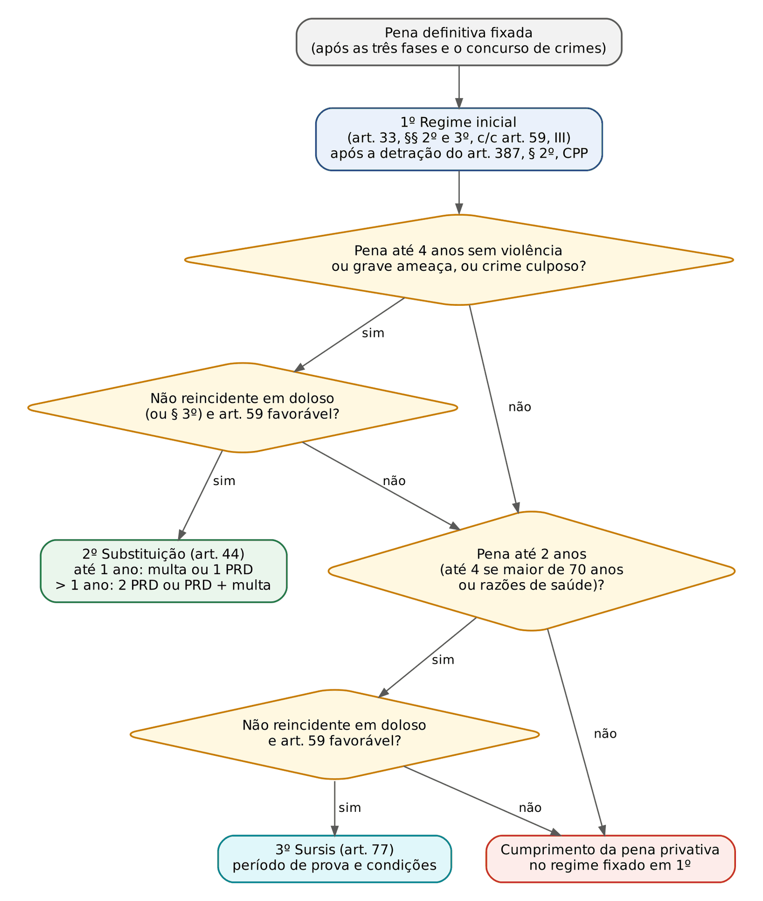
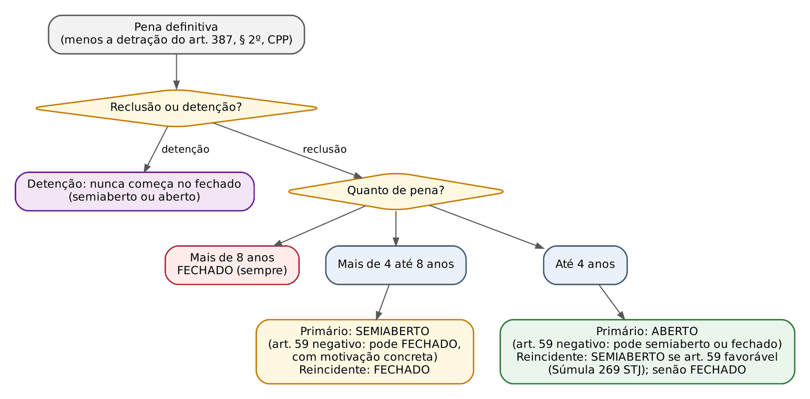
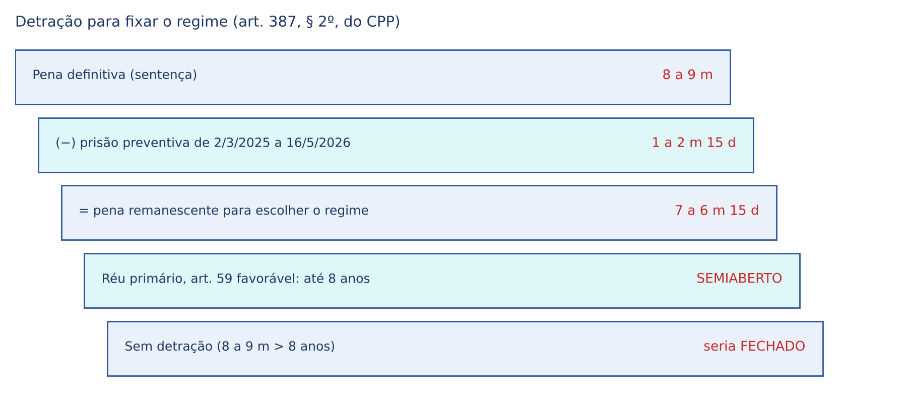
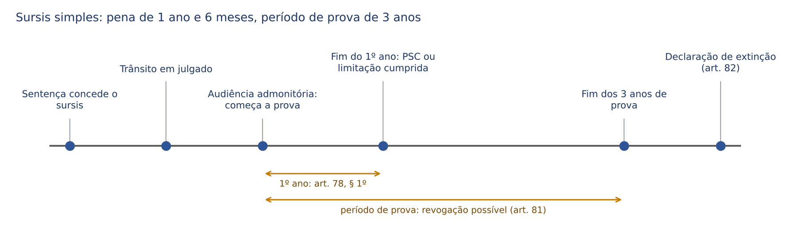

# CAPÍTULO 17 — DEPOIS DA PENA: REGIME INICIAL, DETRAÇÃO NA SENTENÇA, SUBSTITUIÇÃO POR RESTRITIVAS DE DIREITOS E SUSPENSÃO CONDICIONAL DA PENA

:::INCIDENCIA
Pontos: TRF5 p. 6; TJRS p. 4; TJSC p. 24, 25 e 28. Nível A; 29 questões no lote (FGV 23, FCC 6).
O que mais cai: regime inicial com reincidência e na detenção (Súmula 269 do STJ; Súmulas 718 e 719 do STF), requisitos e quantidade de restritivas (crime culposo, grave ameaça, reincidência, art. 44, § 2º, Súmula 588 do STJ), *sursis* etário e humanitário, revogação obrigatória x facultativa e detração do recolhimento noturno (Tema 1.155 do STJ).
:::

| Subtema | FGV | FCC | Padrão de cobrança |
|---|---|---|---|
| Regime inicial | 5 | 0 | detenção nunca começa no fechado; Súmula 269; gravidade abstrata |
| Detração | 0 | 2 | recolhimento noturno e nas folgas (Tema 1.155); prisão em processo diverso |
| Substituição: requisitos e vedações | 4 | 3 | culposo com qualquer pena; grave ameaça (simulacro); reincidência e § 3º; Súmula 588 |
| Substituição: número de restritivas | 4 | 0 | pena acima de 1 ano: duas restritivas ou uma restritiva e multa |
| *Sursis*: requisitos e espécies | 5 | 1 | etário e humanitário; reincidência culposa e multa anterior não impedem; subsidiariedade |
| *Sursis*: condições e revogação | 5 | 0 | revogação obrigatória x facultativa (art. 81); condições do art. 78, § 2º, cumulativas |

## 17.1 O que o juiz decide depois de fixar a pena

Fixada a pena definitiva (Caps. 13 a 15) e resolvido o concurso de crimes (Cap. 16), a sentença ainda não terminou. O art. 59 do CP manda o juiz estabelecer, além da quantidade de pena, "o regime inicial de cumprimento da pena privativa de liberdade" (inciso III) e "a substituição da pena privativa da liberdade aplicada, por outra espécie de pena, se cabível" (inciso IV). O art. 387 do CPP e o art. 157 da LEP completam a lista: o juiz deve computar a prisão provisória para fins de regime (art. 387, § 2º, do CPP) e pronunciar-se, motivadamente, sobre a suspensão condicional da pena, concedendo-a ou negando-a (art. 157 da LEP).

Para o civilista: a condenação fixou o "valor" (a quantidade de pena); agora se decide a FORMA de satisfazê-lo. As quatro decisões têm uma ordem lógica que não é mera preferência de estilo, porque cada uma é pressuposto ou alternativa da seguinte:

1. Detração para fins de regime (art. 387, § 2º, do CPP): desconta-se, só para escolher o regime, o tempo de prisão provisória.
2. Regime inicial (art. 33, §§ 2º e 3º, do CP): fixa-se SEMPRE, mesmo que depois a pena seja substituída ou suspensa, porque é o regime que valerá se a restritiva for convertida ou o *sursis* revogado.
3. Substituição por restritivas de direitos ou multa (art. 44): é a primeira alternativa à prisão.
4. Suspensão condicional da pena (art. 77): é SUBSIDIÁRIA, só cabe se a substituição não for "indicada ou cabível" (art. 77, III).

:::PASSO Como decidir, na sentença, o que vem depois da pena definitiva
1) Anote a pena definitiva de cada crime e a pena total (somada ou exasperada no concurso — Cap. 16).
2) Verifique se houve prisão provisória, administrativa, internação ou recolhimento noturno cautelar; se houve, faça a conta da detração (17.3) e use a pena remanescente APENAS para escolher o regime.
3) Fixe o regime inicial: espécie de pena (reclusão ou detenção), quantidade, reincidência e circunstâncias judiciais (17.2).
4) Examine a substituição: requisitos do art. 44, I a III, e vedações (17.4). Cabendo, diga quantas e quais restritivas.
5) Se a substituição não couber, examine o *sursis* (17.5). Cabendo, fixe período de prova e condições.
6) Feche com a manutenção ou não da prisão preventiva e o direito de recorrer em liberdade (art. 387, § 1º, do CPP) e com os demais comandos da sentença (Cap. 26).
:::

:::PEGADINHA Substituir NÃO dispensa fixar o regime
A sentença que substitui a pena e "deixa de fixar regime por desnecessário" está errada. A restritiva converte-se em privativa no descumprimento (art. 44, § 4º — Cap. 12) e o *sursis* pode ser revogado (art. 81); em ambos os casos, o condenado cumprirá a pena no regime fixado na sentença. Na prova de sentença, a omissão é falha de fundamentação que a banca pune.
:::

## 17.2 Regime inicial de cumprimento da pena

### 17.2.1 A lógica do art. 33: três fatores

As regras dos regimes em si (estabelecimentos, trabalho, isolamento noturno) estão no Cap. 12 (12.5.2). Aqui interessa a ESCOLHA do regime inicial. O CP adotou um sistema progressivo (art. 33, § 2º): a pena começa num regime e o condenado avança para regimes mais brandos por mérito (progressão — Cap. 24). A sentença define só o ponto de partida, combinando três fatores:

- a quantidade de pena aplicada (art. 33, § 2º, alíneas "a" a "c");
- a reincidência (as alíneas "b" e "c" só valem para o "não reincidente");
- as circunstâncias judiciais do art. 59 (art. 33, § 3º).

:::LEI Código Penal, art. 33, §§ 2º e 3º
§ 2º - As penas privativas de liberdade deverão ser executadas em forma progressiva, segundo o mérito do condenado, observados os seguintes critérios e ressalvadas as hipóteses de transferência a regime mais rigoroso:
a) o condenado a pena superior a 8 (oito) anos deverá começar a cumpri-la em regime fechado;
b) o condenado não reincidente, cuja pena seja superior a 4 (quatro) anos e não exceda a 8 (oito), poderá, desde o princípio, cumpri-la em regime semi-aberto;
c) o condenado não reincidente, cuja pena seja igual ou inferior a 4 (quatro) anos, poderá, desde o início, cumpri-la em regime aberto.
§ 3º - A determinação do regime inicial de cumprimento da pena far-se-á com observância dos critérios previstos no art. 59 deste Código.
:::

Repare nos verbos, que são a chave de quase todas as questões: na alínea "a", o condenado "DEVERÁ" começar no fechado (regra cogente); nas alíneas "b" e "c", "PODERÁ" começar no semiaberto ou no aberto. O "poderá" não é arbítrio: significa que esse é o regime mais brando PERMITIDO pela quantidade de pena, do qual o juiz só se afasta (para pior) com fundamentação concreta extraída do art. 59. E o "não reincidente" das alíneas "b" e "c" explica por que a reincidência, em regra, leva ao regime imediatamente mais grave.

### 17.2.2 A tabela-matriz

| Pena aplicada (após detração) | Primário, art. 59 favorável | Primário, art. 59 com vetor negativo | Reincidente, art. 59 favorável | Reincidente, art. 59 desfavorável |
|---|---|---|---|---|
| Reclusão até 4 anos | ABERTO (art. 33, § 2º, "c") | semiaberto (ou, excepcionalmente, fechado), com motivação concreta | SEMIABERTO (Súmula 269 do STJ) | FECHADO |
| Reclusão de mais de 4 até 8 anos | SEMIABERTO (art. 33, § 2º, "b") | fechado, com motivação concreta | FECHADO | FECHADO |
| Reclusão acima de 8 anos | FECHADO (art. 33, § 2º, "a") | FECHADO | FECHADO | FECHADO |
| Detenção, qualquer quantidade | aberto (até 4 anos) ou semiaberto (acima de 4) | semiaberto | semiaberto | semiaberto (teto para a detenção) |

Três observações sobre a tabela:

- A coluna "primário com vetor negativo" não é automática. Uma circunstância judicial negativa AUTORIZA, mas não obriga, regime mais grave; o juiz deve dizer por que a circunstância concreta torna insuficiente o regime da quantidade de pena (Súmula 719 do STF). Na prática do STJ, a pena-base acima do mínimo por circunstância judicial negativa, devidamente fundamentada, é motivação idônea para o regime imediatamente mais grave.
- Na detenção, o regime inicial fechado é vedado em qualquer hipótese, mesmo com reincidência e pena alta (art. 33, caput, segunda parte); o fechado só vem por regressão (Cap. 12, 12.5.1).
- Os "maus antecedentes" não são reincidência: entram pelo art. 59 (Cap. 13). Logo, o primário com maus antecedentes cai na coluna "primário com vetor negativo", não na coluna do reincidente.

:::QUESTAO FGV 2026 — PC-PI — Oficial Investigador (Q3846825)
Multirreincidente em crime doloso, com três circunstâncias judiciais negativas, condenado a 6 anos de DETENÇÃO: regime inicial semiaberto, com trabalho em comum diurno em colônia agrícola, industrial ou similar (gabarito B; arts. 33, caput, e 35, § 1º). Armadilha: reincidência somada a vetores negativos parece levar ao fechado (A e D), mas a detenção não admite fechado inicial; a alternativa E descreve o regime aberto (trabalho fora, sem vigilância).
No mesmo sentido: Q4153626 (FGV 2026 — TJ-SC — Oficial de Justiça; resistência simples e desobediência, ambas punidas com detenção: regime inicial semiaberto ou aberto para os dois, conforme a pena; a resistência só tem reclusão na forma qualificada do art. 329, § 1º; gabarito E); Q2442330 (FGV 2024 — TJ-AP — Analista Judiciário; 3 anos de detenção por lesão corporal contra o genitor no contexto doméstico, reincidente no mesmo delito: semiaberto, porque a reincidência retira o aberto e a detenção impede o fechado; sem substituição, pela violência e pela reincidência específica, e sem *sursis*, pela pena acima de 2 anos e pela reincidência dolosa; gabarito A).
:::

:::EXEMPLO Seis réus, seis regimes
Todos condenados por crimes punidos com reclusão.
A — 3 anos, primário, pena-base no mínimo: ABERTO (alínea "c").
B — 3 anos, reincidente, pena-base no mínimo: SEMIABERTO. Pela letra do § 2º, o reincidente não tem direito ao aberto; e a Súmula 269 do STJ impede que vá automaticamente ao fechado se as circunstâncias judiciais forem favoráveis.
C — 3 anos, reincidente, pena-base acima do mínimo por culpabilidade elevada (vetor negativo): FECHADO. Reincidência + circunstância judicial desfavorável afastam a Súmula 269.
D — 6 anos, primário, pena-base no mínimo: SEMIABERTO (alínea "b"). O juiz NÃO pode impor o fechado alegando que o roubo "é crime grave que intranquiliza a sociedade" (Súmulas 718 do STF e 440 do STJ).
E — 6 anos, reincidente: FECHADO. A alínea "b" só socorre o não reincidente, e não há súmula que estenda a lógica da 269 a penas acima de 4 anos.
F — 9 anos, primário, tudo favorável: FECHADO. Acima de 8 anos o fechado é obrigatório ("deverá"), salvo se a detração reduzir a pena remanescente a 8 anos ou menos (17.3.2).
:::

### 17.2.3 O reincidente com pena até 4 anos: Súmula 269 do STJ

:::JURIS STJ, Súmula 269
É admissível a adoção do regime prisional semi-aberto aos reincidentes condenados a pena igual ou inferior a quatro anos se favoráveis as circunstâncias judiciais.
:::

A lógica: a leitura literal do § 2º levaria o reincidente condenado a pena pequena direto ao fechado, porque as alíneas "b" e "c" exigem "não reincidente". O STJ corrigiu a desproporção: a reincidência retira o ABERTO, mas, se as circunstâncias judiciais forem favoráveis, o reincidente com pena até 4 anos começa no SEMIABERTO. Note os dois limites da súmula, que as bancas exploram: (1) só para pena igual ou inferior a 4 anos; (2) só se as circunstâncias judiciais forem favoráveis. Reincidente com pena de 5 anos vai ao fechado; reincidente com pena de 2 anos e maus antecedentes também pode ir ao fechado, com fundamentação.

Há ainda uma exceção jurisprudencial ao "não reincidente" da alínea "c": o STF admitiu fixar regime ABERTO ao reincidente em casos de furto de bagatela em que, afastada a insignificância pela reincidência, o regime mais grave seria desproporcional (Plenário, HC 123.108, 123.533 e 123.734, j. 3/8/2015 — desenvolvido no Cap. 2). É solução excepcional, ligada ao valor ínfimo do bem; não generalize na prova objetiva.

:::QUESTAO FGV 2024 — Câmara Municipal de São Paulo — Procurador (Q2351293)
Reincidente em crime doloso, condenado por corrupção passiva (reclusão) a pena inferior a 4 anos, com circunstâncias judiciais favoráveis: regime inicial semiaberto (gabarito A; Súmula 269 do STJ). Armadilhas: o aberto (B) ignora a reincidência; o fechado "porque o crime é contra a Administração Pública" (C) é gravidade abstrata; o fechado "porque é reincidente" (E) ignora a súmula; a corrupção passiva é punida com reclusão, não com detenção (D).
:::

### 17.2.4 Gravidade abstrata não fundamenta regime mais grave: Súmulas 718 e 719 do STF e 440 do STJ

:::JURIS STF, Súmulas 718 e 719; STJ, Súmula 440
Súmula 718 do STF: A opinião do julgador sobre a gravidade em abstrato do crime não constitui motivação idônea para a imposição de regime mais severo do que o permitido segundo a pena aplicada.
Súmula 719 do STF: A imposição do regime de cumprimento mais severo do que a pena aplicada permitir exige motivação idônea.
Súmula 440 do STJ: Fixada a pena-base no mínimo legal, é vedado o estabelecimento de regime prisional mais gravoso do que o cabível em razão da sanção imposta, com base apenas na gravidade abstrata do delito.
:::

As três súmulas formam um sistema e respondem a uma pergunta só: quando o juiz pode fixar regime mais grave do que o "permitido" pela quantidade de pena?

- Súmula 719 (regra geral): pode, desde que haja MOTIVAÇÃO IDÔNEA.
- Súmula 718 (o que NÃO é motivação idônea): a gravidade em abstrato, isto é, aquilo que já está no tipo penal e vale para todo e qualquer autor do mesmo crime ("o tráfico destrói famílias", "o roubo gera insegurança", "crime hediondo").
- Súmula 440 (coerência interna da sentença): se o juiz fixou a pena-base no MÍNIMO, ele mesmo reconheceu que as circunstâncias judiciais são favoráveis; não pode, linhas depois, invocar gravidade para agravar o regime. Seria contradição.

E o que É motivação idônea? Elementos CONCRETOS do caso, que extrapolam o tipo: circunstâncias judiciais negativas fundamentadas (culpabilidade acentuada, maus antecedentes, consequências graves), modo de execução especialmente reprovável (por exemplo, violência desnecessária, emprego de arma de grosso calibre, vítima mantida sob ameaça por longo tempo) e, nos crimes de drogas, a natureza e a quantidade da substância, que o art. 42 da Lei 11.343/2006 manda considerar com preponderância.

:::DICA Pena-base no mínimo, mas regime mais grave: é sempre proibido?
Não necessariamente. A Súmula 440 veda regime mais grave baseado APENAS na gravidade abstrata. O STJ admite regime mais grave com pena-base no mínimo quando há dado concreto não valorado na primeira fase — o exemplo clássico é a quantidade e a natureza da droga, que o juiz pode deixar para outra etapa da dosimetria (Jurisprudência em Teses do STJ, ed. 131, tese 50: o juiz pode fixar regime mais gravoso considerando a natureza ou a quantidade da droga). Cuidado, porém, com o *bis in idem*: a mesma circunstância não pode ser usada duas vezes para agravar a pena e, de novo, para agravar o regime de modo desproporcional; a aplicação na Lei de Drogas está no Cap. 37.
:::

:::SENTENCA Fundamentação do regime
Onde entra: logo após a pena definitiva (e depois da detração, se houver). Fundamente com os três fatores (quantidade, reincidência e art. 59) e cite o dispositivo. Redação-modelo (regime mais brando): "Considerando o quantum da pena, a primariedade do réu e a análise favorável das circunstâncias judiciais, fixo o regime inicial aberto (art. 33, § 2º, 'c', e § 3º, do CP)". Redação-modelo (regime mais grave): "Embora a pena permita o regime semiaberto, fixo o regime inicial fechado, nos termos do art. 33, § 3º, do CP, em razão da culpabilidade exacerbada já reconhecida na primeira fase — o réu manteve as vítimas, entre elas uma criança, sob a mira de arma por mais de duas horas —, circunstância concreta que torna insuficiente o regime intermediário". Erros que a banca pune: fundamentar o regime na hediondez ou na "gravidade do delito" (Súmulas 718 e 440); esquecer a reincidência; fixar regime fechado inicial para pena de DETENÇÃO.
:::

:::QUESTAO FGV 2025 — PC-MG — Delegado de Polícia Substituto (Q3171395)
Tentativa de roubo de celular com revólver, autor primário que completava 20 anos. Assertivas: a multa vai de 10 a 360 dias-multa e é paga ao fundo penitenciário (VERDADEIRA — art. 49); o regime será fechado, ainda que a pena não supere 8 anos, pela gravidade em abstrato do emprego de arma (FALSA — Súmulas 718 do STF e 440 do STJ); a idade inferior a 21 anos reduz a pena na terceira fase (FALSA — é atenuante, segunda fase, art. 65, I — Cap. 14). Gabarito C (V – F – F). Armadilha: o regime pode ser agravado por dado concreto do caso, nunca pela "gravidade do crime" em si.
:::

### 17.2.5 Crimes hediondos e equiparados: o regime inicial fechado obrigatório caiu

A Lei 8.072/1990, na redação original, impunha o cumprimento "integralmente" em regime fechado (sem progressão). O STF declarou essa regra inconstitucional, por violar a individualização da pena (HC 82.959, Plenário, 2006 — ver Cap. 24). O legislador reagiu com a Lei 11.464/2007, que trocou "integralmente" por "inicialmente": "A pena por crime previsto neste artigo será cumprida inicialmente em regime fechado" (art. 2º, § 1º, da Lei 8.072/1990).

O STF também derrubou essa segunda versão. No HC 111.840 (Plenário, j. 27/6/2012), declarou incidentalmente a inconstitucionalidade do art. 2º, § 1º, da Lei 8.072/1990: o caso era de tráfico de drogas com pena de 6 anos, e o regime fechado havia sido imposto apenas por força da lei. O raciocínio é o mesmo do HC 82.959: se a Constituição manda individualizar a pena (art. 5º, XLVI), o legislador não pode tirar do juiz a escolha do regime com base exclusivamente no tipo de crime. Em repercussão geral, a tese foi reafirmada no Tema 972 do STF: é inconstitucional a fixação *ex lege* do regime inicial fechado com base no art. 2º, § 1º, da Lei 8.072/1990, devendo o julgador observar os parâmetros do art. 33 do CP.

Consequência prática: nos crimes hediondos e equiparados (tráfico, tortura, terrorismo), o regime inicial segue as regras GERAIS deste capítulo. Um condenado primário por tráfico a 5 anos e 10 meses, com circunstâncias favoráveis, começa no semiaberto; o fechado só com motivação concreta (por exemplo, grande quantidade de droga). A hediondez continua relevante, mas em outras frentes: frações de progressão (art. 112 da LEP, alterado pela Lei 14.843/2024 e, para fatos posteriores a 25/3/2026, pela Lei 15.358/2026 — Cap. 24), vedação de anistia, graça e indulto e de fiança (Cap. 40).

:::JURIS STF, Súmula Vinculante 26
Para efeito de progressão de regime no cumprimento de pena por crime hediondo, ou equiparado, o juízo da execução observará a inconstitucionalidade do art. 2º da Lei n. 8.072, de 25 de julho de 1990, sem prejuízo de avaliar se o condenado preenche, ou não, os requisitos objetivos e subjetivos do benefício, podendo determinar, para tal fim, de modo fundamentado, a realização de exame criminológico.
:::

A SV 26 nasceu do HC 82.959 e tem dois comandos: (1) o condenado por hediondo TEM direito à progressão (a vedação do regime integralmente fechado é inconstitucional); (2) o juiz da execução PODE exigir exame criminológico, desde que fundamentadamente. O segundo comando dialoga com a Lei 14.843/2024, que voltou a prever o exame criminológico como requisito da progressão no art. 112, § 1º, da LEP; a compatibilização entre a lei nova e a súmula, bem como a aplicação no tempo, são temas da execução (Cap. 24). Na sentença, a SV 26 não interfere na escolha do regime INICIAL; quem a confunde com o HC 111.840 erra a questão.

:::PEGADINHA Três decisões que não se confundem
HC 82.959 (2006): inconstitucional o regime INTEGRALMENTE fechado (vedação de progressão) — originou a SV 26. HC 111.840 (2012) e Tema 972: inconstitucional o regime INICIAL fechado obrigatório. HC 97.256 (2010): inconstitucional a vedação de SUBSTITUIÇÃO por restritivas no tráfico (17.4.6). Alternativa que diga "o STF declarou inconstitucional a progressão nos crimes hediondos" está errada: o STF declarou inconstitucional a VEDAÇÃO da progressão.
:::

No tráfico privilegiado (art. 33, § 4º, da Lei 11.343/2006), que não é hediondo, a Súmula Vinculante 59 torna impositivos o regime aberto e a substituição quando não houver vetor negativo na primeira fase e presentes os requisitos dos arts. 33, § 2º, "c", e 44 do CP; o desenvolvimento e o exemplo numérico estão no Cap. 37 (37.4.5).

Lembrete de outras leis com regras de regime: na Lei 9.455/1997 (tortura), o art. 1º, § 7º, prevê início em regime fechado, salvo no caso da omissão do § 2º — a mesma lógica do HC 111.840 tem sido aplicada pela jurisprudência para afastar a obrigatoriedade (Cap. 40); na Lei 12.850/2013, o art. 2º, § 8º, determina que as lideranças de organizações criminosas armadas ou que tenham armas à disposição iniciem o cumprimento em estabelecimento de segurança máxima (Cap. 46).

### 17.2.6 Regime no concurso de crimes e na superveniência de condenação

No concurso de crimes, o regime é fixado pela pena TOTAL, e não pela pena de cada crime isoladamente. É o que decorre do art. 111 da LEP: "Quando houver condenação por mais de um crime, no mesmo processo ou em processos distintos, a determinação do regime de cumprimento será feita pelo resultado da soma ou unificação das penas, observada, quando for o caso, a detração ou remição". No concurso formal e no crime continuado, a pena total é a exasperada (a mais grave aumentada de uma fração); no concurso material, a soma (Cap. 16).

Quando houver reclusão e detenção somadas, executa-se primeiro a reclusão (art. 69, caput, parte final, e art. 76). Na sentença, a solução mais segura é fixar o regime considerando o total, respeitada a vedação de fechado inicial para a parcela de detenção (o regime fechado decorrerá, se for o caso, da pena de reclusão).

:::EXEMPLO Regime pela pena somada
G, primário e com circunstâncias favoráveis, é condenado por furto qualificado (2 anos e 6 meses de reclusão) e por receptação (2 anos de reclusão, mínimo do art. 180, caput, para fatos a partir de 4/5/2026 — Lei 15.397/2026; antes, 1 a 4 anos), em concurso material, ambos praticados em junho de 2026.
Passo 1 — soma: 2 a 6 m + 2 a = 4 anos e 6 meses.
Passo 2 — regime: pena superior a 4 e até 8 anos, primário: SEMIABERTO (art. 33, § 2º, "b"). Isoladamente, cada pena permitiria o aberto; somadas, não.
Passo 3 — substituição: incabível, porque a pena total supera 4 anos (17.4.2). Também não cabe *sursis* (pena superior a 2 anos).
Se, em vez de concurso material, houvesse continuidade delitiva entre dois furtos qualificados de 2 anos e 6 meses cada, a pena seria 2 a 6 m + 1/6 = 2 anos e 11 meses: aberto e substituição possíveis.
:::

Se o condenado já cumpre pena e sobrevém nova condenação, a soma e o novo regime são definidos pelo JUIZ DA EXECUÇÃO (arts. 111, parágrafo único, e 118, II, da LEP), não pelo juiz da sentença nova. Por isso a segunda sentença fixa o regime com base apenas na pena que ela própria aplicou; a unificação é incidente da execução (Cap. 24).

:::ATENCAO Progressão "por salto" e falta de vaga não são temas da sentença
A sentença fixa o regime INICIAL. Pular do fechado diretamente para o aberto na execução é vedado (Súmula 491 do STJ — Cap. 24), e a falta de vaga no regime fixado não autoriza manter o condenado em regime mais grave (Súmula Vinculante 56 — Cap. 23). Alternativa que relacione essas súmulas à fixação do regime inicial está misturando fases.
:::

## 17.3 Detração na sentença

### 17.3.1 O que se detrai

O conceito e o fundamento da detração (art. 42 do CP: cômputo da prisão provisória, no Brasil ou no estrangeiro, da prisão administrativa e da internação) estão no Cap. 12 (12.5.4). Detraem-se, portanto: a prisão em flagrante, a temporária e a preventiva; a prisão domiciliar cautelar (art. 318 do CPP), que é prisão; a internação provisória (art. 319, VII, do CPP) e a internação em hospital de custódia. A detração é feita, como regra, pelo JUIZ DA EXECUÇÃO (art. 66, III, "c", da LEP), que calcula a pena a cumprir e as datas de benefícios. O que o juiz da SENTENÇA faz é diferente e limitado: usa a detração para escolher o regime (17.3.2).

As medidas cautelares diversas da prisão (art. 319 do CPP) não são prisão e, em regra, não geram detração: comparecimento periódico em juízo, proibição de frequentar lugares ou de ausentar-se da comarca restringem direitos, mas não a liberdade de locomoção como a prisão. A exceção, firmada em recurso repetitivo, é o recolhimento domiciliar noturno e nos dias de folga.

:::JURIS STJ, Tema 1.155 (REsp 1.977.135/SC, recurso repetitivo)
1) O período de recolhimento obrigatório noturno e nos dias de folga, por comprometer o *status libertatis* do acusado, deve ser reconhecido como período a ser detraído da pena privativa de liberdade e da medida de segurança, em homenagem aos princípios da proporcionalidade e do *non bis in idem*. 2) O monitoramento eletrônico associado, atribuição do Estado, não é condição indeclinável para a detração. 3) As horas de recolhimento domiciliar noturno e nos dias de folga devem ser convertidas em dias para contagem da detração da pena; se no cômputo total remanescer período menor que vinte e quatro horas, essa fração de dia deverá ser desprezada.
:::

A lógica da tese: quem passa as noites e as folgas trancado em casa por ordem judicial sofre restrição da mesma natureza da prisão (é o que acontece no próprio regime aberto, art. 36, § 1º). O item 2 evita que o réu seja prejudicado pela omissão do Estado em fornecer tornozeleira. O item 3 manda converter HORAS em DIAS, e não contar cada noite como um dia inteiro. Atenção: o monitoramento eletrônico ISOLADO, sem recolhimento, não está abrangido pela tese; a orientação do STJ é de que ele, sozinho, não gera detração (registrado na nota de verificação).

:::EXEMPLO Detração do recolhimento noturno (Tema 1.155)
H ficou 6 meses sob recolhimento domiciliar das 20h às 6h nos dias úteis e integral nos fins de semana. Considere 130 dias úteis e 52 dias de fim de semana no período.
Passo 1 — dias úteis: 10 horas por noite x 130 = 1.300 horas.
Passo 2 — fins de semana: 24 horas x 52 = 1.248 horas.
Passo 3 — total: 1.300 + 1.248 = 2.548 horas.
Passo 4 — conversão: 2.548 ÷ 24 = 106 dias e 4 horas. Desprezam-se as 4 horas (fração inferior a 24 horas — tese 3 e art. 11 do CP). Detração: 106 dias.
Erro comum: contar 182 dias (os 6 meses inteiros, como se fosse prisão), ou 130 + 52 = 182 "noites e folgas" como dias inteiros.
:::

:::QUESTAO FCC 2026 — DPE-BA — Defensor Público (Q4037444)
Preso em flagrante e preventivamente por 6 meses, o réu foi solto mediante condições, entre elas o recolhimento domiciliar noturno e nas folgas, sem tornozeleira. Gabarito E: detraem-se a prisão provisória e também o período de recolhimento noturno e nas folgas (Tema 1.155). Armadilhas: exigir monitoração eletrônica (A — contraria o item 2 da tese); detrair todo o período da liberdade provisória, como se o comparecimento trimestral e a proibição de ausentar-se da comarca também contassem (B); negar a detração pelo regime fechado ou pela violência do crime (D), requisitos que o art. 42 não prevê.
:::

### 17.3.2 Detração para fixar o regime (art. 387, § 2º, do CPP)

:::LEI Código de Processo Penal, art. 387, § 2º
§ 2º O tempo de prisão provisória, de prisão administrativa ou de internação, no Brasil ou no estrangeiro, será computado para fins de determinação do regime inicial de pena privativa de liberdade.
:::

O dispositivo foi incluído pela Lei 12.736/2012 para resolver um problema real: o réu preso preventivamente por muito tempo era condenado a regime fechado pela pena total e só conseguia o semiaberto meses depois, quando o juiz da execução fizesse a detração e analisasse a progressão. Hoje o juiz da sentença já desconta o tempo de prisão provisória e escolhe o regime pela pena REMANESCENTE.

Três regras de aplicação:

- A detração do art. 387, § 2º, é SÓ para o regime. A pena aplicada na sentença continua a mesma (o dispositivo da sentença registra a pena integral); o abatimento definitivo é feito na execução.
- Não se confunde com progressão de regime. O juiz não verifica a fração de cumprimento do art. 112 da LEP nem o bom comportamento carcerário: faz uma subtração e aplica o art. 33 à pena remanescente. É a orientação que prevaleceu no STJ, contra decisões de tribunais estaduais que exigiam o lapso de progressão.
- A pena remanescente não "apaga" o art. 59. Se as circunstâncias judiciais negativas justificarem regime mais grave do que o da pena remanescente, o juiz pode mantê-lo, com fundamentação concreta (17.2.4).

:::EXEMPLO Detração que muda o regime
I, primário, com todas as circunstâncias judiciais favoráveis, é condenado por roubo majorado a 8 anos e 9 meses de reclusão. Ficou preso preventivamente de 2/3/2025 a 16/5/2026.
Passo 1 — tempo de prisão: de 2/3/2025 a 2/5/2026 = 1 ano e 2 meses; de 2/5 a 16/5 = 14 dias; incluindo o dia do começo (art. 10 do CP), 15 dias. Total: 1 ano, 2 meses e 15 dias.
Passo 2 — pena remanescente: 8 a 9 m − 1 a 2 m 15 d = 7 anos, 6 meses e 15 dias.
Passo 3 — regime: pena remanescente superior a 4 e não superior a 8 anos, réu primário, circunstâncias favoráveis: SEMIABERTO (art. 33, § 2º, "b").
Sem a detração, a pena de 8 anos e 9 meses levaria ao fechado obrigatório (alínea "a"). Substituição e *sursis*: incabíveis (pena superior a 4 anos e crime com violência ou grave ameaça).
Se o réu tivesse uma circunstância judicial negativa bem fundamentada (por exemplo, consequências graves do crime), o juiz poderia manter o fechado mesmo após a detração, explicando por quê.
:::

:::SENTENCA Detração na sentença
Onde entra: imediatamente antes da fixação do regime. Faça a conta por escrito (datas de início e fim, total, pena remanescente) e deixe claro que é "para fins de fixação do regime". Redação-modelo: "Nos termos do art. 387, § 2º, do CPP, considerando que o réu permaneceu preso cautelarmente de 2/3/2025 a 16/5/2026 (1 ano, 2 meses e 15 dias), resta, para fins de fixação do regime, pena de 7 anos, 6 meses e 15 dias, razão pela qual, sendo primário e favoráveis as circunstâncias judiciais, fixo o regime inicial semiaberto. A detração definitiva será realizada pelo juízo da execução". Erros que a banca pune: abater a prisão da pena definitiva no dispositivo ("condeno a 7 anos, 6 meses e 15 dias"); exigir fração de progressão; deixar de fazer a detração alegando que é matéria da execução (o § 2º é comando ao juiz da sentença).
:::

### 17.3.3 Prisão em outro processo e a vedação da "conta-corrente"

A detração pode aproveitar prisão provisória sofrida em OUTRO processo, inclusive naquele em que o réu foi absolvido ou teve a punibilidade extinta, desde que o crime cuja pena se quer abater tenha sido praticado ANTES da prisão. A razão é evitar o chamado "crédito de pena" ou "conta-corrente": se o réu pudesse usar uma prisão indevida para abater crimes FUTUROS, teria um "saldo" para delinquir impunemente. Exemplo: J ficou 8 meses preso preventivamente no processo X, praticado em janeiro de 2024, e foi absolvido. Se for condenado no processo Y por fato de dezembro de 2023 (anterior à prisão), os 8 meses são detraídos; se o fato de Y for de 2025 (posterior à soltura), não.

:::QUESTAO FCC 2026 — DPE-MA — Defensor Público (Q4012636)
Detração de prisão cumprida em processo distinto: admitida quando o crime da condenação é anterior e o réu foi absolvido ou teve a punibilidade extinta no processo em que ficou preso (gabarito C). Armadilhas: "sempre admitida" (A) e "crime posterior" (B) ignoram a vedação da conta-corrente; "inviável em qualquer caso" (D) é o extremo oposto. A alternativa correta compara o crime da condenação com o "delito que gerou a prisão"; o critério da jurisprudência, exposto acima, é que o fato seja anterior à PRISÃO a ser detraída.
:::

### 17.3.4 Detração nas restritivas, na multa e na prescrição

- Restritivas de direitos: as que têm a mesma duração da privativa (prestação de serviços, limitação de fim de semana, interdição — art. 55) admitem detração do tempo de prisão provisória, abatendo-se dias de pena. É orientação do STJ, coerente com o fato de a restritiva substituir a privativa. Nas restritivas de valor (prestação pecuniária e perda de bens), não há como converter dias de prisão em dinheiro.
- Multa: não há detração (a multa é dívida de valor, sem equivalência legal com dias de prisão — Cap. 12).
- Prescrição: o tempo de prisão provisória não reduz a pena que regula a prescrição; a discussão sobre o art. 113 e a detração está no Cap. 22.
- Medida de segurança: o art. 42 manda computar o tempo de prisão provisória também na medida de segurança, para fins do prazo mínimo (Cap. 19).

:::PROCESSO Quem faz a detração e como se recorre
Juiz da sentença: só para o regime (art. 387, § 2º, do CPP); a omissão pode ser atacada em apelação ou embargos de declaração. Juiz da execução: detração definitiva e cálculo de pena (art. 66, III, "c", da LEP; a guia de recolhimento informa o tempo de prisão provisória — arts. 105 e 106 da LEP); a decisão desafia agravo em execução (art. 197 da LEP — Cap. 24). Réu preso que aguarda julgamento de recurso e já cumpriu tempo equivalente ao do regime mais brando: a via é a execução provisória (Súmula 716 do STF — Cap. 24).
:::

## 17.4 Substituição da pena privativa de liberdade por restritivas de direitos

### 17.4.1 A lógica e o momento

A substituição é a principal "porta de saída" da prisão para crimes de pequena e média gravidade. A Lei 9.714/1998 ampliou o cabimento de 1 para 4 anos, para que o encarceramento ficasse reservado aos casos em que é de fato necessário. As restritivas em espécie (prestação pecuniária, perda de bens, prestação de serviços, interdições e limitação de fim de semana), sua execução e a conversão estão no Cap. 12 (12.6); aqui, os REQUISITOS e a ESCOLHA na sentença.

O momento é sempre DEPOIS da pena definitiva e do regime. O juiz não "aplica" restritiva no lugar da dosimetria: primeiro calcula a privativa (as restritivas, em regra, não estão cominadas no tipo — art. 54), depois a substitui se presentes os requisitos.

Natureza: a doutrina majoritária e a jurisprudência tratam a substituição como direito público subjetivo do réu quando preenchidos os requisitos objetivos e subjetivos; o juiz não pode negá-la sem fundamentação, e o inciso III exige juízo de suficiência motivado em dados concretos.

### 17.4.2 Requisitos: tabela

:::LEI Código Penal, art. 44, I a III e §§ 2º e 3º
Art. 44. As penas restritivas de direitos são autônomas e substituem as privativas de liberdade, quando:
I - aplicada pena privativa de liberdade não superior a quatro anos e o crime não for cometido com violência ou grave ameaça à pessoa ou, qualquer que seja a pena aplicada, se o crime for culposo;
II - o réu não for reincidente em crime doloso;
III - a culpabilidade, os antecedentes, a conduta social e a personalidade do condenado, bem como os motivos e as circunstâncias indicarem que essa substituição seja suficiente.
§ 2º Na condenação igual ou inferior a um ano, a substituição pode ser feita por multa ou por uma pena restritiva de direitos; se superior a um ano, a pena privativa de liberdade pode ser substituída por uma pena restritiva de direitos e multa ou por duas restritivas de direitos.
§ 3º Se o condenado for reincidente, o juiz poderá aplicar a substituição, desde que, em face de condenação anterior, a medida seja socialmente recomendável e a reincidência não se tenha operado em virtude da prática do mesmo crime.
:::

| Requisito | Natureza | Conteúdo | Pontos cobrados |
|---|---|---|---|
| Quantidade (inciso I) | objetivo | pena APLICADA não superior a 4 anos | é a pena concreta, não a cominada; no concurso, a pena total; crime culposo: qualquer pena |
| Modo de execução (inciso I) | objetivo | crime sem violência ou grave ameaça à PESSOA | violência contra coisa não impede; crime culposo com resultado violento admite |
| Reincidência (inciso II e § 3º) | subjetivo | não reincidente em crime DOLOSO | reincidente em crime culposo não sofre o óbice; o reincidente doloso pode obter a substituição pelo § 3º |
| Suficiência (inciso III) | subjetivo | circunstâncias judiciais indicam que a substituição basta | maus antecedentes ou culpabilidade elevada podem fundamentar a recusa |

### 17.4.3 Inciso I: quantidade e violência

Pena "aplicada": vale a pena definitiva da sentença, inclusive após causas de diminuição (a tentativa de um crime com pena mínima de 5 anos pode resultar em pena substituível). No concurso de crimes, considera-se a pena total resultante da soma ou da exasperação, o que é coerente com o art. 111 da LEP e com o art. 69, § 1º, do CP, que veda substituir as penas dos demais crimes quando, por um deles, a privativa não foi substituída nem suspensa. Se todas forem substituídas, o condenado cumpre simultaneamente as restritivas compatíveis e sucessivamente as demais (art. 69, § 2º).

Violência ou grave ameaça "à pessoa": abrange a violência real (física) e a grave ameaça; não abrange a violência contra a COISA (o furto com rompimento de obstáculo admite substituição). Crimes como roubo, extorsão, estupro, lesão corporal dolosa, ameaça e resistência estão, pela letra da lei, fora da substituição. Crime culposo, ao contrário, admite substituição QUALQUER que seja a pena, mesmo com resultado violento: o homicídio culposo na direção de veículo com pena de 5 anos, por exemplo, comporta substituição (o resultado violento não foi querido). O crime preterdoloso (lesão corporal seguida de morte) não é culposo para este fim: o antecedente é doloso e violento (Cap. 7).

Uma controvérsia: as infrações de menor potencial ofensivo cometidas com violência ou grave ameaça (lesão corporal leve e ameaça fora do contexto doméstico). Parte da doutrina admite a substituição, por coerência com a Lei 9.099/1995, que admite até transação penal nesses casos; a letra do art. 44, I, não faz a distinção, e há julgados nos dois sentidos. No contexto de violência doméstica contra a mulher, porém, a vedação está sumulada (17.4.6). Na prova objetiva, siga a letra da lei e a súmula; na discursiva, mencione a divergência.

:::QUESTAO FGV 2025 — ENAM 2025.2 (Q3692432)
Roubo em joalheria com simulacro de pistola, sem ameaça verbal: o simulacro configura grave ameaça e impede a substituição (art. 44, I), ainda que a pena não supere 4 anos (gabarito C). Armadilhas: chamar o simulacro de "violência" (A — é grave ameaça, não violência física); negar a grave ameaça (B); deixar a questão ao juízo subjetivo sobre o grau de intimidação (D); vedar a substituição pela natureza patrimonial do crime (E). Observação: o enunciado trabalhou com a pena antiga (4 anos, regime aberto); para fatos a partir de 4/5/2026, a Lei 15.397/2026 elevou a pena mínima do roubo para 6 anos (Cap. 29), o que, em regra, já afasta o aberto pela quantidade de pena (salvo redução abaixo de 4 anos na 3ª fase, como na tentativa); o texto da lei consultado não traz vedação expressa de regime inicial aberto (ver nota de verificação).
No mesmo sentido: Q4231783 (FCC 2026 — TJ-CE — Analista Judiciário; réus primários: homicídio culposo da médica, 2 anos de detenção, e fraude eletrônica, 4 anos, admitem substituição; lesão corporal grave não admite, ainda que a pena seja de 1 ano, por ser crime violento; gabarito B); Q3736979 (FCC 2024 — SEAD-PI — Analista Governamental; réus não reincidentes em crime doloso e com circunstâncias favoráveis: prefeito que contrata operação de crédito externo sem autorização legislativa, art. 359-A, 1 ano; contrabando, art. 334-A, 3 anos; contratação direta ilegal, art. 337-E, 5 anos — substituem-se só as duas primeiras penas, porque a terceira supera 4 anos; gabarito D; casos reconstituídos de fonte secundária, ver nota de verificação).
:::

### 17.4.4 Reincidência: inciso II e § 3º

O inciso II veda a substituição ao reincidente em crime DOLOSO. Mas o § 3º abre exceção: o juiz PODE substituir para o reincidente se (a) a medida for socialmente recomendável em face da condenação anterior e (b) a reincidência não se tiver operado em virtude da prática do MESMO crime.

:::JURIS STJ, AgRg no AREsp 1.716.664/SP, Terceira Seção, j. 25/8/2021 (Informativo 706)
A reincidência específica que impede a substituição (art. 44, § 3º) é a reincidência no MESMO crime, isto é, em crimes idênticos (mesmo tipo penal), e não apenas da mesma espécie. Afastada a identidade, o juiz avalia se a substituição é socialmente recomendável.
:::

A Terceira Seção superou a leitura anterior, que equiparava "mesmo crime" a "crime da mesma espécie" (mesmo bem jurídico). Exemplos: condenado anteriormente por furto e agora por furto: reincidência específica, substituição VEDADA; condenado anteriormente por furto e agora por estelionato: não há identidade de tipo, e o juiz PODE substituir, se socialmente recomendável (por exemplo, condenação anterior antiga, crime de pequena monta, réu com trabalho fixo).

:::PEGADINHA Reincidência: três benefícios, três regras diferentes
Substituição (art. 44): reincidente em DOLOSO não tem direito, mas pode obtê-la pelo § 3º, salvo reincidência no mesmo crime. *Sursis* (art. 77): reincidente em DOLOSO não tem direito, sem exceção equivalente, salvo se a condenação anterior foi só a multa (§ 1º). Regime (art. 33): a reincidência, dolosa ou culposa, retira o aberto (o § 2º fala só em "não reincidente"), atenuada pela Súmula 269 do STJ. Questão que transporta o § 3º do art. 44 para o *sursis* está errada.
:::

:::QUESTAO FCC 2025 — DPE-AM — Defensor Público (Q3531591)
Furto de veículo qualificado pelo concurso de agentes, praticado com o irmão de 17 anos; condenação anterior por lesão corporal CULPOSA usada como maus antecedentes na 1ª fase e como reincidência na 2ª; pena final de 3 anos, regime fechado. Gabarito B: apesar da reincidência, a pena podia ser substituída por restritivas de direitos, porque o art. 44, II, só veda a substituição ao reincidente em crime DOLOSO, e o furto não tem violência ou grave ameaça à pessoa (inciso I). Por que as demais erram: (A) e (E) — a participação de adolescente não afasta a qualificadora do concurso de agentes (o inimputável é computado no concurso), e o crime do art. 244-B do ECA, se houver, concorre com o furto, não o substitui; (C) — usar a mesma condenação como antecedente e como reincidência é *bis in idem* vedado pela Súmula 241 do STJ (Cap. 14); (D) — a reincidência não impõe o fechado: com pena até 4 anos, o reincidente pode ter o semiaberto se as circunstâncias judiciais forem favoráveis (Súmula 269 do STJ — 17.2.3), e aqui a valoração negativa dos antecedentes era indevida. Armadilha: ler "reincidente" como óbice automático, sem verificar se o crime anterior foi doloso.
:::

:::QUESTAO FGV 2025 — DPE-PE — Defensor Público (Q3390861)
Quatro casos: (I) homicídios culposos em concurso formal, 4 anos e 6 meses; (II) lesão corporal culposa na direção de veículo com capacidade psicomotora alterada por álcool, 3 anos de reclusão; (III) estelionato, 1 ano e 6 meses, réu reincidente por posse irregular de arma de fogo; (IV) lavagem de dinheiro, 6 anos, com colaboração espontânea. Gabarito D: em I cabe a substituição a despeito da quantidade, porque o crime é culposo. Por que as demais erram: (A) e (B) — a substituição cabe em I, III e IV, mas não em II, porque o art. 312-B do CTB (Lei 14.071/2020) afasta o art. 44, I, do CP nos crimes dos arts. 302, § 3º, e 303, § 2º, do CTB (culposos com embriaguez; a pena de reclusão indica a forma qualificada — Cap. 43); (C) — a reincidência dolosa não é obstáculo absoluto (§ 3º); (E) — se o crime anterior também fosse estelionato, haveria reincidência no mesmo crime e a substituição seria vedada. Em IV, a pena de 6 anos não impede a substituição, porque o art. 1º, § 5º, da Lei 9.613/1998 permite substituí-la "a qualquer tempo" em razão da colaboração espontânea (Cap. 46; correlata: Q2375305).
:::

### 17.4.5 Quantidade e escolha das restritivas (art. 44, § 2º)

| Pena aplicada | O que o juiz pode aplicar | Observações |
|---|---|---|
| Até 6 meses | multa OU uma restritiva (exceto prestação de serviços) | a prestação de serviços exige pena superior a 6 meses (art. 46) |
| Acima de 6 meses até 1 ano | multa OU uma restritiva | o art. 60, § 2º (multa substitutiva até 6 meses), está tacitamente derrogado — Cap. 12 |
| Acima de 1 ano até 4 anos | duas restritivas OU uma restritiva e multa | não cabe só multa, nem só uma restritiva |
| Crime culposo acima de 4 anos | duas restritivas OU uma restritiva e multa | pena sem limite (art. 44, I, parte final) |

Três cuidados. Primeiro: "até 1 ano" é "igual ou inferior a um ano" — pena de exatamente 1 ano admite multa ou uma restritiva. Segundo: a multa SUBSTITUTIVA se soma à multa cominada no tipo, se houver (são penas distintas); mas, nas leis especiais que cominam privativa e multa cumulativamente, a jurisprudência veda substituir a prisão só por multa (Súmula 171 do STJ — Cap. 12). Terceiro: na violência doméstica contra a mulher, o art. 17 da Lei 11.340/2006 veda penas de cesta básica, prestação pecuniária e a substituição que implique pagamento isolado de multa (Cap. 38) — mas, como se verá, nesses crimes, se praticados com violência ou grave ameaça, a substituição é integralmente vedada pela Súmula 588 do STJ.

A escolha das espécies deve ser fundamentada e adequada ao crime e ao condenado: prestação de serviços para quem tem tempo e aptidão; prestação pecuniária para quem tem renda; interdições ligadas ao crime (arts. 56 e 57). Aplicar duas penas da mesma natureza (duas prestações pecuniárias) é solução criticada pela doutrina, porque esvazia a exigência de "duas restritivas"; a prática recomendada é diversificar.

:::QUESTAO FGV 2026 — TJ-RJ — Analista Judiciário (Q3868592)
Reincidente em crime CULPOSO, condenado a exatamente 4 anos por crime sem violência, com circunstâncias favoráveis: cabe a substituição, por uma restritiva e multa ou por duas restritivas (gabarito A). Armadilhas: tratar a reincidência culposa como impedimento (D — o inciso II fala em crime doloso); exigir pena "inferior" a 4 anos (E — a lei diz "não superior"); aplicar a regra da pena até 1 ano (B); cumular multa com duas restritivas (C).
No mesmo sentido: Q3301261 (FGV 2025 — TJ-SE — Juiz Substituto; corrupção passiva, 2 anos: duas restritivas ou uma restritiva e multa, além da perda do cargo, porque o crime foi praticado com violação de dever para com a Administração e a pena não é inferior a 1 ano — art. 92, I, "a", com declaração motivada; gabarito D; efeitos da condenação no Cap. 18); Q4088892 (FGV 2026 — TCE-SC — Auditor Fiscal de Controle Externo; furto qualificado, 2 anos e 6 meses: a única alternativa com duas restritivas é prestação de serviços e prestação pecuniária; três restritivas excedem o § 2º; gabarito B). Correlata: Q4012635 (FCC 2026, Cap. 12).
:::

### 17.4.6 Vedações e situações especiais

:::JURIS STJ, Súmula 588
A prática de crime ou contravenção penal contra a mulher com violência ou grave ameaça no ambiente doméstico impossibilita a substituição da pena privativa de liberdade por restritiva de direitos.
:::

A Súmula 588 é aplicação direta do art. 44, I (violência ou grave ameaça), mas com dois alcances que a banca explora: (1) abrange CONTRAVENÇÃO (as vias de fato do art. 21 da LCP, que não deixam lesão, também impedem a substituição); (2) vale mesmo para infrações de pequeno potencial (lesão leve, ameaça), afastando a controvérsia do 17.4.3 no contexto doméstico. Não impede, porém, o *sursis*, que não tem o requisito da ausência de violência (17.5.3). O panorama da Lei Maria da Penha (art. 41 — inaplicabilidade da Lei 9.099; Súmula 536 do STJ) está nos Caps. 25 e 38.

:::QUESTAO FGV 2024 — TJ-RR — Analista Judiciário (Q3087136)
João, primário, condenado a 1 ano por lesão corporal contra a esposa; Mário, condenado a 2 anos e 4 meses por furto qualificado, reincidente no mesmo crime; circunstâncias neutras. Gabarito A: João não tem direito à substituição (Súmula 588), mas pode obter o *sursis*; Mário não tem direito a nenhum dos dois (a reincidência específica afasta o § 3º do art. 44; o *sursis* esbarra na pena acima de 2 anos e na reincidência dolosa). Armadilha: estender a Súmula 588 ao *sursis*.
:::

Tráfico de drogas: o art. 33, § 4º, e o art. 44 da Lei 11.343/2006 vedavam a "conversão em penas restritivas de direitos". O STF, no HC 97.256 (Plenário, j. 1/9/2010), declarou inconstitucionais essas vedações, por ofensa à individualização da pena; o Senado suspendeu a execução da expressão no § 4º pela Resolução 5/2012 (art. 52, X, da CF). Hoje, a substituição no tráfico depende apenas dos requisitos do art. 44 do CP — o que, na prática, ocorre no tráfico privilegiado (pena até 4 anos; SV 59 — Cap. 37), porque a pena do caput (5 a 15 anos) só cai abaixo de 4 anos com o redutor do § 4º.

Crimes hediondos em geral: não há vedação legal à substituição; o obstáculo, quando existe, é a pena (normalmente superior a 4 anos) ou a violência.

Regime aberto com restritiva como condição: proibido.

:::JURIS STJ, Súmula 493 e Tema 20 (repetitivo)
Súmula 493: É inadmissível a fixação de pena substitutiva (art. 44 do CP) como condição especial ao regime aberto.
:::

O art. 115 da LEP permite ao juiz estabelecer condições especiais para o regime aberto, além das gerais (recolhimento noturno, saída para o trabalho, comparecimento). Alguns juízes passaram a impor, como "condição", a prestação de serviços à comunidade. O STJ vedou: a prestação de serviços é PENA autônoma (art. 44), e impô-la como condição do aberto significa aplicar duas penas pelo mesmo fato (*bis in idem*) e criar sanção sem lei. Condições do aberto devem ser medidas de fiscalização, não penas.

Outras situações:

- Reincidente em crime culposo, ou com condenação anterior apenas a multa: o inciso II só veda a reincidência em crime DOLOSO; a primeira hipótese não impede a substituição.
- Militares e Justiça Militar: o CPM tem regime próprio, sem substituição nos moldes do art. 44 (Cap. 51).
- Crimes ambientais e de trânsito: a Lei 9.605/1998 tem regras próprias de substituição (até 4 anos — Apostila de Direito Ambiental) e o CTB comina a suspensão da habilitação como pena própria (Cap. 43).
- Execução: só após o trânsito em julgado (Súmula 643 do STJ — Cap. 12).

:::EXEMPLO Três substituições, três respostas
K, primário, condenado por estelionato a 1 ano e 4 meses de reclusão e 13 dias-multa, circunstâncias favoráveis. Regime: aberto. Substituição: cabe (pena até 4 anos, sem violência, primário, circunstâncias favoráveis). Como a pena é superior a 1 ano: duas restritivas (por exemplo, prestação de serviços e prestação pecuniária) ou uma restritiva e multa substitutiva. A multa do tipo (13 dias-multa) permanece.
L, condenado por homicídio culposo na direção de veículo automotor (art. 302 do CTB) a 4 anos e 6 meses de detenção, circunstâncias favoráveis. Regime: semiaberto (detenção acima de 4 anos). Substituição: cabe, porque o crime é culposo e, então, o limite de 4 anos não incide. Duas restritivas.
M, primário, condenado por ameaça contra a ex-companheira, no contexto doméstico, a 3 meses de detenção. Regime: aberto. Substituição: VEDADA (Súmula 588). Próximo passo: examinar o *sursis* (17.5).
:::

:::SENTENCA Substituição: fundamentar a concessão e a recusa
Onde entra: depois do regime. Examine os três incisos expressamente; na recusa, indique o requisito ausente. Redação-modelo (concessão): "Preenchidos os requisitos do art. 44, I a III, do CP — pena não superior a 4 anos, crime sem violência ou grave ameaça, réu não reincidente e circunstâncias judiciais favoráveis —, substituo a pena privativa de liberdade, superior a um ano, por duas restritivas de direitos (art. 44, § 2º): prestação de serviços à comunidade, à razão de uma hora de tarefa por dia de condenação, e prestação pecuniária de 2 (dois) salários mínimos em favor da vítima". Redação-modelo (recusa): "Incabível a substituição, porque o crime foi cometido com grave ameaça à pessoa (art. 44, I, do CP), e passo a examinar a suspensão condicional da pena". Erros que a banca pune: aplicar só uma restritiva a pena superior a 1 ano; aplicar prestação de serviços a pena de até 6 meses; substituir em crime com violência doméstica (Súmula 588); recusar a substituição por "gravidade abstrata"; aplicar restritiva como condição do aberto (Súmula 493).
:::

:::QUESTAO FGV 2024 — TJ-SC — Juiz Substituto (Q3049370)
Sobre restritivas de direitos, a correta reproduz a Súmula 588 do STJ (gabarito A). Erradas: vedação de substituição no tráfico (B — HC 97.256 e Resolução 5/2012 do Senado); vedação absoluta ao reincidente em crime doloso (C — o § 3º do art. 44 a admite); pena substitutiva como condição do aberto (D — Súmula 493); execução provisória da restritiva com guia provisória (E — Súmula 643 do STJ, Cap. 12). Armadilha: confundir a vedação legal derrubada no tráfico com a impossibilidade prática (pena do caput superior a 4 anos).
:::

:::QUESTAO FGV 2024 — TJ-PE — Juiz Substituto (Q3117550)
Tráfico privilegiado com redutor máximo, réu primário e sem vetor negativo: pena de 1 ano e 8 meses, regime ABERTO e substituição por DUAS restritivas (ou uma restritiva e multa), porque a pena é superior a 1 ano (gabarito E). O cálculo completo, inclusive da multa, está no Cap. 37 (37.4.5). Armadilha: aplicar uma só restritiva, como se a pena fosse de até 1 ano.
:::

## 17.5 Suspensão condicional da pena (*sursis*)

### 17.5.1 Conceito, natureza e sistemas

*Sursis* (do francês *surseoir*, suspender) é a suspensão da execução da pena privativa de liberdade, por um período de prova, mediante condições; cumpridas as condições sem revogação, a pena privativa é declarada extinta (art. 82). O réu é condenado, a pena é fixada, mas não é executada.

Natureza jurídica: prevalece que é direito público subjetivo do condenado quando preenchidos os requisitos, de modo que o juiz deve fundamentar a negativa (art. 157 da LEP); quanto à essência, a doutrina o vê como forma alternativa de execução da pena privativa (Bitencourt, Nucci), não como espécie de pena (não está no art. 32). Por ser benefício condicionado, o condenado pode recusá-lo, deixando de aceitar as condições na audiência admonitória, e cumprir a pena.

Sistemas, segundo a doutrina clássica:

| Sistema | O que se suspende | No Brasil |
|---|---|---|
| Anglo-americano (*probation system*) | a própria condenação: o juiz reconhece a culpa e suspende a sentença, sob prova | não adotado no CP; a suspensão condicional do PROCESSO (art. 89 da Lei 9.099/1995) aproxima-se dele, porque suspende o processo antes da sentença |
| Franco-belga (europeu continental) | a EXECUÇÃO da pena: há condenação e pena fixada | ADOTADO no CP (art. 77) |
| *Probation of first offenders* | variante inglesa para primários | — |

### 17.5.2 Espécies

| Espécie | Base | Pena | Período de prova | Particularidade |
|---|---|---|---|---|
| Simples | arts. 77, caput, e 78, § 1º | até 2 anos | 2 a 4 anos | no 1º ano, prestação de serviços OU limitação de fim de semana |
| Especial | art. 78, § 2º | até 2 anos | 2 a 4 anos | exige reparação do dano (salvo impossibilidade) e circunstâncias do art. 59 INTEIRAMENTE favoráveis; troca as condições do § 1º por três condições cumulativas mais brandas |
| Etário | art. 77, § 2º, 1ª parte | até 4 anos | 4 a 6 anos | condenado maior de 70 anos (na data da sentença) |
| Humanitário | art. 77, § 2º, 2ª parte | até 4 anos | 4 a 6 anos | razões de saúde justificam a suspensão (Lei 9.714/1998) |
| Contravenção | art. 11 da LCP | prisão simples até 2 anos (requisitos do CP) | 1 a 3 anos | ver Cap. 50 |
| Ambiental | art. 16 da Lei 9.605/1998 | até 3 anos | regras do CP | verificação da reparação por laudo (art. 17) — Apostila de Direito Ambiental |

:::LEI Código Penal, arts. 77 e 78
Art. 77 - A execução da pena privativa de liberdade, não superior a 2 (dois) anos, poderá ser suspensa, por 2 (dois) a 4 (quatro) anos, desde que: I - o condenado não seja reincidente em crime doloso; II - a culpabilidade, os antecedentes, a conduta social e personalidade do agente, bem como os motivos e as circunstâncias autorizem a concessão do benefício; III - Não seja indicada ou cabível a substituição prevista no art. 44 deste Código.
§ 1º - A condenação anterior a pena de multa não impede a concessão do benefício.
§ 2º A execução da pena privativa de liberdade, não superior a quatro anos, poderá ser suspensa, por quatro a seis anos, desde que o condenado seja maior de setenta anos de idade, ou razões de saúde justifiquem a suspensão.
Art. 78, § 1º - No primeiro ano do prazo, deverá o condenado prestar serviços à comunidade (art. 46) ou submeter-se à limitação de fim de semana (art. 48).
§ 2º Se o condenado houver reparado o dano, salvo impossibilidade de fazê-lo, e se as circunstâncias do art. 59 deste Código lhe forem inteiramente favoráveis, o juiz poderá substituir a exigência do parágrafo anterior pelas seguintes condições, aplicadas cumulativamente: a) proibição de freqüentar determinados lugares; b) proibição de ausentar-se da comarca onde reside, sem autorização do juiz; c) comparecimento pessoal e obrigatório a juízo, mensalmente, para informar e justificar suas atividades.
:::

### 17.5.3 Requisitos

Objetivos:

- pena privativa de liberdade aplicada não superior a 2 anos (ou 4, no etário e no humanitário); no concurso de crimes, a pena total;
- não ser indicada nem cabível a substituição do art. 44 (subsidiariedade — inciso III).

Subjetivos:

- não ser reincidente em crime DOLOSO (inciso I); a condenação anterior apenas a multa não impede (§ 1º; no mesmo sentido, a antiga Súmula 499 do STF), nem a reincidência em crime culposo;
- circunstâncias judiciais favoráveis (inciso II).

A subsidiariedade é o ponto mais cobrado. Como o *sursis* é mais gravoso do que a substituição (o condenado fica anos sob prova, e no primeiro ano presta serviços ou se submete à limitação, com risco de cumprir a pena inteira se houver revogação), a lei manda o juiz examinar PRIMEIRO a substituição. Na prática, o *sursis* sobrevive em três espaços:

- crimes com violência ou grave ameaça com pena até 2 anos (o art. 77 não exige ausência de violência): lesão corporal dolosa, ameaça, constrangimento ilegal, inclusive em violência doméstica, em que a substituição é vedada pela Súmula 588, mas o *sursis* é admitido;
- condenados maiores de 70 anos ou com problemas graves de saúde, com pena até 4 anos (etário e humanitário), em crimes com violência;
- casos em que o juiz, fundamentadamente, entende a substituição não "indicada" (por exemplo, réu que já descumpriu restritivas anteriormente) e o *sursis* suficiente.

Estrangeiro: a antiga vedação do Decreto-Lei 4.865/1942 ao *sursis* para estrangeiro em caráter temporário não tem sido aplicada pela jurisprudência, à luz da isonomia (art. 5º, caput, da CF) e da Lei de Migração (registrado na nota de verificação). Tráfico de drogas: o art. 44 da Lei 11.343/2006 menciona também o *sursis* entre as vedações; o tema tem pouca relevância prática, porque no tráfico privilegiado a substituição, que é preferencial, é cabível (Cap. 37).

:::DICA O *sursis* não alcança a multa nem as restritivas
"A suspensão não se estende às penas restritivas de direitos nem à multa" (art. 80). Condenado a 1 ano de detenção e multa, com *sursis*, paga a multa normalmente. Pela mesma razão, não existe *sursis* "de" pena restritiva: se a privativa foi substituída, não há o que suspender.
:::

:::QUESTAO FGV 2026 — TRF-2 — Juiz Federal Substituto (Q3996832)
João, 32 anos, reincidente em crime culposo, 2 anos de reclusão; Caio, 67 anos, saudável, com condenação anterior apenas a multa, 4 anos; circunstâncias neutras e substituição incabível para ambos. Gabarito D: *sursis* cabível para João (a reincidência culposa não impede — art. 77, I) e incabível para Caio (pena acima de 2 anos; o etário exige mais de 70 anos e o humanitário, razões de saúde). Armadilhas: tratar a reincidência culposa ou a condenação anterior a multa (art. 77, § 1º) como impedimentos (A).
No mesmo sentido: Q3157923 (FGV 2024; 72 anos, reincidente culposo, 3 anos, substituição incabível: cabe o *sursis* etário — gabarito D; o livramento condicional não se decide na sentença, ver 17.6); Q3520328 (FGV 2025 — TJ-ES — Outorga de Delegações; 72 anos, reincidente culposo, condenação anterior a multa, 3 anos: tem direito ao *sursis* se as circunstâncias judiciais o autorizarem — gabarito A; a alternativa B confunde com as condições "pactuadas com o Ministério Público", próprias da suspensão condicional do processo); Q4289376 (FGV 2026 — DPE-RJ — Defensor Público; 52 anos, doença renal grave em hemodiálise, roubo tentado, 3 anos e 6 meses: a tese defensiva é o *sursis* HUMANITÁRIO, porque a substituição esbarra na grave ameaça, o *sursis* simples na pena acima de 2 anos e o etário na idade; o recolhimento em residência particular do art. 117 da LEP pressupõe regime aberto; gabarito A).
:::

:::QUESTAO FCC 2026 — DPE-MT — Defensor Público (Q3954627)
Em qual caso cabe o *sursis*? No roubo simples tentado, réu primário e de bons antecedentes, pena de 1 ano e 4 meses (gabarito D): a substituição é vedada pela grave ameaça, e o *sursis* não tem esse requisito. (Pena anterior à Lei 15.397/2026; para fato a partir de 4/5/2026, a redução máxima da tentativa leva a 2 anos — 72 meses menos 2/3 —, ainda dentro do limite de 2 anos do *sursis*.) Erradas: pena já substituída (A e C), porque não há o que suspender (subsidiariedade, art. 77, III); réu reincidente em crime doloso (B e E), porque o art. 77, I, o exclui sem exceção equivalente ao § 3º do art. 44.
:::

### 17.5.4 Condições

| Tipo | Fonte | Conteúdo |
|---|---|---|
| Legais (obrigatórias) no *sursis* simples | art. 78, § 1º | no 1º ano, prestação de serviços OU limitação de fim de semana |
| Legais no *sursis* especial | art. 78, § 2º | cumulativamente: proibição de frequentar lugares, proibição de ausentar-se da comarca sem autorização, comparecimento mensal |
| Judiciais | art. 79; art. 158, § 2º, da LEP | outras condições "adequadas ao fato e à situação pessoal do condenado", fixadas na sentença e modificáveis na execução |
| "Indiretas" | art. 81 | não praticar crime, reparar o dano etc.; são, na verdade, causas de revogação |

As condições judiciais não podem ser vexatórias, ofender direitos fundamentais (liberdade religiosa, intimidade) nem configurar pena não prevista em lei. A exigência de reparar o dano não é condição autônoma: aparece como causa de revogação (art. 81, II) e como requisito do *sursis* especial.

:::QUESTAO FGV 2025 — PC-MG — Delegado de Polícia Substituto (Q3171404)
*Sursis* em crime da Lei Maria da Penha. Gabarito B (só a II): a sentença pode especificar outras condições adequadas ao fato e à situação pessoal do condenado (art. 79). A I erra ao dizer que as condições do *sursis* especial se aplicam "cumulativa ou alternativamente" — o art. 78, § 2º, exige aplicação CUMULATIVA; a III erra ao pôr a condenação por crime culposo entre as causas de revogação obrigatória (é facultativa, e só com pena privativa ou restritiva — art. 81, § 1º). Repare na premissa: no contexto doméstico, o *sursis* é cabível (17.5.3).
:::

### 17.5.5 Período de prova, audiência admonitória e competência

O juiz fixa o período de prova entre os limites legais, fundamentando a escolha acima do mínimo (gravidade concreta, condições pessoais). O período começa a correr da AUDIÊNCIA ADMONITÓRIA, realizada depois do trânsito em julgado, em que o juiz lê a sentença ao condenado e o adverte das consequências de nova infração e do descumprimento das condições (art. 160 da LEP). Se o condenado, intimado pessoalmente ou por edital com prazo de 20 dias, não comparecer injustificadamente, a suspensão fica sem efeito e a pena é executada imediatamente (art. 161 da LEP).

Competência:

- concessão: juiz da sentença (art. 157 da LEP) ou tribunal no julgamento do recurso; concedido pelo tribunal, a ele cabe estabelecer as condições, podendo conferir ao juízo da execução essa incumbência (art. 159 da LEP);
- audiência admonitória, fiscalização, modificação das condições, revogação, prorrogação e extinção: juiz da execução (arts. 66, III, "d", e 158 a 163 da LEP); a fiscalização pode ser atribuída a serviço social penitenciário, Patronato ou Conselho da Comunidade (art. 158, § 3º, da LEP).

O período de prova é computado para o período depurador da reincidência: os 5 anos do art. 64, I, contam-se da data do cumprimento ou extinção da pena, "computado o período de prova da suspensão ou do livramento condicional, se não ocorrer revogação" (Cap. 14). A prescrição durante o *sursis* é tratada no Cap. 22.

### 17.5.6 Revogação, prorrogação e extinção

:::LEI Código Penal, art. 81
Art. 81 - A suspensão será revogada se, no curso do prazo, o beneficiário: I - é condenado, em sentença irrecorrível, por crime doloso; II - frustra, embora solvente, a execução de pena de multa ou não efetua, sem motivo justificado, a reparação do dano; III - descumpre a condição do § 1º do art. 78 deste Código.
§ 1º - A suspensão poderá ser revogada se o condenado descumpre qualquer outra condição imposta ou é irrecorrivelmente condenado, por crime culposo ou por contravenção, a pena privativa de liberdade ou restritiva de direitos.
§ 2º - Se o beneficiário está sendo processado por outro crime ou contravenção, considera-se prorrogado o prazo da suspensão até o julgamento definitivo.
§ 3º - Quando facultativa a revogação, o juiz pode, ao invés de decretá-la, prorrogar o período de prova até o máximo, se este não foi o fixado.
:::

| Revogação OBRIGATÓRIA (caput) | Revogação FACULTATIVA (§ 1º) |
|---|---|
| condenação irrecorrível por crime DOLOSO (qualquer pena) | condenação irrecorrível por crime CULPOSO ou CONTRAVENÇÃO a pena privativa ou restritiva |
| frustrar, sendo solvente, a execução da multa, ou não reparar o dano sem motivo justificado | descumprir qualquer OUTRA condição imposta (judiciais do art. 79 e as do *sursis* especial) |
| descumprir a condição do art. 78, § 1º (serviços ou limitação no 1º ano) | — |
| consequência: revoga-se, sem alternativa | alternativa do § 3º: prorrogar o período de prova até o máximo |

Pontos de interpretação:

- Condenação "no curso do prazo": o que importa é o TRÂNSITO EM JULGADO durante o período de prova; o crime pode ter sido anterior. Condenação por crime culposo ou contravenção apenas a MULTA não autoriza revogação nem facultativa (o § 1º exige privativa ou restritiva).
- "Frustra a execução da multa": depois que a multa passou a ser executada como dívida de valor e deixou de ser convertida em prisão (art. 51, Leis 9.268/1996 e 13.964/2019), boa parte da doutrina sustenta que essa parte do inciso II perdeu sentido ou deve ser lida com cautela, por representar conversão indireta da multa em prisão. A letra do CP continua lá; na prova objetiva, a literalidade costuma prevalecer.
- Contraditório: antes de revogar por descumprimento de condição, o juiz deve ouvir o condenado, que pode justificar (por exemplo, a falta de reparação por insolvência). A revogação pela condenação irrecorrível por crime doloso é automática quanto ao fundamento, mas a decisão é declarada pelo juiz da execução.
- Prorrogação do § 2º: é AUTOMÁTICA (a lei diz "considera-se prorrogado") e dura até o julgamento definitivo do outro processo; prevalece que, durante a prorrogação, não subsistem as condições, porque o objetivo é só aguardar o desfecho. Se o novo processo terminar em condenação por crime doloso, revoga-se o *sursis*, ainda que o período de prova original já tenha acabado.
- Fato no período de prova e decisão posterior: a revogação pode ser decretada depois do término do prazo se a causa ocorreu durante ele e não houve declaração de extinção; é a mesma lógica que o STJ firmou para a suspensão condicional do processo (Tema 920 do STJ — Cap. 25).

Extinção (art. 82): expirado o prazo sem revogação, "considera-se extinta a pena privativa de liberdade". A decisão do juiz da execução é declaratória. Atenção: extingue-se a PENA, não a condenação; os efeitos secundários (reincidência, maus antecedentes, efeitos extrapenais) permanecem (Caps. 14 e 18).

:::EXEMPLO Revogar, prorrogar ou extinguir?
N, condenado a 1 ano de detenção por lesão corporal contra o irmão, no contexto doméstico (art. 129, § 9º), obteve *sursis* simples com período de prova de 2 anos, iniciado em 10/2/2025.
Caso 1 — em agosto de 2025, N deixa de comparecer à entidade onde prestava serviços no 1º ano, sem justificativa: revogação OBRIGATÓRIA (art. 81, III), ouvido o condenado. Cumprirá 1 ano de detenção no regime fixado na sentença (aberto).
Caso 2 — em março de 2026, N deixa de comparecer a juízo, condição judicial do art. 79: revogação FACULTATIVA. O juiz pode, em vez de revogar, prorrogar o período de prova até 4 anos (máximo), porque o fixado foi de 2 anos (§ 3º).
Caso 3 — em janeiro de 2027, N é denunciado por furto praticado em dezembro de 2026; o prazo, que terminaria em 10/2/2027, considera-se prorrogado até o julgamento definitivo (§ 2º). Condenado irrecorrivelmente em 2028 por esse furto doloso: revogação obrigatória. Absolvido: declara-se extinta a pena.
Caso 4 — nada ocorre até 10/2/2027: extinção da pena privativa (art. 82). Para a reincidência, os 5 anos do art. 64, I, computam o período de prova: contam-se desde 10/2/2025 e terminam em 10/2/2030, e não 5 anos depois da extinção.
:::

:::QUESTAO FGV 2024 — TJ-SC — Analista Jurídico (Q2515311)
No período de prova, o beneficiário frustra, sendo solvente, a execução da multa e é condenado definitivamente por crime culposo em outro processo. Gabarito C. A frustração da multa é causa de revogação OBRIGATÓRIA (art. 81, II); a condenação por crime culposo, de revogação FACULTATIVA (art. 81, § 1º), desde que a pena seja privativa ou restritiva (o enunciado não especifica; condenação só a multa não autoriza revogação).
No mesmo sentido: Q3882276 (FGV 2026 — AL-RO — Analista Legislativo; a única hipótese facultativa entre as alternativas é a condenação irrecorrível por crime culposo a pena privativa; as demais são obrigatórias; gabarito D); Q3505797 (FGV 2025 — TJ-CE — Juiz Substituto; revogam obrigatoriamente a frustração da multa ou a não reparação do dano (II) e o descumprimento da prestação de serviços do 1º ano (III), mas não a condenação por crime "doloso ou culposo" (I), que mistura hipóteses obrigatória e facultativa; gabarito D); Q2367572 (FGV 2024 — MPE-GO — Promotor de Justiça Substituto; a alternativa B reproduz o art. 81, II, como revogação obrigatória, mas o gabarito oficial é D, assertiva sobre continuidade delitiva — Cap. 16; a B só seria falsa pela leitura doutrinária de que a frustração da multa perdeu eficácia como causa de revogação; gabarito discutível, ver nota).
:::

:::SENTENCA Como conceder ou negar o *sursis*
Onde entra: depois de afastada a substituição (o art. 77, III, exige que ela não seja cabível ou indicada), e sempre com pronunciamento expresso (art. 157 da LEP). Redação-modelo (concessão): "Incabível a substituição, porque o crime foi praticado com violência à pessoa no âmbito doméstico (art. 44, I, do CP; Súmula 588 do STJ). Presentes, contudo, os requisitos do art. 77 do CP — pena não superior a 2 anos, réu não reincidente em crime doloso e circunstâncias judiciais favoráveis —, suspendo a execução da pena pelo período de prova de 2 anos, devendo o réu, no primeiro ano, prestar serviços à comunidade (art. 78, § 1º), além de comparecer mensalmente em juízo para justificar suas atividades (art. 79). As condições serão especificadas em audiência admonitória pelo juízo da execução". Redação-modelo (negativa): "Deixo de conceder a suspensão condicional da pena, porque a pena aplicada supera 2 anos (art. 77, caput, do CP)". Erros que a banca pune: conceder *sursis* antes de examinar a substituição; fixar período de prova de 2 a 4 anos para o maior de 70 anos (são 4 a 6); estender o *sursis* à multa; omitir o pronunciamento sobre o benefício.
:::

### 17.5.7 *Sursis* penal x suspensão condicional do processo

| Aspecto | *Sursis* penal (arts. 77 a 82 do CP) | Suspensão condicional do processo (art. 89 da Lei 9.099/1995) |
|---|---|---|
| O que se suspende | a EXECUÇÃO da pena | o PROCESSO, antes da instrução |
| Momento | na sentença condenatória | no recebimento da denúncia, mediante proposta |
| Quem propõe ou concede | o juiz, de ofício (direito do réu preenchidos os requisitos) | o Ministério Público propõe; o acusado aceita (Súmula 696 do STF — Cap. 25) |
| Pena considerada | pena APLICADA até 2 anos (4 no etário e humanitário) | pena MÍNIMA cominada igual ou inferior a 1 ano |
| Antecedentes | não reincidente em crime doloso | não estar sendo processado nem ter sido condenado por outro crime |
| Período de prova | 2 a 4 anos (4 a 6) | 2 a 4 anos |
| Resultado do cumprimento | extinção da PENA; a condenação permanece (gera reincidência) | extinção da PUNIBILIDADE; não há condenação nem reincidência |
| Violência doméstica contra a mulher | cabível | vedada (art. 41 da Lei 11.340/2006; Súmula 536 do STJ) |

## 17.6 Quadro comparativo: as saídas da prisão

| Ponto | Substituição (art. 44) | *Sursis* (art. 77) | Regime aberto (art. 36) | Livramento condicional (art. 83) |
|---|---|---|---|---|
| Natureza | pena autônoma que substitui a privativa | suspensão da execução da privativa | forma de cumprimento da privativa | antecipação da liberdade na execução |
| Quem concede | juiz da sentença | juiz da sentença | juiz da sentença (regime inicial) ou da execução (progressão) | juiz da execução (Cap. 24) |
| Pena | até 4 anos (qualquer, se culposo) | até 2 anos (até 4 no etário e humanitário) | até 4 anos para iniciar no aberto (primário) | superior a 2 anos (art. 83, caput) |
| Violência ou grave ameaça | impede | não impede | não impede | não impede (exige, nos crimes violentos, constatação de condições pessoais — art. 83, parágrafo único) |
| Reincidência dolosa | impede, salvo § 3º | impede, salvo condenação anterior só a multa | impede o aberto inicial | não impede (aumenta a fração para mais da metade) |
| Descumprimento | conversão em privativa, com detração e saldo mínimo de 30 dias | revogação: cumpre a pena INTEIRA | regressão | revogação; o tempo em liberdade pode ou não ser computado, conforme a causa (art. 88) |
| Ordem de exame na sentença | 1ª alternativa | subsidiário à substituição | sempre fixado | não se examina na sentença |

:::PEGADINHA Livramento condicional não se concede na sentença
Assertiva que fale em "conceder livramento condicional na sentença condenatória" está errada: o livramento é benefício da execução (art. 131 da LEP), concedido depois do cumprimento de parte da pena. O mesmo vale para progressão, remição e saída temporária (Cap. 24). Na sentença, as decisões são as deste capítulo.
:::

:::QUESTAO FGV 2024 — TRF-1 — Analista Judiciário (Q3028438)
Condenação a 2 anos de reclusão por crime com violência contra a pessoa: cabe o *sursis*, se o réu não for reincidente em crime doloso e as circunstâncias judiciais o autorizarem (gabarito A). Armadilhas: a violência não impede o *sursis* (D); o livramento condicional exige pena SUPERIOR a 2 anos (art. 83, caput), de modo que, com 2 anos exatos, é incabível (B e C); a pena acima de 1 ano não afasta nenhum dos dois (E).
:::

## 17.7 Roteiro integrado: casos resolvidos de ponta a ponta

:::EXEMPLO Caso 1 — furto qualificado e uso de documento falso, primário
O, primário, bons antecedentes, condenado por furto qualificado pelo abuso de confiança (2 anos e 4 meses de reclusão e 11 dias-multa) e por uso de documento falso (2 anos de reclusão e 10 dias-multa), em concurso material. Ficou preso em flagrante por 20 dias.
Passo 1 — pena total: 2 a 4 m + 2 a = 4 anos e 4 meses (as multas são aplicadas distinta e integralmente — art. 72).
Passo 2 — detração para o regime: 4 a 4 m − 20 d = 4 anos, 3 meses e 10 dias.
Passo 3 — regime: ainda acima de 4 anos, primário, circunstâncias favoráveis: SEMIABERTO. A detração não bastou para chegar ao aberto (precisaria de 4 meses de prisão).
Passo 4 — substituição: a pena total (4 a 4 m) supera 4 anos: INCABÍVEL (17.4.3). Atenção: a detração do art. 387, § 2º, serve ao regime, não reduz a pena para fins do art. 44.
Passo 5 — *sursis*: pena superior a 2 anos: incabível.
:::

:::EXEMPLO Caso 2 — lesão corporal grave praticada por pessoa de 72 anos
P, 72 anos, primário, condenado por lesão corporal grave (art. 129, § 1º) a 2 anos e 6 meses de reclusão, circunstâncias favoráveis.
Passo 1 — regime: até 4 anos, primário: ABERTO.
Passo 2 — substituição: vedada pela violência à pessoa (art. 44, I).
Passo 3 — *sursis* simples: incabível (pena superior a 2 anos).
Passo 4 — *sursis* etário: cabível (maior de 70 anos, pena não superior a 4 anos, não reincidente, circunstâncias favoráveis). Período de prova: 4 a 6 anos; no 1º ano, prestação de serviços ou limitação de fim de semana (ou as condições do § 2º, se reparado o dano e inteiramente favoráveis as circunstâncias).
Como o *sursis* é benefício e não imposição, P pode recusá-lo na audiência admonitória e cumprir a pena no aberto.
:::

:::EXEMPLO Caso 3 — reincidente em crime diverso
Q, reincidente (condenação anterior, transitada em julgado há 3 anos, por receptação), é condenado por estelionato a 1 ano e 2 meses de reclusão, com pena-base no mínimo e agravante da reincidência aplicada.
Passo 1 — regime: pena até 4 anos, reincidente, circunstâncias judiciais favoráveis: SEMIABERTO (Súmula 269 do STJ). Não cabe o aberto pela letra do art. 33, § 2º, "c".
Passo 2 — substituição: o inciso II veda (reincidente em crime doloso), mas o § 3º permite se socialmente recomendável e se a reincidência não for no mesmo crime. Receptação e estelionato não são o mesmo tipo penal (AgRg no AREsp 1.716.664 — 17.4.4). O juiz PODE substituir, fundamentando a recomendação social (por exemplo, réu trabalhador, prejuízo reparado). Substituindo: duas restritivas ou uma restritiva e multa (pena superior a 1 ano).
Passo 3 — *sursis*: só se a substituição não fosse indicada; de todo modo, a reincidência em crime doloso o impede (art. 77, I), sem exceção equivalente ao § 3º.
:::

:::QUESTAO Questão de fixação elaborada para esta apostila (não é questão de banca)
R, primário, foi condenado a 9 anos de detenção (dois crimes de detenção em concurso material), com circunstâncias favoráveis, e ficou preso preventivamente por 1 ano e 3 meses. O regime inicial correto é: (A) fechado, pela pena superior a 8 anos; (B) semiaberto, apenas porque a detração reduz a pena a 7 anos e 9 meses; (C) semiaberto, pois na detenção o regime inicial nunca é o fechado; (D) aberto, pela detração. Gabarito: C. A detração é irrelevante aqui: mesmo sem ela, a detenção não começa no fechado (art. 33, caput). (B) chega ao resultado certo pelo motivo errado, armadilha típica de FGV.
:::

## 17.8 Resumo para revisão pré-prova

| Instituto | Regra | Exceções e detalhes | Fundamento |
|---|---|---|---|
| Ordem das decisões | detração para o regime → regime → substituição → *sursis* | o regime é fixado SEMPRE, mesmo com substituição ou *sursis* | art. 59, III e IV; art. 77, III; art. 387, § 2º, CPP |
| Regime: quantidade | > 8 anos fechado; > 4 até 8 semiaberto; até 4 aberto | "deverá" (fechado) x "poderá" (semiaberto e aberto) | art. 33, § 2º |
| Regime: reincidência | reincidente perde o regime mais brando | até 4 anos com art. 59 favorável: semiaberto | Súmula 269 STJ |
| Regime: art. 59 | vetor negativo concreto autoriza regime mais grave | gravidade abstrata não fundamenta; pena-base no mínimo impede regime mais grave só pela gravidade abstrata | art. 33, § 3º; Súmulas 718 e 719 STF; 440 STJ |
| Regime: detenção | nunca começa no fechado | fechado só por regressão | art. 33, caput |
| Regime: hediondos | regras gerais do art. 33 | regime inicial fechado obrigatório é inconstitucional; progressão: SV 26 | HC 111.840; Tema 972 STF; SV 26 |
| Regime: drogas | natureza e quantidade da droga podem justificar regime mais grave | privilegiado sem vetor negativo: aberto e substituição impositivos (SV 59 — Cap. 37) | art. 42 Lei 11.343; JT 131, tese 50 |
| Regime: concurso | pela pena total (soma ou exasperação) | condenação superveniente: unificação pelo juiz da execução | art. 111 LEP |
| Detração na sentença | desconta a prisão provisória só para escolher o regime | não exige fração de progressão; art. 59 negativo pode manter regime mais grave | art. 387, § 2º, CPP; art. 42 CP |
| Detração: cautelares | recolhimento noturno e nas folgas é detraído (horas → dias; fração desprezada) | não depende de monitoração; monitoração isolada não detrai | Tema 1.155 STJ |
| Detração: outro processo | admite prisão em processo diverso | só para crime praticado ANTES da prisão (vedação do crédito de pena) | art. 42 CP; jurisprudência |
| Substituição: requisitos | pena até 4 anos, sem violência ou grave ameaça à pessoa; não reincidente em doloso; art. 59 favorável | culposo: qualquer pena; concurso: pena total | art. 44, I a III |
| Substituição: reincidente | pode, se socialmente recomendável e não for reincidência no mesmo crime | "mesmo crime" = mesmo tipo penal | art. 44, § 3º; AgRg no AREsp 1.716.664 |
| Substituição: quantidade | até 1 ano: multa ou 1 PRD; > 1 ano: 2 PRD ou PRD + multa | PSC só para pena > 6 meses | art. 44, § 2º; art. 46 |
| Substituição: vedações | violência doméstica contra a mulher com violência ou grave ameaça, inclusive contravenção | tráfico: vedação inconstitucional | Súmula 588 STJ; HC 97.256; Res. 5/2012 Senado |
| PRD e regime aberto | restritiva não pode ser condição do aberto | — | Súmula 493 STJ; Tema 20 STJ |
| *Sursis*: requisitos | pena até 2 anos; não reincidente em doloso; art. 59 favorável; substituição incabível | condenação anterior só a multa não impede; violência não impede | art. 77 |
| *Sursis*: espécies | simples (2 a 4 anos, PSC ou limitação no 1º ano); especial (reparação e art. 59 inteiramente favorável) | etário (> 70 anos) e humanitário (saúde): pena até 4, prova de 4 a 6 | arts. 77, § 2º, e 78 |
| *Sursis*: alcance | suspende só a privativa | não se estende à multa nem às restritivas | art. 80 |
| *Sursis*: início | audiência admonitória após o trânsito | ausência injustificada: sem efeito | arts. 160 e 161 LEP |
| *Sursis*: revogação obrigatória | condenação irrecorrível por doloso; não reparação injustificada (ou frustrar multa); descumprir art. 78, § 1º | trânsito no curso do prazo | art. 81, caput |
| *Sursis*: revogação facultativa | outra condição descumprida; condenação por culposo ou contravenção a privativa ou restritiva | pode prorrogar até o máximo | art. 81, §§ 1º e 3º |
| *Sursis*: prorrogação | automática se processado por outro crime ou contravenção | até o julgamento definitivo | art. 81, § 2º |
| *Sursis*: extinção | expirado o prazo sem revogação, extingue-se a pena | condenação subsiste; período de prova conta para o depurador | art. 82; art. 64, I |
| *Sursis* x SCP | suspende a execução, gera reincidência | SCP suspende o processo e extingue a punibilidade | art. 77 CP; art. 89 Lei 9.099 |

## 17.9 Artigos de lei incidentes

- Código Penal: arts. 33, 42, 44, 54, 59, III e IV, 64, I, 69, §§ 1º e 2º, 76, 77 a 82.
- Código de Processo Penal: art. 387, § 2º.
- Lei de Execução Penal: arts. 66, III, "c" e "d", 111, 115, 156 a 163.
- Lei 8.072/1990: art. 2º, § 1º (declarado inconstitucional).
- Lei 11.343/2006: arts. 33, § 4º (parte final suspensa pela Resolução 5/2012 do Senado), 42 e 44.
- Lei 11.340/2006: arts. 17 e 41.
- Lei 9.455/1997: art. 1º, § 7º. Lei 12.850/2013: art. 2º, § 8º.
- Lei 9.099/1995: art. 89 (comparação). Decreto-Lei 3.688/1941: art. 11. Lei 9.605/1998: arts. 16 e 17.
- Constituição Federal: art. 5º, XLVI; art. 52, X.

## 17.10 Julgados, temas e súmulas do capítulo

- Súmula 718 do STF — gravidade abstrata não é motivação idônea para regime mais severo.
- Súmula 719 do STF — regime mais severo que o permitido exige motivação idônea.
- Súmula 269 do STJ — reincidente, pena até 4 anos, art. 59 favorável: semiaberto.
- Súmula 440 do STJ — pena-base no mínimo impede regime mais grave pela gravidade abstrata.
- Súmula 493 do STJ e Tema 20 do STJ — restritiva não pode ser condição especial do aberto.
- Súmula 588 do STJ — violência doméstica contra a mulher com violência ou grave ameaça impede substituição.
- Súmula Vinculante 26 — progressão em hediondos e exame criminológico fundamentado.
- STF, HC 111.840 (Plenário, j. 27/6/2012) e Tema 972 do STF — inconstitucional o regime inicial fechado obrigatório dos hediondos.
- STF, HC 97.256 (Plenário, j. 1/9/2010) e Resolução 5/2012 do Senado — inconstitucional a vedação de substituição no tráfico.
- STJ, Tema 1.155 — detração do recolhimento noturno e nas folgas, convertido em horas.
- STJ, AgRg no AREsp 1.716.664/SP (Terceira Seção, j. 25/8/2021) — reincidência específica do art. 44, § 3º, exige crimes idênticos.
- Jurisprudência em Teses do STJ, ed. 131, teses 49 e 50 — regime no tráfico: regras do CP; natureza e quantidade da droga podem agravar o regime.
- Súmula 499 do STF — condenação anterior a multa não impede o *sursis* (reproduzida no art. 77, § 1º).

Remissões a outros capítulos: HC 123.108, 123.533 e 123.734 (Cap. 2); Súmulas 171 e 643 do STJ, Tema 931 do STJ e AgRg no AREsp 2.783.936 (Cap. 12); Súmula 444 do STJ (Cap. 13); art. 64 e reincidência (Cap. 14); Súmula 715 do STF (Cap. 16); prescrição e detração (Cap. 22); Súmula Vinculante 56 (Cap. 23); HC 82.959, Súmula 491 do STJ, Súmula 716 do STF, Súmula 617 do STJ, Lei 14.843/2024 e progressão (Cap. 24); Súmulas 536 do STJ e 696 do STF, Tema 920 do STJ (Cap. 25); Súmula Vinculante 59 (Cap. 37); art. 17 da Lei 11.340/2006 (Cap. 38).

:::NOTA Notas de verificação
1) Questões (segunda passagem): as 29 questões do lote foram lidas em bank_local.json (FGV 23, FCC 6), todas com gabarito oficial; incluídos o "Mapa de cobrança" e 14 boxes QUESTAO novos (além dos dois já existentes, Q3117550 e Q3049370, este reescrito com o gabarito oficial A), com as demais citadas em "no mesmo sentido". Todas as respostas fundamentadas coincidem com o gabarito oficial. Q3531591 (FCC 2025 — DPE-AM; gabarito B) ganhou box em 17.4.4 na limpeza de 15/10/2026, com o texto completo recuperado no banco local. Q3736979 (FCC 2024 — SEAD-PI; gabarito D) continua SEM os casos hipotéticos no banco local; os três casos (Maurício, art. 359-A, 1 ano; Marilda, art. 334-A, 3 anos; Rodolfo, art. 337-E, 5 anos) foram reconstituídos a partir de resumo da página da questão no Gran Questões (fonte secundária, leitura não literal) e citados em 17.4.3; conferir no QConcursos antes da publicação. Retirado o item de fixação próprio sobre *sursis* (redundante com Q3996832, Q3520328 e Q2515311); mantido um item de fixação (detenção e detração). Correlatas de outros capítulos citadas: Q2375305 (Cap. 46) e Q4012635 (Cap. 12).
1-A) Gabarito discutível: Q2367572 (FGV 2024 — MPE-GO). O gabarito oficial é D (continuidade delitiva), mas a alternativa B reproduz a letra do art. 81, II, do CP (revogação obrigatória por frustrar a multa ou não reparar o dano); conferir se houve recurso ou anulação.
1-B) Conferidos no Planalto em 15/10/2026 (redação conforme o texto): art. 312-B do CTB (Lei 14.071/2020) e art. 1º, § 5º, da Lei 9.613/1998 (redação da Lei 12.683/2012). Antes não conferidos em fonte primária, citados nos boxes: art. 312-B do CTB (Lei 14.071/2020), que afasta o art. 44, I, do CP nos crimes dos arts. 302, § 3º, e 303, § 2º (há debate doutrinário sobre o alcance — Dizer o Direito, out. 2020); art. 1º, § 5º, da Lei 9.613/1998 (substituição "a qualquer tempo" na colaboração espontânea).
2) Drive: o mapeamento FGV foi lido (só cabeçalhos dos enunciados, sem análise útil ao tema); o IURIS vol. 5 e o caderno do Dizer o Direito vieram truncados antes dos capítulos de penas; os Cadernos Sistematizados e o download do PDF derrubaram a conexão; Bitencourt, Sinopse TJSC e CP Coordenado não foram lidos (tamanho). O texto se apoia em fonte legal e na jurisprudência indicada.
3) Lei: o Planalto não pôde ser acessado (WebFetch bloqueado para o domínio; Chrome indisponível). A ausência de alteração em 2024 a 2026 nos arts. 33, 44 e 77 foi conferida em compilação secundária (LegJur, atualizada até 22/9/2026); as transcrições dos arts. 33, §§ 2º e 3º, 44, 77, 78, 81 do CP e 387, § 2º, do CPP, feitas de memória, foram conferidas no Planalto em 15/10/2026 e coincidem com a redação vigente (no CP compilado não há alteração de 2024 a 2026 nesses artigos). Lei 15.358/2026: segundo fonte secundária, não alterou regime inicial, substituição nem *sursis*, e sim frações de progressão (Cap. 24).
4) Tema 972 do STF: o radar indica o ARE 935.967 AgR; a tese aqui resumida (inconstitucionalidade do regime fechado *ex lege*, observância do art. 33) corresponde à formulação mais conhecida; conferir o processo-paradigma e a redação exata.
5) Não confirmados em fonte primária e redigidos sem número de julgado: monitoração eletrônica isolada não gera detração; detração do art. 387, § 2º, sem exigência de fração de progressão; detração nas restritivas; não aplicação da vedação de *sursis* ao estrangeiro; prevalência de que as condições não subsistem na prorrogação do art. 81, § 2º; revogação do *sursis* após o prazo por fato ocorrido durante ele (analogia com o Tema 920 do STJ, firmado para a suspensão condicional do processo).
6) O AgRg no AREsp 1.716.664/SP foi conferido em fonte secundária (Informativo 706 do STJ). As datas dos HCs 111.840 e 97.256 são de memória.
6-A) Revisão de 15/10/2026 (Lei 15.397/2026): o exemplo "Regime pela pena somada" foi refeito com a receptação de 2 a 6 anos (fatos a partir de 4/5/2026, conforme o Cap. 30); a Q3954627 recebeu nota sobre a pena nova. A observação da Q3692432 dizia que a Lei 15.397/2026 "vedou o regime aberto inicial" no roubo (informação também presente na seção 11 de INSTRUCOES.md); o texto da lei consultado em duas fontes secundárias (Lex e PDF do DOU divulgado pelo Poder360) altera só penas e tipos (arts. 155, 157, 171, 180, 180-A e 266) e NÃO contém dispositivo sobre regime inicial. A afirmação foi retirada; conferido no Planalto em 15/10/2026: o texto oficial da Lei 15.397/2026 (arts. 1º a 4º) não contém regra sobre regime inicial.
7) Divergência de titularidade: o Cap. 12 remete a Súmula 493 do STJ ao Cap. 24, mas o registro a atribui ao Cap. 17, onde foi desenvolvida; ajustar a remissão do Cap. 12 na limpeza.
:::
