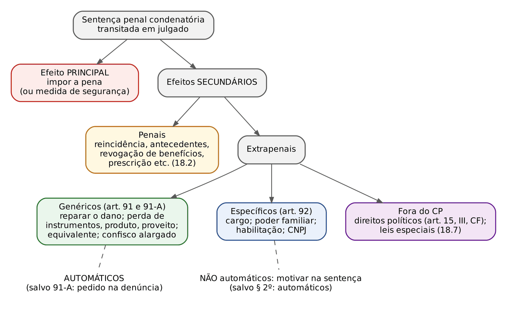
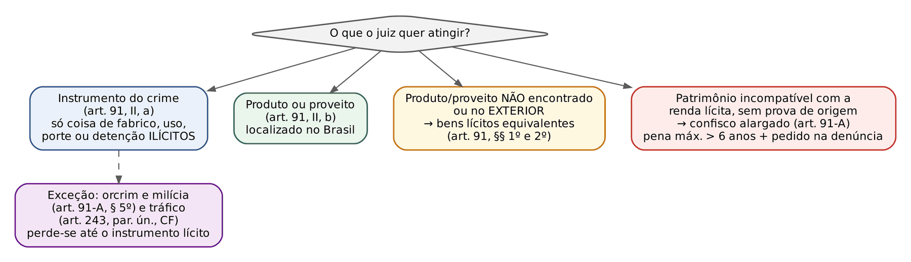
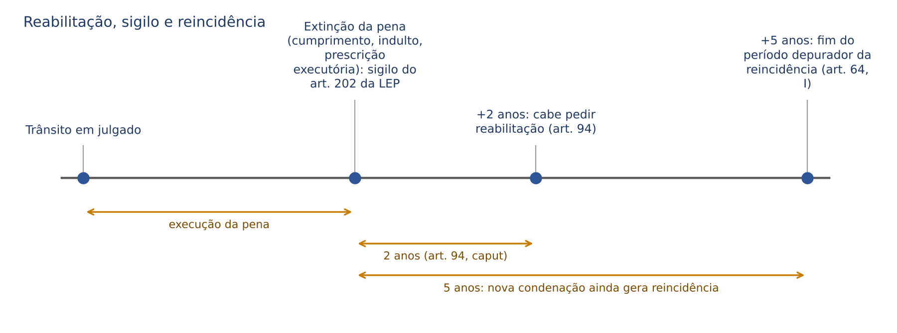

# CAPÍTULO 18 — EFEITOS DA CONDENAÇÃO, PERDA DE BENS, CONFISCO ALARGADO E REABILITAÇÃO

:::INCIDENCIA
TRF5 p. 6; TJRS p. 4; TJSC p. 34. Nível B. Lote: 15 questões (FGV 14, FCC 1).
O que mais cai: perda pelo equivalente x confisco alargado (requisitos do art. 91-A, pedido na denúncia, presunção relativa) e efeitos do art. 92 (perda do cargo: prazos de pena e necessidade de motivação; automaticidade só no § 2º).
:::

| Subtema | FGV | FCC | Padrão da cobrança |
|---|---|---|---|
| Confisco alargado (art. 91-A) | 5 | 1 | literalidade dos §§ 1º a 5º; pedido na denúncia; presunção relativa; mais de 6 anos |
| Perda e sequestro pelo equivalente (art. 91, §§ 1º e 2º) | 4 | 0 | bens no exterior ou não localizados; equivalente de ofício, alargado não |
| Efeitos específicos (art. 92) | 5 | 1 | perda do cargo motivada, sem pedido; 1 ano x mais de 4 anos; poder familiar |
| Perda de instrumentos e produto (art. 91, II) | 2 | 1 | instrumento lícito não se perde (salvo orcrim, milícia e tráfico); destinação à União (ADPF 569) |
| Reabilitação | 1 | 0 | 2 anos; reparação do dano mesmo com sentença omissa; não reintegra no cargo; revogação de ofício |

## 18.1 Panorama: efeito principal e efeitos secundários

Como a sentença civil com efeitos anexos, a condenação penal definitiva tem um efeito PRINCIPAL — sujeitar o condenado à pena (ou, no semi-imputável, à medida de segurança substitutiva) — e efeitos SECUNDÁRIOS, uns automáticos, outros dependentes de declaração expressa.

Os secundários são penais (reincidência, revogação de benefícios etc.) ou extrapenais (cível, administrativo, eleitoral, família). Os extrapenais do CP são genéricos (arts. 91 e 91-A: qualquer crime; em regra automáticos) ou específicos (art. 92: certos crimes e quantitativos de pena; motivação obrigatória).

Três premissas atravessam o capítulo:

- Os efeitos pressupõem condenação DEFINITIVA. A extinção da punibilidade ANTES do trânsito (prescrição da pretensão punitiva, inclusive a retroativa) impede que eles se formem; a extinção DEPOIS do trânsito (prescrição executória, indulto) atinge só o efeito principal e conserva os secundários (Súmula 631 do STJ — ver Cap. 21; quadro comparativo no Cap. 22).
- A sentença homologatória de transação penal NÃO é condenatória e não produz os efeitos do art. 91 (18.4.4).
- Efeito da condenação não é pena. Pode coexistir com a substituição por restritivas: o servidor condenado a 2 anos por corrupção passiva pode ter a pena substituída e, ainda assim, perder o cargo (Q3301261, FGV 2025, TJ-SE, Juiz Substituto, gabarito D — questão do Cap. 17).

## 18.2 Efeitos secundários de natureza penal

São desenvolvidos nos capítulos próprios; basta o rol: gerar reincidência e, depois do quinquênio, maus antecedentes (arts. 63 e 64 — Caps. 13 e 14); impedir ou revogar *sursis* e livramento e dificultar substituição, regime e livramento (arts. 33, 44, II, 77, I, 81, I, 83 e 86 — Caps. 17 e 24); aumentar em 1/3 o prazo da prescrição executória e interromper a prescrição pela reincidência (arts. 110 e 117, VI — Cap. 22); revogar a reabilitação (art. 95 — 18.9.5); afastar privilégios que exigem primariedade (arts. 155, § 2º, 170 e 171, § 1º — Caps. 29 e 30); impedir transação, suspensão condicional do processo e ANPP (Lei 9.099/1995, arts. 76, § 2º, e 89; CPP, art. 28-A, § 2º — Cap. 25).

## 18.3 Obrigação de reparar o dano e a repercussão da sentença penal no cível e no administrativo

### 18.3.1 "Tornar certa a obrigação de indenizar" (art. 91, I)

A condenação penal definitiva resolve, no plano civil, o *an debeatur*: a vítima não precisa provar de novo o fato, a autoria e a ilicitude. A sentença é título executivo judicial (art. 515, VI, do CPC; art. 63 do CPP), executável no juízo cível pelo ofendido, seu representante legal ou herdeiros. Falta, em regra, o *quantum debeatur*, que se apura em liquidação, salvo quanto ao valor mínimo fixado na própria sentença penal (art. 387, IV, e art. 63, parágrafo único, do CPP).

O efeito é automático: ainda que a sentença nada diga, o título se forma. E a obrigação alcança o patrimônio transferido aos sucessores, até o limite da herança (art. 5º, XLV, da CF) (Q3114284, FGV 2024, TJ-MT, Analista Judiciário, gabarito C: estava ERRADA a assertiva que vedava o perdimento contra os sucessores "independentemente do montante").

:::LEI Código de Processo Penal, art. 387, IV, e art. 63, parágrafo único
Art. 387. O juiz, ao proferir sentença condenatória: [...] IV - fixará valor mínimo para reparação dos danos causados pela infração, considerando os prejuízos sofridos pelo ofendido;
Art. 63, parágrafo único. Transitada em julgado a sentença condenatória, a execução poderá ser efetuada pelo valor fixado nos termos do inciso IV do caput do art. 387 deste Código sem prejuízo da liquidação para a apuração do dano efetivamente sofrido.
:::

### 18.3.2 O valor mínimo do art. 387, IV, do CPP

Introduzido pela Lei 11.719/2008, o dispositivo antecipa parte da liquidação para dentro do processo penal. A jurisprudência do STJ construiu quatro balizas, que a banca cobra e o juiz precisa observar na sentença:

- Pedido expresso: o juiz não fixa de ofício. O pedido deve ser formulado pelo Ministério Público, pelo querelante ou pelo assistente, em regra na denúncia ou na queixa, de modo a permitir a defesa sobre ele.
- Contraditório e instrução: o valor precisa ter sido submetido ao contraditório (o réu deve poder discutir o montante e produzir prova). Pedido feito apenas nas alegações finais, sem que a instrução tenha tratado do dano, costuma ser recusado.
- Abrangência: alcança danos materiais e morais.
- Direito intertemporal: por ter conteúdo material, a regra não alcança fatos anteriores à vigência da Lei 11.719/2008 (22/8/2008).

Na violência doméstica, o valor mínimo por dano moral dispensa instrução específica, porque o dano é *in re ipsa*, mas não dispensa o pedido expresso (Tema 983 do STJ — v. Cap. 38). Leis especiais repetem a regra: na Lei de Abuso de Autoridade, a obrigação de indenizar com fixação de valor mínimo é efeito da condenação (art. 4º, I, da Lei 13.869/2019 — Q4231764, FCC 2026, TJ-CE, Analista Judiciário, gabarito C; Cap. 44).

### 18.3.3 Independência relativa das instâncias: o que a sentença penal vincula no cível

A independência das instâncias (art. 935 do CC, primeira parte) é RELATIVA: não se pode mais questionar no cível a existência do fato ou quem seja o seu autor quando essas questões se acharem decididas no juízo criminal (art. 935, segunda parte). O CPP detalha:

| Situação no processo penal | Efeito no cível | Fundamento |
|---|---|---|
| Condenação transitada | título executivo; o cível só discute o valor | art. 91, I, CP; art. 63 CPP; art. 515, VI, CPC |
| Absolvição por estar provada a inexistência do fato (art. 386, I, CPP) | faz coisa julgada no cível: não há indenização | art. 935 CC; art. 66 CPP, a contrário |
| Absolvição por estar provado que o réu não concorreu (art. 386, IV) | idem: afasta a indenização contra ele | art. 935 CC |
| Absolvição por excludente de ilicitude | coisa julgada no cível (art. 65 CPP), MAS indeniza-se o terceiro inocente (estado de necessidade agressivo, *aberratio*) | arts. 65 CPP; 188, 929 e 930 CC (Cap. 9) |
| Absolvição por falta de prova, atipicidade, extinção da punibilidade, arquivamento do inquérito | NÃO impede a ação civil | arts. 66 e 67 CPP |

Conexões com o direito civil: a prescrição da pretensão indenizatória não corre antes da sentença penal definitiva quando a ação se originar de fato que deva ser apurado no juízo criminal (art. 200 do CC); e o juiz cível pode suspender a ação civil até o julgamento da ação penal (art. 64, parágrafo único, do CPP; art. 315 do CPC).

No plano ADMINISTRATIVO a lógica é a mesma: a absolvição penal por inexistência do fato ou negativa de autoria vincula a Administração (art. 126 da Lei 8.112/1990 para o servidor federal); a absolvição por falta de provas não impede a punição disciplinar pelo "resíduo administrativo" (Súmula 18 do STF). A perda do cargo como efeito da condenação, por sua vez, dispensa processo administrativo disciplinar (18.6.1).

:::PROCESSO Cumprimento da sentença penal no cível
O devedor é citado no juízo cível para cumprimento ou liquidação (art. 515, § 1º, do CPC). O responsável civil que não foi réu no processo penal (o empregador, por exemplo) NÃO pode ser executado com esse título: contra ele, a vítima propõe ação de conhecimento (limites subjetivos da coisa julgada).
:::

## 18.4 Perda dos instrumentos, do produto e do proveito do crime (art. 91, II, e §§ 1º e 2º)

:::LEI Código Penal, art. 91, II, e §§ 1º e 2º
II - a perda em favor da União, ressalvado o direito do lesado ou de terceiro de boa-fé:
a) dos instrumentos do crime, desde que consistam em coisas cujo fabrico, alienação, uso, porte ou detenção constitua fato ilícito;
b) do produto do crime ou de qualquer bem ou valor que constitua proveito auferido pelo agente com a prática do fato criminoso.
§ 1º Poderá ser decretada a perda de bens ou valores equivalentes ao produto ou proveito do crime quando estes não forem encontrados ou quando se localizarem no exterior.
§ 2º Na hipótese do § 1º, as medidas assecuratórias previstas na legislação processual poderão abranger bens ou valores equivalentes do investigado ou acusado para posterior decretação de perda.
:::

### 18.4.1 Instrumentos: só os ilícitos em si

Instrumento é o objeto usado para praticar o crime. O CP só manda perder o instrumento cuja fabricação, alienação, uso, porte ou detenção seja, por si, ILÍCITO (a arma sem registro, o petrecho de falsificação). O instrumento lícito volta ao dono (o carro usado no roubo, o celular com que se combinou o crime): confiscá-lo seria pena patrimonial sem previsão legal. Daí a resposta da Q3362383 (FGV 2025, ENAM 2025.1, gabarito C): o veículo que o presidente da comissão de licitação usava para buscar a propina NÃO é instrumento confiscável pelo CP, porque dirigir carro não é ilícito.

Exceções legais em que até o instrumento lícito se perde:

- Organizações criminosas e milícias (art. 91-A, § 5º): os instrumentos usados nos seus crimes "deverão ser declarados perdidos", em favor da União ou do Estado conforme a Justiça em que tramita a ação (a Lei 15.358/2026 incluiu expressamente o Distrito Federal), ainda que não ponham em perigo a segurança, a moral ou a ordem pública, nem ofereçam sério risco de reutilização. Perde-se o caminhão, o galpão, o rádio. Embora esteja no art. 91-A, o § 5º NÃO depende dos requisitos do confisco alargado.
- Tráfico de drogas: todo bem de valor econômico apreendido em decorrência do tráfico é confiscado (art. 243, parágrafo único, da CF; art. 63 da Lei 11.343/2006), sem necessidade de habitualidade ou de adaptação do bem (Tema 647 do STF — ver Cap. 37).
- Lavagem de dinheiro: perdem-se os bens relacionados direta ou indiretamente ao crime (art. 7º, I, da Lei 9.613/1998 — Cap. 46).

:::QUESTAO FGV 2025 — TRF 5ª Região — Juiz Substituto (Q3373861)
Pedia a afirmativa correta sobre efeitos da condenação na CF, no CP e nas leis especiais. Gabarito oficial: D — a perda de instrumentos LÍCITOS é admitida nos crimes da Lei de Drogas e nos praticados por organizações criminosas e milícias.
Erradas: confisco do tráfico só de imóveis (é de todo bem); perda pelo equivalente inviável sem o produto (é o seu remédio, § 1º); interdição de "um a cinco anos" na orcrim (são 8 anos após a pena — 18.7); confisco alargado com pena superior a 4 anos (são 6).
:::

### 18.4.2 Produto e proveito

Produto é o obtido diretamente com o crime (o dinheiro desviado); proveito, o obtido com sua transformação ou uso (o carro comprado com ele). Ambos se perdem, ressalvados o lesado (restituição, arts. 118 a 124 do CPP) e o terceiro de boa-fé (adquirente oneroso sem ciência da origem).

O donatário e o terceiro de má-fé não estão protegidos: na Q4102467 (FGV 2026, ENAM 2026.1), o imóvel comprado com o dinheiro do peculato e doado à esposa continua alcançável, sem ação civil autônoma; o terceiro defende-se por embargos (arts. 129 e 130 do CPP).

### 18.4.3 A perda é automática; a destinação é da União (ou do Estado)

A perda do art. 91, II, é automática: decorre da condenação, ainda que a sentença seja omissa (é prudente, porém, especificá-la — box SENTENCA, 18.10). O CP fala em perda "em favor da União"; na Justiça Estadual, a doutrina e a prática destinam os valores ao Estado, e o art. 91-A, § 5º, já fala em União ou Estado "dependendo da Justiça onde tramita a ação penal". O produto da alienação vai ao Fundo Penitenciário Nacional, salvo lei especial (art. 133, § 2º, do CPP; na Lei de Drogas, o Funad); bens podem ser usados por órgãos de segurança pública (art. 133-A do CPP).

:::JURIS STF, ADPF 569, Plenário, j. 17/5/2024 (procedência parcial)
Sem lei específica sobre a destinação de valores de condenações e acordos (inclusive colaboração premiada), aplica-se o art. 91 do CP: sem lesados ou terceiros de boa-fé, vão à União, pelo processo orçamentário; vedada destinação diversa por acordo do MP ou ordem judicial.
:::

:::QUESTAO FCC 2025 — DPE-RS — Defensor Público (Q3387033)
Gabarito oficial: C — a perda em favor da União do produto e do proveito foi discutida no STF em ADPF julgada parcialmente procedente (ADPF 569).
Armadilhas: instrumentos de orcrim perdidos só se perigosos (é "ainda que não"); confisco alargado com pena superior a 8 anos e patrimônio "da família"; apuração dos bens após o trânsito (o art. 91-A, § 4º, manda fazê-lo NA sentença); incapacidade para o poder familiar automática e em crime punido com detenção.
:::

### 18.4.4 Transação penal não gera confisco

Os efeitos do art. 91 pressupõem sentença CONDENATÓRIA; a sentença que homologa a transação penal não os produz (Tema 187 do STF — v. Cap. 25). Assim, o bem apreendido só se perde na transação se a perda constar do acordo ou se for ilícito em si. No ANPP, a renúncia a instrumentos, produto ou proveito é condição pactuada (art. 28-A, II, do CPP — Cap. 25).

### 18.4.5 Perda e medidas assecuratórias pelo equivalente (§§ 1º e 2º)

Introduzidos pela Lei 12.694/2012, os §§ 1º e 2º alcançam o agente que gastou, escondeu ou mandou ao exterior o produto do crime: o juiz decreta a perda de bens LÍCITOS de valor equivalente, e as medidas assecuratórias (arts. 125 a 144-A do CPP) podem recair, desde a investigação, sobre esses bens.

Diferenças que a FGV explora:

| | Perda pelo equivalente (art. 91, § 1º) | Confisco alargado (art. 91-A) |
|---|---|---|
| Pressuposto | produto ou proveito identificado, mas não encontrado ou no exterior | patrimônio incompatível com a renda lícita, sem vínculo com um crime determinado |
| Crimes | qualquer crime | infrações com pena máxima superior a 6 anos de reclusão |
| Iniciativa | o juiz decreta na sentença, inclusive de ofício (efeito automático, como o do inciso II) | depende de pedido expresso do MP na denúncia, com indicação da diferença |
| Cautelar | sequestro ou arresto "pelo equivalente" (§ 2º) | o CP não criou um "sequestro alargado"; aplicam-se as medidas comuns do CPP, cuja extensão é discutida (ver nota) |

:::EXEMPLO Separando o equivalente do alargado (baseado na Q3865756)
O vereador T desviou 3.200.000 (três milhões e duzentos mil) reais. Com o dinheiro comprou dois carros de 700.000 (setecentos mil) reais e uma lancha de 350.000 (trezentos e cinquenta mil) reais, ambos localizados no Brasil, e uma fazenda no Paraguai de 1.800.000 (um milhão e oitocentos mil) reais. O patrimônio total de T é de 8.000.000 (oito milhões) de reais, dos quais só metade é compatível com a renda lícita.
Passo 1 — produto e proveito localizados no Brasil (art. 91, II, b): carros e lancha = 700.000 + 350.000 = 1.050.000 (um milhão e cinquenta mil) reais, perdidos diretamente.
Passo 2 — proveito no exterior (§ 1º): a fazenda no Paraguai, de 1.800.000 (um milhão e oitocentos mil) reais, autoriza a perda de bens lícitos equivalentes no Brasil (cumprir medida no Paraguai depende de cooperação internacional).
Passo 3 — produto não localizado (§ 1º): 3.200.000 − 1.050.000 − 1.800.000 = 350.000 (trezentos e cinquenta mil) reais, também pelo equivalente.
Total pelo equivalente: 1.800.000 + 350.000 = 2.150.000 (dois milhões, cento e cinquenta mil) reais. Somado ao passo 1, recupera-se o total desviado.
Passo 4 — confisco alargado: diferença entre o patrimônio total e o compatível = 8.000.000 − 4.000.000 = 4.000.000 (quatro milhões) de reais. Cabível, porque o peculato tem pena máxima de 12 anos, SE o MP pediu na denúncia. Para não punir duas vezes o mesmo valor, o que já foi perdido como produto ou equivalente deve ser abatido da diferença (solução que decorre da vedação de *bis in idem*; ver nota).
Gabarito oficial da Q3865756 (FGV 2026, MPE-GO, Promotor de Justiça Substituto): A — cabe a perda de bens lícitos equivalentes ao produto não localizado e ao valor da fazenda no Paraguai. Erradas: confisco alargado com pena máxima superior a 4 anos (são 6); cautelar pelo equivalente com base no poder geral de cautela "por falta de previsão legal" (há previsão expressa no § 2º); pedido de confisco alargado nas alegações finais (é na denúncia); exclusão dos bens recebidos a título gratuito do cálculo (eles se incluem, art. 91-A, § 1º, I).
:::

:::QUESTAO FGV 2025 — TJ-SE — Juiz Substituto (Q3301269)
Corrupção; o MP denunciou e requereu sequestro de bens equivalentes porque o produto não fora encontrado, sem demonstrar a incompatibilidade patrimonial. Gabarito oficial: C — o juiz pode decretar o sequestro pelo equivalente e, na sentença, decretar DE OFÍCIO a perda pelo equivalente.
Armadilha: as alternativas que falavam em "sequestro alargado" (figura que o CP não criou) ou em perda alargada de ofício (o art. 91-A, § 3º, exige pedido na denúncia, que no caso não houve).
No mesmo sentido: Q3532362 (FGV 2025, MPE-RJ, Promotor de Justiça Substituto, gabarito E — equivalente para bens no exterior; alargada só se requerida pelo MP) e Q3786383 (FGV 2025, TJ-MS, Juiz Substituto, gabarito A — sequestro pelo equivalente na lavagem com bens no exterior; questão do Cap. 46).
:::

## 18.5 Confisco alargado (art. 91-A)

### 18.5.1 A ideia

Criado pela Lei 13.964/2019 (vigente desde 23/1/2020), o confisco alargado dispensa o vínculo entre o bem e um crime determinado: condenado por crime grave cujo patrimônio a renda lícita não explica tem contra si presunção RELATIVA de que a diferença é produto ou proveito de crime. A acusação demonstra o desequilíbrio patrimonial; o réu pode demonstrar a origem lícita.

:::LEI Código Penal, art. 91-A
Art. 91-A. Na hipótese de condenação por infrações às quais a lei comine pena máxima superior a 6 (seis) anos de reclusão, poderá ser decretada a perda, como produto ou proveito do crime, dos bens correspondentes à diferença entre o valor do patrimônio do condenado e aquele que seja compatível com o seu rendimento lícito.
§ 1º Para efeito da perda prevista no caput deste artigo, entende-se por patrimônio do condenado todos os bens:
I - de sua titularidade, ou em relação aos quais ele tenha o domínio e o benefício direto ou indireto, na data da infração penal ou recebidos posteriormente; e
II - transferidos a terceiros a título gratuito ou mediante contraprestação irrisória, a partir do início da atividade criminal.
§ 2º O condenado poderá demonstrar a inexistência da incompatibilidade ou a procedência lícita do patrimônio.
§ 3º A perda prevista neste artigo deverá ser requerida expressamente pelo Ministério Público, por ocasião do oferecimento da denúncia, com indicação da diferença apurada.
§ 4º Na sentença condenatória, o juiz deve declarar o valor da diferença apurada e especificar os bens cuja perda for decretada.
§ 5º Os instrumentos utilizados para a prática de crimes por organizações criminosas e milícias deverão ser declarados perdidos em favor da União, do Estado ou do Distrito Federal, dependendo da Justiça onde tramita a ação penal, ainda que não ponham em perigo a segurança das pessoas, a moral ou a ordem pública, nem ofereçam sério risco de ser utilizados para o cometimento de novos crimes. (redação da Lei 15.358/2026)
:::

### 18.5.2 Requisitos, um a um

| Requisito | Conteúdo | Armadilha da banca |
|---|---|---|
| Condenação | por infração com pena MÁXIMA cominada SUPERIOR a 6 anos de reclusão | trocam por 4 ou 8 anos; trocam "máxima cominada" por pena aplicada |
| Patrimônio incompatível | diferença entre o patrimônio do condenado e o compatível com o rendimento lícito | "patrimônio da família" ou "do cônjuge" (Q3387033, Q2515309) |
| Conceito de patrimônio (§ 1º) | bens de titularidade ou sob domínio e benefício direto ou indireto, na data da infração OU RECEBIDOS POSTERIORMENTE; mais os transferidos a terceiros a título gratuito ou por contraprestação irrisória, a partir do início da ATIVIDADE criminal | "anteriormente" no lugar de "posteriormente"; "investigação" no lugar de "atividade criminal"; "título oneroso" no lugar de "contraprestação irrisória" |
| Pedido (§ 3º) | expresso, do MP, NA DENÚNCIA, com indicação da diferença | "a qualquer tempo", "nas alegações finais", "de ofício" |
| Contraditório (§ 2º) | o condenado pode provar a inexistência da incompatibilidade ou a origem lícita | "presunção absoluta" |
| Sentença (§ 4º) | o juiz declara o valor da diferença e especifica os bens | "apuração em procedimento posterior ao trânsito" |

Observações de fundo:

- Exemplos de crimes que admitem: peculato, corrupção, concussão, lavagem, tráfico, roubo, extorsão. A pena aplicada é irrelevante.
- O pedido na denúncia garante o contraditório sobre o patrimônio durante toda a instrução; por isso o juiz não decreta o confisco alargado de ofício.
- Natureza: efeito extrapenal, não pena; ainda assim, não retroage a fatos anteriores a 23/1/2020 (ver nota).

:::QUESTAO FGV 2024 — ENAM — 1º Exame Nacional da Magistratura (Reaplicação) (Q2507060)
Três assertivas sobre o confisco alargado. Gabarito oficial: B — só a III (definição do instituto: perda, como produto ou proveito, da diferença entre o patrimônio e o compatível com a renda lícita).
Erradas: I (patrimônio "na data da infração ou ANTERIORMENTE" — a lei diz "ou recebidos POSTERIORMENTE"); II (pedido do MP "a qualquer tempo" — é na denúncia).
:::

:::QUESTAO FGV 2025 — MPE-ES — Promotor de Justiça Substituto (Q3752756)
Gabarito oficial: E (V – F – F).
I verdadeira: pedido expresso do MP na denúncia, com a diferença. II falsa por um detalhe: os instrumentos da organização criminosa se perdem ainda que não perigosos, mas em favor do ESTADO, e não da União, porque a ação tramita na Justiça Estadual (art. 91-A, § 5º). III falsa: o marco das transferências a terceiros é o início da atividade criminal, não "da investigação criminal".
:::

:::QUESTAO FGV 2025 — TJ-SE — Juiz Substituto (Q3301266)
Afirmativa correta sobre efeitos patrimoniais. Gabarito oficial: E — integram o patrimônio do condenado, além dos bens transferidos a título gratuito, os transferidos por contraprestação irrisória, a partir do início da atividade criminal.
Erradas: confisco alargado de ofício; inviabilidade da perda pelo equivalente; presunção ABSOLUTA de ilicitude; pena máxima superior a 4 anos.
No mesmo sentido: Q2515309 (FGV 2024, TJ-SC, Analista Jurídico, gabarito E — na sentença, o juiz declara o valor da diferença e especifica os bens; erradas a inversão do § 5º, a inclusão do cônjuge e de transferências onerosas, o pedido em alegações finais e a presunção absoluta).
:::

### 18.5.3 Roteiro de decisão

Verifique, nesta ordem: pena máxima da infração da condenação (superior a 6 anos de reclusão); pedido na denúncia com a diferença (sem ele, indefere-se, sem prejuízo da perda do produto e do equivalente); patrimônio do § 1º, inclusive bens em nome de interpostas pessoas; rendimento lícito comprovado; prova de origem lícita da defesa (§ 2º). Na sentença, declare o valor e especifique os bens (§ 4º), abatendo o que já se perdeu como produto ou equivalente.

### 18.5.4 Confisco alargado na Lei de Drogas e na Lei Antifacção

Na Lei de Drogas, o art. 63-F (Lei 13.886/2019) exige, além da pena máxima superior a 6 anos, elementos de conduta criminosa habitual, reiterada ou profissional ou de vínculo com organização criminosa (Cap. 37). A Lei 15.358/2026 criou perdimento extraordinário, confisco ampliado e ação civil autônoma de perdimento contra facções (Cap. 46).

## 18.6 Efeitos extrapenais específicos (art. 92)

São as antigas "penas acessórias", convertidas em efeitos pela Reforma de 1984; por isso, como regra, não são automáticos.

:::LEI Código Penal, art. 92
Art. 92. São também efeitos da condenação:
I - a perda de cargo, função pública ou mandato eletivo:
a) quando aplicada pena privativa de liberdade por tempo igual ou superior a um ano, nos crimes praticados com abuso de poder ou violação de dever para com a Administração Pública;
b) quando for aplicada pena privativa de liberdade por tempo superior a 4 (quatro) anos nos demais casos.
II - a incapacidade para o exercício do poder familiar, da tutela ou da curatela nos crimes dolosos sujeitos à pena de reclusão cometidos contra outrem igualmente titular do mesmo poder familiar, contra filho, filha ou outro descendente, tutelado ou curatelado, bem como nos crimes cometidos contra a mulher por razões da condição do sexo feminino, nos termos do § 1º do art. 121-A deste Código;
III - a inabilitação para dirigir veículo, quando utilizado como meio para a prática de crime doloso.
IV - a suspensão, pelo prazo de 180 (cento e oitenta) dias, da eficácia da inscrição no Cadastro Nacional da Pessoa Jurídica (CNPJ) do estabelecimento que, no exercício de atividade comercial ou industrial, for constituída ou utilizada com o fim de permitir, facilitar ou ocultar a prática dos crimes definidos no caput e no § 1º do art. 180 deste Código. (incluído pela Lei 15.358/2026)
§ 1º Os efeitos de que trata este artigo não são automáticos, devendo ser motivadamente declarados na sentença pelo juiz, mas independem de pedido expresso da acusação, observado o disposto no inciso III do § 2º deste artigo.
§ 2º Ao condenado por crime praticado contra a mulher por razões da condição do sexo feminino, nos termos do § 1º do art. 121-A deste Código, e ao condenado por crime previsto no caput e nos §§ 1º e 2º do art. 240, no caput e no parágrafo único do art. 241, no caput e nos §§ 1º e 3º do art. 241-A, no caput do art. 241-B, no caput e nos §§ 1º e 2º do art. 241-D e no caput e no § 1º do art. 244-A da Lei nº 8.069, de 13 de julho de 1990 (Estatuto da Criança e do Adolescente), serão: (redação da Lei 15.487/2026)
I – aplicados os efeitos previstos nos incisos I e II do caput deste artigo;
II – vedadas a sua nomeação, designação ou diplomação em qualquer cargo, função pública ou mandato eletivo entre o trânsito em julgado da condenação até o efetivo cumprimento da pena;
III – automáticos os efeitos dos incisos I e II do caput e do inciso II do § 2º deste artigo.
§ 3º Em caso de reincidência da conduta prevista no inciso IV do caput deste artigo, a empresa será considerada inidônea e terá sua inscrição no CNPJ considerada inapta, com os efeitos previstos na Lei nº 9.430, de 27 de dezembro de 1996. (incluído pela Lei 15.358/2026)
§ 4º Na hipótese da reincidência descrita no § 3º deste artigo, o administrador, direta ou indiretamente responsável pela infração cometida, será interditado para o exercício do comércio pelo período de 5 (cinco) anos. (incluído pela Lei 15.358/2026)
:::

O inciso IV e os §§ 3º e 4º (suspensão do CNPJ na receptação) são comentados em 18.6.4; o § 2º (efeitos automáticos), em 18.6.5.

### 18.6.1 Perda de cargo, função pública ou mandato eletivo (inciso I)

Dois cenários, que a banca adora confundir:

| | Alínea "a" | Alínea "b" |
|---|---|---|
| Crime | praticado com abuso de poder ou violação de dever para com a Administração (não só os crimes funcionais do Título XI: qualquer crime em que o agente se valha do cargo) | qualquer outro crime |
| Pena APLICADA | privativa de liberdade IGUAL OU SUPERIOR a 1 ano | privativa de liberdade SUPERIOR a 4 anos |
| Cargo atingido | em regra, o cargo ocupado ao tempo do crime (abaixo) | qualquer cargo, pois a perda se funda na incompatibilidade da pena com a função, não no abuso dela |

:::EXEMPLO Fazendo a conta da alínea
1) Servidor A, condenado por peculato (crime funcional) a 1 ano de reclusão, substituída por restritivas: a perda é POSSÍVEL (alínea "a": igual ou superior a 1 ano; a substituição não impede).
2) Servidor B, condenado por homicídio simples sem relação com o cargo a exatos 4 anos de reclusão (em razão de atenuantes e da tentativa, por exemplo): a perda NÃO é possível (alínea "b" exige MAIS de 4 anos). Com 4 anos e 1 mês, seria possível.
O que conta é a pena privativa de liberdade aplicada para o crime que se enquadra na alínea. No concurso de crimes, a doutrina majoritária considera a pena de cada crime isoladamente (art. 119, por analogia), embora haja posição pela pena total (ver nota).
:::

Pontos de jurisprudência:

- Motivação concreta: não basta repetir a lei; sem declaração motivada não há perda, nem pode ser acrescentada depois do trânsito (Q4102467).
- Dispensa pedido da acusação (§ 1º, positivando o que o STJ já dizia) e PAD; não viola a estabilidade (art. 41, § 1º, I, da CF).
- Cargo atingido: na alínea "a", em regra, só o cargo ocupado ao tempo do delito; excepcionalmente, pode alcançar o cargo atual se o juiz fundamentar que guarda correlação com as atribuições do anterior (STJ, Quinta Turma, REsp 1.452.935, j. 14/3/2017, Informativo 599).
- Aposentadoria: o STJ não admite a cassação de aposentadoria como efeito do art. 92, I, por falta de previsão legal (rol taxativo; vedação de analogia *in malam partem*).
- Ressalvas constitucionais: a perda do mandato de parlamentar federal ou estadual é decidida pela Casa (art. 55, VI, e § 2º; art. 27, § 1º, da CF); oficiais militares só perdem posto e patente por decisão de tribunal (art. 142, § 3º, VI e VII) — Cap. 51.

:::QUESTAO FGV 2025 — TJ-MS — Juiz Substituto (Q3786379)
Servidor condenado definitivamente a 6 anos por peculato; a sentença não mencionou a perda do cargo. Gabarito oficial: A — ele poderá retomar o posto após cumprir a pena, porque a perda não foi expressamente imposta.
Armadilhas: perda "automática" por abuso da função (o § 1º diz o contrário); dependência de PAD; exigência de reincidência; exigência de crime hediondo. A demissão em PAD continua possível.
:::

:::QUESTAO FGV 2025 — CGE-SP — Auditor Estadual de Controle (Q3781268)
Servidor municipal condenado por crime doloso contra a Administração. Gabarito oficial: A — perda do cargo se a pena for igual ou superior a 1 ano; não é automática, deve ser motivadamente declarada, mas independe de pedido expresso da acusação.
Armadilhas: "suspensão" da função (o efeito é PERDA); exigência de pedido da acusação (a parte final do § 1º afasta); pena de 2 anos; automaticidade.
:::

:::QUESTAO FGV 2026 — ENAM 2026.1 (Q4102467)
Servidor condenado a 8 anos por peculato e falsidade ideológica; a sentença silenciou sobre a perda do cargo e sobre o imóvel adquirido com o dinheiro desviado e doado à esposa. Depois do trânsito, o MP pediu ambas. Gabarito oficial: C — a perda do cargo exige fundamentação expressa na sentença; a perda dos bens que constituem produto do crime é efeito automático.
Logo, o pedido de perda do cargo após o trânsito é inviável; o imóvel está perdido por força da condenação. Erradas: automaticidade da perda do cargo; inconstitucionalidade por falta de PAD; exigência de pena superior a 10 anos; necessidade de ação civil autônoma para o bem em nome de terceiro.
:::

### 18.6.2 Incapacidade para o poder familiar, a tutela e a curatela (inciso II)

Requisitos cumulativos:

- crime DOLOSO;
- punido com RECLUSÃO (a cominação em abstrato; crime punido com detenção, como o abandono material, não gera o efeito);
- vítima: outro titular do mesmo poder familiar (o pai que tenta matar a mãe dos filhos), filho, filha ou outro descendente, tutelado ou curatelado; ou, desde a Lei 14.994/2024, MULHER vítima de crime por razões da condição do sexo feminino (art. 121-A, § 1º).

O outro titular e o "outro descendente" entraram com a Lei 13.715/2018; a mulher, com a Lei 14.994/2024. Para fatos anteriores, vale a redação da época.

Para a doutrina majoritária, a incapacidade alcança todos os filhos; a reabilitação pode restituí-la quanto aos demais, NUNCA quanto à vítima (art. 93, parágrafo único). Na via civil, o art. 1.638, parágrafo único, do CC prevê a perda do poder familiar por crimes graves contra o outro titular ou contra filho.

### 18.6.3 Inabilitação para dirigir veículo (inciso III)

Exige crime DOLOSO em que o veículo foi o MEIO de execução (atropelar intencionalmente a vítima; usar o carro para transportar droga). Não se confunde com a suspensão ou proibição de obter permissão ou habilitação do CTB (art. 292), que é PENA, aplicada nos crimes de trânsito, inclusive culposos, com prazo de 2 meses a 5 anos (Cap. 43). A inabilitação do art. 92, III, é por tempo indeterminado e só cessa pela reabilitação.

:::JURIS STJ, AgRg no REsp 2.220.076, Quinta Turma, j. 19/11/2025 (Informativo de Jurisprudência n. 30, Edição Extraordinária)
A utilização de veículos automotores para a prática de crime de tráfico de drogas justifica a aplicação do efeito da condenação previsto no art. 92, III, do Código Penal, consistente na inabilitação para condução de veículo.
:::

No tráfico, o veículo pode ser CONFISCADO (art. 243 da CF) e o condenado INABILITADO (art. 92, III): efeitos cumuláveis.

### 18.6.4 Suspensão do CNPJ na receptação (inciso IV, Lei 15.358/2026)

A Lei 15.358/2026 incluiu, como efeito da condenação, a suspensão, pelo prazo de 180 (cento e oitenta) dias, da eficácia da inscrição no CNPJ do estabelecimento utilizado para permitir, facilitar ou ocultar a receptação simples ou qualificada (art. 180, caput e § 1º). Na reincidência, a empresa é considerada inidônea e tem a inscrição no CNPJ considerada inapta, com os efeitos da Lei 9.430/1996 (§ 3º), e o administrador responsável fica interditado para o exercício do comércio por 5 anos (§ 4º). Como os demais efeitos do art. 92, não é automático (§ 1º) e depende de motivação. Aplica-se somente a fatos posteriores à vigência da lei (25/3/2026, data da publicação).

### 18.6.5 Quando os efeitos do art. 92 são automáticos: o § 2º

A Lei 14.994/2024 (pacote antifeminicídio) criou um regime agravado, que a Lei 15.487, de 6/8/2026 (publicada e vigente em 7/8/2026), estendeu aos crimes sexuais contra crianças e adolescentes do ECA. Em síntese, ao condenado por crime praticado contra a mulher por razões da condição do sexo feminino (art. 121-A, § 1º) e, para fatos a partir de 7/8/2026, ao condenado pelos crimes dos arts. 240 (caput e §§ 1º e 2º), 241, 241-A, 241-B, 241-D e 244-A do ECA, aplicam-se os efeitos dos incisos I e II do art. 92, ficam vedadas nomeação, designação ou diplomação para cargo, função ou mandato entre o trânsito em julgado e o cumprimento da pena, e esses efeitos são AUTOMÁTICOS (§ 2º, III). A perda do cargo, aí, independe dos patamares do inciso I; convém, ainda assim, declará-la na sentença.

| Efeito | Regra geral | Crime contra a mulher por razões da condição do sexo feminino (e crimes sexuais do ECA, desde 7/8/2026) |
|---|---|---|
| Perda do cargo, função ou mandato | não automática; pena ≥ 1 ano (abuso) ou > 4 anos (demais) | automática |
| Incapacidade para poder familiar, tutela e curatela | não automática; crime doloso, reclusão, vítima do rol | automática |
| Vedação de nomeação, designação ou diplomação | não existe | automática, até o cumprimento da pena |

:::QUESTAO FGV 2026 — AL-RO — Consultor Legislativo (Q3882053)
Três assertivas sobre o art. 92 para um agente que responde por crimes sem relação com violência de gênero. Gabarito oficial: C — só a III (inabilitação para dirigir quando o veículo é meio de crime doloso).
Erradas: I (nos "demais casos" a pena deve ser SUPERIOR A 4 ANOS, não a 2); II (a incapacidade para o poder familiar NÃO é efeito automático como regra; só no regime do § 2º).
No mesmo sentido, quanto à automaticidade restrita à violência de gênero: Q3453254 (FGV 2025, TJ-TO, Juiz Substituto, gabarito C, questão do Cap. 38 — errada a alternativa que dava perda automática do cargo em lesões sem motivação de gênero).
:::

:::QUESTAO FGV 2025 — ENAM 2025.1 (Q3362383)
Presidente de comissão de licitação recebia propina, ia buscá-la de carro e doava aos filhos os imóveis comprados com ela. Gabarito oficial: C — a progressão de regime fica condicionada à reparação do dano ou à devolução do produto do ilícito (art. 33, § 4º, do CP — Cap. 35).
Erradas: perda automática do poder familiar (não é automática e a corrupção não foi praticada CONTRA os filhos); veículo como instrumento confiscável (é bem lícito — 18.4.1); impossibilidade de tratar como produto a diferença patrimonial (é exatamente o que o art. 91-A permite); perda do cargo só com pena superior a 4 anos (no crime funcional basta 1 ano).
:::

## 18.7 Efeitos da condenação na legislação especial

A regra do CP (efeito específico não automático) cede diante de leis especiais. O quadro é de consulta; o desenvolvimento está nos capítulos dos crimes.

| Lei | Efeito | Automático? | Capítulo |
|---|---|---|---|
| Tortura (Lei 9.455/1997, art. 1º, § 5º) | perda do cargo, função ou emprego e interdição pelo DOBRO da pena aplicada | SIM | Cap. 40 |
| Organização criminosa (Lei 12.850/2013, art. 2º, § 6º) | perda do cargo, função, emprego ou mandato e interdição por 8 anos SUBSEQUENTES ao cumprimento da pena | SIM | Cap. 46 |
| Lavagem (Lei 9.613/1998, art. 7º) | perda dos bens relacionados ao crime; interdição de cargo público e de direção nas pessoas obrigadas pelo DOBRO da pena | majoritariamente automático (ver nota) | Cap. 46 |
| Racismo (Lei 7.716/1989, arts. 16 e 18) | perda do cargo para o servidor; suspensão do funcionamento do estabelecimento particular por até 3 meses | NÃO: devem ser motivadamente declarados | Cap. 41 |
| Abuso de autoridade (Lei 13.869/2019, art. 4º) | I - indenizar, com valor mínimo; II - inabilitação para cargo, mandato ou função por 1 a 5 anos; III - perda do cargo, mandato ou função | I é genérico; II e III só na REINCIDÊNCIA em abuso de autoridade, e não automáticos | Cap. 44 |
| Falência (Lei 11.101/2005, art. 181) | inabilitação para atividade empresarial e para administrar empresa | NÃO; até 5 anos após a extinção da punibilidade, ou antes, pela reabilitação | Cap. 48 |
| Crimes de prefeitos (DL 201/1967, art. 1º, § 2º) | perda do cargo e inabilitação por 5 anos para cargo ou função pública | discutido; prazo prescricional próprio | Caps. 22 e 48 |

Questões do art. 4º da Lei 13.869/2019 (comentadas no Cap. 44): Q3846828 (FGV 2026, PC-PI, gabarito A), Q4221400 (FCC 2026, SEFAZ-CE, gabarito D), Q2365390 (FGV 2024, PC-SC, gabarito E) e Q3032286 (FGV 2024, TRF 1ª Região, gabarito B).

## 18.8 Suspensão dos direitos políticos e inelegibilidade

A suspensão dos direitos políticos não está no CP, mas na Constituição: "condenação criminal transitada em julgado, enquanto durarem seus efeitos" (art. 15, III). É efeito AUTOMÁTICO, que independe de declaração na sentença, e alcança qualquer condenação, inclusive por crime culposo, com pena de multa ou com pena substituída.

:::JURIS STF, Tema 370 (RE 601.182, Plenário, j. 8/5/2019)
A suspensão de direitos políticos prevista no art. 15, III, da Constituição Federal aplica-se no caso de substituição da pena privativa de liberdade pela restritiva de direitos.
:::

Duração: enquanto durar o cumprimento da pena (inclusive o período de prova do *sursis* e do livramento). A Súmula 9 do TSE fixa: a suspensão cessa com o cumprimento ou a extinção da pena, independendo de reabilitação ou de prova de reparação dos danos.

A inelegibilidade é coisa diversa: decorre da LC 64/1990 (art. 1º, I, "e", Lei da Ficha Limpa), para condenados por crimes nela listados em decisão transitada ou de órgão colegiado — Cap. 48.

## 18.9 Reabilitação (arts. 93 a 95 do CP)

### 18.9.1 Conceito e utilidade real

A reabilitação é a declaração judicial de que o condenado, extinta a pena e decorrido certo tempo com bom comportamento, está reintegrado à vida social. Efeitos modestos: (a) assegurar o SIGILO dos registros sobre o processo e a condenação; e (b) suspender os efeitos específicos do art. 92, salvo a reintegração na situação anterior nos casos dos incisos I e II.

Não é causa de extinção da punibilidade (saiu do art. 107 em 1984); é revogável (art. 95) e não apaga a condenação, que continua gerando reincidência no quinquênio do art. 64, I (Cap. 14).

:::LEI Código Penal, arts. 93 a 95
Art. 93. A reabilitação alcança quaisquer penas aplicadas em sentença definitiva, assegurando ao condenado o sigilo dos registros sobre o seu processo e condenação.
Parágrafo único. A reabilitação poderá, também, atingir os efeitos da condenação, previstos no art. 92 deste Código, vedada reintegração na situação anterior, nos casos dos incisos I e II do mesmo artigo.
Art. 94. A reabilitação poderá ser requerida, decorridos 2 (dois) anos do dia em que for extinta, de qualquer modo, a pena ou terminar sua execução, computando-se o período de prova da suspensão e o do livramento condicional, se não sobrevier revogação, desde que o condenado:
I - tenha tido domicílio no País no prazo acima referido;
II - tenha dado, durante esse tempo, demonstração efetiva e constante de bom comportamento público e privado;
III - tenha ressarcido o dano causado pelo crime ou demonstre a absoluta impossibilidade de o fazer, até o dia do pedido, ou exiba documento que comprove a renúncia da vítima ou novação da dívida.
Parágrafo único. Negada a reabilitação, poderá ser requerida, a qualquer tempo, desde que o pedido seja instruído com novos elementos comprobatórios dos requisitos necessários.
Art. 95. A reabilitação será revogada, de ofício ou a requerimento do Ministério Público, se o reabilitado for condenado, como reincidente, por decisão definitiva, a pena que não seja de multa.
:::

### 18.9.2 Requisitos

| Requisito | Detalhe |
|---|---|
| Prazo de 2 anos | da extinção da pena por qualquer causa (cumprimento, indulto, prescrição executória); computa-se o período de prova do *sursis* e do livramento não revogados; o prazo do art. 743 do CPP foi superado |
| Domicílio no País | durante os 2 anos |
| Bom comportamento público e privado | demonstração "efetiva e constante": certidões, declarações, prova de trabalho |
| Reparação do dano | até o dia do pedido, salvo absoluta impossibilidade (hipossuficiência comprovada), renúncia da vítima ou novação; exigida AINDA QUE a sentença seja omissa (decorre dos arts. 91, I, e 94, III) |

Negado o pedido, pode ser renovado a qualquer tempo, com novos elementos (parágrafo único do art. 94); não há prazo de espera.

:::EXEMPLO Contagem do prazo (baseado na Q3390859)
J foi condenado a 3 anos, substituídos por restritivas. O juízo da execução declarou extinta a punibilidade em 10/12/2023. Prazo do art. 94: 2 anos a partir da extinção = 10/12/2025. A partir dessa data J pode pedir a reabilitação, desde que tenha mantido domicílio no Brasil, bom comportamento e reparado o dano (ou provado a impossibilidade).
Variante: se J tivesse cumprido *sursis* de 2 anos sem revogação, o período de prova se COMPUTARIA nos 2 anos, e ele poderia pedir logo após a extinção (posição majoritária; ver nota).
:::

### 18.9.3 Efeitos

- Sigilo: a condenação não constará da folha de antecedentes do reabilitado nem de certidões extraídas dos livros do juízo, salvo quando requisitadas por juiz criminal (art. 748 do CPP).
- Efeitos do art. 92: devolve a capacidade para cargo público (novo concurso), poder familiar (outros filhos) e habilitação para dirigir; é VEDADA a reintegração na situação anterior nos incisos I e II (não volta ao cargo perdido nem ao poder familiar sobre a vítima).
- Não atinge a reincidência (art. 64, I) nem os efeitos do art. 91.

:::QUESTAO FGV 2025 — DPE-PE — Defensor Público (Q3390859)
Servidor do Detran condenado a 3 anos por peculato, substituídos; a sentença impôs a perda do cargo e foi omissa quanto à indenização; punibilidade extinta em 10/12/2023. Gabarito oficial: A — mesmo sem imposição expressa na sentença, a reabilitação depende do ressarcimento do dano.
Erradas: a hipossuficiência não afastaria a reparação (ela afasta: "absoluta impossibilidade"); prazo de 3 anos (são 2); reintegração no cargo (vedada pelo art. 93, parágrafo único); impossibilidade de revogação de ofício (o art. 95 a autoriza de ofício).
:::

### 18.9.4 Competência, procedimento e recurso

- Competência: juízo da CONDENAÇÃO, não o da execução (art. 743 do CPP). Faz sentido: a reabilitação é pedida depois de extinta a execução.
- Procedimento: arts. 743 a 750 do CPP, no que não conflitarem com o CP (certidões, atestados de bom comportamento, prova da reparação, oitiva do MP).
- Recurso: da decisão que concede ou nega cabe apelação (art. 593, II, do CPP). O art. 746 do CPP prevê recurso de ofício da decisão concessiva; a doutrina majoritária e a jurisprudência o consideram vigente (ver nota).
- Várias condenações: a reabilitação "alcança quaisquer penas" (art. 93); havendo várias condenações, a contagem dos 2 anos parte da extinção da última, em pedido único (posição prevalente; ver nota).

### 18.9.5 Revogação

Requisitos cumulativos (art. 95): nova condenação definitiva, como REINCIDENTE (dentro do quinquênio do art. 64, I), a pena que NÃO seja só de multa; de ofício ou a requerimento do MP. Condenação depois do quinquênio não revoga.

### 18.9.6 Reabilitação x sigilo do art. 202 da LEP

O sigilo da LEP, automático, tornou a reabilitação pouco usada. A diferença é cobrável:

| | Sigilo do art. 202 da LEP | Reabilitação (arts. 93 a 95 do CP) |
|---|---|---|
| Quando | imediatamente após cumprida ou extinta a pena | 2 anos após a extinção |
| Como | automático, por ato administrativo dos órgãos de registro | declaração judicial, a pedido |
| Requisitos | nenhum além da extinção | domicílio, bom comportamento, reparação |
| Exceções ao sigilo | para instruir processo por nova infração penal ou "outros casos expressos em lei" (concursos públicos, por exemplo, quando a lei exige) | somente requisição de juiz criminal (art. 748 do CPP) |
| Efeitos do art. 92 | não restitui nada | restitui a capacidade (sem reintegração na situação anterior) |

:::PEGADINHA O que NÃO é reabilitação
Indulto não reabilita (Q4289374, FGV 2026, DPE-RJ, gabarito C — Cap. 21: errada a "reabilitação automática" pelo indulto). Reabilitação não torna primário: na Q2459915 (FGV 2024, ENAM — Cap. 14), quem teve a pena extinta em 2020, foi reabilitado em 2022 e delinquiu em 2024 era reincidente.
:::

## 18.10 A sentença: o que declarar expressamente

:::SENTENCA Capítulo dos efeitos da condenação
Onde entra: no dispositivo, depois da pena definitiva, do regime, da substituição ou do *sursis* e da decisão sobre a prisão, em tópico próprio ("Dos efeitos da condenação"; "Da reparação dos danos"; "Dos bens apreendidos").
O que fundamentar:
1) Valor mínimo (art. 387, IV, do CPP): só se houver pedido expresso e contraditório; indicar a base (avaliação, documentos) e, na violência doméstica, o dano moral com base no Tema 983 do STJ.
2) Bens apreendidos: identificar quais são instrumentos ilícitos (perda, art. 91, II, "a"), produto ou proveito (perda, "b"), equivalentes (§ 1º), bens de orcrim ou milícia (art. 91-A, § 5º) e quais devem ser restituídos ao lesado ou ao terceiro de boa-fé; se houver pedido de confisco alargado na denúncia, declarar o valor da diferença e especificar os bens (art. 91-A, § 4º).
3) Efeitos do art. 92: verificar o tipo de crime e a pena aplicada, e declarar MOTIVADAMENTE (perda do cargo, incapacidade para o poder familiar, inabilitação, suspensão do CNPJ); no regime do § 2º (violência de gênero e crimes sexuais do ECA), consignar que os efeitos são automáticos, por segurança.
4) Comunicações: Justiça Eleitoral, órgão empregador, Detran, Receita Federal (CNPJ), conforme o efeito.
Redação-modelo: "Com fundamento no art. 92, I, 'a', e § 1º, do CP, decreto a perda do cargo de técnico judiciário, pois o crime foi praticado com violação dos deveres funcionais, mediante uso das atribuições do cargo, e a pena aplicada (2 anos) supera o patamar legal, sendo incompatível a permanência na função."
Erros que a banca pune: declarar a perda do cargo sem motivação ou com pena inferior ao patamar; fixar valor mínimo sem pedido; decretar de ofício o confisco alargado; confiscar instrumento lícito fora das exceções; esquecer que a perda do cargo é compatível com a substituição da pena.
:::

## 18.11 Resumo para revisão pré-prova

| Instituto | Regra | Exceções e detalhes | Fundamento |
|---|---|---|---|
| Efeitos penais secundários | reincidência, antecedentes, revogação de benefícios, prescrição | subsistem ao indulto e à PPE; não à PPP | CP, arts. 63, 77, 81, 86, 110, 117; Súmula 631 STJ |
| Obrigação de reparar | automática; sentença é título executivo | valor mínimo exige pedido e contraditório; dano moral *in re ipsa* na violência doméstica | CP, art. 91, I; CPP, arts. 63 e 387, IV; Tema 983 STJ |
| Coisa julgada no cível | inexistência do fato, negativa de autoria e excludentes vinculam | falta de provas e atipicidade não | CC, art. 935; CPP, arts. 65 a 67 |
| Perda de instrumentos | só os ilícitos em si | orcrim e milícia; tráfico; lavagem perdem até os lícitos | CP, art. 91, II, a; 91-A, § 5º; CF, art. 243 |
| Perda de produto e proveito | automática; ressalva do lesado e do terceiro de boa-fé | destinação à União (ou Estado) por lei orçamentária | CP, art. 91, II, b; ADPF 569 |
| Perda pelo equivalente | produto não encontrado ou no exterior; de ofício | sequestro e arresto pelo equivalente desde a investigação | CP, art. 91, §§ 1º e 2º |
| Confisco alargado | pena máxima > 6 anos de reclusão; patrimônio incompatível (bens na data da infração ou recebidos depois; transferências gratuitas ou irrisórias desde o início da ATIVIDADE criminal) | pedido do MP na denúncia; presunção relativa; sentença declara valor e bens | CP, art. 91-A |
| Perda do cargo | ≥ 1 ano (abuso de poder/violação de dever) ou > 4 anos (demais) | não automática; independe de pedido e de PAD; cargo da época (salvo correlação); não cassa aposentadoria | CP, art. 92, I, § 1º; REsp 1.452.935 |
| Poder familiar, tutela, curatela | crime doloso, reclusão, contra filho, descendente, tutelado, curatelado, outro titular, mulher (gênero) | não automática (salvo § 2º) | CP, art. 92, II |
| Inabilitação para dirigir | veículo como meio de crime doloso | não se confunde com a pena do CTB; cabe no tráfico | CP, art. 92, III; AgRg no REsp 2.220.076 |
| Suspensão do CNPJ | 180 dias; estabelecimento usado na receptação | reincidência: inaptidão e interdição do administrador por 5 anos | CP, art. 92, IV, §§ 3º e 4º (Lei 15.358/2026) |
| Regime automático | violência de gênero (e crimes sexuais do ECA desde 7/8/2026) | perda do cargo, poder familiar e vedação de nomeação até o fim da pena | CP, art. 92, § 2º |
| Leis especiais | tortura e orcrim: automáticos; racismo e falência: motivados; abuso: só reincidente | interdição: dobro (tortura, lavagem), 8 anos (orcrim) | Leis 9.455, 12.850, 9.613, 7.716, 11.101, 13.869 |
| Direitos políticos | suspensos automaticamente até o fim da pena | vale com pena substituída; cessa sem reabilitação | CF, art. 15, III; Tema 370 STF; Súmula 9 TSE |
| Reabilitação: requisitos | 2 anos da extinção; domicílio; bom comportamento; reparação | impossibilidade, renúncia ou novação dispensam; computa-se prova do *sursis* e do livramento | CP, art. 94 |
| Reabilitação: efeitos | sigilo e suspensão dos efeitos do art. 92 | sem reintegração no cargo e no poder familiar sobre a vítima; não afasta reincidência | CP, art. 93; CPP, art. 748 |
| Reabilitação: revogação e competência | de ofício ou a pedido do MP; juízo da condenação | condenação como reincidente a pena que não seja só multa; apelação | CP, art. 95; CPP, art. 743 |

## 18.12 Artigos de lei incidentes

- Constituição Federal: arts. 5º, XLV; 15, III; 27, § 1º; 41, § 1º, I; 55, VI, e § 2º; 142, § 3º, VI e VII; 243, parágrafo único.
- Código Penal: arts. 43, II; 63; 64; 91; 91-A; 92 (incisos I a IV, §§ 1º a 4º); 93; 94; 95; 121-A, § 1º; 180.
- Código de Processo Penal: arts. 28-A, II; 63 a 68; 118 a 144-A (em especial 124-A, 125, 129, 130, 133 e 133-A); 386; 387, IV; 593, II; 743 a 750.
- Código Civil: arts. 200; 935; 1.638, parágrafo único.
- Código de Processo Civil: arts. 315; 515, VI, e § 1º.
- Lei de Execução Penal: art. 202.
- Leis especiais: Lei 9.455/1997, art. 1º, § 5º; Lei 12.850/2013, art. 2º, § 6º; Lei 9.613/1998, art. 7º; Lei 7.716/1989, arts. 16 e 18; Lei 13.869/2019, art. 4º; Lei 11.101/2005, art. 181; Lei 11.343/2006, arts. 63 a 63-F; Lei 9.099/1995, art. 76; LC 64/1990, art. 1º, I, "e"; Lei 8.112/1990, arts. 126 e 134; Leis 13.964/2019, 14.994/2024, 15.358/2026 e 15.487/2026 (alterações).

## 18.13 Julgados, temas e súmulas do capítulo

- STF, ADPF 569: valores de condenações e acordos vão à União, pelo orçamento; vedada destinação por MP ou juiz.
- STJ, REsp 1.452.935 (Informativo 599): perda do cargo restrita ao cargo da época do crime, salvo correlação fundamentada.
- STJ, AgRg no REsp 2.220.076 (Informativo 30, edição extraordinária, 2026): inabilitação para dirigir no tráfico com uso de veículo.
- STF, Tema 370 (RE 601.182): suspensão dos direitos políticos mesmo com pena substituída.
- Súmula 9 do TSE: suspensão dos direitos políticos cessa com o cumprimento ou extinção da pena, sem reabilitação.
- Súmula 18 do STF: falta residual autoriza punição administrativa após absolvição criminal.

Remissões a outros capítulos: Tema 983 do STJ (REsp 1.643.051) — dano moral mínimo na violência doméstica (Cap. 38); Tema 187 do STF (RE 795.567) — transação penal sem efeitos do art. 91 (Cap. 25); Súmula 631 do STJ — indulto e efeitos secundários (Cap. 21); quadro de efeitos da PPP x PPE e Informativo 884 do STJ sobre o DL 201/1967 (Cap. 22); Tema 647 do STF — confisco no tráfico (Cap. 37); Súmula 673 do STF — perda da graduação de praças (Cap. 51); art. 33, § 4º, do CP — progressão e reparação nos crimes contra a Administração (Cap. 35); reincidência e período depurador (Cap. 14).

:::NOTA Notas de verificação
Lei: conferido no Planalto em 15/10/2026 (CP e CPP compilados e textos das Leis 15.358/2026 e 15.487/2026): art. 92, IV, e §§ 3º e 4º (incluídos pelo art. 33 da Lei 15.358, de 24/3/2026, DOU de 25/3/2026, vigência na publicação); § 2º do art. 92 na redação da Lei 15.487, de 6/8/2026 (DOU de 7/8/2026, vigência na publicação), que o estende aos crimes dos arts. 240 (caput e §§ 1º e 2º), 241 (caput e parágrafo único), 241-A (caput e §§ 1º e 3º), 241-B (caput), 241-D (caput e §§ 1º e 2º) e 244-A (caput e § 1º) do ECA; § 5º do art. 91-A na redação da Lei 15.358/2026 ("da União, do Estado ou do Distrito Federal"). Transcritos literalmente no box LEI do art. 91-A (§ 5º) e no box do art. 92, agora integral (incisos I a IV e §§ 1º a 4º). A Lei 15.358 também incluiu o inciso II no art. 91, mas o dispositivo foi VETADO. Conferidos ainda: arts. 91, II, e §§ 1º e 2º, 91-A, caput e §§ 1º a 4º, 92, I a III, e § 1º, 93 a 95 do CP, 63, parágrafo único, e 387, IV, do CPP (transcrições idênticas ao texto vigente) e art. 63-F da Lei 11.343/2006 (paráfrase fiel: pena máxima superior a 6 anos e, pelo § 1º, elementos de conduta criminosa habitual, reiterada ou profissional ou vinculação a organização criminosa).
Julgados: ADPF 569 e REsp 1.452.935 conferidos em fontes secundárias; Tema 370 (STF), Súmula 18 do STF e Súmula 9 do TSE citados de memória; vedação de cassação de aposentadoria: orientação do STJ sem número de acórdão.
Divergências (solução adotada): pena de cada crime no concurso para o art. 92, I; abatimento, no confisco alargado, do que já se perdeu como produto ou equivalente; irretroatividade dos arts. 91-A do CP e 387, IV, do CPP; automaticidade do art. 7º da Lei 9.613/1998; vigência do recurso de ofício do art. 746 do CPP; contagem dos 2 anos com várias condenações e com período de prova; reparação exigida mesmo com pretensão civil prescrita (há julgados contra). A Lei 15.358/2026 pode ter criado cautelares patrimoniais próprias (Cap. 46).
Gabaritos: os 15 conferidos com o banco local, sem divergência; na Q3786379, a resposta vale para o efeito penal (a demissão administrativa continua possível). Drive: lido o mapeamento FGV (só listagem); IURIS vol. 5 truncado antes do tema; demais obras não lidas (conector caiu).
:::
