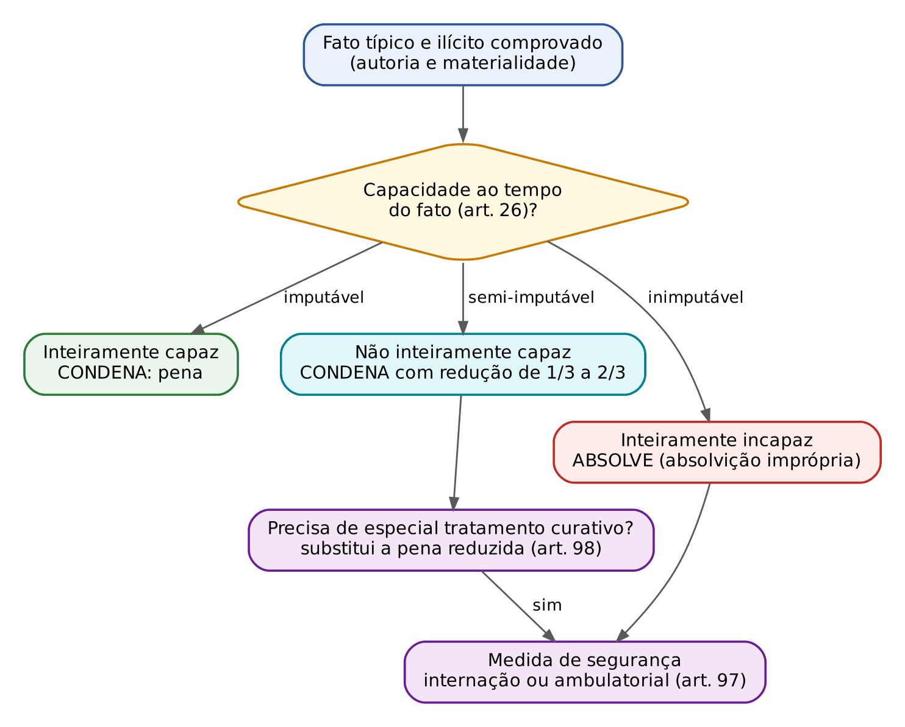
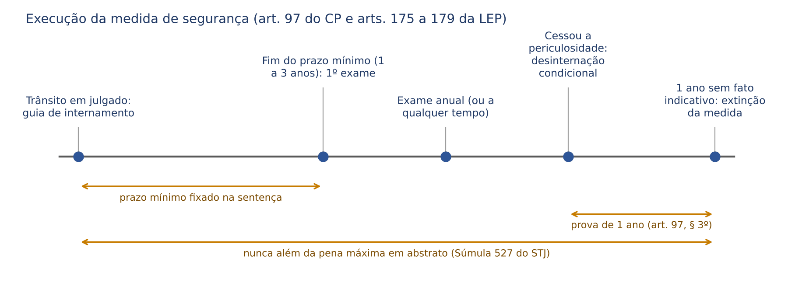

# CAPÍTULO 19 — MEDIDAS DE SEGURANÇA E POLÍTICA ANTIMANICOMIAL

:::INCIDENCIA
Pontos: TRF5 p. 7; TJRS p. 4; TJSC p. 30. Nível B; lote de 3 questões (FGV 3, FCC 0), mais 1 correlata da FCC (Q3954653).
O que mais cai: literalidade do art. 97 do CP (prazo mínimo de 1 a 3 anos, perícia ANUAL, desinternação condicional por 1 ano, conversão do ambulatorial em internação), rito do exame de cessação (arts. 175 a 179 da LEP), Súmula 527 do STJ e flexibilização do art. 97 pela jurisprudência. A política antimanicomial (Resolução CNJ 487/2023) é ponto expresso do TRF5.
:::

## 19.1 Conceito, natureza e fundamento

### 19.1.1 Duas respostas penais, dois fundamentos

O Direito Penal brasileiro tem duas espécies de sanção penal: a pena e a medida de segurança. A pena olha para o PASSADO e se funda na culpabilidade (o agente podia agir de outro modo e é reprovado). A medida de segurança olha para o FUTURO e se funda na periculosidade (a probabilidade de que o agente, por causa de um transtorno mental, volte a praticar fatos previstos como crime). Quem é inteiramente incapaz de entender o caráter ilícito do fato não pode ser reprovado, logo não recebe pena; mas, se revelou perigo, o Estado responde com tratamento compulsório. É essa a lógica: sem culpabilidade não há pena (Cap. 10, 10.1.1), mas pode haver medida de segurança.

Conceito: medida de segurança é a sanção penal de natureza preventiva especial, imposta pelo juiz criminal, no devido processo legal, ao autor de fato típico e ilícito que seja inimputável (ou semi-imputável necessitado de especial tratamento curativo) e perigoso, consistente em internação ou em tratamento ambulatorial, por prazo indeterminado, enquanto durar a periculosidade, dentro dos limites que a jurisprudência fixou (19.5).

Para o civilista: a medida de segurança se parece mais com uma tutela de saúde imposta ao incapaz do que com uma condenação; daí a sentença absolutória IMPRÓPRIA — absolve (falta culpabilidade), mas impõe sanção.

Natureza jurídica: prevalece que é espécie de SANÇÃO PENAL (STF e STJ; Bitencourt, Masson, Greco). Não é "medida administrativa" nem mero tratamento de saúde, e por isso sofre todas as garantias penais: legalidade, anterioridade, devido processo, proporcionalidade e limite temporal. A doutrina crítica (Juarez Cirino dos Santos; Zaffaroni) aponta que a internação funciona, na prática, como prisão, às vezes mais longa que a pena do imputável (19.10).

### 19.1.2 Pena x medida de segurança

| Aspecto | Pena | Medida de segurança |
|---|---|---|
| Fundamento | culpabilidade | periculosidade |
| Finalidade | retributiva e preventiva (geral e especial) | exclusivamente preventiva especial (tratar e neutralizar o perigo) |
| Destinatário | imputável e semi-imputável | inimputável (art. 26, caput) e semi-imputável que precise de especial tratamento curativo (art. 98) |
| Duração | determinada na sentença (quantidade certa) | indeterminada, com prazo MÍNIMO de 1 a 3 anos; máximo pela jurisprudência (Súmula 527 do STJ) |
| Proporcionalidade | com a gravidade do fato e a culpabilidade | com a periculosidade, limitada pela gravidade abstrata do fato |
| Sentença | condenatória | absolutória imprópria (inimputável) ou condenatória com substituição (semi-imputável) |
| Efeitos da condenação | reincidência, maus antecedentes, efeitos extrapenais | NÃO gera reincidência nem maus antecedentes (não há condenação) |
| Benefícios | regime, substituição, *sursis*, livramento | não se aplicam; o "benefício" próprio é a desinternação ou liberação condicional |

### 19.1.3 Legalidade e anterioridade

A medida de segurança submete-se à reserva legal: não há medida de segurança sem lei anterior que defina o fato como crime e preveja a sanção (art. 5º, XXXIX, da CF, lido como "sanção penal"; Q2511469, item I — ver Cap. 2). Dois desdobramentos:

- Só se impõe medida de segurança a quem praticou fato PREVISTO COMO CRIME (ou contravenção). Não existe medida de segurança "pré-delitual" para quem é apenas perigoso, nem para o imputável "perigoso".
- Anterioridade: a redação original do CP de 1940 dizia que a medida de segurança se regia pela lei vigente ao tempo da sentença ou da execução. Esse dispositivo caiu com a Reforma de 1984, e hoje prevalece que a lei nova mais gravosa sobre medida de segurança não retroage, como qualquer lei penal (art. 5º, XL, da CF).

### 19.1.4 Sistemas: duplo binário x vicariante

| Sistema | Como funciona | No Brasil |
|---|---|---|
| Duplo binário (dois trilhos) | o mesmo agente recebia pena E medida de segurança, cumpridas sucessivamente (primeiro a pena; depois, se persistisse o perigo, a medida). Alcançava também imputáveis "perigosos" (reincidentes, habituais) | CP de 1940, até a Reforma de 1984 |
| Vicariante (substituição) | ou pena, ou medida de segurança, NUNCA as duas pelo mesmo fato. O imputável só recebe pena; o inimputável só medida; o semi-imputável recebe pena reduzida OU, se precisar de tratamento, medida em SUBSTITUIÇÃO à pena | Lei 7.209/1984 (atual) |

A abolição do duplo binário afastou a crítica do *bis in idem*: punir duas vezes o mesmo fato, primeiro pela culpa e depois pelo perigo. Por isso hoje o imputável, por mais perigoso que seja, nunca recebe medida de segurança.

:::PEGADINHA Súmula 422 do STF fora de contexto
A Súmula 422 do STF diz que "a absolvição criminal não prejudica a medida de segurança, quando couber, ainda que importe privação da liberdade". Ela nasceu no sistema do duplo binário, quando havia medida de segurança até para absolvidos imputáveis. Lida hoje, só tem sentido para a absolvição IMPRÓPRIA: o inimputável é absolvido e, ainda assim, recebe medida de segurança. Se a absolvição for própria (fato inexistente, negativa de autoria, legítima defesa, atipicidade), NÃO cabe medida alguma, mesmo que o réu seja doente mental.
:::

## 19.2 Pressupostos de aplicação

Três pressupostos cumulativos (TJSC p. 30 os enumera exatamente assim):

1. Prática de fato punível: fato típico e ilícito (injusto penal), com autoria e materialidade provadas. Se houver causa de exclusão da ilicitude, atipicidade (inclusive insignificância), prova insuficiente da autoria ou extinção da punibilidade, NÃO há medida de segurança: o inimputável tem direito à absolvição própria, que é mais favorável. O inimputável pode agir em legítima defesa, ter o fato prescrito ou ser beneficiado por erro de tipo, como qualquer pessoa.
2. Periculosidade do agente: probabilidade de voltar a delinquir em razão do transtorno.
  - Presumida (*juris et de jure* na leitura tradicional) para o inimputável do art. 26, caput: reconhecida a inimputabilidade, o juiz "determinará" a medida (art. 97).
  - Real (a ser demonstrada) para o semi-imputável: só há substituição se ele "necessitar de especial tratamento curativo" (art. 98), o que o juiz afere no caso concreto, com base na perícia.
  - A política antimanicomial e o voto do relator nas ações contra a Resolução CNJ 487/2023 rejeitam a periculosidade presumida como justificativa para internação indeterminada; o tema está em 19.10.
3. Ausência de imputabilidade plena: inimputabilidade (art. 26, caput) ou semi-imputabilidade (art. 26, parágrafo único) por doença mental ou desenvolvimento mental incompleto ou retardado, aferidas pelo critério biopsicológico ao tempo do fato (conceitos e prova no Cap. 10, 10.2).

Quem NÃO recebe medida de segurança, apesar de inimputável ou sem culpabilidade:

- O adolescente (art. 27 do CP): a resposta é a do ECA (Cap. 10, 10.2.4).
- O embriagado por caso fortuito ou força maior com embriaguez completa (art. 28, § 1º): absolvição PRÓPRIA, porque o episódio é transitório e não revela periculosidade (Cap. 10, 10.3).
- Quem age sob coação moral irresistível, erro de proibição inevitável ou outra dirimente que não seja a inimputabilidade.

## 19.3 Espécies e escolha da medida

### 19.3.1 As duas espécies (art. 96)

| Espécie | Natureza | Onde se cumpre |
|---|---|---|
| Internação em hospital de custódia e tratamento psiquiátrico ou, à falta, em outro estabelecimento adequado (art. 96, I) | detentiva | HCTP (arts. 99 a 101 da LEP — Cap. 23, 23.11.2); na falta, estabelecimento com características hospitalares (art. 99 do CP); pela Resolução CNJ 487/2023, leito de saúde mental em hospital geral ou outro equipamento da rede de saúde (19.10) |
| Sujeição a tratamento ambulatorial (art. 96, II) | restritiva | comparecimento aos dias determinados pelo médico (art. 101 da LEP), em HCTP ou outro local com dependência médica adequada; hoje, na rede de atenção psicossocial (CAPS) |

:::LEI Código Penal, arts. 96 e 97
Art. 96. As medidas de segurança são: I - Internação em hospital de custódia e tratamento psiquiátrico ou, à falta, em outro estabelecimento adequado; II - sujeição a tratamento ambulatorial.
Parágrafo único - Extinta a punibilidade, não se impõe medida de segurança nem subsiste a que tenha sido imposta.
Art. 97 - Se o agente for inimputável, o juiz determinará sua internação (art. 26). Se, todavia, o fato previsto como crime for punível com detenção, poderá o juiz submetê-lo a tratamento ambulatorial.
§ 1º - A internação, ou tratamento ambulatorial, será por tempo indeterminado, perdurando enquanto não for averiguada, mediante perícia médica, a cessação de periculosidade. O prazo mínimo deverá ser de 1 (um) a 3 (três) anos.
§ 2º - A perícia médica realizar-se-á ao termo do prazo mínimo fixado e deverá ser repetida de ano em ano, ou a qualquer tempo, se o determinar o juiz da execução.
§ 3º - A desinternação, ou a liberação, será sempre condicional devendo ser restabelecida a situação anterior se o agente, antes do decurso de 1 (um) ano, pratica fato indicativo de persistência de sua periculosidade.
§ 4º - Em qualquer fase do tratamento ambulatorial, poderá o juiz determinar a internação do agente, se essa providência for necessária para fins curativos.
:::

### 19.3.2 A regra literal do art. 97 e a flexibilização jurisprudencial

Pela letra da lei, o critério de escolha é a ESPÉCIE de pena cominada ao fato (Cap. 12, 12.5.1):

- Crime punido com RECLUSÃO: internação obrigatória.
- Crime punido com DETENÇÃO: o juiz escolhe entre internação e tratamento ambulatorial.

A crítica: o critério mede a gravidade abstrata do fato, não a necessidade terapêutica do agente.

:::JURIS STJ, EREsp 998.128/MG, Terceira Seção, j. 27/11/2019 (Info 662)
Na escolha da medida de segurança não se considera a natureza da pena privativa de liberdade cominada, mas a periculosidade do agente, à luz da adequação, da razoabilidade e da proporcionalidade. Mesmo em crime punido com reclusão, o juiz pode aplicar tratamento ambulatorial, se for a medida que melhor se ajusta ao caso.
Por que importa: é a leitura que a banca de magistratura espera. Em prova que pede "segundo o Código Penal", a resposta é a literal (reclusão = internação); em prova que pede "segundo a jurisprudência do STJ", vale a flexibilização. A Resolução CNJ 487/2023 vai além e faz do tratamento ambulatorial a regra (19.10).
:::

:::PEGADINHA "Detenção = ambulatorial obrigatório"
Errado. Na detenção, a lei dá ao juiz uma FACULDADE ("poderá"); a internação continua possível. O que a lei literal torna obrigatório é a internação na reclusão, regra que o STJ relativizou.
:::

### 19.3.3 Local de cumprimento: nunca presídio comum

O internado deve ser recolhido a estabelecimento dotado de características hospitalares e submetido a tratamento (art. 99 do CP). O STJ é firme em que configura constrangimento ilegal manter o inimputável em presídio comum para cumprir medida de segurança, ainda que não haja vaga em hospital de custódia (STJ, HC 381.907, Sexta Turma, j. 14/8/2018): a falta de vaga não pode ser suportada pelo internado. As soluções aceitas são a transferência imediata ou, na impossibilidade, o tratamento ambulatorial até que surja vaga. O raciocínio é o mesmo da Súmula Vinculante 56 para os imputáveis (Cap. 23).

## 19.4 A medida de segurança na sentença

### 19.4.1 Inimputável: absolvição imprópria

O roteiro do incidente de insanidade, o valor do laudo e a redação básica da absolvição imprópria estão no Cap. 10 (10.2.2, boxes PROCESSO e SENTENCA). Aqui interessa o que vem DEPOIS de reconhecida a inimputabilidade: a escolha e a dosagem da medida.

:::SENTENCA Fixação da medida de segurança
Onde entra: no dispositivo da absolvição imprópria (art. 386, VI e parágrafo único, III, do CPP), depois de afastadas as teses de absolvição própria. Não há dosimetria de pena: não se calcula pena-base, agravantes ou causas de aumento.
O que fundamentar: (1) a espécie (internação ou tratamento ambulatorial), com base no laudo e nas condições concretas do réu — não apenas na reclusão ou detenção (EREsp 998.128); (2) o prazo mínimo entre 1 e 3 anos, proporcional à periculosidade e à gravidade do fato; (3) que a duração máxima não ultrapassará a pena máxima cominada ao delito (Súmula 527 do STJ); (4) a detração do tempo de prisão provisória ou de internação provisória (art. 42 do CP).
Redação-modelo: "Aplico ao acusado medida de segurança de tratamento ambulatorial, que se mostra suficiente segundo o laudo de fls., pelo prazo mínimo de 1 (um) ano, ao fim do qual se fará a perícia de cessação da periculosidade (art. 97, §§ 1º e 2º, do CP), observado como limite máximo de duração o máximo da pena abstratamente cominada ao delito (Súmula 527 do STJ) e computado o período de internação provisória (art. 42 do CP)."
Erros que a banca pune: fixar prazo mínimo fora de 1 a 3 anos; "condenar" o inimputável; calcular pena para depois substituí-la (técnica do semi-imputável); deixar de fundamentar a internação quando o laudo indica tratamento ambulatorial; impor internação em grau de recurso exclusivo da defesa (Súmula 525 do STF, abaixo).
:::

Como fixar o prazo mínimo? A lei não dá critérios. A doutrina (Nucci, Masson) recomenda que o juiz considere a gravidade do fato e o grau de periculosidade apontado no laudo: 1 ano é o padrão para casos de menor gravidade e para o tratamento ambulatorial; 3 anos ficam reservados para fatos graves com prognóstico desfavorável. Como qualquer decisão judicial, exige fundamentação: fixar acima de 1 ano sem motivação concreta é ilegal pela mesma lógica que veda a pena acima do mínimo sem fundamento.

:::ATENCAO Prazo mínimo maior que a pena máxima
E se o fato for de pequena gravidade, com pena máxima inferior ao prazo mínimo legal? Exemplo: lesão corporal leve (art. 129, caput: 3 meses a 1 ano de detenção). O prazo mínimo legal é de 1 ano, e o teto da Súmula 527 é também 1 ano. A solução mais coerente com a Súmula 527 e com a proporcionalidade é fixar o prazo mínimo de 1 ano e reconhecer que, decorrido esse ano, a medida se extingue pelo teto, ainda que não tenha cessado a periculosidade (o que pode justificar providências na esfera cível — 19.5.3). Não há precedente vinculante sobre o ponto; trate-o como argumento de proporcionalidade.
:::

### 19.4.2 *Reformatio in pejus* e medida de segurança

:::JURIS STF, Súmula 525
"A medida de segurança não será aplicada em segunda instância, quando só o réu tenha recorrido."
Aplicação atual: se só a defesa apelou, o tribunal não pode impor medida de segurança que a sentença não impôs, nem converter tratamento ambulatorial em internação, nem aumentar o prazo mínimo. É a vedação da *reformatio in pejus* (art. 617 do CPP) aplicada à sanção de segurança. Atenção: a absolvição imprópria é recorrível pela defesa (interesse em obter absolvição própria, sem medida).
:::

:::PROCESSO Internação provisória e prova da inimputabilidade
- Internação provisória (art. 319, VII, do CPP): medida cautelar diversa da prisão, cabível nos crimes praticados com violência ou grave ameaça, quando os peritos concluírem ser o acusado inimputável ou semi-imputável (art. 26 do CP) e houver risco de reiteração. Exige a perícia; não é "prisão preventiva em hospital". O tempo de internação provisória é detraído do prazo mínimo (art. 42 do CP).
- Inimputável preso preventivamente deve ser mantido em estabelecimento de saúde, não em cela comum (mesma lógica de 19.3.3).
- Incidente de insanidade (arts. 149 a 154 do CPP): pressupõe dúvida razoável, suspende o processo e exige exame pericial; não suspende a prescrição (Q3373858 — ver Cap. 22). Detalhes no Cap. 10, 10.2.2.
- Júri: o juiz só absolve sumariamente o inimputável se a inimputabilidade for a ÚNICA tese defensiva (art. 415, parágrafo único, do CPP — Cap. 10).
:::

## 19.5 Duração: prazo mínimo e limite máximo

### 19.5.1 O prazo mínimo e o que ele NÃO é

O prazo mínimo (1 a 3 anos, art. 97, § 1º) não é a duração da medida. É apenas o marco do PRIMEIRO exame de cessação da periculosidade. A medida dura "por tempo indeterminado", enquanto a perícia não atestar que o perigo cessou. Antes do prazo mínimo o exame só é feito por determinação do juiz, a requerimento fundamentado (art. 176 da LEP, 19.6.2).

Detração: computa-se no prazo mínimo o tempo de prisão provisória, de prisão administrativa e de internação em hospital de custódia (art. 42 do CP). Exemplo: réu internado provisoriamente por 8 meses recebe prazo mínimo de 1 ano; o primeiro exame se fará 4 meses depois do início da execução.

### 19.5.2 O limite máximo: a construção jurisprudencial

Lida literalmente, a indeterminação permitiria internação perpétua, vedada pelo art. 5º, XLVII, "b", da CF. Daí dois limites jurisprudenciais:

| Corte | Tese | Fundamento |
|---|---|---|
| STF | a medida de segurança não pode ultrapassar o limite máximo de cumprimento das penas do art. 75 do CP — 30 anos na redação antiga (HC 84.219/SP, Primeira Turma, j. 16/8/2005); 40 anos desde a Lei 13.964/2019 | vedação de penas de caráter perpétuo; isonomia com o imputável |
| STJ | Súmula 527: "O tempo de duração da medida de segurança não deve ultrapassar o limite máximo da pena abstratamente cominada ao delito praticado." | proporcionalidade e isonomia: o inimputável não pode ficar mais tempo sob sanção do que ficaria o imputável na pior das hipóteses |

Na prova, quando a pergunta é sobre o entendimento do STJ (ou não especifica), responda com a Súmula 527. O limite do STF é um teto geral; o do STJ é mais favorável e específico para cada crime, e é o que se aplica na prática forense.

:::JURIS STJ, EDcl no HC 894.787/SP, Sexta Turma, j. 6/5/2025
A Súmula 527 aplica-se também à medida de segurança imposta em sentença absolutória imprópria: atingido o máximo da pena abstrata, a medida se extingue, ainda que não tenha cessado a periculosidade. No julgamento originário (fevereiro de 2025), a Turma havia afastado a súmula para a absolvição imprópria; nos embargos, reconheceu a contradição, deu-lhes efeitos infringentes e restabeleceu a extinção da medida (tratamento ambulatorial imposto por roubo circunstanciado, que já superava o máximo cominado).
Armadilha provável: alternativa dizendo que a medida decorrente de absolvição imprópria "perdura enquanto não cessar a periculosidade, sem limite" — está ERRADA.
:::

:::EXEMPLO Calculando o teto da medida de segurança
Caso 1. A, inimputável, praticou homicídio simples (art. 121, caput: 6 a 20 anos). Teto da medida (Súmula 527): 20 anos. Se ficou 7 meses internado provisoriamente, esse tempo também conta para o teto (art. 42): restam 19 anos e 5 meses de duração máxima.
Caso 2. B, inimputável, praticou ameaça (art. 147, caput: detenção de 1 a 6 meses, ou multa). Teto: 6 meses, inferior ao prazo mínimo legal de 1 ano (ver ATENCAO em 19.4.1).
Atenção a alterações legislativas de pena: para fatos posteriores à Lei 14.994/2024 ou à Lei 15.397/2026, confira a pena cominada vigente na data do fato (Caps. 27 a 29), porque o teto da medida acompanha a pena máxima ABSTRATA do crime, e a lei mais grave não retroage.
:::

### 19.5.3 Esgotado o teto e persistindo o perigo

Atingido o limite, o juiz da execução declara extinta a medida. Se o agente ainda precisa de cuidado, a resposta passa à esfera sanitária e civil: tratamento na rede pública, eventual internação involuntária (Lei 10.216/2001, arts. 6º e 8º, com comunicação ao Ministério Público) e, se for o caso, curatela (arts. 1.767 e seguintes do CC, com os limites do Estatuto da Pessoa com Deficiência). O que NÃO se admite é manter a medida "até a cura".

## 19.6 Execução da medida de segurança

### 19.6.1 Início: guia de internamento ou de tratamento

A execução só começa com o trânsito em julgado e a expedição da guia (arts. 171 a 173 da LEP); ninguém será internado em hospital de custódia ou submetido a tratamento ambulatorial para cumprimento de medida de segurança sem guia expedida pela autoridade judiciária (art. 172). Antes disso, só a internação provisória cautelar (19.4.2). Aplicam-se, no que couber, os exames de classificação dos arts. 8º e 9º da LEP (art. 174).

### 19.6.2 Exame de verificação da cessação da periculosidade

A perícia é realizada: (a) ao termo do prazo mínimo; (b) depois, de ANO EM ANO; (c) a qualquer tempo, se o juiz da execução determinar (art. 97, § 2º, do CP). O art. 176 da LEP acrescenta que, mesmo no curso do prazo mínimo, o juiz pode ordenar o exame diante de requerimento fundamentado do Ministério Público ou do interessado, seu procurador ou defensor.

:::PASSO Rito do exame de cessação (art. 175 da LEP)
1. A AUTORIDADE ADMINISTRATIVA (direção do estabelecimento), até 1 MÊS antes de expirar o prazo mínimo, remete ao juiz minucioso relatório que o habilite a resolver sobre a revogação ou permanência da medida (inciso I).
2. O relatório é instruído com o LAUDO PSIQUIÁTRICO (inciso II).
3. Juntado o relatório ou realizadas as diligências, são ouvidos, SUCESSIVAMENTE, o Ministério Público e o curador ou defensor, no prazo de 3 DIAS para cada um (inciso III).
4. O juiz nomeia curador ou defensor ao agente que não o tiver (inciso IV).
5. O juiz, de ofício ou a requerimento de qualquer das partes, pode determinar novas diligências, AINDA QUE expirado o prazo mínimo (inciso V).
6. Ouvidas as partes ou realizadas as diligências, o juiz decide em 5 DIAS (inciso VI).
7. Nos exames sucessivos (anuais), segue-se o mesmo rito no que couber (art. 177).
8. Transitada em julgado a decisão, o juiz expede a ordem de desinternação ou liberação (art. 179) — exceção relevante à regra de que o agravo em execução não tem efeito suspensivo (art. 197 da LEP): a desinternação depende do trânsito.
:::

:::QUESTAO FGV 2024 — TJ-SC — Analista Jurídico (Q2515320)
Mãe de João, absolvido impropriamente por homicídio, quer saber quando ele será liberado, seis meses após o trânsito. Gabarito: A — em qualquer tempo, ainda no decorrer do prazo mínimo, o juiz pode ordenar o exame de cessação, diante de requerimento fundamentado do MP ou do interessado, seu procurador ou defensor (art. 176 da LEP).
Armadilhas: (B) e (C) atribuem o relatório à Defensoria ou ao advogado, quando é da AUTORIDADE ADMINISTRATIVA (art. 175, I); (B) ainda troca a oitiva sucessiva de MP e defesa em 3 dias por "MP em 5 dias"; (D) diz que novas diligências não cabem depois de expirado o prazo mínimo — a lei diz o contrário ("ainda que expirado", art. 175, V); (E) troca o prazo de decisão de 5 por 10 dias (art. 175, VI).
:::

### 19.6.3 Desinternação e liberação condicionais

Cessada a periculosidade, o internado é DESINTERNADO e o submetido a tratamento ambulatorial é LIBERADO. Ambas são SEMPRE condicionais (art. 97, § 3º): durante 1 ano, o agente fica sujeito às condições do livramento condicional (arts. 132 e 133 da LEP, por força do art. 178 — ex.: obter ocupação lícita, comunicar o endereço, não mudar de comarca sem autorização). Se, antes de decorrido 1 ano, praticar "fato indicativo de persistência de sua periculosidade", restabelece-se a situação anterior.

Dois detalhes cobrados:

- "Fato indicativo de periculosidade" NÃO precisa ser crime: basta conduta que revele a persistência do perigo (abandono do tratamento seguido de agressividade, por exemplo). É diferente da revogação do livramento condicional, que exige condenação (Cap. 24).
- Decorrido 1 ano sem esse fato, o juiz declara extinta a medida de segurança.

:::QUESTAO FGV 2025 — PC-MG — Delegado de Polícia Substituto (Q3171402)
Carlos, absolvido impropriamente por crime contra a dignidade sexual; três afirmações sobre a disciplina do CP. Gabarito: C — corretas a I (tempo indeterminado, até a perícia atestar a cessação; prazo mínimo de 1 a 3 anos) e a III (desinternação ou liberação sempre condicional; restabelece-se a situação anterior se, antes de 1 ano, praticar fato indicativo de persistência da periculosidade).
Armadilha: a II troca "de ano em ano" por "semestralmente". Grave: a perícia é ANUAL (art. 97, § 2º).
:::

### 19.6.4 Conversões entre as espécies

| Conversão | Base | Requisito | Detalhe |
|---|---|---|---|
| Tratamento ambulatorial → internação | art. 97, § 4º, do CP; art. 184 da LEP | necessidade para fins curativos (CP) ou incompatibilidade do agente com a medida (LEP) | "em qualquer fase" do tratamento; prazo mínimo da internação: 1 ano (art. 184, parágrafo único) |
| Internação → tratamento ambulatorial (desinternação progressiva) | sem previsão expressa na lei; admitida pela jurisprudência e determinada como diretriz pela Resolução CNJ 487/2023 e pela Lei 10.216/2001 (alta planejada, art. 5º) | melhora clínica que, sem atestar a cessação total da periculosidade, permita cuidado em meio aberto | é o instrumento de transição para o tratamento em liberdade |

:::QUESTAO FGV 2024 — TJ-AP — Analista Judiciário (Q2442329)
Jonas, por doença mental inteiramente incapaz, causou lesão leve em consumidora e recebeu medida de segurança. Gabarito: E — em qualquer fase do tratamento ambulatorial, o juiz pode determinar a internação, se necessária para fins curativos (art. 97, § 4º).
Armadilhas: (A) prazo mínimo "de dois anos" (é de 1 a 3); (B) prova da desinternação "de dois anos" (é de 1 ano); (C) extinta a punibilidade, NÃO subsiste nem o tratamento ambulatorial (art. 96, parágrafo único); (D) perícia "de três em três meses" (é anual).
:::

## 19.7 Semi-imputável: a medida de segurança substitutiva

:::LEI Código Penal, art. 98
Art. 98 - Na hipótese do parágrafo único do art. 26 deste Código e necessitando o condenado de especial tratamento curativo, a pena privativa de liberdade pode ser substituída pela internação, ou tratamento ambulatorial, pelo prazo mínimo de 1 (um) a 3 (três) anos, nos termos do artigo anterior e respectivos §§ 1º a 4º.
:::

O semi-imputável é CONDENADO (Cap. 10, 10.2.3). A ordem das operações é rígida: primeiro o juiz faz a dosimetria completa, com a redução de 1/3 a 2/3 na terceira fase (Cap. 15); só depois, se a perícia indicar necessidade de especial tratamento curativo, SUBSTITUI a pena privativa de liberdade já reduzida pela medida de segurança. É o sistema vicariante em ação: pena reduzida OU medida, nunca as duas.

:::EXEMPLO Semi-imputável com substituição
C, com transtorno que lhe reduz a autodeterminação, pratica estelionato (art. 171, caput: 1 a 5 anos). O laudo atesta semi-imputabilidade e recomenda acompanhamento psiquiátrico contínuo.
Passo 1 — pena-base: duas circunstâncias judiciais negativas; intervalo de 4 anos (48 meses); 1/8 do intervalo = 6 meses por circunstância; 2 × 6 = 12 meses; pena-base = 2 anos (critério de 1/8 do intervalo — Cap. 13).
Passo 2 — segunda fase: sem agravantes ou atenuantes; 2 anos.
Passo 3 — terceira fase: redução de 1/3 pela semi-imputabilidade (comprometimento leve indicado no laudo); 24 meses ÷ 3 = 8 meses; 24 − 8 = 16 meses = 1 ano e 4 meses.
Passo 4 — substituição (art. 98): em vez de regime e restritivas, o juiz substitui a pena de 1 ano e 4 meses por tratamento ambulatorial, com prazo mínimo de 1 ano.
Passo 5 — limite: a medida substitutiva não deve durar mais que 1 ano e 4 meses na posição que toma a pena concreta como teto; na leitura literal da Súmula 527, o teto seria a pena máxima abstrata (5 anos). Ver o quadro abaixo.
:::

Pontos de atenção na substituição:

- Faculdade vinculada à perícia: o "pode" do art. 98 depende da comprovação da necessidade de tratamento; sem ela, cumpre-se a pena reduzida.
- Se a pena reduzida admite restritivas (art. 44) ou *sursis*, o juiz escolhe a resposta mais adequada; a medida, por ser indeterminada, pode ser mais gravosa.
- Duração da medida substitutiva: a lei remete ao art. 97 (prazo indeterminado), mas, havendo pena CONCRETA, forte corrente (Bitencourt) a limita à pena aplicada e substituída, por coerência com o art. 183 da LEP (19.8); outros aplicam a Súmula 527 (máximo abstrato). Não há súmula específica.

| Situação | Sentença | Duração máxima da medida |
|---|---|---|
| Inimputável (art. 26, caput) | absolvição imprópria (art. 386, parágrafo único, III, do CPP) | máximo da pena abstrata (Súmula 527 do STJ) |
| Semi-imputável com substituição (art. 98) | condenatória, com pena reduzida e substituída | controvertida: pena concreta substituída (corrente favorável) ou máximo abstrato |
| Doença mental superveniente (art. 183 da LEP) | condenatória já transitada; conversão na execução | restante da pena concretamente imposta (STJ, HC 373.405) |

## 19.8 Superveniência de doença mental

Se a doença mental surge DEPOIS do fato, a culpabilidade do momento do crime não se altera (Cap. 10, 10.2.1). O que muda depende do momento e da duração do quadro:

| Momento | Consequência | Base |
|---|---|---|
| Durante o processo | suspensão do processo até o restabelecimento do acusado; pode haver internação em estabelecimento adequado | art. 152 do CPP |
| Durante a execução, quadro TRANSITÓRIO | transferência para HCTP ou estabelecimento adequado; o tempo de internação conta como pena cumprida (detração, art. 42) e, recuperado, o condenado volta ao estabelecimento penal | art. 41 do CP; art. 108 da LEP |
| Durante a execução, quadro DURADOURO | conversão (substituição) da pena privativa de liberdade em medida de segurança, pelo juiz, de ofício ou a requerimento do MP, da Defensoria ou da autoridade administrativa | art. 183 da LEP (redação da Lei 12.313/2010) |
| Na execução da multa | suspensão da execução da multa | art. 52 do CP (Cap. 12) |

:::JURIS STJ, HC 373.405/SP, Sexta Turma, j. 6/10/2016
A medida de segurança resultante da conversão do art. 183 da LEP fica limitada ao tempo restante da pena concretamente imposta, e não à pena máxima abstrata: a conversão não pode ampliar a restrição de liberdade definida na condenação transitada em julgado, sob pena de violar a coisa julgada.
:::

:::EXEMPLO Conversão do art. 183 da LEP
D foi condenado a 9 anos de reclusão. Depois de cumprir 4 anos e 3 meses, desenvolve quadro psicótico duradouro, e o juiz converte a pena em internação.
Conta: 9 anos − 4 anos e 3 meses = 4 anos e 9 meses. Esse é o teto da medida de segurança convertida (HC 373.405). Se, ao fim de 4 anos e 9 meses, a periculosidade não tiver cessado, a medida penal se extingue e o cuidado segue pela via sanitária e civil (19.5.3).
Pegadinha: aplicar o teto da Súmula 527 (pena máxima abstrata do crime) à conversão do art. 183. A súmula não serve aqui, porque já há pena concreta.
:::

:::DICA Art. 41 do CP x art. 183 da LEP
Transferência (art. 41) é logística: o condenado continua cumprindo PENA, só que em hospital. Conversão (art. 183) muda a natureza da sanção: passa a ser MEDIDA DE SEGURANÇA, com perícias e desinternação condicional.
:::

## 19.9 Extinção da punibilidade e prescrição da medida de segurança

Regra de ouro (art. 96, parágrafo único): extinta a punibilidade, não se impõe medida de segurança nem subsiste a que tenha sido imposta. As causas do art. 107 (morte, *abolitio criminis*, anistia, prescrição etc. — Caps. 21 e 22) atingem a medida de segurança como atingem a pena. Se a prescrição ocorreu antes da sentença, o juiz declara extinta a punibilidade e NÃO aplica medida, ainda que o réu seja perigoso.

:::JURIS STF, Tema 371 da repercussão geral (RE 628.658)
É legítima a concessão de indulto (art. 84, XII, da CF) a pessoa submetida a medida de segurança, inimputável ou semi-imputável, ainda que a medida seja detentiva. Os decretos natalinos costumam prever indulto para internados que cumpriram tempo equivalente ao máximo da pena cominada ou a determinada fração dela (os requisitos variam a cada decreto — Cap. 21).
:::

Prescrição. A medida de segurança prescreve (STJ, RHC 39.920/RJ, Quinta Turma, j. 6/2/2014, Info 535; AgRg no REsp 1.667.508, Sexta Turma, j. 10/4/2018). Como regular o prazo se o inimputável não tem pena concreta?

| Agente | Prescrição da pretensão punitiva | Prescrição da pretensão executória |
|---|---|---|
| Inimputável (absolvição imprópria) | pelo máximo da pena abstrata (art. 109) | também pelo máximo da pena ABSTRATA, porque não há pena concreta (posição do STJ nos julgados acima) |
| Semi-imputável (condenado, pena substituída) | pelo máximo abstrato antes da sentença; depois, pela pena concreta (art. 110) | pela pena concretamente aplicada e substituída |

:::EXEMPLO Prescrição da medida de segurança
E, inimputável, praticou lesão corporal leve (pena máxima de 1 ano). Pelo art. 109, V, pena máxima igual a 1 ano prescreve em 4 anos. Se entre o recebimento da denúncia e a sentença decorreram mais de 4 anos, extingue-se a punibilidade e não se aplica medida de segurança.
Detalhe: a sentença absolutória imprópria NÃO consta como marco interruptivo (o art. 117, IV, fala em sentença ou acórdão CONDENATÓRIOS), e prevalece que ela não interrompe a prescrição; a sentença que substitui a pena do semi-imputável, por ser condenatória, interrompe. Ver o regime geral dos marcos no Cap. 22.
:::

:::PEGADINHA Incidente de insanidade e prescrição
O incidente suspende o PROCESSO (art. 149, § 2º, do CPP), mas NÃO a prescrição, que não está entre as causas do art. 116 do CP (Q3373858, alternativa E, errada — Cap. 22).
:::

## 19.10 Política antimanicomial e desinstitucionalização

### 19.10.1 Por que o tema entrou nos editais

Os hospitais de custódia funcionaram por décadas como prisões sem prazo, com internações longas por fatos leves e laudos de periculosidade renovados burocraticamente. A reação veio em três camadas normativas:

| Camada | Norma | Ideia central |
|---|---|---|
| Internacional | Convenção sobre os Direitos das Pessoas com Deficiência (Decreto 6.949/2009), aprovada pelo rito do art. 5º, § 3º, da CF, com status de emenda constitucional; caso Ximenes Lopes vs. Brasil (Corte Interamericana, sentença de 4/7/2006) | a deficiência, inclusive psicossocial, não justifica por si a privação de liberdade (art. 14 da Convenção); o caso Ximenes Lopes, primeira condenação do Brasil na Corte, tratou da morte de paciente em clínica psiquiátrica conveniada ao SUS (Sobral/CE, 1999) |
| Legal | Lei 10.216/2001 (Reforma Psiquiátrica) e Lei 13.146/2015 (Estatuto da Pessoa com Deficiência) | tratamento preferencialmente em serviços comunitários; internação só quando os recursos extra-hospitalares forem insuficientes; vedação de instituições asilares |
| Judicial-administrativa | Resolução CNJ 487/2023 (Política Antimanicomial do Poder Judiciário), alterada pela Resolução CNJ 572/2024 | aplicar a Convenção e a Lei 10.216 ao processo penal e à execução das medidas de segurança; fechamento progressivo dos HCTPs |

### 19.10.2 Lei 10.216/2001: o que cai

- Direitos da pessoa com transtorno mental (art. 2º, parágrafo único), entre eles: acesso ao melhor tratamento do sistema de saúde; tratamento com humanidade e respeito, no interesse exclusivo de beneficiar sua saúde, visando à reinserção na família, no trabalho e na comunidade; proteção contra abuso e exploração; sigilo; presença médica, a qualquer tempo, para esclarecer a necessidade de hospitalização involuntária; livre acesso aos meios de comunicação; informação sobre a doença e o tratamento; tratamento pelos meios menos invasivos possíveis; tratamento preferencialmente em serviços comunitários de saúde mental.
- Internação como exceção: "em qualquer de suas modalidades, só será indicada quando os recursos extra-hospitalares se mostrarem insuficientes" (art. 4º), com a finalidade permanente de reinserção social (§ 1º).
- Vedação de internação em instituições com características ASILARES, isto é, desprovidas de assistência integral (médica, psicológica, ocupacional, de lazer etc.) e que não assegurem os direitos do art. 2º (art. 4º, § 3º).
- Três modalidades de internação psiquiátrica (art. 6º, parágrafo único): voluntária (com consentimento), involuntária (sem consentimento, a pedido de terceiro, comunicada ao Ministério Público em 72 horas — art. 8º, § 1º) e COMPULSÓRIA (determinada pela Justiça — art. 9º). A medida de segurança de internação é a forma penal da internação compulsória.
- Alta planejada e reabilitação psicossocial assistida para o paciente há longo tempo hospitalizado ou com grave dependência institucional (art. 5º): é a base legal da desinternação progressiva.

:::PEGADINHA A Lei 10.216 não revogou o art. 97 do CP
A lei não fala em medida de segurança e não revogou os arts. 96 a 99 do CP. O que ela faz, segundo a leitura que prevalece e que fundamenta a Resolução 487, é condicionar a INTERPRETAÇÃO desses artigos: a internação continua existindo, mas como exceção terapêutica, e não como resposta automática à reclusão. Alternativa que afirme "a Lei 10.216 extinguiu a medida de segurança de internação" está errada; também está errada a que diga que, "de acordo com a lei antimanicomial, o agente será internado em hospital de custódia" (Q3401935, alternativa C).
:::

### 19.10.3 Resolução CNJ 487/2023

Editada em 15/2/2023, institui a Política Antimanicomial do Poder Judiciário. Suas diretrizes principais, que vinculam juízes criminais e da execução:

- Desde a audiência de custódia: identificar indícios de transtorno mental e articular o encaminhamento voluntário à Rede de Atenção Psicossocial (RAPS), com preferência por medidas cautelares diversas da prisão.
- Incidente de insanidade: perícia acompanhada de avaliação biopsicossocial, com quesitos voltados ao tratamento, e não só à periculosidade.
- Medida de segurança: PREFERÊNCIA pelo tratamento ambulatorial em meio aberto, na RAPS (CAPS), com projeto terapêutico singular (PTS) elaborado pela equipe de saúde; internação apenas excepcional, quando indicada por avaliação clínica, pelo menor tempo possível, em leito de saúde mental de hospital geral ou outro equipamento de saúde referenciado pelo CAPS — e não em HCTP ou instituição de característica asilar.
- Equipe de avaliação e acompanhamento (EAP) e comitês estaduais interinstitucionais, que fazem a ponte entre o Judiciário e a rede de saúde.
- Revisão dos casos de pessoas internadas, para desinternação progressiva e alta planejada.
- Interdição e fechamento dos HCTPs: na redação original, interdição parcial (proibição de novas internações) em 6 meses e interdição total com fechamento em 12 meses, contados da entrada em vigor (art. 18). A Resolução CNJ 572/2024 ampliou os prazos para 9 e 15 meses (limites em maio e novembro de 2025) e criou a possibilidade de prorrogação a pedido do tribunal, mediante plano de ação (art. 18-A).

### 19.10.4 Controle de constitucionalidade e estado atual

A resolução é impugnada no STF nas ADIs 7.389, 7.454 e 7.566 e na ADPF 1.076 (propostas por partidos políticos, pela Associação Brasileira de Psiquiatria e pela CONAMP), julgadas em conjunto sob a relatoria do Ministro Edson Fachin. As ações sustentam que o CNJ invadiu a competência legislativa da União (art. 22, I, da CF) e esvaziou o art. 96, I, do CP.

No Plenário Virtual (sessão iniciada em junho de 2025), o relator votou pela improcedência integral: o CNJ apenas regulamentou o CP, a Lei 10.216 e a Convenção, sem revogar o art. 96, I; a internação continua possível como exceção, quando indispensável e indicada por equipe de saúde, por período breve, preferencialmente em hospital geral; avaliações fundadas apenas em periculosidade não legitimam internações indeterminadas; entes federados podem demonstrar ao CNJ que determinado estabelecimento não é asilar. O Ministro Luís Roberto Barroso acompanhou, e o Ministro Flávio Dino pediu vista em 21/7/2025. Até o fechamento deste capítulo não foi localizada a conclusão do julgamento (ver nota).

Paralelamente, em mandado de segurança do Ministério Público de Minas Gerais, o Ministro Flávio Dino deferiu liminar (3/6/2026) para permitir a continuidade das admissões em unidades psiquiátricas de custódia de Minas Gerais até que a RAPS comprove capacidade de absorver a demanda, decisão referendada pela Primeira Turma.

## 19.11 Direitos do internado

O internado é sujeito de direitos, não objeto de custódia. Os principais:

- Todos os direitos não atingidos pela sentença (art. 3º da LEP) e, no que couber, os direitos do preso (art. 41), por remissão expressa do art. 42 da LEP.
- Estabelecimento hospitalar e exame psiquiátrico obrigatório (art. 99 do CP; art. 100 da LEP); nunca presídio comum (19.3.3).
- Médico de confiança: é garantida a liberdade de contratar médico de confiança pessoal do internado ou do submetido a tratamento ambulatorial, por seus familiares ou dependentes, para orientar e acompanhar o tratamento; as divergências entre o médico oficial e o particular são resolvidas pelo juiz da execução (art. 43 da LEP).
- Não sujeição ao regime disciplinar da LEP: estão sujeitos à disciplina o condenado e o preso provisório (art. 44, parágrafo único), não o internado — a resposta a condutas agressivas é terapêutica.
- Direitos da Lei 10.216/2001 (19.10.2) e da Resolução CNJ 487/2023.

:::QUESTAO FCC 2026 — DPE-MT — Defensor Público (Q3954653)
Questão de direitos e deveres na LEP (atribuída ao Cap. 23). Gabarito: C — a pessoa sob medida de segurança pode contratar médico de confiança para orientar e acompanhar o tratamento, e a divergência com o médico oficial é resolvida pelo juiz da execução (art. 43 da LEP).
Armadilha relacionada ao tema: a alternativa B afirma que os direitos do art. 41 valem para condenados e internados, e que os do preso provisório estariam no CP; o art. 42 da LEP estende esses direitos, no que couber, ao provisório E ao internado. As demais alternativas (visitas, higiene, pecúlio) são do Cap. 23.
:::

## 19.12 Resumo para revisão pré-prova

| Instituto | Regra | Exceções e detalhes | Fundamento |
|---|---|---|---|
| Natureza | sanção penal preventiva especial; fundamento na periculosidade | não gera reincidência nem maus antecedentes | arts. 96 a 99 do CP |
| Legalidade | reserva legal e anterioridade | sem medida pré-delitual; lei mais grave não retroage | art. 5º, XXXIX e XL, da CF |
| Sistema | vicariante: pena OU medida | duplo binário abolido em 1984 | Lei 7.209/1984; art. 98 |
| Pressupostos | fato típico e ilícito + periculosidade + inimputabilidade ou semi-imputabilidade | absolvição própria prevalece; adolescente e embriaguez fortuita não recebem medida | arts. 26, 27, 28, § 1º |
| Espécies | internação (reclusão: obrigatória pela lei) ou ambulatorial (faculdade na detenção) | STJ: escolha pela periculosidade, mesmo na reclusão; Resolução 487: ambulatorial como regra | art. 97; EREsp 998.128 |
| Local | estabelecimento hospitalar | presídio comum: constrangimento ilegal, mesmo sem vaga | art. 99; HC 381.907 |
| Sentença | absolvição imprópria com medida | sem dosimetria; fundamentar espécie e prazo mínimo | art. 386, VI e p.u., III, do CPP |
| Recurso só da defesa | tribunal não aplica medida | vedada a *reformatio in pejus* | Súmula 525 do STF |
| Prazo mínimo | 1 a 3 anos; marco do 1º exame | detração (art. 42) | art. 97, § 1º |
| Duração máxima | pena máxima abstrata do crime | STF: limite do art. 75 (40 anos); vale também na absolvição imprópria | Súmula 527 do STJ; EDcl HC 894.787 |
| Perícia | ao fim do prazo mínimo e de ANO EM ANO | a qualquer tempo, por ordem do juiz; antes do mínimo, a requerimento fundamentado | art. 97, § 2º; art. 176 da LEP |
| Rito do exame | relatório da autoridade administrativa 1 mês antes, com laudo; MP e defesa 3 dias cada; decisão em 5 dias | diligências mesmo após o prazo mínimo; desinternação após trânsito | arts. 175 a 179 da LEP |
| Desinternação ou liberação | sempre condicional, por 1 ano | volta se praticar fato indicativo de periculosidade (não precisa ser crime) | art. 97, § 3º; art. 178 da LEP |
| Ambulatorial → internação | a qualquer fase, para fins curativos ou por incompatibilidade | prazo mínimo de 1 ano | art. 97, § 4º; art. 184 da LEP |
| Semi-imputável | pena reduzida (1/3 a 2/3) e, se precisar de tratamento, substituída por medida | duração: controvertida (pena concreta x máximo abstrato) | art. 26, p.u.; art. 98 |
| Doença superveniente | transitória: transferência (conta como pena); duradoura: conversão | conversão limitada ao restante da pena | art. 41; arts. 108 e 183 da LEP; HC 373.405 |
| Extinção da punibilidade | não se impõe nem subsiste medida | indulto alcança medida de segurança | art. 96, p.u.; Tema 371 do STF |
| Prescrição | inimputável: máximo abstrato (PPP e PPE); semi-imputável: pena concreta após a sentença | absolutória imprópria não interrompe; incidente de insanidade não suspende | arts. 109, 110, 116 e 117; RHC 39.920 |
| Lei 10.216/2001 | internação só se insuficientes os recursos extra-hospitalares | vedadas instituições asilares; internação compulsória pelo juiz | arts. 2º, 4º, 6º e 9º |
| Resolução CNJ 487/2023 | ambulatorial na RAPS, PTS, internação excepcional em leito de saúde; fechamento dos HCTPs | prazos de 9 e 15 meses (Res. 572/2024), prorrogáveis; ADIs 7.389, 7.454, 7.566 e ADPF 1.076 pendentes | Resolução CNJ 487/2023 |
| Direitos do internado | direitos do preso no que couber; médico de confiança | divergência médica resolvida pelo juiz; sem regime disciplinar | arts. 3º, 42, 43 e 44 da LEP |

## 19.13 Artigos de lei incidentes

- Constituição Federal: art. 5º, XXXIX, XL e XLVII, "b"; art. 5º, § 3º; art. 84, XII.
- Código Penal: arts. 26, 27, 28, § 1º, 41, 42, 52, 75, 96 a 99, 107, 109, 110, 116 e 117.
- Código de Processo Penal: arts. 149 a 154, 319, VII, 386, VI e parágrafo único, III, 415, parágrafo único, e 617.
- Lei 7.210/1984 (LEP): arts. 3º, 41 a 44, 99 a 101, 108, 132, 133, 171 a 179, 183, 184 e 197.
- Lei 10.216/2001: arts. 2º, 4º, 5º, 6º, 8º e 9º.
- Lei 13.146/2015 (Estatuto da Pessoa com Deficiência) e Convenção sobre os Direitos das Pessoas com Deficiência (Decreto 6.949/2009), art. 14.
- Resolução CNJ 487/2023 (art. 18 e art. 18-A, este incluído pela Resolução CNJ 572/2024).

## 19.14 Julgados, temas e súmulas do capítulo

- Súmula 527 do STJ — duração máxima da medida de segurança: pena máxima abstrata do delito.
- Súmula 422 do STF — absolvição não prejudica a medida de segurança (hoje: só na absolvição imprópria).
- Súmula 525 do STF — medida de segurança não se aplica em segunda instância em recurso exclusivo da defesa.
- STJ, EREsp 998.128/MG (Info 662) — escolha da espécie pela periculosidade, não pela reclusão ou detenção.
- STJ, EDcl no HC 894.787/SP (2025) — Súmula 527 vale para a absolvição imprópria.
- STJ, HC 373.405/SP — conversão do art. 183 da LEP limitada ao restante da pena concreta.
- STJ, HC 381.907 — inimputável em presídio comum é constrangimento ilegal, mesmo sem vaga.
- STJ, RHC 39.920/RJ (Info 535) e AgRg no REsp 1.667.508 — prescrição da medida de segurança pelo máximo abstrato.
- STF, HC 84.219/SP — medida de segurança limitada ao teto do art. 75 do CP.
- STF, Tema 371 (RE 628.658) — indulto alcança medida de segurança.
- STF, ADIs 7.389, 7.454 e 7.566 e ADPF 1.076 (pendentes) — constitucionalidade da Resolução CNJ 487/2023.
- Corte IDH, caso Ximenes Lopes vs. Brasil (2006) — primeira condenação do Brasil; saúde mental.

Remissões a outros capítulos: inimputabilidade, semi-imputabilidade, incidente de insanidade e STJ REsp 1.802.845 (Cap. 10); legalidade e Q2511469 (Cap. 2); autoria mediata e acessoriedade (Cap. 11); detração e Tema 1.155 do STJ (Cap. 17); Súmula Vinculante 56 e estabelecimentos penais (Cap. 23); marcos e causas suspensivas da prescrição (Cap. 22); indulto em geral (Cap. 21).

:::NOTA Notas de verificação
Questões: as 3 do lote (Q3171402, Q2442329, Q2515320) e a correlata Q3954653 (FCC) com gabarito oficial do arquivo local, todos coincidentes com a resolução fundamentada. O mapeamento FGV de magistratura (176 questões) não registra questão do tema.
Conferidos no Planalto em 15/10/2026: boxes LEI dos arts. 96 a 98 do CP (redação idêntica à vigente); arts. 175 a 179 e 183 da LEP (rito do exame de cessação, prazos de 1 mês, 3 dias e 5 dias, legitimados do art. 183); arts. 4º, 5º, 6º, 8º, § 1º, e 9º da Lei 10.216/2001 (paráfrases fiéis). No CP e na LEP compilados não há alteração de 2024 a 2026 nos arts. 96 a 99 do CP nem nos arts. 171 a 184 da LEP.
Resolução CNJ 487/2023: o texto oficial não pôde ser aberto (acesso bloqueado); prazos de 6/12 meses e 9/15 meses (Resolução 572/2024) e o art. 18-A foram conferidos em fonte jornalística (O Fator, 9/6/2026); conferir numeração dos artigos e a data de vigência. Julgamento das ADIs 7.389, 7.454, 7.566 e ADPF 1.076: confirmado até o pedido de vista de Dino (21/7/2025; Conjur e Migalhas); não localizei a conclusão — verificar antes da prova. Mandado de segurança do MPMG: liminar de 3/6/2026 e referendo pela Primeira Turma segundo Conjur (4/8/2026), que o identifica como MS 40.940 (número não conferido no portal do STF).
Julgados conferidos na Sinopse TJSC 2026 (Drive): EDcl no HC 894.787, HC 373.405, EREsp 998.128, HC 381.907, RHC 39.920, AgRg no REsp 1.667.508. De memória, a conferir: STF HC 84.219/SP (data 16/8/2005) e Tema 371 do STF (RE 628.658); tese de que a sentença absolutória imprópria não interrompe a prescrição (prevalente, sem precedente citado); duração da medida substitutiva do art. 98 (controvérsia; não indiquei julgado específico); caso Ximenes Lopes (sentença de 4/7/2006).
Fontes do Drive lidas: Mapeamento FGV; Sinopse TJSC 2026 (trecho do tema); IURIS Execução Penal vol. 9 (trechos de HCTP e conceito). O IURIS Parte Geral vol. 5 e o CP Coordenado 2026 chegaram truncados pelo conector, antes do Título VI, e não foram aproveitados; o Bitencourt vol. 1 não foi lido (doutrina citada de conhecimento consolidado).
:::
