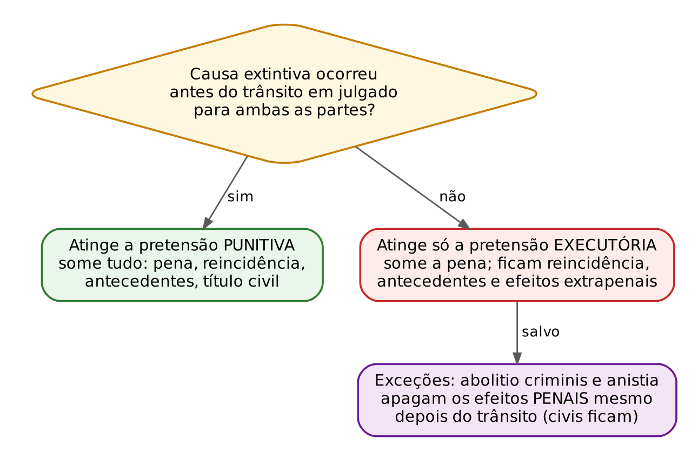
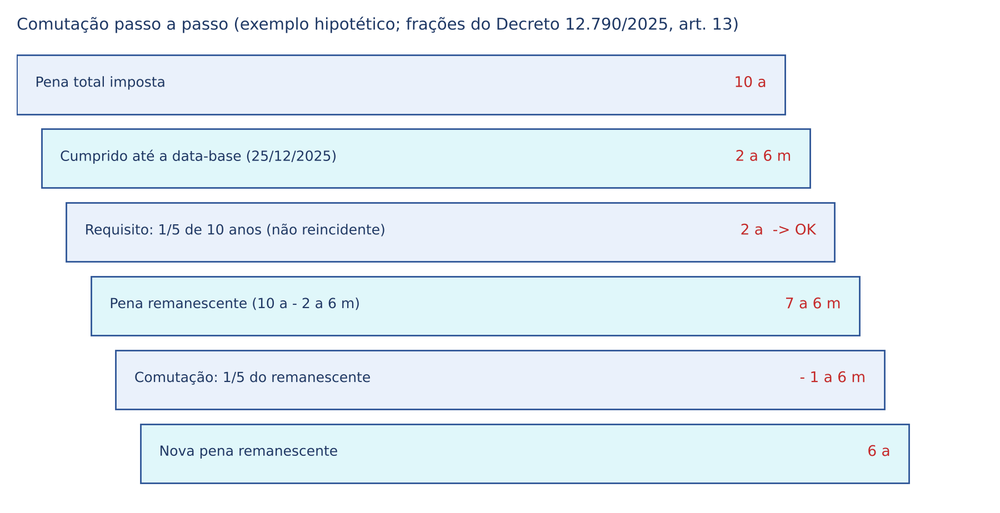
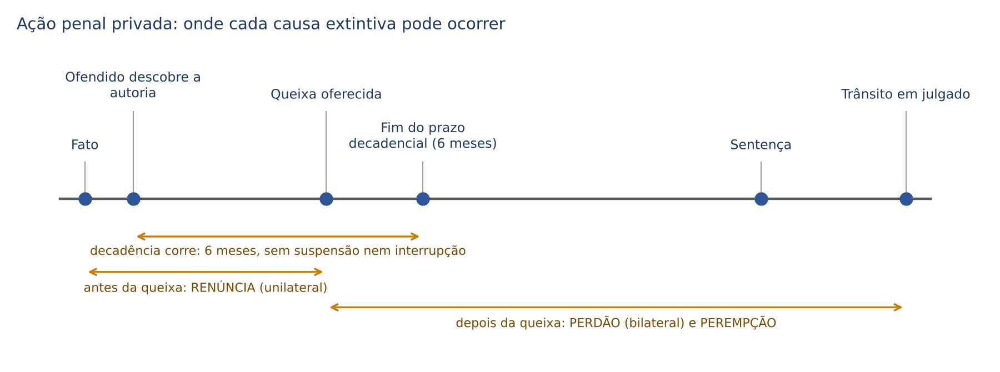

# CAPÍTULO 21 — EXTINÇÃO DA PUNIBILIDADE: MORTE, ANISTIA, GRAÇA, INDULTO, ABOLITIO CRIMINIS, RENÚNCIA, PERDÃO, RETRATAÇÃO, DECADÊNCIA, PEREMPÇÃO E PERDÃO JUDICIAL

:::INCIDENCIA
TRF5 p. 8; TJRS p. 4; TJSC p. 36. Nível B; 10 questões no lote (FGV 7, FCC 3).
O que mais cai: competência e efeitos de anistia, graça e indulto (Súmula 631 do STJ) e o texto dos decretos de indulto (FCC, Defensoria); art. 108; perdão do ofendido com vários querelantes e querelados; perempção; morte do agente depois do trânsito.
:::

| Subtema | FGV | FCC | Padrão |
|---|---|---|---|
| Anistia, graça e indulto: competência, delegação e efeitos | 2 | 1 | quem concede e o que sobrevive (Súmula 631); anistia imprópria |
| Texto dos decretos de indulto (12.338/2024 e 12.790/2025) | 1 | 2 | alcance (regimes, livramento, *sursis*), Defensoria e reparação do dano; indulto coletivo x graça |
| Art. 108 (crime-pressuposto) | 1 | 0 | receptação x estelionato extinto |
| Morte do agente | 1 | 0 | caso longo com distratores; morte depois do trânsito prevalece |
| Perdão do ofendido e perempção | 2 | 0 | extensão do perdão a coautor que aceita; 30 dias de inércia |

## 21.1 Punibilidade e natureza jurídica da extinção

Punibilidade é a possibilidade jurídica de o Estado impor a sanção penal a quem praticou fato típico, ilícito e culpável; nasce com o crime (quando A mata B, surge o *jus puniendi* concreto contra A). As causas de extinção são acontecimentos POSTERIORES ao crime (morte, anistia, perdão, decurso do tempo) que fazem o Estado perder esse direito; o crime continua a ter existido.

Para o civilista, a analogia é a extinção da pretensão. Na concepção tripartida (Bitencourt, Masson, Greco, Sanches), a punibilidade NÃO é elemento do crime, e sim sua consequência: extinta, o fato não se torna atípico nem lícito.

Três figuras costumam ser confundidas e convém separá-las desde já:

| Figura | Momento | Efeito | Exemplo |
|---|---|---|---|
| Causa extintiva da punibilidade | posterior ao crime | o direito de punir, que nasceu, desaparece | morte, prescrição, perdão judicial |
| Condição objetiva de punibilidade | evento exterior ao tipo, exigido para que a punibilidade nasça | sem ela, não há punibilidade | sentença que decreta a falência nos crimes falimentares (Cap. 20) |
| Escusa absolutória | contemporânea ao fato, ligada a condição pessoal | a punibilidade nem chega a nascer para aquele agente | furto do filho contra o pai (art. 181, II; Caps. 20 e 30) |

O art. 107 do CP lista as causas gerais, mas o rol é EXEMPLIFICATIVO: há dezenas de causas espalhadas pelo próprio Código (art. 312, § 3º; art. 82; art. 90) e pela legislação especial (pagamento do tributo, cumprimento do ANPP, colaboração premiada).

:::LEI Código Penal, art. 107
Extingue-se a punibilidade:
I - pela morte do agente;
II - pela anistia, graça ou indulto;
III - pela retroatividade de lei que não mais considera o fato como criminoso;
IV - pela prescrição, decadência ou perempção;
V - pela renúncia do direito de queixa ou pelo perdão aceito, nos crimes de ação privada;
VI - pela retratação do agente, nos casos em que a lei a admite;
VII - (revogado);
VIII - (revogado);
IX - pelo perdão judicial, nos casos previstos em lei.
:::

### 21.1.1 O momento da causa define o alcance dos efeitos

A pergunta-chave de qualquer questão sobre efeitos é: a causa ocorreu ANTES ou DEPOIS do trânsito em julgado da condenação? É a lógica da prescrição (PPP x PPE, Cap. 22, 22.3), generalizada.

- Antes do trânsito em julgado: a causa atinge a pretensão PUNITIVA. Não haverá condenação válida; desaparecem a pena e todos os efeitos que dela decorreriam (reincidência, maus antecedentes, título executivo civil, efeitos extrapenais do art. 92).
- Depois do trânsito em julgado: a causa atinge, em regra, só a pretensão EXECUTÓRIA. A pena principal deixa de ser executada, mas a condenação continua existindo e produzindo efeitos secundários: gera reincidência (art. 63), conta como antecedente, vale como título executivo no cível (art. 91, I; art. 515, VI, do CPC) e mantém os efeitos do art. 92.
- Exceções: a *abolitio criminis* e a anistia, mesmo depois do trânsito, apagam todos os efeitos PENAIS da condenação (inclusive a reincidência); só os efeitos CIVIS sobrevivem (art. 2º, *caput*, do CP; ver 21.3.2 e 21.4).

:::EXEMPLO Mesma causa, momentos diferentes
A é condenado por furto a 1 ano de reclusão. (1) Se A morre durante a apelação, extingue-se a pretensão punitiva: não há condenação definitiva, e a vítima não terá título executivo penal (precisará da ação civil contra o espólio). (2) Se A recebe indulto depois do trânsito, a pena se extingue, mas, se A cometer novo crime nos 5 anos seguintes, será reincidente, e a vítima pode executar a sentença no cível (Súmula 631 do STJ; ver 21.3.6). (3) Se, depois do trânsito, lei nova descriminaliza o furto (hipótese escolar), cessam a execução e todos os efeitos penais, inclusive a reincidência; a obrigação de indenizar permanece.
:::

### 21.1.2 Comunicabilidade e o art. 108

Comunicabilidade é saber se a causa que extingue a punibilidade de um coautor beneficia os demais. A regra prática:

| Comunicáveis (objetivas, ligadas ao fato) | Incomunicáveis (pessoais, ligadas ao agente) |
|---|---|
| *abolitio criminis* e anistia (atingem o fato) | morte do agente |
| renúncia ao direito de queixa (art. 49 do CPP) | graça e indulto (salvo se o decreto abranger a todos) |
| perdão do ofendido, salvo quanto a quem o recusar (art. 51 do CPP) | perdão judicial (depende da situação de cada agente) |
| decadência e perempção (atingem a ação) | prescrição, quando ligada a dado pessoal (idade do art. 115, reincidência na PPE) |
| retratação no falso testemunho (o fato "deixa de ser punível"; posição majoritária) | retratação nos crimes contra a honra (art. 143: só o querelado que se retrata fica isento) |

O art. 108 resolve outro problema, o dos crimes ligados entre si. A extinção da punibilidade do crime que é PRESSUPOSTO, ELEMENTO ou AGRAVANTE de outro não se estende a este. Exemplos: prescrito o furto, a receptação da coisa furtada continua punível (o furto é pressuposto da receptação; ver também art. 180, § 4º); extinta a punibilidade do crime antecedente, a lavagem continua punível (art. 2º, § 1º, da Lei 9.613/1998; Cap. 46). Segunda parte: nos crimes CONEXOS, a extinção da punibilidade de um não impede, quanto ao outro, a agravação resultante da conexão. Se A mata B para assegurar a impunidade de um estupro (qualificadora do art. 121, § 2º, V), a prescrição do estupro não afasta a qualificadora do homicídio.

:::QUESTAO FGV 2025 — ENAM — Exame Nacional da Magistratura 2025.1 (Q3362381)
Declarada extinta a punibilidade do estelionato (decadência da representação), a defesa da receptadora pede a extensão da extinção à receptação. Gabarito oficial: E — não se declara a extinção, porque a extinção da punibilidade do crime que é PRESSUPOSTO de outro não se comunica a este (art. 108, primeira parte). Armadilhas: as alternativas trocam "pressuposto" por "elemento" (D, com a conclusão certa e o fundamento errado) e invocam a conexão (A), que na segunda parte do art. 108 trata de outra coisa (manutenção da agravação). Observação: a Lei 15.397/2026 revogou o § 5º do art. 171, e o estelionato voltou a ser de ação pública incondicionada para fatos a partir de 4/5/2026 (Cap. 30).
:::

## 21.2 Morte do agente

Fundamento: o princípio da pessoalidade ou intranscendência da pena (art. 5º, XLV, da CF): nenhuma pena passa da pessoa do condenado. Morto o agente, não há a quem punir (*mors omnia solvit*). A causa é personalíssima: NÃO se comunica aos coautores e partícipes.

Alcance, ponto a ponto:

- extingue TODAS as penas, inclusive a multa. Embora a multa seja "dívida de valor" (art. 51), ela continua sanção penal e NÃO pode ser cobrada dos herdeiros (Cap. 12, 12.7.2);
- a obrigação de reparar o dano e a decretação do perdimento de bens podem ser estendidas aos sucessores, até o limite do patrimônio transferido (art. 5º, XLV, segunda parte, da CF). Se a morte ocorreu DEPOIS do trânsito, a sentença penal continua sendo título executivo contra o espólio; se ocorreu ANTES, o ofendido precisará da ação civil de conhecimento;
- se a morte ocorre antes do trânsito, extingue-se a pretensão punitiva; recurso pendente do réu fica prejudicado, e o processo é extinto sem condenação.

Prova: o art. 62 do CPP exige a certidão de óbito e a oitiva do MP. A declaração de ausência do Código Civil, meramente patrimonial, NÃO basta (posição prevalente); a morte presumida do art. 7º do CC, que gera registro de óbito, é aceita pela maioria da doutrina.

:::JURIS STF, HC 104.998, Primeira Turma, j. 14/12/2010
Certidão de óbito falsa. A decisão que declara extinta a punibilidade com base em certidão de óbito falsa não faz coisa julgada em sentido estrito e pode ser revogada, retomando-se a persecução penal, sem que isso configure revisão *pro societate* (vedada no processo penal). Fundamento: a decisão se apoiou em fato inexistente, e ninguém pode se beneficiar da própria fraude. O agente ainda responde pelo uso de documento falso. Mesma orientação no STJ.
:::

:::PEGADINHA Morte da VÍTIMA x morte do AGENTE
O art. 107, I, fala na morte do AGENTE. A morte do ofendido, em regra, não extingue nada; na ação privada, ela abre a sucessão processual (art. 31 do CPP: cônjuge, ascendente, descendente ou irmão) e, se ninguém comparecer em 60 dias, há perempção (art. 60, II, do CPP; ver 21.5). Exceção: nos crimes de ação privada PERSONALÍSSIMA (induzimento a erro essencial e ocultação de impedimento, art. 236), a morte do ofendido extingue a punibilidade, porque ninguém pode suceder.
:::

:::QUESTAO FGV 2026 — TJ-PR — Juiz Substituto (Q3898928)
Apropriação indébita contra ex-sócio em março de 2021; a vítima conheceu a autoria no mesmo mês, mas só noticiou o crime em janeiro de 2022; o agente restituiu o valor em agosto de 2021, antes da denúncia (recebida em março de 2022); às vésperas do julgamento da apelação contra a condenação, lei nova passa a exigir representação para o crime, sem regra de transição; dias depois do trânsito em julgado, o réu morre. Gabarito oficial: D — a punibilidade se extingue pela morte do agente (art. 107, I), e as demais discussões ficam prejudicadas. Armadilhas: (A) a restituição antes do recebimento da denúncia é arrependimento posterior, que só REDUZ a pena (art. 16; Cap. 8), não extingue a punibilidade; (B) não há decadência: quando a vítima noticiou o fato, a ação era pública incondicionada, e não corria prazo algum; com a lei nova (norma mista benéfica), a orientação firmada para o estelionato manda intimar a vítima para representar, não declarar decadência retroativa (STF, HC 208.817 AgR — Cap. 3; Cap. 20); (C) a retroatividade da norma mista benéfica não se restringe aos crimes contra a vida; (E) a lei nova não "convalida" representação intempestiva, até porque não havia prazo em curso. Todas essas questões perdem relevância diante da causa extintiva superveniente. Lembre que, morto o agente depois do trânsito, a sentença continua título executivo contra o espólio (21.2).
:::

## 21.3 Anistia, graça e indulto

São formas de clemência soberana (*indulgentia principis*). A diferença essencial: a ANISTIA esquece o FATO e vem do Congresso por lei; a GRAÇA e o INDULTO perdoam a PENA de pessoas e vêm do Presidente da República por decreto.

### 21.3.1 Quadro comparativo

| Aspecto | Anistia | Graça (indulto individual) | Indulto (coletivo) |
|---|---|---|---|
| Quem concede | Congresso Nacional, por lei, com sanção presidencial (art. 48, VIII, da CF) | Presidente da República, por decreto (art. 84, XII), delegável a Ministros de Estado, PGR e AGU (art. 84, parágrafo único) | idem |
| Objeto | FATOS (em regra crimes políticos, mas pode abranger comuns) | uma pessoa determinada | grupo indeterminado que preencha requisitos objetivos e subjetivos |
| Iniciativa | legislativa | provocada: pedido do condenado, MP, Conselho Penitenciário ou autoridade administrativa (art. 188 da LEP) | espontânea (decreto, tradicionalmente no Natal) |
| Momento | antes (própria) ou depois (imprópria) da condenação | em regra após a condenação | em regra após a condenação; admite-se com trânsito só para a acusação |
| Efeitos | apaga todos os efeitos PENAIS (reincidência, antecedentes); ficam os civis | só a pena (efeitos executórios); ficam reincidência, antecedentes e efeitos extrapenais (Súmula 631 do STJ) | idem |
| Recusa | só a anistia condicionada pode ser recusada | o indulto pleno incondicionado não se recusa; a comutação pode ser recusada (art. 739 do CPP), bem como o benefício sujeito a condições | idem |
| Vedação constitucional | hediondos, tortura, tráfico e terrorismo (art. 5º, XLIII) | idem (a "graça" do inciso XLIII abrange o indulto) | idem, conforme o STF e o STJ |

:::DICA Para não confundir
Anistia = Assembleia (Legislativo), Apaga o fato. Graça = Gente individualizada. Indulto = Inúmeros (coletivo). Comutação = indulto parcial: reduz ou substitui a pena por outra mais branda, sem extingui-la; por isso a comutação NÃO é causa de extinção da punibilidade, apenas de diminuição.
:::

:::QUESTAO FGV 2026 — TJ-GO — Juiz Substituto (Q3966677)
Afirmações sobre anistia, graça e indulto. Gabarito oficial: E — indulto e graça são de competência privativa do Presidente da República, delegável às autoridades do art. 84, parágrafo único, da CF. Erros das demais: anistia por decreto presidencial (é lei do Congresso); indulto e graça apagando todos os efeitos penais (só os primários, Súmula 631; ver 21.3.6); tráfico privilegiado admitindo indulto, mas não graça (não sendo hediondo, não incide nenhuma das vedações; ver 21.3.4); anistia mantendo os efeitos penais secundários (ela os apaga).
:::

:::QUESTAO FGV 2024 — TJ-AP — Analista Judiciário (Q2449088)
Decreto presidencial extingue a punibilidade de todos os condenados por estelionato que, durante o cumprimento da pena, ficaram paraplégicos, comprovado por laudo oficial. Gabarito oficial: C — indulto (coletivo, na modalidade humanitária). Armadilha: marcar graça porque o benefício tem motivação pessoal; o que define a graça é o destinatário individualizado, e o decreto atinge um grupo indeterminado que preenche requisitos. Anistia exigiria lei e incidiria sobre fatos.
:::

### 21.3.2 Anistia

A anistia é lei penal benéfica de efeito retroativo que atinge os fatos, e não as pessoas: o fato continua sendo crime em abstrato (não é *abolitio criminis*), mas os fatos praticados num determinado período ou contexto deixam de ser puníveis. Classificações cobradas:

- própria (antes da condenação) x imprópria (depois dela);
- geral ou plena (menciona os fatos e atinge a todos que os praticaram) x parcial ou restrita (exclui pessoas ou crimes, por exemplo os reincidentes);
- incondicionada x condicionada (exige uma contrapartida, como a entrega de armas; só esta pode ser recusada);
- especial (crimes políticos) x comum (crimes comuns).

:::QUESTAO FCC 2026 — DPE-MT — Defensor Público Estadual (Q3954633)
Afirmações variadas sobre causas extintivas. Gabarito oficial: C — a anistia imprópria incide depois da condenação definitiva e pode ser condicionada ou incondicionada. Erros: (A) nem o indulto pleno nem o parcial (comutação) atingem os efeitos secundários (Súmula 631); (B) há perdão judicial em crime culposo contra o patrimônio (receptação culposa, art. 180, § 5º — dispositivo revogado pela Lei 15.358/2026, art. 33; o perdão só subsiste para fatos anteriores a 25/3/2026, por ultra-atividade da lei mais benéfica — Cap. 30); (D) "em qualquer hipótese" é falso: a redução etária do art. 115 não se aplica aos crimes com violência sexual contra a mulher (Lei 15.160/2025; Cap. 22); (E) a pena restritiva prescreve no prazo da privativa substituída (art. 109, parágrafo único); o prazo de 2 anos do art. 114, I, é da MULTA, e prestação pecuniária não é multa.
:::

Efeitos: retroage e extingue a punibilidade de todos os que praticaram o fato; apaga a reincidência e os antecedentes; não alcança os efeitos civis (a obrigação de reparar o dano subsiste). Concedida, é IRREVOGÁVEL: lei posterior que a revogasse seria *novatio legis in pejus*, vedada pelo art. 5º, XL, da CF. Declara-a o juiz de ofício ou a requerimento (art. 187 da LEP).

:::JURIS STF, ADPF 153, Plenário, j. 29/4/2010
O STF julgou improcedente a arguição contra a Lei 6.683/1979 (Lei da Anistia), afirmando a validade da anistia ampla e bilateral, que alcançou também os crimes comuns conexos aos políticos praticados por agentes do Estado durante o regime militar. A condenação do Brasil pela Corte Interamericana (caso Gomes Lund, 2010) mantém o tema vivo em provas discursivas.
:::

### 21.3.3 Graça e indulto: competência, procedimento e natureza da decisão

O decreto fixa requisitos objetivos (pena, fração cumprida, natureza do crime), subjetivos (ausência de falta grave em certo período) e uma data-base (no indulto natalino, 25 de dezembro). Procedimento na LEP: a graça ("indulto individual") é pedida ao Presidente, com parecer do Conselho Penitenciário (arts. 188 a 191); concedida, o juiz da execução declara extinta a pena ou a ajusta, na comutação (art. 192); o indulto coletivo é aplicado pelo juiz da execução, de ofício ou a requerimento, ouvidos MP, Conselho Penitenciário e defesa (art. 193).

Natureza da decisão judicial: DECLARATÓRIA. O benefício é concedido pelo Presidente; o juiz apenas verifica o preenchimento dos requisitos do decreto e, presentes, não pode negá-lo por razões próprias (STJ, Jurisprudência em Teses, ed. 139, tese 2). Na outra ponta, também não pode ampliá-lo: a interpretação deve ser ESTRITA, sob pena de usurpar a competência privativa do art. 84, XII, e ofender a separação de Poderes (tese 3). O juiz não exige requisito ausente do decreto (exame criminológico, por exemplo) nem dispensa o que ele exige.

Pressupõe condenação definitiva? Em regra, o indulto incide sobre condenação. Os decretos recentes admitem-no com trânsito em julgado apenas para a acusação, ou quando o recurso da acusação não busca aumentar a pena (Decreto 12.790/2025, art. 2º), e o STF reconhece essa possibilidade.

### 21.3.4 Vedações constitucionais e legais

:::LEI Constituição Federal, art. 5º, XLIII
a lei considerará crimes inafiançáveis e insuscetíveis de graça ou anistia a prática da tortura, o tráfico ilícito de entorpecentes e drogas afins, o terrorismo e os definidos como crimes hediondos, por eles respondendo os mandantes, os executores e os que, podendo evitá-los, se omitirem.
:::

A Constituição fala em "graça ou anistia"; o art. 2º, I, da Lei 8.072/1990 acrescentou o INDULTO. Para o STF e o STJ, isso é válido: a "graça" do inciso XLIII está em sentido amplo e abrange indulto e comutação (STJ, Jurisprudência em Teses, ed. 139, tese 1).

Desdobramentos cobrados:

- crimes hediondos praticados ANTES da Lei 8.072/1990 (e de suas modificações) podem ser indultados, se o decreto não dispuser em contrário: a vedação legal não retroage (tese 10);
- concurso de crime comum com hediondo: possível a comutação ou o indulto quanto ao crime comum, desde que cumpridas as frações exigidas para AMBOS (tese 11); os decretos recentes exigem o cumprimento de 2/3 da pena do crime impeditivo antes de beneficiar o comum (Decreto 12.790/2025, art. 7º, parágrafo único);
- tráfico privilegiado (art. 33, § 4º, da Lei 11.343/2006): não é hediondo, logo pode ser indultado (Tema 1.400 do STF e Tema 1.336 do STJ — v. Cap. 37; correlata: Q4088260);
- crimes da Lei 15.358/2026 (Marco Legal do Combate ao Crime Organizado): o art. 2º, § 4º, I, veda anistia, graça e indulto aos crimes de domínio social estruturado (art. 2º), e o art. 4º considera hediondos os crimes do caput e dos §§ 1º e 3º do art. 2º e do art. 3º, atraindo a vedação do art. 5º, XLIII, da CF e da Lei 8.072/1990 (Cap. 46);
- fora dessas vedações, os crimes excluídos são escolha política do Presidente (os decretos recentes excluem, por exemplo, violência contra a mulher e crimes contra o Estado Democrático de Direito).

### 21.3.5 Controle judicial do decreto: ADI 5.874 e as ADPFs da graça

:::JURIS STF, ADI 5.874, Plenário, j. 9/5/2019
O STF validou o indulto natalino de 2017 (Decreto 9.246/2017), que fora suspenso cautelarmente por beneficiar amplamente inclusive crimes de colarinho branco. Teses: o indulto é ato privativo e discricionário do Presidente, de política criminal; o Judiciário não reescreve o decreto nem substitui a conveniência presidencial pela sua; controla só a compatibilidade com a Constituição.
:::

:::JURIS STF, ADPFs 964, 965, 966 e 967, Plenário, j. 10/5/2023
O STF anulou o decreto de 21/4/2022 que concedera graça a deputado federal condenado pela Corte na véspera: a clemência, embora discricionária, submete-se à impessoalidade e à moralidade e é nula se praticada com desvio de finalidade (beneficiar aliado e desautorizar o Judiciário). Par cobrado com a ADI 5.874: no indulto coletivo, autocontenção judicial; na graça com desvio de finalidade, invalidação.
:::

### 21.3.6 Efeitos: Súmula 631 do STJ

:::JURIS STJ, Súmula 631
O indulto extingue os efeitos primários da condenação (pretensão executória), mas não atinge os efeitos secundários, penais ou extrapenais.
:::

Consequências: o indultado que comete novo crime é reincidente (o prazo do art. 64, I, conta-se da data da extinção da pena pelo indulto); a condenação vale como maus antecedentes (Cap. 13); a sentença é título executivo civil; subsistem os efeitos do art. 92 (perda do cargo, por exemplo). Os decretos repetem isso: o indulto não alcança os efeitos da condenação (Decreto 12.790/2025, art. 1º, § 2º). Contraste com a anistia, que apaga também os efeitos penais secundários (21.3.2).

:::QUESTAO FGV 2026 — DPE-RJ — Defensor Público (Q4289374)
Sentenciado preenche os requisitos do indulto pleno; pede-se a competência para concedê-lo e o seu efeito. Gabarito oficial: C — Presidente da República; extingue a pretensão executória (efeito primário), subsistindo os efeitos penais secundários e os extrapenais (Súmula 631). Armadilhas: atribuir a concessão ao juízo da execução (ele só DECLARA, 21.3.3), ao Congresso (anistia) ou ao STF; confundir indulto com reabilitação ou com suspensão condicional; e (D) dizer que o indulto afasta a reincidência, o que só a anistia e a *abolitio* fazem. No mesmo sentido, quanto aos efeitos: Q3966677 e Q3954633.
:::

### 21.3.7 Indulto e comutação na execução: o que o STJ consolidou

Teses do STJ que caem (Jurisprudência em Teses, ed. 139, e julgados posteriores):

| Tema | Entendimento | Fonte |
|---|---|---|
| Condenações consideradas no requisito objetivo | todas as transitadas em julgado até a publicação do decreto, ainda que a guia seja juntada depois | JT 139, tese 4 |
| Pena considerada | a originalmente imposta, não a remanescente após comutações anteriores | JT 139, tese 7 |
| Penas alternativas | a fração exigida é aferida em relação a cada sanção, isoladamente | JT 139, tese 8 |
| Indulto humanitário | exige laudo médico oficial ou de médico designado pelo juízo sobre doença grave, permanente e sem tratamento possível no presídio | JT 139, tese 13 |
| Falta grave | a falta praticada no período fixado no decreto impede o benefício, ainda que homologada depois da publicação | JT 146, tese 17 |
| Falta grave e prazo | a falta grave NÃO interrompe o prazo para indulto e comutação | Súmula 535 do STJ (ver Cap. 23); correlata: Q4289375 |
| Reparação do dano e hipossuficiência | o art. 9º, XV, do Decreto 12.338/2024 dispensa a reparação sempre que presente presunção de incapacidade econômica do art. 12, § 2º (atuação da Defensoria, dia-multa no mínimo etc.), sem exigir prova adicional; não se transpõe o Tema 931 do STJ para o indulto | STJ, AgRg no HC 1.050.739, Quinta Turma, j. 16/6/2026 (Informativo 33, edição extraordinária) |

Multa: pode ser indultada se o decreto o previr; o Decreto 12.790/2025 indulta a multa de pequeno valor e a do condenado sem capacidade econômica, e o inadimplemento não impede o indulto da pena privativa (arts. 4º e 12). A tese 9 da edição 139 (indulto da multa no juízo da execução fiscal) é anterior à Lei 13.964/2019 e à ADI 3.150 e está superada: a multa se executa no juízo da execução PENAL (Cap. 12, 12.7.5).

A FCC (provas de Defensoria) cobra o TEXTO do decreto vigente no ano da prova; vale ler o último decreto natalino antes da prova.

:::QUESTAO FCC 2026 — DPE-MT — Defensor Público Estadual (Q3954651)
Afirmações sobre o Decreto 12.338/2024. Gabarito oficial: E — o indulto pode alcançar pessoas em qualquer regime, inclusive em livramento condicional e com *sursis*, preenchidos os requisitos de cada hipótese. Erros: (A) o decreto não exige trânsito em julgado para ambas as partes (basta para a acusação, 21.3.3); (B) o juiz não pode exigir exame criminológico que o decreto não prevê (interpretação estrita, tese 3 da JT 139); (C) a afirmação de que a multa sempre subsiste contraria as regras do próprio decreto sobre a multa; (D) o indulto especial das mulheres presas não alcança crimes com violência ou grave ameaça.
:::

:::QUESTAO FCC 2026 — DPE-MA — Defensor Público (Q4012647)
M começou a cumprir, em 15/12/2025, pena de 2 anos e 4 meses por furto qualificado; o prejuízo de 500 (quinhentos) reais não foi reparado; é assistido pela Defensoria Pública. Pergunta-se sobre o indulto do Decreto 12.790/2025. Gabarito oficial: C — o indulto é cabível, porque o decreto prevê hipótese expressa para o assistido pela Defensoria, sem exigir reparação do dano nem lapso temporal mínimo. Armadilhas: (B) negar o benefício por falta de fração cumprida, quando a hipótese aplicada dispensa o lapso; (D) exigir prova documental da impossibilidade de reparar, quando a hipossuficiência é presumida (mesma lógica do AgRg no HC 1.050.739, na tabela acima); (A) e (E) invocam requisitos (valor inferior ao salário mínimo; ausência de violência e pena inferior a 4 anos) que não são o fundamento do gabarito.
:::

:::EXEMPLO Comutação passo a passo
Suponha decreto que conceda comutação de 1/5 da pena remanescente a quem, não reincidente, tenha cumprido 1/5 da pena até 25/12/2025 (estrutura do art. 13 do Decreto 12.790/2025). C, não reincidente, cumpre pena de 10 anos e, na data-base, já havia cumprido 2 anos e 6 meses.
- Requisito objetivo: 1/5 de 10 anos = 2 anos. C cumpriu 2 anos e 6 meses: preenchido.
- Pena remanescente na data-base: 10 anos − 2 anos e 6 meses = 7 anos e 6 meses (90 meses).
- Comutação: 1/5 de 90 meses = 18 meses = 1 ano e 6 meses.
- Nova pena remanescente: 7 anos e 6 meses − 1 ano e 6 meses = 6 anos.
Se a divisão gerasse fração de dia, ela seria desprezada (art. 11 do CP). Lembre que, para o requisito do INDULTO, usa-se a pena originalmente imposta, e não a reduzida por comutações anteriores (tese 7).
:::

:::SENTENCA Indulto na sentença?
O juiz da sentença NÃO aplica indulto: a matéria é do juízo da execução (arts. 66, II, e 192 e 193 da LEP). A técnica é condenar, fixar a pena e deixar o benefício para a execução. Erro comum: "deixar de condenar" porque o crime seria indultável.
:::

## 21.4 *Abolitio criminis*

A *abolitio criminis* (art. 107, III, combinado com o art. 2º, *caput*) é a lei posterior que deixa de considerar o fato como crime. A teoria (requisitos, diferença para a continuidade normativo-típica, competência do juízo da execução para aplicá-la, Súmula 611 do STF) está no Cap. 3, 03.4.4 e 03.4.5. Aqui interessa o efeito: ela retroage sempre, mesmo depois do trânsito em julgado, faz cessar a execução e apaga TODOS os efeitos penais da sentença condenatória (reincidência, antecedentes, inscrição no rol dos culpados). Os efeitos civis permanecem: a sentença continua título para a reparação do dano. É, com a anistia, a exceção do quadro de 21.1.1.

## 21.5 Renúncia, perdão do ofendido, decadência e perempção

Estas quatro causas giram em torno da vontade (ou da inércia) do ofendido e, por isso, têm campo próprio: a ação penal privada e, no caso da decadência, também a pública condicionada à representação. A disciplina processual (titularidade, indivisibilidade da queixa, sucessão do ofendido, prazos e contagem) é do Cap. 20; aqui se fixa o que importa para a extinção da punibilidade: quando cada uma ocorre, se depende de aceitação e se aproveita aos coautores.

A lógica é a da disponibilidade do direito, familiar ao civilista: na ação privada, o Estado entrega ao particular a decisão de processar; se ele abre mão (renúncia), perdoa (perdão), deixa o prazo correr (decadência) ou abandona a causa (perempção), o Estado perde o direito de punir.

| Instituto | Momento | Natureza | Cabimento | Extensão aos coautores |
|---|---|---|---|---|
| Renúncia (art. 104 do CP; arts. 49 e 50 do CPP) | ANTES da queixa | ato unilateral; dispensa aceitação | ação privada (exclusiva e personalíssima); no JECrim, também a representação (art. 74, parágrafo único, da Lei 9.099/1995) | a renúncia quanto a um se estende a todos (art. 49 do CPP) |
| Perdão do ofendido (arts. 105 e 106 do CP; arts. 51 a 59 do CPP) | DEPOIS de iniciada a ação e até o trânsito em julgado (art. 106, § 2º) | ato bilateral; só produz efeito se ACEITO | só ação privada exclusiva e personalíssima; NÃO na subsidiária | concedido a um, aproveita a todos, mas não produz efeito para quem o recusar (art. 106, I e III) |
| Decadência (art. 103 do CP; art. 38 do CPP) | 6 meses, em regra do dia em que o ofendido soube quem é o autor | prazo penal (art. 10), fatal: não se suspende, não se interrompe, não se prorroga | queixa (ação privada) e representação (ação pública condicionada) | atinge o fato, logo a todos |
| Perempção (art. 60 do CPP) | depois de iniciada a ação | sanção à negligência do querelante | só ação privada exclusiva e personalíssima | atinge a ação; na prática, a todos os querelados, salvo a hipótese de não pedir condenação de um deles |

Renúncia, pontos cobrados:

- pode ser expressa (art. 50 do CPP) ou tácita (ato incompatível com a vontade de processar, como convidar o ofensor para padrinho de casamento);
- o recebimento de indenização pelo dano causado pelo crime NÃO importa renúncia tácita (art. 104, parágrafo único, do CP). EXCEÇÃO: no JECrim, a composição civil HOMOLOGADA, nos crimes de ação privada ou pública condicionada, acarreta renúncia ao direito de queixa ou de representação (art. 74, parágrafo único, da Lei 9.099/1995; Cap. 25);
- queixa proposta deliberadamente só contra um dos autores conhecidos importa renúncia quanto ao omitido, que se estende a todos (indivisibilidade, arts. 48 e 49 do CPP).

Perdão do ofendido: o querelado é intimado a dizer, em 3 dias, se aceita, e o silêncio importa ACEITAÇÃO (art. 58 do CPP); pode ser processual ou extraprocessual, expresso ou tácito (art. 106); o perdão dado por um dos ofendidos não prejudica o direito dos outros (art. 106, II).

Decadência, pontos cobrados:

- o que impede a decadência é o OFERECIMENTO da queixa (ou da representação) dentro do prazo, não o seu recebimento; o requerimento de inquérito policial NÃO interrompe o prazo;
- na ação privada subsidiária, o prazo corre do esgotamento do prazo do MP (art. 103, parte final), mas essa decadência é "imprópria": não extingue a punibilidade, pois o MP continua podendo denunciar.

Perempção, as quatro hipóteses do art. 60 do CPP (memorize pelos números): (I) deixar de promover o andamento do processo por 30 dias seguidos; (II) morte ou incapacidade do querelante sem que o sucessor (cônjuge, ascendente, descendente ou irmão, art. 36) compareça em 60 dias; (III) deixar de comparecer, sem motivo justificado, a ato a que deva estar presente, ou deixar de formular pedido de condenação nas alegações finais; (IV) extinção da pessoa jurídica querelante sem sucessor.

:::PEGADINHA As cinco trocas preferidas da banca
1) "Perempção na ação privada subsidiária": NÃO existe; o MP retoma a ação (art. 29 do CPP). 2) "O perdão independe de aceitação": errado; a RETRATAÇÃO e a RENÚNCIA é que são unilaterais. 3) "A renúncia pode ocorrer no curso da ação": errado; depois da queixa fala-se em perdão. 4) "Receber indenização importa renúncia": errado no CP (art. 104, parágrafo único), certo apenas na composição civil homologada do JECrim. 5) "O prazo decadencial se suspende nas férias forenses ou se prorroga para o primeiro dia útil": errado; é prazo penal, contado pelo art. 10 do CP.
:::

:::EXEMPLO Contagem do prazo decadencial
D é ofendida por injúria em 10/1/2026, mas só descobre quem é o autor em 3/2/2026. O prazo de 6 meses começa no dia em que soube da autoria e inclui esse dia (art. 10 do CP): o último dia é 2/8/2026. Se 2/8/2026 cair num domingo, NÃO há prorrogação para o dia útil seguinte: D deve oferecer a queixa até 2/8/2026 (na prática, distribuindo-a eletronicamente ou perante o juiz de plantão). Queixa oferecida em 3/8/2026: decadência, extinta a punibilidade (art. 107, IV).
:::

:::QUESTAO FGV 2026 — MPE-RJ — Promotor de Justiça Substituto (Q4088250)
R e S, querelantes, processam T e U por crimes contra a honra. R perdoa só T (com quem fez acordo de reparação civil); T aceita, e U pede a extensão do perdão, aceitando-o. Gabarito oficial: C — extingue-se a punibilidade do crime contra R em relação a AMBOS os querelados (o perdão concedido a um aproveita a todos que o aceitarem: art. 51 do CPP e art. 106, I, do CP), e o processo prossegue quanto ao crime contra S (o perdão de um ofendido não prejudica o direito dos outros, art. 106, II). Armadilhas: (E) tratar o perdão como pessoal a T; (B) estender o perdão de R ao crime contra S; (D) "absolver" T, quando a decisão é declaratória da extinção da punibilidade.
:::

:::QUESTAO FGV 2024 — TJ-SC — Analista Jurídico (Q2515312)
Querelante deixa de promover o andamento da ação privada por 35 dias seguidos e, intimado, permanece inerte; o juiz extingue a punibilidade. Gabarito oficial: D — perempção (art. 60, I, do CPP: 30 dias seguidos; art. 107, IV, do CP). Distratores: renúncia (anterior à queixa), perdão do ofendido (ato de vontade, não inércia), decadência (anterior à ação) e retratação do agente.
:::

:::QUESTAO Questão de fixação elaborada para esta apostila (não é questão de banca)
E e F difamam G em coautoria. G oferece queixa contra ambos; no curso da ação, concede perdão a E. Intimados, E fica em silêncio por 3 dias e F declara expressamente que não aceita, porque quer provar sua inocência. Consequência: extingue-se a punibilidade de E (silêncio = aceitação, art. 58 do CPP); F continua sendo processado (o perdão concedido a um aproveita a todos, mas não produz efeito para quem o recusa, art. 106, I e III, do CP). Armadilhas: afirmar que o perdão a E "não se estende" a F (estende-se, mas F recusou) ou que a recusa de F impede a extinção quanto a E.
:::

## 21.6 Retratação do agente

Retratar-se é desdizer-se: o agente reconhece o erro e retira o que afirmou. O art. 107, VI, só a admite "nos casos em que a lei a admite", e as hipóteses são de crimes em que a palavra é o próprio núcleo do ilícito, de modo que a retratação repara, em grande parte, o dano causado.

| Hipótese | Crimes | Prazo | Características |
|---|---|---|---|
| Art. 143 do CP | calúnia e difamação (NÃO injúria) | antes da sentença de primeiro grau | cabal (completa, inequívoca); unilateral; se a ofensa foi feita por meio de comunicação, a retratação se dá pelos mesmos meios, se o ofendido assim desejar (parágrafo único, Lei 13.188/2015) |
| Art. 342, § 2º, do CP | falso testemunho e falsa perícia | antes da sentença no processo em que ocorreu o ilícito | o fato deixa de ser punível; para a doutrina majoritária, comunica-se aos partícipes |

Não cabe na injúria porque ela é juízo de valor (xingamento), e não imputação de fato que possa ser desmentida.

:::JURIS STJ, AgRg no HC 1.014.496, Quinta Turma, j. 4/11/2025 (Informativo 30, edição extraordinária)
A retratação do art. 143 é ato unilateral: dispensa a aceitação do ofendido, pode ser feita por escrito antes da sentença e basta a sua juntada aos autos. A retratação pelos mesmos meios da ofensa (parágrafo único) só é exigível se a vítima o requerer; é faculdade do ofendido, não requisito. No caso, o querelado que difamara a ex-esposa em redes sociais retratou-se por escrito; o STJ extinguiu a punibilidade da difamação e manteve a condenação pela injúria, para a qual não há retratação. Na mesma linha, a Corte Especial já havia decidido que a retratação da calúnia antes da sentença extingue a punibilidade independentemente de aceitação, porque, quando a lei quis exigir aceitação, disse-o expressamente, como no perdão do ofendido (STJ, APn 912, Corte Especial, j. 3/3/2021, Informativo 687).
:::

"Antes da sentença" é a de primeiro grau: retratação em grau de recurso não extingue a punibilidade. Como o art. 143 fala em "querelado", a doutrina majoritária o restringe à ação PRIVADA; na pública condicionada (ofensa a funcionário público, Súmula 714 do STF), há divergência.

:::PEGADINHA Retratação do AGENTE x retratação da REPRESENTAÇÃO
A retratação do art. 107, VI, é ato do autor do crime. Coisa diversa é a retratação da REPRESENTAÇÃO pelo ofendido na ação pública condicionada: possível até o OFERECIMENTO da denúncia (art. 25 do CPP; art. 102 do CP) e, nos crimes da Lei Maria da Penha, até o RECEBIMENTO da denúncia, somente em audiência especialmente designada para esse fim (art. 16 da Lei 11.340/2006; Cap. 38). A retratação da representação não está no art. 107; ela faz desaparecer a condição de procedibilidade, e a punibilidade se extingue depois, pela decadência, se a representação não for renovada no prazo.
:::

## 21.7 Perdão judicial

Perdão judicial é a faculdade (para a maioria, direito subjetivo do réu, quando presentes os requisitos) de o juiz deixar de aplicar a pena, nas hipóteses expressamente previstas em lei, embora reconheça que houve crime e que o réu é culpado. A razão é a desnecessidade da pena: as consequências já puniram o agente (o pai que, por imprudência, causa a morte do filho) ou ele prestou contribuição relevante à justiça (colaboração premiada).

Não confunda com o perdão do OFENDIDO (21.5): este é ato da vítima, só na ação privada, e precisa ser aceito; o perdão JUDICIAL é ato do juiz, cabe em qualquer espécie de ação penal e independe de aceitação, mas só existe onde a lei o prevê.

### 21.7.1 Natureza da sentença: Súmula 18 do STJ

:::JURIS STJ, Súmula 18
A sentença concessiva do perdão judicial é declaratória da extinção da punibilidade, não subsistindo qualquer efeito condenatório.
:::

Prevaleceu a natureza declaratória sobre a tese condenatória (que invocava julgados antigos do STF e o art. 120, que seria inútil se a sentença não condenasse). Consequências práticas, todas cobradas:

- não gera reincidência (art. 120 do CP, expresso) nem maus antecedentes (Cap. 13);
- não interrompe a prescrição, porque não é sentença condenatória (art. 117, IV; Cap. 22, 22.7.1);
- não é título executivo judicial no cível; a vítima ou seus herdeiros precisam de ação civil de conhecimento;
- não lança o nome do réu no rol dos culpados e não produz os efeitos dos arts. 91 e 92;
- o juiz NÃO faz dosimetria: se não há condenação, não há pena a fixar.

Mesmo sendo declaratória, a sentença de perdão judicial pressupõe o exame do mérito: o juiz precisa reconhecer materialidade, autoria, tipicidade, ilicitude e culpabilidade, porque só se perdoa quem cometeu crime. Se a prova indicar atipicidade ou insuficiência, a solução é ABSOLVER (art. 386 do CPP); por isso a doutrina reconhece ao réu interesse recursal para buscar a absolvição.

### 21.7.2 Hipóteses legais

| Previsão | Crime | Requisito do perdão |
|---|---|---|
| Art. 121, § 5º, do CP | homicídio culposo | consequências da infração atingem o próprio agente de forma tão grave que a sanção se torna desnecessária |
| Art. 129, § 8º, do CP | lesão corporal culposa | remete ao art. 121, § 5º |
| Art. 140, § 1º, I e II, do CP | injúria | ofendido provocou diretamente a injúria de forma reprovável; ou retorsão imediata que consista em outra injúria |
| Art. 176, parágrafo único, do CP | tomar refeição, alojar-se em hotel ou usar transporte sem recursos para pagar | conforme as circunstâncias |
| Art. 180, § 5º, primeira parte, do CP (revogado pela Lei 15.358/2026, art. 33) | receptação culposa | réu primário, consideradas as circunstâncias; só para fatos anteriores a 25/3/2026 (ultra-atividade — Cap. 30) |
| Art. 242, parágrafo único, do CP | parto suposto, registro de filho alheio, ocultação ou substituição de recém-nascido | motivo de reconhecida nobreza |
| Art. 249, § 2º, do CP | subtração de incapazes | restituição sem que o incapaz tenha sofrido maus-tratos ou privações |
| Arts. 168-A, § 3º, e 337-A, § 2º, do CP | apropriação indébita e sonegação previdenciárias | primário e de bons antecedentes, com pagamento após o início da ação fiscal e antes da denúncia ou valor pequeno (o juiz pode perdoar ou aplicar só a multa; Cap. 45) |
| Art. 13 da Lei 9.807/1999 | qualquer crime | réu primário, colaboração efetiva e voluntária com resultado (identificação dos coautores, localização da vítima com integridade preservada ou recuperação do produto), consideradas personalidade e gravidade do fato |
| Art. 4º, *caput* e § 2º, da Lei 12.850/2013 | crimes praticados por organização criminosa | colaboração premiada com um dos resultados do art. 4º; perdão pode ser requerido a qualquer tempo pelo MP, ou pelo delegado com manifestação do MP, mesmo sem previsão na proposta inicial (Cap. 46) |
| Art. 1º, § 5º, da Lei 9.613/1998 | lavagem de capitais | colaboração espontânea com esclarecimentos que conduzam à apuração ou à localização dos bens (Cap. 46) |
| Art. 29, § 2º, da Lei 9.605/1998 | guarda doméstica de espécie silvestre não ameaçada | consideradas as circunstâncias (Apostila de Direito Ambiental, Cap. 8) |
| Art. 8º do Decreto-Lei 3.688/1941 | contravenções | ignorância ou erro de compreensão da lei, quando escusáveis (Cap. 50) |

### 21.7.3 Homicídio e lesão culposos, inclusive no trânsito

É a hipótese que mais cai. O requisito é que as consequências atinjam o próprio agente "de forma tão grave" que a pena se torne desnecessária. As consequências podem ser FÍSICAS (o motorista que fica paraplégico no acidente que causou) ou MORAIS (a morte do filho, do cônjuge, de um amigo íntimo). Nos danos morais, o STJ exige vínculo afetivo relevante entre o agente e a vítima, comprovado nos autos; o mero abalo por ter causado a morte de um desconhecido não basta (STJ, REsp 1.444.699, Sexta Turma, 2017, Informativo 606).

Aplica-se aos crimes culposos do Código de Trânsito (arts. 302 e 303 do CTB). O art. 300 do CTB, que previa perdão próprio, foi vetado porque o CP já o contemplava; aplicam-se os arts. 121, § 5º, e 129, § 8º, por força do art. 291 do CTB (Cap. 43).

Não cabe perdão judicial no homicídio DOLOSO, nem por analogia: as hipóteses são taxativas, e a ampliação dependeria de lei. E o perdão judicial pressupõe crime: na Q3532353 (FGV 2025, Cap. 7), a alternativa "não cometeu crime, pois é caso de perdão judicial" era distrator (gabarito: homicídio culposo com culpa consciente).

### 21.7.4 Colaboração premiada

Na Lei 9.807/1999 (proteção a vítimas e testemunhas), o perdão judicial do art. 13 exige réu PRIMÁRIO e colaboração efetiva e voluntária da qual resulte ao menos um dos resultados dos incisos, consideradas a personalidade do beneficiado e a natureza, circunstâncias, gravidade e repercussão social do fato (parágrafo único). O STJ afirma que os requisitos legais devem estar preenchidos cumulativamente (Jurisprudência em Teses, ed. 193, tese 7). Não cabendo o perdão, resta a diminuição de 1/3 a 2/3 do art. 14. Na Lei 12.850/2013, o perdão é uma das premiações do art. 4º; depois da sentença, só cabem redução até a metade ou progressão sem os requisitos objetivos (art. 4º, § 5º). O restante da colaboração está no Cap. 46.

:::SENTENCA Perdão judicial na sentença
Onde entra: no mérito, DEPOIS de afirmar materialidade, autoria, tipicidade, ilicitude e culpabilidade, e no lugar da dosimetria. Redação-modelo do dispositivo: "Ante o exposto, reconhecida a prática do crime do art. 121, § 3º, do Código Penal, e presentes os requisitos do § 5º do mesmo artigo, concedo ao réu o perdão judicial e declaro extinta a sua punibilidade, com fundamento no art. 107, IX, do Código Penal, sem qualquer efeito condenatório (Súmula 18 do STJ)." Erros que a banca pune: (1) "condenar" e fixar pena para depois perdoar; (2) "absolver" com base no perdão; (3) conceder o perdão sem demonstrar o vínculo afetivo ou o dano físico grave; (4) lançar o nome no rol dos culpados ou fixar valor mínimo de indenização (art. 387, IV, do CPP), que pressupõe condenação.
:::

## 21.8 Casamento com a vítima: incisos revogados

Os incisos VII (casamento do agente com a vítima, nos crimes contra os costumes) e VIII (casamento da vítima com terceiro, se o crime não fosse cometido com violência real ou grave ameaça e ela não requeresse o prosseguimento em 60 dias) foram REVOGADOS pela Lei 11.106/2005. Hoje, o casamento não extingue a punibilidade de nenhum crime contra a dignidade sexual.

Direito intertemporal: a revogação de causa extintiva da punibilidade é lei penal mais gravosa e não retroage. Para fatos praticados antes da vigência da Lei 11.106/2005 (29/3/2005), a causa continua aplicável por ultratividade da lei anterior mais benéfica (Cap. 3). Para os crimes contra vulnerável, o relacionamento amoroso ou o consentimento da vítima com menos de 14 anos são irrelevantes (Súmula 593 do STJ, ver Cap. 31).

## 21.9 Outras causas de extinção fora do art. 107

Mapa das causas desenvolvidas em outros capítulos. Atenção a dois detalhes: no peculato culposo, a reparação depois da sentença irrecorrível só reduz a pena pela metade; e o STJ admite a extinção pelo pagamento do tributo mesmo após o trânsito, mas NÃO no descaminho.

| Causa | Dispositivo | Onde |
|---|---|---|
| Reparação do dano no peculato CULPOSO | art. 312, § 3º, do CP | Cap. 35 |
| Pagamento integral do tributo nos crimes tributários | art. 9º, § 2º, da Lei 10.684/2003; art. 83, § 4º, da Lei 9.430/1996; art. 168-A, § 2º, e 337-A, § 1º, do CP | Caps. 45 e 47 |
| Pagamento do cheque sem fundos antes do recebimento da denúncia | Súmula 554 do STF (a contrário senso) | Caps. 8 e 30 |
| Término do período de prova do *sursis* sem revogação | art. 82 do CP | Cap. 17 |
| Término do livramento condicional sem revogação | art. 90 do CP | Cap. 24 |
| Término da suspensão condicional do processo sem revogação | art. 89, § 5º, da Lei 9.099/1995 | Cap. 25 |
| Cumprimento do acordo de não persecução penal | art. 28-A, § 13, do CPP | Cap. 25 |
| Cumprimento da transação penal | art. 76 da Lei 9.099/1995; Súmula Vinculante 35 | Cap. 25 |
| Composição civil homologada (ação privada e pública condicionada) | art. 74, parágrafo único, da Lei 9.099/1995 | Cap. 25 |
| Reconciliação nos crimes contra a honra | arts. 520 a 522 do CPP | Cap. 20 |
| Cumprimento integral da pena (incluída a multa, salvo impossibilidade de pagar) | LEP; ADI 7.032 e Tema 931 do STJ | Caps. 12 e 24 |
| Prescrição | arts. 109 a 119 do CP | Cap. 22 |

:::DICA Furto, estelionato e reparação do dano
No furto e no estelionato comum, a reparação do dano NÃO extingue a punibilidade: antes do recebimento da denúncia, é arrependimento posterior (redução de 1/3 a 2/3, art. 16; Cap. 8); depois, atenuante (art. 65, III, "b"). A extinção pela reparação só existe onde a lei prevê (peculato culposo, crimes tributários, cheque sem fundos pela Súmula 554 do STF).
:::

## 21.10 A extinção da punibilidade na sentença: roteiro

:::PASSO Como decidir quando há causa extintiva
1. Antes do mérito, verifique as causas que impedem o julgamento: morte (certidão de óbito nos autos), decadência e perempção (na ação privada), prescrição pela pena em abstrato (Cap. 22), *abolitio criminis* e anistia.
2. Se houver causa extintiva da pretensão punitiva, NÃO examine o mérito (salvo perdão judicial): declare extinta a punibilidade com base no inciso do art. 107 ou na lei especial, e no art. 61 do CPP.
3. Havendo vários crimes ou vários réus, decida um a um: a causa pode atingir só um crime (art. 108) ou só um réu (causas pessoais, 21.1.2).
4. Perdão judicial: examine o mérito por inteiro e, presentes os requisitos, declare a extinção no lugar da dosimetria (21.7).
5. Condenação com pena aplicada: a prescrição retroativa NÃO é declarada na própria sentença; só depois do trânsito para a acusação (Cap. 22, 22.10).
6. Recursos: RESE contra a decisão que declara ou nega a extinção (art. 581, VIII e IX, do CPP); na execução, agravo (art. 197 da LEP).
:::

:::SENTENCA Redação-modelo e erro comum
Dispositivo: "Diante do exposto, com fundamento no art. 107, IV, do Código Penal, e no art. 61 do Código de Processo Penal, declaro extinta a punibilidade de K quanto ao crime do art. 139 do Código Penal, pela decadência do direito de queixa." Erros comuns: (1) "absolver" por extinção da punibilidade (a decisão é declaratória, embora o art. 397, IV, do CPP fale em absolvição sumária); (2) declarar a morte sem certidão de óbito e sem ouvir o MP (art. 62 do CPP).
:::

## 21.11 Resumo para revisão pré-prova

| Instituto | Regra | Exceções e detalhes | Fundamento |
|---|---|---|---|
| Natureza | consequência do crime, não elemento; causa posterior ao fato | rol exemplificativo; declaração de ofício | art. 107; art. 61 do CPP |
| Momento | antes do trânsito: some tudo; depois: só a pena | *abolitio* e anistia apagam também efeitos penais; civis ficam | arts. 2º, 63, 91 e 92 |
| Art. 108 | extinção do crime-pressuposto, elemento ou agravante não se estende | conexão: agravação permanece | art. 108 |
| Morte | personalíssima; extingue todas as penas, inclusive multa | reparação e perdimento alcançam herdeiros até a herança; certidão falsa: decisão revogável | art. 5º, XLV, da CF; art. 62 do CPP; HC 104.998 |
| Anistia | lei do Congresso; atinge fatos; apaga efeitos penais | condicionada é recusável; irrevogável | art. 48, VIII, da CF; ADPF 153 |
| Graça e indulto | decreto presidencial, delegável; só a pena | decisão declaratória; interpretação estrita; comutação = indulto parcial | art. 84, XII; LEP, arts. 187 a 193; JT 139 |
| Vedações | hediondos, tortura, tráfico, terrorismo | "graça" abrange indulto; privilegiado pode; fatos anteriores à Lei 8.072 podem | art. 5º, XLIII; Lei 8.072, art. 2º, I; Tema 1.400 do STF |
| Controle | discricionário; só constitucionalidade | graça com desvio de finalidade é nula | ADI 5.874; ADPFs 964 a 967 |
| Efeitos do indulto | só efeitos primários | reincidência, antecedentes e extrapenais ficam | Súmula 631 do STJ |
| Renúncia | antes da queixa; unilateral; estende-se a todos | indenização não é renúncia, salvo composição civil homologada | art. 104; art. 49 do CPP; art. 74 da Lei 9.099 |
| Perdão do ofendido | após a queixa, até o trânsito; bilateral | silêncio em 3 dias = aceitação; não vale para quem recusa; não cabe na subsidiária | arts. 105 e 106; art. 58 do CPP |
| Decadência | 6 meses do conhecimento da autoria | prazo penal fatal; basta oferecer a queixa | art. 103; art. 38 do CPP |
| Perempção | negligência do querelante, só ação privada exclusiva | 30 dias; 60 dias sem sucessor; ausência ou falta de pedido de condenação; PJ extinta | art. 60 do CPP |
| Retratação | calúnia e difamação; falso testemunho e falsa perícia; antes da sentença | unilateral; não cabe na injúria | arts. 143 e 342, § 2º; APn 912 |
| Perdão judicial | só nos casos legais; sentença declaratória | sem reincidência, sem interrupção da prescrição, sem título civil; culposo exige vínculo afetivo ou dano físico | arts. 107, IX, 120 e 121, § 5º; Súmula 18 do STJ |
| Casamento e outras causas | incisos VII e VIII revogados (ultratividade antes de 29/3/2005) | peculato culposo, tributo, *sursis*, livramento, ANPP; furto: reparação não extingue | Lei 11.106/2005; art. 312, § 3º |

## 21.12 Artigos de lei incidentes

- Constituição Federal: art. 5º, XL, XLIII e XLV; art. 48, VIII; art. 84, XII e parágrafo único.
- Código Penal: arts. 2º; 10; 11; 63; 64; 91; 92; 102 a 108; 120; 121, § 5º; 129, § 8º; 140, § 1º; 143; 168-A, §§ 2º e 3º; 176, parágrafo único; 180, § 5º (revogado pela Lei 15.358/2026; fatos até 24/3/2026); 236, parágrafo único; 242, parágrafo único; 249, § 2º; 312, § 3º; 337-A, §§ 1º e 2º; 342, § 2º.
- Código de Processo Penal: arts. 25; 28-A, § 13; 29; 31; 36; 38; 48 a 62; 395; 397, IV; 520 a 522; 581, VIII e IX; 739.
- Lei 7.210/1984 (LEP): arts. 66, II; 187 a 193; 197.
- Lei 8.072/1990: art. 2º, I.
- Lei 9.099/1995: arts. 74, parágrafo único; 76; 89, § 5º.
- Lei 9.807/1999: arts. 13 e 14.
- Lei 12.850/2013: art. 4º, *caput*, §§ 2º e 5º.
- Lei 9.613/1998: arts. 1º, § 5º, e 2º, § 1º.
- Lei 11.340/2006: art. 16.
- Leis 10.684/2003 (art. 9º, § 2º) e 9.430/1996 (art. 83, § 4º).
- Lei 15.358/2026 (vedação de anistia, graça e indulto aos crimes que tipifica).
- Lei 11.106/2005 (revogação dos incisos VII e VIII do art. 107).
- Decretos de indulto: Decreto 12.338/2024 e Decreto 12.790/2025.

## 21.13 Julgados, temas e súmulas do capítulo

- Súmula 18 do STJ: sentença de perdão judicial é declaratória, sem efeito condenatório.
- Súmula 631 do STJ: indulto extingue só os efeitos primários da condenação.
- STF, ADI 5.874: indulto é ato discricionário do Presidente; controle judicial só de constitucionalidade.
- STF, ADPFs 964, 965, 966 e 967: graça anulada por desvio de finalidade.
- STF, ADPF 153: validade da Lei da Anistia de 1979.
- STF, HC 104.998: extinção baseada em certidão de óbito falsa pode ser revogada.
- STJ, Jurisprudência em Teses, ed. 139, teses 1 a 11 e 13: indulto e comutação (graça abrange indulto; decisão declaratória; interpretação estrita; data-base; pena original; penas alternativas; humanitário).
- STJ, Jurisprudência em Teses, ed. 146, tese 17: falta grave no período do decreto impede o indulto.
- STJ, Jurisprudência em Teses, ed. 193, tese 7: perdão judicial da Lei 9.807 exige requisitos cumulativos.
- STJ, AgRg no HC 1.050.739 (Informativo 33, ed. extraordinária, 2026): reparação do dano dispensada no indulto se presumida a hipossuficiência.
- STJ, APn 912 (Informativo 687): retratação da calúnia independe de aceitação.
- STJ, AgRg no HC 1.014.496 (Informativo 30, ed. extraordinária): retratação unilateral, por escrito; mesmos meios só se a vítima quiser.
- STJ, REsp 1.444.699 (Informativo 606): perdão judicial no homicídio culposo exige vínculo afetivo com a vítima.

Remissões a outros capítulos: Tema 1.400 do STF (RE 1.542.482) — indulto ao tráfico privilegiado (Cap. 37); Súmula 535 do STJ (Cap. 23); Súmula 438 do STJ e prescrição em geral (Cap. 22); Súmula 611 do STF e teoria da *abolitio criminis* (Cap. 3); Súmula 554 do STF (Cap. 8); ADI 7.032, ADI 3.150 e Tema 931 do STJ (Cap. 12); Súmula 593 do STJ (Cap. 31); Tema 1.336 do STJ (Cap. 37); Súmula Vinculante 35 (Cap. 25); Súmula Vinculante 24 e pagamento do tributo (Cap. 45); Súmula 714 do STF (Cap. 20).

:::NOTA Notas de verificação
1) Questões (segunda passagem, 15/10/2026, pelo arquivo local com gabaritos oficiais): lidas as 10 do lote (FGV 7, FCC 3) e inseridos 10 boxes QUESTAO, o mapa de cobrança e as correlatas Q4088260, Q4289375 e Q3532353 (citadas sem box). Removida a questão de fixação sobre indulto x anistia (redundante com Q4289374 e Q3954633); mantida a de perdão do ofendido com recusa de um querelado (ponto não coberto pelas questões de banca). Nenhum gabarito discutível. Pontos a confirmar no texto dos decretos (Planalto inacessível): na Q4012647, o artigo do Decreto 12.790/2025 que prevê a hipótese do assistido pela Defensoria sem reparação nem lapso temporal (o box segue o gabarito oficial); na Q3954651, a redação do Decreto 12.338/2024 sobre multa e sobre o indulto especial das mulheres (erros das alternativas C e D explicados de forma genérica). A Q3898928, antes truncada, foi completada na limpeza de 15/10/2026 com o texto integral do banco local.
2) Conferidos no Planalto em 15/10/2026: boxes LEI do art. 107 do CP e do art. 5º, XLIII, da CF (redação idêntica à vigente). No CP compilado, as únicas alterações de 2024 a 2026 nos arts. 100 a 120 são o parágrafo único do art. 103 (Lei 15.438/2026, decadência de 12 meses na violência doméstica contra a mulher — Cap. 20) e o art. 115 (Lei 15.160/2025 — Cap. 22); a afirmação anterior, de que nenhuma lei de 2024 a 2026 alterara os arts. 107 a 120, estava imprecisa quanto ao art. 115. Lei 15.358/2026 conferida no Planalto: o art. 2º, § 4º, veda anistia, graça, indulto, fiança e livramento condicional aos crimes de domínio social estruturado, e o art. 4º os declara hediondos (redação ajustada no texto).
3) Lei 15.358/2026 (vedação de anistia, graça e indulto) e Decreto 12.790/2025 (arts. 1º, § 2º, 2º, 4º, 7º, 12 e 13) conferidos só em fontes secundárias; o exemplo de comutação é hipotético.
4) Conferir números e datas: HC 104.998 (j. 14/12/2010), ADI 5.874 (j. 9/5/2019), ADPFs 964 a 967 (j. 10/5/2023), ADPF 153 (j. 29/4/2010), REsp 1.444.699 (Informativo 606). Comunicabilidade da retratação no falso testemunho e restrição do art. 143 à ação privada: posições doutrinárias. Tese 9 da JT 139 tratada como superada.
4-A) Revisão de 15/10/2026: acrescentada, no quadro do perdão judicial, no comentário da questão sobre causas extintivas e na lista de legislação, a ressalva de que o art. 180, § 5º, do CP foi revogado pela Lei 15.358/2026 (art. 33), com vigência em 25/3/2026, conforme apurado no Cap. 30; conferido no Planalto em 15/10/2026: o art. 33 da Lei 15.358, de 24/3/2026 (DOU de 25/3/2026, vigência na publicação), revogou o § 5º inteiro ("§ 5º (Revogado)"), e o CP compilado não registra correção legislativa posterior.
5) Drive: lidos o mapeamento FGV (só enunciados iniciais), o Caderno Dizer o Direito e a Sinopse TJSC 2026 no tema; IURIS vol. 5 e Bitencourt vol. 1 vieram truncados antes do capítulo.
:::
