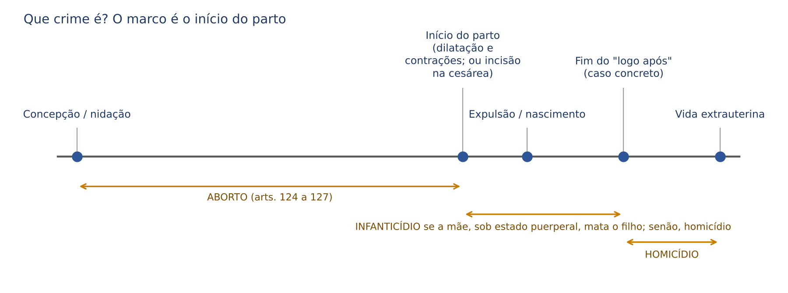
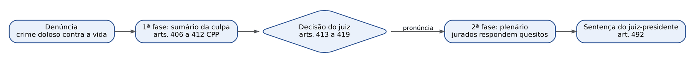
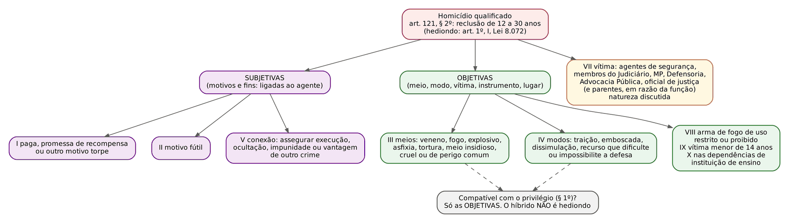
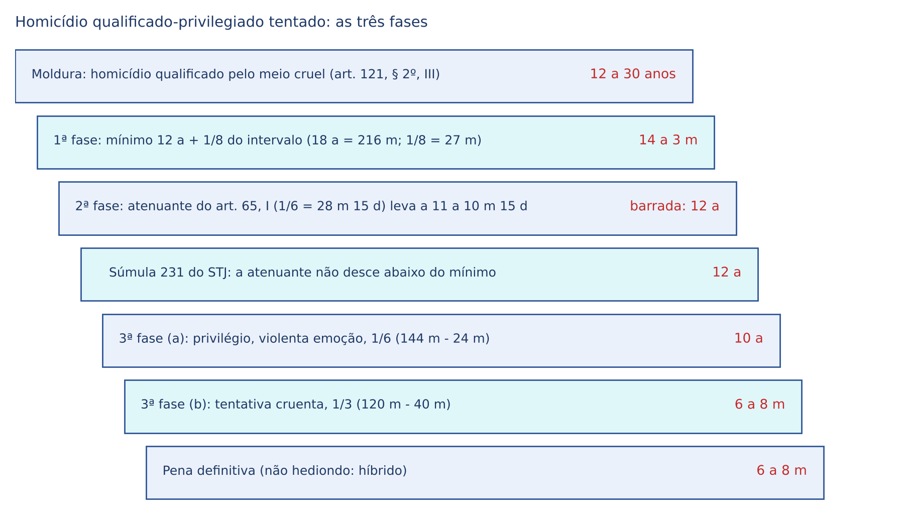
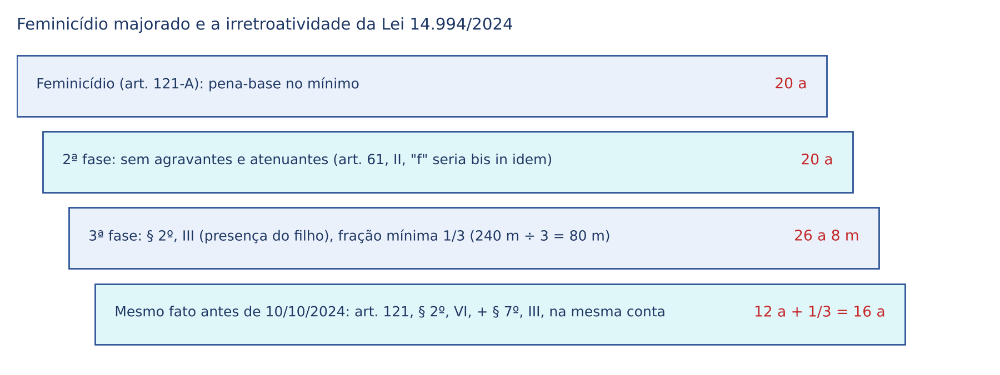
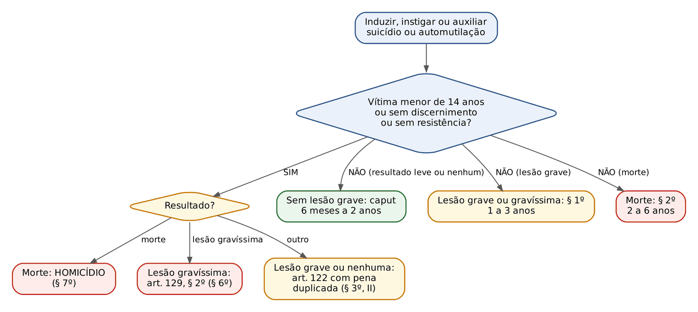

# CAPÍTULO 27 — CRIMES CONTRA A VIDA: HOMICÍDIO, FEMINICÍDIO, INDUZIMENTO AO SUICÍDIO E À AUTOMUTILAÇÃO, INFANTICÍDIO E ABORTO

:::INCIDENCIA
TRF5 p. 9; TJRS p. 5; TJSC p. 38. Nível A. Lote: 19 questões (FGV 14, FCC 5).
O que mais cai: contar qualificadoras e majorantes num caso concreto depois das Leis 14.344/2022, 15.134/2025 e 15.159/2025; feminicídio autônomo (pena, majorantes do § 2º, comunicabilidade, data do fato) e o novo vicaricídio; art. 122 x homicídio nos pactos de morte; espécies de aborto com o art. 128 e a ADPF 54.
:::

| Subtema | FGV | FCC | Padrão |
|---|---|---|---|
| Qualificadoras e majorantes do homicídio (incisos VII, IX e X; §§ 2º-B, 2º-C e 6º) | 6 | 1 | Caso com vários dados para classificar: qualificadora, majorante ou nada; leis recentes e data do fato |
| Homicídio: conceitos, dolo eventual, concurso de pessoas | 1 | 2 | Afirmações soltas; dolo eventual x qualificadoras; mandante e art. 288, § 2º |
| Feminicídio (art. 121-A) | 3 | 1 | Pena de 20 a 40 anos, quais e quantas majorantes, comunicação ao executor |
| Vicaricídio (art. 121-B) | 1 | 1 | Pena, majorantes próprias, rol de vítimas |
| Art. 122 | 1 | 0 | Auxílio material doloso x homicídio |
| Aborto | 2 | 0 | Art. 128, ADPF 54, art. 127 |

## 27.1 Visão geral: o que os crimes contra a vida têm em comum

O Capítulo I do Título I da Parte Especial reúne os crimes em que o bem jurídico protegido é a VIDA humana: a vida extrauterina (homicídio, feminicídio, vicaricídio, participação em suicídio e infanticídio) e a vida intrauterina (aborto). A distinção entre um grupo e outro depende de um único marco, o INÍCIO DO PARTO. Antes dele, quem mata o fruto da concepção pratica aborto; depois dele, pratica homicídio ou, se for a própria mãe sob a influência do estado puerperal, infanticídio.

Considera-se iniciado o parto com a dilatação do colo do útero e as contrações expulsivas, no parto natural, e com a incisão abdominal, na cesárea. A morte, por sua vez, é a cessação da atividade encefálica (art. 3º da Lei 9.434/1997, aplicado por analogia pela doutrina): a partir dela não há mais vida a proteger, e atirar num cadáver é crime impossível por absoluta impropriedade do objeto (Cap. 8).

Três traços comuns, que a banca cobra em afirmações soltas:

- Competência: os crimes DOLOSOS contra a vida, tentados ou consumados, são julgados pelo Tribunal do Júri (art. 5º, XXXVIII, "d", da CF; art. 74, § 1º, do CPP). Entram no rol os arts. 121, §§ 1º e 2º, 121-A, 121-B, 122 (na parte do suicídio), 123, 124, 125, 126 e 127. O homicídio culposo (art. 121, § 3º) é julgado pelo juiz singular, assim como a lesão corporal seguida de morte e o latrocínio (crime contra o patrimônio, Súmula 603 do STF — ver Cap. 29).
- Ação penal: SEMPRE pública incondicionada.
- Modalidade culposa: só o homicídio a admite. Não existe infanticídio culposo, aborto culposo nem participação culposa em suicídio.

:::PROCESSO Júri: o mínimo que o juiz cível precisa saber

Procedimento bifásico. Ao fim da 1ª fase (arts. 406 a 412 do CPP), o juiz togado:
- pronuncia (art. 413), se há prova da materialidade e indícios suficientes de autoria, com fundamentação contida (excesso de linguagem anula); qualificadora só é excluída na pronúncia se MANIFESTAMENTE improcedente (STJ, AgRg no AREsp 1.886.886/GO, 5ª Turma, j. 24/8/2021);
- impronuncia (art. 414), sem coisa julgada material;
- absolve sumariamente (art. 415); ou
- desclassifica (art. 419) para crime não doloso contra a vida, remetendo os autos ao juízo competente.
Na 2ª fase, os quesitos seguem o art. 483: materialidade, autoria, "o jurado absolve o acusado?", causa de diminuição (o privilégio) e, por último, qualificadoras e majorantes. O juiz-presidente sentencia (art. 492) com base no que os jurados reconheceram (box SENTENCA, 27.12).
:::

:::DICA Justiça Federal e Júri federal (TRF5)
Há Tribunal do Júri na Justiça Federal. Homicídio doloso de servidor público federal em razão da função é da competência federal (Súmula 147 do STJ: crimes praticados contra funcionário público federal, quando relacionados com o exercício da função), assim como o cometido a bordo de navio ou aeronave (art. 109, IX, da CF). Morte de indígena, por si só, é da Justiça Estadual (Súmula 140 do STJ); vira federal quando há disputa sobre direitos indígenas (art. 109, XI, da CF — ver Cap. 42).
:::

## 27.2 Homicídio simples (art. 121, caput)

"Matar alguém": reclusão de 6 a 20 anos. É o tipo básico, de forma livre (qualquer meio, inclusive omissão de quem é garantidor, art. 13, § 2º — Cap. 6), comum quanto aos sujeitos, material (consuma-se com a morte) e plurissubsistente (admite tentativa). O elemento subjetivo é o dolo de matar (*animus necandi*), direto ou eventual; não há elemento subjetivo especial.

A tentativa pode ser branca ou incruenta (a vítima não é atingida) ou vermelha ou cruenta (é ferida). A distinção importa para a fração de redução do art. 14, parágrafo único, que segue o *iter criminis* percorrido: quanto mais perto da morte, menor a redução. A tese de que a tentativa branca enseja a redução máxima de 2/3 e a dos critérios de fração está no Cap. 8 (STJ, AgRg no HC 731.845).

:::PEGADINHA Homicídio simples NÃO é hediondo, salvo uma exceção
O homicídio simples só é hediondo quando "praticado em atividade típica de grupo de extermínio, ainda que cometido por um só agente" (art. 1º, I, da Lei 8.072/1990). Fora disso, não é. Afirmações do tipo "todo homicídio doloso é hediondo" estão erradas, e o homicídio privilegiado (inclusive o qualificado-privilegiado) também não é (27.4.4).
:::

O dolo eventual no homicídio é fonte constante de questões, sobretudo no trânsito. A distinção entre dolo eventual e culpa consciente, a regra de que a embriaguez, por si só, não autoriza presumir dolo eventual e a compatibilidade entre dolo eventual e tentativa estão no Cap. 7. Aqui interessa a consequência processual: havendo elementos indiciários razoáveis das duas versões, a dúvida sobre dolo eventual ou culpa consciente se resolve no plenário, não na pronúncia (STJ, AgRg no AREsp 2.795.012-SP, 6ª Turma, j. 11/3/2025, Info 843 — ver Cap. 7). Se o crime de trânsito for culposo, a tipificação é o art. 302 do CTB, por especialidade (Cap. 43).

## 27.3 Homicídio privilegiado (art. 121, § 1º)

O "privilégio" não é um tipo autônomo: é uma CAUSA DE DIMINUIÇÃO DE PENA (minorante), aplicada na 3ª fase da dosimetria, de 1/6 a 1/3. Os nomes "homicídio privilegiado" e "privilégio" são da doutrina; a lei diz apenas que "o juiz pode reduzir a pena". A razão é a menor reprovabilidade do motivo ou do estado anímico do agente: a conduta continua típica, ilícita e culpável.

:::LEI CP, art. 121, § 1º
"Se o agente comete o crime impelido por motivo de relevante valor social ou moral, ou sob o domínio de violenta emoção, logo em seguida a injusta provocação da vítima, o juiz pode reduzir a pena de um sexto a um terço."
:::

São três hipóteses:

- Relevante valor SOCIAL: o motivo atende a um interesse da coletividade. Exemplo clássico: matar o traidor da pátria; matar o criminoso que aterroriza a comunidade.
- Relevante valor MORAL: o motivo atende a um interesse particular, mas aprovado pela moral média. Exemplos: o pai que mata o estuprador da filha; a eutanásia (homicídio piedoso, por compaixão com o doente incurável).
- Domínio de violenta emoção, LOGO EM SEGUIDA a injusta provocação da vítima (homicídio emocional): exige três requisitos cumulativos, (1) emoção intensa que DOMINA o agente, (2) provocação injusta da vítima (não precisa ser crime) e (3) reação imediata, sem intervalo que permita o esfriamento do ânimo.

"Pode reduzir" não significa faculdade: reconhecido o privilégio pelos jurados, a redução é obrigatória (direito subjetivo do réu, posição pacífica). O juiz escolhe apenas a fração, que se mede pela intensidade do motivo ou da emoção e pela gravidade da provocação, nunca pelas circunstâncias do art. 59 já usadas na 1ª fase.

:::ESQUEMA Privilégio x atenuante do art. 65, III, "a" e "c"
| Aspecto | Privilégio (art. 121, § 1º) | Atenuante (art. 65, III) |
|---|---|---|
| Natureza | Causa de diminuição (3ª fase), 1/6 a 1/3 | Atenuante genérica (2ª fase), sem fração legal |
| Estado anímico | "Sob o DOMÍNIO" de violenta emoção | "Sob a INFLUÊNCIA" de violenta emoção |
| Tempo | "Logo em seguida" à provocação | Sem exigência de imediatidade |
| Provocação | Injusta provocação da vítima | "Ato injusto da vítima" |
| Pode cair abaixo do mínimo? | Sim (3ª fase) | Não (Súmula 231 do STJ — Cap. 14) |
| Cumulação | Reconhecido o privilégio, NÃO se aplica a atenuante da violenta emoção pelo mesmo fato (STJ, conforme o Caderno Dizer o Direito) | |
:::

:::DICA Eutanásia, ortotanásia e distanásia
A eutanásia ativa é homicídio, ainda que a vítima consinta (vida indisponível — Cap. 9), mas com o privilégio do relevante valor moral. A ortotanásia (suspender tratamentos fúteis que só prolongam artificialmente a vida do paciente terminal, com consentimento) é tratada pela doutrina majoritária como atípica (Resolução CFM 1.805/2006).
:::

O privilégio é circunstância de caráter pessoal (motivo e estado anímico) e, por isso, NÃO se comunica ao coautor que não agiu pelo mesmo motivo (art. 30; tabela do Cap. 11, 11.8.2).

## 27.4 Homicídio qualificado (art. 121, § 2º)

### 27.4.1 Lógica e mapa das qualificadoras

Qualificadora é a circunstância que a lei transforma em um NOVO PATAMAR de pena (nova moldura com mínimo e máximo próprios), diferentemente da majorante, que só manda aumentar a pena por uma fração. No homicídio, a presença de qualquer qualificadora desloca a pena de 6 a 20 para 12 a 30 anos de reclusão, e o crime passa a ser HEDIONDO (art. 1º, I, da Lei 8.072/1990, na redação da Lei 15.159/2025, que se refere ao "homicídio qualificado (art. 121, § 2º)", sem listar incisos).

A distinção que organiza todo o estudo é entre qualificadoras SUBJETIVAS (dizem respeito ao motivo ou ao fim do agente: incisos I, II e V) e OBJETIVAS (dizem respeito ao meio, ao modo de execução, à vítima, ao instrumento ou ao lugar: incisos III, IV, VIII, IX e X). Dessa classificação dependem três respostas: a compatibilidade com o privilégio (27.4.4), a comunicabilidade aos coautores (Cap. 11) e, em parte, a compatibilidade com o dolo eventual (27.4.5).

:::LEI CP, art. 121, § 2º (redação vigente)
"Se o homicídio é cometido: I - mediante paga ou promessa de recompensa, ou por outro motivo torpe; II - por motivo futil; III - com emprego de veneno, fogo, explosivo, asfixia, tortura ou outro meio insidioso ou cruel, ou de que possa resultar perigo comum; IV - à traição, de emboscada, ou mediante dissimulação ou outro recurso que dificulte ou torne impossivel a defesa do ofendido; V - para assegurar a execução, a ocultação, a impunidade ou vantagem de outro crime: Pena - reclusão, de doze a trinta anos. [...] VI - (Revogado pela Lei nº 14.994, de 2024) VII – contra: a) autoridade ou agente descrito nos arts. 142 e 144 da Constituição Federal, integrantes do sistema prisional e da Força Nacional de Segurança Pública, no exercício da função ou em decorrência dela, ou contra seu cônjuge, companheiro ou parente consanguíneo até o terceiro grau, em razão dessa condição; b) membro do Poder Judiciário, do Ministério Público, da Defensoria Pública ou da Advocacia Pública, de que tratam os arts. 131 e 132 da Constituição Federal, ou oficial de justiça, no exercício da função ou em decorrência dela, ou contra seu cônjuge, companheiro ou parente, inclusive por afinidade, até o terceiro grau, em razão dessa condição; VIII - com emprego de arma de fogo de uso restrito ou proibido: [...] IX - contra menor de 14 (quatorze) anos: X - nas dependências de instituição de ensino: Pena - reclusão, de doze a trinta anos."
:::

### 27.4.2 As qualificadoras subjetivas (I, II e V)

Inciso I — paga, promessa de recompensa ou outro motivo torpe. Torpe é o motivo abjeto, repugnante, que causa repulsa à moral média (matar para receber a herança, para assumir o cargo da vítima, por inveja do sucesso alheio). A paga (pagamento prévio) e a promessa de recompensa (pagamento futuro, que não precisa ser cumprido nem ser em dinheiro) são os exemplos que a lei dá; a cláusula "ou outro motivo torpe" autoriza interpretação analógica (Cap. 3). É o homicídio mercenário, crime de concurso necessário (mandante e executor).

:::JURIS STJ, EAREsp 1.322.867-SP, j. 13/8/2025 (Info 860) — remissão
A paga ou promessa de recompensa NÃO se comunica automaticamente ao mandante: o executor mata por cupidez; o mandante será punido pela forma qualificada se o SEU motivo também for torpe (ex.: mandar matar para ficar com o patrimônio), o que se examina no caso concreto. Tese desenvolvida no Cap. 11 (comunicabilidade); aqui, guarde a consequência para a pronúncia e os quesitos: a qualificadora deve ser imputada e quesitada separadamente para cada réu.
:::

:::QUESTAO FCC 2025 — DPE-SP — Analista de Defensoria (Q3304087)
Afirmações gerais sobre o homicídio. Gabarito: D — a qualificadora da promessa de recompensa independe do cumprimento da promessa ou do recebimento da recompensa.
Armadilhas: o homicídio protege a vida EXTRAuterina (a intrauterina é do aborto); concurso de pessoas não torna hediondo o homicídio simples (só a atividade típica de grupo de extermínio, 27.2); o privilégio decorre do MENOR desvalor (27.3); o homicídio culposo admite as majorantes do § 4º, convivendo com o perdão judicial (27.6).
:::

Vingança e ciúme não são, por si sós, motivos torpes ou fúteis: depende do que originou o sentimento. A vingança contra quem matou o filho do agente pode até caracterizar relevante valor moral; a vingança contra a testemunha que depôs contra o agente é torpe. O mesmo vale para o ciúme, que a jurisprudência não qualifica automaticamente.

Inciso II — motivo fútil. É o motivo insignificante, desproporcional à reação: matar porque a vítima esbarrou no carro, porque recusou um cigarro, porque o time perdeu. Duas armadilhas:

- Motivo fútil NÃO se confunde com ausência de motivo: se o crime foi praticado sem razão conhecida, a qualificadora do inciso II é "manifestamente descabida" (STJ, HC 152.548/MG, 5ª Turma, j. 22/2/2011). Há corrente doutrinária em sentido contrário (quem mata sem motivo revela reprovabilidade ainda maior), mas a posição do STJ é a que cai.
- A futilidade pressupõe uma reação a uma ação ou omissão da VÍTIMA. Por isso, não há motivo fútil no "racha" que atinge terceiro estranho à disputa (STJ, HC 307.617-SP, 6ª Turma, j. 19/4/2016, Info 583).

A compatibilidade do motivo fútil com o dolo eventual (REsp 912.904/SP) foi desenvolvida no Cap. 7: dolo e motivo são coisas distintas, e quem assume o risco de matar pode tê-lo feito por razão desproporcional.

Inciso V — conexão. O homicídio é praticado para assegurar a execução (conexão TELEOLÓGICA: matar o segurança para depois sequestrar o empresário), ou a ocultação, a impunidade ou a vantagem de outro crime (conexão CONSEQUENCIAL: matar a testemunha do roubo; matar o comparsa para ficar com todo o produto). Basta a finalidade: o outro crime não precisa ser executado, e pode ter sido cometido por terceiro. Só "crime": se o fim é assegurar CONTRAVENÇÃO penal, não incide o inciso V (vedada a analogia *in malam partem*), podendo haver motivo torpe ou fútil.

:::PEGADINHA Matar para roubar: latrocínio ou homicídio qualificado pela conexão?
Se a morte é meio para a subtração ou para garantir a posse da coisa ou a impunidade, NO MESMO CONTEXTO do roubo, o crime é latrocínio (art. 157, § 3º, II), julgado pelo juiz singular (Cap. 29). Se o agente, já consumado o roubo e fora daquele contexto, mata dias depois a testemunha que poderia reconhecê-lo, há roubo em concurso material com homicídio qualificado pelo inciso V (Júri). O critério é o nexo de contexto entre a violência e a subtração.
:::

### 27.4.3 As qualificadoras objetivas (III, IV, VIII, IX e X)

Inciso III — meios. Veneno (venefício: só qualifica se ministrado às escondidas, como meio insidioso; se a vítima é forçada a ingeri-lo, pode haver meio cruel), fogo, explosivo, asfixia (mecânica, como esganadura e afogamento, ou tóxica), tortura, "outro meio insidioso" (dissimulado, que a vítima não percebe), "cruel" (que causa sofrimento intenso e desnecessário) ou "de que possa resultar perigo comum" (que expõe a perigo número indeterminado de pessoas). De novo, fórmula casuística seguida de cláusula genérica: interpretação analógica.

- Meio cruel e tortura exigem prolongamento do sofrimento: agressões momentâneas e passageiras não bastam (STJ, AgRg no AREsp 1.886.886/GO, 5ª Turma, j. 24/8/2021). A pluralidade de golpes, por si só, não prova crueldade se não houve intenção de fazer sofrer.
- Homicídio qualificado pela tortura x tortura com resultado morte (art. 1º, § 3º, da Lei 9.455/1997): no primeiro, há dolo de matar e a tortura é o meio (Júri); no segundo, o dolo é de torturar e a morte é culposa, crime preterdoloso (juiz singular). A diferença está no elemento subjetivo (Cap. 40).

Inciso IV — modos. Traição (ataque inesperado de quem tinha a confiança da vítima), emboscada (tocaia, o agente aguarda escondido a passagem da vítima), dissimulação (o agente esconde a intenção hostil, por exemplo fingindo amizade ou disfarçando-se) ou "outro recurso que dificulte ou torne impossível a defesa" (a surpresa; o ataque à vítima dormindo ou de costas). O que a lei pune é a redução das chances de defesa.

:::EXEMPLO Meio ou modo? Classifique
1. A dispara contra B, que dormia: modo (IV, recurso que impossibilitou a defesa).
2. A mata B com vinte facadas, prolongando a agonia: meio cruel (III), se provado o propósito de fazer sofrer.
3. A coloca formicida no café de B: meio insidioso (III, veneno às escondidas).
4. A aguarda B atrás do muro e atira quando ele passa: modo (IV, emboscada).
5. A convida B para pescar, fingindo reconciliação, e o afoga: modo (IV, dissimulação) e meio (III, asfixia). Uma qualifica; a outra é sobressalente (27.12.1).
:::

Inciso VIII — arma de fogo de uso restrito ou proibido. Incluído pelo Pacote Anticrime (Lei 13.964/2019), vetado e restabelecido com a derrubada do veto (promulgação publicada em 30/4/2021). É norma penal em branco: a classificação das armas está no regulamento do Estatuto do Desarmamento (Cap. 39). A arma de uso permitido com numeração raspada NÃO qualifica o homicídio: a equiparação do art. 16, § 1º, I, do Estatuto vale para os crimes do Estatuto, e estendê-la ao CP seria analogia *in malam partem* (STJ, AgRg no REsp 2.104.061-MG — desenvolvido no Cap. 3).

Inciso IX — vítima menor de 14 anos (Lei 14.344/2022, Lei Henry Borel, em vigor desde 9/7/2022). A idade é aferida no momento da conduta (art. 4º do CP). O § 2º-B traz majorantes específicas desse homicídio: de 1/3 até a metade, se a vítima é pessoa com deficiência ou com doença que implique aumento de sua vulnerabilidade; de 2/3, se o autor é ascendente, padrasto ou madrasta, tio, irmão, cônjuge, companheiro, tutor, curador, preceptor ou empregador da vítima ou por qualquer outro título tem autoridade sobre ela; e de 2/3 se o crime é praticado em instituição de educação básica pública ou privada (inciso III, incluído pela Lei 14.811/2024).

Inciso X — nas dependências de instituição de ensino (Lei 15.159/2025, em vigor desde 4/7/2025). Qualificadora de lugar, objetiva, que alcança qualquer vítima (aluno, professor, funcionário, visitante). A mesma lei criou o § 2º-C: aumento de 1/3 até a metade se a vítima é pessoa com deficiência ou com doença que acarrete condição limitante ou de vulnerabilidade física ou mental, e de 2/3 se o autor é ascendente, padrasto, madrasta, tio, irmão, cônjuge, companheiro, tutor, curador, preceptor ou empregador da vítima, ou tem autoridade sobre ela, OU se é professor ou funcionário da instituição. Também incluiu a agravante genérica do art. 61, II, "m" (crime cometido nas dependências de instituição de ensino), que obviamente não incide no homicídio já qualificado pelo inciso X (*bis in idem*).

:::QUESTAO FGV 2025 — MPE-ES — Promotor de Justiça Substituto (Q3752759)
Professor, em setembro de 2025, sem motivo aparente, tenta matar a facadas, dentro da escola, aluno de 16 anos sabidamente com deficiência. Gabarito: A (F – V – F) — o lugar QUALIFICA (inciso X); a deficiência da vítima é majorante da 3ª fase (§ 2º-C, 1/3 até a metade); e a condição de professor da instituição NÃO é mera circunstância judicial: é majorante de 2/3 (§ 2º-C).
Armadilhas: tratar a escola como agravante do art. 61, II, "m" (aqui ela qualifica); esquecer que o § 2º-C também alcança o autor professor ou funcionário. "Sem motivo aparente" não é motivo fútil (27.4.2), e a idade de 16 anos afasta o inciso IX.
:::

:::QUESTAO FGV 2026 — MPE-MT — Promotor de Justiça Substituto (Q4116981)
Homicídio em novembro de 2025, com arma de fogo de uso restrito, nas dependências de instituição de ensino, por motivo fútil e mediante recurso que dificultou a defesa. Gabarito: E — quatro qualificadoras (incisos II, IV, VIII e X), nenhuma causa de aumento.
Armadilha: tomar a arma de uso restrito ou o lugar por majorantes (assim funcionam no feminicídio, art. 121-A, § 2º, V, mas no homicídio são qualificadoras). Na sentença, uma qualifica e as outras migram (27.12.1).
No mesmo sentido (rol taxativo): Q3744590 (FGV 2025, TJ-RS, Analista; gabarito C) — homicídio nas dependências de instituição HOSPITALAR não é qualificado; só a de ensino está no inciso X, e estender seria analogia *in malam partem*.
:::

:::QUESTAO FCC 2026 — TJ-CE — Oficial de Justiça (Q4240025)
Vizinho, em 2026, mata a facadas, de surpresa, criança de 12 anos que usa cadeira de rodas. Gabarito: B — homicídio qualificado (12 a 30 anos, inciso IX), aumentado de 1/3 até a metade pela deficiência da vítima (§ 2º-B, I).
Armadilhas: a pena de 20 a 40 anos é a do feminicídio, do vicaricídio e do § 2º-D; o aumento de 2/3 (§ 2º-B, II) exige relação de parentesco ou autoridade do autor sobre a vítima, inexistente no vizinho.
No mesmo sentido: Q4153624 (FGV 2026, TJ-SC, Oficial de Justiça e Avaliador; gabarito B) — homicídio de 2024 qualificado pela idade inferior a 14 anos com uma majorante: só pode ser a doença que aumenta a vulnerabilidade (§ 2º-B, I); surpresa, promessa de recompensa e veneno são qualificadoras, e nacionalidade estrangeira não é nada.
:::

:::PEGADINHA Menor de 14 anos: qualificadora, majorante do § 4º e majorante do § 2º-B
O § 4º, parte final, sempre previu aumento de 1/3 para o homicídio doloso contra pessoa menor de 14 ou maior de 60 anos. Depois da Lei 14.344/2022, a idade inferior a 14 anos virou QUALIFICADORA (inciso IX). Usar a idade para qualificar E para aumentar pelo § 4º é *bis in idem*: a majorante do § 4º, quanto à criança, fica absorvida (posição da doutrina majoritária). Já as majorantes do § 2º-B descrevem dados ADICIONAIS (deficiência da vítima, relação de autoridade do autor, escola) e se somam à qualificadora. A vítima idosa (maior de 60) continua no § 4º.
:::

Inciso VII — vítimas em razão da função. Criado pela Lei 13.142/2015 (agentes de segurança pública dos arts. 142 e 144 da CF, sistema prisional, Força Nacional) e ampliado pela Lei 15.134/2025 (em vigor desde 7/5/2025), que o dividiu em alíneas e incluiu, na alínea "b", membros do Poder Judiciário, do Ministério Público, da Defensoria Pública e da Advocacia Pública e oficiais de justiça. Protege também o cônjuge, o companheiro e o parente até o 3º grau, desde que o crime seja praticado EM RAZÃO dessa condição: na alínea "a" (forças de segurança), só o parente CONSANGUÍNEO; na alínea "b" (Judiciário, MP, Defensoria, Advocacia Pública e oficial de justiça), o parente "inclusive por afinidade". Não basta a vítima ser policial: o crime precisa ser cometido no exercício da função ou em decorrência dela. A natureza (objetiva ou subjetiva) é controvertida. Parente por afinidade (enteado, sogra) do policial NÃO está abrangido pela alínea "a": estender seria analogia *in malam partem*; já o enteado ou a sogra do juiz ou do promotor estão na alínea "b". A Lei 15.134/2025, mais gravosa, não alcança fatos anteriores a 7/5/2025 (Cap. 3).

:::QUESTAO FGV 2026 — PC-PI — Delegado de Polícia (Q3848977)
Plano, em outubro de 2025, de matar, em razão das funções, magistrado, oficial de justiça, delegado de polícia e deputado estadual. Gabarito: C — o homicídio é qualificado (inciso VII) quanto ao magistrado, ao oficial de justiça e ao delegado; NÃO quanto ao parlamentar.
Armadilha: supor que todo agente político está protegido; o rol é fechado (arts. 142 e 144 da CF, sistema prisional, Força Nacional e, desde a Lei 15.134/2025, as carreiras da alínea "b").
:::

### 27.4.4 Homicídio qualificado-privilegiado (híbrido) e hediondez

Pode o mesmo homicídio ser privilegiado e qualificado? Sim, desde que a qualificadora seja OBJETIVA. O privilégio diz respeito ao motivo (relevante valor) ou ao estado anímico (violenta emoção), isto é, é subjetivo; não convive com uma qualificadora que também trate do motivo. Quem mata "por relevante valor moral" não pode, ao mesmo tempo, matar "por motivo torpe" ou "fútil". Já o meio (veneno, asfixia) e o modo (surpresa) são compatíveis: o pai que, logo após descobrir o estupro da filha, mata o estuprador de surpresa responde por homicídio privilegiado-qualificado (art. 121, § 2º, IV, c/c § 1º).

O homicídio qualificado-privilegiado NÃO é hediondo (posição pacífica no STJ e na doutrina). O argumento é o do art. 67 do CP: no concurso entre circunstâncias, preponderam as de natureza subjetiva (motivos determinantes), e a Lei 8.072/1990 não incluiu a forma privilegiada no rol. Consequências: progressão pelas frações comuns do art. 112 da LEP, livramento condicional comum, indulto possível (Cap. 24).

:::PROCESSO Ordem dos quesitos e o "conflito" privilégio x qualificadora
O quesito do privilégio (causa de diminuição alegada pela defesa) é votado ANTES das qualificadoras (art. 483, § 3º, I e II, do CPP). Reconhecido o privilégio, o juiz-presidente NÃO submete aos jurados as qualificadoras subjetivas (motivo torpe, fútil), que ficam prejudicadas; as objetivas continuam a ser quesitadas. Erro clássico: deixar os jurados reconhecerem relevante valor moral e motivo fútil no mesmo réu, o que gera contradição e nulidade (art. 490 do CPP).
:::

:::EXEMPLO Dosimetria do híbrido tentado, passo a passo
Fato: A, com 20 anos, logo depois de ser humilhado publicamente pela vítima (injusta provocação), dominado por violenta emoção, desfere vários golpes de faca prolongando o sofrimento (meio cruel); a vítima sobrevive com lesões graves. Jurados: materialidade, autoria, não absolvem, reconhecem o privilégio e a qualificadora do meio cruel; tentativa reconhecida.
1. Moldura: art. 121, § 2º, III: 12 a 30 anos (a tentativa e o privilégio não mudam a moldura; são da 3ª fase).
2. 1ª fase: uma circunstância judicial negativa (ex.: culpabilidade elevada, por fundamento concreto que não seja o próprio meio cruel). Pelo critério de 1/8 do intervalo: intervalo = 30 - 12 = 18 anos = 216 meses; 1/8 = 27 meses = 2 anos e 3 meses; pena-base = 14 anos e 3 meses. Pelo critério de 1/6 da pena mínima: 1/6 de 12 anos = 2 anos; pena-base = 14 anos. O STJ admite os dois; a escolha e os limites estão no Cap. 13.
3. 2ª fase: atenuante do art. 65, I (agente com menos de 21 anos na data do fato). Fração usual de 1/6: 14 anos e 3 meses = 171 meses; 1/6 = 28,5 meses = 2 anos, 4 meses e 15 dias; o resultado (11 anos, 10 meses e 15 dias) fica ABAIXO do mínimo, e a Súmula 231 do STJ impede (Cap. 14). Pena intermediária = 12 anos.
4. 3ª fase: duas causas de diminuição, aplicadas em cascata (uma sobre o resultado da outra). Privilégio na fração mínima de 1/6 (a provocação não foi grave): 12 anos = 144 meses; 144 - 24 = 120 meses = 10 anos. Tentativa cruenta, iter avançado, 1/3: 120 - 40 = 80 meses = 6 anos e 8 meses.
5. Pena definitiva: 6 anos e 8 meses de reclusão. Não é hediondo. Regime inicial semiaberto se primário (art. 33, § 2º, "b") — Cap. 17. Não há frações de dia a desprezar nesta conta; se houvesse, aplicar-se-ia o art. 11 do CP.
Variante: aplicando primeiro a tentativa e depois o privilégio, o resultado é o mesmo (multiplicação é comutativa: 144 × 5/6 × 2/3 = 80 meses). A ordem só altera o resultado quando há aumento e diminuição juntos, tema do Cap. 15.
:::

### 27.4.5 Compatibilidades que caem: dolo eventual, pluralidade e concurso de pessoas

:::ESQUEMA Quadro das compatibilidades das qualificadoras
| Combinação | Resposta | Fundamento |
|---|---|---|
| Qualificadora objetiva + privilégio | Compatível (híbrido, não hediondo) | 27.4.4 |
| Qualificadora subjetiva + privilégio | Incompatível | Ambos tratam do motivo |
| Motivo fútil + dolo eventual | Compatível | REsp 912.904/SP (Cap. 7) |
| Meio cruel + dolo eventual | Compatível | STJ, REsp 1.829.601-PR, 6ª Turma (ver nota) |
| Surpresa ou recurso que dificulte a defesa (IV) + dolo eventual | Incompatível, segundo julgados do STJ: quem não dirige a conduta à morte não "escolhe" o modo de impedir a defesa | Ver nota |
| Motivo torpe + feminicídio (regime anterior à Lei 14.994/2024) | Compatível: feminicídio era qualificadora objetiva | 27.7.4 |
| Paga (executor) x mandante | Não se comunica automaticamente | EAREsp 1.322.867 (Cap. 11) |
| Duas qualificadoras | Uma qualifica; a outra vai para agravante ou art. 59 | 27.12.1 e Cap. 13 |
:::

:::QUESTAO FCC 2025 — DPE-RS — Defensor Público (Q3387035)
Caso de homicídio no trânsito com embriaguez e velocidade, imputado a título de dolo eventual. Gabarito: D — foi considerada correta a afirmação de que a qualificadora do meio cruel é compatível com o dolo eventual; erradas as que davam por suficiente a soma "embriaguez + velocidade" ou "embriaguez + fuga" para presumir o dolo e a que negava a tentativa com dolo eventual.
Armadilha: transportar para o meio cruel a incompatibilidade que alguns julgados afirmam para a surpresa (inciso IV). Fundamentos do dolo eventual no trânsito: Cap. 7.
:::

:::QUESTAO FGV 2026 — TJ-BA — Juiz Substituto (Q4083750)
Empresário contrata atiradores integrantes de associação criminosa para matar um rival. Gabarito: B — o mandante responde pelo homicídio (qualificado, conforme os motivos dele próprio) E pelo crime autônomo do art. 288, § 2º, do CP (incluído pela Lei 15.245/2025: solicitar ou contratar crime a integrante de associação criminosa).
Armadilha: supor que o mandante só responde pelo homicídio, como partícipe. A Lei 15.245/2025 criou tipo autônomo que se soma (análise do art. 288 no Cap. 33; reflexo no concurso de pessoas no Cap. 11).
:::

### 27.4.6 Homicídio por integrante de organização criminosa ultraviolenta (§ 2º-D)

A Lei 15.358/2026 (Marco Legal do Combate ao Crime Organizado, de 24/3/2026, publicada e em vigor em 25/3/2026) incluiu no art. 121 o § 2º-D: se o homicídio doloso é cometido por integrante de organização criminosa ultraviolenta, grupo paramilitar ou milícia privada, no contexto da atuação ou para a consecução das condutas do art. 2º daquela lei, a pena é de reclusão de 20 a 40 anos. É qualificadora (nova moldura), de natureza pessoal quanto ao sujeito ativo (integrante do grupo) e que exige nexo com a atuação da facção; a mera condição de integrante, num homicídio por razões pessoais, não basta.

Três pontos sensíveis:

- Competência: o art. 2º, § 8º, da Lei 15.358/2026 manda julgar esses homicídios, quando conexos aos crimes de domínio social estruturado, pelas Varas Criminais Colegiadas do art. 1º-A da Lei 12.694/2012, e a mesma lei alterou o art. 78, I, do CPP para excepcionar a prevalência do Júri. Há forte crítica doutrinária de inconstitucionalidade (o Júri é garantia do art. 5º, XXXVIII, da CF, e lei ordinária não pode subtrair-lhe crime doloso contra a vida). Não localizei decisão do STF sobre o ponto até 14/10/2026.
- Hediondez: o art. 1º, I, da Lei 8.072/1990 fala em "homicídio qualificado (art. 121, § 2º)"; o § 2º-D é parágrafo autônomo, e a Lei 15.358/2026 não o incluiu expressamente no rol. Parte da doutrina sustenta que não é hediondo (vedada a analogia *in malam partem*); em sentido contrário, argumenta-se que é espécie de homicídio qualificado. Tema aberto.
- Concurso: em regra, concurso material com o crime de domínio social estruturado (art. 2º da Lei 15.358/2026), sem *bis in idem*, segundo a doutrina que comentou a lei. A lei em si é do Cap. 46.

## 27.5 Majorantes do homicídio doloso (§§ 4º, parte final, e 6º)

- § 4º, parte final: aumento de 1/3 se o homicídio doloso é praticado contra pessoa menor de 14 ou maior de 60 anos. Para a criança, ver a pegadinha de 27.4.3; para o idoso, aplica-se normalmente, desde que o agente conheça a idade (erro sobre a idade afasta a majorante — Cap. 7). Não incide, com o idoso, a agravante do art. 61, II, "h" (*bis in idem*).
- § 6º: aumento de 1/3 até a metade se o crime é praticado por milícia privada, sob o pretexto de prestação de serviço de segurança, ou por grupo de extermínio (Lei 12.720/2012). Grupo de extermínio, mesmo no homicídio simples, já torna o crime hediondo (art. 1º, I, da Lei 8.072/1990). O concurso com o § 2º-D e com o art. 288-A deve ser examinado para evitar dupla valoração do mesmo dado (Cap. 33 e Cap. 46).
- §§ 2º-B e 2º-C: vistos em 27.4.3.

:::QUESTAO FGV 2026 — TJ-MS — Analista Judiciário (Q3856347)
Condenação por homicídio SIMPLES (fato de dezembro de 2025) com uma causa de aumento. Gabarito: E — cometido por grupo de extermínio (§ 6º).
Armadilhas: surpresa, arma de uso restrito e veneno são qualificadoras; a vítima menor de 14 anos também é, desde a Lei 14.344/2022 (inciso IX), e por isso o homicídio contra ela não é "simples" (pegadinha de 27.4.3).
:::

A ordem de aplicação, a possibilidade de aplicar só uma majorante quando há várias (art. 68, parágrafo único) e o deslocamento da majorante sobressalente para a pena-base são temas do Cap. 15.

## 27.6 Homicídio culposo (§§ 3º, 4º, primeira parte, e 5º)

Pena: detenção de 1 a 3 anos. A estrutura do tipo culposo (dever objetivo de cuidado, previsibilidade, modalidades e espécies de culpa) está no Cap. 7. Não há tentativa (salvo a peculiar culpa imprópria, Cap. 7). Se praticado na direção de veículo automotor, aplica-se o art. 302 do CTB (Cap. 43).

O § 4º, primeira parte, aumenta a pena em 1/3 se o crime:

- resulta de inobservância de regra técnica de profissão, arte ou ofício: o agente CONHECE a regra e não a observa (diferente da imperícia, em que ele não sabe). A doutrina adverte que a majorante exige fato distinto do que caracteriza a própria culpa; se a única negligência descrita é a inobservância da regra técnica, aplicá-la duas vezes (para criar o crime e para aumentá-lo) é *bis in idem*;
- ou se o agente deixa de prestar imediato socorro à vítima, não procura diminuir as consequências do seu ato ou foge para evitar a prisão em flagrante. Aqui há omissão dolosa posterior a um crime culposo, e por isso o agente não responde também pela omissão de socorro do art. 135 (absorvida pela majorante).

O § 5º prevê o PERDÃO JUDICIAL: o juiz pode deixar de aplicar a pena se as consequências da infração atingirem o próprio agente de forma tão grave que a sanção se torne desnecessária (o pai que, por descuido, causa a morte do filho). Natureza de causa extintiva da punibilidade (art. 107, IX) e efeitos da sentença (Súmula 18 do STJ) — Cap. 21.

:::EXEMPLO Majorante e suspensão condicional do processo
Homicídio culposo simples: pena mínima de 1 ano. Cabe suspensão condicional do processo (art. 89 da Lei 9.099/1995: pena mínima igual ou inferior a 1 ano).
Com a majorante do § 4º (fuga do local, por exemplo): pena mínima = 1 ano + 1/3 = 12 meses + 4 meses = 1 ano e 4 meses. Passa de 1 ano: NÃO cabe a suspensão. As majorantes entram no cálculo da pena mínima para esse fim, pela fração que MENOS aumenta (Súmula 723 do STF e Súmula 243 do STJ — Cap. 25).
:::

## 27.7 Feminicídio (art. 121-A)

### 27.7.1 De qualificadora a crime autônomo

O feminicídio entrou no CP pela Lei 13.104/2015 como QUALIFICADORA do homicídio (antigo art. 121, § 2º, VI, com o conceito no § 2º-A e majorantes no § 7º). A Lei 14.994/2024 (publicada e em vigor em 10/10/2024, o "pacote antifeminicídio") revogou esses dispositivos e criou o art. 121-A, crime AUTÔNOMO, com pena própria muito mais alta. Não houve *abolitio criminis*: a conduta continua punida, agora em outro artigo (continuidade normativo-típica — Cap. 3).

:::LEI CP, art. 121-A (Lei 14.994/2024)
"Matar mulher por razões da condição do sexo feminino: Pena - reclusão, de 20 (vinte) a 40 (quarenta) anos.
§ 1º Considera-se que há razões da condição do sexo feminino quando o crime envolve: I - violência doméstica e familiar; II - menosprezo ou discriminação à condição de mulher.
§ 2º A pena do feminicídio é aumentada de 1/3 (um terço) até a metade se o crime é praticado: I - durante a gestação, nos 3 (três) meses posteriores ao parto ou se a vítima é a mãe ou a responsável por criança, adolescente ou pessoa com deficiência de qualquer idade; II - contra pessoa menor de 14 (catorze) anos, maior de 60 (sessenta) anos, com deficiência ou portadora de doenças degenerativas que acarretem condição limitante ou de vulnerabilidade física ou mental; III - na presença física ou virtual de descendente ou de ascendente da vítima; IV - em descumprimento das medidas protetivas de urgência previstas nos incisos I, II e III do caput do art. 22 da Lei nº 11.340, de 7 de agosto de 2006 (Lei Maria da Penha); V - nas circunstâncias previstas nos incisos III, IV e VIII do § 2º do art. 121 deste Código.
§ 3º Comunicam-se ao coautor ou partícipe as circunstâncias pessoais elementares do crime previstas no § 1º deste artigo."
:::

### 27.7.2 Elementos do tipo

- Sujeito ativo: qualquer pessoa, homem ou mulher (a Lei Maria da Penha alcança relações entre mulheres, art. 5º, parágrafo único, da Lei 11.340/2006).
- Sujeito passivo: MULHER. A mulher transexual está protegida pela Lei Maria da Penha (STJ, REsp 1.977.124/SP, 6ª Turma, 2022), e a doutrina majoritária lhe estende o feminicídio, sem exigir cirurgia.
- Elemento normativo central: "razões da condição do sexo feminino", que o § 1º define de modo FECHADO: (I) violência doméstica e familiar (conceito do art. 5º da Lei Maria da Penha: unidade doméstica, família ou relação íntima de afeto, independentemente de coabitação) ou (II) menosprezo ou discriminação à condição de mulher (matar a mulher porque é mulher: por "não aceitar ordens de mulher", por considerá-la inferior).

:::PEGADINHA Femicídio não é feminicídio
Matar uma mulher não é, por si só, feminicídio. "Femicídio" é o homicídio cuja vítima é mulher, sem razão de gênero. O empregado que mata a ex-patroa por ter sido demitido, a vizinha que mata a outra numa briga de muro, o assaltante que mata a vítima mulher: homicídio (eventualmente qualificado), não art. 121-A, salvo se presente uma das situações do § 1º. Inversamente, se o ex-marido mata a ex-mulher por inconformismo com o fim do relacionamento, há violência doméstica e familiar (relação íntima de afeto, ainda que encerrada), e o feminicídio se configura pelo inciso I, sem necessidade de provar "ódio às mulheres".
:::

### 27.7.3 Majorantes, comunicabilidade e o que ficou de fora

As majorantes do § 2º aumentam de 1/3 até a metade. Pontos de prova:

- Inciso I ampliou o antigo § 7º, I: além da gestação e dos 3 meses posteriores ao parto, alcança a vítima que é mãe ou responsável por criança, adolescente ou pessoa com deficiência de qualquer idade. O agente precisa conhecer a condição (erro afasta a majorante).
- Inciso II passou a incluir a vítima menor de 14 anos (antes só maior de 60, com deficiência ou doença degenerativa).
- Inciso III: presença FÍSICA ou VIRTUAL (chamada de vídeo, transmissão) de descendente ou ascendente da vítima.
- Inciso IV: descumprimento das medidas protetivas de afastamento do lar, proibição de aproximação e de contato (art. 22, I a III, da Lei Maria da Penha). Discute-se se o agente responde também pelo crime do art. 24-A da Lei Maria da Penha; a solução mais coerente é a absorção pela majorante (o mesmo descumprimento não pode aumentar a pena do feminicídio e ser punido como crime autônomo), mas não localizei tese firmada dos tribunais superiores (Cap. 38).
- Inciso V: as antigas qualificadoras OBJETIVAS de meio (III), modo (IV) e arma de uso restrito ou proibido (VIII) do homicídio funcionam como MAJORANTES no feminicídio. As subjetivas (motivo torpe, fútil, conexão) não foram transportadas: se presentes, entram como agravante (art. 61, II, "a" ou "b") ou circunstância judicial, desde que não sejam a própria razão de gênero.

O § 3º resolve uma antiga polêmica: as elementares do § 1º (violência doméstica e familiar; menosprezo ou discriminação) são de caráter pessoal, mas a lei manda comunicá-las ao coautor ou partícipe. O executor contratado pelo ex-marido responde por feminicídio, desde que saiba do contexto (desenvolvido no Cap. 11, 11.8.2).

:::QUESTAO FGV 2026 — MPE-GO — Promotor de Justiça Substituto (Q3865761)
Ex-marido, inconformado com o valor da pensão alimentícia, contrata executor que mata a ex-esposa na frente do filho do casal. Gabarito: C — ambos respondem por feminicídio (art. 121-A), com a majorante da presença de descendente (§ 2º, III).
Armadilhas: (1) dizer que a circunstância pessoal não se comunica ao executor (o § 3º manda comunicar); (2) tratar o fato como "homicídio qualificado pelo feminicídio", regime revogado em 10/10/2024. Comunicabilidade: Cap. 11.
:::

:::QUESTAO FGV 2025 — MPE-ES — Promotor de Justiça Substituto (Q3752763)
Em 20/10/2024, o ex-marido, ciente das medidas protetivas que lhe proibiam o contato, aproxima-se da ex-esposa e a mata por ciúme com arma de fogo de uso restrito; sem perigo comum nem recurso que dificultasse a defesa. Gabarito: C — feminicídio autônomo com DUAS majorantes: descumprimento de medida protetiva do art. 22, I a III, da Lei Maria da Penha (§ 2º, IV) e arma de uso restrito (§ 2º, V, remetendo ao inciso VIII do art. 121, § 2º).
Armadilhas: a data (fato posterior a 10/10/2024, logo art. 121-A, não homicídio qualificado); contar a arma como qualificadora; o ciúme, por si só, não acrescenta nada.
No mesmo sentido: Q4092722 (FCC 2026, MPE-AL, Analista; gabarito E) — feminicídio de janeiro de 2026 diante dos filhos do casal: 20 a 40 anos, aumentada de 1/3 até a metade (§ 2º, III); erradas as alternativas com a moldura antiga (12 a 30) e com frações de 2/3 ou de 1/6 a 1/3.
:::

:::ATENCAO E o privilégio no feminicídio?
O art. 121-A não reproduz nem remete ao § 1º do art. 121. Leituras possíveis: (a) não há privilégio, restando as atenuantes do art. 65, III; (b) aplica-se o § 1º por analogia *in bonam partem*. Sem posição consolidada dos tribunais superiores. A hipótese é rara (razão de gênero dificilmente convive com relevante valor moral), e a ADPF 779 (27.7.5; v. Cap. 9) veda a legítima defesa da honra.
:::

### 27.7.4 Jurisprudência formada no regime anterior: o que continua valendo

Antes da Lei 14.994/2024, o STJ firmou que a qualificadora do feminicídio tinha natureza OBJETIVA: incide quando o crime é praticado contra a mulher em contexto de violência doméstica e familiar, dispensando a análise do ânimo do agente (Jurisprudência em Teses, ed. 231, tese 6), e por isso era compatível com as qualificadoras subjetivas, como o motivo torpe (STJ, HC 433.898-RS, 6ª Turma, j. 24/4/2018, Info 625); o Júri não podia afastá-la com base em aspectos subjetivos da motivação (ed. 231, tese 7); e não havia *bis in idem* entre ela e a agravante do art. 61, II, "e" (crime contra cônjuge, ascendente, descendente ou irmão) (ed. 231, tese 8).

Com o feminicídio autônomo, a pergunta "objetiva ou subjetiva?" perde parte da utilidade (não há mais "homicídio qualificado-privilegiado-feminicídio"), mas a lógica permanece: o inciso I do § 1º se satisfaz com o contexto de violência doméstica e familiar, provado objetivamente. Quanto às agravantes, vale o raciocínio do *bis in idem*:

- art. 61, II, "e" (cônjuge, ascendente, descendente, irmão): pela tese 8, aplicável;
- art. 61, II, "f" (prevalecendo-se de relações domésticas ou com violência contra a mulher na forma da lei específica): quando o feminicídio se funda no § 1º, I, a violência doméstica já é elementar, e a agravante é *bis in idem* (mesma lógica que o STJ aplicou aos arts. 147-A, § 1º, II, e 147-B no AgRg no REsp 2.245.002-RS, j. 2/9/2026, Info 903 — ver Cap. 28).

Feminicídio de gestante e aborto: não há *bis in idem* entre a majorante da gestação e o crime de aborto sem consentimento (art. 125), porque protegem bens distintos, a vida da mulher em maior vulnerabilidade e a vida do feto (STJ, REsp 1.860.829/RJ, 6ª Turma, j. 15/9/2020, julgado no regime do antigo § 7º, I). Há concurso formal impróprio (desígnios autônomos, dolo ao menos eventual quanto ao feto).

### 27.7.5 Aplicação no tempo, hediondez e reflexos

:::EXEMPLO Fato de 5/10/2024, sentença em 2026
B matou a ex-companheira em 5/10/2024, na presença da filha. A Lei 14.994/2024 entrou em vigor em 10/10/2024. Tempo do crime: o da conduta (art. 4º — Cap. 3).
Lei vigente na data: art. 121, § 2º, VI (12 a 30 anos) + § 7º, III (presença de descendente, 1/3 a 1/2). Lei nova: art. 121-A (20 a 40 anos) + § 2º, III.
Pena mínima possível na lei antiga: 12 anos + 1/3 = 16 anos. Na lei nova: 20 anos + 1/3 = 26 anos e 8 meses (240 meses ÷ 3 = 80 meses).
A lei nova é mais gravosa: NÃO retroage (art. 5º, XL, da CF). B é julgado pelo art. 121, § 2º, VI, c/c § 7º, III, na redação anterior. A pronúncia e os quesitos devem usar a capitulação antiga, e não há *abolitio criminis*.
Se o crime for permanente ou continuado e atravessar 10/10/2024, aplica-se a lei nova a toda a série (Súmula 711 do STF — Cap. 3).
:::

- Hediondez: o feminicídio é hediondo pelo art. 1º, I-B, da Lei 8.072/1990 (incluído pela Lei 14.994/2024). No regime anterior já era, como homicídio qualificado.
- Reflexos da Lei 14.994/2024 fora do CP: progressão com 55% da pena, se primário, vedado o livramento (art. 112, VI-A, da LEP — Cap. 24); efeitos específicos da condenação no art. 92, que devem ser declarados na sentença (Cap. 18); prioridade de tramitação (art. 394-A do CPP — Cap. 38).
- Legítima defesa da honra: tese inconstitucional, que nenhum ator processual pode usar em qualquer fase, inclusive no plenário do Júri, sob pena de nulidade; a absolvição pelo quesito genérico nela fundada pode ser anulada em apelação (STF, ADPF 779; v. Cap. 9).

## 27.8 Vicaricídio (art. 121-B)

A Lei 15.384/2026 (de 9/4/2026, publicada no DOU de 10/4/2026 e retificada em 15/4/2026, em vigor na data da publicação) reconheceu a "violência vicária" como forma de violência doméstica e familiar contra a mulher (art. 7º, VI, da Lei Maria da Penha) e criou o art. 121-B do CP, com o *nomen iuris* "vicaricídio". Vicária é a violência dirigida a uma pessoa próxima da mulher para atingir a própria mulher: o agressor mata o filho para punir a ex-companheira.

- Conduta: matar descendente, ascendente, dependente, enteado ou pessoa sob guarda ou responsabilidade direta da mulher, em contexto de violência doméstica e familiar, com o FIM ESPECÍFICO de causar-lhe sofrimento, punição ou controle (elemento subjetivo especial; sem ele, é homicídio).
- Pena: reclusão de 20 a 40 anos (a mesma do feminicídio).
- Parágrafo único: aumento de 1/3 até a metade se praticado na presença da mulher visada; contra criança, adolescente, pessoa idosa ou com deficiência; ou em descumprimento de medida protetiva de urgência.
- Hediondo: art. 1º, I-C, da Lei 8.072/1990 (incluído pela Lei 15.384/2026).
- Júri: crime doloso contra a vida.
- Vítima direta: o descendente, ascendente etc.; a mulher é vítima reflexa. A mulher que mata o próprio filho para punir o ex-marido não pratica vicaricídio (o tipo exige que a violência se dirija contra a mulher), mas homicídio qualificado.
- Tempo: fatos até 9/4/2026 continuam como homicídio qualificado (motivo torpe; inciso IX se a vítima tinha menos de 14 anos), pena de 12 a 30 anos; a lei nova, mais gravosa, não retroage.

:::ESQUEMA Homicídio qualificado x feminicídio x vicaricídio
| Aspecto | Homicídio qualificado (art. 121, § 2º) | Feminicídio (art. 121-A) | Vicaricídio (art. 121-B) |
|---|---|---|---|
| Natureza | Tipo derivado (qualificadoras) | Crime autônomo (Lei 14.994/2024) | Crime autônomo (Lei 15.384/2026) |
| Vítima | Qualquer pessoa ("alguém") | Mulher | Descendente, ascendente, dependente, enteado ou pessoa sob guarda da mulher |
| Núcleo diferenciador | Motivo, fim, meio, modo, vítima, arma, lugar | Razões da condição do sexo feminino (§ 1º, rol fechado) | Fim de causar sofrimento, punição ou controle à mulher, em contexto doméstico |
| Pena | 12 a 30 anos | 20 a 40 anos | 20 a 40 anos |
| Majorantes | §§ 2º-B, 2º-C, 4º e 6º | § 2º, I a V (1/3 até a metade); meio, modo e arma viram majorantes | Parágrafo único (1/3 até a metade) |
| Privilégio (§ 1º do art. 121) | Sim, com qualificadora objetiva (híbrido) | Controvertido | Controvertido (mesma questão) |
| Comunicabilidade | Art. 30 (objetivas comunicam; subjetivas não) | Regra expressa: § 3º comunica as elementares do § 1º | Art. 30 (sem regra especial) |
| Hediondo | Sim (art. 1º, I), exceto o híbrido | Sim (art. 1º, I-B) | Sim (art. 1º, I-C) |
| Fatos anteriores à lei | — | Antes de 10/10/2024: art. 121, § 2º, VI | Antes de 10/4/2026: art. 121, § 2º |
:::

:::QUESTAO FCC 2026 — TJ-CE — Analista Judiciário (Q4231779)
Marido, em contexto de violência doméstica, mata o enteado de 15 anos para fazer a esposa sofrer e puni-la pelo pedido de divórcio. Gabarito: A — vicaricídio, 20 a 40 anos, aumentado de 1/3 até a metade porque a vítima é adolescente.
Armadilhas: "parricídio" (nome doutrinário da morte do ascendente) e a moldura de 12 a 30 anos do homicídio qualificado.
:::

:::QUESTAO FGV 2026 — TJ-PE — Juiz Substituto (Q4349505)
Ex-companheiro, para punir a mulher, então grávida de 5 meses, mata o filho dela de 6 anos. Gabarito: A — vicaricídio, com majorantes próprias (aqui, vítima criança), SEM aumento pela gravidez da mulher, que não está no parágrafo único do art. 121-B.
Armadilhas: (1) supor remissão às majorantes do feminicídio (não há); (2) incluir irmão ou sobrinho da mulher no rol de vítimas: colateral só entra se for dependente ou estiver sob guarda ou responsabilidade dela.
:::

## 27.9 Induzimento, instigação ou auxílio a suicídio ou a automutilação (art. 122)

### 27.9.1 Estrutura depois da Lei 13.968/2019

O suicídio e a autolesão não são punidos (princípio da alteridade: ninguém é punido por lesar apenas a si mesmo). O que o art. 122 pune é a PARTICIPAÇÃO na autodestruição alheia. A Lei 13.968/2019 (em vigor desde 26/12/2019) reescreveu o artigo: incluiu a automutilação, deixou de condicionar a punição à ocorrência de lesão grave ou morte e transformou esses resultados em formas qualificadas.

- Condutas (tipo misto alternativo: praticar mais de uma, no mesmo contexto, é crime único): INDUZIR (fazer nascer a ideia), INSTIGAR (reforçar a ideia já existente) — participação moral; PRESTAR AUXÍLIO MATERIAL (fornecer a arma, o veneno, a corda) — participação material.
- O auxílio é acessório: se o agente pratica o ato executório que causa a morte (puxa o gatilho, abre o gás), responde por HOMICÍDIO, ainda que a vítima consinta.
- A vítima precisa ser pessoa determinada (ou pessoas determinadas): o livro ou a música que "incentivam" o suicídio em geral não configuram o crime.
- Elemento subjetivo: dolo; não há forma culposa.

:::LEI CP, art. 122, caput e §§ 1º a 3º
"Induzir ou instigar alguém a suicidar-se ou a praticar automutilação ou prestar-lhe auxílio material para que o faça: Pena - reclusão, de 6 (seis) meses a 2 (dois) anos.
§ 1º Se da automutilação ou da tentativa de suicídio resulta lesão corporal de natureza grave ou gravíssima, nos termos dos §§ 1º e 2º do art. 129 deste Código: Pena - reclusão, de 1 (um) a 3 (três) anos.
§ 2º Se o suicídio se consuma ou se da automutilação resulta morte: Pena - reclusão, de 2 (dois) a 6 (seis) anos.
§ 3º A pena é duplicada: I - se o crime é praticado por motivo egoístico, torpe ou fútil; II - se a vítima é menor ou tem diminuída, por qualquer causa, a capacidade de resistência."
:::

As demais majorantes: § 4º, aumento ATÉ O DOBRO se a conduta é realizada por meio da rede de computadores, de rede social ou transmitida em tempo real; § 5º, pena aplicada EM DOBRO se o autor é líder, coordenador ou administrador de grupo, de comunidade ou de rede virtual, ou por estes é responsável (redação da Lei 14.811/2024, que trocou o antigo aumento "em metade" pelo dobro e ampliou os sujeitos — *novatio in pejus*, só para fatos posteriores à vigência da Lei 14.811/2024, de 12/1/2024, em vigor na data da publicação). O alvo são os "desafios" e "jogos" macabros difundidos em grupos virtuais.

:::QUESTAO FGV 2024 — TJ-PE — Juiz Substituto (Q3117548)
Policial, de olho na herança, deixa deliberadamente a arma na casa da sogra deprimida, que fala em suicídio, e ela se mata com essa arma. Gabarito: D — induzimento, instigação ou auxílio a suicídio (auxílio material doloso; na dosimetria, § 2º e motivo egoístico do § 3º, I).
Armadilhas: homicídio doloso (ele não praticou ato executório da morte); homicídio culposo e omissão de cautela do art. 13 do Estatuto do Desarmamento (a conduta foi dolosa, e a vítima não é criança, adolescente ou pessoa com deficiência).
:::

:::PEGADINHA "Menor" no § 3º, II x "menor de 14" nos §§ 6º e 7º
No § 3º, II, "menor" é a vítima entre 14 e 18 anos incompletos (que ainda tem algum discernimento): a pena é DUPLICADA. Se a vítima tem MENOS de 14 anos ou não tem discernimento ou capacidade de resistência, a lei a trata como instrumento do agente: havendo lesão gravíssima, o agente responde por LESÃO CORPORAL GRAVÍSSIMA (art. 129, § 2º — § 6º); havendo morte, por HOMICÍDIO (§ 7º). É a autoria mediata positivada (Cap. 11).
:::

### 27.9.2 Consumação, competência, hediondez e casos clássicos

Antes de 2019, a doutrina tratava o crime como dependente de resultado (sem lesão grave ou morte, o fato era impunível). Hoje, a forma simples do caput pune a participação mesmo sem resultado danoso relevante. Discute-se o momento consumativo: para uma corrente, basta que a conduta idônea (induzimento, instigação ou auxílio) alcance a vítima (crime formal, tentativa possível quando a mensagem é interceptada); para outra, exige-se ao menos que a vítima tente o suicídio ou se automutile. As formas dos §§ 1º e 2º dependem dos resultados ali descritos.

:::PROCESSO Quem julga o art. 122?
- Participação em SUICÍDIO (caput, §§ 1º e 2º): crime doloso contra a vida, competência do Júri, mesmo na forma simples. Como a pena máxima do caput é 2 anos, é infração de menor potencial ofensivo: cabem composição e transação penal, que o juízo competente (inclusive o do Júri) pode aplicar (art. 60, parágrafo único, da Lei 9.099/1995). Cabendo transação, não cabe ANPP (art. 28-A, § 2º, I, do CPP).
- Participação em AUTOMUTILAÇÃO sem morte: a doutrina entende que o bem atingido é a integridade física, e não a vida; competência do juiz singular (Juizado Especial Criminal, no caput). Se da automutilação resulta morte (§ 2º), há divergência; prevalece a competência do Júri por se tratar de morte dolosamente estimulada.
- Hediondez: o induzimento, instigação ou auxílio a suicídio ou automutilação realizado por meio da rede de computadores, de rede social ou transmitido em tempo real (art. 122, caput e § 4º) é HEDIONDO (art. 1º, X, da Lei 8.072/1990, incluído pela Lei 14.811/2024). As demais formas não são. Correlatas: Q2511956 (FGV 2024; errada a alternativa que negava a hediondez da forma virtual) e Q2367567 (FGV 2024; errada a que negava o aumento do § 3º).
:::

:::EXEMPLO Pactos e jogos de morte
- Pacto de morte (ambicídio): A abre o gás para ambos; B morre, A sobrevive: A praticou o ato executório, HOMICÍDIO. Se cada um tomou o próprio veneno, o sobrevivente que induziu, instigou ou auxiliou responde pelo art. 122.
- Roleta-russa: os sobreviventes respondem pelo art. 122 quanto ao que morreu (cada um instigou o outro a puxar o gatilho contra si).
- Duelo americano (duas armas, uma carregada, cada um atira na própria cabeça): o sobrevivente responde pelo art. 122.
- Coação para impedir o suicídio: não há constrangimento ilegal (art. 146, § 3º, II).
:::

:::QUESTAO FGV 2025 — TJ-SE — Juiz Substituto (Q3301262)
Irmãos que mantêm relação amorosa fazem pacto de morte; ele abre o gás da cozinha trancada; ela morre, ele é salvo. Gabarito: D — feminicídio, com causa de aumento.
Raciocínio da banca: quem abre o gás pratica o ato executório (homicídio, não art. 122); a vítima é mulher morta em contexto de violência doméstica e familiar (relação familiar e íntima de afeto, art. 121-A, § 1º, I, lido de forma objetiva, 27.7.4); a asfixia ou o perigo comum, qualificadoras do art. 121, § 2º, III, viram majorante (art. 121-A, § 2º, V).
Gabarito discutível: num pacto consentido e de iniciativa da própria vítima, há quem negue as "razões da condição do sexo feminino". Em prova FGV, siga a leitura objetiva.
:::

:::NOTA Direito intertemporal da Lei 13.968/2019
Para fatos anteriores a 26/12/2019: a participação em automutilação era atípica (salvo se configurasse lesão corporal em autoria mediata), e a participação em suicídio sem lesão grave ou morte era impunível; a lei nova, nessas partes, é *novatio legis incriminadora* e não retroage. Nas hipóteses com resultado, as penas da lei antiga (2 a 6 anos com morte; 1 a 3 anos com lesão grave) foram mantidas nos §§ 1º e 2º.
:::

## 27.10 Infanticídio (art. 123)

:::LEI CP, art. 123
"Matar, sob a influência do estado puerperal, o próprio filho, durante o parto ou logo após: Pena - detenção, de dois a seis anos."
:::

O infanticídio é uma forma privilegiada de homicídio erigida em tipo autônomo (critério fisiopsicológico): a lei pune com pena bem menor a mãe que, perturbada pelas alterações do parto, mata o filho. Elementos, todos cumulativos:

- Sujeito ativo: a MÃE (crime próprio). Sujeito passivo: o PRÓPRIO FILHO, nascente (durante o parto) ou recém-nascido (logo após). Por isso se diz crime "bipróprio".
- Estado puerperal: conjunto de perturbações físicas e psíquicas decorrentes do parto que reduzem a capacidade de autodeterminação da parturiente. Não basta estar no puerpério: é preciso que o estado tenha INFLUENCIADO a conduta (relação de causalidade psíquica). Prevalece que não se exige perícia, por ser efeito normal do parto, embora ela possa ser produzida. Estado puerperal não é inimputabilidade nem semi-imputabilidade (Masson); se a mãe tem doença mental (psicose puerperal) que lhe retire o entendimento, o caso é de inimputabilidade, art. 26 (Cap. 10). Nucci vê no tipo uma semi-imputabilidade tratada como crime especial.
- Elemento temporal: "durante o parto ou logo após". Antes do início do parto, é aborto. "Logo após" é elemento normativo aferido no caso concreto, enquanto durar a influência do estado puerperal.
- Elemento subjetivo: dolo (direto ou eventual). Não há infanticídio culposo. Se a mãe, sob o estado puerperal, mata o filho por culpa, uma corrente (Damásio) sustenta atipicidade, pois a perturbação seria incompatível com a exigência de cuidado; outra (Bitencourt, Mirabete) aplica o homicídio culposo. Em prova objetiva, a afirmação "não existe infanticídio culposo" é correta; a solução do caso depende da corrente indicada.
- Forma: comissiva ou omissiva (a mãe que deixa de alimentar o recém-nascido é garante, art. 13, § 2º, "a").

:::PEGADINHA Erro sobre a pessoa e agravantes
- A mãe, sob estado puerperal, mata no berçário o bebê de outra mulher, pensando ser o seu: responde por INFANTICÍDIO, pois no erro sobre a pessoa consideram-se as condições da vítima visada (art. 20, § 3º — Cap. 7).
- Não incidem as agravantes do art. 61, II, "e" (crime contra descendente) e "h" (contra criança): ser filho e recém-nascido é elementar do tipo (*bis in idem*).
:::

Concurso de pessoas: "própria mãe" e "sob a influência do estado puerperal" são elementares e, por força do art. 30, comunicam-se ao terceiro que conhece essas condições. Os três cenários (mãe executa sozinha; mãe executa com auxílio de terceiro; terceiro executa a pedido da mãe) e a posição majoritária (infanticídio para ambos, inclusive no terceiro cenário, segundo boa parte da doutrina) estão no Cap. 11. Para o juiz da sentença, o ponto é fundamentar o conhecimento do corréu sobre o estado puerperal.

Pena de detenção de 2 a 6 anos: não cabe suspensão condicional do processo (mínimo de 2 anos) nem ANPP (violência contra a pessoa). Não é hediondo. Competência do Júri.

## 27.11 Aborto (arts. 124 a 128)

### 27.11.1 Conceito, objeto e espécies

Aborto é a interrupção da gravidez com a morte do produto da concepção (ovo, embrião ou feto). A proteção penal começa com a NIDAÇÃO (fixação do óvulo fecundado no útero), segundo a doutrina majoritária: por isso, a pílula do dia seguinte e o DIU não configuram aborto. Termina com o início do parto (figura de 27.1). O crime é material (exige a morte do feto), doloso em todas as formas, admite tentativa e é de ação pública incondicionada.

:::LEI CP, arts. 124 a 127
"Art. 124 - Provocar aborto em si mesma ou consentir que outrem lho provoque: Pena - detenção, de um a três anos.
Art. 125 - Provocar aborto, sem o consentimento da gestante: Pena - reclusão, de três a dez anos.
Art. 126 - Provocar aborto com o consentimento da gestante: Pena - reclusão, de um a quatro anos. Parágrafo único. Aplica-se a pena do artigo anterior, se a gestante não é maior de quatorze anos, ou é alienada ou debil mental, ou se o consentimento é obtido mediante fraude, grave ameaça ou violência.
Art. 127 - As penas cominadas nos dois artigos anteriores são aumentadas de um terço, se, em conseqüência do aborto ou dos meios empregados para provocá-lo, a gestante sofre lesão corporal de natureza grave; e são duplicadas, se, por qualquer dessas causas, lhe sobrevém a morte."
:::

| Figura | Quem responde | Pena | Observação |
|---|---|---|---|
| Autoaborto (art. 124, 1ª parte) | Gestante que provoca em si mesma | Detenção, 1 a 3 anos | Crime de mão própria: admite participação (namorado que instiga ou compra o remédio), não coautoria |
| Aborto consentido (art. 124, 2ª parte) | Gestante que consente | Detenção, 1 a 3 anos | Quem executa responde pelo art. 126 |
| Aborto provocado com consentimento (art. 126) | Terceiro que executa | Reclusão, 1 a 4 anos | Exceção pluralista à teoria monista |
| Aborto provocado sem consentimento (art. 125) | Terceiro | Reclusão, 3 a 10 anos | Inclui o consentimento inválido do art. 126, parágrafo único (gestante com 14 anos ou menos, alienada, débil mental, ou consentimento obtido por fraude, grave ameaça ou violência) |
| Majorado (art. 127) | Terceiro dos arts. 125 e 126 | + 1/3 (lesão grave) ou em dobro (morte) | Não se aplica ao art. 124 |

:::DICA A exceção pluralista do aborto
Pela teoria monista do art. 29, todos que concorrem para o crime respondem pelo MESMO crime. No aborto consentido, a lei separa: a gestante que consente responde pelo art. 124 (pena menor) e o terceiro que executa, pelo art. 126. Por isso o médico que faz o aborto a pedido da gestante não é "coautor do art. 124". O namorado que só leva a gestante à clínica e paga o procedimento é partícipe; a doutrina diverge sobre se do art. 124 ou do art. 126, conforme a conduta a que aderiu. Exceções pluralistas: Cap. 11.
:::

O parágrafo único do art. 126 fala em gestante "não maior de quatorze anos": a idade de 14 anos completos ainda torna o consentimento inválido (quem tem exatamente 14 anos "não é maior de quatorze"). Note o contraste com o estupro de vulnerável ("menor de 14").

O art. 127, apesar da rubrica "forma qualificada", traz causas de AUMENTO (3ª fase). Os resultados lesão grave e morte da gestante são punidos a título de culpa (crime preterdoloso); se o agente quis ou assumiu o risco de matar a gestante, há homicídio (ou feminicídio) em concurso com aborto. As lesões inerentes ao próprio aborto (lesão leve) não majoram. A majorante não alcança a gestante (art. 124), porque a autolesão não é punível.

:::QUESTAO FGV 2026 — PC-PI — Perito Médico Legista (Q3850378)
Afirmações sobre o aborto. Gabarito: A — o CP pune o aborto provocado pela gestante ou com seu consentimento (art. 124), além das formas dos arts. 125 e 126.
Armadilhas: gestante não maior de 14 anos, alienada ou débil mental não é "forma qualificada", mas consentimento inválido que leva à pena do art. 125 (art. 126, parágrafo único); salvar a vida da gestante é aborto NECESSÁRIO, não sentimental; o aborto sentimental dispensa boletim de ocorrência (27.11.3); preterdoloso é o do art. 127 (resultado culposo para a gestante), não o "premeditado pela mãe".
:::

:::EXEMPLO Calculando o art. 127
- Art. 126 com morte da gestante: pena de 1 a 4 anos, duplicada: 2 a 8 anos.
- Art. 125 com lesão grave: 3 anos + 1/3 (12 meses) = 4 anos; 10 anos + 1/3 (40 meses) = 13 anos e 4 meses. Faixa: 4 anos a 13 anos e 4 meses.
- Art. 125 com morte: 6 a 20 anos.
Na sentença, a majorante é aplicada na 3ª fase sobre a pena intermediária, não sobre os limites abstratos; as faixas acima servem para prescrição em abstrato (Cap. 22) e benefícios.
:::

### 27.11.2 Concurso com outros crimes e casos de prova

- Agente que mata a mulher que sabe estar grávida: homicídio (ou feminicídio) em concurso formal impróprio com aborto sem consentimento (art. 125), pois há dolo, ao menos eventual, quanto ao feto (Cap. 16). No feminicídio, a majorante da gestação também incide (27.7.4).
- Agente que só quer lesionar a gestante, conhecendo a gravidez, e causa o aborto por culpa: lesão corporal gravíssima (art. 129, § 2º, V — Cap. 28). Se quis o aborto, é art. 125.
- Gêmeos: quem provoca aborto sabendo da gravidez gemelar pratica dois abortos em concurso formal.
- Manobra abortiva em mulher que não está grávida, ou com feto já morto: crime impossível por absoluta impropriedade do objeto (Cap. 8).
- Prova: a comunicação, pela médica, do aborto relatado pela paciente no atendimento, sem consentimento e fora de exceção legal, viola o sigilo profissional (art. 207 do CPP); a prova e as derivadas são ilícitas, com impronúncia (STJ, HC 1.000.918-SP, 6ª Turma, j. 15/4/2026, Info 887).

### 27.11.3 Aborto legal (art. 128) e as hipóteses criadas pela jurisprudência

:::LEI CP, art. 128
"Não se pune o aborto praticado por médico: Aborto necessário I - se não há outro meio de salvar a vida da gestante; Aborto no caso de gravidez resultante de estupro II - se a gravidez resulta de estupro e o aborto é precedido de consentimento da gestante ou, quando incapaz, de seu representante legal."
:::

"Não se pune" é expressão imprópria: a doutrina majoritária vê no art. 128 causas especiais de EXCLUSÃO DA ILICITUDE (não há crime), e não escusas absolutórias.

- Aborto necessário ou terapêutico (I): requisitos são o perigo para a VIDA da gestante (não basta risco à saúde) e a inexistência de outro meio. Dispensa o consentimento da gestante e autorização judicial. Se praticado por enfermeira ou outra pessoa que não médico, em perigo atual, aplica-se o estado de necessidade (art. 24).
- Aborto sentimental, humanitário ou ético (II): gravidez resultante de estupro (inclusive de estupro de vulnerável), com consentimento da gestante ou de seu representante legal. Não exige autorização judicial, condenação do estuprador nem boletim de ocorrência; não há limite temporal na lei. Se o médico é enganado por documentos falsos sobre o estupro, há descriminante putativa (erro de tipo permissivo, Cap. 10) e só a gestante responde.
- Só o MÉDICO está coberto pelo art. 128. A gestante que consente nos casos do art. 128 também não responde, pois o fato não é ilícito.

:::JURIS STF, ADPF 54, Plenário, j. 11 e 12/4/2012
É inconstitucional interpretação segundo a qual a interrupção da gravidez de feto ANENCÉFALO seria conduta tipificada nos arts. 124, 126 e 128, I e II, do CP. O fato é ATÍPICO: o feto anencéfalo não tem potencialidade de vida extrauterina, e não há "vida" a proteger no sentido do tipo. Dispensa autorização judicial; basta o diagnóstico de anencefalia firmado por médico. Dono do julgado nesta apostila: este capítulo (o Cap. 7 apenas o menciona).
:::

O alcance da ADPF 54 é restrito à anencefalia. Para outras malformações, o STJ:

- já reconheceu atipicidade da antecipação do parto quando há diagnóstico médico DEFINITIVO de inviabilidade de vida extrauterina (HC 56.572/SP, 5ª Turma, j. 25/4/2006), admitindo o *habeas corpus* preventivo como via para pedir salvo-conduto;
- negou o salvo-conduto para feto com Síndrome de Edwards e cardiopatia grave, porque a documentação médica não demonstrava a impossibilidade de vida fora do útero, mas apenas alta probabilidade de letalidade (HC 932.495-SC, 5ª Turma, j. 6/8/2024, Info 820).

O critério, portanto, é a INVIABILIDADE de vida extrauterina comprovada, não a gravidade do prognóstico.

:::QUESTAO FGV 2026 — PC-PI — Perito Médico Legista e Psiquiatria (Q3856224)
Gravidez decorrente de estupro, anencefalia e risco de vida para a gestante: em quais o aborto não é crime? Gabarito: E — nas três (art. 128, II e I, e ADPF 54).
Armadilha: excluir a anencefalia por não estar no art. 128; ela não está, mas o fato é atípico pela ADPF 54.
:::

:::JURIS STF, HC 124.306/RJ, 1ª Turma, j. 29/11/2016
Ao afastar a preventiva de médicos de clínica de aborto, a 1ª Turma (voto condutor do Min. Roberto Barroso) afirmou que criminalizar a interrupção voluntária da gestação no PRIMEIRO TRIMESTRE viola direitos fundamentais da mulher e a proporcionalidade, propondo interpretação conforme dos arts. 124 a 126. Decisão de Turma, em *habeas corpus*, sem efeito vinculante: não descriminalizou o aborto nem trancou a ação penal.
:::

:::ATENCAO ADPF 442: situação em 14/10/2026
A ADPF 442 pede a exclusão dos arts. 124 e 126 da interrupção voluntária até a 12ª semana. Votaram a favor a Min. Rosa Weber (2023) e o Min. Barroso (17/10/2025); o Min. Gilmar Mendes pediu destaque e o caso saiu de pauta. Sem conclusão localizada até esta redação. Em prova: a lei vigente CRIMINALIZA o aborto consentido em qualquer fase, ressalvados o art. 128 e a ADPF 54.
:::

## 27.12 Dosimetria típica e a sentença no Júri

### 27.12.1 Os erros mais frequentes na dosimetria do homicídio

- Qualificadora sobressalente: havendo duas ou mais qualificadoras, uma qualifica e as demais vão para a 2ª fase se tiverem agravante correspondente (motivo torpe ou fútil: art. 61, II, "a"; conexão: "b"; traição, emboscada, dissimulação, surpresa: "c"; veneno, fogo, explosivo, tortura, meio insidioso, cruel ou de perigo comum: "d"; a asfixia não está nominada na alínea "d" e só migra para ela se, no caso, configurar meio insidioso ou cruel), e para o art. 59, de forma residual, se não tiverem (as do inciso VII, VIII, IX e X não têm agravante equivalente) — teoria e precedentes no Cap. 13, 13.6. Nunca a mesma circunstância em duas fases.
- Consequências do crime: a morte é o resultado típico e NÃO justifica aumento; a orfandade de filhos crianças ou adolescentes, sim (Tema 1.394 do STJ — Cap. 13). Sofrimento da família, por si só, é inerente.
- Comportamento da vítima: só pode ser neutro ou favorável ao réu, nunca negativo (Cap. 13).
- Circunstâncias do crime: não use, para aumentar a pena-base, o mesmo dado que já qualificou (meio cruel, surpresa) ou que é elementar (no feminicídio, a violência doméstica).
- Privilégio: fração pela intensidade do motivo ou da emoção; reconhecido pelos jurados, a redução é obrigatória.
- Tentativa: fração pelo *iter* percorrido (a vítima atingida em órgão vital, internada em UTI, autoriza a redução mínima de 1/3; a tentativa branca, a máxima de 2/3) — Cap. 8.

:::SENTENCA Sentença do juiz-presidente (art. 492 do CPP)
Onde entra: o juiz-presidente não rediscute materialidade, autoria, privilégio nem qualificadoras: transcreve o resultado da votação e faz a dosimetria a partir dele. Agravantes e atenuantes só podem ser consideradas se ALEGADAS NOS DEBATES (art. 492, I, "b"); a qualificadora que os jurados afastaram não pode voltar como circunstância judicial com o mesmo fundamento.
O que fundamentar: a escolha da qualificadora que tipifica e o destino da sobressalente; as circunstâncias judiciais com base em fatos provados; a fração do privilégio, da tentativa e das majorantes; o regime; a execução imediata.
Redação-modelo: "Reconhecidas pelo Conselho de Sentença as qualificadoras do motivo torpe e da emboscada, utilizo a primeira para qualificar o delito (art. 121, § 2º, I, do CP) e considero a segunda na segunda fase, como agravante do art. 61, II, 'c', do CP, alegada em plenário pela acusação."
Execução imediata: "A soberania dos veredictos do Tribunal do Júri autoriza a imediata execução de condenação imposta pelo corpo de jurados, independentemente do total da pena aplicada" (STF, Tema 1.068, RE 1.235.340, j. 12/9/2024). O juiz determina o início do cumprimento, sem prejuízo de recurso.
Absolvição pelo quesito genérico: cabe apelação do MP com base no art. 593, III, "d", do CPP (decisão manifestamente contrária à prova), salvo se a absolvição decorreu de tese de clemência constante da ata e compatível com a Constituição e os precedentes vinculantes (STF, Tema 1.087, ARE 1.225.185, j. 3/10/2024). Clemência fundada em legítima defesa da honra não é admitida (ADPF 779).
Erro que a banca pune: aplicar agravante não debatida em plenário; somar a idade inferior a 14 anos como qualificadora e como majorante do § 4º; aumentar a pena-base porque "a vítima morreu"; tratar o homicídio qualificado-privilegiado como hediondo no regime e na progressão.
:::

:::QUESTAO Questão de fixação elaborada para esta apostila (não é questão de banca)
Os jurados reconheceram homicídio qualificado por motivo fútil e por recurso que dificultou a defesa (disparos pelas costas). Pena-base fixada no mínimo, sem circunstâncias judiciais negativas; nenhuma atenuante; a acusação sustentou em plenário a agravante do art. 61, II, "c". Qual a pena intermediária, adotada a fração de 1/6 para a agravante?
Resposta: a futilidade qualifica (12 anos). A surpresa, sobressalente, vai para a 2ª fase como agravante do art. 61, II, "c" (dissimulação ou outro recurso que dificultou a defesa): 12 anos + 1/6 (2 anos) = 14 anos. A pena-base continua em 12 anos, porque a sobressalente não pode ser usada também no art. 59.
Variante: sem sustentação da agravante nos debates, ela não pode ser aplicada (art. 492, I, "b").
:::

## 27.13 Fichas dos crimes contra a vida

| Crime | Conduta nuclear | Pena | Elemento subjetivo | Consumação e tentativa | Ação e competência | Benefícios | Hediondo |
|---|---|---|---|---|---|---|---|
| Homicídio simples (121, caput) | Matar alguém | Reclusão, 6 a 20 a | Dolo | Morte; tentativa sim | Pública incondicionada; Júri (federal se vítima servidor federal na função) | Nenhum (violência; pena mínima alta) | Só em atividade típica de grupo de extermínio |
| Homicídio privilegiado (§ 1º) | Idem | 6 a 20 a, reduzida de 1/6 a 1/3 | Dolo + motivo ou emoção | Idem | Júri | Nenhum em regra | Não |
| Homicídio qualificado (§ 2º) | Idem + qualificadora | Reclusão, 12 a 30 a | Dolo (algumas incompatíveis com dolo eventual) | Idem | Júri | Nenhum | Sim (exceto híbrido) |
| Homicídio por integrante de facção (§ 2º-D) | Idem, no contexto da organização ultraviolenta | Reclusão, 20 a 40 a | Dolo + nexo com a atuação do grupo | Idem | Varas Criminais Colegiadas (constitucionalidade discutida) | Nenhum | Discutido |
| Homicídio culposo (§ 3º) | Matar por culpa | Detenção, 1 a 3 a (+ 1/3 no § 4º) | Culpa | Morte; sem tentativa | Juiz singular | Suspensão condicional do processo sem majorante; ANPP em tese; substituição (art. 44, culposo) | Não |
| Feminicídio (121-A) | Matar mulher por razões da condição do sexo feminino | Reclusão, 20 a 40 a | Dolo | Morte; tentativa sim | Júri | Nenhum | Sim (I-B) |
| Vicaricídio (121-B) | Matar parente ou dependente da mulher para fazê-la sofrer | Reclusão, 20 a 40 a | Dolo + fim específico | Morte; tentativa sim | Júri | Nenhum | Sim (I-C) |
| Art. 122, caput | Induzir, instigar, auxiliar suicídio ou automutilação | Reclusão, 6 m a 2 a | Dolo | Discutida (formal x tentativa da vítima) | Júri (suicídio) ou juiz singular/JECrim (automutilação) | Transação; suspensão condicional do processo | Sim, se pela internet ou em tempo real (X) |
| Art. 122, §§ 1º e 2º | Idem com lesão grave ou morte | 1 a 3 a; 2 a 6 a | Dolo quanto à participação | Resultado | Júri (suicídio) | Suspensão condicional do processo no § 1º | Idem |
| Infanticídio (123) | Mãe mata o filho sob estado puerperal | Detenção, 2 a 6 a | Dolo | Morte; tentativa sim | Júri | Nenhum | Não |
| Autoaborto e aborto consentido (124) | Provocar em si ou consentir | Detenção, 1 a 3 a | Dolo | Morte do feto; tentativa sim | Júri | Suspensão condicional do processo; ANPP em tese | Não |
| Aborto sem consentimento (125) | Provocar sem consentimento válido | Reclusão, 3 a 10 a | Dolo | Idem | Júri | Nenhum em regra | Não |
| Aborto com consentimento (126) | Terceiro provoca com consentimento | Reclusão, 1 a 4 a | Dolo | Idem | Júri | Suspensão condicional do processo; ANPP em tese | Não |

## 27.14 Resumo para revisão pré-prova

| Instituto | Regra | Exceções e detalhes | Fundamento |
|---|---|---|---|
| Marco aborto x homicídio | Início do parto (dilatação e contrações; incisão na cesárea) | Antes: aborto; depois: homicídio ou infanticídio | Doutrina |
| Competência | Júri para os dolosos contra a vida, tentados ou consumados | Culposo, lesão seguida de morte e latrocínio: juiz singular; § 2º-D: Varas Colegiadas (discutido); automutilação: juiz singular | CF, art. 5º, XXXVIII; CPP, art. 74, § 1º |
| Homicídio simples | 6 a 20 anos | Hediondo só em atividade típica de grupo de extermínio | Lei 8.072, art. 1º, I |
| Privilégio | Causa de diminuição de 1/6 a 1/3, obrigatória se reconhecida | Relevante valor social ou moral; domínio de violenta emoção logo após injusta provocação; não se comunica | CP, art. 121, § 1º |
| Qualificadoras | 12 a 30 anos; hediondo | Subjetivas: I, II, V; objetivas: III, IV, VIII, IX, X; VII discutida | CP, art. 121, § 2º |
| Paga ao mandante | Não se comunica automaticamente | Depende do motivo do próprio mandante | EAREsp 1.322.867 (Cap. 11) |
| Motivo fútil | Reação desproporcional a ato da vítima | Ausência de motivo não é fútil; compatível com dolo eventual | HC 152.548; REsp 912.904 |
| Conexão (V) | Assegurar execução, ocultação, impunidade ou vantagem de outro CRIME | Contravenção não; no contexto do roubo, latrocínio | CP, art. 121, § 2º, V |
| Menor de 14 (IX) | Qualificadora | Afasta a majorante do § 4º quanto à criança; somam-se as do § 2º-B | Lei 14.344/2022 |
| Híbrido | Privilégio + qualificadora objetiva | Não é hediondo; subjetivas ficam prejudicadas nos quesitos | CP, art. 67; CPP, art. 483 |
| Dolo eventual | Compatível com motivo fútil e meio cruel | Julgados afirmam incompatibilidade com surpresa (IV) | Cap. 7 |
| § 2º-D | Homicídio por integrante de facção ultraviolenta: 20 a 40 anos | Competência e hediondez discutidas | Lei 15.358/2026 |
| Majorantes dolosas | § 4º (menor de 14, maior de 60): 1/3; § 6º (milícia, extermínio): 1/3 a 1/2 | §§ 2º-B e 2º-C | CP, art. 121 |
| Homicídio culposo | 1 a 3 anos; § 4º: + 1/3; § 5º: perdão judicial | Trânsito: CTB, art. 302 | CP, art. 121, §§ 3º a 5º |
| Feminicídio | Crime autônomo, 20 a 40 anos, hediondo | Razões: violência doméstica e familiar ou menosprezo/discriminação; § 3º comunica | CP, art. 121-A |
| Feminicídio no tempo | Fatos antes de 10/10/2024: art. 121, § 2º, VI, e § 7º | Lei nova mais grave não retroage; sem abolitio | CF, art. 5º, XL |
| Feminicídio e agravantes | 61, II, "e": cabe (JT 231, t. 8) | 61, II, "f": *bis in idem* se o fundamento é a violência doméstica | JT ed. 231 |
| Vicaricídio | Matar parente ou dependente da mulher para fazê-la sofrer; 20 a 40 anos | Hediondo; fatos antes de 10/4/2026: homicídio qualificado | CP, art. 121-B |
| Art. 122 | Caput 6 m a 2 a; lesão grave 1 a 3; morte 2 a 6 | Duplica: motivo egoístico, torpe ou fútil; vítima menor ou com resistência diminuída; internet até o dobro; líder de grupo em dobro | Lei 13.968/2019; Lei 14.811/2024 |
| Art. 122 e vulnerável | Menor de 14 ou sem discernimento | Lesão gravíssima: art. 129, § 2º; morte: homicídio | CP, art. 122, §§ 6º e 7º |
| Infanticídio | Mãe, estado puerperal, durante o parto ou logo após; 2 a 6 anos de detenção | Sem forma culposa; elementares comunicam (Cap. 11); erro sobre a pessoa mantém o crime | CP, art. 123 |
| Aborto: espécies | 124 (1 a 3, detenção); 125 (3 a 10); 126 (1 a 4) | Consentimento inválido: gestante não maior de 14, alienada, fraude, violência → 125 | CP, arts. 124 a 126 |
| Art. 127 | + 1/3 (lesão grave) ou em dobro (morte) da gestante | Só arts. 125 e 126; preterdoloso | CP, art. 127 |
| Aborto legal | Necessário (vida da gestante) e sentimental (estupro + consentimento) | Só médico; sem autorização judicial; exclusão da ilicitude | CP, art. 128 |
| Anencefalia | Fato atípico; sem autorização judicial | Não se estende a Síndrome de Edwards sem prova de inviabilidade | ADPF 54; HC 932.495 |
| Sentença no Júri | Agravantes só se debatidas; execução imediata | Apelação contra absolvição genérica com limites | CPP, art. 492; Temas 1.068 e 1.087 do STF |

## 27.15 Artigos de lei incidentes

- Constituição Federal: art. 5º, XXXVIII, "d" (Júri), e XL (irretroatividade); art. 109, IV, IX e XI.
- Código Penal: arts. 121 (caput, §§ 1º, 2º, 2º-B, 2º-C, 2º-D, 3º, 4º, 5º e 6º), 121-A, 121-B, 122, 123, 124, 125, 126, 127 e 128; correlatos: arts. 4º, 13, § 2º, 14, 20, § 3º, 29, 30, 61, II, 65, III, 67, 68 e 146, § 3º, II.
- Código de Processo Penal: arts. 74, § 1º, 78, I (redação da Lei 15.358/2026), 207, 394-A, 406 a 419, 483, 490, 492 e 593, III, "d".
- Lei 8.072/1990: art. 1º, I, I-B, I-C e X.
- Lei 11.340/2006: arts. 5º, 7º, VI, 17-A, 22 e 24-A.
- Lei 7.210/1984: art. 112, VI-A.
- Lei 15.358/2026: art. 2º, §§ 2º e 8º; Lei 12.694/2012, art. 1º-A.
- Lei 9.099/1995: arts. 60, parágrafo único, 61 e 89.
- Leis de alteração a conhecer: 13.104/2015, 13.142/2015, 13.964/2019, 13.968/2019, 14.344/2022, 14.811/2024, 14.994/2024, 15.134/2025, 15.159/2025, 15.358/2026 e 15.384/2026.

## 27.16 Julgados, temas e súmulas do capítulo

- STF, ADPF 54 (2012): interrupção da gravidez de feto anencéfalo é atípica.
- STF, HC 124.306/RJ (2016): aborto no primeiro trimestre; fundamento de Turma sem efeito vinculante.
- STF, ADPF 442: descriminalização até a 12ª semana; julgamento pendente.
- STF, Tema 1.068 (RE 1.235.340): execução imediata da condenação pelo Júri.
- STF, Tema 1.087 (ARE 1.225.185): apelação contra absolvição pelo quesito genérico e limite da clemência.
- STJ, HC 56.572/SP (2006): inviabilidade de vida extrauterina comprovada afasta o aborto.
- STJ, HC 932.495-SC (Info 820): Síndrome de Edwards não se equipara à anencefalia.
- STJ, HC 1.000.918-SP (Info 887): sigilo médico e prova ilícita no autoaborto.
- STJ, HC 152.548/MG: ausência de motivo não é motivo fútil.
- STJ, HC 307.617-SP (Info 583): sem motivo fútil no "racha" contra terceiro.
- STJ, AgRg no AREsp 1.886.886/GO: tortura e meio cruel exigem sofrimento prolongado; exclusão de qualificadora só se manifestamente improcedente.
- STJ, REsp 1.829.601-PR: meio cruel compatível com dolo eventual.
- STJ, Jurisprudência em Teses, ed. 231, teses 6 a 8: feminicídio objetivo; Júri não o afasta por motivação; sem *bis in idem* com o art. 61, II, "e".
- STJ, HC 433.898-RS (Info 625): feminicídio (regime anterior) compatível com motivo torpe.
- STJ, REsp 1.860.829/RJ: feminicídio majorado pela gestação e aborto sem *bis in idem*.
- STJ, REsp 1.977.124/SP: Lei Maria da Penha aplicável à mulher transexual.
- Súmula 147 do STJ: crime contra servidor federal na função, competência federal (Júri federal).
- Súmula 140 do STJ: crime contra indígena, competência estadual (regra).

Remissões a outros capítulos: STF, ADPF 779 — legítima defesa da honra (Cap. 9); REsp 912.904/SP, dolo eventual e embriaguez, AgRg no AREsp 2.519.852 e AgRg no AREsp 2.795.012 (Cap. 7); AgRg no HC 731.845 e frações da tentativa (Cap. 8); EAREsp 1.322.867 e comunicabilidade no feminicídio e no infanticídio (Cap. 11); AgRg no REsp 2.104.061 e Súmula 711 do STF (Cap. 3); Tema 1.394 do STJ e qualificadora sobressalente (Cap. 13); Súmula 231 do STJ (Cap. 14); Súmula 18 do STJ (Cap. 21); Súmula 723 do STF e Súmula 243 do STJ (Cap. 25); Súmula 603 do STF (Cap. 29); AgRg no REsp 2.245.002-RS (Cap. 28); art. 288, § 2º (Cap. 33); Lei 15.358/2026 (Cap. 46).

:::NOTA Notas de verificação
Questões (segunda passagem, 15/10/2026): as 19 do lote foram lidas no arquivo local, todas com gabarito oficial (FGV 14, FCC 5); 16 boxes QUESTAO (Q4153624, Q3744590 e Q4092722 citadas "no mesmo sentido"); incluído o "Mapa de cobrança" e corrigido o INCIDENCIA. Removida a questão de fixação sobre a gestante de 14 anos (coberta pelo texto e pela Q3850378); mantida a de qualificadora sobressalente (27.12). Gabarito discutível: Q3301262 (feminicídio em pacto de morte entre irmãos). Q4349505 depende da redação do art. 121-B (Lei 15.384/2026), conferida no Planalto em 15/10/2026 (o gabarito se mantém: a gravidez da mulher não está no parágrafo único). Busca por palavra-chave no banco: citadas sem box as correlatas Q2511956 e Q2367567 (art. 122, em 27.9.2); as demais encontradas pertencem ao núcleo de outros capítulos.
Lei: boxes LEI dos arts. 121, §§ 1º e 2º, 121-A, 122, 123, 124 a 127 e 128 e o texto dos §§ 2º-B, 2º-C e 2º-D do art. 121 e do art. 121-B conferidos no Planalto em 15/10/2026 (CP compilado). Correções feitas na conferência: box do § 2º refeito com a redação literal (o inciso VII estava abreviado e atribuía à alínea "b" o "parente consanguíneo", quando a lei diz "parente, inclusive por afinidade"; o texto de 27.4.3 foi corrigido no mesmo ponto); art. 122, § 3º, I ("se o crime é praticado por motivo egoístico, torpe ou fútil"); art. 127 ("conseqüência", grafia oficial). Datas conferidas nas leis: Lei 14.994/2024 (de 9/10/2024, DOU e vigência em 10/10/2024); Lei 15.134/2025 (DOU e vigência em 7/5/2025); Lei 15.159/2025 (DOU e vigência em 4/7/2025); Lei 15.358/2026 (de 24/3/2026, DOU e vigência em 25/3/2026; art. 2º, § 8º, e nova redação do art. 78, I, do CPP conferidos); Lei 15.384/2026 (de 9/4/2026, DOU de 10/4/2026, retificada em 15/4/2026, vigência na publicação). Rol do art. 1º da Lei 8.072/1990 conferido no Planalto: I-B (feminicídio), I-C (vicaricídio) e X (art. 122 virtual) constam; o § 2º-D não consta (a Lei 15.358/2026 incluiu no parágrafo único só o inciso VIII, crimes de domínio social estruturado e de favorecimento), o que mantém a hediondez do § 2º-D controvertida.
Jurisprudência citada de memória (tese segura, número e data a conferir): REsp 1.829.601-PR; julgados sobre dolo eventual x surpresa (sem número); HC 433.898-RS; REsp 1.977.124/SP; Temas 1.068 e 1.087 do STF. REsp 1.860.829/RJ conferido no IURIS. ADPF 442: situação conferida em notícia de 17/10/2025; pode ter havido andamento posterior.
Pontos sem posição consolidada, apresentados como tais: natureza do inciso VII; privilégio no feminicídio e no vicaricídio; absorção do art. 24-A pela majorante do art. 121-A, § 2º, IV; consumação do art. 122, caput; competência na automutilação com morte; infanticídio culposo; partícipe no aborto consentido; ANPP no aborto.
Drive: lidos IURIS Parte Especial vol. 6, Caderno Dizer o Direito e Mapeamento FGV (só incidência). O CP Coordenado veio truncado; Bitencourt, Estefam e Sinopse TJSC não lidos.
Registro: Tema 1.394 já desenvolvido no Cap. 13 (só remissão). ADPF 779 reduzida a remissão (titular: Cap. 9). Desenvolvidos aqui e não registrados: Temas 1.068 e 1.087 do STF.
:::
