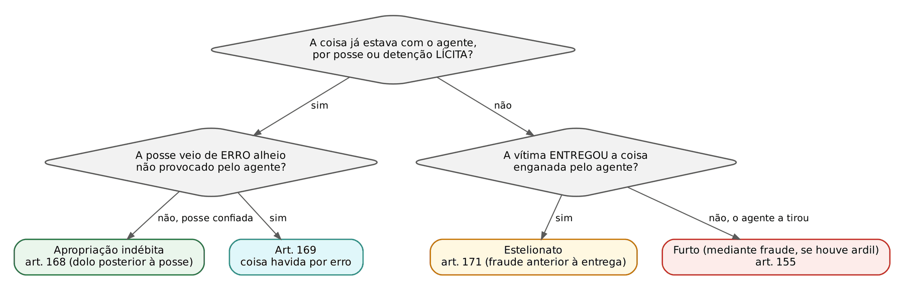
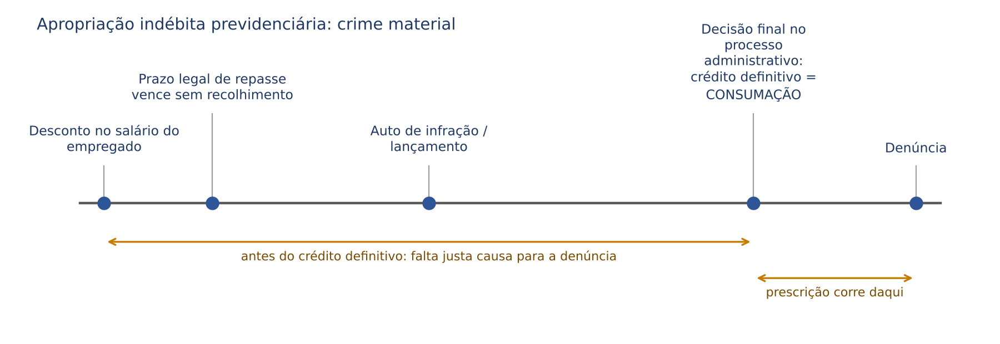
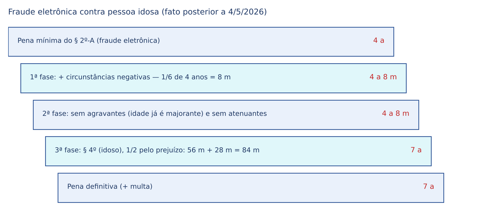
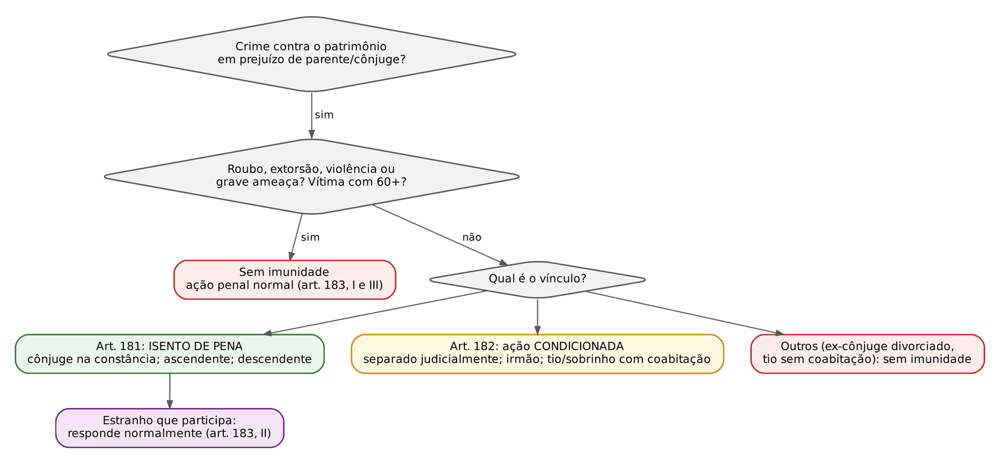

# CAPÍTULO 30 — CRIMES CONTRA O PATRIMÔNIO II: APROPRIAÇÃO INDÉBITA, ESTELIONATO E FRAUDES ELETRÔNICAS, RECEPTAÇÃO E IMUNIDADES PATRIMONIAIS

:::INCIDENCIA
TRF5 p. 9; TJRS p. 5; TJSC p. 39. Nível A. Lote de 12 questões (FGV 11, FCC 1), todas com gabarito oficial.
O que mais cai: distinguir apropriação indébita, estelionato, art. 169 e furto mediante fraude; natureza material do art. 168-A; fraude eletrônica contra pessoa idosa e ação penal; receptação qualificada e o novo art. 180-A (Lei 15.397/2026); imunidades dos arts. 181 a 183, inclusive na violência doméstica.
:::

| Subtema | FGV | FCC | Padrão de cobrança |
|---|---|---|---|
| Apropriação indébita comum e majorada | 2 | 0 | caso concreto: dolo superveniente à posse lícita; tutor = majorante |
| Apropriação indébita previdenciária | 2 | 0 | natureza material x formal; pagamento e perdão judicial |
| Estelionato e fraude eletrônica | 2 | 1 | distinguir de apropriação e furto; tentativa; idoso + ação penal |
| Receptação (art. 180 e 180-A) | 2 | 0 | qualificada pelo comércio; receptação de animal (2026) |
| Fraude à execução | 1 | 0 | ação penal privada |
| Imunidades (arts. 181 a 183) | 2 | 0 | sobrinho sem coabitação; escusa e violência de gênero |

## 30.1 O mapa dos crimes patrimoniais sem violência

### 30.1.1 A pergunta que resolve quase toda questão

Aqui o agente não subtrai: já tem a coisa e decide ficar com ela (apropriação indébita), engana a vítima para que ela própria entregue (estelionato) ou se beneficia do crime de outra pessoa (receptação). Para o civilista: a apropriação é o descumprimento do dever de restituir que vira crime porque o agente passa a agir como dono; o estelionato é um dolo civil (art. 145 do CC) com intenção de lesar desde o início.

O critério decisivo é o MOMENTO em que surge o dolo e QUEM transferiu a coisa:

| Crime | Como a coisa chega ao agente | Quando nasce o dolo | Exemplo |
|---|---|---|---|
| Furto (art. 155 — Cap. 29) | o agente a retira, sem consentimento | antes da subtração | pega a carteira esquecida na mesa |
| Furto mediante fraude (art. 155, § 4º, II) | o agente a retira; a fraude só distrai a vigilância | antes | finge-se interessado e foge com o relógio que provava |
| Estelionato (art. 171) | a vítima ENTREGA, enganada, querendo transferir a posse | ANTES da entrega (dolo *ab initio*) | falso manobrista recebe a chave e some com o carro |
| Apropriação indébita (art. 168) | a vítima entrega LIVREMENTE, sem engano | DEPOIS da posse (dolo superveniente) | toma o livro emprestado de boa-fé e depois resolve não devolver |
| Apropriação de coisa havida por erro (art. 169) | chega por erro espontâneo da vítima ou acaso | depois, ao perceber o erro | recebe na conta um PIX enviado por engano e não devolve |

Correlata de outro capítulo: FGV 2024 — ENAM (Q2459916, Cap. 29): falso manobrista que recebe as chaves e se apossa do veículo comete ESTELIONATO (gabarito A), não furto mediante fraude, porque a vítima entregou a posse por estar enganada.

### 30.1.2 Alterações legislativas que atingem este capítulo

| Lei (vigência) | Dispositivo | O que mudou |
|---|---|---|
| Lei 14.155/2021 (28/5/2021) | art. 171, §§ 2º-A, 2º-B e 4º; art. 70, § 4º, do CPP | criou a fraude eletrônica (4 a 8 anos), a majorante do servidor no exterior, a majorante de 1/3 ao dobro contra idoso ou vulnerável e a competência pelo domicílio da vítima |
| Lei 15.181/2025 (29/7/2025) | art. 180, § 7º | receptação de fios, cabos e equipamentos de energia, telefonia, dados ou cargas ferroviárias e metroviárias: pena em dobro |
| Lei 15.358/2026 (25/3/2026) | art. 180, § 5º (REVOGADO) e § 8º (novo) | acabou com o perdão judicial da receptação culposa e com o privilégio da receptação dolosa; aumento de 2/3 para integrante de organização criminosa ultraviolenta, grupo paramilitar ou milícia |
| Lei 15.397/2026 (4/5/2026) | art. 171, § 2º, VII; § 2º-A; § 5º (REVOGADO); art. 180, caput; art. 180-A | cessão de conta laranja; ampliação dos meios da fraude eletrônica (duplicação de dispositivo, aplicação de internet); estelionato volta a ser de ação pública incondicionada; receptação simples passa a 2 a 6 anos; receptação de animal passa a 3 a 8 anos e abrange animal DOMÉSTICO |

:::ATENCAO Direito intertemporal
Tudo o que a Lei 15.358/2026 e a Lei 15.397/2026 trouxeram neste capítulo é mais grave: vale só para fatos praticados a partir de 25/3/2026 (Lei 15.358) ou de 4/5/2026 (Lei 15.397). Exemplos: receptação simples de 3/5/2026 tem pena de 1 a 4 anos; a de 4/5/2026, de 2 a 6 anos. Receptação culposa de primário praticada em fevereiro de 2026 ainda admite perdão judicial (o § 5º revogado é ultra-ativo para fatos anteriores). Estelionato de março de 2026 continua dependendo de representação (Cap. 20, 20.5.1). Nos crimes permanentes (receptação na modalidade ocultar ou ter em depósito) e no crime continuado, se a conduta avança para a vigência da lei nova, aplica-se esta (Súmula 711 do STF — ver Cap. 3).
:::

## 30.2 Apropriação indébita (art. 168)

### 30.2.1 O tipo: posse lícita anterior e dolo posterior

Art. 168: apropriar-se de coisa alheia móvel, de que tem a posse ou a detenção. Pena: reclusão de 1 a 4 anos e multa (não alterada em 2026).

Elementos, um a um:

- Posse ou detenção LÍCITA e DESVIGIADA, recebida da vítima (depósito, comodato, mandato, locação, transporte, penhor). Se a posse é vigiada (o caixa que manipula dinheiro sob fiscalização do patrão, o cliente que prova a roupa no provador), quem fica com a coisa subtrai: é furto.
- Apropriação: o agente passa a se comportar como dono (*animus rem sibi habendi*), invertendo o título da posse. Manifesta-se por atos de disposição (vender, doar, consumir) ou pela recusa em restituir (negativa de devolução, ocultação).
- Coisa alheia móvel: inclui dinheiro. Coisa fungível entregue para consumo (mútuo) passa à propriedade de quem recebe (art. 587 do CC); não restituir o equivalente é inadimplemento civil, não crime. Mas o dinheiro recebido para entrega a terceiro (o advogado que levanta o alvará do cliente, o síndico que recebe as cotas) continua alheio.
- Dolo SUPERVENIENTE: a vontade de se apropriar surge depois de a posse ter sido recebida de boa-fé. Se existia desde o início e foi a razão de pedir a coisa, a vítima foi enganada: estelionato.

:::QUESTAO FGV 2024 — TJ-MS — Analista Judiciário — Área Fim (Q2489735)
Caso: amigo pede emprestado, legitimamente, livro raro; no dia da devolução, "embora pretendesse, inicialmente," devolver, muda de ideia e fica com a obra como dono. Gabarito oficial: B — apropriação indébita. Armadilhas: estelionato (não houve fraude anterior à entrega) e furto qualificado (a coisa não foi subtraída; já estava na posse lícita do agente).
:::

Direito de retenção: quem retém a coisa para garantir crédito legítimo (arts. 644 e 1.219 do CC) não se apropria, porque falta o *animus rem sibi habendi*; reter para cobrar crédito duvidoso pode ser exercício arbitrário das próprias razões (art. 345 — Cap. 36).

:::PEGADINHA Prestação de contas não é condição do crime
Para mandatários e administradores (advogado, sócio-gerente), o STJ entende que a ação de prestação de contas no cível NÃO é condição de procedibilidade da ação penal: basta prova da apropriação. O que se exige é demonstrar o dolo, e não mero atraso ou divergência contábil.
:::

### 30.2.2 Consumação, tentativa e reparação

A apropriação indébita é crime material e se consuma no momento em que o agente inverte o título da posse, isto é, quando pratica o ato de dono (a venda, a recusa de devolver). Como esse momento é interno e muitas vezes só se revela pela recusa, a prova costuma vir da notificação para restituir seguida de silêncio ou negativa. A tentativa é admitida pela doutrina majoritária quando o ato de disposição é fracionável (o depositário é surpreendido no momento em que entrega a coisa ao comprador); na apropriação por simples negativa, é impossível.

A restituição posterior NÃO extingue a punibilidade: antes do recebimento da denúncia, arrependimento posterior (art. 16, redução de 1/3 a 2/3); depois, atenuante (art. 65, III, "b") (ver Cap. 8 e STJ, HC 452.163, já desenvolvido ali). Correlata: FGV 2026 — TJ-PR — Juiz Substituto (Q3898928, Cap. 21): restituição integral do valor apropriado ANTES da denúncia não extingue a punibilidade (a alternativa que dizia isso estava errada); o gabarito foi a extinção pela morte do agente.

Ação penal: pública incondicionada, salvo as imunidades dos arts. 181 e 182 (30.7). Competência territorial: lugar em que ocorreu a inversão da posse (onde o agente deveria restituir e não restituiu, ou onde dispôs da coisa).

### 30.2.3 Majorante do § 1º: aumento de 1/3

:::LEI Código Penal, art. 168, § 1º
§ 1º - A pena é aumentada de um terço, quando o agente recebeu a coisa: I - em depósito necessário; II - na qualidade de tutor, curador, síndico, liquidatário, inventariante, testamenteiro ou depositário judicial; III - em razão de ofício, emprego ou profissão.
:::

Por que aumenta: nas três hipóteses a vítima não escolhe livremente a quem confia o bem, ou confia em razão de um dever qualificado de lealdade. Detalhes cobráveis:

- Inciso I: depósito necessário é o legal e o miserável (art. 647 do CC); para o hoteleiro que se apropria da bagagem do hóspede, a doutrina majoritária aplica o inciso III.
- Inciso II: rol taxativo de funções de confiança em encargos de ordem pública. "Síndico" e "liquidatário" referem-se à antiga Lei de Falências (hoje administrador judicial); a analogia para incluir o administrador judicial é questionada (analogia *in malam partem*). O síndico de condomínio NÃO é o síndico do inciso II; se cabível, incide o inciso III.
- Inciso III: profissionais que recebem a coisa por causa do ofício (advogado, contador, despachante, leiloeiro, empregado que recebe valores do cliente).

:::QUESTAO FGV 2025 — MPE-RJ — Analista do Ministério Público — Área Processual (Q3362527)
Caso: tutor recebe e guarda, legitimamente, cordão de ouro do adolescente tutelado e, meses depois, nega-se dolosamente a devolvê-lo, agindo como dono. Gabarito oficial: A — apropriação indébita simples com causa de aumento (art. 168, § 1º, II). Armadilhas: chamar o § 1º de "qualificadora" (é majorante de fração fixa, 3ª fase) e falar em estelionato (não houve engano anterior à entrega).
:::

:::JURIS STJ, REsp 2.215.933-SC, Quinta Turma, j. 2/9/2025 (Info 861)
Tese: o sócio-administrador nomeado depositário judicial que se apropria ou deixa de restituir bens penhorados da sociedade empresária responde por apropriação indébita MAJORADA (art. 168, § 1º, II), independentemente dos vínculos societários. Lógica: ao assumir o encargo, ele passa a deter os bens por força da nomeação judicial (posse em nome da Justiça), e não na qualidade de sócio; a confusão patrimonial alegada pela defesa é irrelevante.
:::

Se o agente é funcionário público e se apropria de bem de que tem a posse em razão do cargo, o crime é peculato (art. 312 — Cap. 35), tipo especial em relação ao art. 168. Bem particular em poder da Administração (veículo apreendido no pátio) também gera peculato.

### 30.2.4 Apropriações privilegiadas do art. 169 e o art. 170

O art. 169 reúne três figuras de menor gravidade, punidas com detenção de 1 mês a 1 ano, ou multa (infrações de menor potencial ofensivo):

| Figura | Conduta | Ponto de prova |
|---|---|---|
| Coisa havida por erro, caso fortuito ou força da natureza (caput) | apropriar-se de coisa alheia que veio ao seu poder por erro (o entregador deixa a encomenda na casa errada; o PIX vai para a conta errada), caso fortuito ou força da natureza (o boi do vizinho que a enchente levou para o seu pasto) | o erro é ESPONTÂNEO da vítima; se o agente o provocou ou o manteve com fraude ativa, é estelionato |
| Apropriação de tesouro (parágrafo único, I) | quem acha tesouro em prédio alheio e se apropria, no todo ou em parte, da quota a que tem direito o proprietário do prédio | o achador tem direito à metade (art. 1.264 do CC); o crime incide sobre a metade do dono do terreno |
| Apropriação de coisa achada (parágrafo único, II) | quem acha coisa alheia PERDIDA e dela se apropria, total ou parcialmente, deixando de restituí-la ao dono ou legítimo possuidor ou de entregá-la à autoridade competente dentro de 15 (quinze) dias | crime a prazo: só se consuma após os 15 dias; coisa abandonada (*res derelicta*) não gera crime; coisa apenas esquecida em local conhecido pelo dono (a bolsa deixada na mesa do restaurante, que o dono vai buscar) é furto, não coisa perdida |

:::QUESTAO FGV 2024 — ENAM — Exame Nacional da Magistratura (2024.2) (Q3058675)
Caso: entregador de loja toca a campainha e pergunta se ali é o endereço de quem encomendou e pagou uma garrafa de vinho de 1.500 (mil e quinhentos) reais; o morador, percebendo o engano, confirma FALSAMENTE ser o comprador, recebe a garrafa e a consome. Gabarito oficial: B — estelionato. Fundamento: o erro inicial do entregador foi espontâneo, mas o agente o MANTEVE mediante afirmação falsa, e foi essa fraude que determinou a entrega ("induzindo ou MANTENDO alguém em erro"). Armadilha: alternativa D, art. 169 (seria o caso se o morador recebesse o vinho em silêncio, sem nada afirmar, e só depois decidisse ficar com ele); furto mediante fraude e furto por destreza não cabem porque a coisa foi entregue.
:::

Art. 170: aos crimes do capítulo da apropriação indébita (arts. 168 a 169) aplica-se o privilégio do art. 155, § 2º (réu primário e coisa de pequeno valor: substituir reclusão por detenção, diminuir de 1/3 a 2/3 ou aplicar só multa — Cap. 29). O STJ estende ao privilégio a mesma métrica do furto: pequeno valor é o que não excede um salário mínimo na data do fato.

### 30.2.5 Ficha da apropriação indébita

| Crime | Pena | Elemento subjetivo | Consumação e tentativa | Ação penal | Benefícios |
|---|---|---|---|---|---|
| Art. 168, caput | reclusão 1 a 4 anos e multa | dolo superveniente + *animus rem sibi habendi* | inversão da posse; tentativa só se o ato de disposição for fracionável | pública incondicionada (ressalvados arts. 181 e 182) | suspensão do processo (mínimo 1 ano); ANPP; substituição; privilégio (art. 170) |
| Art. 168, § 1º | 1 a 4 anos + 1/3 (1 ano e 4 meses a 5 anos e 4 meses) | idem | idem | idem | suspensão do processo NÃO (as majorantes entram no cálculo e o mínimo passa de 1 ano — ver Cap. 25); ANPP sim (mínimo < 4 anos) |
| Art. 169 e parágrafo único | detenção 1 mês a 1 ano, ou multa | dolo (na coisa achada, após 15 dias) | a coisa achada é crime a prazo | pública incondicionada | transação penal (Lei 9.099) |

## 30.3 Apropriação indébita previdenciária (art. 168-A)

### 30.3.1 O tipo e quem responde

Art. 168-A: deixar de repassar à Previdência Social as contribuições recolhidas dos contribuintes, no prazo e forma legal ou convencional. Pena: reclusão de 2 a 5 anos e multa. O § 1º estende a pena a quem deixa de: I — recolher, no prazo legal, contribuição ou outra importância destinada à Previdência que tenha sido descontada de pagamento efetuado a segurados, a terceiros ou arrecadada do público; II — recolher contribuições devidas à Previdência que tenham integrado despesas contábeis ou custos relativos à venda de produtos ou à prestação de serviços; III — pagar benefício devido a segurado, quando as respectivas cotas ou valores já tiverem sido reembolsados à empresa pela Previdência.

O caso típico de prova é o do § 1º, I: a empresa desconta do salário do empregado a contribuição dele e não a repassa. Daí o nome "apropriação": o empregador é mero intermediário de dinheiro que já é da Previdência.

Sujeito ativo: quem decide sobre o recolhimento (sócio-administrador, diretor financeiro); a denúncia contra todos os sócios só por constarem do contrato social é inepta. Sujeito passivo: a União e, mediatamente, os segurados. Competência: Justiça Federal (art. 109, IV, da CF).

### 30.3.2 Natureza: omissivo próprio, de dolo genérico, e MATERIAL

Três classificações convivem e a FGV gosta de misturá-las:

- Omissivo próprio: a conduta é um "deixar de" descrito no tipo (Cap. 6). Não admite tentativa.
- Dolo genérico: basta a vontade livre e consciente de não repassar; não se exige *animus rem sibi habendi* nem intenção de fraudar (STJ, Terceira Seção; JT ed. 87, tese 7 — ver Cap. 6 e 7). A comprovada impossibilidade financeira, que torne inexigível o recolhimento, pode excluir a culpabilidade, com ônus da defesa (Cap. 10).
- Material: o STF e o STJ entendem que o crime só se consuma com a CONSTITUIÇÃO DEFINITIVA do crédito tributário na via administrativa, aplicando ao art. 168-A a lógica da Súmula Vinculante 24 (a SV fala dos crimes do art. 1º, I a IV, da Lei 8.137/1990, mas o raciocínio foi estendido a esta contribuição, que tem natureza tributária). Antes disso, falta justa causa para a ação penal, e a prescrição não corre.

:::QUESTAO FGV 2025 — TJ-MS — Juiz Substituto (Q3786409)
Caso: contribuições descontadas em 2017 e 2018; auto de infração em 2019; processo administrativo encerrado em 2022; denúncia em 2023. Gabarito oficial: A — delito de natureza MATERIAL, que se consuma com a constituição definitiva do crédito tributário. Armadilhas: "omissivo próprio e instantâneo, dispensada a constituição definitiva" (B), "formal" (C), "permanente" (D) e "de mera conduta" (E). Note que "omissivo próprio" é verdadeiro, mas a parte "dispensada a constituição definitiva" torna a B errada. No mesmo sentido: FGV 2025 — Prefeitura de Canaã dos Carajás — Procurador (Q3265487, Cap. 45): denúncia oferecida antes do lançamento definitivo carece de justa causa (gabarito D).
:::

:::JURIS STJ, Jurisprudência em Teses, ed. 87, tese 6
"O crime de apropriação indébita previdenciária (art. 168-A do CP) é de natureza material e exige a constituição definitiva do débito tributário perante o âmbito administrativo para configurar-se como conduta típica." Consequências práticas: (1) o inquérito pode ser instaurado antes, mas a denúncia não; (2) o termo inicial da prescrição é a data da constituição definitiva; (3) a impugnação administrativa suspende, na prática, a persecução penal.
:::

Concurso com a sonegação de contribuição previdenciária (art. 337-A): concurso material, sem continuidade, por serem crimes de espécies diversas (Tema 1.353 do STJ — ver Cap. 16). Continuidade entre vários meses de não repasse do art. 168-A: sim, crime continuado (Cap. 16).

### 30.3.3 Pagamento, parcelamento e perdão judicial

Este é o ponto mais traiçoeiro, porque há duas camadas de regras: as do próprio CP (§§ 2º a 4º) e as das leis tributárias especiais, que são mais benéficas e acabaram prevalecendo.

:::LEI Código Penal, art. 168-A, §§ 2º a 4º
§ 2º É extinta a punibilidade se o agente, espontaneamente, declara, confessa e efetua o pagamento das contribuições, importâncias ou valores e presta as informações devidas à previdência social, na forma definida em lei ou regulamento, antes do início da ação fiscal.
§ 3º É facultado ao juiz deixar de aplicar a pena ou aplicar somente a de multa se o agente for primário e de bons antecedentes, desde que: I – tenha promovido, após o início da ação fiscal e antes de oferecida a denúncia, o pagamento da contribuição social previdenciária, inclusive acessórios; ou II – o valor das contribuições devidas, inclusive acessórios, seja igual ou inferior àquele estabelecido pela previdência social, administrativamente, como sendo o mínimo para o ajuizamento de suas execuções fiscais.
§ 4º A faculdade prevista no § 3º deste artigo não se aplica aos casos de parcelamento de contribuições cujo valor, inclusive dos acessórios, seja superior àquele estabelecido, administrativamente, como sendo o mínimo para o ajuizamento de suas execuções fiscais.
§ 5º A extinção de punibilidade de que trata o § 2º deste artigo não se aplica ao agente declarado devedor contumaz em decisão administrativa definitiva e inscrito no Cadastro Informativo dos créditos não quitados do setor público federal (Cadin), previsto na Lei nº 10.522, de 19 de julho de 2002.
§ 6º O fato de o agente deixar de ser considerado devedor contumaz não afasta o disposto no § 5º deste artigo em relação aos atos praticados no período em que era assim considerado.
(§§ 5º e 6º incluídos pela LC 225/2026, de 8/1/2026, DOU de 9/1/2026, vigentes na publicação.)
:::

Atenção à novidade de 2026: o devedor contumaz (conceito e requisitos da LC 225/2026 no Cap. 45) não se beneficia da extinção da punibilidade do § 2º, e a LC 225/2026 restringiu também os benefícios do pagamento e do parcelamento nas leis especiais (Cap. 45). Como a regra é mais gravosa, só alcança fatos posteriores a 9/1/2026 (o § 6º alcança apenas os atos praticados enquanto o agente era contumaz).

| Momento | Pelo CP | Pelas leis especiais (prevalecem por serem mais benéficas) |
|---|---|---|
| Antes do início da ação fiscal, com declaração e pagamento espontâneos | extinção da punibilidade (§ 2º) | idem |
| Depois da ação fiscal e antes da denúncia | perdão judicial ou só multa, se primário e de bons antecedentes, com pagamento integral e acessórios (§ 3º, I) | o pagamento INTEGRAL extingue a punibilidade a qualquer tempo (art. 9º, § 2º, da Lei 10.684/2003; art. 69 da Lei 11.941/2009) |
| Parcelamento | — | suspende a pretensão punitiva (e a prescrição) enquanto cumprido, desde que formalizado ANTES do recebimento da denúncia (art. 83, §§ 2º e 4º, da Lei 9.430/1996, com a redação da Lei 12.382/2011); quitado, extingue a punibilidade |
| Depois do recebimento da denúncia | — | pagamento integral extingue a punibilidade (STF e STJ) |

Por que isso cai: o candidato que só leu o CP marca que o pagamento após a denúncia é irrelevante, quando, pela legislação especial, ele extingue a punibilidade. O detalhe técnico que a banca explora é o verbo: o pagamento EXTINGUE A PUNIBILIDADE (art. 107 do CP, rol não taxativo); não gera "absolvição" (Cap. 21). O regime especial de pagamento e parcelamento dos crimes tributários é desenvolvido no Cap. 45.

:::QUESTAO FGV 2025 — TRT 24ª Região — Analista Judiciário — Oficial de Justiça Avaliador Federal (Q3349706)
Caso: sócio REINCIDENTE em crime doloso deixa de repassar contribuições descontadas dos empregados. Gabarito oficial: E — responderá por apropriação indébita previdenciária. Por que as outras erram: (A) pagamento PARCIAL após a ação fiscal não gera "absolvição", e o § 3º exige pagamento integral, primariedade e bons antecedentes (o agente é reincidente); (B) pagamento após a ação penal extingue a punibilidade pelas leis especiais, mas não é causa de "absolvição"; (C) e (D) a conduta é formalmente típica e é crime, não mero ilícito administrativo.
:::

Insignificância: a orientação atual do STJ é pela inaplicabilidade aos crimes previdenciários (ver Cap. 2, com o registro da divergência histórica). Não confunda com o perdão do § 3º, II, que pressupõe crime e é faculdade do juiz.

:::SENTENCA Art. 168-A na sentença
Onde entra: na materialidade, cite a representação fiscal para fins penais e a certidão de constituição definitiva do crédito (data). Na autoria, demonstre o poder de gestão do réu à época (contrato social, depoimentos, assinatura de guias), não só a qualidade de sócio. Teses defensivas a enfrentar: dificuldade financeira (exige prova documental robusta e contemporânea: balanços, pedidos de recuperação judicial), parcelamento (certidão da Receita) e pagamento. Redação-modelo: "A materialidade está comprovada pela representação fiscal e pela constituição definitiva do crédito em 10/3/2022, termo inicial do prazo prescricional; a autoria recai sobre o réu, que, como sócio-administrador, decidia quais obrigações seriam pagas." Erro comum: contar a prescrição da data de cada desconto.
:::

## 30.4 Estelionato (art. 171)

### 30.4.1 Estrutura: quatro elementos em cadeia

Art. 171, caput: obter, para si ou para outrem, vantagem ilícita, em prejuízo alheio, induzindo ou mantendo alguém em erro, mediante artifício, ardil, ou qualquer outro meio fraudulento. Pena: reclusão de 1 a 5 anos e multa (a Lei 15.397/2026 reescreveu o preceito sem mudar a pena).

O estelionato é um crime de cadeia causal: cada elo deve provocar o seguinte. Faltando um, ou o crime é outro, ou não há crime.

- Fraude (o meio): artifício é a encenação material (disfarce, documento, uniforme falso, site clonado); ardil é a conversa enganosa, a mentira verbal; "qualquer outro meio fraudulento" abrange até o SILÊNCIO de quem tem o dever de esclarecer (fórmula genérica que autoriza a interpretação analógica).
- Erro (o efeito na vítima): falsa percepção da realidade. O tipo admite duas modalidades: INDUZIR (o agente cria o erro) e MANTER (o erro já existia e o agente o sustenta — Q3058675, 30.2.4).
- Disposição patrimonial: é a própria vítima, enganada, que entrega a coisa ou faz a transferência. É o que separa o estelionato do furto mediante fraude, em que o agente subtrai (Cap. 29, 29.2.6).
- Vantagem ilícita e prejuízo alheio (o duplo resultado): a vantagem pode ser de qualquer natureza patrimonial (dinheiro, bem, serviço, liberação de dívida). Se a vantagem é DEVIDA (o agente usa ardil para receber o que lhe devem), não há estelionato; pode haver exercício arbitrário das próprias razões (art. 345 — Cap. 36).

A pessoa enganada e a pessoa prejudicada podem ser diferentes (estelionato "triangular"): o funcionário do banco é enganado pelo documento falso e o banco suporta o prejuízo. Mas é preciso que haja uma PESSOA enganada: máquina não erra. Quem usa senha obtida ilicitamente para transferir dinheiro sem enganar ninguém comete furto mediante fraude por meio eletrônico (art. 155, § 4º-B — Cap. 29).

### 30.4.2 Fraude penal x fraude civil, torpeza bilateral e meio grosseiro

Nem todo negócio desonesto é crime. A fronteira entre o ilícito civil (dolo do art. 145 do CC, inadimplemento) e o estelionato está no DOLO ANTERIOR de não cumprir e na fraude como causa da disposição. Quem compra a prazo e depois não paga, porque a empresa quebrou, é devedor; quem compra a prazo usando nome de empresa de fachada, já planejando não pagar, é estelionatário. Na sentença, o juiz deve apontar os indícios do dolo *ab initio* (identidade falsa, empresa sem existência real, desaparecimento após o recebimento, reiteração com várias vítimas), e não apenas o inadimplemento.

Torpeza bilateral: a vítima que também age de má-fé (paga para "comprar" vaga em concurso, cai no "golpe do bilhete premiado" achando que vai lucrar) continua vítima de estelionato. Nélson Hungria sustentava a atipicidade; prevalece (Noronha, Bitencourt, Masson e a jurisprudência) que há crime, porque a boa-fé da vítima não é elementar e o patrimônio continua tutelado.

Meio grosseiro: se a fraude é tão evidente que não engana o homem médio, o meio é absolutamente ineficaz e há crime impossível (art. 17 — Cap. 8). A análise é feita no caso concreto, considerando a vítima real (uma fraude grosseira para o homem médio pode enganar pessoa idosa ou de pouca instrução, e então o meio é eficaz). Correlata: papel-moeda GROSSEIRAMENTE falsificado gera estelionato, não moeda falsa (Súmula 73 do STJ — v. Cap. 34).

Estelionato x extorsão: se a vítima entrega por estar ENGANADA, é estelionato; se por estar AMEAÇADA, extorsão (exigir pagamento para devolver documentos que o próprio agente "acharia" é ardil, não grave ameaça — STJ, HC 1.066.889, Info 904, desenvolvido no Cap. 29).

### 30.4.3 Consumação e tentativa

Crime material de duplo resultado: consuma-se quando o agente obtém a vantagem ilícita e a vítima sofre o prejuízo. Se a vítima, enganada, faz a ordem de pagamento, mas o banco a bloqueia, há tentativa. A competência tem regra própria em vários casos (30.4.8).

:::QUESTAO FGV 2024 — TRF 1ª Região — Técnico Judiciário — Agente da Polícia Judicial (Q3029968)
Caso: em reunião na agência da Caixa, o agente emprega meio fraudulento para induzir a gerente em erro e obter 5.000 (cinco mil) reais em prejuízo da estatal; a execução começou, mas o crime não se consumou por circunstâncias alheias à sua vontade, sem hipótese de crime impossível. Gabarito oficial: D — tentativa de estelionato simples. Armadilhas: apropriação indébita (a coisa nunca esteve na posse do agente) e furto (não houve subtração; a fraude visava a entrega). Repare que a banca não cogitou do § 3º (entidade de direito público) para a Caixa, empresa pública de direito privado (ver 30.4.7). Competência: Justiça Federal (art. 109, I e IV, da CF).
:::

### 30.4.4 Estelionato privilegiado (§ 1º)

Se o criminoso é primário e é de pequeno valor o PREJUÍZO, o juiz pode aplicar o art. 155, § 2º (substituir reclusão por detenção, diminuir de 1/3 a 2/3 ou aplicar só multa — Cap. 29, 29.2.5). Duas diferenças em relação ao furto privilegiado:

- no furto, mede-se o valor da COISA; no estelionato, o valor do PREJUÍZO (se a vítima recupera parte, considera-se o prejuízo efetivo apurado no momento da consumação);
- a jurisprudência usa o mesmo teto de um salário mínimo vigente na data do fato.

O privilégio é compatível, em tese, com as majorantes dos §§ 3º e 4º e com a forma do § 2º-A (critério análogo ao da Súmula 511 do STJ para o furto qualificado), mas raramente terá aplicação prática nas fraudes eletrônicas de valor relevante.

### 30.4.5 Figuras equiparadas (§ 2º): "nas mesmas penas incorre quem"

| Inciso | Rubrica | Conduta | Observação de prova |
|---|---|---|---|
| I | disposição de coisa alheia como própria | vende, permuta, dá em pagamento, em locação ou em garantia coisa alheia como própria | o "estelionato do imóvel alheio"; o terceiro de boa-fé é vítima |
| II | alienação ou oneração fraudulenta de coisa própria | vende, permuta, dá em pagamento ou em garantia coisa própria inalienável, gravada de ônus ou litigiosa, ou imóvel prometido a terceiro em prestações, SILENCIANDO sobre isso | crime por omissão de informação |
| III | defraudação de penhor | defrauda a garantia pignoratícia, quando tem a posse do objeto empenhado | o devedor que vende o bem dado em penhor que ficou em seu poder |
| IV | fraude na entrega de coisa | defrauda substância, qualidade ou quantidade de coisa que deve entregar | se em atividade comercial ao consumidor, ver art. 175 e Lei 8.137/1990 (Cap. 45) |
| V | fraude para recebimento de indenização ou valor de seguro | destrói ou oculta coisa própria, ou lesa o próprio corpo ou a saúde, ou agrava as consequências da lesão ou doença, com o intuito de haver indenização ou seguro | crime FORMAL: consuma-se com a destruição ou a autolesão, ainda que o seguro não seja pago; a autolesão aqui é punível porque atinge o patrimônio da seguradora |
| VI | fraude no pagamento por meio de cheque | emite cheque sem suficiente provisão de fundos em poder do sacado, ou lhe frustra o pagamento | ver abaixo |
| VII | cessão de conta laranja (Lei 15.397/2026) | cede, gratuita ou onerosamente, conta bancária para que nela transitem recursos destinados ao financiamento de atividade criminosa ou que dela sejam fruto | só para fatos a partir de 4/5/2026 |

Cheque sem fundos (inciso VI) — as súmulas que ainda caem:

- Súmula 246 do STF: "Comprovado não ter havido fraude, não se configura o crime de emissão de cheque sem fundos." O cheque é ordem de pagamento à vista; quem o emite já sabendo da falta de fundos para obter a mercadoria engana. Por isso o cheque PRÉ-DATADO, dado como garantia de dívida, não configura o crime (JT ed. 84, tese 11), e o cheque emitido para pagar dívida PREEXISTENTE também não, porque não há vantagem obtida pela fraude (a dívida já existia).
- Súmula 554 do STF: pagamento depois do recebimento da denúncia não obsta a ação penal; lida *a contrario*, o pagamento ANTES do recebimento extingue a punibilidade. Desenvolvida no Cap. 8 (8.5.6). O STJ restringe essa extinção ao inciso VI; no estelionato comum, a reparação gera só o art. 16 (JT ed. 84, tese 8).
- Súmula 521 do STF e Súmula 244 do STJ (competência do local da RECUSA do pagamento pelo sacado): SUPERADAS pelo art. 70, § 4º, do CPP (30.4.8). Súmula 48 do STJ (cheque FALSIFICADO: competência do local da obtenção da vantagem) trata do estelionato do caput com cheque de terceiro, fora do § 4º, e permanece aplicável.

:::PEGADINHA Frustrar o pagamento
"Frustrar o pagamento" é sustar o cheque ou retirar os fundos depois de emiti-lo, com fraude. Sustar porque a mercadoria veio com defeito é exercício de direito (não há fraude — Súmula 246).
:::

Conta laranja (inciso VII). Antes de 2026, quem emprestava a conta ao golpista só era punido como partícipe do estelionato, se provado o ajuste com cada golpe. O tipo autônomo (1 a 5 anos) dispensa essa prova: (1) é doloso, exigindo ao menos dolo eventual quanto à destinação criminosa; (2) não exige fraude nem vítima enganada, embora esteja no § 2º do estelionato; (3) para a doutrina inicial, é formal e se consuma com a cessão, ainda sem jurisprudência; (4) havendo ajuste prévio com um golpe determinado, a relação com a participação no estelionato está em aberto (ver nota).

### 30.4.6 Fraude eletrônica (§§ 2º-A e 2º-B)

:::LEI Código Penal, art. 171, §§ 2º-A e 2º-B
§ 2º-A. A pena é de reclusão, de 4 (quatro) a 8 (oito) anos, e multa, se a fraude é cometida com a utilização de informações fornecidas pela vítima ou por terceiro induzido a erro por meio de redes sociais, contatos telefônicos, envio de correio eletrônico fraudulento, duplicação de dispositivo eletrônico ou aplicação de internet, ou por qualquer outro meio fraudulento análogo. (Redação da Lei 15.397/2026)
§ 2º-B. A pena prevista no § 2º-A deste artigo, considerada a relevância do resultado gravoso, aumenta-se de 1/3 (um terço) a 2/3 (dois terços), se o crime é praticado mediante a utilização de servidor mantido fora do território nacional. (Incluído pela Lei 14.155/2021)
:::

Natureza: o § 2º-A é QUALIFICADORA (novo intervalo de pena, 4 a 8 anos), não majorante; entra na primeira fase como ponto de partida (Cap. 13). O § 2º-B é majorante (terceira fase) e só se aplica sobre o § 2º-A.

O que caracteriza a fraude eletrônica: a vítima (ou um terceiro enganado) FORNECE as informações (senha, código de verificação, dados do cartão) ou faz a transferência, enganada por meio de rede social, telefone, e-mail, clonagem de aplicativo de mensagens ("duplicação de dispositivo eletrônico", incluída em 2026), aplicativo ou meio análogo. Exemplos: o falso funcionário do banco que pede o código por telefone; o golpe do "filho com número novo" no aplicativo de mensagens; o falso boleto enviado por e-mail; o falso anúncio em rede social.

| Situação | Crime |
|---|---|
| A vítima, enganada pelo falso atendente, informa a senha e o agente faz a transferência | fraude eletrônica (art. 171, § 2º-A): a informação foi FORNECIDA pela vítima induzida em erro |
| A vítima, enganada, faz ela mesma o PIX para o golpista | fraude eletrônica |
| O agente instala programa malicioso, captura a senha sem a vítima perceber e transfere | furto mediante fraude eletrônica (art. 155, § 4º-B — Cap. 29): não houve entrega pela vítima |

:::QUESTAO FCC 2026 — MPE-AL — Analista de Ministério Público — Área Jurídica (Q4092725)
Caso: vítima de 72 anos recebe mensagem por aplicativo cobrando falsa dívida com a Receita Federal e, enganada, paga 10.000 (dez mil) reais por PIX; dois agentes são presos. Gabarito oficial: C — fraude eletrônica, com aumento de 1/3 ao dobro pela idade da vítima (art. 171, § 4º), em ação penal pública incondicionada. Por que as outras erram: (A e D) estelionato "simples" ignora a qualificadora do § 2º-A; (B e E) ação condicionada é erro em qualquer cenário: para fatos a partir de 4/5/2026, o § 5º foi revogado; para fatos anteriores, o próprio § 5º, IV, dispensava a representação quando a vítima tinha mais de 70 anos. A (E) ainda troca a fração (1/6 à metade não existe no § 4º).
:::

Concurso de crimes: várias transferências fraudulentas, em dias distintos, contra vítimas diferentes, com a mesma conta e o mesmo modo de agir caracterizam continuidade delitiva (FGV 2026 — TJ-PR — Juiz Substituto, Q3898929, gabarito E — ver Cap. 16).

### 30.4.7 Majorantes: entidade de direito público (§ 3º) e idoso ou vulnerável (§ 4º)

§ 3º: a pena aumenta-se de 1/3 se o crime é cometido em detrimento de entidade de direito público ou de instituto de economia popular, assistência social ou beneficência. Entidade de direito público é a pessoa jurídica de direito público: União, Estados, DF, Municípios, autarquias (inclusive o INSS) e fundações públicas de direito público.

:::JURIS STJ, Súmula 24
"Aplica-se ao crime de estelionato, em que figure como vítima entidade autárquica da previdência social, a qualificadora do § 3º, do art. 171 do Código Penal." Atenção: a súmula usa "qualificadora" em sentido impróprio; o § 3º é MAJORANTE (fração fixa de 1/3, terceira fase). Empresas públicas e sociedades de economia mista (Caixa, Banco do Brasil, Correios) têm personalidade de direito privado e, pela literalidade, não são "entidade de direito público"; a aplicação do § 3º a elas não é pacífica e depende de enquadrá-las como instituto de economia popular (ver nota de verificação).
:::

§ 4º (Lei 14.155/2021): "A pena aumenta-se de 1/3 (um terço) ao dobro, se o crime é cometido contra idoso ou vulnerável, considerada a relevância do resultado gravoso." Pontos cobráveis:

- idoso é a pessoa com 60 anos ou mais (Estatuto da Pessoa Idosa); vulnerável é conceito aberto: criança, adolescente, pessoa com deficiência ou enfermidade que reduza o discernimento, e a pessoa em situação concreta de vulnerabilidade (fundamentar);
- a fração varia de 1/3 ao dobro conforme a "relevância do resultado gravoso": o critério legal é o tamanho do dano, não o número de circunstâncias. Prejuízo de poucas centenas de reais justifica 1/3; perda das economias de uma vida, o dobro. A fração precisa ser fundamentada concretamente (lógica da Súmula 443 do STJ — Cap. 15);
- aplicado o § 4º, NÃO incide a agravante do art. 61, II, "h" (crime contra maior de 60 anos), sob pena de *bis in idem* (Cap. 14);
- o § 4º se aplica também ao estelionato eletrônico do § 2º-A (as duas coisas cumulam: qualificadora + majorante);
- direito intertemporal: a redação anterior (Lei 13.228/2015) dobrava a pena só para o idoso; para ele, a fração variável de 2021 é mais benéfica e retroage; para o vulnerável não idoso, a majorante é nova e não retroage. Correlata: FGV 2026 — DPE-RJ (Q4289360, Cap. 3), lei mais grave no curso de continuidade delitiva contra idosa (Súmula 711 do STF).

Estelionato previdenciário: é o estelionato contra o INSS (§ 3º), em geral para obter ou manter benefício indevido. A sua natureza depende de QUEM o pratica (teoria binária, adotada pelo STF e pelo STJ — JT ed. 84, teses 4 e 5):

| Autor | Natureza | Termo inicial da prescrição |
|---|---|---|
| O próprio beneficiário, que recebe as parcelas | crime PERMANENTE (a lesão se renova a cada recebimento, por sua vontade) | cessação do recebimento indevido |
| Terceiro que pratica a fraude em favor de outrem (o servidor que insere dados falsos, o intermediário que fabrica o documento) | crime INSTANTÂNEO DE EFEITOS PERMANENTES | recebimento da primeira parcela |
| Terceiro que, após a morte do segurado, continua sacando o benefício com o cartão dele | crime continuado (cada saque, uma nova fraude — JT ed. 84, tese 6) | cada saque |

O cálculo da prescrição com a teoria binária (Q3179519, TRF3 2025) está resolvido no Cap. 22 (22.6.1). Outros pontos:

- a devolução dos valores ao INSS antes do recebimento da denúncia NÃO extingue a punibilidade; pode configurar arrependimento posterior (JT ed. 84, tese 7);
- a insignificância é inaplicável ao estelionato contra a Administração Pública (JT ed. 84, tese 2);
- não há estelionato quando o benefício é obtido SEM fraude no preenchimento dos requisitos, ainda que depois se discuta o direito a ele: o erro administrativo do INSS não transforma o recebimento em vantagem ilícita (STJ, AgRg no REsp 2.230.017-PB, Quinta Turma, j. 9/12/2025, Info 878);
- Súmula 107 do STJ: compete à Justiça ESTADUAL o estelionato praticado mediante falsificação das guias de recolhimento das contribuições previdenciárias, quando não ocorrente lesão à autarquia federal (o prejudicado é o particular que pagou a guia falsa).

### 30.4.8 Ação penal e competência

:::PROCESSO Ação penal no estelionato
Desenvolvido no Cap. 20 (20.5.1). Em uma linha: fato até 22/1/2020, incondicionada; de 23/1/2020 a 3/5/2026, condicionada à representação (art. 171, § 5º), salvo vítima Administração Pública, criança ou adolescente, pessoa com deficiência mental, maior de 70 anos ou incapaz; fato a partir de 4/5/2026, incondicionada (Lei 15.397/2026 revogou o § 5º, sem retroagir). A pergunta é sempre a DATA DO FATO.
:::

Competência territorial (art. 70, § 4º, do CPP, incluído pela Lei 14.155/2021): nos crimes de estelionato praticados mediante DEPÓSITO, mediante emissão de CHEQUES sem suficiente provisão de fundos em poder do sacado ou com o pagamento frustrado, ou mediante TRANSFERÊNCIA de valores, a competência é definida pelo local do DOMICÍLIO DA VÍTIMA; havendo pluralidade de vítimas, pela prevenção. Por que a lei fez isso: antes, a competência era a do local da obtenção da vantagem (a agência da conta do golpista, muitas vezes em outro Estado), o que dificultava a investigação e afastava a vítima do processo.

| Hipótese | Foro |
|---|---|
| Estelionato por depósito, transferência (PIX, TED) ou cheque sem fundos/frustrado | domicílio da vítima (art. 70, § 4º, CPP); várias vítimas: prevenção |
| Estelionato com cheque FALSIFICADO de terceiro | local da obtenção da vantagem (Súmula 48 do STJ) |
| Demais estelionatos | local da consumação (art. 70, caput), identificado pelo STJ com o local do prejuízo (JT ed. 84, tese 9) |
| Vítima União, autarquia federal (INSS) ou empresa pública federal (Caixa) | Justiça Federal (art. 109, IV, CF); guias previdenciárias falsas sem lesão ao INSS: Justiça Estadual (Súmula 107 do STJ) |
| Papel-moeda grosseiramente falsificado | Justiça Estadual (Súmula 73 do STJ — v. Cap. 34) |

O STJ (Terceira Seção) entendeu que o art. 70, § 4º, por ser norma processual, tem aplicação imediata, inclusive a inquéritos e processos relativos a fatos anteriores, ressalvados os atos já praticados (CC 180.832, 2021 — ver nota de verificação).

### 30.4.9 Estelionato e outros tipos: especialidade e consunção

- Falso documental usado para o estelionato: se o falso se exaure no estelionato, sem mais potencialidade lesiva, é absorvido (Súmula 17 do STJ — desenvolvida no Cap. 3). Se o documento continua apto a novas fraudes, concurso de crimes.
- Fraude para obter financiamento em instituição financeira: crime contra o Sistema Financeiro Nacional (art. 19 da Lei 7.492/1986), de competência federal, e não estelionato (FGV 2025 — TRF3 — Juiz Federal, Q3179518, gabarito E — ver Cap. 47).
- Apropriação ou desvio de proventos da pessoa idosa (art. 102) e indução de idosa sem discernimento a outorgar procuração (art. 106): crimes especiais do Estatuto da Pessoa Idosa (Cap. 42), que prevalecem sobre os arts. 168 e 173.
- Fraude cometida por funcionário público contra a Administração, valendo-se do cargo: peculato-estelionato (art. 313) ou peculato, conforme o caso (Cap. 35).

### 30.4.10 Dosimetria típica e sentença

:::EXEMPLO Fraude eletrônica contra pessoa idosa (fato de 10/6/2026)
Caso: golpista, primário, por aplicativo de mensagens, passa-se pelo filho de vítima de 68 anos e a convence a transferir 80.000 (oitenta mil) reais, quase todas as suas economias. Condenado por fraude eletrônica (art. 171, § 2º-A) com a majorante do § 4º.
1ª fase: o tipo do § 2º-A parte de 4 anos (pena de 4 a 8). Circunstâncias do crime desfavoráveis: o agente montou perfil falso com fotos do filho da vítima e usou contas de terceiros para pulverizar o dinheiro (sofisticação acima do comum para o tipo). O PREJUÍZO não é valorado aqui, porque será o critério da 3ª fase (evita-se *bis in idem*). Pelo parâmetro de 1/6 sobre a pena mínima: 4 anos = 48 meses; 48 ÷ 6 = 8 meses; pena-base = 4 anos e 8 meses. Pelo critério de 1/8 do intervalo: intervalo = 8 − 4 = 4 anos = 48 meses; 48 ÷ 8 = 6 meses; pena-base = 4 anos e 6 meses. Ambos são aceitos pelo STJ (Cap. 13); adotamos 1/6.
2ª fase: sem agravantes (a do art. 61, II, "h" não incide, porque a idade já é majorante — *bis in idem*) e sem atenuantes. Pena intermediária: 4 anos e 8 meses.
3ª fase: § 4º, de 1/3 ao dobro "considerada a relevância do resultado gravoso". O prejuízo de 80.000 (oitenta mil) reais, quase todas as economias da vítima, é relevante, mas não extremo a ponto de justificar o dobro: fração de 1/2, fundamentada no dano concreto. Conta: 4 anos e 8 meses = 56 meses; 56 × 1/2 = 28 meses; 56 + 28 = 84 meses = 7 anos.
Pena definitiva: 7 anos de reclusão e multa. Regime inicial: semiaberto (primário, pena superior a 4 e não excedente a 8 — art. 33, § 2º, "b"; Cap. 17). Sem substituição (pena superior a 4 anos).
Variante: se o fato fosse de 2025, a pena seria a mesma (o § 2º-A já tinha 4 a 8 anos desde 2021), mas a ação penal seria condicionada à representação, porque a vítima tinha menos de 70 anos (antigo § 5º).
:::

:::SENTENCA Estelionato na sentença
Onde entra: na fundamentação da materialidade e da autoria, descreva os quatro elos (fraude, erro, disposição, vantagem com prejuízo) e prove o dolo ANTERIOR (para afastar a tese de ilícito meramente civil). Verifique antes a condição de procedibilidade conforme a data do fato (representação até 3/5/2026, salvo exceções). Na dosimetria: o prejuízo ordinário é inerente ao tipo e não serve para exasperar a pena-base; prejuízo vultoso sim. Na fixação do valor mínimo de reparação (art. 387, IV, do CPP), use o prejuízo apurado, se houve pedido e contraditório. Redação-modelo: "O dolo antecedente evidencia-se pela criação de perfil falso dias antes do contato e pelo bloqueio da vítima logo após a transferência, o que afasta a tese de mero desacordo comercial." Erros que a banca pune: aplicar o § 4º e a agravante da idade ao mesmo tempo; chamar o § 2º-A de majorante; aplicar a ação condicionada a fato posterior a 4/5/2026.
:::

### 30.4.11 Ficha do estelionato

| Crime | Pena | Elemento subjetivo | Consumação e tentativa | Ação penal | Benefícios |
|---|---|---|---|---|---|
| Estelionato (caput e § 2º, I a VI) | reclusão 1 a 5 anos e multa | dolo anterior + fim de vantagem ilícita | obtenção da vantagem com prejuízo; tentativa admitida (inciso V: formal) | incondicionada para fatos a partir de 4/5/2026; antes, condicionada (salvo exceções) | suspensão do processo (mínimo 1 ano); ANPP; substituição; privilégio (§ 1º) |
| Cessão de conta laranja (§ 2º, VII) | reclusão 1 a 5 anos e multa | dolo de ceder conhecendo a destinação | com a cessão (formal — a confirmar) | incondicionada | idem |
| Fraude eletrônica (§ 2º-A) | reclusão 4 a 8 anos e multa | idem | idem | idem | ANPP em tese NÃO (mínimo de 4 anos, e com majorantes ainda mais); sem suspensão; substituição só se pena final ≤ 4 anos |
| Majorantes | § 2º-B: + 1/3 a 2/3; § 3º: + 1/3; § 4º: + 1/3 ao dobro | — | — | — | competência: domicílio da vítima nos casos do art. 70, § 4º, CPP |

## 30.5 Outras fraudes do Capítulo VI (arts. 172 a 179)

Baixa incidência; cobrança pela literalidade (verbo, pena, ação penal):

| Artigo | Crime | Conduta essencial | Pena | Ponto de prova |
|---|---|---|---|---|
| 172 | duplicata simulada | emitir fatura, duplicata ou nota de venda que não corresponda à mercadoria vendida ou ao serviço prestado | detenção 2 a 4 anos e multa | crime FORMAL: consuma-se com a emissão, sem prejuízo; abrange a duplicata "fria", sem venda alguma |
| 173 | abuso de incapazes | abusar da necessidade, paixão ou inexperiência de criança ou adolescente ("menor", no texto legal), ou da alienação ou debilidade mental de outrem, induzindo-o a ato jurídico prejudicial | reclusão 2 a 6 anos e multa | formal (basta o ato apto a produzir efeito jurídico); vítima idosa sem discernimento: art. 106 do Estatuto da Pessoa Idosa (especial) |
| 174 | induzimento à especulação | abusar da inexperiência ou simplicidade de outrem, induzindo-o a jogo, aposta ou especulação que sabe ou deve saber ruinosa | reclusão 1 a 3 anos e multa | admite dolo eventual ("deve saber") |
| 175 | fraude no comércio | enganar o adquirente ou consumidor, no comércio, vendendo mercadoria falsificada ou deteriorada como perfeita, ou entregando uma por outra; § 1º: alterar metal ou pedra em obra encomendada | detenção 6 meses a 2 anos, ou multa; § 1º: reclusão 1 a 5 anos e multa | § 2º manda aplicar o privilégio do art. 155, § 2º; relação de consumo pode atrair a Lei 8.137/1990, art. 7º (Cap. 45) |
| 176 | outras fraudes | tomar refeição em restaurante, alojar-se em hotel ou utilizar-se de meio de transporte sem dispor de recursos para efetuar o pagamento | detenção 15 dias a 2 meses, ou multa | ação pública CONDICIONADA à representação; o juiz pode deixar de aplicar a pena (perdão judicial); quem tem dinheiro e simplesmente não paga não comete este crime ("sem dispor de recursos") |
| 177 | fraudes e abusos na fundação ou administração de sociedade por ações | fundar sociedade por ações com afirmação falsa ou ocultação de fato relevante; § 1º: condutas de administradores | reclusão 1 a 4 anos e multa, "se o fato não constitui crime contra a economia popular" | subsidiariedade EXPRESSA |
| 178 | emissão irregular de conhecimento de depósito ou *warrant* | emitir esses títulos em desacordo com disposição legal | reclusão 1 a 4 anos e multa | norma penal em branco (Decreto 1.102/1903) |
| 179 | fraude à execução | fraudar execução, alienando, desviando, destruindo ou danificando bens, ou simulando dívidas | detenção 6 meses a 2 anos, ou multa | ação penal PRIVADA (parágrafo único) |

Fraude à execução (art. 179): além da ineficácia civil (art. 792 do CPC), o crime exige execução em curso (há divergência sobre bastar o processo de conhecimento) e dolo de frustrar o credor. Ação privada; se o exequente é ente público, pública incondicionada (art. 24, § 2º, CPP). O depositário judicial que desvia o bem penhorado comete apropriação indébita majorada (30.2.3).

:::QUESTAO FGV 2026 — AL-RO — Consultor Legislativo (Q3882052)
Caso: agente desvia bens para fraudar execução em curso; o Ministério Público toma ciência por denúncia anônima. Gabarito oficial: C — fraude à execução, de ação penal de iniciativa PRIVADA. Armadilha: a menção ao Ministério Público induz a marcar ação pública (A ou B); o MP não tem legitimidade, salvo se o exequente for ente público (art. 24, § 2º, CPP).
:::

## 30.6 Receptação (arts. 180 e 180-A)

### 30.6.1 O tipo básico e a lógica do crime acessório

A receptação existe porque o mercado de produtos de crime alimenta o próprio crime: quem compra o celular roubado financia o próximo roubo. Por isso a lei pune quem se beneficia de crime ANTERIOR praticado por outra pessoa. É crime acessório (depende de um crime antecedente) mas AUTÔNOMO (punido independentemente da punição do autor do antecedente).

:::LEI Código Penal, art. 180, caput (pena dada pela Lei 15.397/2026)
Art. 180 - Adquirir, receber, transportar, conduzir ou ocultar, em proveito próprio ou alheio, coisa que sabe ser produto de crime, ou influir para que terceiro, de boa-fé, a adquira, receba ou oculte: Pena - reclusão, de 2 (dois) a 6 (seis) anos, e multa.
:::

Dissecando:

- Receptação PRÓPRIA (primeira parte): adquirir, receber, transportar, conduzir ou ocultar. Tipo misto alternativo: várias condutas sobre a mesma coisa formam um só crime (Cap. 3). Nas modalidades transportar, conduzir e ocultar, o crime é PERMANENTE, e o flagrante perdura enquanto o agente mantém o bem (JT ed. 87, tese 12); adquirir e receber são instantâneos.
- Receptação IMPRÓPRIA (segunda parte): influir para que terceiro DE BOA-FÉ adquira, receba ou oculte. É crime formal: consuma-se com a influência, ainda que o terceiro não adquira. Se o terceiro está de má-fé, ele é receptador próprio e quem influiu é partícipe.
- "Coisa": móvel, para a doutrina majoritária (imóvel pode gerar lavagem — Cap. 46); talonário de cheques serve (JT ed. 87, tese 14).
- "Produto de crime": não de contravenção; pode ser produto de receptação anterior (receptação em cadeia).
- Elemento subjetivo: dolo DIRETO ("sabe ser"), segundo a doutrina majoritária; a dúvida (dolo eventual) desloca a conduta para a receptação culposa (§ 3º), salvo na forma qualificada (§ 1º, "deve saber").
- "Em proveito próprio ou alheio": o proveito alheio não pode ser o do próprio autor do crime antecedente. Quem ajuda o ladrão a guardar a coisa EM PROVEITO DO LADRÃO comete favorecimento real (art. 349 — Cap. 36), não receptação.

Sujeito ativo: qualquer pessoa, EXCETO o autor, coautor ou partícipe do crime antecedente. Para eles, o aproveitamento da coisa é *post factum* impunível (o autor do roubo que depois conduz o carro roubado não responde por receptação — STJ, HC 179.927, desenvolvido no Cap. 3). O critério para saber se o sujeito é partícipe do antecedente ou receptador é o momento do ajuste: se prometeu ANTES do crime que receberia ou esconderia a coisa, reforçou a decisão do autor e é partícipe do crime antecedente (Cap. 11).

Correlata do Cap. 29 — FGV 2024 — TJ-SC — Juiz Substituto (Q3049374). Caso: o amigo, ao saber que o outro pretende furtar um automóvel, oferece antecipadamente seu sítio, em outro Estado, para esconder o veículo; o furto é praticado e o carro, escondido lá. Gabarito oficial: B — furto qualificado (participação no furto do § 5º, transporte de veículo para outro Estado). Armadilhas: receptação (C e D) e favorecimento real (E) pressupõem ajuda NÃO prometida antes do crime.

### 30.6.2 Autonomia: o § 4º e o art. 108

"A receptação é punível, ainda que desconhecido ou isento de pena o autor do crime de que proveio a coisa" (§ 4º). Basta provar que a coisa é produto de crime; não é preciso identificar ou condenar o autor. Também não importa que o autor do antecedente seja inimputável ou tenha escusa absolutória (o filho que furta o pai é isento — art. 181 —, mas quem compra do filho, sabendo, é receptador). E o art. 108 do CP: a extinção da punibilidade do crime que é PRESSUPOSTO de outro não se estende a este.

Correlata do Cap. 21 — FGV 2025 — ENAM 2025.1 (Q3362381). Caso: declarada extinta a punibilidade do estelionato antecedente pela decadência do direito de representação, a defesa da compradora pede a extensão à receptação. Gabarito oficial: E — o juiz NÃO deve estender, porque a extinção da punibilidade do crime que é pressuposto de outro não se comunica a este (art. 108). Armadilhas: as alternativas trocam "pressuposto" por "conexo" ou "elemento" e invertem a conclusão.

Exceções em que a sorte do antecedente importa: se o fato antecedente for ATÍPICO (*abolitio criminis* ou absolvição por inexistência do fato), desaparece a "coisa produto de crime" e, com ela, a receptação. A prova da origem ilícita pode ser feita no próprio processo da receptação.

Prova do dolo: o dolo é inferido das circunstâncias (preço vil, ausência de documentos, vendedor desconhecido, horário e local da compra). O STJ entende que, apreendido o bem em poder do acusado, cabe à defesa apresentar prova da origem lícita ou da conduta culposa (art. 156 do CPP), sem que isso seja inversão do ônus da prova (JT ed. 87, tese 13). A tese é criticada pela doutrina garantista, mas é a que cai em prova objetiva.

### 30.6.3 Receptação qualificada (§ 1º): o comerciante e o "deve saber"

:::LEI Código Penal, art. 180, §§ 1º e 2º
§ 1º - Adquirir, receber, transportar, conduzir, ocultar, ter em depósito, desmontar, montar, remontar, vender, expor à venda, ou de qualquer forma utilizar, em proveito próprio ou alheio, no exercício de atividade comercial ou industrial, coisa que deve saber ser produto de crime: Pena - reclusão, de 3 (três) a 8 (oito) anos, e multa.
§ 2º - Equipara-se à atividade comercial, para efeito do parágrafo anterior, qualquer forma de comércio irregular ou clandestino, inclusive o exercício em residência.
:::

É crime próprio (do comerciante ou industrial, inclusive o irregular, o camelô, o desmanche clandestino e o comércio feito em casa). Por que a pena é maior: o comerciante dá ao produto do crime a aparência de mercadoria regular e o espalha no mercado (JT ed. 87, tese 16).

O nó do § 1º é o elemento subjetivo. "Deve saber" indica DOLO EVENTUAL, o que gerou um paradoxo: o comerciante com dolo eventual teria pena maior que o com dolo direto ("sabe"), que ficaria no caput. Parte da doutrina (Alberto Silva Franco) sustentou a inconstitucionalidade da pena do § 1º. Prevaleceu que "deve saber" ABRANGE o dolo direto e o eventual (quem sabe também "deve saber"), e o § 1º é constitucional (STF, RE 443.388, Segunda Turma, 2009; STJ, Terceira Seção). É a posição de prova.

Os elementos do § 1º comunicam-se aos corréus que sabem da atividade comercial, ainda que não sejam comerciantes (STJ, AgRg no AREsp 2.712.504, Info 863 — ver Cap. 11).

:::QUESTAO FGV 2025 — Analista (prova não identificada no banco) (Q3171981)
Caso: dono de pequeno estabelecimento de compra e venda de eletrônicos expõe à venda, em proveito próprio, no exercício da atividade comercial, celular que DEVERIA SABER ser produto de crime. Gabarito oficial: C — receptação qualificada (art. 180, § 1º). Armadilhas: fraude no comércio (não há engano do consumidor quanto à qualidade da mercadoria) e apropriação indébita. No mesmo sentido: FGV 2026 — TJ-GO — Juiz Substituto (Q3966673, Cap. 29): dono de ferro-velho que compra cobre de cabos furtados, sem perguntar a origem nem exigir documento, responde por receptação QUALIFICADA (gabarito C), e não culposa.
:::

### 30.6.4 Receptação culposa (§ 3º) e o fim do perdão judicial

§ 3º: "Adquirir ou receber coisa que, por sua natureza ou pela desproporção entre o valor e o preço, ou pela condição de quem a oferece, deve presumir-se obtida por meio criminoso: Pena — detenção, de 1 (um) mês a 1 (um) ano, ou multa, ou ambas as penas."

É um tipo culposo FECHADO, raro no CP: em vez de falar genericamente em "imprudência", a lei indica os três indícios que deveriam ter alertado o agente (natureza da coisa, como arma ou joia sem procedência; preço desproporcional; condição de quem oferece, como adolescente oferecendo notebook). Só dois verbos (adquirir e receber); transportar ou ocultar culposamente é atípico. Infração de menor potencial ofensivo.

:::ATENCAO Lei 15.358/2026: revogação do § 5º do art. 180
O § 5º dizia: na receptação culposa, se o criminoso é primário, o juiz pode, considerando as circunstâncias, deixar de aplicar a pena (perdão judicial); na receptação dolosa, aplica-se o privilégio do art. 155, § 2º. A Lei 15.358/2026 (art. 33) REVOGOU o § 5º inteiro. Consequências: (1) para fatos a partir de 25/3/2026, não há mais perdão judicial na receptação culposa nem privilégio na receptação dolosa; (2) para fatos anteriores, o § 5º continua aplicável (ultra-atividade da lei mais benéfica — art. 5º, XL, da CF); (3) as obras e questões anteriores a 2026 que cobram o § 5º (inclusive o quadro de perdão judicial do Cap. 21, 21.7.2) devem ser lidas com essa ressalva. A revogação abrange as duas partes do parágrafo, e não apenas o privilégio, como chegou a ser noticiado; conferir eventual correção legislativa posterior (ver nota de verificação).
:::

### 30.6.5 Bens públicos (§ 6º), infraestrutura (§ 7º) e crime organizado (§ 8º)

| Parágrafo | Hipótese | Consequência | Natureza |
|---|---|---|---|
| § 6º (Lei 13.531/2017) | bens do patrimônio da União, Estado, DF, Município, autarquia, fundação pública, empresa pública, sociedade de economia mista ou concessionária de serviço público | aplica-se EM DOBRO a pena do CAPUT | majorante (3ª fase); só para a receptação simples dolosa, não para a qualificada nem para a culposa |
| § 7º (Lei 15.181/2025) | fios, cabos ou equipamentos de energia elétrica, telefonia, transferência de dados, ou cargas transportadas em modais ferroviários ou metroviários | aplica-se em dobro a pena do caput OU do § 1º, conforme o caso | majorante; alcança também a qualificada |
| § 8º (Lei 15.358/2026) | crime cometido por integrante de organização criminosa ultraviolenta, grupo paramilitar ou milícia privada, no contexto da sua atuação | aumenta-se a pena de 2/3 | majorante |

:::EXEMPLO Receptação de bem público: cálculo e direito intertemporal
Caso: réu primário, sem circunstâncias negativas, recebe, sabendo da origem, computador furtado de escola estadual.
Fato de 10/7/2026: caput, 2 a 6 anos. 1ª fase: 2 anos. 2ª fase: 2 anos. 3ª fase: § 6º, "aplica-se em dobro": 2 × 2 = 4 anos. Pena: 4 anos de reclusão e multa; regime aberto (art. 33, § 2º, "c"); substituição cabível (sem violência e pena não superior a 4 anos — art. 44).
Fato de 10/4/2026 (antes da Lei 15.397/2026): caput, 1 a 4 anos; 1 × 2 = 2 anos. Antes da Lei 15.358/2026 (fato de 10/2/2026), o réu ainda poderia pleitear o privilégio do antigo § 5º, se o bem fosse de pequeno valor.
Se o receptador fosse comerciante (§ 1º, 3 a 8), o § 6º NÃO incidiria (ele dobra a pena "prevista no caput"); se o bem fosse cabo de energia, incidiria o § 7º sobre o § 1º: 3 × 2 = 6 anos.
:::

### 30.6.6 Receptação de animal (art. 180-A)

:::LEI Código Penal, art. 180-A (redação da Lei 15.397/2026)
Art. 180-A. Adquirir, receber, transportar, conduzir, ocultar, ter em depósito ou vender, com a finalidade de produção ou de comercialização, semovente domesticável de produção, ainda que abatido ou dividido em partes, ou animal doméstico, que sabe ou deve saber ser produto de crime: Pena - reclusão, de 3 (três) a 8 (oito) anos, e multa.
:::

Criado pela Lei 13.330/2016 para o abigeato (gado, ovinos, suínos, inclusive abatidos e em partes), com pena de 2 a 5 anos. A Lei 15.397/2026 elevou a pena para 3 a 8 anos e incluiu o ANIMAL DOMÉSTICO (cães, gatos, aves). Características: crime comum (não exige comerciante); exige finalidade especial de produção ou de comercialização (sem ela, aplica-se o art. 180); admite dolo direto e eventual ("sabe ou deve saber"). É norma ESPECIAL em relação ao art. 180, inclusive ao § 1º. O furto do animal é o do art. 155, § 6º (Cap. 29).

:::QUESTAO FGV 2026 — TJ-PE — Juiz Substituto (Q4349506)
Caso (fato de 10/6/2026): dono de pet shop compra, por preço vil, sem documentos e com pagamento só em espécie, um cão de raça que devia saber ser furtado, e o mantém na loja para revender. Gabarito oficial: B — receptação de animal (art. 180-A): o animal doméstico passou a integrar o tipo, há finalidade de comercialização e dolo eventual ("deve saber"). Armadilhas: (A) dizer que cão não está no tipo e aplicar o § 1º do art. 180 (era a solução ANTES de 4/5/2026, quando o 180-A só abrangia semovente de produção); (C) inventar majorante; (D) receptação culposa (o "deve saber" do 180-A abrange o dolo eventual); (E) atribuir a figura à Lei de Crimes Ambientais.
:::

### 30.6.7 Concursos e conflitos frequentes

- Receptação e porte ilegal da arma receptada: concurso material, sem consunção (JT ed. 87, tese 15 — Estatuto do Desarmamento no Cap. 39).
- Receptação de veículo e adulteração de sinal identificador (art. 311): crimes autônomos; mas conduzir veículo SEM PLACA não se enquadra no art. 311, § 2º, III, que fala em sinal "adulterado ou remarcado", e não suprimido (FCC 2025 — DPE-AM, Q3531588, gabarito E — ver Cap. 34).
- Peculato: o particular que, em ajuste prévio com o servidor, recebe em sua conta o dinheiro desviado é coautor de peculato, não receptador (FGV 2025 — MPE-RJ, Q3532360, gabarito A — Cap. 35).

### 30.6.8 Ficha da receptação

| Crime | Pena (fatos desde 4/5/2026) | Elemento subjetivo | Consumação | Ação penal | Benefícios |
|---|---|---|---|---|---|
| Art. 180, caput | reclusão 2 a 6 anos e multa (antes: 1 a 4) | dolo direto ("sabe") | adquirir/receber: instantâneo; transportar, conduzir, ocultar: permanente; imprópria: formal | pública incondicionada (ressalvados arts. 181 e 182) | suspensão do processo NÃO (mínimo 2 anos; antes cabia); ANPP sim; substituição |
| Art. 180, § 1º | reclusão 3 a 8 anos e multa | "deve saber": dolo direto e eventual | idem | idem | ANPP sim (mínimo < 4) |
| Art. 180, § 3º | detenção 1 mês a 1 ano, ou multa, ou ambas | culpa (tipo fechado) | adquirir ou receber | idem | transação penal; perdão judicial só para fatos até 24/3/2026 |
| Art. 180, §§ 6º a 8º | dobro do caput (§ 6º); dobro do caput ou do § 1º (§ 7º); + 2/3 (§ 8º) | — | — | — | — |
| Art. 180-A | reclusão 3 a 8 anos e multa (antes: 2 a 5) | sabe ou deve saber + fim de produção ou comércio | idem | idem | ANPP sim |

:::SENTENCA Receptação na sentença
Onde entra: na materialidade, prove a origem criminosa (boletim de ocorrência do crime antecedente, auto de reconhecimento pela vítima). No dolo, enumere os indícios concretos (preço, documentos, vendedor, local). Se a prova não alcança o "sabia", considere a desclassificação para a culposa (art. 383 do CPP, *emendatio libelli*, se os fatos narrados permitirem; caso contrário, *mutatio libelli*, art. 384). Redação-modelo: "A aquisição de aparelho avaliado em 4.000 (quatro mil) reais por 300 (trezentos) reais, de pessoa desconhecida, à noite e sem nota fiscal, revela que o acusado sabia da origem ilícita, não se tratando de mera desatenção." Erros comuns: aplicar o § 6º sobre o § 1º; aplicar o perdão judicial a fato posterior a 24/3/2026; aplicar pena nova a fato anterior a 4/5/2026.
:::

## 30.7 Disposições gerais: imunidades patrimoniais (arts. 181 a 183)

### 30.7.1 O sistema

A natureza jurídica das escusas absolutórias e a diferença para as condições objetivas de punibilidade estão no Cap. 20 (20.13). Aqui interessa a aplicação aos crimes patrimoniais. A razão de política criminal: preservar a família e evitar que o processo penal agrave a desagregação doméstica por questões patrimoniais que podem ser resolvidas internamente.

| | Imunidade ABSOLUTA (art. 181) | Imunidade RELATIVA (art. 182) |
|---|---|---|
| Efeito | "é isento de pena": escusa absolutória; não há sequer ação penal contra o beneficiário | "somente se procede mediante representação": transforma a ação em pública condicionada |
| Vítimas | I — cônjuge, na constância da sociedade conjugal; II — ascendente ou descendente, de qualquer parentesco (legítimo ou ilegítimo, civil ou natural) | I — cônjuge desquitado ou judicialmente separado; II — irmão, legítimo ou ilegítimo; III — tio ou sobrinho, COM QUEM O AGENTE COABITA |
| Exceções (art. 183) | I — roubo, extorsão ou qualquer crime com emprego de grave ameaça ou violência à pessoa; II — o estranho que participa do crime; III — vítima com 60 anos ou mais | as mesmas |

Detalhes que a banca explora:

- Valem para todos os crimes do Título II, salvo o art. 183; não para crimes de outros títulos (peculato, crimes tributários).
- Não confunda com o art. 183-A (Lei 14.967/2024, Estatuto da Segurança Privada), causa de aumento geral do Título II: "Nos crimes de que trata este Título, quando cometidos contra as instituições financeiras e os prestadores de serviço de segurança privada, de que trata o Estatuto da Segurança Privada e da Segurança das Instituições Financeiras, as penas serão aumentadas de 1/3 (um terço) até o dobro." Alcança furto, roubo, estelionato, receptação e os demais crimes patrimoniais contra bancos e empresas de segurança (lei mais grave: só fatos posteriores à sua vigência).
- Divorciado não tem imunidade. Como o STF (Tema 1.053) afirmou que a separação judicial não subsiste como figura autônoma após a EC 66/2010, o art. 182, I, ficou restrito a separações antigas não convertidas em divórcio.
- Companheiro: a doutrina majoritária estende o art. 181, I, por analogia *in bonam partem* (art. 226, § 3º, da CF); há posição contrária.
- Sociedade conjugal "na constância": a separação de fato não a desfaz formalmente; prevalece que o cônjuge separado de fato continua imune (há precedentes em sentido contrário, considerando a ruptura da vida em comum — tema controvertido).
- Coabitação (art. 182, III) exige convivência sob o mesmo teto, não visita eventual. Sem coabitação, tio e sobrinho não têm imunidade nenhuma.
- A idade de 60 anos é aferida na data do fato (art. 183, III, incluído pelo Estatuto da Pessoa Idosa).
- O estranho que participa responde normalmente (art. 183, II): a escusa é pessoal e não se comunica (art. 30 do CP — Cap. 11). Correlato: quem compra do filho o bem furtado do pai é receptador (30.6.2).

:::QUESTAO FGV 2026 — TJ-MS — Analista Judiciário — Área Fim (Q3856351)
Caso: agente subtrai, sem violência, 2.000 (dois mil) reais do sobrinho, de 50 anos, sem coabitação. Gabarito oficial: E — responde por furto em ação penal pública incondicionada. Armadilhas: representação (B) só caberia se houvesse coabitação (art. 182, III); isenção de pena (C) é só para ascendente, descendente e cônjuge (art. 181); queixa (A) não existe no sistema das imunidades.
:::

### 30.7.2 Escusa absolutória e violência patrimonial contra a mulher

A Lei Maria da Penha define violência patrimonial como forma de violência doméstica (art. 7º, IV, da Lei 11.340/2006: retenção, subtração, destruição de bens, documentos e recursos da mulher). Surge o choque: o marido que subtrai bens da esposa, sem violência física, estaria isento de pena pelo art. 181, I?

Três posições:

- Prevalência do art. 181 (posição tradicional do STJ): a Lei 11.340/2006 não revogou expressa nem tacitamente o art. 181, e o art. 183 não traz a violência doméstica entre as exceções; criar exceção por interpretação seria analogia *in malam partem* (STJ, RHC 42.918, Quinta Turma, 2014). Para quem adota esta posição, a "violência" do art. 183, I, é a violência FÍSICA contra a pessoa, não a violência patrimonial.
- Inaplicabilidade por controle de convencionalidade: a Convenção de Belém do Pará (Decreto 1.973/1996) obriga o Estado a punir a violência contra a mulher, inclusive a patrimonial; a escusa, editada em 1940 num contexto de hierarquia conjugal, não sobreviveria ao controle de convencionalidade nesse contexto, o que é recomendado pelo Protocolo para Julgamento com Perspectiva de Gênero do CNJ (de observância obrigatória pela Resolução CNJ 492/2023). Parte da doutrina e do Ministério Público.
- Inconstitucionalidade parcial sem redução de texto: objeto das ADPFs 1.185 (Conamp, 2024) e 1.241 (Partido Verde, 2025), com parecer favorável da PGR na primeira; sem julgamento de mérito localizado até a redação deste capítulo.

:::QUESTAO FGV 2026 — TRF 2ª Região — Juiz Federal Substituto (Q3996905)
Caso: marido denunciado por crimes patrimoniais contra a esposa, em contexto de violência doméstica, alega a escusa do art. 181; o MP invoca o Protocolo de Julgamento com Perspectiva de Gênero. Gabarito oficial: B — assiste razão ao MP, pelo controle de convencionalidade da escusa à luz da Convenção de Belém do Pará, com eficácia paralisante sobre a norma, como recomenda o Protocolo. Por que as outras erram, na lógica da banca: (A) o fundamento não é o Protocolo "por si", que não é norma penal, mas a Convenção (norma supralegal); (C) não se trata de aplicar o Protocolo *in malam partem*, e sim de afastar norma interna incompatível com tratado; (D) e (E) negam o conflito. Atenção: o gabarito adota posição que NÃO é a da jurisprudência tradicional do STJ (RHC 42.918) e está pendente no STF (ADPFs 1.185 e 1.241). Em prova da FGV, especialmente para a magistratura federal, siga o gabarito; em prova de outras bancas, verifique se a pergunta é "segundo o STJ".
:::

:::SENTENCA Escusa absolutória na sentença
Momento: a escusa deve ser examinada logo no recebimento da denúncia (falta de justa causa para a ação penal contra o beneficiário — art. 395, III, do CPP) ou na absolvição sumária (art. 397, IV, do CPP, extinção da punibilidade). Na sentença, se reconhecida só ao final, o dispositivo é de ISENÇÃO DE PENA (extinção da punibilidade), não de absolvição por atipicidade. Redação-modelo: "Reconheço a imunidade absoluta do art. 181, II, do CP em favor do acusado, descendente da vítima, que contava 58 anos na data do fato, e declaro extinta a sua punibilidade, prosseguindo o feito quanto ao corréu, estranho à relação familiar (art. 183, II)." Erro comum: estender a escusa ao comparsa ou aplicá-la a vítima com 60 anos ou mais.
:::

## 30.8 Resumo para revisão pré-prova

| Instituto | Regra | Exceções e detalhes | Fundamento |
|---|---|---|---|
| Distinção básica | furto: agente tira; estelionato: vítima entrega enganada (dolo anterior); apropriação: posse lícita e dolo posterior; art. 169: coisa chega por erro espontâneo | manter em erro com afirmação falsa = estelionato | arts. 155, 168, 169, 171 |
| Apropriação indébita | 1 a 4 anos; consuma-se com a inversão da posse | restituição: art. 16 ou atenuante, não extingue | art. 168 |
| Majorante do § 1º | + 1/3: depósito necessário; tutor, curador, inventariante, depositário judicial etc.; ofício, emprego ou profissão | sócio nomeado depositário judicial: majorada | REsp 2.215.933 |
| Art. 169 | detenção 1 mês a 1 ano ou multa; coisa achada: 15 dias para restituir | coisa esquecida em local conhecido = furto | art. 169; art. 170 (privilégio) |
| Art. 168-A | omissivo próprio, dolo genérico, MATERIAL: só com o crédito definitivo | denúncia antes do lançamento: falta justa causa | JT ed. 87, tese 6 |
| Pagamento no 168-A | antes da ação fiscal: extinção (§ 2º); depois e antes da denúncia: perdão ou multa (§ 3º); pagamento integral a qualquer tempo extingue | parcelamento antes do recebimento da denúncia suspende; reincidente não tem o § 3º | Lei 10.684/2003; Lei 9.430/1996, art. 83 |
| Estelionato | 1 a 5 anos; fraude, erro, disposição, vantagem com prejuízo | torpeza bilateral não exclui; meio grosseiro = crime impossível | art. 171 |
| Privilégio | primário + pequeno PREJUÍZO (até 1 salário mínimo) | mede o prejuízo, não a coisa | § 1º |
| Cheque sem fundos | exige fraude; pré-datado ou dívida anterior não configura | pagamento antes da denúncia extingue (Súmula 554 — Cap. 8) | Súmula 246 do STF |
| Conta laranja | ceder conta para trânsito de recursos do crime: 1 a 5 anos | só fatos desde 4/5/2026 | § 2º, VII |
| Fraude eletrônica | qualificadora: 4 a 8 anos; vítima ou terceiro FORNECE dados ou transfere, enganado por meio eletrônico | sem entrega pela vítima: furto do art. 155, § 4º-B; servidor no exterior: + 1/3 a 2/3 | §§ 2º-A, 2º-B |
| Entidade de direito público | + 1/3 | INSS: Súmula 24 do STJ; empresa pública e SEM: controvertido | § 3º |
| Idoso ou vulnerável | + 1/3 ao dobro conforme o resultado gravoso | afasta a agravante do art. 61, II, "h" | § 4º |
| Estelionato previdenciário | beneficiário: permanente; terceiro: instantâneo de efeitos permanentes | devolução: art. 16; sem fraude não há vantagem ilícita | JT ed. 84, teses 4 a 7; Info 878 |
| Ação penal | data do fato: até 3/5/2026 condicionada (com exceções); depois, incondicionada | revogação do § 5º não retroage | Cap. 20 |
| Competência | depósito, cheque sem fundos ou transferência: domicílio da vítima | cheque falsificado: Súmula 48; guias falsas sem lesão ao INSS: Súmula 107 | art. 70, § 4º, CPP |
| Outras fraudes | duplicata simulada formal; art. 176 condicionada e com perdão; art. 179 ação PRIVADA | art. 179 com exequente público: pública | arts. 172 a 179 |
| Receptação | 2 a 6 anos (fatos desde 4/5/2026); dolo direto; autor do antecedente não é receptador | ajuste prévio = participação no antecedente | art. 180 |
| Autonomia | punível ainda que desconhecido ou isento o autor do antecedente | extinção da punibilidade do antecedente não se estende | § 4º; art. 108 |
| Qualificada | comerciante ou industrial, inclusive clandestino; "deve saber" abrange dolo direto e eventual: 3 a 8 anos | comunica-se a corréus | § 1º; RE 443.388 |
| Culposa | tipo fechado: natureza, preço, condição de quem oferece | perdão judicial e privilégio REVOGADOS (fatos desde 25/3/2026) | § 3º; Lei 15.358/2026 |
| Majorantes | bem público: dobro do caput; infraestrutura: dobro do caput ou do § 1º; facção: + 2/3 | § 6º não incide na qualificada | §§ 6º a 8º |
| Receptação de animal | semovente de produção ou animal DOMÉSTICO, fim de produção ou comércio, sabe ou deve saber: 3 a 8 anos | especial em relação ao art. 180, § 1º | art. 180-A |
| Imunidade absoluta | isento: cônjuge na constância, ascendente, descendente | não vale: violência ou grave ameaça, roubo, extorsão, estranho, vítima 60+ | arts. 181 e 183 |
| Imunidade relativa | representação: separado judicialmente, irmão, tio ou sobrinho com coabitação | sem coabitação: incondicionada | art. 182 |
| Violência doméstica | STJ tradicional: escusa subsiste; FGV 2026: afastada por convencionalidade | ADPFs 1.185 e 1.241 pendentes | Q3996905 |

## 30.9 Artigos de lei incidentes

- Código Penal: arts. 155, § 2º (por remissão), 168, 168-A (inclusive §§ 5º e 6º, LC 225/2026), 169, 170, 171 (caput, §§ 1º a 4º; § 5º revogado), 172 a 179, 180 (caput, §§ 1º a 4º, 6º a 8º; § 5º revogado), 180-A, 181, 182, 183, 183-A; arts. 16, 17, 61, II, "h", 65, III, "b" e 108 (por remissão).
- Código de Processo Penal: art. 24, § 2º; art. 70, caput e § 4º; arts. 383, 384, 387, IV, 395, III, e 397, IV (por remissão).
- Leis especiais: Lei 10.684/2003, art. 9º; Lei 9.430/1996, art. 83 (redação da Lei 12.382/2011); Lei 11.941/2009, arts. 68 e 69; Lei 7.492/1986, art. 19 (remissão); Lei 10.741/2003 (Estatuto da Pessoa Idosa), arts. 102 e 106 (remissão); Lei 11.340/2006, art. 7º, IV.
- Leis de alteração: Lei 13.330/2016; Lei 13.531/2017; Lei 13.606/2018; Lei 13.964/2019; Lei 14.155/2021; Lei 15.181/2025; Lei 15.358/2026; Lei 15.397/2026.
- Constituição e tratados: art. 5º, XL, e art. 109, I e IV, da CF; Convenção de Belém do Pará (Decreto 1.973/1996).

## 30.10 Julgados, temas e súmulas do capítulo

- Súmula 246 do STF: sem fraude, não há crime de cheque sem fundos.
- Súmula 521 do STF e Súmula 244 do STJ: foro do local da recusa do cheque — superadas pelo art. 70, § 4º, do CPP.
- Súmula 24 do STJ: majorante do § 3º no estelionato contra o INSS.
- Súmula 48 do STJ: cheque falsificado — foro da obtenção da vantagem.
- Súmula 107 do STJ: guias previdenciárias falsas sem lesão ao INSS — Justiça Estadual.
- JT ed. 84, teses 2, 4 a 9 e 11 (STJ): estelionato contra a Administração sem insignificância; teoria binária do estelionato previdenciário; continuidade do saque após a morte; devolução e art. 16; reparação só extingue no cheque; consumação; cheque pré-datado.
- JT ed. 87, teses 6, 12 a 16 (STJ): art. 168-A material; receptação permanente; ônus da defesa; talonário; receptação e porte de arma; razão da pena do § 1º.
- STJ, REsp 2.215.933-SC (Info 861): sócio depositário judicial — apropriação indébita majorada.
- STJ, AgRg no REsp 2.230.017-PB (Info 878): benefício sem fraude não é vantagem ilícita do § 3º.
- STF, RE 443.388, e STJ, EREsp 772.086: constitucionalidade do art. 180, § 1º ("deve saber").
- STJ, CC 180.832: aplicação imediata do art. 70, § 4º, do CPP.
- STJ, RHC 42.918: art. 181 subsiste na violência doméstica (posição tradicional).
- STF, ADPFs 1.185 e 1.241: escusa do art. 181 e violência patrimonial contra a mulher (pendentes).

Remissões: Súmula 17 do STJ e HC 179.927 (Cap. 3); Súmula 73 do STJ (Cap. 34); Tema 1.353 do STJ (Cap. 16); Súmula 554 do STF e HC 452.163 (Cap. 8); Súmula 711 do STF (Cap. 3); Súmula 443 do STJ (Cap. 15); HC 1.066.889 (Cap. 29); AgRg no AREsp 2.712.504 (Cap. 11); Súmula Vinculante 24 (Cap. 45); escusas absolutórias e ação penal do estelionato (Cap. 20); estelionato previdenciário e prescrição (Cap. 22).

:::NOTA Notas de verificação
1) Legislação: conferido no Planalto em 15/10/2026 (CP compilado e textos das Leis 15.358/2026 e 15.397/2026 e da LC 225/2026): arts. 168 a 183-A inteiros, inclusive os boxes LEI dos arts. 168, § 1º, 168-A, §§ 2º a 4º, 171, §§ 2º-A e 2º-B, 180, caput e §§ 1º a 3º, e 180-A, e as penas dos arts. 169 e 172 a 179 (sem divergência). A revogação do § 5º do art. 180 consta do art. 33 da Lei 15.358/2026 (de 24/3/2026, DOU de 25/3/2026, vigência na publicação, art. 44), na nova redação do art. 180 ("§ 5º (Revogado)."), sem cláusula revogatória autônoma; o compilado do Planalto registra o § 5º como revogado pela Lei 15.358/2026; não se localizou correção legislativa posterior. Confirmados também o § 7º (Lei 15.181/2025: dobro da pena do caput ou do § 1º) e o § 8º (Lei 15.358/2026: aumento de 2/3) do art. 180. Acrescentados nesta conferência, por estarem ausentes do capítulo: art. 168-A, §§ 5º e 6º (LC 225/2026, devedor contumaz) e art. 183-A (Lei 14.967/2024, aumento de 1/3 até o dobro nos crimes patrimoniais contra instituições financeiras e prestadoras de segurança privada). A Lei 15.397/2026 é de 30/4/2026 (DOU de 4/5/2026); revogou o § 5º do art. 171 (art. 3º).
2) Jurisprudência a confirmar: número e data do STJ, CC 180.832 (aplicação imediata do art. 70, § 4º, CPP); STJ, RHC 42.918 (Quinta Turma, 2014); STF, RE 443.388 e STJ, EREsp 772.086; STF, Tema 1.053 (separação judicial). Status das ADPFs 1.185 e 1.241 (sem julgamento localizado em 15/10/2026). A aplicação do § 3º do art. 171 a empresas públicas e sociedades de economia mista é controvertida; não se citou precedente específico. O alcance do pagamento integral no art. 168-A após o trânsito em julgado não foi afirmado (há precedentes divergentes; ver Cap. 45).
3) Conta laranja (art. 171, § 2º, VII): natureza formal e relação com o concurso de pessoas no estelionato são posições doutrinárias iniciais; não há jurisprudência consolidada.
4) Questões: as 12 do lote foram usadas (Q3786409, Q4349506, Q2489735, Q3362527, Q3349706, Q3882052, Q4092725, Q3058675, Q3856351, Q3171981, Q3029968, Q3996905), todas com gabarito oficial do banco local. Gabarito discutível: Q3996905 (TRF2 2026) adota o afastamento da escusa por controle de convencionalidade, contrário à posição tradicional do STJ. A Q3171981 não tem a prova identificada no banco. Correlatas citadas: Q2459916, Q3898928, Q3265487, Q3898929, Q4289360, Q3179518, Q3179519, Q3049374, Q3362381, Q3966673, Q3531588, Q3532360.
5) Fontes do Drive: lido o Mapeamento FGV (confirma a alta incidência de patrimônio; questões ali listadas sobre estelionato — MPGO 2026, TRF5 2025, TRF1 2025, MPES 2025 — não estão no banco local). Bitencourt (vol. 3), IURIS, Estefam, Sinopse TJSC e Dizer o Direito não foram lidos nesta redação; a doutrina citada (torpeza bilateral, "deve saber", união estável no art. 181) reflete posições clássicas, a conferir nessas obras.
:::
