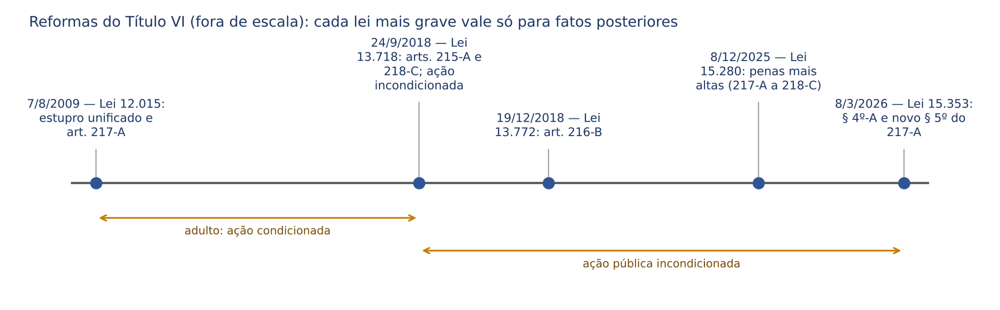
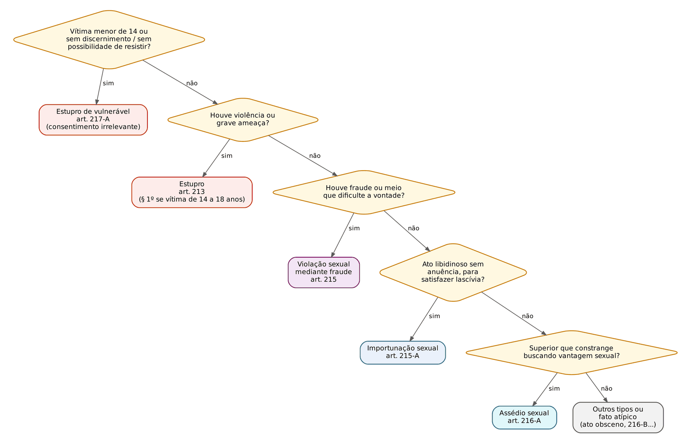
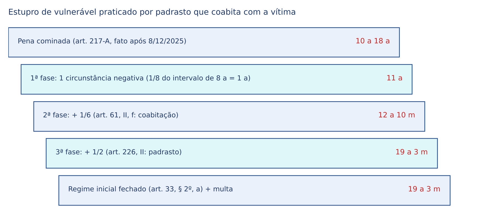

# CAPÍTULO 31 — CRIMES CONTRA A DIGNIDADE SEXUAL

:::INCIDENCIA
TRF5 p. 9; TJRS p. 5; TJSC p. 43. Nível A. Lote de 41 questões (FGV 34, FCC 7), a maior parte de provas de magistratura e Ministério Público de 2024 a 2026.
O que mais cai: estupro de vulnerável (consumação, vulnerabilidade do § 1º, consentimento irrelevante, Tema 1.121), a fronteira estupro x importunação x assédio, as majorantes do art. 226 combinadas com a agravante do art. 61, II, f (Tema 1.215), lenocínio e as penas novas da Lei 15.280/2025.
:::

| Subtema | FGV | FCC | Padrão de cobrança |
|---|---|---|---|
| Estupro de vulnerável (tipicidade, § 1º, consumação, concurso de agentes, qualificadoras) | 12 | 2 | caso concreto; "consumado ou tentado?"; "vulnerável ou não?" |
| Estupro (art. 213): qualificadoras, crime único | 5 | 0 | vítima de 14 a 18 anos; atos diversos no mesmo contexto |
| Importunação sexual | 3 | 3 | distinguir de estupro, assédio e fato atípico |
| Assédio sexual | 6 | 1 | exige superioridade; professor e aluno; § 2º |
| Arts. 216-B e 218-C | 3 | 1 | montagem, IA, exclusão de ilicitude do § 2º |
| Arts. 215, 218-A, 218-B | 3 | 0 | ginecologista; plateia de 13 anos; cliente de adolescente |
| Lenocínio | 3 | 0 | rufianismo simples x qualificado; presente da filha |
| Majorantes (art. 226) x agravantes | 4 | 0 | Tema 1.215; padrasto; estupro corretivo |

## 31.1 Panorama do Título VI

### 31.1.1 Bem jurídico e vocabulário

Até 2009 o Título VI chamava-se "Dos crimes contra os costumes": protegia-se a moral sexual pública, e a mulher "honesta" ou "virgem" aparecia como elementar de vários tipos. A Lei 12.015/2009 trocou o nome para "Dos crimes contra a dignidade sexual" e mudou o eixo: o bem jurídico passou a ser a LIBERDADE SEXUAL (o direito de cada um decidir se, quando, como e com quem pratica atos sexuais) e, para os vulneráveis, o DESENVOLVIMENTO SEXUAL saudável (a criança não tem liberdade sexual a exercer; tem um desenvolvimento a preservar). Daí a consequência que a banca cobra sem cessar: no capítulo dos vulneráveis o consentimento é irrelevante; nos demais, o dissenso da vítima é o centro do tipo.

Vocabulário que aparece em todos os tipos:

- Conjunção carnal: a introdução, ainda que parcial, do pênis na vagina. É conceito restrito, herdado do texto de 1940.
- Ato libidinoso: qualquer ato de conotação sexual destinado a satisfazer a libido, inclusive a própria conjunção carnal (que é espécie). Abrange coito anal, sexo oral, toques nas partes íntimas, beijo lascivo, masturbação e até a contemplação lasciva da vítima despida (STJ, Jurisprudência em Teses, ed. 152, tese 4), sem necessidade de contato físico.
- Lascívia (ou libido): o desejo sexual; "satisfazer a lascívia" é a finalidade que alguns tipos exigem expressamente (arts. 215-A, 218, 218-A).
- Vulnerável: pessoa a quem a lei nega capacidade de consentir validamente para o ato sexual: quem tem menos de 14 anos; quem, por enfermidade ou deficiência mental, não tem o necessário discernimento; quem, por qualquer outra causa, não pode oferecer resistência (art. 217-A, § 1º).

### 31.1.2 Mapa do Título e reformas recentes

| Capítulo | Artigos | Conteúdo |
|---|---|---|
| I — Liberdade sexual | 213 a 216-A | estupro, violação sexual mediante fraude, importunação, assédio |
| I-A — Exposição da intimidade sexual | 216-B | registro não autorizado |
| II — Crimes sexuais contra vulnerável | 217-A a 218-C | estupro de vulnerável, corrupção de menores, satisfação de lascívia, exploração sexual, divulgação de cena |
| IV — Disposições gerais | 225 e 226 | ação penal; majorantes |
| V — Lenocínio e tráfico | 227 a 230; 232-A | mediação, favorecimento da prostituição, casa de prostituição, rufianismo, promoção de migração ilegal |
| VI — Ultraje público ao pudor | 233 e 234 | ato obsceno, escrito ou objeto obsceno |
| VII — Disposições gerais | 234-A a 234-C | majorantes, segredo de justiça |

O Capítulo III foi inteiramente revogado (rapto, Lei 11.106/2005), e os arts. 231 e 231-A (tráfico de pessoas para exploração sexual) foram revogados pela Lei 13.344/2016, que levou a conduta para o art. 149-A (tráfico de pessoas, crime contra a liberdade individual — ver Caps. 28 e 47). Não houve *abolitio criminis*, mas continuidade normativo-típica (o conceito está no Cap. 3).

As duas leis mais recentes mudam a resposta de muitas questões:

| Dispositivo | Pena até 7/12/2025 | Pena a partir de 8/12/2025 (Lei 15.280/2025) |
|---|---|---|
| Art. 217-A, caput e § 1º | reclusão de 8 a 15 anos | reclusão de 10 a 18 anos e multa |
| Art. 217-A, § 3º (lesão grave) | reclusão de 10 a 20 anos | reclusão de 12 a 24 anos e multa |
| Art. 217-A, § 4º (morte) | reclusão de 12 a 30 anos | reclusão de 20 a 40 anos e multa |
| Art. 218 | reclusão de 2 a 5 anos | reclusão de 6 a 14 anos e multa |
| Art. 218-A | reclusão de 2 a 4 anos | reclusão de 5 a 12 anos e multa |
| Art. 218-B, caput e § 2º | reclusão de 4 a 10 anos (multa só com fim de lucro, § 1º) | reclusão de 7 a 16 anos e multa (§ 1º revogado) |
| Art. 218-C | reclusão de 1 a 5 anos | reclusão de 4 a 10 anos e multa |

A Lei 15.280, de 5/12/2025, foi publicada e entrou em vigor em 8/12/2025 (outras inovações dela em 31.13). A Lei 15.353, de 8/3/2026 (vigência na publicação), incluiu no art. 217-A o § 4º-A (presunção ABSOLUTA de vulnerabilidade, vedada a relativização) e deu nova redação ao § 5º (ver 31.7.1).

:::ATENCAO Direito intertemporal: a data do fato decide
Tudo o que a Lei 15.280/2025 agravou vale só para fatos a partir de 8/12/2025 (art. 5º, XL, da CF; art. 2º do CP — Cap. 3). Questões anteriores usam as penas antigas: siga a pena do enunciado ou a data do fato. No crime continuado e no permanente que avançam para depois da lei nova, aplica-se a lei nova a toda a série (Súmula 711 do STF — ver Cap. 3), o que é frequente nos abusos intrafamiliares que se estendem por anos.
:::

## 31.2 Estupro (art. 213)

### 31.2.1 O tipo depois da Lei 12.015/2009

:::LEI Código Penal, art. 213
Constranger alguém, mediante violência ou grave ameaça, a ter conjunção carnal ou a praticar ou permitir que com ele se pratique outro ato libidinoso:
Pena - reclusão, de 6 (seis) a 10 (dez) anos.
§ 1º Se da conduta resulta lesão corporal de natureza grave ou se a vítima é menor de 18 (dezoito) ou maior de 14 (catorze) anos:
Pena - reclusão, de 8 (oito) a 12 (doze) anos.
§ 2º Se da conduta resulta morte:
Pena - reclusão, de 12 (doze) a 30 (trinta) anos.
:::

A Lei 12.015/2009 fundiu no art. 213 o antigo estupro (só conjunção carnal, só vítima mulher) e o atentado violento ao pudor (art. 214, revogado). Consequências (Jurisprudência em Teses do STJ, ed. 151):

- Não houve *abolitio criminis* do atentado violento ao pudor: a conduta continua punida no art. 213 (continuidade normativa; tese 4).
- A fusão é lei mais benéfica no ponto em que permite reconhecer crime único onde antes havia concurso de dois crimes; por isso retroage aos fatos anteriores (tese 5).

Sujeitos. Crime comum: qualquer pessoa pode ser autora ou vítima, homem ou mulher, inclusive o cônjuge ou companheiro (não existe "débito conjugal" que autorize o constrangimento; a relação conjugal, aliás, aumenta a pena — art. 226, II). A mulher pode ser autora, inclusive constrangendo o homem à conjunção carnal.

Núcleo e meios. "Constranger" é forçar, por violência física (*vis absoluta*) ou grave ameaça (*vis compulsiva*), a praticar o ato ou a permitir que com a vítima se pratique. A violência imprópria (sedativos, hipnose, embriaguez completa provocada) NÃO está no art. 213: quem deixa a vítima sem capacidade de resistir e com ela pratica o ato comete estupro de vulnerável (art. 217-A, § 1º; ver 31.7.2).

Dissenso. O dissenso deve ser sério e perdurar durante o ato, mas a lei não exige resistência heroica. A falta de reação física enérgica e o consentimento inicial não afastam o crime (AgRg no REsp 2.105.317-DF, j. 13/8/2024, Info 822), e que, havendo dissenso superveniente no curso do ato, a continuidade mediante força física configura a violência do art. 213, ainda que a relação tenha começado consensualmente (Quinta Turma, j. 19/5/2026, Info 890).

Contato físico. É dispensável: há estupro em constranger a vítima a se masturbar ou a se despir para ser contemplada, inclusive por videochamada ("estupro virtual"). O beijo lascivo obtido com força física contra vítima maior de 14 anos é estupro (Jurisprudência em Teses, ed. 151, tese 11), e o STJ afastou a desclassificação para as contravenções de importunação ofensiva ao pudor ou de perturbação da tranquilidade (arts. 61 e 65 da LCP; ed. 152, tese 1).

Elemento subjetivo. Dolo. Não se exige finalidade especial de satisfazer a lascívia: o dolo consiste na vontade de constranger a vítima à prática do ato libidinoso, e o crime existe ainda que o agente aja por vingança, para humilhar ou "punir" a vítima (STJ, Quinta Turma, j. 12/8/2025, Info 862). A importunação, ao contrário, exige o fim lascivo.

### 31.2.2 Consumação, tentativa e número de crimes

Consumação: com o primeiro ato libidinoso, sem exigir ejaculação ou rompimento himenal. Tentativa: possível se o agente, já empregando violência ou grave ameaça, é interrompido antes de qualquer ato libidinoso (derruba a vítima e é contido por terceiros); se já houve toques lascivos, o crime está consumado.

Quanto ao número de crimes, o STJ trata o art. 213 como tipo misto ALTERNATIVO: no mesmo contexto fático, contra a mesma vítima, há CRIME ÚNICO (Jurisprudência em Teses, ed. 151, tese 6). A pluralidade de atos não desaparece da dosimetria: pode ser valorada na pena-base, como circunstância do crime (Cap. 13). A tese minoritária do tipo misto cumulativo (concurso material entre conjunção carnal e ato diverso) não prevaleceu.

| Situação | Solução |
|---|---|
| Mesma vítima, mesmo contexto, conjunção carnal + sexo oral + coito anal | crime único (art. 213), atos adicionais valorados na pena-base |
| Mesma vítima, contextos diversos (dias diferentes), condições semelhantes | crime continuado (art. 71), em regra; para a fração e para o estupro de vulnerável em longo período, ver Tema 1.202 do STJ (Cap. 16) |
| Vítimas diferentes, mesmo contexto | dois crimes (concurso formal impróprio ou continuidade específica, art. 71, parágrafo único, conforme o caso — Cap. 16) |

:::QUESTAO FGV 2024 — TJ-AP — Analista Judiciário (Q2449089)
Companheiro que, com emprego de faca, obriga a companheira à conjunção carnal e, no mesmo contexto, a sexo oral e anal. Gabarito: C — um só estupro, com a causa de aumento por ser companheiro da vítima (art. 226, II, aumento de metade).
Armadilhas: "estupro e atentado violento ao pudor em concurso" (o art. 214 foi revogado em 2009); "estupro de vulnerável" (vítima adulta e capaz); "violação sexual mediante fraude" (houve grave ameaça).
:::

### 31.2.3 Formas qualificadas (§§ 1º e 2º)

São três hipóteses, todas com pena própria (qualificadoras, que mudam o ponto de partida da dosimetria):

- Lesão corporal grave ou gravíssima resultante (§ 1º, primeira parte): reclusão de 8 a 12 anos. Lesão leve é absorvida pela violência elementar do caput.
- Vítima com mais de 14 e menos de 18 anos (§ 1º, segunda parte): reclusão de 8 a 12 anos. É qualificadora de natureza objetiva, e o agente precisa conhecer a idade (o erro sobre ela é erro de tipo, Cap. 7). Se a vítima tem MENOS de 14 anos, o crime é outro: estupro de vulnerável (art. 217-A), com ou sem violência.
- Morte resultante (§ 2º): reclusão de 12 a 30 anos.

Os resultados lesão grave e morte podem ser culposos (preterdolo) ou dolosos, desde que decorram da conduta sexual; se o agente estupra e depois mata para assegurar a impunidade, há estupro em concurso material com homicídio qualificado (art. 121, § 2º, V), julgados pelo Júri (art. 78, I, CPP). O estupro em todas as formas é crime hediondo (art. 1º, V, da Lei 8.072/1990; ver 31.13.4).

:::PEGADINHA O "dia do aniversário de 14 anos"
O § 1º fala em vítima "menor de 18 ou maior de 14"; o art. 217-A, em "menor de 14". Menor de 14 é quem ainda não completou 14 anos (14 anos incompletos: gabarito B da Q4217293, FGV 2026). A doutrina aponta a lacuna literal do dia exato do 14º aniversário (a vítima não é "menor" nem, a rigor, "maior" de 14); a solução não está pacificada e a questão é rara. Em prova, basta: até a véspera do 14º aniversário, art. 217-A; a partir dos 14 anos, com violência ou grave ameaça, art. 213, § 1º.
:::

:::QUESTAO FGV 2025 — TJ-GO — Residente Jurídico (Q3345946)
Agente que, em local ermo, sob ameaça com arma branca, constrange à conjunção carnal estudante de 16 anos. Gabarito: C — estupro qualificado em razão da idade da vítima (art. 213, § 1º).
Armadilha: chamar de "estupro de vulnerável" a vítima de 14 a 18 anos (alternativas A e B). Vulnerável etário é só quem tem menos de 14 anos. No mesmo sentido: Q3852399 (FGV 2026, PC-PI, Perito Legista; gabarito A: as formas qualificadas; erradas a virgindade como elementar, a exigência de agressão física, o boletim de ocorrência como condição do aborto legal e a "imunidade" conjugal) e Q3203666 (FGV 2025, PC-MG, Médico Legista; gabarito B: V–F–V — homem pode ser vítima; é falso que as vítimas de estupro sejam "sempre vulneráveis").
:::

## 31.3 Violação sexual mediante fraude (art. 215)

Tipo: ter conjunção carnal ou praticar outro ato libidinoso com alguém, mediante fraude ou outro meio que impeça ou dificulte a livre manifestação de vontade da vítima. Pena: reclusão de 2 a 6 anos; se o crime é cometido com o fim de obter vantagem econômica, aplica-se também multa (parágrafo único). É o antigo "estelionato sexual".

Na fraude a vítima consente, mas o consentimento está viciado por um engano sobre a natureza do ato ou sobre a identidade do parceiro: o falso médico ou o médico que, a pretexto de exame, pratica atos libidinosos; o irmão gêmeo que se passa pelo marido no quarto escuro; o líder religioso que convence a fiel de que o ato sexual é ritual de cura. A cláusula genérica "outro meio que impeça ou dificulte a livre manifestação de vontade" cobre a vítima com capacidade REDUZIDA (embriaguez parcial, sonolência, efeito moderado de medicamento), mas não anulada.

:::ESQUEMA Fraude x vulnerabilidade x violência
| Estado da vítima | Crime |
|---|---|
| Vontade íntegra, vencida por força ou ameaça | estupro (art. 213) |
| Vontade presente, mas enganada ou apenas diminuída | violação sexual mediante fraude (art. 215) |
| Vontade inexistente ou incapacidade total de resistir (sono, coma, embriaguez completa, sedação) | estupro de vulnerável (art. 217-A, § 1º) |
| Vítima com menos de 14 anos (com ou sem fraude) | estupro de vulnerável (art. 217-A, caput) |
:::

:::QUESTAO FGV 2025 — ENAM 2025.2 (Q3692429)
Ginecologista que, a pretexto de exame de rotina, pratica atos libidinosos com paciente de 15 anos. Gabarito: E — violação sexual mediante fraude (art. 215).
Armadilhas: "sedução" (art. 217, revogado em 2005); "corrupção de menores" (art. 218 exige vítima com menos de 14 anos e induzimento a satisfazer a lascívia de OUTREM); "mediação para servir a lascívia de outrem" (lenocínio, que pressupõe terceiro beneficiário). A idade de 15 anos não torna a vítima vulnerável, e a qualificadora etária do § 1º é exclusiva do art. 213; o abuso da confiança profissional pode ser valorado na pena-base ou, conforme o caso, como agravante do art. 61, II, g (violação de dever inerente a profissão).
:::

## 31.4 Importunação sexual (art. 215-A)

:::LEI Código Penal, art. 215-A
Praticar contra alguém e sem a sua anuência ato libidinoso com o objetivo de satisfazer a própria lascívia ou a de terceiro:
Pena - reclusão, de 1 (um) a 5 (cinco) anos, se o ato não constitui crime mais grave.
:::

O tipo (Lei 13.718/2018) preencheu o vazio entre o estupro (pena mínima de 6 anos) e a contravenção de importunação ofensiva ao pudor (art. 61 da LCP, punida só com multa e revogada pela mesma lei), exposto pelo caso do homem que ejaculou numa passageira de ônibus, em 2017.

Elementos:

- "Contra alguém": o ato tem de ser DIRIGIDO a uma pessoa determinada. Quem se masturba sozinho, em local reservado, sem dirigir o ato a ninguém, não importuna; se o faz em lugar público, comete ato obsceno (art. 233).
- "Sem a sua anuência": o dissenso é elementar; não há violência nem grave ameaça (se houver, é estupro). A surpresa é o meio típico: o toque rápido nas nádegas no metrô, a "encoxada", o beijo roubado, a ejaculação ou a masturbação dirigida à vítima.
- Fim especial: satisfazer a lascívia própria ou de terceiro. Sem ele (por exemplo, o toque para humilhar, sem conotação lasciva), a conduta pode ser injúria real ou vias de fato.
- Subsidiariedade EXPRESSA: só se aplica "se o ato não constitui crime mais grave". Se a vítima é vulnerável (art. 217-A) ou se houve violência ou grave ameaça (art. 213), prevalecem esses tipos.
- Contato físico: dispensável. O STJ admitiu importunação praticada por meio tecnológico, com o envio de conteúdo pornográfico à vítima sem o seu consentimento (Quinta Turma, j. 22/4/2026, Informativo de Jurisprudência — Edição Extraordinária 33).

Desclassificação do estupro. Entre adultos, o STJ desclassificou para importunação a conduta de apalpar as partes íntimas da vítima, ainda que por dentro da roupa, sem violência ou grave ameaça (AgRg no AREsp 2.470.205/AL, Quinta Turma, j. 6/2/2024). Já contra vulnerável a desclassificação é VEDADA (Tema 1.121 — ver 31.7.3), assim como contra quem dorme (31.7.2).

:::QUESTAO FCC 2026 — TJ-CE — Analista Judiciário (Q4231782)
Passageiro que, no metrô, puxa conversa de conteúdo sexual com desconhecida e, no desembarque, passa a mão nas nádegas dela. Gabarito: E — importunação sexual.
Armadilhas: estupro (faltam violência e grave ameaça); assédio (não há relação de superioridade); violação mediante fraude (não há engano). No mesmo sentido: Q2442328 (FGV 2024, TJ-AP; gabarito C: homem que se masturba no ônibus olhando para a passageira ao lado, ocultando o órgão sob a blusa — o ato é dirigido a ela) e Q2365386 (FGV 2024, PC-SC; gabarito C: SUBORDINADO que apalpa as nádegas da chefe comete importunação, não assédio, porque o assédio exige que o agente seja o superior).
:::

:::QUESTAO FCC 2026 — DPE-BA — Defensor Público (Q4037432)
Gerente flagrado se masturbando dentro da cabine fechada do banheiro masculino, em área restrita, por subordinada que abriu a porta ao ouvir barulho; a sentença condenou por importunação. Gabarito: C — a decisão está errada porque a conduta é atípica: o ato não foi dirigido à funcionária.
Armadilhas: ato obsceno (A) exige lugar público, aberto ou exposto ao público, e a cabine fechada não é; assédio (B) exige constrangimento para obter vantagem sexual; a falta de contato físico (E) não é o fundamento, porque a importunação dispensa contato; erro de proibição (D) é impertinente, pois não há fato típico.
:::

:::QUESTAO FGV 2026 — TJ-MS — Analista Judiciário (Q3856349)
Tio que importuna sexualmente a sobrinha adulta. Gabarito: C — importunação simples, com a causa de aumento do art. 226, II (tio: aumento de metade), em ação penal pública incondicionada.
Armadilhas: não existe "importunação qualificada"; desde 2018 não há representação nem queixa nos crimes do Capítulo I (art. 225).
:::

## 31.5 Assédio sexual (art. 216-A)

:::LEI Código Penal, art. 216-A
Constranger alguém com o intuito de obter vantagem ou favorecimento sexual, prevalecendo-se o agente da sua condição de superior hierárquico ou ascendência inerentes ao exercício de emprego, cargo ou função.
Pena - detenção, de 1 (um) a 2 (dois) anos.
§ 2º A pena é aumentada em até um terço se a vítima é menor de 18 (dezoito) anos.
:::

Estrutura. É crime PRÓPRIO quanto ao sujeito ativo: só o superior hierárquico (relação de direito público: cargo ou função) ou quem tem ascendência (relação privada: emprego). O inverso NÃO é assédio: o estagiário que constrange a coordenadora, ou o subordinado que apalpa a chefe, não preenche o tipo. Não há exigência de diversidade de sexos.

Conduta. "Constranger" aqui não é forçar com violência: é embaraçar, pressionar, criar situação de desconforto, explícita ou implicitamente vinculando a relação de trabalho à vantagem sexual. A Corte Especial do STJ decidiu que a ameaça de prejudicar ou a promessa de favorecer a vítima NÃO são elementares, e que o assédio pode configurar-se por atos que evidenciem o intuito sexual implícito do agente (Inq 1.802-DF, j. 20/5/2026, Info 893; o mesmo julgado, quanto à violência psicológica do art. 147-B, está no Cap. 28). Basta um único ato (crime formal, que se consuma com o constrangimento, ainda que a vantagem não seja obtida); a reiteração não é exigida.

Assédio por chantagem x por intimidação. A doutrina distingue o assédio por chantagem (*quid pro quo*: o superior busca favores sexuais para si ou para terceiro, usando o poder sobre o emprego), que é o tipificado no art. 216-A, do assédio por intimidação ou ambiental (incitações sexuais inoportunas que tornam hostil o ambiente de trabalho), que é ilícito trabalhista e civil, mas não é o crime do art. 216-A. Na Q2511422 (FGV 2024, Câmara dos Deputados), gabarito D (no assédio por chantagem o agente busca favores sexuais para si ou para terceiro); erradas as afirmações de que não há assédio entre pessoas do mesmo sexo, de que o assédio por intimidação é crime e de que se exigem atos reiterados.

Professor e aluno. O STJ admite assédio sexual na relação professor-aluno, porque o docente tem ascendência inerente à função, sobretudo pela avaliação do aluno (REsp 1.759.135/SP, Sexta Turma, j. 13/8/2019; Jurisprudência em Teses, ed. 152, tese 5). Parte da doutrina resistia (a relação educacional não seria "emprego, cargo ou função"), mas é a posição do STJ que a FGV cobra.

:::QUESTAO FGV 2024 — TJ-MT — Juiz Substituto (Q3086957)
Professor que retém a aluna de 16 anos após a aula, diz estar preocupado com as notas dela, que ela é "muito bonita para ter esse tipo de problema" e sussurra "te quero". Gabarito: A — assédio sexual.
Armadilhas: importunação (não houve ato libidinoso) e estupro tentado (sem violência ou ameaça). No mesmo sentido: Q4349513 (FGV 2026, TJ-PE, Juiz; gabarito A: professor que propõe "ajudar" o aluno de 15 anos reprovado em troca de sexo oral, recusado — assédio CONSUMADO, não tentado, porque o crime é formal; incide o § 2º).
:::

:::QUESTAO FGV 2025 — TJ-TO — Juiz Substituto (Q3453261)
Afirmações variadas sobre crimes sexuais. Gabarito: C — não configura assédio o constrangimento praticado por estagiário contra a coordenadora da seção (falta a superioridade do agente).
Erradas: (A) nos crimes contra vítima em vulnerabilidade temporária praticados sob a redação de 2009 do art. 225, a ação era CONDICIONADA (Súmula 670 do STJ — ver Cap. 20); (B) a defesa NÃO pode explorar a vida sexual pregressa ou o modo de vida da vítima (art. 400-A do CPP, Lei 14.245/2021, e ADPF 1.107 — ver 31.13.1 e Cap. 13); (D) o registro não autorizado de cena íntima é crime (art. 216-B), não contravenção; (E) o consentimento, a experiência sexual e o namoro não afastam o estupro de vulnerável (Súmula 593 do STJ).
:::

:::QUESTAO FGV 2024 — TJ-SC — Oficial de Justiça (Q2515587)
Chefe de repartição que ameaça abrir sindicância contra servidora, salvo se ela mantiver relações sexuais com ele. Gabarito: D — assédio sexual.
No mesmo sentido: Q4092723 (FCC 2026, MPE-AL; gabarito D: dono de restaurante que insiste no convite recusado, faz comentários de cunho sexual e ameaça demitir a funcionária).
:::

:::QUESTAO FGV 2026 — PC-PI — Delegado (Q3848978)
Superior hierárquico que constrange estagiária de 17 anos para obter vantagem sexual. Gabarito: C — assédio sexual simples, com a causa de aumento do § 2º (vítima com menos de 18 anos: até 1/3).
Armadilha: não existe "assédio qualificado". O aumento do § 2º é causa de aumento (terceira fase), com fração VARIÁVEL de até 1/3.
:::

## 31.6 Registro não autorizado da intimidade sexual (art. 216-B)

Tipo (Lei 13.772/2018): produzir, fotografar, filmar ou registrar, por qualquer meio, conteúdo com cena de nudez ou ato sexual ou libidinoso de caráter íntimo e privado sem autorização dos participantes. Pena: detenção de 6 meses a 1 ano e multa. Parágrafo único: na mesma pena incorre quem realiza montagem em fotografia, vídeo, áudio ou qualquer outro registro com o fim de incluir pessoa em cena de nudez ou ato sexual ou libidinoso de caráter íntimo — a figura que alcança a montagem por inteligência artificial (*deepfake*).

O crime pune o REGISTRO (ou a montagem); a DIVULGAÇÃO é o art. 218-C, mais grave. Se quem registra depois divulga, há dois crimes ou progressão criminosa, conforme o contexto; a jurisprudência tende a absorver o registro quando ele é mero meio para a divulgação (resolva pelo princípio da consunção, Cap. 3). É infração de menor potencial ofensivo. Ação penal: pública incondicionada (STJ, RHC 175.947/SP, j. 25/4/2023, Info 772): o art. 225 menciona só os Capítulos I e II, mas o silêncio da lei sobre o Capítulo I-A leva à regra geral do art. 100 do CP.

Se a pessoa retratada é criança ou adolescente, incidem os tipos especiais do ECA (arts. 240 e 241-C — simulação de participação em cena de sexo por montagem), mais graves; a lei sancionada em 6/8/2026 (origem no PL 3.066/2025, divulgada como Lei 15.487/2026) endureceu esses tipos e criou figura específica de montagem por inteligência artificial com criança ou adolescente (ver Cap. 42).

:::QUESTAO FGV 2024 — PC-SC — Delegado (Q2360687)
Estudante de 18 anos que, por aplicativo de inteligência artificial, faz montagens das colegas (uma de 17 e outra de 18 anos) nuas e as guarda no celular. Gabarito: D — art. 216-B, parágrafo único, do CP (colega adulta) e art. 241-C do ECA (colega adolescente).
Armadilhas: atipicidade (A: a montagem é expressamente típica); difamação (E: sem divulgação a terceiros não há imputação de fato ofensivo à reputação). O critério é a idade de cada vítima: especialidade do ECA para a adolescente.
:::

## 31.7 Estupro de vulnerável (art. 217-A)

:::LEI Código Penal, art. 217-A (redação das Leis 12.015/2009, 13.718/2018, 15.280/2025 e 15.353/2026)
Ter conjunção carnal ou praticar outro ato libidinoso com menor de 14 (catorze) anos:
Pena - reclusão, de 10 (dez) a 18 (dezoito) anos, e multa.
§ 1º Incorre na mesma pena quem pratica as ações descritas no caput com alguém que, por enfermidade ou deficiência mental, não tem o necessário discernimento para a prática do ato, ou que, por qualquer outra causa, não pode oferecer resistência.
§ 3º Se da conduta resulta lesão corporal de natureza grave: Pena - reclusão, de 12 (doze) a 24 (vinte e quatro) anos, e multa.
§ 4º Se da conduta resulta morte: Pena - reclusão, de 20 (vinte) a 40 (quarenta) anos, e multa.
§ 4º-A. É absoluta a presunção de vulnerabilidade da vítima e inadmissível sua relativização.
§ 5º As penas previstas no caput e nos §§ 1º, 3º e 4º deste artigo aplicam-se independentemente do consentimento da vítima, de sua experiência sexual, do fato de ela ter mantido relações sexuais anteriormente ao crime ou da ocorrência de gravidez resultante da prática do crime.
:::

Repare na estrutura: o tipo NÃO menciona violência nem grave ameaça. O fato de alguém ter conjunção carnal ou praticar ato libidinoso com pessoa vulnerável já é o crime, porque a lei nega a essa pessoa capacidade de consentir. Antes de 2009 a técnica era a violência "presumida" (antigo art. 224), já tida por absoluta para vítima com menos de 14 anos (Jurisprudência em Teses, ed. 151, tese 7); daí a expressão ainda usada, por exemplo, para negar a continuidade específica, que exige violência real (Cap. 16).

### 31.7.1 Vulnerabilidade etária: presunção absoluta e o fim do *distinguishing*

O STJ firmou, em recurso repetitivo, que basta a conjunção carnal ou qualquer ato libidinoso com pessoa com menos de 14 anos; o consentimento da vítima, sua experiência sexual anterior ou a existência de relacionamento amoroso com o agente não afastam o crime (Tema 918, REsp 1.480.881/PI, Terceira Seção, j. 26/8/2015). A tese virou a Súmula 593 do STJ (2017) e, em 2018, o § 5º do art. 217-A.

:::JURIS STJ, Súmula 593
"O crime de estupro de vulnerável se configura com a conjunção carnal ou prática de ato libidinoso com menor de 14 anos, sendo irrelevante eventual consentimento da vítima para a prática do ato, sua experiência sexual anterior ou existência de relacionamento amoroso com o agente."
Gancho: vulnerabilidade etária é objetiva; não se discute "maturidade" da vítima.
:::

A exceção de Romeu e Julieta (relacionamento consentido entre jovens de idades próximas) sempre foi rejeitada como regra; ainda assim, entre 2022 e o início de 2026, turmas do STJ admitiram *distinguishing* em casos excepcionalíssimos: pequena diferença de idade, relacionamento estável com anuência da família, formação de núcleo familiar e nascimento de filho, sem indício de violência ou abuso. Exemplos: AgRg no REsp 2.015.310/MG (2023: réu de 19 e vítima de 12 anos que viviam maritalmente); AgRg no AREsp 2.389.611/MG (2024: absolvição por erro de proibição — ver Cap. 10); REsp 2.144.411/AL (Sexta Turma, j. 6/8/2024); HC 860.538/PE (Sexta Turma, por maioria, j. 3/2/2026, Info 876, atipicidade material). A Quinta Turma, em sentido oposto, insistia que a constituição de família não exclui, por si só, a punibilidade (AgRg no HC 849.912/MG, j. 20/2/2024).

A Lei 15.353/2026 encerrou o debate para o futuro: o § 4º-A declara ABSOLUTA a presunção de vulnerabilidade e "inadmissível sua relativização", e o § 5º acrescentou a gravidez resultante do crime entre os fatos irrelevantes (justamente o argumento do "filho do casal"). Como a lei elimina uma porta de exclusão do crime aberta pela jurisprudência, o STJ passou a tratar a vedação como norma mais gravosa: o *distinguishing* só é admitido, em hipóteses excepcionalíssimas, para fatos ANTERIORES a 8/3/2026 (Quinta Turma, j. 9/6/2026, Info 897).

Prova da idade. A idade é elementar e precisa ser provada; na falta de certidão de nascimento, admite-se outro meio idôneo (por analogia à Súmula 74 do STJ — ver Cap. 14). Erro sobre a idade: se o agente, de forma justificável, supõe que a vítima tem 14 anos ou mais, há erro de tipo (art. 20 do CP — Cap. 7), que exclui o dolo do art. 217-A; resta apurar se a conduta, vista com a idade que o agente supunha, configura outro crime.

:::QUESTAO FCC 2026 — DPE-MT — Defensor Público (Q3954626)
Em festa vedada a pessoas com menos de 18 anos, o agente ouve da jovem que ela é maior de idade e, de repente, a beija e passa a mão em suas nádegas sem consentimento; ela tinha 13 anos e usara documento falso. Gabarito: C — importunação sexual.
Raciocínio: o erro de tipo sobre a idade afasta o dolo do art. 217-A; vista com a idade suposta, a conduta (ato libidinoso surpresa, sem violência, com fim lascivo) é importunação.
:::

### 31.7.2 Vulnerabilidade do § 1º: deficiência mental e incapacidade de resistir

Duas hipóteses, que precisam ser provadas no caso concreto (não há presunção):

- Enfermidade ou deficiência mental SEM o necessário discernimento para o ato. Não basta o diagnóstico, porque a pessoa com deficiência tem direitos sexuais (Lei 13.146/2015, art. 6º). Pune-se quem se aproveita da falta de discernimento, não quem se relaciona com pessoa com deficiência capaz de consentir. O laudo pericial é útil, mas o juiz não está vinculado a ele, podendo formar convicção fundamentada por outras provas (Jurisprudência em Teses, ed. 151, tese 10).
- Pessoa que, "por qualquer outra causa", não pode oferecer resistência: sono, desmaio, coma, embriaguez completa, efeito de drogas ou sedativos, paralisia, idade avançada com debilidade extrema. O estado de sono caracteriza a vulnerabilidade (ed. 151, tese 9), e o STJ vedou a desclassificação para importunação de ato libidinoso com pessoa adormecida (Quinta Turma, j. 5/8/2025, Info 859). A indução ao consumo excessivo de álcool pode ser o meio para colocar a vítima nesse estado (REsp 1.775.136/AC, j. 3/12/2019).

:::QUESTAO FGV 2024 — TJ-PE — Juiz Substituto (Q3117549)
Folião que, no carnaval, beija lascivamente mulher totalmente embriagada, que não resiste por causa do seu estado. Gabarito: C — estupro de vulnerável (art. 217-A, § 1º), de ação penal pública incondicionada.
Armadilhas: estupro (não houve violência nem ameaça), importunação (subsidiária) e ação condicionada (regime revogado em 2018).
:::

:::QUESTAO FGV 2026 — TJ-BA — Juiz Substituto (Q4083759)
Pai de uma adolescente entra de madrugada no quarto da filha e, para satisfazer a lascívia, passa a mão nas nádegas da amiga dela, de 16 anos, que dormia, sobre a camisola; interrompe quando a filha acorda e grita. Gabarito: C — estupro de vulnerável.
Fundamento: a vítima dormindo não pode oferecer resistência (§ 1º); o ato libidinoso consumou o crime; a idade de 16 anos é irrelevante porque a vulnerabilidade é de outra natureza. Armadilhas: importunação (vedada a desclassificação — Info 859) e estupro do art. 213 (não houve violência nem grave ameaça).
:::

### 31.7.3 Ato libidinoso, consumação e a vedação de desclassificar (Tema 1.121)

Qualquer ato libidinoso com o vulnerável consuma o crime: toques nas partes íntimas, ainda que por cima da roupa, beijo lascivo, contemplação lasciva da criança despida (ed. 152, tese 4), carícias nos seios e nas coxas (STF, RHC 133.121/DF, j. 30/8/2016). O STF, no HC 134.591/SP (Primeira Turma, j. 1/10/2019), considerou estupro de vulnerável o beijo lascivo em criança, afastando a contravenção penal.

:::JURIS STJ, Tema 1.121 (REsp 1.959.697/SC e outros, Terceira Seção, j. 8/6/2022)
"Presente o dolo específico de satisfazer à lascívia, própria ou de terceiro, a prática de ato libidinoso com menor de 14 anos configura o crime de estupro de vulnerável (art. 217-A do CP), independentemente da ligeireza ou da superficialidade da conduta, não sendo possível a desclassificação para o delito de importunação sexual (art. 215-A do CP)."
Gancho: contra vulnerável, todo ato libidinoso é estupro de vulnerável; a importunação é subsidiária e o 217-A é especial.
:::

O "dolo específico" exigido pelo Tema 1.121 separa o toque lascivo do toque sem conotação sexual (exame médico, banho da criança). A desproporção entre a pena mínima (agora 10 anos) e um toque fugaz é a principal crítica doutrinária, mas a posição do STJ é firme.

Tentativa. Como qualquer ato libidinoso consuma o crime, o STJ (Quinta Turma, REsp 2.172.883-SP, j. 10/12/2024 — desenvolvido no Cap. 8) afirmou não ser cabível a forma tentada; a doutrina admite em tese a tentativa quando o agente é interrompido antes de qualquer ato libidinoso (por exemplo, ao convencer a criança a entrar no carro), mas em prova a resposta esperada, se houve qualquer toque lascivo, é crime CONSUMADO.

:::QUESTAO FGV 2025 — TJ-SE — Juiz Substituto (Q3301264)
Pai que, decidido a praticar sexo anal com o filho de 11 anos, com quem coabita, acaricia a região genital da criança sobre o short enquanto se despe; a mãe entra e ele foge. Gabarito: C — estupro de vulnerável CONSUMADO, com a agravante do art. 61, II, f, e a causa de aumento do art. 226, II.
Fundamento: o toque lascivo consumou o crime (não importa que o plano fosse a penetração); a agravante decorre da coabitação e das relações domésticas, fato DIVERSO do parentesco que funda a majorante (Tema 1.215 — ver 31.10.2). Armadilhas: tentativa (A e B), desclassificação para importunação (E, vedada pelo Tema 1.121) e afastamento da agravante (D). No mesmo sentido, sobre a consumação: Q3530367 (FCC 2025, MPE-PI; gabarito D: qualquer ato libidinoso contra pessoa com menos de 14 anos consuma o crime, sem tentativa; errada a alternativa C, de que a falta de reação enérgica excluiria o estupro).
:::

:::QUESTAO FGV 2025 — ENAM 2025.1 (Q3362386)
Professor que, no carro, no estacionamento da escola, acaricia os seios da aluna de 13 anos e a beija na boca; enquanto se despe, é interrompido pela diretora. Gabarito: D — estupro de vulnerável consumado, NÃO sendo admissível aplicar ao mesmo tempo a agravante do art. 61, II, f, e a causa de aumento do art. 226, II.
Fundamento: aqui o único dado é a autoridade do professor sobre a aluna; usá-lo duas vezes seria *bis in idem* (é a exceção ressalvada no Tema 1.215). Compare com a Q3301264: lá havia parentesco (majorante) e coabitação (agravante), dois fatos distintos.
:::

:::QUESTAO FGV 2026 — MPE-GO — Promotor de Justiça (Q3865760)
Agente despe adolescente de 13 anos, acaricia e MORDE os seus seios e é interrompido pela mãe antes da conjunção carnal; o laudo registra lesões leves (duas mordidas) e que a vítima não era virgem. Gabarito: C — estupro de vulnerável consumado, em CONCURSO com o crime de lesão corporal.
Fundamento: no art. 217-A a violência não é elementar; por isso a lesão leve não é absorvida pelo tipo (como seria no art. 213, cuja violência elementar absorve a lesão leve), e a qualificadora do § 3º só abrange lesão GRAVE. Armadilhas: tentativa (B), absorção (D), importunação (E) e relevância da experiência sexual (A, vedada pelo § 5º).
:::

:::QUESTAO FGV 2024 — TJ-SC — Juiz Substituto (Q2386991)
Rapaz de 20 anos que, no cinema quase vazio, pede à namorada de 13 anos que lhe faça sexo oral, e ela o faz; um segurança surpreende o casal. Gabarito: E — ato obsceno e estupro de vulnerável.
Fundamento: o namoro e o consentimento são irrelevantes (Súmula 593; § 5º); a sala de cinema é lugar aberto ao público, o que configura também o art. 233 (bem jurídico diverso: o pudor público). Armadilha: importunação (subsidiária e vedada pelo Tema 1.121).
:::

### 31.7.4 Concurso de pessoas, omissão e estupro coletivo

Quem segura a vítima, vigia, ameaça ou cria a oportunidade, com vínculo subjetivo, é coautor ainda que não pratique o ato sexual (art. 29 — Cap. 11). O STJ condenou por estupro de vulnerável quem, anuindo ao dolo do corréu, contribuiu efetivamente para a consumação, sem praticar ato libidinoso (AgRg no HC 562.153/MS, j. 19/4/2022), e o "mentor intelectual" que determinava à distância os atos libidinosos (HC 478.310, j. 9/2/2021, Info 685).

Omissão imprópria. O garantidor (art. 13, § 2º — Cap. 6) que, podendo, não impede o abuso responde pelo estupro de vulnerável por omissão: a mãe que presencia o abuso da filha pelo padrasto e nada faz; a irmã que assumiu a guarda da vítima (HC 603.195/PR, Info 681 — desenvolvido no Cap. 6).

:::QUESTAO FGV 2024 — TJ-SC — Juiz Substituto (Q2386996)
Mãe que flagra o padrasto mantendo relação sexual com a filha de 12 anos, assiste por alguns segundos e volta para a cama. Gabarito: C — estupro de vulnerável, com a causa de aumento do CONCURSO DE PESSOAS (a alternativa não indica o inciso; para estupro com dois ou mais agentes, desde 2018 incide o art. 226, IV, a: 1/3 a 2/3).
Por que não E (aumento por ser genitora, art. 226, II)? A condição de mãe é o que faz dela GARANTIDORA (art. 13, § 2º, a) e, portanto, o fundamento da sua responsabilidade penal; usá-la de novo como majorante seria valorar duas vezes o mesmo dado. O gabarito é discutível (o art. 226, II, menciona expressamente o "ascendente" e parte da doutrina o aplicaria), mas é o oficial. Armadilhas: omissão de socorro (crime omissivo próprio de quem não é garante) e atipicidade (D).
:::

Estupro coletivo e estupro corretivo. A Lei 13.718/2018 criou o inciso IV do art. 226: aumento de 1/3 a 2/3 se o crime é praticado (a) mediante concurso de 2 ou mais agentes (estupro coletivo) ou (b) para controlar o comportamento social ou sexual da vítima (estupro corretivo). O inciso IV, a, é especial em relação ao inciso I (concurso de pessoas, aumento de 1/4): por isso, nos estupros (arts. 213 e 217-A) com dois ou mais agentes aplica-se o IV, a, e o inciso I continua a reger os demais crimes dos Capítulos I e II praticados em concurso (ex.: violação sexual mediante fraude). O alcance exato da revogação tácita é discutido na doutrina; em prova, "estupro coletivo" é sempre o IV, a.

:::QUESTAO FGV 2025 — MPE-ES — Promotor de Justiça (Q3752764)
Amigos que, combinados com João, deixam a festa e se dirigem a local reservado para favorecer o ato sexual de João com jovem em vulnerabilidade química pela ingestão excessiva de álcool; só João mantém conjunção carnal. Gabarito: D — há coautoria quando há ciência, contribuição e vínculo subjetivo, ainda que só um pratique o ato sexual; todos respondem pelo art. 217-A, c/c art. 226, IV, a (estupro coletivo).
Armadilhas: exigir que todos pratiquem o ato (E) ou prova de contribuição material de cada um no ato sexual (A). Sobre a Lei Maria da Penha (C), a relação íntima de afeto pode ser passada e independe de coabitação (Súmula 600 do STJ — Cap. 38).
:::

### 31.7.5 Formas qualificadas (§§ 3º e 4º) e penas

As qualificadoras pelo resultado lesão grave (§ 3º) e morte (§ 4º) seguem a lógica do art. 213 (31.2.3), com as penas novas da Lei 15.280/2025 (12 a 24 e 20 a 40 anos, e multa). Para fato anterior a 8/12/2025: 10 a 20 e 12 a 30 anos.

:::QUESTAO FGV 2026 — MPE-RJ — Promotor de Justiça (Q4088243)
Padrasto condenado por estupro de vulnerável do qual resultou debilidade permanente de função na vítima. Gabarito: A — uma qualificadora (§ 3º: debilidade permanente é lesão grave, art. 129, § 1º, III) e uma causa de aumento (art. 226, II: padrasto, metade).
Armadilha: tratar o padrasto como "qualificadora" ou a lesão grave como "causa de aumento". Qualificadora muda a pena-base; majorante é fração na terceira fase.
:::

## 31.8 Corrupção de menores, satisfação de lascívia e exploração sexual (arts. 218 a 218-B)

A chave para distinguir os três tipos é QUEM satisfaz a lascívia e COMO a vítima participa:

| Tipo | Conduta | Vítima | Pena (fato desde 8/12/2025) |
|---|---|---|---|
| Art. 218 (corrupção de menores) | induzir a vítima a satisfazer a lascívia de OUTREM | menos de 14 anos | reclusão de 6 a 14 anos e multa |
| Art. 218-A (satisfação de lascívia mediante presença) | praticar ato sexual NA PRESENÇA da vítima, ou induzi-la a presenciar, para satisfazer lascívia própria ou alheia | menos de 14 anos | reclusão de 5 a 12 anos e multa |
| Art. 218-B (favorecimento da prostituição ou exploração sexual) | submeter, induzir ou atrair à prostituição ou outra forma de exploração sexual, facilitá-la, impedir ou dificultar que a abandone | menos de 18 anos ou sem discernimento por enfermidade ou deficiência mental | reclusão de 7 a 16 anos e multa |

Art. 218. A vítima é induzida a satisfazer a lascívia de terceiro sem com ele praticar ato libidinoso (dançar nua, posar); se pratica, ambos respondem por estupro de vulnerável. Não confundir com a "corrupção de menores" do art. 244-B do ECA (corromper pessoa com menos de 18 anos levando-a a praticar infração penal — Súmula 500 do STJ, Cap. 42).

Art. 218-A. A criança é plateia, não participante. O STJ entendeu que a presença pode ser virtual: a visualização à distância, em tempo real, por meios tecnológicos, basta para o elemento "presença" (REsp 2.107.993/BA, Sexta Turma, Info 874; Jurisprudência em Teses, ed. 279, tese 6).

:::QUESTAO FGV 2024 — ENAM — 1º Exame Nacional da Magistratura (Q2459921)
Agente que, para excitar a libido, mantém relações com a namorada na presença da vizinha de 13 anos, a quem pagou 100 (cem) reais para assistir. Gabarito: D — satisfação de lascívia mediante presença de criança ou adolescente (art. 218-A).
Armadilhas: corrupção de menores (art. 218: a vítima satisfaz a lascívia de OUTREM praticando algo; aqui ela só assiste para a lascívia do próprio agente); estupro de vulnerável (não houve ato libidinoso com a vítima); exploração sexual (o pagamento não a insere em prostituição).
:::

Art. 218-B. Além das condutas do proxeneta, o § 2º pune (I) quem pratica conjunção carnal ou ato libidinoso com pessoa entre 14 e 18 anos na situação do caput (o "cliente") e (II) o proprietário, gerente ou responsável pelo local onde se verificam as práticas, com cassação obrigatória da licença do estabelecimento (§ 3º). O § 1º (multa quando houvesse fim de lucro) foi revogado pela Lei 15.280/2025, que pôs a multa no próprio caput. Se a vítima explorada tem menos de 14 anos, quem com ela pratica ato sexual responde por estupro de vulnerável, e a ciência sobre a idade basta, sendo irrelevante que a criança ou adolescente atue na prostituição (AgRg no AREsp 2.618.243-RS, Sexta Turma, j. 20/8/2024, Info 830).

Jurisprudência que a banca usa:

- O cliente pode ser punido sozinho, sem que exista proxeneta ou rede de exploração (EREsp 1.530.637/SP, Terceira Seção, j. 24/3/2021, Info 690).
- O crime não exige habitualidade: é instantâneo e se consuma com um único ato de exploração (REsp 1.963.590/SP, j. 20/9/2022, Info 754).
- Relação "*sugar*" entre adolescente de 14 a 18 anos e adulto que oferece vantagens econômicas em troca de sexo configura o § 2º, I (AREsp 2.529.631-RJ, Quinta Turma, j. 10/9/2024, Info 825).
- É hediondo, em todas as modalidades (art. 1º, VIII, da Lei 8.072/1990).

:::QUESTAO FGV 2025 — MPE-RJ — Promotor de Justiça (Q3532352)
Vizinho que oferece 100 (cem) reais a adolescente de 15 anos para manter relações sexuais, ela aceita e eles têm conjunção carnal; a adolescente já não era virgem. Gabarito: E — favorecimento da prostituição ou de outra forma de exploração sexual de criança ou adolescente (art. 218-B, § 2º, I).
Armadilhas: fato atípico (A: a vítima tem mais de 14 anos, o que afasta o 217-A, mas a troca de sexo por dinheiro com adolescente é exploração sexual); estupro de vulnerável (B: vítima com 15 anos); corrupção de menores e art. 218-A (C e D: vítima com mais de 14 e participante). A experiência sexual anterior é irrelevante, e basta um único ato (não se exige habitualidade).
:::

## 31.9 Divulgação de cena de estupro, de sexo ou de pornografia (art. 218-C)

Tipo (Lei 13.718/2018): oferecer, trocar, disponibilizar, transmitir, vender ou expor à venda, distribuir, publicar ou divulgar, por qualquer meio — inclusive por meio de comunicação de massa ou sistema de informática ou telemática —, fotografia, vídeo ou outro registro audiovisual que contenha cena de estupro ou de estupro de vulnerável ou que faça apologia ou induza a sua prática, ou, sem o consentimento da vítima, cena de sexo, nudez ou pornografia. Pena: reclusão de 4 a 10 anos e multa (Lei 15.280/2025; antes, 1 a 5 anos), se o fato não constitui crime mais grave.

Embora no capítulo dos vulneráveis, a vítima do art. 218-C pode ser qualquer pessoa ("pornografia de vingança"). Se a cena envolve criança ou adolescente, prevalecem os arts. 241 e 241-A do ECA (Cap. 42), mais específicos.

:::LEI Código Penal, art. 218-C, §§ 1º e 2º
§ 1º A pena é aumentada de 1/3 (um terço) a 2/3 (dois terços) se o crime é praticado por agente que mantém ou tenha mantido relação íntima de afeto com a vítima ou com o fim de vingança ou humilhação.
§ 2º Não há crime quando o agente pratica as condutas descritas no caput deste artigo em publicação de natureza jornalística, científica, cultural ou acadêmica com a adoção de recurso que impossibilite a identificação da vítima, ressalvada sua prévia autorização, caso seja maior de 18 (dezoito) anos.
:::

O § 2º tem a rubrica legal "Exclusão de ilicitude": causa ESPECIAL de exclusão da antijuridicidade, não de tipicidade; vítima adulta pode autorizar previamente a identificação.

:::QUESTAO FCC 2026 — TJ-CE — Oficial de Justiça (Q4240026)
Mestranda que, para ilustrar a dissertação apresentada à banca, divulga fotografias de cena de estupro de vulnerável de duas crianças, com recurso que impossibilita identificá-las. Gabarito: E — não cometeu crime (art. 218-C, § 2º).
Armadilhas: as alternativas inventam uma "redução de 1 a 2/3" pela não identificação; a não identificação, somada à finalidade acadêmica, exclui o crime. No mesmo sentido: Q3846826 (FGV 2026, PC-PI; gabarito D: publicação jornalística com nudez de mulher não identificável — a natureza jurídica é EXCLUDENTE DE ILICITUDE, não de tipicidade) e Q2367574 (FGV 2024, MPE-GO; gabarito B: aumento de 1/3 a 2/3 se o agente mantém ou manteve relação íntima de afeto com a vítima ou age por vingança ou humilhação).
:::

## 31.10 Disposições gerais: ação penal, majorantes e segredo de justiça

### 31.10.1 Ação penal (art. 225)

Desde a Lei 13.718/2018 (vigente em 25/9/2018), os crimes dos Capítulos I e II do Título VI são de ação penal pública INCONDICIONADA, qualquer que seja a vítima. A evolução (privada até 2009, condicionada de 2009 a 2018 com exceções, Súmula 608 do STF, Súmula 670 do STJ e a irretroatividade da Lei 13.718/2018) está desenvolvida no Cap. 20 (20.5.2). Acrescente apenas: para estupro de vulnerável praticado sob a Lei 12.015/2009 (quando a ação já era incondicionada para vulneráveis), a maioridade posterior da vítima não converte a ação em condicionada (STJ, Sexta Turma, j. 14/4/2025, Info 851). Os crimes do Capítulo I-A (216-B), do lenocínio e do ultraje ao pudor também são de ação pública incondicionada, pela regra geral do art. 100 do CP.

### 31.10.2 Majorantes do art. 226 e a agravante do art. 61, II, f (Tema 1.215)

:::LEI Código Penal, art. 226
A pena é aumentada:
I - de quarta parte, se o crime é cometido com o concurso de 2 (duas) ou mais pessoas;
II - de metade, se o agente é ascendente, padrasto ou madrasta, tio, irmão, cônjuge, companheiro, tutor, curador, preceptor ou empregador da vítima ou por qualquer outro título tiver autoridade sobre ela;
IV - de 1/3 (um terço) a 2/3 (dois terços), se o crime é praticado:
Estupro coletivo
a) mediante concurso de 2 (dois) ou mais agentes;
Estupro corretivo
b) para controlar o comportamento social ou sexual da vítima.
:::

O inciso II tem duas partes: a lista fechada de relações (ascendente, padrasto, madrasta, tio, irmão, cônjuge, companheiro, tutor, curador, preceptor, empregador) e a cláusula aberta "por qualquer outro título tiver autoridade sobre ela". A cláusula aberta alcança o professor (Jurisprudência em Teses, ed. 152, tese 6), o motorista de van escolar em relação às crianças transportadas (AREsp 2.593.050-RS, Quinta Turma, j. 8/10/2024, Info 829) e o bisavô, que é ascendente (STF, RHC 138.717/PR, Segunda Turma, j. 23/5/2017). Não alcança o mero vizinho ou amigo da família sem poder de fato sobre a vítima (a confiança da família pode ir para a pena-base — AgRg no AREsp 1.834.993/SC, Cap. 13).

O problema mais cobrado é a cumulação da majorante do inciso II com a agravante genérica do art. 61, II, f.

:::JURIS STJ, Tema 1.215 (REsp 2.038.833/MG e outros, Terceira Seção)
"Nos crimes contra a dignidade sexual, não configura *bis in idem* a aplicação simultânea da agravante genérica do art. 61, II, 'f', e da majorante específica do art. 226, II, ambos do Código Penal, salvo quando presente apenas a relação de autoridade do agente sobre a vítima, hipótese na qual deve ser aplicada tão somente a causa de aumento."
Gancho: dois fatos (ex.: parentesco + coabitação) = agravante e majorante; um só fato (autoridade) = só a majorante.
:::

| Caso | Majorante do art. 226, II | Agravante do art. 61, II, f | Fundamento |
|---|---|---|---|
| Pai que abusa do filho com quem coabita | sim (ascendente) | sim (coabitação, relações domésticas) | fatos distintos (Q3301264) |
| Professor que abusa da aluna | sim (autoridade) | NÃO | só a autoridade: *bis in idem* (Q3362386) |
| Padrasto, sem menção a coabitação no enunciado | sim | não, salvo se o enunciado indicar relações domésticas | não presuma o fato da agravante (Q4116980) |
| Estupro de vulnerável contra criança | — | a agravante do art. 61, II, h (crime contra criança) NÃO incide | a idade é elementar (ed. 152, tese 8) |
| Relações domésticas usadas na pena-base e como agravante | — | não as duas vezes | *bis in idem* (ed. 152, tese 9) |

Outros dados úteis para a dosimetria: o trauma psicológico só justifica valorar negativamente as consequências do crime quando superior ao inerente ao tipo (ed. 152, tese 10); a tenra idade da vítima de estupro de vulnerável (uma criança de 4 anos, por exemplo) pode elevar a pena-base, porque o tipo abrange qualquer idade abaixo de 14 (ed. 152, tese 11).

:::QUESTAO FGV 2026 — MPE-MT — Promotor de Justiça (Q4116980)
Padrasto que pratica crime sexual contra a enteada de 13 anos para controlar o comportamento social dela. Gabarito: C — estupro de vulnerável simples, com DUAS causas de aumento na terceira fase (art. 226, II: padrasto; art. 226, IV, b: estupro corretivo).
Armadilhas: "estupro qualificado" (a vítima tem menos de 14 anos: é 217-A, cujas qualificadoras são só os resultados lesão grave e morte); agravante na segunda fase (o enunciado não descreve coabitação ou relação doméstica distinta do parentesco). Com duas majorantes da Parte Especial, o juiz pode limitar-se a um só aumento, o que mais aumente (art. 68, parágrafo único — Cap. 15).
:::

:::QUESTAO FGV 2026 — TJ-PA — Juiz Substituto (Q3951753)
Pai que, para "verificar a castidade" da filha de 15 anos, introduz os dedos em sua vagina e, ao concluir que ela não é mais virgem, apalpa-lhe os seios com violência e com ela pratica conjunção carnal "como punição". Gabarito: C — estupro qualificado pela idade da vítima (art. 213, § 1º), com causas de aumento pela motivação (art. 226, IV, b: controlar o comportamento sexual) e pelo parentesco (art. 226, II).
Armadilhas: estupro de vulnerável (A: vítima com 15 anos e sem incapacidade de resistir); tortura em concurso (B e D: o sofrimento é o próprio meio do crime sexual); agravante cumulada (E: o enunciado não traz fato distinto do parentesco, e a idade de 15 anos já qualifica). Os vários atos no mesmo contexto formam crime único.
:::

### 31.10.3 Majorantes do art. 234-A e segredo de justiça

O art. 234-A aplica-se a TODOS os crimes do Título VI: aumento de metade a 2/3 se do crime resulta gravidez (III), e de 1/3 a 2/3 se o agente transmite à vítima doença sexualmente transmissível de que sabe ou deveria saber ser portador, ou se a vítima é idosa ou pessoa com deficiência (IV). Os incisos I e II foram vetados. A transmissão de doença absorve o perigo de contágio venéreo (art. 130 — Cap. 28).

:::PEGADINHA Gravidez: majorante e não "fato irrelevante"
O novo § 5º do art. 217-A diz que a gravidez resultante do crime não afasta a pena (argumento do "filho do casal"); o art. 234-A, III, diz que a gravidez AUMENTA a pena. As regras convivem: a gravidez nunca exclui o crime e, se resultou dele, majora a pena de metade a 2/3. A gravidez resultante de estupro autoriza o aborto legal (art. 128, II — Cap. 27).
:::

Os processos correm em segredo de justiça (art. 234-B).

### 31.10.4 Dosimetria completa: exemplo

:::EXEMPLO Estupro de vulnerável cometido pelo padrasto que coabita com a vítima
Fato: abril de 2026. Réu primário. Vítima de 9 anos. Ato libidinoso diverso da conjunção carnal, único. Laudo psicológico aponta trauma severo, acima do comum (consequências negativas). Réu coabita com a vítima e é seu padrasto.
1ª fase. Pena cominada: 10 a 18 anos (Lei 15.280/2025). Intervalo: 18 − 10 = 8 anos = 96 meses. Fração de 1/8 do intervalo por circunstância negativa: 96 ÷ 8 = 12 meses. Uma circunstância (consequências): 10 anos + 1 ano = 11 anos. Variante de 1/6 sobre a pena mínima (também aceita pelo STJ; critérios no Cap. 13): 10 anos ÷ 6 = 1 ano e 8 meses; pena-base de 11 anos e 8 meses.
2ª fase. Agravante do art. 61, II, f (prevalecer-se de coabitação e relações domésticas), fração usual de 1/6: 11 anos = 132 meses; 132 ÷ 6 = 22 meses; 132 + 22 = 154 meses = 12 anos e 10 meses. A idade da vítima NÃO agrava (art. 61, II, h), porque é elementar.
3ª fase. Majorante do art. 226, II (padrasto), aumento de metade: 154 ÷ 2 = 77 meses; 154 + 77 = 231 meses = 19 anos e 3 meses. Não há tentativa (crime consumado com o ato libidinoso).
Pena definitiva: 19 anos e 3 meses de reclusão, em regime inicial fechado (art. 33, § 2º, a), além da multa. Pela variante de 1/6 na primeira fase: 11 a 8 m → 13 a 7 m 10 d → 20 anos e 5 meses.
Fato até 7/12/2025 (pena de 8 a 15 anos): 1/8 do intervalo de 84 meses = 10 m 15 d; pena-base 8 a 10 m 15 d; + 1/6 = 10 a 4 m 7 d (desprezada a fração de dia — art. 11 do CP); + 1/2 = 15 anos, 6 meses e 10 dias (meses de 30 dias).
:::

:::SENTENCA Crimes sexuais na sentença
Onde entra: na fundamentação da materialidade e da autoria (palavra da vítima, depoimento especial, laudos), na tipificação (por que 217-A e não 215-A; por que crime único ou continuado) e nas três fases da dosimetria.
Fundamentar: a vulnerabilidade (idade provada por documento; ou, no § 1º, a incapacidade concreta de resistir); a consumação com o primeiro ato libidinoso; a separação entre o fato da majorante e o da agravante (Tema 1.215).
Redação-modelo: "A vítima contava 9 anos à data dos fatos (certidão de nascimento, evento X), circunstância que, por si só, a torna vulnerável (art. 217-A, caput e § 4º-A, do CP), sendo irrelevantes eventual consentimento ou experiência anterior (§ 5º). Incide a majorante do art. 226, II (padrasto) e, por fato diverso, a agravante do art. 61, II, f (coabitação), sem *bis in idem* (Tema 1.215 do STJ)."
Erros que a banca pune: aplicar a agravante de crime contra criança no 217-A; reconhecer tentativa após toque lascivo; desclassificar para importunação; usar o mesmo fato (autoridade) como agravante e majorante; esquecer a multa nos fatos posteriores a 8/12/2025.
:::

## 31.11 Lenocínio e tráfico de pessoas (arts. 227 a 232-A)

Lenocínio é explorar, facilitar ou tirar proveito da prostituição ou da lascívia ALHEIA. A prostituição de adulto não é crime; pune-se o intermediário e o aproveitador. Com vítima de menos de 18 anos, aplica-se em regra o art. 218-B.

| Artigo | Conduta | Pena simples | Forma qualificada |
|---|---|---|---|
| 227 — mediação para servir a lascívia de outrem | induzir alguém a satisfazer a lascívia de outrem | reclusão de 1 a 3 anos | § 1º: vítima de 14 a 18 anos, ou agente ascendente, descendente, cônjuge ou companheiro, irmão, tutor, curador ou pessoa a quem esteja confiada para educação, tratamento ou guarda: 2 a 5 anos; § 2º: violência, grave ameaça ou fraude: 2 a 8 anos, além da pena da violência; § 3º: fim de lucro, também multa |
| 228 — favorecimento da prostituição ou outra forma de exploração sexual | induzir ou atrair à prostituição, facilitá-la, impedir ou dificultar que alguém a abandone | reclusão de 2 a 5 anos e multa | § 1º: relações de parentesco, tutela, curatela, preceptoria, emprego ou dever de cuidado, proteção ou vigilância: 3 a 8 anos; § 2º: violência, grave ameaça ou fraude: 4 a 10 anos, além da pena da violência; § 3º: fim de lucro, também multa |
| 229 — casa de prostituição | manter estabelecimento em que ocorra exploração sexual, com ou sem intuito de lucro ou mediação direta | reclusão de 2 a 5 anos e multa | — |
| 230 — rufianismo | tirar proveito da prostituição alheia, participando diretamente de seus lucros ou fazendo-se sustentar, no todo ou em parte, por quem a exerça | reclusão de 1 a 4 anos e multa | § 1º: vítima de 14 a 18 anos, ou agente ascendente, padrasto, madrasta, irmão, enteado, cônjuge, companheiro, tutor, curador, preceptor, empregador ou quem assumiu obrigação de cuidado, proteção ou vigilância: 3 a 6 anos e multa; § 2º: violência, grave ameaça, fraude ou outro meio que impeça ou dificulte a livre manifestação da vontade: 2 a 8 anos, além da pena da violência |

Casa de prostituição. Depois da Lei 12.015/2009, o tipo exige estabelecimento em que ocorra EXPLORAÇÃO sexual (sujeição, violência, fraude, envolvimento de adolescentes, retenção abusiva de ganhos). O STJ considerou atípico manter estabelecimento em que adultos se prostituem voluntariamente, sem exploração e sem adolescentes (REsp 1.683.375/SP, Sexta Turma, j. 14/8/2018).

Tráfico. O tráfico internacional e interno de pessoas para fim de exploração sexual (antigos arts. 231 e 231-A) migrou para o art. 149-A, V (Lei 13.344/2016 — Cap. 47). No Capítulo V restou o art. 232-A (promoção de migração ilegal com fim de vantagem econômica, Lei 13.445/2017 — Cap. 47).

:::QUESTAO FGV 2025 — PC-MG — Delegado (Q3171400)
Amigo que divide apartamento com adolescente de 16 anos e passa a tirar proveito, com dolo, da prostituição a que ela se dedicou por conta própria. Gabarito: B — rufianismo qualificado (art. 230, § 1º: vítima de 14 a 18 anos).
Armadilha: casa de prostituição (não há estabelecimento de exploração). Atenção: com vítima adolescente, a conduta também se aproxima do art. 218-B ("facilitar" ou "impedir que abandone" a exploração), mais grave e hediondo; a banca, porém, ficou com o tipo do lenocínio, que descreve exatamente o "tirar proveito".
:::

:::QUESTAO FGV 2024 — TJ-RR — Analista Judiciário (Q3087137)
Irmão que, sabendo que a irmã adulta se prostitui voluntariamente, passa a participar diretamente dos lucros. Gabarito: D — rufianismo qualificado (art. 230, § 1º: agente irmão da vítima).
Armadilha: confundir o rol do § 1º do art. 230 com o art. 227 (mediação). No rufianismo o parentesco QUALIFICA (pena própria de 3 a 6 anos), não é majorante.
:::

:::QUESTAO FGV 2024 — TJ-SC — Juiz Substituto (Q2386989)
Mãe que recebe da filha de 18 anos, como presente, um automóvel comprado com o dinheiro da prostituição. Gabarito: A — não cometeu crime.
Fundamento: rufianismo exige participar DIRETAMENTE dos lucros ou fazer-se sustentar pela pessoa prostituída, com caráter de proveito continuado; um presente isolado não basta. Não há receptação nem lavagem, porque a prostituição de adulto não é crime e o dinheiro não é produto de infração penal.
:::

## 31.12 Ultraje público ao pudor (arts. 233 e 234)

Ato obsceno (art. 233): praticar ato obsceno em lugar público, ou aberto ou exposto ao público. Pena: detenção de 3 meses a 1 ano, ou multa. Lugar público é a rua, a praça; aberto ao público é o acessível mediante condições (cinema, estádio, ônibus); exposto ao público é o local privado devassável (a janela aberta voltada para a rua). Ato obsceno é o de conotação sexual que ofende o pudor médio (exibir genitais, masturbar-se, praticar sexo). Nudez em protesto político ou manifestação artística tende a ser considerada atípica, por falta de conotação sexual.

Escrito ou objeto obsceno (art. 234): fazer, importar, exportar, adquirir ou ter sob sua guarda, para fim de comércio, distribuição ou exposição pública, escrito, desenho, pintura, estampa ou objeto obsceno. Pena: detenção de 6 meses a 2 anos, ou multa. Tipo de pouca aplicação, criticado à luz da liberdade de expressão.

Ambos são infrações de menor potencial ofensivo. Vimos em 31.4 e 31.7.3 os dois casos de prova: masturbação em cabine fechada não é ato obsceno (Q4037432); sexo oral em sala de cinema é ato obsceno, em concurso com estupro de vulnerável se a parceira tem menos de 14 anos (Q2386991).
## 31.13 Prova, processo, prescrição e hediondez

### 31.13.1 A prova nos crimes sexuais

:::PROCESSO Prova típica dos crimes sexuais
Palavra da vítima: nos delitos sexuais, praticados em regra às ocultas, tem especial relevância, desde que em consonância com as demais provas (Jurisprudência em Teses, ed. 151, tese 2). A sentença deve mostrar coerência e persistência do relato e corroboração periférica (relatos a terceiros, laudo psicológico, mensagens).
Exame de corpo de delito: indispensável quando a infração deixa vestígios (art. 158 do CPP), mas muitos atos libidinosos não deixam; a ausência de vestígios não impede a condenação, e o laudo pode ser suprido por outras provas (art. 167). Para a vulnerabilidade mental, ver 31.7.2.
Depoimento especial e escuta especializada de crianças e adolescentes: Lei 13.431/2017 (produção antecipada, sala própria, entrevista única) — ver Cap. 42.
Proteção da vítima em audiência: art. 400-A e art. 474-A do CPP (Lei 14.245/2021, "Lei Mariana Ferrer") vedam manifestações sobre circunstâncias alheias aos fatos e o uso de linguagem, informações ou material ofensivos à dignidade da vítima; o STF, na ADPF 1.107 (ver Cap. 13), declarou inconstitucional questionar a vida sexual pregressa ou o modo de vida da vítima, inclusive para valorá-los na dosimetria.
Julgamento com perspectiva de gênero: o Protocolo do CNJ (de observância obrigatória pela Resolução CNJ 492/2023) orienta a não exigir da vítima comportamento "ideal" (reação enérgica, denúncia imediata) e a afastar estereótipos na valoração da prova.
:::

### 31.13.2 Competência, rito e medidas protetivas

- Competência: em regra, Justiça Estadual. É facultado aos tribunais de justiça atribuir às Varas da Infância e Juventude a competência para crimes sexuais contra crianças e adolescentes (Jurisprudência em Teses, ed. 151, tese 1). Justiça Federal: crime a bordo de navio ou aeronave (art. 109, IX, da CF), ou quando houver tratado e transnacionalidade (pornografia infantojuvenil na internet com acesso no exterior — Cap. 42 e 47).
- Benefícios: estupro, estupro de vulnerável e exploração sexual (art. 218-B) não admitem ANPP (violência ou grave ameaça, ou pena mínima igual ou superior a 4 anos — art. 28-A do CPP), nem suspensão condicional do processo; importunação (pena mínima de 1 ano) admite, em tese, suspensão condicional do processo e ANPP, salvo vedações do art. 28-A, § 2º, IV, do CPP (violência contra a mulher por razões da condição de sexo feminino) e do art. 41 da Lei Maria da Penha (Súmula 536 do STJ — Cap. 25).
- Medidas protetivas: a Lei 15.280/2025 criou no CPP medidas protetivas de urgência para vítimas de crimes sexuais (afastamento do lar, proibição de contato, monitoração), cujo descumprimento é crime (art. 338-A do CP — Cap. 36).

### 31.13.3 Prescrição e redução etária

Nos crimes contra a dignidade sexual ou que envolvam violência contra criança ou adolescente, a prescrição da pretensão punitiva só começa a correr da data em que a vítima completar 18 anos, salvo se já proposta a ação penal (art. 111, V, do CP — desenvolvido no Cap. 22, com o caso numérico da Q3951748). A redução pela metade dos prazos para o agente com menos de 21 anos ou mais de 70 (art. 115) e a atenuante etária (art. 65, I) deixaram de valer, desde a Lei 15.160/2025, quando o crime envolver violência sexual contra a mulher (Caps. 14 e 22).

### 31.13.4 Hediondez, efeitos e execução

São hediondos (art. 1º da Lei 8.072/1990 — Cap. 40): o estupro (art. 213, caput e §§ 1º e 2º — inciso V), o estupro de vulnerável (art. 217-A, caput e §§ 1º a 4º — inciso VI) e o favorecimento da prostituição ou exploração sexual de criança, adolescente ou vulnerável (art. 218-B, caput e §§ 1º e 2º — inciso VIII). NÃO são hediondos: violação sexual mediante fraude, importunação, assédio, arts. 218, 218-A, 218-C e o lenocínio de adultos.

:::JURIS STJ, Tema 581 (REsp 1.110.520/SP)
"Os crimes de estupro e atentado violento ao pudor praticados antes da edição da Lei nº 12.015/2009, ainda que em sua forma simples, configuram modalidades de crime hediondo."
Gancho: encerrou a tese defensiva de que só as formas qualificadas pela lesão grave ou morte seriam hediondas no texto original da Lei 8.072/1990.
:::

Efeitos: a condenação por crime doloso punido com reclusão contra filho, filha ou outro descendente, tutelado ou curatelado gera incapacidade para o poder familiar, a tutela ou a curatela (art. 92, II — Cap. 18). Na execução, a Lei 15.280/2025 condicionou a progressão do condenado por crime sexual a exame criminológico favorável e tornou obrigatória a monitoração eletrônica nas saídas (Cap. 24).

:::QUESTAO FCC 2026 — TJ-CE — Analista Judiciário, Psicologia (Q4293760)
Conceito de abuso sexual incestuoso. Gabarito: D — caracteriza-se também quando a relação envolve laços de afinidade ou responsabilidade (padrinho, padrasto, tutor), e não só o parentesco consanguíneo.
Ponte com o CP: é a lógica do art. 226, II (padrasto, tutor, "qualquer outro título" de autoridade). O incesto consentido entre adultos capazes não é crime no Brasil.
:::

## 31.14 Fichas dos crimes

| Crime | Pena (fato atual) | Elemento subjetivo | Consumação e tentativa | Ação | Benefícios | Hediondo |
|---|---|---|---|---|---|---|
| Estupro (213) | 6 a 10; § 1º 8 a 12; § 2º 12 a 30 | dolo (sem exigir fim lascivo) | primeiro ato libidinoso; tentativa possível | pública incondicionada | nenhum | sim |
| Violação sexual mediante fraude (215) | 2 a 6 (+ multa se fim de lucro) | dolo | ato libidinoso; tentativa possível | pública incondicionada | ANPP, em tese; substituição se pena até 4 | não |
| Importunação sexual (215-A) | 1 a 5, se não for crime mais grave | dolo + fim de satisfazer lascívia | ato libidinoso; tentativa discutível | pública incondicionada | SCP e ANPP, em tese | não |
| Assédio sexual (216-A) | detenção 1 a 2; § 2º até + 1/3 | dolo + intuito de vantagem sexual | constrangimento (formal) | pública incondicionada | transação (IMPO) | não |
| Registro não autorizado (216-B) | detenção 6 meses a 1 ano e multa | dolo | registro ou montagem | pública incondicionada | transação (IMPO) | não |
| Estupro de vulnerável (217-A) | 10 a 18 e multa; § 3º 12 a 24; § 4º 20 a 40 | dolo (com fim lascivo, Tema 1.121) | primeiro ato libidinoso; STJ nega tentativa | pública incondicionada | nenhum | sim |
| Corrupção de menores (218) | 6 a 14 e multa | dolo | induzimento seguido do ato da vítima | pública incondicionada | nenhum | não |
| Satisfação de lascívia (218-A) | 5 a 12 e multa | dolo + fim lascivo | prática na presença (inclusive virtual) | pública incondicionada | nenhum | não |
| Exploração sexual de vulnerável (218-B) | 7 a 16 e multa | dolo | crime instantâneo; um ato basta | pública incondicionada | nenhum | sim |
| Divulgação de cena (218-C) | 4 a 10 e multa; § 1º + 1/3 a 2/3 | dolo | divulgação | pública incondicionada | nenhum (pena mínima de 4) | não |
| Rufianismo (230) | 1 a 4 e multa; § 1º 3 a 6; § 2º 2 a 8 | dolo | proveito da prostituição alheia | pública incondicionada | SCP no caput | não |
| Ato obsceno (233) | detenção 3 meses a 1 ano ou multa | dolo | prática do ato | pública incondicionada | transação (IMPO) | não |

Para fatos anteriores a 8/12/2025, as penas dos arts. 217-A a 218-C são as da tabela de 31.1.2.

## 31.15 Resumo para revisão pré-prova

| Instituto | Regra | Exceções e detalhes | Fundamento |
|---|---|---|---|
| Estupro: número de crimes | tipo misto alternativo: crime único na mesma vítima e contexto | contextos diversos: continuidade; atos extras na pena-base | JT 151, teses 4 a 6 |
| Estupro: dissenso | não se exige reação enérgica; dissenso superveniente com força = estupro | dolo dispensa fim lascivo | Infos 822, 862 e 890 |
| Estupro qualificado | lesão grave, vítima de 14 a 18 anos (8 a 12); morte (12 a 30) | vítima com menos de 14: art. 217-A | art. 213, §§ 1º e 2º |
| Fraude (215) | vontade enganada ou diminuída | vontade anulada: 217-A, § 1º | art. 215 |
| Importunação (215-A) | ato libidinoso contra alguém, sem anuência, com fim lascivo; dispensa contato | subsidiária; não se aplica a vulnerável nem a quem dorme | Tema 1.121; Info 859 |
| Assédio (216-A) | superior ou ascendência; ato único basta; promessa ou ameaça não são elementares | inverso (subordinado) não é assédio; professor-aluno é | Inq 1.802; REsp 1.759.135 |
| 216-B x 218-C | registrar ou montar x divulgar | criança ou adolescente: ECA | RHC 175.947 (ação incondicionada) |
| 218-C, § 2º | publicação jornalística, científica, cultural ou acadêmica sem identificação | é exclusão de ILICITUDE | art. 218-C, § 2º |
| Vulnerabilidade etária | menos de 14 anos; presunção absoluta | *distinguishing* só para fatos anteriores a 8/3/2026 | Súmula 593; Tema 918; § 4º-A; Info 897 |
| Vulnerabilidade do § 1º | sem discernimento ou sem possibilidade de resistir (sono, embriaguez completa) | prova concreta; laudo não vincula | JT 151, teses 9 e 10 |
| Consumação do 217-A | qualquer ato libidinoso; sem tentativa (STJ) | lesão leve não absorvida (concurso) | Tema 1.121; REsp 2.172.883 (Cap. 8) |
| Erro sobre a idade | erro de tipo afasta o 217-A | subsiste o tipo compatível com a idade suposta | art. 20 do CP |
| Coautoria e omissão | quem contribui com vínculo subjetivo é coautor; garante omisso responde | estupro coletivo: art. 226, IV, a | art. 29; art. 13, § 2º |
| Art. 226 | I: 1/4; II: 1/2; IV: 1/3 a 2/3 (coletivo, corretivo) | duas majorantes: art. 68, parágrafo único | art. 226 |
| Tema 1.215 | agravante 61, II, f + majorante 226, II: cabem juntas | só autoridade: apenas a majorante | Tema 1.215 |
| Art. 61, II, h | não incide no 217-A | tenra idade pode ir à pena-base | JT 152, teses 8 e 11 |
| Art. 234-A | gravidez: 1/2 a 2/3; DST, idosa ou pessoa com deficiência: 1/3 a 2/3 | aplica-se a todo o Título | art. 234-A |
| 218-B | cliente de adolescente de 14 a 18 responde; ato único basta | menos de 14 anos: 217-A | Infos 690, 754, 825 e 830 |
| Lenocínio | pune quem explora prostituição alheia; prostituição de adulto é lícita | casa de prostituição exige exploração | arts. 227 a 230; REsp 1.683.375 |
| Leis novas | Lei 15.280/2025: penas maiores (8/12/2025); Lei 15.353/2026: § 4º-A e § 5º (8/3/2026) | irretroatividade | art. 5º, XL, CF |
| Prova | palavra da vítima com especial relevância, se coerente com o conjunto | vedado explorar vida sexual pregressa | JT 151, tese 2; art. 400-A CPP |

## 31.16 Artigos de lei incidentes

- Código Penal: arts. 13, § 2º; 20; 29; 61, II, f, g e h; 68, parágrafo único; 92, II; 100; 111, V; 115; 128, II; 130; 213; 215; 215-A; 216-A; 216-B; 217-A (com §§ 4º-A e 5º); 218; 218-A; 218-B; 218-C; 225; 226; 227 a 230; 232-A; 233; 234; 234-A; 234-B; 338-A; 149-A.
- Lei 12.015/2009; Lei 13.718/2018; Lei 13.772/2018; Lei 15.280/2025; Lei 15.353/2026.
- Lei 8.072/1990: art. 1º, V, VI e VIII.
- Código de Processo Penal: arts. 28-A; 158 e 167; 400-A; 474-A.
- Lei 13.431/2017; Lei 13.146/2015, art. 6º; ECA, arts. 240 a 241-E e 244-B.
- Lei 9.099/1995: arts. 61, 76 e 89; Lei 11.340/2006, art. 41.

## 31.17 Julgados, temas e súmulas do capítulo

- Súmula 593 do STJ e Tema 918 do STJ (REsp 1.480.881/PI): consentimento, experiência e namoro irrelevantes.
- Tema 1.121 do STJ (REsp 1.959.697/SC): vedada a desclassificação para importunação.
- Tema 1.215 do STJ (REsp 2.038.833/MG): agravante do art. 61, II, f, com o art. 226, II, salvo só autoridade.
- Tema 581 do STJ (REsp 1.110.520/SP): estupro simples anterior a 2009 é hediondo.
- Jurisprudência em Teses do STJ, eds. 151 e 152: crime único, continuidade normativa, sono, laudo, beijo, contemplação lasciva, professor, *bis in idem*.
- STJ, Info 897 (9/6/2026): *distinguishing* só para fatos anteriores à Lei 15.353/2026; HC 860.538/PE (Info 876), REsp 2.144.411/AL e AgRg no REsp 2.015.310/MG: casos de *distinguishing*; AgRg no HC 849.912/MG: família não exclui o crime.
- STJ, Infos 822, 862 e 890: estupro sem reação enérgica; dolo sem fim lascivo; dissenso superveniente.
- STJ, Info 859 e REsp 1.775.136/AC: vítima dormindo ou embriagada é vulnerável.
- STJ, AgRg no AREsp 2.470.205/AL e Informativo Edição Extraordinária 33: importunação entre adultos; por meio tecnológico.
- STJ, Inq 1.802-DF (Info 893) e REsp 1.759.135/SP: assédio sem promessa explícita; professor-aluno.
- STJ, RHC 175.947/SP (Info 772) e Info 851: ação incondicionada no 216-B e no 217-A após a maioridade.
- STJ, AgRg no HC 562.153/MS e HC 478.310 (Info 685): coautoria sem ato libidinoso.
- STJ, REsp 2.107.993/BA (Info 874): presença virtual no 218-A.
- STJ, EREsp 1.530.637/SP, REsp 1.963.590/SP, AREsp 2.529.631-RJ e AgRg no AREsp 2.618.243-RS: cliente punível, ato único, relação "*sugar*", adolescente prostituída (218-B).
- STJ, AREsp 2.593.050-RS e STF, RHC 138.717/PR: motorista de van escolar e bisavô no art. 226, II.
- STF, RHC 133.121/DF e HC 134.591/SP: carícias e beijo lascivo em criança são estupro de vulnerável.
- STJ, REsp 1.683.375/SP: casa de prostituição sem exploração é atípica.

Remissões a outros capítulos: Súmula 608 do STF, Súmula 670 do STJ e art. 225 (Cap. 20); REsp 2.172.883 (Cap. 8); HC 603.195 (Cap. 6); AgRg no AREsp 2.389.611 (Cap. 10); AgRg no AREsp 1.834.993 e ADPF 1.107 (Cap. 13); Súmula 74 do STJ (Cap. 14); Tema 1.202, HC 232.709 e AgRg no AREsp 2.165.385 (Cap. 16); art. 111, V, e Lei 15.160/2025 (Cap. 22); Súmula 500 do STJ e ECA (Cap. 42); Súmulas 536 e 600 do STJ (Caps. 25 e 38).

:::NOTA Notas de verificação
Lei: conferidos no Planalto em 15/10/2026 (CP compilado e leis alteradoras) os boxes LEI dos arts. 213, 215-A, 216-A, 217-A, 218-C, §§ 1º e 2º, e 226, as penas dos arts. 213 a 218-C e 227 a 230, o texto dos arts. 215, 216-B, 218-B, 218-C, 227 a 230 e 234-A e o quadro de penas antes e depois da Lei 15.280/2025. Leis 15.280/2025 (de 5/12/2025, DOU e vigência em 8/12/2025; alterou os arts. 217-A, 218, 218-A, 218-B, com revogação do § 1º, e 218-C, criou o art. 338-A e os arts. 119-A e 146-E da LEP) e 15.353/2026 (de 8/3/2026, DOU de 8/3/2026, edição extra, vigência na publicação; incluiu o § 4º-A e deu nova redação ao § 5º do art. 217-A) conferidas no Planalto. Nenhum erro de conteúdo; ajustes de literalidade: "§ 4º-A." (com ponto, como no texto oficial), o tipo do art. 218-C ("inclusive por meio de comunicação de massa ou sistema de informática ou telemática") e o § 3º do art. 228 (multa com fim de lucro), que faltava no quadro do lenocínio.
Lei sancionada em 6/8/2026 (PL 3.066/2025), divulgada como Lei 15.487/2026 (crimes sexuais digitais contra crianças e adolescentes): número e conteúdo a confirmar no Cap. 42.
Julgados conhecidos por resumos (Radar e material da PC-SC), sem conferência do inteiro teor: HC 134.591/SP, RHC 138.717/PR, REsp 1.683.375/SP, REsp 2.107.993/BA, Inq 1.802-DF; Tema 1.215 citado sem data.
Gabaritos discutíveis: Q2386996 (majorante do concurso de pessoas, e não a do art. 226, II, para a mãe garante); Q3171400 (rufianismo qualificado, embora a conduta com adolescente se aproxime do art. 218-B); Q3954626 (pressupõe erro de tipo inevitável sobre a idade).
Lacuna do 14º aniversário (art. 213, § 1º, x art. 217-A): divergência doutrinária não aprofundada.
Drive: lido o Mapeamento FGV de Direito Penal; Bitencourt (vol. 4), IURIS, Estefam, Sinopse TJSC e CP Coordenado não consultados (doutrina citada sem página).
:::
