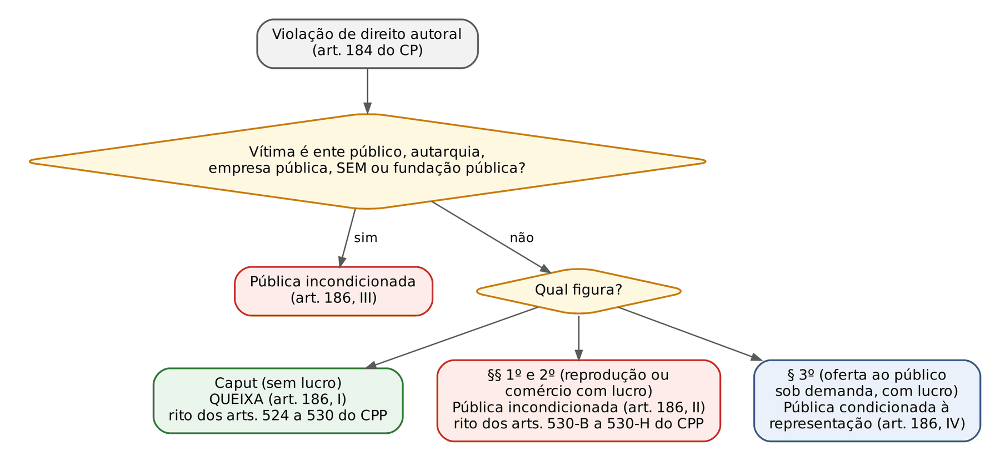
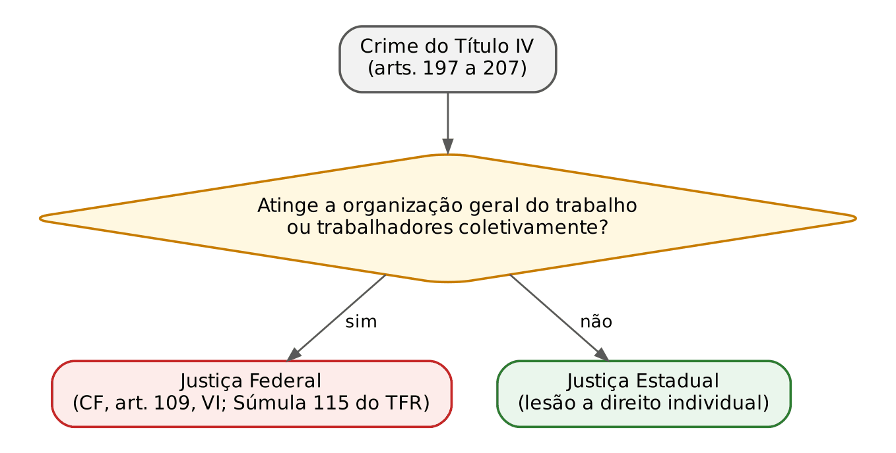
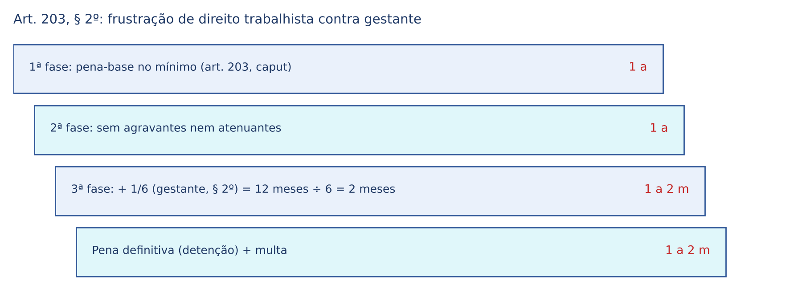
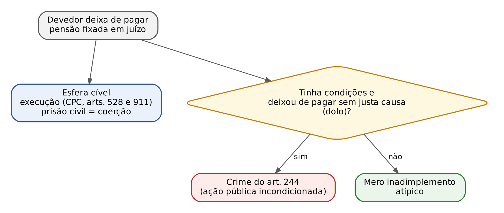

# CAPÍTULO 32 — PROPRIEDADE IMATERIAL (CP, LEI 9.279/1996 E LEI 9.609/1998), ORGANIZAÇÃO DO TRABALHO, SENTIMENTO RELIGIOSO, RESPEITO AOS MORTOS E CRIMES CONTRA A FAMÍLIA

:::INCIDENCIA
TRF5 p. 9; TJRS p. 5; TJSC p. 40, 41, 42, 44, 63 e 75. Nível B. Lote: 4 questões (FGV 3, FCC 1).
O que mais cai: organização do trabalho (tipo certo entre os arts. 197, 200 e 203, majorante do art. 203, § 2º, e ação penal), elementares do abandono material (idoso com mais de 60 anos, pensão fixada em juízo) e as Súmulas 502 e 574 do STJ no art. 184.
:::

A banca cobra estes cinco títulos pela literalidade: vítima, pena, ação penal e competência. Para o civilista, a chave é que quase todo crime aqui tem um "irmão" no Direito Civil, Empresarial ou do Trabalho, e o tipo penal só alcança a violação mais grave (com fraude, violência, intuito de lucro ou dolo de abandono).

## 32.1 Crimes contra a propriedade imaterial

### 32.1.1 O mapa: três diplomas, três regimes de ação penal

Propriedade intelectual é o gênero; dentro dele estão o direito autoral (obra de espírito: livro, música, filme, fonograma, regido pela Lei 9.610/1998), a proteção do programa de computador (Lei 9.609/1998, que remete ao regime autoral) e a propriedade industrial (patentes, desenhos industriais, marcas, indicações geográficas e repressão à concorrência desleal, na Lei 9.279/1996, a LPI). O Título III da Parte Especial do CP já cuidou de tudo isso; hoje só sobrou nele o art. 184 (e o art. 186, sobre a ação penal). Os arts. 187 a 196 do CP foram revogados pelo art. 244 da LPI.

| Objeto protegido | Diploma penal | Regra de ação penal | Detalhe que a banca explora |
|---|---|---|---|
| Direito de autor e conexos (obra, interpretação, fonograma) | CP, art. 184 | Mista: queixa no caput; pública incondicionada nos §§ 1º e 2º; condicionada no § 3º (art. 186) | Súmulas 502 e 574 do STJ |
| Programa de computador | Lei 9.609/1998, art. 12 | Queixa, salvo prejuízo a ente público ou reflexo tributário/consumerista (§ 3º) | É lei especial: não se aplica o art. 184 do CP |
| Propriedade industrial e concorrência desleal | Lei 9.279/1996, arts. 183 a 195 | Queixa, salvo o art. 191 (armas, brasões e distintivos oficiais), que é de ação pública (art. 199) | Penas baixíssimas (todas IMPO); nulidade do registro como defesa (art. 205) |

Os conceitos de marca, patente e concorrência desleal estão na Apostila de Direito Empresarial do mesmo usuário (Pontos 4 e 5); aqui, só o recorte penal.

### 32.1.2 Violação de direito autoral (art. 184 do CP)

O bem jurídico é o direito autoral em suas duas faces: a moral (paternidade e integridade da obra) e a patrimonial (exploração econômica). "Direitos conexos" são os dos intérpretes, executantes, produtores de fonogramas e empresas de radiodifusão (Lei 9.610/1998, arts. 89 e seguintes). O crime é comum, doloso e não tem forma culposa.

:::LEI Código Penal, art. 184, § 4º (redação da Lei 10.695/2003)
§ 4º O disposto nos §§ 1º, 2º e 3º não se aplica quando se tratar de exceção ou limitação ao direito de autor ou os que lhe são conexos, em conformidade com o previsto na Lei nº 9.610, de 19 de fevereiro de 1998, nem a cópia de obra intelectual ou fonograma, em um só exemplar, para uso privado do copista, sem intuito de lucro direto ou indireto.
:::

Penas: caput, detenção de 3 meses a 1 ano, ou multa; §§ 1º a 3º, reclusão de 2 a 4 anos, e multa. A estrutura é de escada. O caput é o tipo básico, aberto ("violar direitos"), completado pela Lei 9.610/1998 (norma penal em branco em sentido amplo, ver Cap. 3): plágio, execução pública não autorizada sem fim de lucro, cópia sem lucro. Os §§ 1º a 3º são formas qualificadas cujo traço comum é o INTUITO DE LUCRO DIRETO OU INDIRETO (elemento subjetivo especial) e a falta de autorização expressa (elemento normativo; quem supõe, por erro invencível, que havia autorização incide em erro de tipo, ver Cap. 7).

- § 1º: quem REPRODUZ (o "fabricante" da cópia pirata).
- § 2º: quem COMERCIALIZA ou mantém o produto pirata (o camelô, o distribuidor); expor à venda e ter em depósito são modalidades permanentes.
- § 3º: a pirataria "sob demanda" (*streaming* e *download* em que o usuário escolhe o que e quando recebe).
- § 4º: exclui as formas qualificadas nas limitações legais (Lei 9.610/1998, art. 46) e na cópia de UM exemplar para uso privado, sem lucro.

:::PEGADINHA Sem intuito de lucro não há § 2º
Quem compra DVD pirata para ver em casa não "adquire com intuito de lucro": não há § 2º; Bitencourt registra precedente que viu receptação (art. 180, ver Cap. 30) na aquisição ciente sem fim lucrativo. Quem adquire para revender incide no § 2º, especial em relação à receptação.
:::

:::JURIS STJ, Súmula 502 e Jurisprudência em Teses, ed. 269, teses 6, 8 e 9
"Presentes a materialidade e a autoria, afigura-se típica, em relação ao crime previsto no art. 184, § 2º, do CP, a conduta de expor à venda CDs e DVDs piratas" (Súmula 502). Adequação social e insignificância: ver Cap. 2 (Tema 593). A edição 269 da Jurisprudência em Teses (24/10/2025) reafirmou que não há insignificância (tese 8) e que, sendo crime permanente, dispensa-se mandado para ingresso em domicílio em flagrância (tese 9), observadas as fundadas razões do Tema 280 do STF.
:::

:::JURIS STJ, Tema 926 e Súmula 574 (REsp 1.456.239/MG, Terceira Seção, j. 12/8/2015)
Para provar a materialidade do art. 184, § 2º, basta a perícia por AMOSTRAGEM sobre os aspectos EXTERNOS do material apreendido (capa, encarte, ausência de selo), e é DESNECESSÁRIA a identificação dos titulares dos direitos violados ou de quem os represente (Súmula 574, de 22/6/2016). Exigir exame individual de milhares de mídias, como sugere a letra do art. 530-D do CPP, tornaria a lei inaplicável.
:::

:::SENTENCA Art. 184, § 2º, na sentença
Na materialidade, basta o auto de apreensão e o laudo por amostragem; no dolo, o intuito de lucro se extrai da quantidade, do local e do preço. Redação-modelo: "A materialidade está comprovada pelo laudo que, por amostragem, atestou a falsificação das mídias pelos seus aspectos externos, sendo desnecessária a identificação dos titulares (Súmula 574 do STJ); o intuito de lucro decorre da exposição de 300 exemplares em banca comercial." Erro que a banca pune: absolver por adequação social ou por falta de identificação das vítimas.
:::

Competência: em regra, Justiça Estadual; a mera origem estrangeira da obra não atrai a Justiça Federal, que depende de hipótese do art. 109 da CF.

### 32.1.3 Ação penal (art. 186) e processo

O art. 186 é a parte mais cobrada do título, e cada figura tem uma ação diferente.

:::PROCESSO Dois procedimentos no CPP (arts. 524 a 530-I)
- Ação privada (caput): arts. 524 a 530 do CPP (art. 530-A). Havendo vestígios, a queixa vem instruída com o laudo dos objetos (art. 525), produzido em busca e apreensão requerida pelo ofendido e homologada pelo juiz (arts. 527 e 528); homologado o laudo, a queixa deve vir em 30 dias (art. 529). Para Bitencourt e a maioria, esse prazo NÃO substitui a decadência de 6 meses: corre dentro dela (o STF já o tratou como decadencial no RHC 67.300).
- Ação pública (§§ 1º a 3º e entes públicos): arts. 530-B a 530-H (art. 530-I). Apreensão dos bens e equipamentos, perícia (lida com a Súmula 574), titulares como depositários, destruição antecipada e, na sentença condenatória, destruição dos bens e perdimento dos equipamentos (art. 530-G); associações de titulares podem ser assistentes de acusação (art. 530-H).
:::

Benefícios: o caput é infração de menor potencial ofensivo (máximo de 1 ano; ver Cap. 25). Nos §§ 1º a 3º, o mínimo de 2 anos afasta a suspensão condicional do processo (foi exatamente esse o objetivo declarado da Lei 10.695/2003, segundo Bitencourt), mas cabe ANPP (mínimo inferior a 4 anos e ausência de violência), e, na condenação, substituição por restritivas de direitos.

### 32.1.4 Programa de computador (Lei 9.609/1998)

O programa de computador tem proteção autoral (art. 2º da Lei 9.609/1998), mas a tutela penal é a da lei especial, que prevalece sobre o art. 184 do CP pela especialidade.

| Figura (art. 12) | Conduta | Pena |
|---|---|---|
| Caput | Violar direitos de autor de programa de computador | detenção, de 6 meses a 2 anos, ou multa |
| § 1º | Reproduzir o programa, no todo ou em parte, para fins de comércio, sem autorização expressa | reclusão, de 1 a 4 anos, e multa |
| § 2º | Vender, expor à venda, introduzir no País, adquirir, ocultar ou ter em depósito, para fins de comércio, original ou cópia produzida com violação | reclusão, de 1 a 4 anos, e multa |

Ação penal (§ 3º): somente mediante QUEIXA, SALVO (I) quando praticado em prejuízo de entidade de direito público, autarquia, empresa pública, sociedade de economia mista ou fundação instituída pelo poder público; ou (II) quando resultar sonegação fiscal, perda de arrecadação tributária ou crime contra a ordem tributária ou contra as relações de consumo. Nesses casos, a ação é pública incondicionada. A ação penal e as buscas são precedidas de vistoria (art. 13).

:::PEGADINHA Lógica inversa à do art. 184
No CP, a forma com lucro (§§ 1º e 2º) é de ação PÚBLICA incondicionada. Na Lei 9.609/1998, mesmo a reprodução para fins de comércio (§ 1º) é, em regra, de ação PRIVADA. E os §§ 1º e 2º da Lei 9.609 (mínimo de 1 ano) admitem suspensão condicional do processo, ao contrário dos §§ 1º e 2º do art. 184.
:::

Não confunda com a produção ou venda de programa malicioso para invadir dispositivos: isso é o art. 154-A, § 1º, do CP (invasão de dispositivo informático; ver Cap. 47 e a correlata Q3880833, FGV 2026, ALERJ).

### 32.1.5 Crimes contra a propriedade industrial (Lei 9.279/1996)

A LPI organiza os crimes em seis capítulos, sempre com um tipo de fabricação ou reprodução (detenção de 3 meses a 1 ano, ou multa) e outro de comercialização, estoque ou importação do produto contrafeito (1 a 3 meses, ou multa): patentes (arts. 183 a 186), desenhos industriais (arts. 187 e 188), marcas (arts. 189 e 190), crimes por meio de marca com armas, brasões ou distintivos oficiais (art. 191), indicações geográficas (arts. 192 a 194) e concorrência desleal (art. 195, 3 meses a 1 ano, ou multa, com 14 incisos: falsa afirmação sobre concorrente, meio fraudulento para desviar clientela, uso de sinal ou nome alheio, corrupção de empregado do concorrente, violação de segredo de empresa).

Detalhes que a banca cobra:

- Art. 195, § 1º: nos incisos XI e XII (segredo de empresa), responde também o empregador, sócio ou administrador.
- Art. 196: as penas de detenção dos crimes contra patentes, desenhos e marcas aumentam de 1/3 à metade se o agente é ou foi representante, mandatário, preposto, sócio ou empregado do titular ou licenciado, ou se a marca é de alto renome, notoriamente conhecida, de certificação ou coletiva.
- Art. 197: multa de 10 a 360 dias-multa, que pode ser aumentada ou reduzida em até 10 vezes conforme as condições do agente e a vantagem auferida.
- Art. 199: "Nos crimes previstos neste Título somente se procede mediante queixa, salvo quanto ao crime do art. 191, em que a ação penal será pública." Não há ressalva para crimes contra entes públicos, ao contrário do art. 186 do CP.
- Art. 205: a nulidade da patente ou do registro pode ser alegada como DEFESA, mas a absolvição não anula o registro (questão resolvida *incidenter tantum*, sem coisa julgada; a nulidade exige a ação própria).

:::PROCESSO Busca e apreensão na LPI (arts. 198 a 204)
Aplica-se o rito do CPP para a ação privada (arts. 524 a 530), com ajustes: no crime contra patente de processo, o oficial vai acompanhado de perito (art. 201); pode-se pedir a apreensão e a destruição da marca falsificada antes do uso, ainda que se destruam os produtos (art. 202); em estabelecimento regular e aberto ao público, a diligência limita-se à vistoria e apreensão, sem paralisar a atividade lícita (art. 203); quem requer a diligência de má-fé ou por erro grosseiro responde por perdas e danos (art. 204); a alfândega pode apreender de ofício produtos com marca falsificada (art. 198).
:::

Competência: Justiça Estadual. Todos os crimes da LPI são de menor potencial ofensivo, mesmo com o aumento máximo do art. 196 (1 ano + 1/2 = 1 ano e 6 meses).

:::ESQUEMA Ficha — propriedade imaterial
| Crime | Pena | Elemento subjetivo | Consumação e tentativa | Ação penal | Benefícios |
|---|---|---|---|---|---|
| Art. 184, caput, CP | detenção 3 m a 1 a, ou multa | dolo | com a violação; tentativa possível | queixa (salvo ente público) | IMPO |
| Art. 184, §§ 1º e 2º, CP | reclusão 2 a 4 a + multa | dolo + intuito de lucro | reprodução / prática do núcleo; expor e ter em depósito são permanentes | pública incondicionada | ANPP; substituição; sem sursis processual |
| Art. 184, § 3º, CP | reclusão 2 a 4 a + multa | dolo + intuito de lucro | com o oferecimento ao público | condicionada à representação | ANPP; substituição |
| Lei 9.609, art. 12, caput | detenção 6 m a 2 a, ou multa | dolo | com a violação | queixa (exceções do § 3º) | IMPO |
| Lei 9.609, art. 12, §§ 1º e 2º | reclusão 1 a 4 a + multa | dolo + fim de comércio | com a reprodução / prática do núcleo | queixa (exceções do § 3º) | sursis processual; ANPP |
| LPI, arts. 183 a 195 | de 1 m a 1 a, ou multa | dolo (no 195, fins especiais em vários incisos) | com a prática do núcleo | queixa (art. 191: pública) | IMPO |
Nenhum é hediondo. Competência: Justiça Estadual, salvo hipótese do art. 109 da CF.
:::

## 32.2 Crimes contra a organização do trabalho (arts. 197 a 207)

### 32.2.1 Bem jurídico, ação penal e competência

O Título IV protege a liberdade de trabalho (escolher profissão, contratar, sindicalizar-se) e a organização do trabalho como sistema. Três regras resolvem boa parte das questões:

1. Ação penal: TODOS os crimes do título são de ação pública INCONDICIONADA (não há regra especial; art. 100 do CP, ver Cap. 20).
2. Cúmulo da violência: os arts. 197 a 200, 203 e 204 mandam aplicar a pena "além da pena correspondente à violência" (o agente responde também pela lesão ou pelo dano, com penas somadas).
3. Competência: o art. 109, VI, da CF dá à Justiça Federal "os crimes contra a organização do trabalho", mas o STF e o STJ o leem restritivamente, na linha da Súmula 115 do extinto TFR: só quando "tenham por objeto a organização geral do trabalho ou direitos dos trabalhadores considerados coletivamente". Lesão a direito de um ou de poucos trabalhadores é da Justiça Estadual.

:::ATENCAO Vizinhos fora do Título IV
Redução a condição análoga à de escravo (art. 149; competência federal fixada pelo STF no RE 398.041 — ver Cap. 28); tráfico de pessoas (art. 149-A — ver Cap. 47); omissão ou falsa anotação na CTPS (art. 297, §§ 3º e 4º, e Súmula 62 do STJ — v. Cap. 34).
:::

### 32.2.2 Constrangimentos à liberdade de trabalho (arts. 197 a 199)

São formas especiais de constrangimento ilegal (art. 146): exigem VIOLÊNCIA OU GRAVE AMEAÇA, e o que muda é o comportamento imposto. No art. 197, I, constrange-se a exercer ou não profissão, ou a trabalhar ou não em certos dias; no art. 197, II, a abrir ou fechar o próprio estabelecimento ou a aderir a greve; no art. 198, a celebrar contrato de trabalho ou a não fornecer ou não adquirir matéria-prima ou produto (boicotagem violenta); no art. 199, a participar ou não de sindicato.

:::QUESTAO FGV 2025 — TJ-ES — Atividade Notarial e de Registro, Remoção (Q3520327)
Integrante de facção, em retaliação a uma operação policial, agride um comerciante para obrigá-lo a manter fechado o estabelecimento. Gabarito: E, atentado contra a liberdade de trabalho (art. 197, II), de ação pública incondicionada, além da pena da violência. Armadilhas: o art. 200 exige que o agente PARTICIPE de paralisação coletiva; o art. 203 pressupõe direito trabalhista frustrado; nenhum crime do título é de ação condicionada.
:::

### 32.2.3 Greve, paralisação e invasão (arts. 200 a 202)

A greve é direito constitucional (CF, art. 9º), e a Lei 7.783/1989 não criou crimes: assegura meios pacíficos de persuasão (art. 6º, I) e remete à lei penal os ilícitos cometidos no seu curso (art. 15). Greve e piquete pacíficos são exercício regular de direito; o CP pune o excesso:

- Art. 200: participar de suspensão (*lockout*) ou abandono coletivo de trabalho (greve) PRATICANDO VIOLÊNCIA contra pessoa ou coisa. O abandono só é coletivo com, PELO MENOS, TRÊS EMPREGADOS (parágrafo único). Responde quem pratica a violência, não todo grevista.
- Art. 201: participar de paralisação coletiva que interrompe obra pública ou serviço de interesse coletivo. Como a CF admite greve até em serviço essencial (Lei 7.783/1989, arts. 10 a 13), a doutrina só vê crime na paralisação abusiva.
- Art. 202 (invasão de estabelecimento e sabotagem): invadir ou ocupar estabelecimento industrial, comercial ou agrícola com o intuito de impedir ou embaraçar o trabalho, ou, com esse fim, danificá-lo ou dispor de suas coisas. O fim especial o separa do esbulho (art. 161, § 1º, II) e do dano (art. 163).

:::QUESTAO FGV 2024 — Câmara dos Deputados — Consultor Legislativo, Área V, reaplicação (Q2511466)
Três empregados deixam seus postos, entram no centro de controle da fábrica e destroem máquinas. Gabarito: D, paralisação de trabalho seguida de violência (art. 200): abandono coletivo (três empregados, o mínimo legal) com violência contra coisa. Armadilhas: "dano" ignora o tipo especial; o art. 202 foi tido por errado porque os autores participavam da paralisação, e não eram terceiros que invadem o estabelecimento (solução discutível, já que o art. 202 também pune quem o danifica para embaraçar o trabalho); o art. 205 trata de decisão administrativa.
:::

No mesmo tema, a FGV (ENAM 2024, Q2507052, Cap. 34) considerou atípicos o piquete pacífico do líder sindical e o não pagamento do 13º salário sem fraude ou violência; só a omissão de anotação na CTPS foi tida como crime (art. 297, § 4º).

### 32.2.4 Frustração de direitos trabalhistas (arts. 203 e 204)

:::LEI Código Penal, art. 203
Art. 203 - Frustrar, mediante fraude ou violência, direito assegurado pela legislação do trabalho: Pena - detenção de um ano a dois anos, e multa, além da pena correspondente à violência.
§ 1º Na mesma pena incorre quem: I — obriga ou coage alguém a usar mercadorias de determinado estabelecimento, para impossibilitar o desligamento do serviço em virtude de dívida; II — impede alguém de se desligar de serviços de qualquer natureza, mediante coação ou por meio da retenção de seus documentos pessoais ou contratuais.
§ 2º A pena é aumentada de um sexto a um terço se a vítima é menor de dezoito anos, idosa, gestante, indígena ou portadora de deficiência física ou mental.
:::

- Norma penal em branco: o direito frustrado está na CLT e nas leis trabalhistas.
- Meios: só FRAUDE ou VIOLÊNCIA; a grave ameaça NÃO está no caput (só a "coação" do § 1º, II). Sem esses meios, o não pagamento de verba é ilícito trabalhista, não crime.
- § 1º, I, é o "sistema de barracão" (*truck system*); § 1º, II, a retenção de CTPS ou documentos. Se a dívida ou a vigilância restringem a locomoção, o fato vai para o art. 149 (Cap. 28).
- § 2º é causa de aumento (terceira fase), não qualificadora; o mesmo rol está no art. 207, § 2º.

:::QUESTAO FGV 2025 — TRT 24ª Região — Analista Judiciário, Oficial de Justiça, reaplicação (Q3349704)
Empregador frustra, mediante fraude, direito trabalhista de empregada grávida. Gabarito: B, modalidade SIMPLES com causa de aumento (art. 203, caput e § 2º). Armadilhas: "qualificada" confunde majorante (fração sobre a pena do caput) com qualificadora (nova pena mínima e máxima); "atipicidade" ignora a fraude.
:::

:::EXEMPLO Dosimetria e benefícios no caso da Q3349704
Réu primário, art. 59 favorável, sem agravantes ou atenuantes. 1ª fase: 1 ano. 2ª fase: 1 ano. 3ª fase: uma só hipótese do § 2º, sem dado concreto que justifique mais, fração mínima de 1/6: 12 meses ÷ 6 = 2 meses; pena definitiva de 1 ano e 2 meses de detenção, e multa; regime aberto e substituição cabíveis (crime com fraude; arts. 33 e 44, Cap. 17).
Benefícios, calculados com a majorante: IMPO? Máximo 2 anos + 1/3 = 2 anos e 8 meses: NÃO. Suspensão condicional do processo? Mínimo 1 ano + 1/6 = 1 ano e 2 meses: NÃO (lógica das Súmulas 723 do STF e 243 do STJ — Cap. 25); sem a gestante, caberia. ANPP: sim, porque o meio foi fraude.
:::

O art. 204 pune quem frustra, mediante fraude ou violência, obrigação legal relativa à nacionalização do trabalho (cotas de brasileiros, CLT, arts. 352 e seguintes); tem aplicação rara.

### 32.2.5 Atividade vedada e aliciamento (arts. 205 a 207)

- Art. 205: exercer atividade de que está impedido por DECISÃO ADMINISTRATIVA (advogado suspenso pela OAB, médico com registro cassado). Crime habitual, sem tentativa. Se o impedimento vem de DECISÃO JUDICIAL, é o art. 359 (Cap. 36); se a pessoa nunca preencheu as condições da profissão, é a contravenção do art. 47 da LCP (Cap. 50).
- Art. 206: RECRUTAR trabalhadores, mediante FRAUDE, para levá-los ao exterior. Crime formal; havendo finalidade de exploração, tráfico de pessoas (art. 149-A).
- Art. 207: ALICIAR trabalhadores para levá-los de uma para outra localidade do território nacional (no caput, a fraude NÃO é elementar). § 1º: recrutar fora da localidade de execução do trabalho mediante fraude ou cobrança de quantia do trabalhador, ou sem assegurar o retorno (o "gato" das frentes rurais). § 2º: aumento de 1/6 a 1/3, como no art. 203 (o art. 206 não tem aumento).

:::ESQUEMA Ficha — organização do trabalho
| Crime | Pena | Elemento subjetivo | Consumação | Benefícios |
|---|---|---|---|---|
| 197, I / II; 198; 199 | det. 1 m a 1 a (197, II: 3 m a 1 a) + multa + violência | dolo | com o comportamento imposto; tentativa possível | IMPO |
| 200 | det. 1 m a 1 a + multa + violência | dolo | com a violência na paralisação | IMPO |
| 201 | det. 6 m a 2 a + multa | dolo | com a interrupção | IMPO |
| 202 | rec. 1 a 3 a + multa | dolo + fim de embaraçar o trabalho | com a invasão (formal) | sursis processual; ANPP |
| 203 | det. 1 a 2 a + multa + violência (§ 2º: +1/6 a 1/3) | dolo | com a frustração | sem § 2º: IMPO e sursis; com § 2º: ANPP (se fraude) |
| 204 | det. 1 m a 1 a + multa + violência | dolo | com a frustração | IMPO |
| 205 | det. 3 m a 2 a, ou multa | dolo; habitual | com a reiteração | IMPO |
| 206 e 207 | det. 1 a 3 a + multa (207, § 2º: +1/6 a 1/3) | dolo + fim de deslocamento | com o recrutamento ou aliciamento (formal) | sursis processual (sem majorante); ANPP |
Ação pública incondicionada em todos; Justiça Federal só se atingidos trabalhadores coletivamente; nenhum é hediondo.
:::

## 32.3 Crimes contra o sentimento religioso e contra o respeito aos mortos (arts. 208 a 212)

### 32.3.1 Ultraje a culto e impedimento ou perturbação de ato a ele relativo (art. 208)

O bem jurídico é o sentimento religioso (CF, art. 5º, VI): o Estado laico protege o respeito a qualquer crença. O art. 208 reúne três condutas (tipo misto cumulativo — ver Cap. 5): escarnecer de alguém PUBLICAMENTE por motivo de crença ou função religiosa (vítima determinada); impedir ou perturbar cerimônia ou prática de culto (sem exigência de publicidade); vilipendiar PUBLICAMENTE ato ou objeto de culto (quebrar, diante de fiéis, a imagem de uma santa). Detenção, de 1 mês a 1 ano, ou multa; com violência, aumento de 1/3, além da pena da violência.

:::ATENCAO Interfaces com a Lei 7.716/1989 e a injúria (Caps. 41 e 28)
- Discriminação ou preconceito de religião: art. 20 da Lei 7.716/1989 (reclusão de 1 a 3 anos).
- A Lei 14.532/2023 incluiu no art. 20 o § 2º-B: mesmas penas para quem "obstar, impedir ou empregar violência contra quaisquer manifestações ou práticas religiosas". IMPEDIR prática religiosa tende, assim, a sair do art. 208 para a lei especial e posterior; a mera PERTURBAÇÃO segue no CP.
- Ofensa à dignidade com elementos referentes à religião é injúria qualificada do art. 140, § 3º, do CP (a Lei 14.532/2023 levou para a Lei 7.716/1989 só a injúria por raça, cor, etnia e procedência nacional).
:::

### 32.3.2 Respeito aos mortos (arts. 209 a 212)

Protege-se o sentimento de respeito aos mortos (da coletividade e, sobretudo, de parentes e amigos; o morto não é titular de direitos). São crimes comuns, dolosos e de ação pública incondicionada: impedir ou perturbar enterro ou cerimônia funerária (art. 209); violar ou profanar sepultura ou urna funerária (art. 210); destruir, subtrair ou ocultar cadáver ou parte dele (art. 211); vilipendiar cadáver ou suas cinzas (art. 212).

- Cadáver é o corpo humano sem vida que conserva a aparência humana. Para a corrente majoritária, o natimorto expulso com capacidade de vida extrauterina é cadáver; o feto imaturo, não.
- Homicídio seguido de ocultação do corpo: concurso MATERIAL, sem consunção (bens jurídicos e condutas distintos). Foi o gabarito da FGV 2024, TJ-SC, Oficial de Justiça (Q2515589, Cap. 16).
- "Ocultar" é tido por parte relevante da doutrina como permanente (prescrição da cessação, art. 111, III). O STF afetou à repercussão geral a anistia (Lei 6.683/1979) à ocultação iniciada antes da lei e mantida depois (Tema 1.369, ARE 1.501.674; sem tese localizada na última conferência — ver Cap. 21).
- Remoção ilegal de órgãos ou tecidos de cadáver: Lei 9.434/1997, especial (Cap. 42).
- O art. 212 exige o fim de aviltar: empurrar com o pé o corpo para conferir a morte não é vilipêndio (Bitencourt). A necrofilia enquadra-se aqui.

:::PEGADINHA Cadáver pode ser objeto de furto?
Em regra, NÃO: é coisa fora do comércio, e quem o subtrai pratica o art. 211. EXCEÇÃO: cadáver com valor econômico e dono (peça de instituto científico, múmia de museu): furto (art. 155; Cap. 29). Subtrair objetos da sepultura sem violá-la é furto; violá-la para subtrair (dentes de ouro, joias) divide a doutrina entre o concurso com o art. 210 ou 211 e a absorção pelo furto.
:::

:::ESQUEMA Ficha — sentimento religioso e respeito aos mortos
| Crime | Pena | Elemento subjetivo | Consumação | Benefícios |
|---|---|---|---|---|
| 208 e 209 | det. 1 m a 1 a, ou multa (+1/3 com violência) | dolo; no escárnio, motivo religioso | com o ato | IMPO |
| 210 | rec. 1 a 3 a + multa | dolo | com a violação ou profanação | sursis processual; ANPP |
| 211 | rec. 1 a 3 a + multa | dolo | com a destruição, subtração ou ocultação | sursis processual; ANPP |
| 212 | det. 1 a 3 a + multa | dolo + fim de ultrajar | com o ato ultrajante | sursis processual; ANPP |
Ação pública incondicionada; Justiça Estadual; nenhum é hediondo.
:::

## 32.4 Crimes contra a família (arts. 235 a 249)

O Título VII tem quatro capítulos, cada um apoiado num instituto civil: casamento (impedimentos e invalidade, CC, arts. 1.521 e 1.548 a 1.564), estado de filiação (registro civil), assistência familiar (alimentos e deveres do poder familiar, CC, arts. 1.634 e 1.694) e poder familiar, tutela e curatela (guarda). O Direito Penal só entra com fraude, abandono doloso ou violação grave; o resto fica no cível. O adultério (art. 240) foi revogado pela Lei 11.106/2005.

### 32.4.1 Crimes contra o casamento (arts. 235 a 239)

:::LEI Código Penal, art. 235 (bigamia)
Art. 235 - Contrair alguém, sendo casado, novo casamento: Pena - reclusão, de dois a seis anos.
§ 1º - Aquele que, não sendo casado, contrai casamento com pessoa casada, conhecendo essa circunstância, é punido com reclusão ou detenção, de um a três anos.
§ 2º - Anulado por qualquer motivo o primeiro casamento, ou o outro por motivo que não a bigamia, considera-se inexistente o crime.
:::

- Sujeitos: o caput é crime próprio (casado); o § 1º pune com pena menor o solteiro que sabe, exceção pluralística à teoria monista (Cap. 11). Crime plurissubjetivo de condutas convergentes.
- Pressuposto: casamento anterior VÁLIDO e vigente. União estável NÃO é casamento: a união paralela ou o casamento de quem vive em união estável são atípicos. Casamento religioso só conta com efeitos civis (CF, art. 226, § 2º).
- § 2º: anulado o primeiro casamento (qualquer motivo) ou o segundo (motivo diverso da bigamia), o crime inexiste. O DIVÓRCIO não apaga o crime (dissolve, não invalida). Ação anulatória em curso: suspensão do processo penal por questão prejudicial (art. 92 do CPP). Divórcio obtido no exterior e não homologado: Bitencourt e Rogério Sanches sustentam a atipicidade.
- Consumação: na celebração (CC, art. 1.535); instantâneo de efeitos permanentes (Cap. 5). A falsa declaração de estado civil na habilitação é absorvida pela bigamia consumada.
- Prescrição: corre da data em que o fato se tornou CONHECIDO (art. 111, IV — Cap. 22).

| Artigo | Conduta | Pena | Ponto-chave |
|---|---|---|---|
| 236 | casar induzindo o outro em erro essencial, ou ocultando-lhe impedimento que NÃO seja casamento anterior | det. 6 m a 2 a | queixa só do contraente enganado (privada PERSONALÍSSIMA), depois do trânsito da sentença anulatória (Cap. 20); erro essencial: CC, art. 1.557 |
| 237 | casar conhecendo impedimento que cause NULIDADE ABSOLUTA | det. 3 m a 1 a | norma em branco completada pelo CC, art. 1.521 (Cap. 3) |
| 238 | atribuir-se falsamente autoridade para celebrar casamento | det. 1 a 3 a | subsidiário expresso |
| 239 | simular casamento mediante engano de outra pessoa | det. 1 a 3 a | subsidiário expresso |

:::PEGADINHA Casamento anterior oculto é bigamia
O art. 236 exclui o impedimento "casamento anterior": ocultá-lo e casar é bigamia, de ação pública incondicionada. No art. 237, o agente SABE do impedimento absoluto; no art. 236, ele ENGANA o outro contraente.
:::

### 32.4.2 Crimes contra o estado de filiação (arts. 241 a 243)

- Art. 241: promover no registro civil a inscrição de nascimento INEXISTENTE (não há criança). Reclusão, de 2 a 6 anos.
- Art. 242: dar parto alheio como próprio; registrar como seu o filho de outrem ("adoção à brasileira"); ocultar ou substituir recém-nascido, suprimindo ou alterando direito inerente ao estado civil. Reclusão, de 2 a 6 anos; se por motivo de reconhecida NOBREZA, detenção, de 1 a 2 anos, podendo o juiz deixar de aplicar a pena (perdão judicial).
- Art. 243: deixar filho próprio ou alheio em instituição de assistência, ocultando ou trocando a filiação, com o fim de prejudicar direito inerente ao estado civil. Reclusão, de 1 a 5 anos, e multa.

Os arts. 241 e 242 são especiais em relação à falsidade ideológica (art. 299), e, nas figuras de assentamento do registro civil, a prescrição corre do conhecimento do fato (art. 111, IV).

:::SENTENCA Adoção à brasileira por motivo de reconhecida nobreza
Fundamente o motivo nobre concreto (acolhimento de criança abandonada, criação afetiva, ausência de lucro) e a desnecessidade da pena. Redação-modelo: "O acusado registrou a criança movido por motivo de reconhecida nobreza, pois a acolheu recém-nascida e a cria há oito anos com afeto e sustento; com fundamento no art. 242, parágrafo único, do CP, deixo de aplicar a pena e declaro extinta a punibilidade (art. 107, IX)." A sentença é declaratória e não gera reincidência (Súmula 18 do STJ; art. 120 — Cap. 21). Erro punido: estender o perdão ao art. 241.
:::

:::DICA O que acontece no cível
O processo penal não desfaz o registro. O STJ tende a preservar a paternidade registral voluntária consolidada pela socioafetividade (anulação só por vício de consentimento, CC, art. 1.604), e o STF admite a multiparentalidade (Tema 622). O caminho legal para a gestante é a entrega voluntária à Justiça da Infância (ECA, art. 19-A); entregar o filho mediante paga é o art. 238 do ECA (Cap. 42).
:::

### 32.4.3 Crimes contra a assistência familiar (arts. 244 a 247)

:::LEI Código Penal, art. 244 (abandono material)
Art. 244. Deixar, sem justa causa, de prover a subsistência do cônjuge, ou de filho menor de 18 (dezoito) anos ou inapto para o trabalho, ou de ascendente inválido ou maior de 60 (sessenta) anos, não lhes proporcionando os recursos necessários ou faltando ao pagamento de pensão alimentícia judicialmente acordada, fixada ou majorada; deixar, sem justa causa, de socorrer descendente ou ascendente, gravemente enfermo: Pena — detenção, de 1 (um) a 4 (quatro) anos e multa, de uma a dez vezes o maior salário mínimo vigente no País.
Parágrafo único. Nas mesmas penas incide quem, sendo solvente, frustra ou ilide, de qualquer modo, inclusive por abandono injustificado de emprego ou função, o pagamento de pensão alimentícia judicialmente acordada, fixada ou majorada.
:::

- Três figuras, com rol FECHADO de vítimas: (1) deixar de prover a subsistência do cônjuge, do filho com menos de 18 anos ou inapto para o trabalho, ou do ascendente inválido ou com mais de 60 anos; (2) faltar ao pagamento de pensão JUDICIAL; (3) deixar de socorrer descendente ou ascendente gravemente enfermo (sem cônjuge nem colaterais). O parágrafo único pune o devedor solvente que frustra o pagamento (pede demissão para fugir do desconto em folha).
- "Sem justa causa" é elemento normativo: desemprego involuntário ou doença excluem o crime. Exige DOLO de abandonar; o simples inadimplemento não basta, e o provimento parcial, para Bitencourt, não é "deixar de prover". A ajuda de terceiros (avós) não exclui o crime do obrigado.
- Crime omissivo próprio, sem tentativa; permanente para a doutrina majoritária (prescrição da cessação, art. 111, III).
- Multa: a referência a salários mínimos foi cancelada pela Lei 7.209/1984 (art. 2º); aplica-se o sistema de dias-multa (Cap. 12).
- Ação pública incondicionada; Justiça Estadual.

:::PEGADINHA Pensão fixada por escritura pública
A figura da pensão exige título JUDICIAL ("judicialmente acordada, fixada ou majorada"). Alimentos ajustados em escritura pública não preenchem a elementar; resta examinar a 1ª figura (deixar de prover a subsistência).
:::

:::QUESTAO FCC 2025 — DPE-AM — Defensor Público (Q3531619)
Vítima de 65 anos: o que decorre da idade? Gabarito: C, é elementar do abandono material ("maior de 60 anos"). Armadilhas: no estelionato contra idoso a pena aumenta de 1/3 (um terço) ao dobro (art. 171, § 4º, redação da Lei 14.155/2021), majorante e não qualificadora; a idade da vítima não aumenta prazo prescricional (só a idade do agente o REDUZ, art. 115 — Cap. 22); o constrangimento ilegal é punido com detenção ou multa.
:::

:::JURIS STJ, Informativo 856 (Quinta Turma, Rel. Min. Ribeiro Dantas, j. 10/6/2025, processo em segredo de justiça)
A agravante do art. 61, II, "f" (prevalecimento de relações domésticas ou de coabitação), aplica-se ao abandono material cometido em contexto doméstico e de coabitação: o parentesco é elementar (por isso a alínea "e" não incide), mas a coabitação é dado fático diverso, que torna a omissão mais reprovável.
:::

:::EXEMPLO Dosimetria no abandono material com a alínea "f"
Pai que mora com o filho de 10 anos e, tendo renda, deixa de prover sua subsistência. Primário, art. 59 neutro. 1ª fase: 1 ano. 2ª fase: a alínea "e" (descendente) NÃO incide, por ser elementar (*bis in idem* — Cap. 14); incide a "f" (Inf. 856), com 1/6: 12 ÷ 6 = 2 meses; 1 ano e 2 meses. 3ª fase: nada. Pena definitiva: 1 ano e 2 meses de detenção, e multa; regime aberto e substituição cabíveis.
Antes da denúncia, agravante não conta para a suspensão condicional do processo: mínimo de 1 ano, benefício cabível, assim como o ANPP. Se a vítima for mulher em contexto de violência doméstica (privação de recursos é violência patrimonial, art. 7º, IV, da Lei 11.340/2006), o art. 41 da Lei Maria da Penha afasta a Lei 9.099/1995 (Súmula 536 do STJ — Caps. 25 e 38).
:::

:::PROCESSO Prisão civil, execução de alimentos e ação penal
- A prisão civil (CPC, art. 528, § 3º) é COERÇÃO, não pena: cumprida, ainda cabe a condenação pelo art. 244, sem *bis in idem*; o pagamento posterior não extingue a punibilidade do crime consumado.
- Verificada conduta procrastinatória do executado, o juiz dá ciência ao Ministério Público dos indícios de abandono material (CPC, art. 532).
- A Lei 5.478/1968 (art. 22) pune o empregador ou servidor que sonega ao juízo informações para a execução dos alimentos e quem ajuda o devedor a se eximir do pagamento.
- O abandono AFETIVO passou a ser ilícito civil no ECA (Lei 15.240/2025), não crime.
:::

:::SENTENCA Abandono material: prova do dolo
Demonstre que o réu TINHA condições e não pagou sem justa causa. Redação-modelo: "O réu manteve emprego e adquiriu veículo no período em que nada pagou, de modo que a omissão decorreu da deliberada vontade de não prover a subsistência do filho, e não de impossibilidade." Erro punido: condenar só com a prova do débito executado no cível.
:::

Os demais crimes da assistência familiar:

- Art. 245: entregar filho com menos de 18 anos a pessoa em cuja companhia saiba ou deva saber que fica moral ou materialmente em perigo (detenção, de 1 a 2 anos); com fim de lucro ou envio ao exterior, reclusão, de 1 a 4 anos (§§ 1º e 2º). Essas formas hoje encontram tipos especiais no ECA (arts. 238 e 239 — Cap. 42).
- Art. 246 (abandono intelectual): deixar, sem justa causa, de prover à instrução primária de filho em idade escolar (detenção, de 15 dias a 1 mês, ou multa). Ensino domiciliar: o STF negou que seja direito sem lei regulamentadora (Tema 822); a repercussão penal depende do dolo e da falta de justa causa.
- Art. 247 (abandono moral): permitir que pessoa com menos de 18 anos sob sua guarda frequente casa de jogo ou mal-afamada, conviva com pessoa viciosa, frequente espetáculo pervertedor, resida ou trabalhe em casa de prostituição ou mendigue (detenção, de 1 a 3 meses, ou multa).

:::ATENCAO Pensão desviada pela guardiã não é abandono material
Na FGV 2024, TJ-SC, Juiz Substituto (Q2386988, Cap. 28), a mãe que gastava consigo a pensão do filho de 13 anos, privando-o de alimentos, respondeu por maus-tratos com aumento e apropriação indébita (gabarito E): ela não é a devedora dos alimentos.
:::

### 32.4.4 Crimes contra o poder familiar, a tutela e a curatela (arts. 248 e 249)

- Art. 248: induzir pessoa com menos de 18 anos, ou interdito, a fugir de onde está por determinação de quem exerce autoridade legal ou judicial; confiá-lo a outrem sem ordem do pai, tutor ou curador; ou deixar, sem justa causa, de entregá-lo a quem legitimamente o reclame. Detenção, de 1 mês a 1 ano, ou multa.
- Art. 249: subtrair pessoa com menos de 18 anos, ou interdito, ao poder de quem o tem sob guarda legal ou judicial. Detenção, de 2 meses a 2 anos, se o fato não constitui elemento de outro crime. § 1º: o pai, tutor ou curador destituído ou privado da guarda também responde. § 2º: restituído o incapaz sem maus-tratos ou privações, o juiz pode deixar de aplicar a pena.

:::DICA Disputa de guarda: onde está o crime
O genitor que, findo o período de convivência, não devolve o filho ao guardião pode incidir na última figura do art. 248; o genitor privado da guarda por decisão judicial que leva o filho incide no art. 249 (§ 1º). Sem decisão que o prive da guarda, a retenção tende à solução cível (Lei 12.318/2010; a alienação parental não é crime). Subtração para colocação em lar substituto é o art. 237 do ECA (Cap. 42); privação de liberdade como fim, arts. 148 ou 159.
:::

:::ESQUEMA Ficha — crimes contra a família
| Crime | Pena | Elemento subjetivo | Consumação | Ação penal | Benefícios |
|---|---|---|---|---|---|
| 235, caput / § 1º | rec. 2 a 6 a / rec. ou det. 1 a 3 a | dolo | celebração | pública incond. | ANPP / sursis e ANPP |
| 236 | det. 6 m a 2 a | dolo | celebração | privada personalíssima | IMPO |
| 237 | det. 3 m a 1 a | dolo direto | celebração | pública incond. | IMPO |
| 238 e 239 | det. 1 a 3 a | dolo | ato | pública incond. | sursis; ANPP |
| 241 e 242 | rec. 2 a 6 a (242, par. único: det. 1 a 2 a + perdão) | dolo | registro, ocultação ou troca | pública incond. | ANPP (par. único: IMPO) |
| 243 | rec. 1 a 5 a + multa | dolo + fim de prejudicar o estado civil | abandono na instituição | pública incond. | sursis; ANPP |
| 244 | det. 1 a 4 a + multa | dolo (sem justa causa) | omissão; permanente | pública incond. | sursis; ANPP (salvo Lei Maria da Penha) |
| 245 / § 1º | det. 1 a 2 a / rec. 1 a 4 a | dolo direto ou eventual | entrega | pública incond. | IMPO / sursis e ANPP |
| 246, 247 e 248 | até 1 a, ou multa | dolo | omissão ou permissão | pública incond. | IMPO |
| 249 | det. 2 m a 2 a (§ 2º: perdão) | dolo | subtração | pública incond. | IMPO |
Justiça Estadual; nenhum é hediondo.
:::

## 32.5 Resumo para revisão pré-prova

| Instituto | Regra | Exceções e detalhes | Fundamento |
|---|---|---|---|
| Direito autoral | caput: violar; §§ 1º a 3º: reproduzir, comercializar ou oferecer sob demanda com intuito de lucro | § 4º: limitações e cópia única privada; ação: queixa (caput), incondicionada (§§ 1º e 2º, ente público), representação (§ 3º) | CP, arts. 184 e 186; Súmulas 502 e 574 do STJ |
| Software e propriedade industrial | Lei 9.609: queixa, salvo ente público ou reflexo tributário; LPI: todos IMPO, queixa | LPI, art. 191: ação pública; art. 205: nulidade como defesa | Lei 9.609/1998, art. 12; Lei 9.279/1996, arts. 183 a 205 |
| Organização do trabalho | ação pública incondicionada; pena da violência somada | Justiça Federal só se atingidos trabalhadores coletivamente ou a organização geral do trabalho | CF, art. 109, VI; Súmula 115 do TFR |
| Greve e frustração de direitos | greve pacífica é lícita; art. 200 exige violência e 3 empregados; art. 203 exige fraude ou violência | art. 203, § 2º: +1/6 a 1/3 (gestante, idosa, indígena etc.); art. 205: decisão administrativa | CP, arts. 197 a 207 |
| Religião e mortos | art. 208: três condutas; arts. 209 a 212 | cadáver não é objeto de furto, salvo se de instituição científica; homicídio + ocultação: concurso material | CP, arts. 208 a 212 |
| Casamento | bigamia: 2 a 6 a (casado) e 1 a 3 a (solteiro ciente) | anulação apaga o crime, divórcio não; união estável não conta; art. 236: privada personalíssima | CP, arts. 235 a 239; art. 111, IV |
| Filiação | 241: nascimento inexistente; 242: parto suposto, adoção à brasileira | reconhecida nobreza: pena menor e perdão (só no 242) | CP, arts. 241 a 243 |
| Abandono material | omitir subsistência, pensão JUDICIAL ou socorro, sem justa causa e com dolo | rol fechado de vítimas (idoso: mais de 60 anos); agravante "f" aplicável; prisão civil é independente | CP, art. 244; Inf. 856 do STJ; CPC, art. 532 |
| Incapazes | 245 a 249 | lucro ou exterior: ECA; pai destituído responde; restituição sem maus-tratos: perdão | CP, arts. 245 a 249 |

## 32.6 Artigos de lei incidentes

- Constituição Federal: art. 5º, VI, XXVII a XXIX e LXVII; art. 9º; art. 109, VI; art. 208, I; art. 226, § 2º.
- Código Penal: arts. 61, II, "e" e "f"; 107, IX; 111, III e IV; 120; 146; 149 e 149-A (remissão); 155 e 180 (remissão); 184 e 186; 197 a 207; 208 a 212; 235 a 239; 241 a 249.
- Código de Processo Penal: art. 92; arts. 524 a 530-I.
- Lei 9.279/1996: arts. 183 a 206 e art. 244.
- Lei 9.609/1998: arts. 2º, 12, 13 e 14.
- Lei 9.610/1998: art. 46 (limitações) e arts. 89 e seguintes (direitos conexos).
- Lei 7.783/1989: arts. 6º, 9º a 15.
- Lei 7.716/1989: art. 20, § 2º-B (incluído pela Lei 14.532/2023).
- Código Civil: arts. 1.515, 1.521, 1.535, 1.548, 1.556, 1.557 e 1.604.
- Código de Processo Civil: arts. 528, 532 e 911.
- Lei 5.478/1968: art. 22.
- Lei 8.069/1990 (ECA): arts. 19-A, 237, 238 e 239 (remissão).
- Lei 9.434/1997 (remissão); Lei 11.340/2006, arts. 7º, IV, e 41 (remissão); Lei 7.209/1984, art. 2º.

## 32.7 Julgados, temas e súmulas do capítulo

- Súmula 502 do STJ — expor à venda CDs e DVDs piratas é típico (art. 184, § 2º).
- Súmula 574 do STJ — materialidade do art. 184 por perícia por amostragem, sem identificar titulares.
- Tema 926 do STJ (REsp 1.456.239/MG, Terceira Seção, 2015) — perícia por amostragem nos aspectos externos basta para o art. 184, § 2º.
- STJ, Jurisprudência em Teses, ed. 269, teses 8 e 9 — sem insignificância no direito autoral; crime permanente e ingresso em domicílio em flagrância.
- STJ, Informativo 856 (Quinta Turma, j. 10/6/2025) — agravante do art. 61, II, "f", no abandono material em contexto doméstico e de coabitação.
- Súmula 115 do extinto TFR — Justiça Federal só nos crimes contra a organização geral do trabalho ou direitos coletivos.
- STF, RHC 67.300 — prazo do art. 529 do CPP tratado como decadencial (criticado).
- STF, Tema 1.369 (ARE 1.501.674) — anistia e ocultação de cadáver como crime permanente (pendente na última conferência).
- STF, Tema 622 e Tema 822 — multiparentalidade e ensino domiciliar (pontes cíveis).

Remissões: Tema 593 do STJ, adequação social e insignificância (Cap. 2); Súmula 62 do STJ (Cap. 34); RE 398.041 e art. 149 (Cap. 28); Súmula 18 do STJ e perdão judicial (Cap. 21); art. 111, IV, e prescrição (Cap. 22); art. 236 e ação privada personalíssima (Cap. 20); Súmulas 723 do STF, 243 e 536 do STJ (Cap. 25); Q2515589, concurso material (Cap. 16); Q2507052, CTPS (Cap. 34); Q2386988, maus-tratos (Cap. 28); Q3880833, art. 154-A (Cap. 47).

:::NOTA Notas de verificação
- Questões: as 4 do lote (FGV 3, FCC 1) têm box com gabarito oficial; correlatas citadas pelo número: Q2507052, Q2515589, Q2386988, Q3880833. Gabarito discutível: Q2511466 (oficial D, art. 200), porque o art. 202 também pune quem danifica o estabelecimento para embaraçar o trabalho.
- Lei: CP conferido no Planalto em 15/10/2026 (compilado): arts. 184 a 212 e 235 a 249, boxes LEI dos arts. 184, § 4º, 203, 235 e 244 (os boxes dos arts. 203 e 235 foram ajustados à grafia oficial, com penas por extenso, sem mudança de conteúdo) e todas as penas das tabelas (sem divergência). Nenhuma alteração de 2024 a 2026 nesses artigos no compilado. Corrigido erro de conteúdo no box da Q3531619: a majorante do estelionato contra idoso (art. 171, § 4º) é de 1/3 ao dobro desde a Lei 14.155/2021, e não "em dobro". LPI (Lei 9.279/1996: penas dos arts. 183 a 195 e texto dos arts. 196 e 197, inclusive o inciso I do art. 196) e Lei 9.609/1998, art. 12 (caput, §§ 1º a 3º), também conferidos no Planalto em 15/10/2026, sem divergência.
- Conferir: § 2º-B do art. 20 da Lei 7.716/1989 e sua relação com o art. 208; situação do Tema 1.369 do STF (pautado para 13 a 24/2/2026, sem tese localizada); Lei 15.240/2025 (só fontes secundárias); Lei 5.478/1968, art. 22, e CPC, art. 532 (de memória); RE 398.041 (de memória).
- Drive: lidos Bitencourt vols. 3 e 4 (capítulos do tema), Caderno do Dizer o Direito (art. 184) e Mapeamento FGV; IURIS vol. 6, Sinopse TJSC e CP Coordenado não baixaram (tamanho). A Súmula 502, listada para este capítulo no registro, já fora desenvolvida no Cap. 2 com o Tema 593; aqui só o recorte do tipo.
:::
