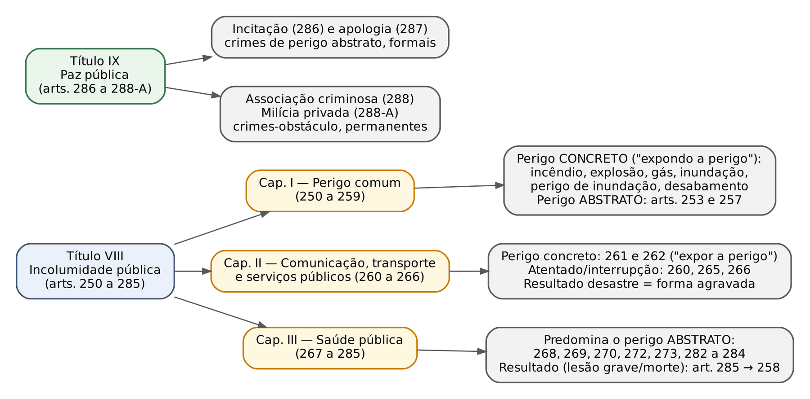
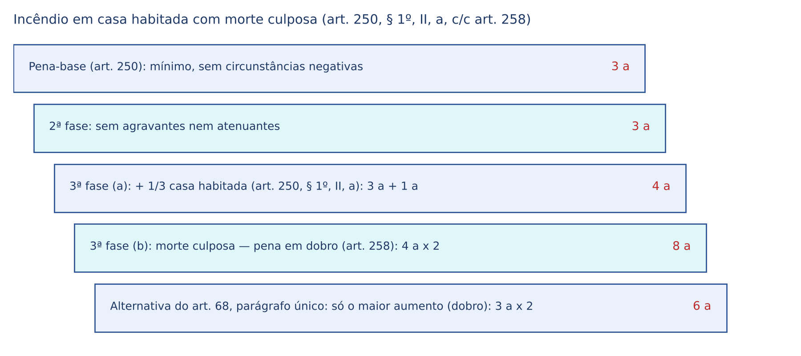
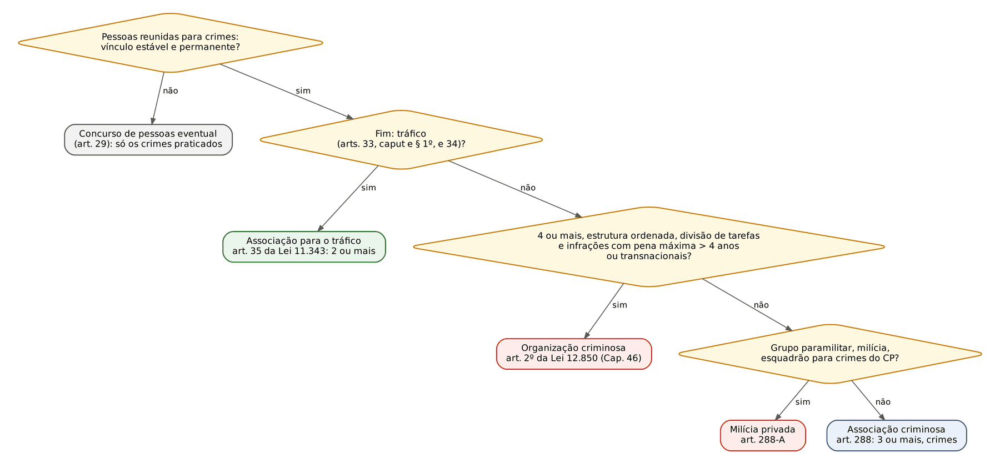

# CAPÍTULO 33 — CRIMES CONTRA A INCOLUMIDADE PÚBLICA E CONTRA A PAZ PÚBLICA

:::INCIDENCIA
TRF5 p. 9; TJRS p. 5; TJSC p. 45 e 46. Nível B. Lote: 4 questões (FGV 1, FCC 3), mais correlatas de outros capítulos.
O que mais cai: associação criminosa (número mínimo, estabilidade, majorante do § 1º e o novo § 2º da Lei 15.245/2025); incêndio (perigo comum, majorantes); penas dos crimes contra a saúde pública e o Tema 1.003 do STF (art. 273); incitação x apologia.
:::

## 33.1 O que une os dois Títulos

### 33.1.1 Bem jurídico coletivo e perigo comum

Nos Títulos VIII (incolumidade pública) e IX (paz pública) o Código deixa de proteger uma pessoa determinada e passa a proteger a COLETIVIDADE. Incolumidade pública é a segurança de todos contra riscos à vida, à integridade física e ao patrimônio; paz pública é o sentimento coletivo de tranquilidade e de confiança na ordem jurídica. O sujeito passivo é a coletividade (crime vago). A lógica é de ANTECIPAÇÃO da tutela: a lei pune a criação do perigo, sem esperar o dano.

| Conceito | O que é | Exemplo neste capítulo |
|---|---|---|
| Perigo comum (ou coletivo) | Risco que atinge número indeterminado de pessoas ou bens | Incêndio num prédio de apartamentos |
| Perigo concreto | O tipo exige que o perigo REALMENTE ocorra e seja provado no processo; costuma vir na fórmula "expondo a perigo" | Incêndio, explosão, inundação, desabamento (arts. 250 a 256) |
| Perigo abstrato | A lei presume o perigo da própria conduta; basta provar a conduta | Infração de medida sanitária (art. 268), falsificação de medicamento (art. 273), associação criminosa (art. 288) |

A distinção concreto x abstrato tem consequência prática direta: no crime de perigo concreto, a denúncia precisa descrever, e a sentença precisa demonstrar, a situação real de risco (quem ou o que esteve em perigo, como). Se o fogo foi ateado num terreno isolado, sem ninguém ou nada alheio por perto, não há incêndio do art. 250, mas, quando muito, dano qualificado (art. 163, parágrafo único, II, do CP, que é expressamente subsidiário: "se o fato não constitui crime mais grave"). A legitimidade dos crimes de perigo abstrato em face do princípio da ofensividade foi tratada no Cap. 2.

### 33.1.2 Dolo de perigo e resultado agravador

Nos crimes de perigo o dolo é de PERIGO: o agente quer (ou aceita) criar a situação de risco, mas não quer o dano. Se ele quer matar usando fogo, o crime é homicídio qualificado pelo meio (art. 121, § 2º, III, Cap. 27), e não incêndio; a doutrina majoritária (Greco, Masson) admite concurso formal impróprio com o art. 250 quando, além da morte desejada, o agente cria conscientemente perigo para número indeterminado de pessoas (desígnios autônomos).

Se do crime de perigo resulta lesão grave ou morte NÃO queridas, incide a forma agravada pelo resultado do art. 258 (crimes de perigo comum), estendida aos crimes contra os meios de transporte (art. 263) e aos crimes contra a saúde pública (art. 285, salvo a epidemia, que tem regra própria). Por ser preterdoloso (ou culposo-culposo, nas formas culposas), o resultado mais grave tem de ser ao menos previsível (art. 19 do CP, Cap. 7).

:::DICA Como reconhecer o tipo de perigo na prova
Leu "expondo a perigo a vida, a integridade física ou o patrimônio de outrem" no tipo? Perigo concreto, comum. Leu só o verbo (fabricar, possuir, infringir, falsificar, associar-se)? Perigo abstrato. A FCC adora dizer que o incêndio "exige pessoa certa e determinada" ou que é "crime de dano": as duas afirmações são falsas.
:::

## 33.2 Crimes de perigo comum (arts. 250 a 259)

### 33.2.1 Incêndio (art. 250)

Causar incêndio é provocar fogo que fuja ao controle e crie perigo comum (fogueira controlada não é incêndio). Admite omissão imprópria (art. 13, § 2º).

- Sujeito ativo: qualquer pessoa, INCLUSIVE o proprietário da coisa incendiada (o bem jurídico é a incolumidade pública, não o patrimônio). Crime comum.
- Elemento subjetivo: dolo de perigo (direto ou eventual). Forma culposa no § 2º (detenção de 6 meses a 2 anos).
- Consumação: com a situação concreta de perigo comum; admite tentativa (o agente espalha gasolina e é impedido de riscar o fósforo).
- Majorantes do § 1º (aumento fixo de 1/3): I — intuito de vantagem pecuniária em proveito próprio ou alheio; II — lugar especialmente sensível: casa habitada ou destinada a habitação; edifício público ou destinado a uso público, ou a obra de assistência social ou de cultura; embarcação, aeronave, comboio ou veículo de transporte coletivo; estação ferroviária ou aeródromo; estaleiro, fábrica ou oficina; depósito de explosivo, combustível ou inflamável; poço petrolífero ou galeria de mineração; lavoura, pastagem, mata ou floresta.

Conflitos aparentes cobrados:

| Situação | Solução prevalente |
|---|---|
| Fogo sem perigo comum, em coisa alheia | Dano qualificado (art. 163, parágrafo único, II), subsidiário |
| Incêndio para receber seguro, com perigo comum | Art. 250, § 1º, I (a majorante já valora o fim de lucro); sem perigo comum, fraude para recebimento de indenização (art. 171, § 2º, V, Cap. 30) |
| Incêndio em mata ou floresta | Art. 41 da Lei 9.605/1998 quando a ofensa é ao meio ambiente; art. 250, § 1º, II, "h", quando há perigo comum a pessoas ou patrimônio (ver Apostila de Direito Ambiental, Cap. 8) |
| Fogo como meio para matar | Homicídio qualificado (art. 121, § 2º, III); concurso formal com o incêndio se criado perigo comum (33.1.2) |
| Crime praticado "por ocasião de incêndio" | Não é o art. 250: é a agravante do art. 61, II, "j" (Cap. 14; ver a Q3996829, em que o furto em meio a incêndio gera agravante) |

:::QUESTAO FCC 2025 — DPE-SP — Analista de Defensoria (Q3304088)
Afirmações sobre o crime de incêndio. Gabarito oficial: C — a pena aumenta de 1/3 se o incêndio é em edifício destinado a uso público (§ 1º, II, "b"). Armadilhas: (A) bem jurídico "paz pública" e crime "próprio" que o dono não poderia cometer (o bem é a incolumidade pública e o crime é comum); (B) exigência de pessoa "certa e determinada" (o perigo é comum, a pessoas indeterminadas); (D) "perde a tipicidade em prol do estelionato" com intuito de lucro (o lucro é majorante do próprio incêndio); (E) crime "de dano" (é de perigo).
:::

:::PROCESSO Prova do incêndio
O incêndio deixa vestígios, por isso exige exame de corpo de delito (art. 158 do CPP). O art. 173 do CPP manda os peritos verificarem a causa e o lugar em que o fogo começou, o PERIGO que dele resultou para a vida ou o patrimônio alheio, a extensão do dano e seu valor. Sem prova do perigo concreto (laudo, testemunhas sobre a proximidade de casas ou pessoas), a absolvição ou a desclassificação para dano qualificado se impõe. Ação penal pública incondicionada; competência estadual, salvo bem ou serviço da União (art. 109, IV, da CF).
:::

### 33.2.2 Explosão, gás tóxico e artefatos (arts. 251 a 253)

- Explosão (art. 251): expor a perigo a vida, a integridade física ou o patrimônio de outrem mediante explosão, arremesso ou simples colocação de engenho de dinamite ou substância de efeitos análogos. Reclusão de 3 a 6 anos e multa; se a substância não é dinamite nem explosivo análogo (ex.: rojão de grande potência), 1 a 4 anos (§ 1º). As majorantes de 1/3 do art. 250, § 1º, aplicam-se por remissão (§ 2º). Culpa: § 3º.
- Uso de gás tóxico ou asfixiante (art. 252): reclusão de 1 a 4 anos e multa; culposo, detenção de 3 meses a 1 ano.
- Fabrico, fornecimento, aquisição, posse ou transporte de explosivos, gás tóxico ou asfixiante, sem licença (art. 253): detenção de 6 meses a 2 anos e multa. Crime de perigo ABSTRATO. Para artefato explosivo ou incendiário, prevalece hoje o art. 16, § 1º, III, da Lei 10.826/2003 (lei posterior e especial, pena muito maior), restando ao art. 253 o gás tóxico ou asfixiante e o material destinado à fabricação não abrangido pelo Estatuto (Cap. 39).

O furto ou o roubo com emprego de explosivo têm pena própria (art. 155, § 4º-A, e art. 157, § 2º-A, II) e absorvem a explosão (Cap. 29). Explosão usada por facção para impor domínio territorial pode configurar o crime de domínio social estruturado da Lei 15.358/2026 (art. 2º, II e V), com pena de 20 a 40 anos (Cap. 46).

### 33.2.3 Inundação, desabamento, material de salvamento e difusão de doença ou praga

| Artigo | Conduta | Observação |
|---|---|---|
| 254 — Inundação | Causar inundação, expondo a perigo vida, integridade ou patrimônio de outrem | Pena da forma culposa está no próprio caput |
| 255 — Perigo de inundação | Remover, destruir ou inutilizar obstáculo natural ou obra destinada a impedir inundação, em prédio próprio ou alheio, expondo a perigo | Só doloso; se a inundação ocorre, art. 254 |
| 256 — Desabamento ou desmoronamento | Causar desabamento ou desmoronamento, expondo a perigo | Sem perigo comum: contravenções dos arts. 29 e 30 da LCP (Cap. 50) |
| 257 — Subtração, ocultação ou inutilização de material de salvamento | Por ocasião de incêndio, inundação, naufrágio ou outra calamidade, subtrair, ocultar ou inutilizar meio de socorro; ou impedir ou dificultar o serviço | Perigo abstrato; furto do extintor durante o incêndio é este crime, não furto |
| 259 — Difusão de doença ou praga | Difundir doença ou praga que possa causar dano a floresta, plantação ou animais de utilidade econômica | Parte da doutrina o tem por revogado pelo art. 61 da Lei 9.605/1998 (disseminar doença ou praga), que é posterior e mais amplo |

Quando o desabamento de obra mal executada mata pessoas, sem dolo de perigo, o engenheiro responde pelos homicídios culposos (art. 121, §§ 3º e 4º), em concurso formal, e não pelo art. 256 — foi o caso usado pela FGV na Q3390861 (DPE-PE 2025) para cobrar substituição da pena acima de 4 anos em crime culposo (Cap. 17).

### 33.2.4 Formas agravadas pelo resultado (art. 258)

:::LEI Código Penal, art. 258
"Se do crime doloso de perigo comum resulta lesão corporal de natureza grave, a pena privativa de liberdade é aumentada de metade; se resulta morte, é aplicada em dobro. No caso de culpa, se do fato resulta lesão corporal, a pena aumenta-se de metade; se resulta morte, aplica-se a pena cominada ao homicídio culposo, aumentada de um terço."
:::

Apesar da rubrica "formas qualificadas", o art. 258 funciona como CAUSA DE AUMENTO, aplicada na terceira fase. Na forma dolosa só a lesão GRAVE agrava (a leve fica absorvida). Resultado querido afasta o art. 258 (33.1.2).

Conta da forma culposa com morte: homicídio culposo (1 a 3 anos) + 1/3 = 1 ano e 4 meses a 4 anos.

:::EXEMPLO Incêndio em casa habitada com morte culposa
A ateia fogo à casa de B, sabendo que havia moradores, para assustá-lo (dolo de perigo). Um morador morre asfixiado; a morte era previsível, mas A não a quis. Circunstâncias judiciais favoráveis; sem agravantes nem atenuantes.
- 1ª fase: pena mínima do art. 250 = 3 anos.
- 2ª fase: nada a considerar = 3 anos.
- 3ª fase: duas causas de aumento da PARTE ESPECIAL: 1/3 (casa habitada, § 1º, II, "a") e dobro (art. 258). O art. 68, parágrafo único, permite ao juiz aplicar uma só delas, a que mais aumente (Cap. 15).
  - Aplicando as duas, em cascata (a segunda incide sobre a pena já aumentada): 3 anos + 1/3 (1 ano) = 4 anos; 4 anos x 2 = 8 anos.
  - Aplicando só a maior: 3 anos x 2 = 6 anos.
- A cumulação exige fundamentação de desvalores distintos (lugar habitado e morte). Somar as frações (3 anos + 1/3 + 100% = 7 anos) NÃO é o método do STJ, que adota a incidência sucessiva (Cap. 15).
:::

:::SENTENCA Crime de perigo com resultado agravador
Onde entra: na tipificação (fundamentação do mérito), demonstrando o perigo concreto e o nexo com o resultado previsível; e na terceira fase da dosimetria. Redação-modelo: "Comprovado que o fogo ateado pelo réu na residência habitada se alastrou e causou, culposamente, a morte de C., incide o art. 258 do CP, aplicando-se a pena em dobro, cumulada com a majorante do art. 250, § 1º, II, 'a', por representarem desvalores autônomos (art. 68, parágrafo único, do CP)." Erro punido: lançar o art. 258 como qualificadora na primeira fase, ou aplicá-lo quando a morte foi dolosa.
:::

### 33.2.5 Ficha dos crimes de perigo comum

| Crime | Pena | Elemento subjetivo | Consumação e tentativa | Benefícios |
|---|---|---|---|---|
| Incêndio (250) | Reclusão 3 a 6 e multa; culposo: detenção 6 m a 2 a | Dolo de perigo; culpa | Perigo concreto; tentativa possível | Doloso: ANPP em tese; culposo: transação |
| Explosão (251) | Reclusão 3 a 6 e multa; § 1º: 1 a 4 | Dolo de perigo; culpa (§ 3º) | Perigo concreto; tentativa possível | ANPP; § 1º: sursis processual |
| Gás tóxico (252) | Reclusão 1 a 4 e multa | Dolo; culpa | Perigo concreto | Sursis processual; ANPP |
| Artefatos sem licença (253) | Detenção 6 m a 2 a e multa | Dolo | Perigo abstrato; mera conduta | Transação |
| Inundação (254) | Reclusão 3 a 6 e multa; culpa: detenção 6 m a 2 a | Dolo; culpa | Perigo concreto | ANPP; culposo: transação |
| Perigo de inundação (255) | Reclusão 1 a 3 e multa | Dolo | Perigo concreto | Sursis processual |
| Desabamento (256) | Reclusão 1 a 4 e multa; culpa: detenção 6 m a 1 a | Dolo; culpa | Perigo concreto | Sursis processual; culposo: transação |
| Material de salvamento (257) | Reclusão 2 a 5 e multa | Dolo | Perigo abstrato | ANPP |
| Difusão de doença ou praga (259) | Reclusão 2 a 5 e multa | Dolo; culpa | Perigo concreto ("que possa causar dano") | ANPP; culposo: transação |

Todos são de ação penal pública incondicionada; nenhum é hediondo. O ANPP exige pena mínima inferior a 4 anos e ausência de violência ou grave ameaça à pessoa (art. 28-A do CPP); a suspensão condicional do processo, pena mínima não superior a 1 ano (art. 89 da Lei 9.099/1995); a transação, pena máxima não superior a 2 anos (Cap. 25). Com o resultado agravador do art. 258, refaça a conta antes de oferecer ou negar o benefício (Súmula 723 do STF e Súmula 243 do STJ — ver Cap. 25).

## 33.3 Crimes contra a segurança dos meios de comunicação e transporte e outros serviços públicos (arts. 260 a 266)

### 33.3.1 Transportes (arts. 260 a 264)

A estrutura se repete: um tipo básico de atentado ou perigo, uma forma agravada se o desastre ou sinistro ocorre e uma forma culposa que só é punida se houver desastre.

| Artigo | Tipo básico | Se resulta desastre ou sinistro | Culpa (só com desastre) |
|---|---|---|---|
| 260 — Perigo de desastre ferroviário | Impedir ou perturbar serviço de estrada de ferro (danificar linha, colocar obstáculo, falso aviso, outro ato de que possa resultar desastre): reclusão 2 a 5 e multa | Reclusão 4 a 12 e multa | Detenção 6 m a 2 a |
| 261 — Atentado contra transporte marítimo, fluvial ou aéreo | Expor a perigo embarcação ou aeronave, própria ou alheia, ou dificultar a navegação: reclusão 2 a 5 | Naufrágio, submersão, encalhe, queda ou destruição de aeronave: reclusão 4 a 12 | Detenção 6 m a 2 a |
| 262 — Atentado contra outro meio de transporte | Expor a perigo outro meio de transporte PÚBLICO, impedir-lhe ou dificultar-lhe o funcionamento: detenção 1 a 2 a | Reclusão 2 a 5 | Detenção 3 m a 1 a |

"Estrada de ferro", para o art. 260, é qualquer via em que circulem veículos de tração mecânica em trilhos ou por cabo aéreo (§ 3º: metrô, bonde, teleférico). No art. 261, a multa é acrescida se há fim de lucro (§ 2º). O art. 263 manda aplicar o art. 258 se, havendo desastre ou sinistro, resultar lesão ou morte.

Arremesso de projétil (art. 264): arremessar projétil contra veículo EM MOVIMENTO destinado ao transporte público (ônibus, trem, barca, avião): detenção de 1 a 6 meses; com lesão, 6 meses a 2 anos; com morte, a pena do homicídio culposo aumentada de 1/3. Pedra contra carro particular não está aqui (pode ser dano ou perigo para a vida, art. 132); contra ônibus parado, também não.

### 33.3.2 Serviços de utilidade pública e de telecomunicação (arts. 265 e 266) — atenção à Lei 15.397/2026

Atentado contra a segurança de serviço de utilidade pública (art. 265): atentar contra a segurança ou o funcionamento de serviço de água, luz, força, calor ou outro de utilidade pública; reclusão de 1 a 5 anos e multa; aumento de 1/3 até a metade se o dano decorre de SUBTRAÇÃO de material essencial ao funcionamento do serviço (parágrafo único, desde 1967). É a resposta penal ao furto de cabos e transformadores que deixa bairros sem energia.

:::LEI Código Penal, art. 266 (redação da Lei 15.397/2026)
"Art. 266. Interromper ou perturbar serviço telegráfico, radiotelegráfico ou telefônico, impedir ou dificultar-lhe o restabelecimento: Pena – reclusão, de 2 (dois) a 4 (quatro) anos, e multa. § 1º Incorre na mesma pena quem interrompe serviço telemático ou de informação de utilidade pública, ou impede ou dificulta-lhe o restabelecimento. § 2º Aplicam-se as penas em dobro se o crime é cometido: I – por ocasião de calamidade pública; II – mediante subtração, dano ou destruição de equipamento instalado em estrutura utilizada para a prestação de serviços de telecomunicações."
:::

O que mudou: a pena do caput era de DETENÇÃO de 1 a 3 anos e multa, e o § 2º previa só a dobra por calamidade pública. A Lei 15.397/2026 (vigente desde 4/5/2026, a mesma que elevou as penas do furto e do roubo, Cap. 29) passou a pena para reclusão de 2 a 4 anos e criou a dobra pela subtração, dano ou destruição de equipamento de telecomunicações (antenas, estações rádio-base, cabos em postes). Como é lei mais grave, só alcança fatos posteriores (art. 5º, XL, da CF; Cap. 3). Consequência prática: o crime deixou de admitir suspensão condicional do processo (mínimo agora de 2 anos), mas ainda admite ANPP em tese.

Furto de cabos e serviço público. Quem subtrai cabos de energia ou de telefonia pratica furto (art. 155, § 8º: 2 a 8 anos — Cap. 29). Se, além disso, a subtração interrompe o serviço, há dois bens jurídicos atingidos (patrimônio e incolumidade pública), e a doutrina admite concurso (formal, quando a única conduta subtrai e interrompe) com o art. 265, parágrafo único, ou com o art. 266, § 2º, II. Tema sem posição consolidada do STJ após a Lei 15.397/2026 (ver nota).

### 33.3.3 Benefícios e competência

Todos são de ação penal pública incondicionada, dolosos (culpa só onde indicado) e nenhum é hediondo. Cabem: transação nos arts. 262 (caput), 264 e nas formas culposas até 2 anos; suspensão condicional do processo no art. 265; ANPP nos arts. 260 e 261 (caput), 262, § 1º, 265 e 266; nenhum benefício nas formas com desastre ou sinistro de 4 a 12 anos. Competência: crime cometido a bordo de aeronave ou navio é federal (art. 109, IX, da CF); atentado contra serviço de telecomunicações, em regra estadual, salvo lesão a bem, serviço ou interesse direto da União (ver Cap. 47).

## 33.4 Crimes contra a saúde pública (arts. 267 a 285)

### 33.4.1 Epidemia (art. 267)

Causar epidemia mediante a propagação de germes patogênicos: reclusão de 10 a 15 anos; se resulta morte, pena em dobro (§ 1º); culposo, detenção de 1 a 2 anos, ou de 2 a 4 anos se resulta morte (§ 2º). Epidemia é a doença que atinge, num mesmo período, grande número de pessoas de uma região; é crime de perigo concreto e de resultado (a epidemia tem de ocorrer). O art. 285 exclui a epidemia da regra geral do art. 258, porque ela já tem resultado agravador próprio.

A epidemia COM RESULTADO MORTE é hedionda (art. 1º, VII, da Lei 8.072/1990); a epidemia simples, não. Não confundir com a transmissão dolosa de doença a pessoa determinada, que é crime contra a pessoa (arts. 130 e 131, ou lesão corporal — Cap. 28).

### 33.4.2 Infração de medida sanitária preventiva (art. 268) e omissão de notificação de doença (art. 269)

:::LEI Código Penal, art. 268
"Infringir determinação do poder público, destinada a impedir introdução ou propagação de doença contagiosa: Pena - detenção, de um mês a um ano, e multa. Parágrafo único - A pena é aumentada de um terço, se o agente é funcionário da saúde pública ou exerce a profissão de médico, farmacêutico, dentista ou enfermeiro."
:::

É o tipo da pandemia de covid-19 (isolamento, quarentena, máscara, fechamento de estabelecimentos). Características:

- Norma penal em branco heterogênea: a "determinação do poder público" é o complemento, que pode vir de qualquer ente federado, respeitadas as competências (Tema 1.246 do STF — ver Cap. 3). Revogado o complemento excepcional, os fatos praticados na sua vigência continuam puníveis (art. 3º do CP — Cap. 3).
- Crime de perigo ABSTRATO e formal: não precisa haver contágio; basta a desobediência à determinação sanitária. Exige-se, porém, que a determinação seja efetivamente destinada a impedir doença CONTAGIOSA e que o agente a conheça.
- Especialidade sobre a desobediência (art. 330, Cap. 36): quem descumpre ordem sanitária responde pelo art. 268, e não pelo 330.
- Infração de menor potencial ofensivo, mesmo com o aumento do parágrafo único (máximo de 1 ano e 4 meses): transação penal.

Omissão de notificação de doença (art. 269): deixar o MÉDICO de denunciar à autoridade pública doença de notificação compulsória; detenção de 6 meses a 2 anos e multa. Crime próprio (só o médico), omissivo puro (não admite tentativa) e norma penal em branco (a lista de doenças é do Ministério da Saúde). Enfermeiro ou dentista que omite não pratica o crime.

### 33.4.3 Água, alimentos e outras substâncias (arts. 270 a 272 e 274 a 280)

| Artigo | Conduta | Pena | Pontos de prova |
|---|---|---|---|
| 270 — Envenenamento | Envenenar água potável ou substância alimentícia ou medicinal destinada a consumo; § 1º: entregá-la ou tê-la em depósito | Reclusão 10 a 15; culposo: detenção 6 m a 2 a | Perigo abstrato; NÃO é mais hediondo (excluído do rol pela Lei 8.930/1994), apesar da pena alta |
| 271 — Água potável | Corromper ou poluir água potável, tornando-a imprópria ou nociva | Reclusão 2 a 5; culposo: detenção 2 m a 1 a | Poluição ambiental genérica: art. 54 da Lei 9.605/1998 |
| 272 — Alimentos | Falsificar ou adulterar alimento, tornando-o nocivo OU reduzindo-lhe o valor nutritivo; § 1º-A: comercializar o produto; § 1º: bebidas, com ou sem álcool | Reclusão 4 a 8 e multa; culposo: detenção 1 a 2 a e multa | Bebida com metanol; leite com soda cáustica; NÃO é hediondo |
| 274 a 277 | Substância não permitida; invólucro com falsa indicação; venda desses produtos; substância para falsificar | Reclusão 1 a 5 e multa | Sursis processual e ANPP |
| 278 — Outras substâncias nocivas | Comercializar coisa nociva à saúde, ainda que não alimentícia nem medicinal | Detenção 1 a 3 e multa; culposo: 2 m a 1 a | Tipo residual |
| 279 | Substância avariada | Revogado pela Lei 8.137/1990 | A matéria foi para o art. 7º, IX, da Lei 8.137/1990 (mercadoria imprópria ao consumo — Cap. 45) |
| 280 — Medicamento em desacordo com receita | Fornecer substância medicinal em desacordo com receita médica | Detenção 1 a 3, ou multa; culposo: 2 m a 1 a | Crime do farmacêutico ou balconista; admite forma culposa |

:::QUESTAO FGV 2026 — AMAZUL — Médico do Trabalho (Q3851302)
Adulteração de bebida alcoólica com metanol, enquadrada no art. 272 do CP (o § 1º estende o tipo às bebidas). Pergunta: a pena. Gabarito oficial: C — reclusão de 4 a 8 anos e multa. Armadilhas: 1 a 2 anos ou multa (pena da forma CULPOSA, que é detenção de 1 a 2 anos e multa, cumulativa); 6 a 9 anos e 2 a 4 anos (inventadas). Se a vítima morre, art. 285 c/c 258: pena em dobro para o crime doloso.
:::

Na relação com a Lei 8.137/1990 (crimes contra as relações de consumo, art. 7º, IX: vender ou ter em depósito mercadoria em condições impróprias ao consumo), o critério é o PERIGO à saúde: produto nocivo à saúde, adulterado ou falsificado, vai para o CP (arts. 272 ou 273); produto apenas impróprio (vencido, mal acondicionado) vai para a Lei 8.137/1990, cujo crime o STJ exige seja demonstrado por perícia (Cap. 45).

### 33.4.4 Falsificação de produto terapêutico ou medicinal (art. 273) e o Tema 1.003 do STF

O art. 273 pune falsificar, corromper, adulterar ou alterar produto destinado a fins terapêuticos ou medicinais (caput), e quem importa, vende, expõe à venda, tem em depósito para vender ou, de qualquer forma, distribui ou entrega a consumo o produto falsificado (§ 1º). O § 1º-A amplia o objeto: medicamentos, matérias-primas, insumos farmacêuticos, COSMÉTICOS, SANEANTES e produtos de uso em diagnóstico. A pena de todas essas figuras, desde a Lei 9.677/1998 (editada após o escândalo das "pílulas de farinha"), é de reclusão de 10 a 15 anos e multa, e todas são HEDIONDAS (art. 1º, VII-B, da Lei 8.072/1990).

:::LEI Código Penal, art. 273, § 1º-B
"Está sujeito às penas deste artigo quem pratica as ações previstas no § 1º em relação a produtos em qualquer das seguintes condições: I - sem registro, quando exigível, no órgão de vigilância sanitária competente; II - em desacordo com a fórmula constante do registro previsto no inciso anterior; III - sem as características de identidade e qualidade admitidas para a sua comercialização; IV - com redução de seu valor terapêutico ou de sua atividade; V - de procedência ignorada; VI - adquiridos de estabelecimento sem licença da autoridade sanitária competente."
:::

O § 1º-B equipara à falsificação condutas sem produto falso (medicamento verdadeiro sem registro na Anvisa) e as pune com 10 a 15 anos, mais do que o homicídio simples.

:::JURIS STF, Tema 1.003 (RE 979.962), j. 24/3/2021; embargos de declaração j. 13/6/2023
Tese (na redação ajustada pelos embargos): é inconstitucional a aplicação do preceito secundário do art. 273 do CP, com a redação da Lei 9.677/1998 (reclusão de 10 a 15 anos e multa), à hipótese do § 1º-B, I — importar, vender, expor à venda, ter em depósito para vender ou, de qualquer forma, distribuir ou entregar produto SEM REGISTRO no órgão de vigilância sanitária. Para essas situações fica REPRISTINADO o preceito secundário do art. 273 na redação ORIGINÁRIA: reclusão de 1 a 3 anos e multa. Fundamento: proibição do excesso (proporcionalidade — Cap. 2); a conduta não envolve risco à saúde comparável ao da falsificação. Os embargos estenderam a tese, originalmente firmada para a importação, a todos os verbos do § 1º-B, I.
:::

A prova explora a confusão entre duas soluções:

| Solução | Quem | Para quê |
|---|---|---|
| Aplicar a pena do caput do art. 33 da Lei de Drogas (5 a 15 anos), com possível redutor do § 4º | STJ, Corte Especial, AI no HC 239.363 (j. 26/2/2015, Info 559) | Para o § 1º-B, V (procedência ignorada), antes do STF |
| Repristinar a pena ORIGINAL do art. 273 (1 a 3 anos e multa) | STF, Tema 1.003 | Para o § 1º-B, I (sem registro), com efeito vinculante |

Portanto, a tese do STF NÃO manda aplicar a pena do tráfico: manda aplicar 1 a 3 anos. Para os demais incisos (II a VI) há divergência: o STF entende que o Tema 1.003 se limita ao inciso I (1ª Turma, RE 1.116.972 AgR; decisão monocrática no RE 1.553.774, de 4/6/2025), enquanto julgados do STJ estendem a inconstitucionalidade a outros incisos. Na prova, responda pela literalidade da tese. Caput e § 1º (produto efetivamente falsificado) continuam com 10 a 15 anos.

Outros pontos de jurisprudência:

- Venda de medicamentos pela internet sem as formalidades legais amolda-se ao art. 273, § 1º-B, e não ao tráfico de drogas (art. 33 da Lei 11.343/2006), por especialidade (STJ, 6ª Turma, AgRg no AgRg no REsp 1.835.395-RS, j. 14/4/2026, por maioria, Info 887).
- O § 1º exige prova do conhecimento prévio da falsificação pelo vendedor (REsp 2.088.056-PR — ver Cap. 7).
- Insignificância: inaplicável ao art. 273, qualquer que seja a quantidade, com a exceção da importação de pequena quantidade para uso próprio (Jurisprudência em Teses, ed. 221 — ver Cap. 2).

:::EXEMPLO Dosimetria no art. 273, § 1º-B, I, depois do Tema 1.003
D, primário, vende em sua loja anabolizantes importados SEM registro na Anvisa. Circunstâncias judiciais: uma negativa (quantidade expressiva de produtos, valorada como consequência).
- Pena cominada aplicável: 1 a 3 anos (redação originária, repristinada). Intervalo: 2 anos = 24 meses.
- 1ª fase, critério de 1/8 do intervalo por circunstância: 24 / 8 = 3 meses; pena-base = 1 ano e 3 meses.
- Variante de 1/6 sobre a pena mínima: 12 / 6 = 2 meses; pena-base = 1 ano e 2 meses. Ambos os critérios são admitidos pelo STJ como parâmetros, desde que fundamentados (Cap. 13).
- 2ª e 3ª fases: nada a considerar. Pena definitiva: 1 ano e 3 meses (ou 1 ano e 2 meses).
- Regime aberto, substituição por restritivas (art. 44) e, antes da denúncia, ANPP em tese. Com a pena antiga (10 a 15 anos), regime fechado: eis a desproporção reconhecida pelo STF.
:::

:::SENTENCA Art. 273
Onde entra: na capitulação (identificar o inciso do § 1º-B ou a falsificação propriamente dita) e no preceito secundário aplicável. Redação-modelo: "Tratando-se de venda de produto sem registro no órgão de vigilância sanitária (art. 273, § 1º-B, I, do CP), aplico o preceito secundário da redação originária do art. 273 (reclusão, de 1 a 3 anos, e multa), por força da tese vinculante do Tema 1.003 do STF." Erro punido: aplicar a pena do art. 33 da Lei de Drogas ao inciso I, ou aplicar 1 a 3 anos a quem vendeu produto efetivamente FALSIFICADO (§ 1º).
:::

:::PROCESSO Competência no art. 273
A competência é estadual, em regra. É federal quando há indícios de que o próprio agente IMPORTOU o produto (transnacionalidade da conduta, com interesse da União no controle aduaneiro e sanitário de fronteira — art. 109, IV ou V, da CF, conforme a fundamentação adotada), orientação reiterada da 3ª Seção do STJ em conflitos de competência. Simples venda interna de produto sem registro, sem prova de origem estrangeira ligada ao agente, fica na Justiça Estadual. Prova típica: laudo pericial atestando a falsificação ou a ausência de registro (consulta à Anvisa).
:::

### 33.4.5 Exercício ilegal da medicina, charlatanismo e curandeirismo (arts. 282 a 284)

A Lei 15.425/2026 (de 3/6/2026, publicada e vigente em 8/6/2026) reescreveu o art. 282: passou a abranger o MÉDICO VETERINÁRIO e acrescentou os §§ 2º a 5º.

| Elemento | Exercício ilegal (282) | Charlatanismo (283) | Curandeirismo (284) |
|---|---|---|---|
| Conduta | Exercer, ainda que gratuitamente, a profissão de médico, médico veterinário, dentista ou farmacêutico sem autorização legal ou excedendo-lhe os limites | Inculcar ou anunciar cura por meio SECRETO ou INFALÍVEL | Exercer o curandeirismo: prescrever, ministrar ou aplicar habitualmente qualquer substância; usar gestos, palavras ou outro meio; fazer diagnósticos |
| Quem pratica | Quem não tem habilitação, ou o habilitado que excede os limites (dentista que faz cirurgia geral); desde 2026, também quem exerce durante a suspensão ou após o cancelamento do registro (§ 5º) | Qualquer pessoa, inclusive o médico | Pessoa sem conhecimento técnico (o rude, o "benzedor") |
| Elemento subjetivo | Dolo; fim de lucro acrescenta multa (§ 1º) | Dolo; o agente SABE que a cura anunciada é falsa | Dolo; o agente geralmente acredita no que faz |
| Habitualidade | Exigida (crime habitual) | Não exigida | Exigida nos incisos (prevalece que é crime habitual) |
| Pena | Detenção 6 m a 2 a | Detenção 3 m a 1 a e multa | Detenção 6 m a 2 a; remuneração acrescenta multa |

Os novos §§ 2º a 4º do art. 282 dizem que, se do exercício ilegal resulta lesão grave ou gravíssima, morte, ou lesão ou morte de animal, o agente responde TAMBÉM pela lesão corporal (art. 129, §§ 1º e 2º), pelo homicídio (art. 121) ou pelo crime de maus-tratos a animais (art. 32 da Lei 9.605/1998). A técnica é de cúmulo expresso, e não de resultado agravador: aos crimes de exercício ilegal NÃO se aplica mais o art. 258 nessas hipóteses, porque a regra especial do art. 282 prevalece sobre a geral do art. 285 (conclusão doutrinária inicial, ainda sem jurisprudência — ver nota). Atenção: os parágrafos remetem aos tipos de lesão e homicídio sem dizer se dolosos ou culposos; a imputação dependerá do elemento subjetivo provado em relação ao resultado.

Crime habitual só existe com a reiteração de atos (um atendimento isolado não basta); prevalece que não admite tentativa.

Charlatanismo x estelionato x extorsão: o charlatão promete cura milagrosa; se, mediante essa fraude, obtém vantagem patrimonial de vítima determinada, há estelionato (art. 171). Se, em vez de enganar, INTIMIDA (anuncia desgraça iminente para forçar o pagamento), há extorsão — foi o gabarito da FGV na Q3532357 (MPE-RJ 2025: "vidente" que ameaça a cliente com tragédia espiritual e obtém Pix: extorsão; Cap. 29).

Rituais religiosos sem prescrição de substâncias nem diagnósticos são liberdade de crença (art. 5º, VI, da CF), não curandeirismo.

### 33.4.6 Ficha dos crimes contra a saúde pública

| Crime | Pena | Elemento subjetivo | Consumação | Benefícios | Hediondo |
|---|---|---|---|---|---|
| Medida sanitária (268) | Detenção 1 m a 1 a e multa | Dolo | Com a infração (formal) | Transação | Não |
| Omissão de notificação (269) | Detenção 6 m a 2 a e multa | Dolo | Omissivo puro; sem tentativa | Transação | Não |
| Envenenamento (270) e água potável (271) | Ver 33.4.3 | Dolo; culpa | Com o envenenamento ou a corrupção | 270: nenhum; 271: ANPP | Não |
| Alimentos e bebidas (272) | Reclusão 4 a 8 e multa | Dolo; culpa | Perigo abstrato (nocividade ou redução nutritiva) | Sem ANPP (mínimo 4); substituição se a pena aplicada não passar de 4 | Não |
| Produto terapêutico (273, caput e § 1º) | Reclusão 10 a 15 e multa | Dolo; culpa (detenção 1 a 3 e multa) | Perigo abstrato | Nenhum | Sim |
| Art. 273, § 1º-B, I | Reclusão 1 a 3 e multa (Tema 1.003) | Dolo | Com a conduta | Sursis processual; ANPP | Formalmente no rol (ver nota) |
| Exercício ilegal (282) | Detenção 6 m a 2 a | Dolo | Habitual | Transação | Não |
| Charlatanismo (283) | Detenção 3 m a 1 a e multa | Dolo | Com o anúncio | Transação | Não |
| Curandeirismo (284) | Detenção 6 m a 2 a | Dolo | Habitual | Transação | Não |

Todos são de ação penal pública incondicionada. Resultado lesão grave ou morte: art. 285 c/c art. 258, salvo epidemia (regra própria) e, desde 2026, exercício ilegal (cúmulo expresso).

## 33.5 Crimes contra a paz pública (arts. 286 a 288-A)

### 33.5.1 Incitação ao crime (art. 286) e apologia de crime ou criminoso (art. 287)

Os dois tipos punem a palavra que ameaça a tranquilidade coletiva; ambos têm pena de detenção de 3 a 6 meses, ou multa (menor potencial ofensivo), exigem PUBLICIDADE (a manifestação deve alcançar ou poder alcançar número indeterminado de pessoas: praça, rádio, carro de som, rede social aberta) e são formais (dispensam que alguém cometa o crime incitado ou exaltado).

| Elemento | Incitação (286) | Apologia (287) |
|---|---|---|
| Núcleo | INCITAR: estimular, provocar a prática FUTURA de crime | Fazer APOLOGIA: elogiar, exaltar fato criminoso JÁ OCORRIDO ou o autor de crime (por causa do crime) |
| Objeto | Crime (incitar contravenção é atípico) | Fato criminoso concreto ou autor de crime (apologia de contravenção é atípica) |
| Tempo | Olha para o futuro | Olha para o passado |
| Exemplo | Pelo microfone, conclamar a multidão a linchar alguém | Em programa de rádio, louvar o assassinato ocorrido ontem e chamar o autor de herói |

O parágrafo único do art. 286 (Lei 14.197/2021, que revogou a Lei de Segurança Nacional) pune com a mesma pena quem incita publicamente animosidade entre as Forças Armadas, ou delas contra os poderes constitucionais, as instituições civis ou a sociedade (conexão com os crimes contra o Estado Democrático de Direito, Cap. 36).

Especialidade: a incitação tem tipos específicos que prevalecem sobre o art. 286: induzir, instigar ou auxiliar ao uso de droga (art. 33, § 2º, da Lei 11.343/2006, Cap. 37); incitar discriminação ou preconceito (art. 20 da Lei 7.716/1989, Cap. 41); incitar ao genocídio (art. 3º da Lei 2.889/1956, Cap. 40); distribuir material que incite os atos de domínio social estruturado (art. 3º, II, da Lei 15.358/2026, Cap. 46). Praticado o crime incitado, o incitador responde também por ele, como partícipe.

:::JURIS STF, ADPF 187, j. 15/6/2011 (marcha da maconha)
O STF deu interpretação conforme à Constituição ao art. 287 do CP para excluir do tipo as manifestações e eventos públicos em defesa da legalização ou da descriminalização de drogas. Defender a mudança da lei é exercício das liberdades de reunião e de expressão (art. 5º, IV, IX e XVI, da CF), não apologia de crime. O mesmo raciocínio foi aplicado ao art. 33, § 2º, da Lei de Drogas na ADI 4.274 (Cap. 37). Limite: a manifestação não pode incitar o consumo nem envolver o uso de drogas durante o evento.
:::

### 33.5.2 Associação criminosa (art. 288)

:::LEI Código Penal, art. 288 (redação das Leis 12.850/2013 e 15.245/2025)
"Art. 288. Associarem-se 3 (três) ou mais pessoas, para o fim específico de cometer crimes: Pena - reclusão, de 1 (um) a 3 (três) anos. § 1º A pena aumenta-se até a metade se a associação é armada ou se houver a participação de criança ou adolescente. § 2º Incorre na pena prevista no caput deste artigo quem, de qualquer modo, solicitar ou contratar o cometimento de crime a integrante de associação criminosa, independentemente da aplicação da pena correspondente ao crime solicitado ou contratado."
:::

Até 2013 o tipo era "quadrilha ou bando", com mínimo de QUATRO pessoas; a Lei 12.850/2013 reduziu o mínimo para TRÊS (lei mais grave, sem retroação). A Lei 15.245/2025 renumerou o antigo parágrafo único como § 1º e criou o § 2º.

Elementos do tipo, um a um:

- Pluralidade mínima de TRÊS pessoas. Crime plurissubjetivo (de concurso necessário) de condutas paralelas (Cap. 5 e Cap. 11). Contam os inimputáveis (a própria majorante pela participação de criança ou adolescente o confirma) e os integrantes não identificados, desde que provada a sua existência.
- Estabilidade e permanência. É o que separa a associação do concurso de pessoas (art. 29): reunião ocasional para um ou alguns crimes gera só coautoria nesses crimes.
- Fim específico de cometer CRIMES (plural, indeterminados). Elemento subjetivo especial. Associação para contravenções (jogo do bicho) não é art. 288; NÃO importa a pena dos crimes visados nem a transnacionalidade.

Consumação e tentativa: o crime se consuma com a formação do vínculo associativo estável, independentemente da prática de qualquer crime (crime formal, de perigo abstrato e crime-obstáculo, Cap. 8). É PERMANENTE: a consumação se prolonga enquanto durar a associação. Prevalece que não admite tentativa (ou há associação estável, ou há atos preparatórios impuníveis).

Concurso com os crimes praticados: concurso MATERIAL (art. 69). O integrante não responde automaticamente pelos crimes dos demais só por integrar o grupo. O STJ não vê *bis in idem* entre o art. 288 e o furto qualificado pelo concurso de pessoas (ou o roubo majorado pelo concurso), porque os bens jurídicos e os momentos são distintos; o mesmo raciocínio tem sido usado para a associação ARMADA em concurso com roubo majorado pelo emprego de arma (ver nota).

Majorante do § 1º (até a metade):

- Associação armada: arma própria (de fogo, branca) ou imprópria, desde que empregada a serviço do grupo; prevalece que basta um integrante armado, se a arma serve aos fins da associação.
- Participação de criança ou adolescente.

O aumento é variável ("até a metade") e a fração exige fundamentação concreta (número de armas, de adolescentes), na linha da Súmula 443 do STJ (Cap. 15).

O novo § 2º (Lei 15.245/2025, de 29/10/2025, publicada e vigente em 30/10/2025): quem, de qualquer modo, SOLICITA ou CONTRATA o cometimento de crime a integrante de associação criminosa responde pela pena do caput (1 a 3 anos) MAIS a pena do crime contratado. O mandante não precisa integrar o grupo. Consuma-se com a solicitação ou a contratação (crime formal), exige dolo quanto ao fato de o contratado integrar associação criminosa, e cria um cúmulo material expresso. A FGV cobrou o dispositivo na Q4083750 (TJ-BA 2026, Juiz): empresário que contrata atiradores de associação criminosa para matar o rival responde pelo homicídio e pelo art. 288, gabarito B (box completo no Cap. 27; reflexo no concurso de pessoas no Cap. 11).

Associação para crimes hediondos (art. 8º da Lei 8.072/1990): quando a associação se destina a crimes hediondos, tortura, tráfico ou terrorismo, a pena do art. 288 passa a ser de 3 a 6 anos; o associado que denuncia o grupo à autoridade, possibilitando o seu desmantelamento, tem a pena reduzida de 1/3 a 2/3 (parágrafo único — delação premiada). Para o tráfico, porém, prevalece o tipo especial do art. 35 da Lei de Drogas, o que restringe o art. 8º aos hediondos, à tortura e ao terrorismo (Cap. 40).

:::QUESTAO FCC 2025 — DPE-SP — Analista de Defensoria (Q3304092)
Afirmações sobre a associação criminosa. Gabarito oficial: D — exige três ou mais pessoas e a pena aumenta até a metade se houver participação de criança ou adolescente (§ 1º). Armadilhas: (A) aumento "no interior do sistema prisional" (não existe no art. 288); (B) "independe de finalidade específica" (o tipo exige o fim específico de cometer crimes); (C) exigência de crimes com pena máxima superior a 4 anos (requisito da organização criminosa, art. 1º, § 1º, da Lei 12.850/2013); (E) transnacionalidade como elementar (alternativa ao requisito da pena na organização criminosa, não elementar do art. 288).
:::

:::QUESTAO FCC 2026 — DPE-BA — Defensor(a) Público(a) (Q4037439)
Quatro proposições sobre crimes em espécie. Gabarito oficial: A — corretas apenas II e III. (II) quem, de um carro de som, conclama moradores a agredir até a morte pessoas em situação de rua não faz APOLOGIA (que exalta fato passado), mas INCITAÇÃO ao crime (art. 286); a proposição, que nega a apologia, está correta. (III) quatro pessoas reunidas para furtar três motocicletas e repartir o lucro não formam associação criminosa: falta estabilidade e permanência; há concurso de pessoas nos furtos. As proposições I (fuga de jovem em medida socioeducativa não é fuga de pessoa presa) e IV (consumação do ingresso de chip em presídio, art. 349-A) são do Cap. 36.
No mesmo sentido do item III: Q2360683 (FGV 2024, PC-SC, Delegado: três torcedores que, de improviso, perseguem e espancam torcedor rival respondem por lesão corporal em concurso de pessoas, não por associação criminosa — gabarito B).
:::

### 33.5.3 Constituição de milícia privada (art. 288-A)

:::LEI Código Penal, art. 288-A
"Constituir, organizar, integrar, manter ou custear organização paramilitar, milícia particular, grupo ou esquadrão com a finalidade de praticar qualquer dos crimes previstos neste Código: Pena - reclusão, de 4 (quatro) a 8 (oito) anos."
:::

Incluído pela Lei 12.720/2012, o tipo responde aos grupos armados, muitas vezes com agentes ou ex-agentes estatais, que exercem controle territorial e "vendem" segurança e serviços à comunidade sob ameaça.

- Núcleos: cinco verbos alternativos (tipo misto alternativo): constituir, organizar, integrar, manter ou custear. Quem só financia (custeia) é autor, não mero partícipe.
- Objeto: organização paramilitar (estrutura e hierarquia de tipo militar), milícia particular, grupo ou esquadrão (o "esquadrão da morte").
- Número mínimo: a lei é omissa. Prevalece na doutrina o mínimo de TRÊS (analogia com o art. 288, que é o tipo geral da mesma família); há quem exija quatro (pela proximidade com a organização criminosa). Ver nota.
- Estabilidade e permanência: exigidas, como no art. 288. O STJ admite que o vínculo estável seja deduzido da narrativa fática, ainda que não identificados nominalmente todos os integrantes e sem uso literal das palavras "estabilidade" e "permanência" pelas instâncias ordinárias (AgRg no HC 922.420-RJ, 6ª Turma, j. 14/4/2026, Info 885).
- Finalidade: praticar crimes "previstos neste Código". Milícia voltada só ao tráfico não se encaixa literalmente no tipo (pode ser organização criminosa ou associação para o tráfico).
- Consumação: com a constituição ou a integração estável (formal, permanente); concurso material com os crimes praticados.

A Lei 15.358/2026 (Marco Legal do Combate ao Crime Organizado) mudou o entorno do art. 288-A sem alterar o seu texto: (i) declara que a conduta do art. 288-A constitui "forma especial de organização criminosa", aplicando-se, no que couber, as disposições materiais da Lei 12.850/2013 (art. 4º, parágrafo único); (ii) tipifica o domínio social estruturado (art. 2º, reclusão de 20 a 40 anos) quando integrante de milícia privada pratica atos de controle territorial com violência ou grave ameaça; e (iii) pune com 12 a 20 anos, como crime hediondo, quem promove, funda, adere ou apoia milícia privada (art. 3º, I). A relação entre o art. 3º, I, da Lei 15.358/2026 e o art. 288-A, cuja pena é de 4 a 8 anos, é o grande problema de conflito aparente da nova lei e fica no Cap. 46.

Milícia como majorante de outros crimes: homicídio praticado por milícia privada, sob o pretexto de prestação de serviço de segurança, ou por grupo de extermínio (art. 121, § 6º: aumento de 1/3 até a metade — Cap. 27); lesão corporal nas mesmas condições (art. 129, § 7º — Cap. 28). Prevalece que não há *bis in idem* com o art. 288-A: a majorante valora o modo de execução; o art. 288-A, o pertencimento ao grupo.

Correlatas: Q2386993 (FGV 2024, TJ-SC: milícia privada como crime plurissubjetivo, Cap. 5) e Q3645136 (FGV 2025, CNU: controle territorial e participação de agentes estatais são traços das milícias; errado dizer que a milícia não é crime autônomo, Cap. 46).

### 33.5.4 Quadro comparativo dos crimes associativos

| Figura | Número mínimo | Finalidade | Pena | Observações |
|---|---|---|---|---|
| Concurso de pessoas (art. 29) | 2 | Crime(s) determinado(s), sem vínculo estável | A dos crimes praticados | Não é crime autônomo |
| Associação criminosa (288) | 3 | Crimes indeterminados, qualquer pena | Reclusão 1 a 3; até + 1/2 (armada, criança ou adolescente) | § 2º: contratar crime a integrante |
| Associação para hediondos (art. 8º da Lei 8.072/1990) | 3 | Hediondos, tortura, terrorismo | Reclusão 3 a 6 | Delação: − 1/3 a 2/3 |
| Associação para o tráfico (art. 35 da Lei 11.343/2006) | 2 | Arts. 33, caput e § 1º, e 34, "reiteradamente ou não" | Reclusão 3 a 10 e multa | STJ exige estabilidade (Cap. 37) |
| Organização criminosa (art. 2º da Lei 12.850/2013) | 4 | Infrações com pena máxima superior a 4 anos ou transnacionais; estrutura ordenada e divisão de tarefas; vantagem de qualquer natureza | Reclusão 3 a 8 e multa, sem prejuízo das penas dos crimes | Cap. 46 |
| Milícia privada (288-A) | Omisso (prevalece 3) | Crimes do CP | Reclusão 4 a 8 | "Forma especial de organização criminosa" (Lei 15.358/2026) |

:::SENTENCA Associação criminosa e crimes-fim
Onde entra: na fundamentação do mérito, em tópico próprio para o art. 288, separado dos crimes-fim; na dosimetria, uma pena para cada crime, somadas ao final (art. 69). O que fundamentar: a estabilidade (duração, divisão de funções, reiteração), o número de integrantes (identificados ou não), a adesão individual de cada réu e, se for o caso, a fração da majorante do § 1º. Redação-modelo: "A prova revela vínculo estável entre os réus, que, por ao menos oito meses, dividiram funções na prática reiterada de furtos de cargas, o que configura o art. 288 do CP, em concurso material com os furtos efetivamente praticados." Erro punido: condenar por associação com base apenas na pluralidade de agentes num crime único, ou somar a pena do art. 288 sem individualizar a adesão de cada réu.
:::

:::PROCESSO Crime permanente
Por ser permanente, a associação admite prisão em flagrante enquanto não cessada (art. 303 do CPP); a prescrição só começa a correr da cessação da permanência (art. 111, III, do CP — Cap. 22); e lei mais grave editada durante a permanência se aplica (Súmula 711 do STF — Cap. 3). Associação que atua em várias comarcas: competência firmada pela prevenção (art. 71 do CPP). A pena do caput (mínimo de 1 ano) admite suspensão condicional do processo e ANPP, mas o concurso com os crimes-fim normalmente afasta os benefícios (soma das penas mínimas — Súmula 243 do STJ e Súmula 723 do STF, Cap. 25).
:::

### 33.5.5 Ficha dos crimes contra a paz pública

| Crime | Pena | Elemento subjetivo | Consumação e tentativa | Ação penal | Benefícios | Hediondo |
|---|---|---|---|---|---|---|
| Incitação (286) | Detenção 3 a 6 m, ou multa | Dolo | Com a incitação pública; tentativa na forma escrita | Pública incondicionada | Transação | Não |
| Apologia (287) | Detenção 3 a 6 m, ou multa | Dolo | Com a manifestação pública | Pública incondicionada | Transação | Não |
| Associação criminosa (288) | Reclusão 1 a 3; até + 1/2 | Dolo + fim específico | Formal, permanente; sem tentativa | Pública incondicionada | Sursis processual; ANPP | Não (art. 8º da Lei 8.072 só agrava a pena) |
| Contratação de crime (288, § 2º) | Reclusão 1 a 3 + pena do crime contratado | Dolo | Com a solicitação ou contratação | Pública incondicionada | Isoladamente, sursis processual e ANPP | Não |
| Milícia privada (288-A) | Reclusão 4 a 8 | Dolo + fim de praticar crimes do CP | Formal, permanente | Pública incondicionada | Sem ANPP nem sursis processual; substituição só se a pena aplicada não passar de 4 anos | Não |

## 33.6 Resumo para revisão pré-prova

| Instituto | Regra | Exceções e detalhes | Fundamento |
|---|---|---|---|
| Perigo concreto x abstrato | "Expondo a perigo" = concreto, provado no processo | Abstrato: 253, 257, 268, 270, 272, 273, 286 a 288-A | Arts. 250 a 256 |
| Incêndio | 3 a 6; crime comum (inclusive o dono) | + 1/3 por lucro ou lugar sensível; sem perigo comum, dano qualificado | Arts. 250 e 163, p. ú., II |
| Resultado agravador | Doloso: lesão grave + 1/2, morte em dobro; culposo: lesão + 1/2, morte = homicídio culposo + 1/3 | 3ª fase; com outra majorante, art. 68, p. ú. | Arts. 258, 263 e 285 |
| Serviços públicos | 265: 1 a 5, + 1/3 a 1/2 por subtração | 266: reclusão 2 a 4, dobro em calamidade ou por dano a equipamento de telecom | Lei 15.397/2026 |
| Saúde pública | Epidemia 10 a 15 (hedionda só com morte); 268 norma em branco, perigo abstrato; 272: 4 a 8 | 269 só o médico; 270 não é hediondo | Arts. 267 a 280 |
| Art. 273 | 10 a 15; hediondo | § 1º-B, I: 1 a 3 (repristinação, não pena do tráfico); incisos II a VI: divergência; venda pela internet: 273 | Tema 1.003; Info 887 |
| Exercício ilegal, charlatanismo, curandeirismo | 282 e 284 habituais; 283 anuncia cura secreta ou infalível | 282 inclui veterinário e cúmulo com lesão, homicídio ou maus-tratos | Lei 15.425/2026 |
| Incitação x apologia | Crime futuro x crime passado ou autor; publicidade | Contravenção: atípico; marcha da maconha: atípica | Arts. 286 e 287; ADPF 187 |
| Associação criminosa | 3 ou mais, estáveis, fim de crimes; formal e permanente | Até + 1/2 (arma, criança ou adolescente); § 2º: contratar crime a integrante | Art. 288 |
| Milícia privada | 4 a 8; crimes do CP; estabilidade | Forma especial de organização criminosa | Art. 288-A; Info 885; Lei 15.358/2026 |

## 33.7 Artigos de lei incidentes

- Código Penal: arts. 3º; 13, § 2º; 19; 29; 61, II, "j"; 68, parágrafo único; 69; 70; 111, III; 121, § 2º, III, e § 6º; 129, § 7º; 155, §§ 4º-A e 8º; 163, parágrafo único, II; 171, § 2º, V; 250 a 259; 260 a 266; 267 a 285; 286 a 288-A; 330.
- Lei 8.072/1990: art. 1º, VII e VII-B; art. 8º e parágrafo único.
- Lei 15.245/2025 (art. 288, §§ 1º e 2º); Lei 15.397/2026 (art. 266); Lei 15.425/2026 (art. 282); Lei 15.358/2026: arts. 2º, 3º e 4º, parágrafo único.
- Lei 12.850/2013: arts. 1º, § 1º, e 2º (comparação). Lei 11.343/2006: arts. 33, § 2º, e 35 (comparação). Lei 10.826/2003: art. 16, § 1º, III. Lei 9.605/1998: arts. 32, 41, 54 e 61. Lei 8.137/1990: art. 7º, IX. Lei 12.720/2012. Lei 14.197/2021.
- CPP: arts. 71, 158, 173 e 303; art. 28-A. Lei 9.099/1995: arts. 61, 76 e 89. CF: art. 5º, IV, VI, IX, XVI e XL; art. 109, IV, V e IX.

## 33.8 Julgados, temas e súmulas do capítulo

- STF, Tema 1.003 (RE 979.962, 2021; embargos de 2023) — art. 273, § 1º-B, I: inconstitucional a pena de 10 a 15 anos; repristina-se a de 1 a 3 anos.
- STJ, Corte Especial, AI no HC 239.363 (Info 559) — § 1º-B, V: pena do art. 33 da Lei de Drogas (solução anterior, não adotada pelo STF).
- STF, 1ª Turma, RE 1.116.972 AgR, e RE 1.553.774 (decisão monocrática, 4/6/2025) — Tema 1.003 limitado ao inciso I.
- STJ, AgRg no AgRg no REsp 1.835.395-RS (Info 887) — venda de medicamentos pela internet: art. 273, § 1º-B, por especialidade.
- STJ, AgRg no HC 922.420-RJ (Info 885) — milícia privada: estabilidade deduzível da narrativa fática.
- STF, ADPF 187 — marcha da maconha não é apologia (art. 287).

Remissões a outros capítulos: Tema 1.246 do STF (art. 268, complemento por entes federados — Cap. 3); REsp 2.088.056-PR (conhecimento prévio da falsificação no art. 273, § 1º — Cap. 7); insignificância e medicamentos, Jurisprudência em Teses ed. 221 (Cap. 2); ADI 4.274 (Cap. 37); Súmula 711 do STF (Cap. 3); Súmula 443 do STJ e art. 68, parágrafo único (Cap. 15); Súmulas 243 do STJ e 723 do STF (Cap. 25); Q3049371, incêndio tentado e majorado (Cap. 15); Q4083750, art. 288, § 2º (Cap. 27 e Cap. 11); Lei 15.358/2026 (Cap. 46).

:::NOTA Notas de verificação
- Questões: as 4 do lote lidas no bank_local.json, com gabarito oficial e sem divergência; 4 boxes (Q4037439 cobre só as proposições II e III aqui; I e IV são do Cap. 36). Correlatas citadas sem box: Q3996829, Q3390861, Q3532357, Q4083750, Q2360683, Q2386993, Q3645136, Q3049371.
- Conferidos no Planalto (15/10/2026): arts. 250 a 288-A do CP, inclusive art. 266 (Lei 15.397/2026), art. 282 (Lei 15.425/2026, DOU de 8/6/2026) e art. 288, §§ 1º e 2º (Lei 15.245/2025); Lei 15.358/2026, arts. 2º a 4º. Conferidos também no Planalto em 15/10/2026: Lei 8.072/1990, art. 1º, VII e VII-B, e 8º e parágrafo único; Lei 10.826/2003, art. 16, § 1º, III (pena de 3 a 6 anos); Lei 9.605/1998, arts. 41 (redação da Lei 14.944/2024: "floresta ou em demais formas de vegetação"), 54 e 61; data da Lei 15.245/2025 (29/10/2025, DOU de 30/10/2025, vigência na publicação). Não conferidos: pena anterior do art. 266 (o compilado do Planalto não reproduz a redação revogada); Lei 8.137/1990, art. 7º, IX.
- Tema 1.003 conferido na Sinopse TJSC 2026 (Drive); AI no HC 239.363 no Dizer o Direito; RE 1.553.774 e RE 1.116.972 AgR e a extensão pelo STJ a outros incisos, só por resumo publicado pelo MPCE (conferir inteiro teor e julgados do STJ pós-2023). Hediondez do § 1º-B, I, após o Tema: sem posição consolidada localizada.
- Sem conferência em fonte (IURIS vol. 6 e Bitencourt vol. 4 vieram truncados pelo conector): competência federal no art. 273 e sua base constitucional; concurso entre homicídio pelo fogo e incêndio; incêndio para receber seguro; revogação do art. 259; mínimo de três na milícia; ausência de *bis in idem* entre associação armada e roubo com arma e entre art. 288-A e majorantes de milícia (STJ, sem número); afastamento do art. 285 no exercício ilegal após 2026 (conclusão própria); concurso entre furto de cabos e arts. 265 ou 266.
:::
