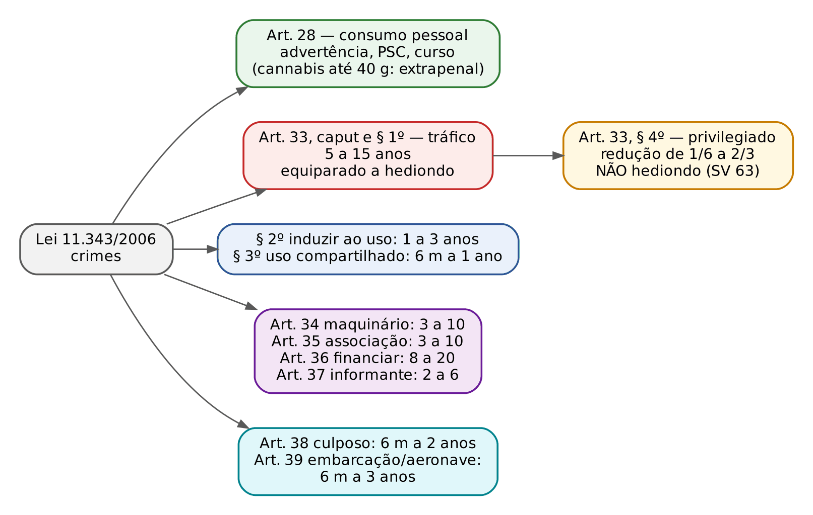
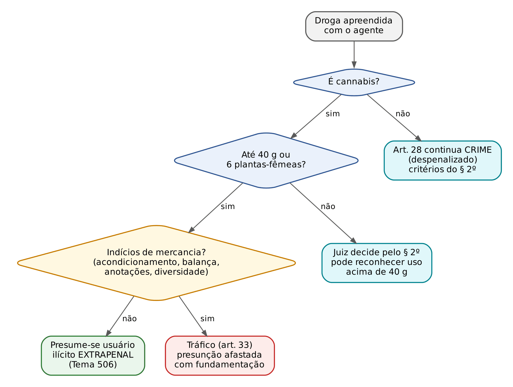
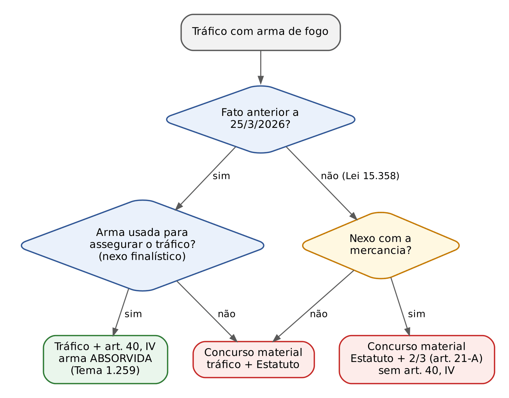
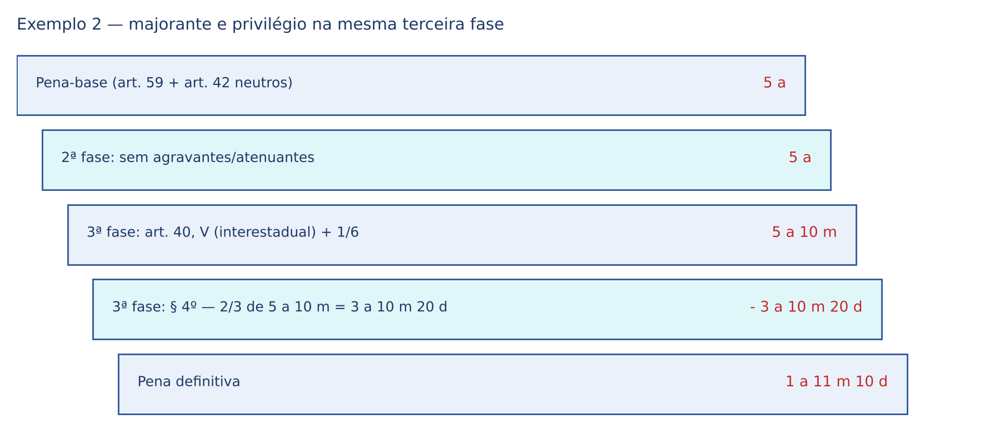

# CAPÍTULO 37 — LEI DE DROGAS (LEI 11.343/2006)

:::INCIDENCIA
TRF5 p. 10; TJRS p. 7; TJSC p. 50. Nível A. Lote: 28 questões (FGV 24, FCC 4).
O que mais cai: art. 28 depois do Tema 506 do STF, tráfico privilegiado (requisitos, Tema 1.139, hediondez), majorantes do art. 40 (transnacional, interestadual, arma, transporte público), associação x informante x financiador, art. 42 e *bis in idem*, literalidade dos arts. 41 a 47 e do procedimento (art. 55).
:::

| Subtema | FGV | FCC | Padrão de cobrança |
|---|---|---|---|
| Art. 28 e Tema 506 | 4 | 1 | itens do Tema 506 (40 g, presunção relativa, sem prestação de serviços); critérios do § 2º para outras drogas |
| Tráfico: verbos, consumação, § 3º, prova | 5 | 0 | consumação antecipada (adquirir, ter em depósito); uso compartilhado; coautoria; materialidade sem apreensão |
| Tráfico privilegiado | 1 | 0 | inquéritos e ações em curso (Tema 1.139); incompatibilidade com o art. 35 |
| Arts. 35, 36 e 37 | 4 | 1 | estabilidade da associação (2 pessoas bastam); financiador puro x traficante que financia; informante eventual |
| Majorantes do art. 40 e arma | 2 | 2 | intermunicipal NÃO majora; transporte público só como meio NÃO majora; Tema 1.259 x Lei 15.358/2026 |
| Arts. 41 a 47 (dosimetria, multa, dependência) | 3 | 0 | troca de palavras na literalidade: "personalidade e conduta social"; "1/30 a 5 vezes"; "décuplo"; "1/3 a 2/3" |
| Procedimento (arts. 54 a 58) | 3 | 0 | prazos de 10 dias e 5 testemunhas; interrogatório ao final; art. 385 do CPP |
| Bens apreendidos | 2 | 0 | arts. 61 a 63-E (Funad, Senad, leilão por 50%) |

## 37.1 Visão geral: o que a lei protege e como ela está montada

A Lei 11.343/2006 tem uma parte sanitária, o Sistema Nacional de Políticas Públicas sobre Drogas (Sisnad: prevenção, atenção e reinserção de usuários, arts. 3º a 26), que trata o usuário pela lógica da saúde, e uma parte penal, que trata o traficante pela lógica da repressão: crimes (arts. 28 e 33 a 39), causas de aumento e diminuição (arts. 33, § 4º, 40, 40-A, 41 e 46), dosimetria (arts. 42 e 43), vedações (art. 44), procedimento (arts. 48 a 59) e bens apreendidos (arts. 60 a 64).

O bem jurídico é a saúde pública, e os tipos são de perigo abstrato (o legislador presume o perigo; ninguém precisa provar que alguém ficou doente). Consequências: primeira, o princípio da insignificância NÃO se aplica ao tráfico nem ao porte para consumo (Jurisprudência em Teses do STJ, ed. 131, tese 5; a teoria da insignificância está no Cap. 2). segunda, não se exige laudo de grau de pureza para tipificar nem para dosar a pena (teses 15 e 44 da mesma edição): a lei fala em "natureza e quantidade", não em pureza.

### 37.1.1 Conceito de droga: norma penal em branco heterogênea

Quem define o que é "droga" é o Poder Executivo da União: é o exemplo clássico de norma penal em branco heterogênea (complemento de outra fonte e hierarquia). O art. 66 remete às listas da Portaria SVS/MS 344/1998.

:::LEI Lei 11.343/2006, art. 1º, parágrafo único
Para fins desta Lei, consideram-se como drogas as substâncias ou os produtos capazes de causar dependência, assim especificados em lei ou relacionados em listas atualizadas periodicamente pelo Poder Executivo da União.
:::

Consequências cobradas:

- Substância fora das listas não é droga para fins penais, ainda que cause dependência (o álcool e o tabaco são o exemplo de sala de aula). Se a substância é retirada da lista, há *abolitio criminis*; se é incluída, a lei só alcança fatos posteriores.
- O STJ entendeu típico o transporte de substâncias que, isoladamente, constam das listas como drogas ou precursoras, ainda que a mistura final não esteja listada (Informativo de Jurisprudência, Edição Extraordinária 27).
- Venda de medicamento pela internet sem as formalidades legais, quando o produto não é droga das listas, enquadra-se no art. 273, § 1º-B, do CP, por especialidade (Informativo 887 do STJ).

:::QUESTAO FGV 2024 — Câmara dos Deputados — Consultor Legislativo (Q2513051)
Gabarito: D — conceito do art. 1º, parágrafo único. Armadilhas: plantio medicinal "atípico" sem autorização da União (art. 2º, parágrafo único); oferta eventual para consumo conjunto "impune" (é o art. 33, § 3º); "prisão simples" no art. 28.
:::

:::DICA
Cannabis medicinal: o STJ admite salvo-conduto para cultivo doméstico com finalidade terapêutica comprovada por documentação médica idônea, enquanto não houver regulamentação federal específica, sem exigir prova de que o paciente não pode comprar o fármaco importado (Informativos 842 e 873 do STJ). Fundamento: falta de tipicidade material.
:::

:::PEGADINHA
Combinação de leis: na sucessão entre a Lei 6.368/1976 e a Lei 11.343/2006, NÃO se pode aplicar o § 4º do art. 33 (lei nova) sobre a pena da lei antiga (3 a 15 anos). O juiz escolhe a lei mais favorável e a aplica por inteiro (Súmula 501 do STJ e Tema 169 do STF — ver Cap. 3).
:::

## 37.2 Porte para consumo pessoal (art. 28)

### 37.2.1 O tipo e as "penas"

O art. 28 pune quem adquire, guarda, tem em depósito, transporta ou traz consigo droga para consumo pessoal; o § 1º equipara quem semeia, cultiva ou colhe plantas para preparar PEQUENA quantidade para consumo próprio. Os cinco verbos também estão no art. 33: o que distingue os tipos é o elemento subjetivo especial, a finalidade de consumo pessoal.

As sanções são três (art. 28, I a III): advertência sobre os efeitos das drogas, prestação de serviços à comunidade e medida educativa de comparecimento a programa ou curso educativo. Não há pena privativa de liberdade em hipótese alguma; nem o descumprimento converte em prisão. Se o agente se recusa injustificadamente a cumprir, o juiz pode aplicar, sucessivamente, admoestação verbal e multa (§ 6º), esta de 40 a 100 dias-multa, cada um de 1/30 a 3 vezes o maior salário mínimo (art. 29). Prazos: prestação de serviços e curso por no máximo 5 meses; na reincidência, 10 meses (§§ 3º e 4º). As penas podem ser aplicadas isolada ou cumulativamente e substituídas a qualquer tempo (art. 27). A prescrição da imposição e da execução é de 2 anos, com as causas interruptivas do CP (art. 30).

### 37.2.2 Natureza: despenalização, não descriminalização

Como o art. 1º da Lei de Introdução ao CP define crime pela cominação de reclusão ou detenção, discutiu-se se o art. 28 ainda era crime. O STF (RE 430.105 QO, 2007) e o STJ responderam: houve despenalização (afastamento da prisão), não descriminalização. Logo, não houve *abolitio criminis* para os fatos da Lei 6.368/1976 (Jurisprudência em Teses do STJ, ed. 131, tese 6).

Mesmo sendo crime, a condenação anterior pelo art. 28 NÃO gera reincidência nem maus antecedentes (STJ, REsp 1.672.654, Sexta Turma, 2018; Jurisprudência em Teses, ed. 45, tese 2). Razão: se a contravenção, punida com prisão simples, não gera reincidência (art. 63 do CP), seria desproporcional que o art. 28, sem prisão, gerasse. A FCC considerou errado o item que admitia maus antecedentes (Q4037436, DPE-BA 2026).

### 37.2.3 O Tema 506 do STF (RE 635.659): a maconha para consumo pessoal

Em 26/6/2024, o STF concluiu o RE 635.659 (Tema 506). As teses valem SOMENTE para a maconha; as demais drogas continuam no art. 28 como crime despenalizado.

| Item | O que o STF decidiu (Tema 506) |
|---|---|
| Natureza | Não comete infração penal quem adquire, guarda, tem em depósito, transporta ou traz consigo cannabis para consumo pessoal; a conduta continua ILÍCITA, mas no plano extrapenal |
| Sanções | Apreensão da droga, advertência sobre os efeitos e medida educativa de comparecimento a curso (incisos I e III); NÃO cabe prestação de serviços à comunidade (inciso II) |
| Procedimento | Natureza não penal, sem repercussão criminal; até regulamentação pelo CNJ, competência dos Juizados Especiais Criminais, vedada qualquer atribuição de efeito penal à decisão |
| Atuação policial | A autoridade apreende a droga e notifica o autor do fato para comparecer em juízo; não há prisão em flagrante nem termo com efeito penal |
| Critério quantitativo | Presume-se usuário quem porta até 40 g de cannabis ou 6 plantas-fêmeas, até que o Congresso legisle |
| Força da presunção | RELATIVA nos dois sentidos: abaixo de 40 g pode haver flagrante por tráfico se houver indícios de mercancia (forma de acondicionamento, diversidade de substâncias, balança, registros de operações, celular com contatos de compradores); acima de 40 g, o juiz pode concluir pelo uso pessoal se houver prova suficiente |
| Ônus de fundamentação | Se o delegado afastar a presunção, deve justificar minuciosamente no auto, vedados critérios subjetivos arbitrários; o juiz reavalia na audiência de custódia |

:::QUESTAO FGV 2025 — TJ-SE — Juiz Substituto (Q3301263)
Gabarito: E — não cabe prestação de serviços à comunidade para quem porta até 40 g ou 6 plantas-fêmeas. Armadilhas: atipicidade de 1 g de cocaína (o tema é só da cannabis); transação anterior por maconha como óbice ao ANPP (sem efeito penal); abuso de autoridade no flagrante de quem tinha 10 g, balança e anotações (presunção relativa); condutas "indiferentes ao ordenamento" (seguem ilícitas fora do Direito Penal). No mesmo sentido: Q3530369 (FCC 2025, MPE-PI: errados os itens com 60 g e oito plantas e com presunção absoluta) e Q3265274 (FGV 2025: usuário tem tratamento distinto; o tráfico de maconha continua crime).
:::

:::QUESTAO FGV 2025 — DPE-PE — Defensor Público (Q3390852)
Gabarito: E — com 80 g de maconha, o juiz ainda pode concluir pela atipicidade se convencido do uso. Armadilhas: estender a presunção a ecstasy e cocaína; presunção absoluta.
:::

:::QUESTAO FGV 2025 — TJ-TO — Juiz Substituto (Q3453256)
0,8 g de cocaína. Gabarito: C — critérios do art. 28, § 2º. Armadilhas: atipicidade e vedação da prestação de serviços (ambas só para a cannabis).
:::

### 37.2.4 Como distinguir usuário de traficante (art. 28, § 2º)

O critério geral é o do § 2º: natureza e quantidade, local e condições da ação, circunstâncias sociais e pessoais, conduta e antecedentes. Nenhum é decisivo sozinho. O STJ já considerou insuficiente a quantidade de 37 g de maconha, sem outros elementos, para condenar por tráfico (Informativo de Jurisprudência, Edição Extraordinária 24), e afirmou que a condenação por tráfico exige prova de atos concretos de traficância, não bastando a apreensão de droga somada a antecedentes (Informativo 886).

:::SENTENCA Desclassificação para o art. 28
Onde entra: no mérito, depois da materialidade e antes da dosimetria. O que fundamentar: os vetores do § 2º, um a um, com os fatos dos autos. Redação-modelo: "A quantidade apreendida (12 g de cocaína, em porção única), a ausência de petrechos de mercancia e a prova testemunhal sobre a dependência do acusado afastam a finalidade comercial; desclassifico a conduta para a do art. 28 da Lei 11.343/2006." Consequência: observa-se o art. 383, §§ 1º e 2º, do CPP (oportunidade de transação, art. 48, § 5º, e remessa ao Juizado conforme a organização judiciária). Se for maconha no parâmetro, reconhece-se a atipicidade penal (Tema 506), com encaminhamento às medidas extrapenais. Erro que a banca pune: condenar pelo art. 28 por maconha para consumo, ou desclassificar sem enfrentar os vetores do § 2º.
:::

:::PROCESSO Art. 28 no Juizado
O art. 28 segue o rito da Lei 9.099/1995 (art. 48, § 1º): não se impõe prisão em flagrante (§ 2º); lavra-se termo circunstanciado e o autor assume o compromisso de comparecer. Cabem transação penal (art. 48, § 5º) e suspensão condicional do processo. A competência é do Juizado ESTADUAL, mesmo que a droga venha do exterior, porque o art. 70 só leva à Justiça Federal os arts. 33 a 37 transnacionais (Jurisprudência em Teses, ed. 131, tese 8). Materialidade: exige laudo de constatação da natureza e quantidade (tese 12). Para a maconha dentro do Tema 506, a tese 12 da ed. 123 (cabimento de transação e suspensão) foi dada por superada: não há mais procedimento penal.
:::

### 37.2.5 Reflexos fora do processo do art. 28

- Execução penal: posse de droga para uso no presídio é falta grave, inclusive maconha após o Tema 506, e exige laudo (Jurisprudência em Teses, ed. 144, tese 10; ed. 131, tese 11 — ver Cap. 23).
- Corrupção ativa: oferecer dinheiro a policial para não ser conduzido por porte para uso é corrupção ativa consumada (STJ, AREsp 2.007.599, Informativo 735; Q3049375 — ver Cap. 36).
- Ato infracional: aplicar semiliberdade a adolescente por ato análogo ao art. 28 viola a proteção integral (ed. 131, tese 51); e o ato análogo ao tráfico, por si só, não conduz obrigatoriamente à internação (Súmula 492 do STJ — ver Cap. 42).

## 37.3 Tráfico de drogas (art. 33, caput e § 1º)

:::LEI Lei 11.343/2006, art. 33, caput
Importar, exportar, remeter, preparar, produzir, fabricar, adquirir, vender, expor à venda, oferecer, ter em depósito, transportar, trazer consigo, guardar, prescrever, ministrar, entregar a consumo ou fornecer drogas, ainda que gratuitamente, sem autorização ou em desacordo com determinação legal ou regulamentar: Pena - reclusão de 5 (cinco) a 15 (quinze) anos e pagamento de 500 (quinhentos) a 1.500 (mil e quinhentos) dias-multa.
:::

### 37.3.1 Estrutura do tipo

São 18 verbos. O tipo é misto alternativo (de ação múltipla): vários verbos no mesmo contexto, sobre a mesma droga, configuram UM só crime (quem adquire, guarda e vende a mesma partida comete um tráfico); contextos distintos geram crimes distintos (Cap. 16). Outros traços:

- "Ainda que gratuitamente": o lucro NÃO é elementar; doar droga é tráfico. Basta que a finalidade NÃO seja o consumo pessoal.
- Crime comum (qualquer pessoa), doloso (não há tráfico culposo; a prescrição culposa é o art. 38), de perigo abstrato, formal (não exige que a droga chegue ao consumidor).
- Vários verbos são permanentes (ter em depósito, guardar, transportar, trazer consigo, expor à venda): a consumação se prolonga, o flagrante é possível a qualquer tempo e a entrada em domicílio sem mandado é admitida desde que amparada em fundadas razões, justificadas a posteriori (tese do STF no RE 603.616, Tema 280; Jurisprudência em Teses, ed. 60, tese 16). Esse controle é processual e entra na sentença como preliminar.
- "Trazer consigo" não exige contato corporal: abrange a droga à disposição imediata do agente (Informativo 859 do STJ).

### 37.3.2 Consumação, tentativa e a venda ao policial disfarçado

Como basta qualquer verbo, o tráfico costuma estar consumado cedo. Quem encomenda e adquire a droga já consumou o verbo "adquirir" com o ajuste sobre o objeto, antes mesmo de recebê-la (STJ, HC 650.712, Sexta Turma, 2022). A tentativa é rara (por exemplo, tentativa de adquirir sem ajuste concluído).

O flagrante preparado (Súmula 145 do STF — ver Cap. 8) torna impossível o crime induzido pelo provocador; mas o policial que se passa por comprador encontra o traficante já em flagrante por verbo anterior (trazia consigo, tinha em depósito): a venda simulada é crime impossível, o depósito anterior não. A Lei 13.964/2019 criou ainda figura própria: vender ou entregar droga, matéria-prima ou insumo a agente policial disfarçado, quando presentes elementos probatórios razoáveis de conduta criminal preexistente (art. 33, § 1º, IV). O agente disfarçado não cria a intenção criminosa, apenas a revela.

:::QUESTAO FGV 2024 — TJ-PE — Juiz Substituto (Q3117544)
Elmo adquire 500 pinos de cocaína para vender e os guarda num terreno; policial disfarçado de usuário pede 20 pinos e o prende no início da entrega. Gabarito: D — consumação quando ADQUIRIU os pinos com intenção comercial. Armadilhas: atipicidade por flagrante esperado ou preparado (o crime já estava consumado); consumação na venda ao policial; tentativa.
:::

:::ATENCAO Solicitação de droga de dentro do presídio
O preso que apenas pede que lhe levem droga, interceptada na revista, pratica ato preparatório impunível (Informativo 770); a visitante responde por tráfico consumado (Informativo 899). Se a solicitação vem com atos de coordenação e determinação da compra, o preso responde pelo tráfico, pelo art. 29 do CP (Informativo de Jurisprudência, Edição Extraordinária 27). Controvérsia afetada no Tema 1.431 (pendente).
:::

### 37.3.3 Prova da materialidade e da traficância

Sem droga apreendida e periciada não há materialidade do tráfico: depoimentos e interceptações não suprem a falta de apreensão e laudo (STJ, Terceira Seção, HC 686.312, j. 12/4/2023), nem prints de anúncios em redes sociais (Informativo 846). A regra NÃO vale para a associação do art. 35, que se prova pelo vínculo estável (Jurisprudência em Teses, ed. 131, tese 27).

:::QUESTAO FGV 2025 — TJ-SE — Juiz Substituto (Q3301268)
Grupo de 16 pessoas, com liderança e divisão de tarefas, dedicado ao tráfico e a extorsões; nenhuma droga apreendida; o líder comprou cavalos em seu próprio nome. Gabarito: E — associação para o tráfico e organização criminosa em concurso material, sem *bis in idem*, porque o grupo praticava outros crimes além do tráfico. Armadilhas: falta de apreensão impedindo a associação (não impede); tráfico sem apreensão (não cabe); lavagem por compra de bens em nome próprio (sem ocultação — Cap. 46).
:::

### 37.3.4 Concurso de pessoas no tráfico

Aplicam-se as regras do Cap. 11. O empresário que coordena a logística e o funcionário que esconde a droga nos contêineres são coautores do tráfico internacional (Q3742364, FGV 2025, TRF6, Juiz Federal, gabarito D). Na mesma questão: o servidor que recebe para não fiscalizar não responde "apenas" por corrupção passiva; a advogada que orienta a ocultação não tem imunidade; a namorada que só usufrui do dinheiro não é partícipe.

### 37.3.5 Figuras equiparadas do § 1º

Respondem pelas mesmas penas do caput:

- Inciso I: verbos sobre matéria-prima, insumo ou produto químico destinado à preparação de drogas (não precisa ser, ele próprio, droga listada).
- Inciso II: semear, cultivar ou colher plantas que sejam matéria-prima de drogas (fora da hipótese do art. 28, § 1º).
- Inciso III: utilizar local ou bem sob sua propriedade, posse, administração, guarda ou vigilância, ou CONSENTIR que outrem o utilize, para o tráfico (dono de bar que permite a venda).
- Inciso IV: venda ou entrega a agente policial disfarçado (37.3.2).

Quando o § 1º ou o art. 34 (maquinário) são meios para o mesmo tráfico do caput, no mesmo contexto, aplica-se a consunção; se houver contextos autônomos, que ofendem o bem jurídico de modo distinto, há concurso (Jurisprudência em Teses, ed. 131, tese 18).

### 37.3.6 Induzimento ao uso (§ 2º) e uso compartilhado (§ 3º)

O § 2º pune quem induz, instiga ou auxilia alguém ao uso indevido de droga (detenção de 1 a 3 anos e multa de 100 a 300 dias-multa). O STF, na ADI 4.274 (2011), deu interpretação conforme para excluir do tipo as manifestações e eventos públicos em defesa da legalização (a "marcha da maconha").

O § 3º é o tipo privilegiado de verdade: oferecer droga, eventualmente e sem objetivo de lucro, a pessoa de seu relacionamento, para juntos a consumirem. Pena de detenção de 6 meses a 1 ano e 700 a 1.500 dias-multa, sem prejuízo das penas do art. 28. Os quatro requisitos são cumulativos; faltando qualquer um, volta-se ao caput.

| Situação | Enquadramento |
|---|---|
| A oferece maconha ao amigo, numa festa, para fumarem juntos, sem cobrar | Art. 33, § 3º (infração de menor potencial ofensivo) |
| A dá maconha de presente ao amigo, para ele usar sozinho | Art. 33, caput (fornecer, ainda que gratuitamente) — falta "para juntos consumirem" |
| A oferece ao amigo para fumarem juntos, mas cobra a sua parte | Art. 33, caput — há objetivo de lucro |
| A oferece rotineiramente a colegas do trabalho | Art. 33, caput — falta eventualidade |
| A oferece a desconhecido, num show, para fumarem juntos | Art. 33, caput — falta relação pessoal |

:::QUESTAO FGV 2026 — TJ-GO — Juiz Substituto (Q3966678)
Jorge presenteia a colega Kátia, usuária, com 20 g de maconha; ela o convida a fumarem juntos, e ele recusa. Gabarito: D — ambos cometeram tráfico, Kátia "na forma privilegiada": Jorge forneceu para consumo alheio (caput); Kátia ofereceu, eventualmente e sem lucro, a pessoa do seu relacionamento, para consumo conjunto (§ 3º, consumado com a oferta, ainda que recusada). Armadilhas: aplicar o Tema 506 (não protege quem fornece ou oferece a terceiro); tentativa. Cuidado: aqui "privilegiado" designa o § 3º; em regra, a expressão designa o § 4º.
:::

## 37.4 Tráfico privilegiado (art. 33, § 4º)

:::LEI Lei 11.343/2006, art. 33, § 4º
Nos delitos definidos no caput e no § 1º deste artigo, as penas poderão ser reduzidas de um sexto a dois terços, desde que o agente seja primário, de bons antecedentes, não se dedique às atividades criminosas nem integre organização criminosa.
:::

A lógica é separar o pequeno traficante eventual do profissional. Não é tipo derivado, e sim causa especial de diminuição (minorante) de TERCEIRA fase. A parte final do dispositivo, que vedava a conversão em restritivas de direitos, foi declarada inconstitucional e suspensa pela Resolução 5/2012 do Senado (HC 97.256 — v. Cap. 17).

### 37.4.1 Requisitos cumulativos

Os quatro requisitos são cumulativos (Jurisprudência em Teses, ed. 131, tese 22).

| Requisito | O que afasta | O que NÃO afasta |
|---|---|---|
| Primariedade | Reincidência (art. 63 do CP) | Condenação anterior pelo art. 28 (37.2.2) |
| Bons antecedentes | Condenação definitiva anterior que não gere reincidência (Cap. 13) | Inquéritos e ações penais em curso (Tema 1.139 do STJ) |
| Não dedicação a atividades criminosas | Prova concreta de habitualidade: petrechos, diversidade e quantidade associadas a outros elementos, condenação simultânea por associação (art. 35), quantidade tão expressiva que seja incompatível com traficante eventual (Tema 1.154) | A condição de "mula", por si só; a quantidade isolada não expressiva; a mera presunção |
| Não integrar organização criminosa | Prova de vínculo com organização (Lei 12.850/2013 — Cap. 46) | Transportar droga de terceiro sem prova de vínculo estável |

:::JURIS STJ, Tema 1.139 (REsp 1.977.027, j. 10/8/2022)
É vedada a utilização de inquéritos e/ou ações penais em curso para impedir a aplicação do art. 33, § 4º. Fundamento: presunção de inocência (mesma lógica da Súmula 444 do STJ — Cap. 13). O STF decide no mesmo sentido.
:::

:::QUESTAO FGV 2025 — MPE-RJ — Promotor de Justiça Substituto (Q3532372)
Preso com 1 kg de cocaína, com inquérito e ação penal em curso, teve o § 4º negado por "maus antecedentes e dedicação". Gabarito: A — contraria o Tema 1.139. Armadilhas: 1 kg como impeditivo por si só; exceção para acórdão condenatório de segundo grau (não existe).
:::

Atos infracionais: o STJ admite que registros de atos infracionais graves, documentados e próximos no tempo indiquem dedicação a atividades criminosas, mediante fundamentação concreta (EREsp 1.916.596, Terceira Seção, 2021). Não são antecedentes, mas podem revelar a habitualidade.

### 37.4.2 Quantidade, natureza e "mula": o Tema 1.154 do STJ

Em 18/6/2026, a Terceira Seção (Temas 1.154 e 1.241) fixou: quantidade tão expressiva que, por sua própria dimensão, seja incompatível com o traficante eventual ou de pequeno porte AFASTA a minorante; fora daí, natureza e quantidade só a afastam associadas a outros elementos concretos (alto profissionalismo, logística sofisticada, estrutura complexa de armazenamento) que revelem dedicação ao crime ou integração a organização criminosa.

A "mula" (quem transporta droga alheia mediante pagamento) não é, só por isso, integrante de organização criminosa, mas a condição pode pesar na fração (Jurisprudência em Teses, ed. 131, tese 24; ed. 60, tese 4). Está afetada a questão de saber se a destinação interestadual da droga, por si só, afasta o § 4º (Tema 1.381, pendente).

:::PEGADINHA Associação e privilégio são incompatíveis
Condenado também pelo art. 35, o réu não tem o § 4º: a associação estável revela dedicação ao crime (Jurisprudência em Teses, ed. 131, tese 23). Cobrado na Q3870778 (FGV 2026, TJ-RJ, alternativa D errada) e na Q2442326 (FGV 2024, TJ-AP: tráfico e associação SEM privilégio).
:::

### 37.4.3 A fração: de 1/6 a 2/3

A lei não dá critérios. Admite-se modular a fração pela natureza, quantidade e demais circunstâncias (Jurisprudência em Teses, ed. 131, tese 25), desde que natureza e quantidade não tenham sido usadas na pena-base (Tema 712 — 37.7.2). Sem circunstância desfavorável, aplica-se 2/3; fração menor exige fundamentação concreta.

### 37.4.4 O privilegiado não é hediondo: consequências

Trajetória: Súmula 512 do STJ (2014, dizia que o § 4º não afastava a hediondez); STF, HC 118.533 (Plenário, 23/6/2016), em sentido contrário; cancelamento da Súmula 512 e Tema 600 do STJ (2016); art. 112, § 5º, da LEP (Lei 13.964/2019); Súmula Vinculante 63 (2025): o privilegiado não é hediondo, afastando-se os parâmetros mais rigorosos de progressão e de livramento. Consequências:

- Progressão pelas frações comuns do art. 112 da LEP, não pelas de hediondos (Cap. 24).
- Livramento condicional pelas regras comuns do art. 83 do CP, sem a fração de 2/3 nem a vedação ao reincidente específico do art. 44, parágrafo único, da Lei de Drogas.
- Indulto e graça possíveis: a vedação constitucional (art. 5º, XLIII) atinge o tráfico equiparado, não o privilegiado; o STF reafirmou a constitucionalidade do indulto ao privilegiado no Tema 1.400 (RE 1.542.482, j. 30/5/2025). O STJ, no Tema 1.336, decidiu que o Decreto 11.846/2023 não alcança o tráfico do caput e do § 1º, inclusive quanto à multa, salvo quando reconhecido o redutor (ver Cap. 21 e 24).

### 37.4.5 Regime e substituição no privilegiado (Súmula Vinculante 59)

:::JURIS STF, Súmula Vinculante 59
É impositiva a fixação do regime aberto e a substituição da pena privativa de liberdade por restritiva de direitos quando reconhecida a figura do tráfico privilegiado (art. 33, § 4º, da Lei 11.343/2006) e ausentes vetores negativos na primeira fase da dosimetria (art. 59 do CP), observados os requisitos do art. 33, § 2º, alínea c, e do art. 44, ambos do Código Penal.
:::

Três filtros: privilégio reconhecido; nenhum vetor negativo na primeira fase; requisitos do CP (pena até 4 anos e não reincidência; art. 44). Presentes, aberto e substituição são OBRIGATÓRIOS. Se natureza ou quantidade foram valoradas na pena-base, a súmula não incide e o regime pode ser mais grave, fundamentadamente (art. 33, § 3º, do CP; Jurisprudência em Teses, ed. 131, tese 50).

:::EXEMPLO Exemplo 1 — o privilegiado "limpo" (Q3117550, FGV 2024, TJ-PE, Cap. 17)
Réu primário, bons antecedentes, 30 g de cocaína, sem circunstância judicial negativa.
- 1ª fase: pena-base no mínimo = 5 anos e 500 dias-multa.
- 2ª fase: sem agravantes nem atenuantes = 5 anos.
- 3ª fase: § 4º na fração máxima (2/3). 2/3 de 5 anos (60 meses) = 40 meses. 60 - 40 = 20 meses = 1 ano e 8 meses.
- Multa, mesma proporção: 500 - 333,33 = 166,66 → 166 dias-multa, desprezada a fração (art. 11 do CP); a questão trouxe 167, arredondando para cima.
- Regime: pena até 4 anos, réu primário e sem vetor negativo: ABERTO (art. 33, § 2º, c, do CP e SV 59).
- Substituição: pena superior a 1 ano, logo DUAS restritivas de direitos ou uma restritiva e multa (art. 44, § 2º, do CP). Gabarito da questão: E.
:::

:::ATENCAO Multa mínima do tráfico
A multa mínima do art. 33 é opção legislativa legítima; o juiz não pode reduzi-la por proporcionalidade, isonomia ou individualização (STF, Tema 1.178, RE 1.347.158, j. 21/10/2021). A pobreza do réu se reflete no VALOR do dia-multa (art. 43).
:::

## 37.5 Os demais crimes: arts. 34 a 39

### 37.5.1 Maquinário (art. 34)

Pune condutas sobre maquinário, aparelho, instrumento ou objeto destinado à fabricação, preparação, produção ou transformação de drogas (reclusão de 3 a 10 anos): antecipa a tutela ao preparatório do tráfico (prensa, laboratório). Balança e embalagens, sozinhas, costumam ser indício de tráfico, não o art. 34. Se o maquinário serve ao mesmo tráfico do caput, há consunção (37.3.5). O art. 34 NÃO é hediondo, porque não figura no rol da Lei 8.072/1990 (Informativo 882 do STJ; no mesmo sentido, Q4349502, FGV 2026, TJ-PE, Juiz, gabarito A — ver Cap. 40).

### 37.5.2 Associação para o tráfico (art. 35)

Associarem-se duas ou mais pessoas para o fim de praticar, reiteradamente ou não, qualquer dos crimes dos arts. 33, caput e § 1º, e 34 (reclusão de 3 a 10 anos). O parágrafo único estende a pena a quem se associa para a prática REITERADA do financiamento do art. 36.

- Número mínimo: DUAS pessoas (contam-se inimputáveis e não identificados).
- Estabilidade: apesar de "reiteradamente ou não", exige-se dolo de associação estável e permanente (Jurisprudência em Teses, ed. 131, tese 26). Reunião ocasional para um tráfico é coautoria; amizade com traficantes ou convivência em área de facção não bastam.
- Autonomia: consuma-se com a associação, independentemente de tráfico efetivo, e concorre materialmente com o tráfico. Não é hediondo (ed. 131, tese 28), mas segue o art. 44, parágrafo único, quanto ao livramento condicional (37.8).

| Figura | Mínimo de pessoas | Finalidade | Estrutura exigida |
|---|---|---|---|
| Associação para o tráfico (art. 35) | 2 | Crimes dos arts. 33, caput e § 1º, e 34 (ou financiamento reiterado) | Estabilidade e permanência |
| Associação criminosa (art. 288 do CP) | 3 | Crimes em geral | Estabilidade e permanência |
| Organização criminosa (art. 1º, § 1º, da Lei 12.850/2013) | 4 | Infrações com pena máxima superior a 4 anos ou transnacionais | Estrutura ordenada e divisão de tarefas, ainda que informal |

Associação para o tráfico e organização criminosa podem concorrer sem *bis in idem* quando a organização se dedica também a outros crimes além do tráfico (Q3301268, 37.3.3).

:::QUESTAO FCC 2026 — DPE-MT — Defensor Público (Q3954630)
Réu em seu primeiro dia vendendo droga, com adolescente olheiro ao lado, condenado por tráfico, associação e corrupção de menores, com pena-base elevada e § 4º negado, ambos pela quantidade. Por que a decisão está ERRADA? Gabarito: D — a associação, ainda que de duas pessoas, exige vínculo estável, ausente no primeiro dia. Armadilhas: corrupção de menores como crime material (é formal — Súmula 500 do STJ, Cap. 42); continuidade entre crimes de espécies diferentes; "quantidade expressiva, por si só, afasta o § 4º" (só se incompatível com o pequeno traficante — embora a alternativa apontasse corretamente o uso duplo, 37.7.2); absorção pela associação.
:::

:::QUESTAO FGV 2025 — MPE-RJ — Analista (Q3362534)
Dois agentes, atuando juntos de forma estável há meses, presos no Rio de Janeiro com 50 kg de cocaína destinados a Belo Horizonte. Gabarito: E — tráfico com a majorante interestadual (Súmula 587) e associação (duas pessoas bastam). Armadilhas: exigir transposição da divisa ou três pessoas.
:::

### 37.5.3 Financiamento ou custeio (art. 36) e majorante do art. 40, VII

Financiar ou custear os crimes dos arts. 33, caput e § 1º, e 34: reclusão de 8 a 20 anos, a maior pena da lei.

- Quem APENAS financia, sem participar diretamente da execução do tráfico (o investidor), responde pelo art. 36, crime autônomo (Jurisprudência em Teses, ed. 131, tese 30).
- Quem TRAFICA e também financia responde pelo art. 33 com a causa de aumento do art. 40, VII (tese 17). Não há concurso entre os arts. 33 e 36 no mesmo contexto. O art. 36 é exceção pluralística à teoria monista (Cap. 11).

:::QUESTAO FGV 2024 — TJ-MS — Analista Judiciário (Q2489731)
Financiador do tráfico alheio, em vários municípios, sem participar da execução. Gabarito: E — só o art. 36, sem majorante. Armadilhas: tráfico com a majorante do financiamento (é para quem também trafica); majorante "intermunicipal" (não existe). Sobre a majorante de 1/6 a 2/3 do inciso VII: Q3304091 (FCC 2025, DPE-SP, gabarito A).
:::

### 37.5.4 Informante (art. 37)

Colaborar, como informante, com grupo, organização ou associação destinados aos crimes dos arts. 33, caput e § 1º, e 34 (reclusão de 2 a 6 anos). Tipo SUBSIDIÁRIO, para a colaboração eventual, sem vínculo com o grupo (Jurisprudência em Teses, ed. 131, tese 31; Informativo 892 do STJ):

| Quem avisa sobre a polícia | Enquadramento |
|---|---|
| Morador que, eventualmente, avisa traficantes conhecidos | Art. 37 |
| Integrante estável da associação, cuja função é vigiar | Art. 35 (absorve a colaboração) |
| Vigia que atua na própria venda, com divisão de tarefas | Art. 33 (coautoria ou participação) |

:::QUESTAO FGV 2026 — TJ-BA — Juiz Substituto (Q4083758)
Morador amigo de traficantes avisa-os, por WhatsApp, da entrada da polícia; eles são presos mesmo assim. Gabarito: C — art. 37 (consumado com a colaboração, ainda que inútil). Armadilhas: associação (sem vínculo estável) e tráfico.
:::

### 37.5.5 Prescrição ou ministração culposa (art. 38) e condução de embarcação ou aeronave (art. 39)

O art. 38 é o único crime culposo da lei: prescrever ou ministrar, culposamente, droga desnecessária, em dose excessiva ou em desacordo com norma (detenção de 6 meses a 2 anos); crime próprio de profissionais de saúde, com comunicação ao conselho profissional. Dolosa a prescrição, art. 33. Quem exerce ilegalmente a medicina e prescreve droga responde pelo art. 282 do CP em concurso formal com o art. 33 (Jurisprudência em Teses, ed. 131, tese 19).

O art. 39 pune conduzir embarcação ou aeronave após consumir droga, expondo a dano potencial a incolumidade de outrem (detenção de 6 meses a 3 anos, mais apreensão do veículo e cassação da habilitação; 4 a 6 anos no transporte coletivo). Veículo terrestre: art. 306 do CTB (Cap. 43).

### 37.5.6 Ficha dos crimes

| Crime | Conduta nuclear | Pena | Elemento subjetivo | Consumação e tentativa | Benefícios | Hediondo |
|---|---|---|---|---|---|---|
| Art. 28 | adquirir, guardar, ter em depósito, transportar ou trazer consigo para consumo | advertência, prestação de serviços, curso (cannabis até o parâmetro: só medidas extrapenais) | dolo + finalidade de consumo pessoal | com o verbo; prescrição em 2 anos | JECrim: transação e suspensão | não |
| Art. 33, caput e § 1º | 18 verbos; insumo; plantio; local; venda a policial disfarçado | 5 a 15 anos e 500 a 1.500 dias-multa | dolo (lucro dispensável) | formal; tentativa rara | nenhum, salvo § 4º | sim (equiparado) |
| Art. 33, § 4º | minorante de 1/6 a 2/3 | pode chegar a 1 ano e 8 meses | — | — | regime aberto, substituição (SV 59), indulto; ANPP discutido (Cap. 25) | NÃO (SV 63) |
| Art. 33, § 2º | induzir, instigar, auxiliar ao uso | 1 a 3 anos (detenção) e 100 a 300 dias-multa | dolo | formal | suspensão do processo; ANPP | não |
| Art. 33, § 3º | oferecer, eventualmente e sem lucro, a pessoa do relacionamento, para consumo conjunto | 6 meses a 1 ano (detenção) e 700 a 1.500 dias-multa, mais as do art. 28 | dolo | com a oferta | transação; suspensão | não |
| Art. 34 | maquinário destinado a produzir drogas | 3 a 10 anos e 1.200 a 2.000 dias-multa | dolo | formal | ANPP em tese (mínimo inferior a 4) | não (Informativo 882) |
| Art. 35 | associação estável de 2 ou mais | 3 a 10 anos e 700 a 1.200 dias-multa | dolo de associação estável | com a associação; sem tentativa | ANPP em tese; livramento só com 2/3 | não |
| Art. 36 | financiar ou custear | 8 a 20 anos e 1.500 a 4.000 dias-multa | dolo | formal | nenhum | controvertido (ver nota) |
| Art. 37 | colaborar como informante | 2 a 6 anos e 300 a 700 dias-multa | dolo | com a colaboração | ANPP em tese | não |
| Art. 38 | prescrever ou ministrar culposamente | 6 meses a 2 anos (detenção) e 50 a 200 dias-multa | culpa | com a prescrição ou ministração | transação; suspensão | não |
| Art. 39 | conduzir embarcação ou aeronave após consumo | 6 meses a 3 anos (detenção); coletivo: 4 a 6 anos | dolo | perigo a outrem | suspensão e ANPP (caput) | não |

Ação penal: pública incondicionada em todos. Competência: Justiça Estadual, salvo transnacionalidade dos arts. 33 a 37 (37.9.3). As vedações do art. 44 alcançam os arts. 33, caput e § 1º, e 34 a 37 (37.8).

## 37.6 Majorantes (art. 40) e a nova causa do art. 40-A

:::LEI Lei 11.343/2006, art. 40
As penas previstas nos arts. 33 a 37 desta Lei são aumentadas de um sexto a dois terços, se: I - a natureza, a procedência da substância ou do produto apreendido e as circunstâncias do fato evidenciarem a transnacionalidade do delito; II - o agente praticar o crime prevalecendo-se de função pública ou no desempenho de missão de educação, poder familiar, guarda ou vigilância; III - a infração tiver sido cometida nas dependências ou imediações de estabelecimentos prisionais, de ensino ou hospitalares, de sedes de entidades estudantis, sociais, culturais, recreativas, esportivas, ou beneficentes, de locais de trabalho coletivo, de recintos onde se realizem espetáculos ou diversões de qualquer natureza, de serviços de tratamento de dependentes de drogas ou de reinserção social, de unidades militares ou policiais ou em transportes públicos; IV - o crime tiver sido praticado com violência, grave ameaça, emprego de arma de fogo, ou qualquer processo de intimidação difusa ou coletiva; V - caracterizado o tráfico entre Estados da Federação ou entre estes e o Distrito Federal; VI - sua prática envolver ou visar a atingir criança ou adolescente ou a quem tenha, por qualquer motivo, diminuída ou suprimida a capacidade de entendimento e determinação; VII - o agente financiar ou custear a prática do crime.
:::

São causas de aumento de terceira fase (Cap. 15), aplicáveis aos arts. 33 a 37 — portanto também à associação, sem *bis in idem* em relação ao tráfico, porque as penas dos dois crimes são calculadas separadamente (Jurisprudência em Teses, ed. 131, tese 36). Não se aplicam ao art. 28 nem aos arts. 38 e 39.

### 37.6.1 Transnacionalidade (I) e interestadualidade (V)

Basta a prova da destinação: não é preciso que a droga cruze a fronteira (Súmula 607 do STJ) nem a divisa estadual (Súmula 587 do STJ). Também vale a procedência estrangeira.

Não há *bis in idem* entre o inciso I e os verbos "importar" e "exportar", porque o tipo já se realiza com "trazer consigo" (Jurisprudência em Teses, ed. 131, tese 16). As majorantes I e V podem ser CUMULADAS quando a droga estrangeira se destina a mais de um estado (tese 38).

:::PEGADINHA Tráfico intermunicipal não majora
Transporte entre municípios do mesmo estado NÃO majora, nem o concurso de pessoas. Q2442326 (FGV 2024, TJ-AP, gabarito E: sem majorantes) e Q4150724 (FGV 2026, TJ-SC, gabarito A: as majorantes possíveis eram a interestadualidade e a função pública).
:::

### 37.6.2 Função pública ou missão de educação, poder familiar, guarda ou vigilância (II) e envolvimento de criança ou adolescente (VI)

O inciso II exige que o agente se PREVALEÇA da função (policial que usa a viatura); ser servidor, sem relação com o crime, não basta. Os incisos II e VI têm naturezas distintas e podem incidir juntos (Informativo 857 do STJ): o pai que usa o filho adolescente no tráfico.

Prova da idade: a qualificação do adolescente no boletim de ocorrência só serve se trouxer dados que indiquem consulta a documento hábil (número de identidade, CPF, certidão de nascimento) (Tema 1.052 do STJ). Quando o adolescente participa de crime da própria Lei de Drogas (arts. 33 a 37), o STJ tem aplicado a majorante do inciso VI, por especialidade, em vez de condenação autônoma pelo art. 244-B do ECA; nos demais crimes, cabe o art. 244-B (Súmula 500 do STJ — ver Cap. 42).

### 37.6.3 Locais (III)

- O rol não é taxativo: a finalidade é proteger lugares de aglomeração de pessoas (Jurisprudência em Teses, ed. 131, tese 39).
- A natureza é objetiva: incide pelo lugar do crime, sem necessidade de provar que o tráfico visava aos frequentadores (tese 40). Traficar nas imediações de presídio majora a pena mesmo que o comprador não seja preso (STJ, HC 138.944).
- Exceção: pode ser afastada quando nada indica aproveitamento da aglomeração ou exposição dos frequentadores, consideradas as condições de dia, local e horário (tese 41; ed. 123, tese 6). Exemplo: venda às 3 horas da madrugada de domingo, em frente a escola fechada.
- Transporte público: exige oferta ou comercialização DENTRO do veículo; usar o ônibus apenas como meio de locomoção para levar a droga não majora (tese 42).

:::QUESTAO FCC 2026 — DPE-MA — Defensor Público (Q4012634)
Gabarito: D — não majora o uso de veículo público só como meio de transporte da droga. Armadilhas: *bis in idem* da mesma majorante no tráfico e na associação; fração pelo número de causas; exigência de transpor a fronteira; imediações de presídio "não majoram".
:::

### 37.6.4 Violência, grave ameaça, arma de fogo ou intimidação difusa (IV) e a Lei 15.358/2026

Até 24/3/2026 valia o Tema 1.259 do STJ (REsp 1.994.424, j. 27/11/2024): com nexo finalístico (arma usada para garantir o sucesso do tráfico), majorante do inciso IV e crime de arma ABSORVIDO; sem nexo, concurso material com o crime do Estatuto. A Lei 15.358/2026 (vigente em 25/3/2026) mudou a equação:

- Art. 21-A da Lei 10.826/2003: nos crimes dos arts. 12, 14 e 16 do Estatuto, a pena é aumentada de 2/3 se o crime for praticado em concurso com crime da Lei de Drogas, estiver diretamente ligado ao comércio de entorpecentes ou a arma tiver sido usada para assegurar o sucesso da mercancia. A arma ligada ao tráfico passa a ser crime AUTÔNOMO e mais grave.
- Art. 40-A da Lei de Drogas: as penas dos arts. 33 a 37 são aplicadas EM DOBRO se o crime for praticado por integrante de organização criminosa ultraviolenta, grupo paramilitar ou milícia privada, no contexto da atuação ou para a consecução das condutas do art. 2º da Lei 15.358/2026 (Cap. 46); o parágrafo único impõe concurso material se houver emprego de arma de fogo, independentemente do nexo com a mercancia.

Leitura recomendada (ver nota): fatos a partir de 25/3/2026 — arma ligada ao tráfico gera concurso material entre o tráfico e o crime do Estatuto majorado de 2/3, sem o art. 40, IV, pela mesma arma; o inciso IV segue para violência, grave ameaça e intimidação difusa. Fatos anteriores — Tema 1.259 (irretroatividade da *lex gravior*). A FGV cobrou assim na Q4349504 (TJ-PE 2026, Juiz, Cap. 46: miliciano com cocaína e arma a serviço da mercancia — concurso material, aumento só sobre o crime de arma).

:::QUESTAO FGV 2026 — DPE-RJ — Defensor Público (Q4289357)
Réu preso em casa com 500 g de cocaína fracionada e, na mesma mesa, pistola municiada com numeração suprimida, que nunca mencionou nem usou. Gabarito: B — concurso material entre tráfico e posse de arma (art. 16, § 1º, IV, do Estatuto). Armadilhas: absorção ou majorante pela "mera posse no local" (o Tema 1.259 exige nexo demonstrado); concurso formal; majorante mais crime autônomo pela mesma arma.
:::

### 37.6.5 Quantas majorantes, quanto aumento

- Acima de 1/6, a fração exige fundamentação concreta; contar incisos não basta (Jurisprudência em Teses, ed. 131, tese 43; lógica da Súmula 443 do STJ — Cap. 15).
- Vários incisos do art. 40 geram um único aumento, graduado pela gravidade das hipóteses.
- Concorrendo o art. 40 com outra causa de aumento (como o art. 40-A), aplica-se o art. 68, parágrafo único, do CP (Cap. 15).

## 37.7 Dosimetria nos crimes de drogas

### 37.7.1 Art. 42: as circunstâncias preponderantes

:::LEI Lei 11.343/2006, art. 42
O juiz, na fixação das penas, considerará, com preponderância sobre o previsto no art. 59 do Código Penal, a natureza e a quantidade da substância ou do produto, a personalidade e a conduta social do agente.
:::

O art. 42 diz quais circunstâncias judiciais pesam MAIS na primeira fase: natureza, quantidade, personalidade e conduta social. NÃO estão nele antecedentes, culpabilidade, consequências nem motivos — a troca é a pegadinha.

"Preponderância" significa que quantidade e natureza podem justificar aumento da pena-base maior que o de uma circunstância comum do art. 59, desde que proporcional (crack e cocaína pesam mais que maconha, pelo poder viciante). O limite: droga em quantidade ínfima não autoriza elevar a pena-base, qualquer que seja a natureza (Tema 1.262 do STJ, j. 13/8/2025); e o grau de pureza é irrelevante (Jurisprudência em Teses, ed. 131, tese 44). O "lucro fácil" é inerente ao tráfico e não serve para valorar negativamente os motivos (Q3117542, FGV 2024, TJ-PE, Cap. 13).

:::QUESTAO FGV 2026 — PC-PI — Delegado de Polícia (Q3848981)
Gabarito: C — só a III (multas cumulativas no concurso, até o décuplo). A I trocou "conduta social" por "antecedentes"; a II, "um trinta avos" por "metade". No mesmo sentido: Q3171406 (FGV 2025, PC-MG: incorreta a E, com "antecedentes" e "consequências" no art. 42) e Q2515314 (FGV 2024, TJ-SC: correta a C; erradas "1/6 a metade" no art. 41, isenção com mera falta de "plena" capacidade, "um a dez vezes" o salário mínimo e "culpabilidade" no art. 42).
:::

### 37.7.2 Natureza e quantidade só em uma fase (Tema 712 do STF)

:::JURIS STF, Tema 712 (ARE 666.334, j. 3/4/2014)
As circunstâncias da natureza e da quantidade da droga apreendida devem ser levadas em consideração apenas em uma das fases do cálculo da pena, sob pena de *bis in idem*.
:::

O problema: elevar a pena-base pela quantidade e, pela mesma quantidade, aplicar o § 4º em 1/6. A Terceira Seção do STJ detalhou a regra (HC 725.534, j. 27/4/2022): a natureza e a quantidade podem ser usadas para fixar a pena-base OU para modular a fração do § 4º, neste caso ainda que sejam os únicos elementos, desde que não tenham sido considerados na primeira fase (Jurisprudência em Teses, ed. 131, tese 45).

Coisa diversa é usar a quantidade, com outros elementos, para AFASTAR o § 4º como prova de dedicação ao crime: aí ela demonstra a falta de um requisito, e o STJ não vê *bis in idem* (ed. 131, tese 46; Tema 1.154). Na sentença, por prudência, não use a quantidade como único fundamento das duas etapas.

:::EXEMPLO Exemplo 2 — majorante e privilégio na mesma terceira fase
C, primário, sem antecedentes, é preso em São Paulo com 300 g de maconha que levaria a Curitiba; nada indica dedicação ao crime.
- 1ª fase: nenhum vetor negativo: 5 anos e 500 dias-multa.
- 2ª fase: sem agravantes nem atenuantes: 5 anos.
- 3ª fase, aumento: art. 40, V, em 1/6 (hipótese única): 1/6 de 60 meses = 10 meses → 5 anos e 10 meses (70 meses).
- 3ª fase, diminuição: § 4º em 2/3: 2/3 de 70 meses = 46 meses e 20 dias → 70 meses - 46 meses e 20 dias = 23 meses e 10 dias = 1 ano, 11 meses e 10 dias.
- Multa: 500 × 7/6 = 583,33; × 1/3 = 194,44 → 194 dias-multa (desprezadas as frações).
- Regime e substituição: SV 59 (privilégio, nenhum vetor negativo, pena até 4 anos, primário) → aberto e duas restritivas de direitos.
Em cascata, a ordem entre aumento e diminuição não altera o resultado. Pendente no STJ se o destino interestadual, por si só, afasta o § 4º (Tema 1.381).
:::

:::EXEMPLO Exemplo 3 — a mesma quantidade, três sentenças (só uma errada)
B, primário, sem antecedentes, transporta 2 kg de cocaína dentro do mesmo estado; não há outros elementos de dedicação ao crime.
Caminho A — quantidade valorada na 1ª fase:
- Pena-base: um vetor negativo (art. 42). Pelo critério de 1/8 do intervalo: intervalo = 15 - 5 = 10 anos = 120 meses; 1/8 = 15 meses → 5 anos + 1 ano e 3 meses = 6 anos e 3 meses (75 meses). Pelo critério de 1/6 sobre a pena mínima: 1/6 de 60 meses = 10 meses → 5 anos e 10 meses (70 meses). Ambos os critérios são aceitos; os vetores do art. 42 admitem fração maior, fundamentada (Cap. 13).
- 2ª fase: sem alteração.
- 3ª fase: § 4º obrigatoriamente na fração MÁXIMA de 2/3, porque a quantidade já foi usada. Com 75 meses: 75 ÷ 3 = 25 meses = 2 anos e 1 mês. Com 70 meses: 70 ÷ 3 = 23,33 meses = 1 ano, 11 meses e 10 dias.
Caminho B — quantidade reservada para a 3ª fase:
- Pena-base: 5 anos. 2ª fase: 5 anos.
- 3ª fase: § 4º modulado pela quantidade, por exemplo na fração mínima de 1/6: 60 - 10 = 50 meses = 4 anos e 2 meses.
Caminho errado — quantidade nas duas fases:
- Pena-base de 6 anos e 3 meses e § 4º em 1/6 pela mesma quantidade: 75 - 12,5 = 62,5 meses = 5 anos, 2 meses e 15 dias. Há *bis in idem* (Tema 712).
Moral: A e B são válidos e levam a penas diferentes; escolhe-se uma fase e fundamenta-se a fração. No caminho A, havendo vetor negativo, a SV 59 não obriga o aberto: regime e substituição são fundamentados (arts. 33, § 3º, e 44, III, do CP).
:::

### 37.7.3 Colaboração do art. 41

Quem colaborar VOLUNTARIAMENTE na identificação dos demais coautores ou partícipes E na recuperação total ou parcial do produto do crime terá a pena reduzida de 1/3 a 2/3 (minorante reconhecida na sentença, sem acordo; colaboração premiada da Lei 12.850/2013 no Cap. 46). Pela literalidade ("e"), predomina a exigência cumulativa (Jurisprudência em Teses, ed. 193, tese 8; Informativo 868); a Sexta Turma já admitiu requisitos alternativos (HC 663.265, Informativo 789).

### 37.7.4 Multa (art. 43)

Número de dias-multa: o do tipo, atendido o art. 42. Valor: de 1/30 a 5 vezes o maior salário mínimo. No concurso de crimes, multas SEMPRE cumulativas, aumentáveis até o DÉCUPLO se ineficazes mesmo no máximo (no CP, o aumento vai até o triplo, art. 60, § 1º).

### 37.7.5 Dependência química e imputabilidade (arts. 45 a 47)

A Lei de Drogas tem regra própria de imputabilidade, mais ampla que a do CP para a embriaguez (Cap. 10):

| Dispositivo | Hipótese | Efeito |
|---|---|---|
| Art. 45 | Em razão da dependência, OU sob o efeito de droga proveniente de caso fortuito ou força maior, o agente era INTEIRAMENTE incapaz de entender ou de se determinar, qualquer que seja a infração (não só as da Lei de Drogas) | Isenção de pena; na absolvição, o juiz pode determinar encaminhamento a tratamento médico (parágrafo único) |
| Art. 46 | Pelas mesmas causas, o agente NÃO possuía a PLENA capacidade | Redução de 1/3 a 2/3 |
| Art. 47 | Condenado com necessidade de tratamento atestada por profissional de saúde | A sentença determina o tratamento |
| Uso voluntário (sem dependência) | Intoxicação voluntária ou culposa | Não exclui a imputabilidade (*actio libera in causa* — Cap. 10) |

A dependência isenta ainda que o vício tenha origem voluntária; o efeito agudo só isenta se fortuito. A prova é pericial (audiência em até 90 dias se houver avaliação de dependência, art. 56, § 2º).

:::PASSO Roteiro da sentença por tráfico
1. Preliminares: nulidades da busca domiciliar (fundadas razões), do laudo e do rito (art. 55).
2. Materialidade: auto de apreensão e laudo definitivo (ou, excepcionalmente, constatação com grau de certeza equivalente).
3. Autoria e tipicidade: qual verbo; finalidade (art. 28, § 2º, ou Tema 506 para a maconha); tráfico, § 3º ou art. 28.
4. Demais crimes e concursos: art. 35 (estabilidade), art. 37, art. 36, arma (Tema 1.259 ou Lei 15.358/2026, conforme a data do fato).
5. Pena-base: art. 59 com a preponderância do art. 42 (decidir AQUI se natureza e quantidade serão usadas).
6. Pena intermediária: agravantes e atenuantes (confissão parcial do usuário: Súmula 630 do STJ — ver Cap. 14).
7. Terceira fase: art. 40 (fração fundamentada), art. 40-A, § 4º (requisitos e fração, sem repetir a quantidade), art. 41, art. 46.
8. Multa (arts. 42 e 43), regime (SV 59 ou art. 33, § 3º, do CP), substituição, detração (Cap. 17).
9. Efeitos: perdimento de bens (art. 63; art. 243 da CF), destruição da droga, inabilitação para dirigir se o veículo foi usado (art. 92, III, do CP), comunicação ao conselho (art. 38) e afastamento de servidor.
10. Prisão preventiva: manter ou revogar fundamentadamente; nunca condicionar o recurso ao recolhimento (art. 59 da lei não foi recepcionado — 37.8).
:::

## 37.8 O art. 44 e o que restou das vedações

:::LEI Lei 11.343/2006, art. 44
Os crimes previstos nos arts. 33, caput e § 1º, e 34 a 37 desta Lei são inafiançáveis e insuscetíveis de sursis, graça, indulto, anistia e liberdade provisória, vedada a conversão de suas penas em restritivas de direitos. Parágrafo único. Nos crimes previstos no caput deste artigo, dar-se-á o livramento condicional após o cumprimento de dois terços da pena, vedada sua concessão ao reincidente específico.
:::

| Vedação | Situação atual | Fundamento |
|---|---|---|
| Fiança | VÁLIDA (inafiançável) para o tráfico equiparado | Art. 5º, XLIII, da CF |
| Liberdade provisória | INCONSTITUCIONAL: cabe liberdade provisória sem fiança, salvo presentes os requisitos da preventiva | STF, HC 104.339 (Plenário, 2012); Jurisprudência em Teses, ed. 45, tese 8 |
| Conversão em restritivas de direitos | INCONSTITUCIONAL: cabe substituição se presentes os requisitos do art. 44 do CP | HC 97.256 e Resolução 5/2012 do Senado (v. Cap. 17); ed. 131, tese 47 |
| Regime inicial fechado obrigatório (Lei 8.072/1990, art. 2º, § 1º) | INCONSTITUCIONAL: regime pelo art. 33 do CP | HC 111.840 e Tema 972 do STF (v. Cap. 17); ed. 131, tese 49 |
| Graça, indulto e anistia | VÁLIDA para o tráfico equiparado; NÃO alcança o privilegiado | Art. 5º, XLIII, da CF; SV 63; Tema 1.400 do STF |
| *Sursis* | Formalmente vigente; aplicação rara, porque exige pena até 2 anos e impossibilidade de substituição (art. 77, III, do CP) | ver nota |
| Livramento com 2/3 e vedação ao reincidente específico | VÁLIDA; alcança inclusive a associação do art. 35, por especialidade; não alcança o privilegiado | Tema 1.355 do STJ; SV 63 |
| Apelar só recolhido à prisão (art. 59 da lei) | NÃO recepcionado | Súmula 347 do STJ; art. 387, § 1º, do CPP |

:::PEGADINHA
"É vedada a substituição da pena privativa de liberdade por restritiva de direitos nos casos de condenação por tráfico de drogas": FALSO (Q3049370, FGV 2024, TJ-SC, Juiz — Cap. 17). E "a reincidência específica impede a concessão de livramento condicional pelo magistrado na sentença condenatória pelo tráfico" também é falso por outro motivo: o livramento não é concedido na sentença, e sim na execução (Q4012630, FCC 2026 — Cap. 14).
:::

## 37.9 Processo, prova e competência

### 37.9.1 Procedimento especial (arts. 54 a 58)

Peculiaridade: a defesa prévia vem ANTES do recebimento da denúncia. Prazos cobrados na literalidade:

| Ato | Prazo ou número |
|---|---|
| Inquérito (art. 51) | 30 dias com indiciado preso; 90 dias solto; prazos duplicáveis pelo juiz |
| Manifestação do MP (art. 54) | 10 dias; denúncia com até 5 testemunhas |
| Defesa prévia, por escrito, antes do recebimento (art. 55) | 10 dias; até 5 testemunhas |
| Defesa não apresentada (art. 55, § 3º) | juiz nomeia defensor para oferecê-la em 10 dias |
| Decisão sobre o recebimento (art. 55, § 4º) | 5 dias |
| Diligências imprescindíveis (art. 55, § 5º) | prazo máximo de 10 dias |
| Audiência de instrução e julgamento (art. 56, § 2º) | em 30 dias do recebimento; 90 dias se houver avaliação de dependência |
| Debates (art. 57) | 20 minutos para cada parte, prorrogáveis por mais 10 |
| Sentença (art. 58) | de imediato ou em 10 dias |

Jurisprudência: (1) o interrogatório é o ÚLTIMO ato da instrução também neste rito, prevalecendo o art. 400 do CPP sobre o art. 57 (STF, HC 127.900, 2016, para instruções não encerradas até a publicação da ata); (2) receber a denúncia antes da defesa prévia é nulidade relativa, dependente de prejuízo (Jurisprudência em Teses, ed. 131, tese 2).

:::QUESTAO FGV 2025 — TJ-RS — Analista Judiciário (Q3744591)
Gabarito: E (F, V, V) — falso "até oito" testemunhas (são 5); verdadeiros o defensor nomeado em 10 dias e as diligências em até 10 dias. No mesmo sentido: Q2367594 (FGV 2024, MPE-GO, gabarito B; erradas as alternativas com oito testemunhas, quinze dias e decisão em dez dias).
:::

:::QUESTAO FGV 2026 — TJ-RJ — Analista Judiciário (Q3870778)
MP e Defensoria pedem absolvição; o juiz condena por tráfico e associação. Gabarito: B — o juiz não se vincula ao pedido do MP (art. 385 do CPP). Armadilhas: interrogatório como primeiro ato; tráfico "não hediondo" impedindo o fechado (o caput é equiparado, e o regime decorre do art. 33 do CP); privilégio com condenação pelo art. 35; ofensa ao sistema acusatório (tese doutrinária não acolhida pelos tribunais — ver nota).
:::

### 37.9.2 Laudo de constatação x laudo definitivo

:::PROCESSO Prova pericial nos crimes de drogas
Laudo de constatação: basta para o flagrante e a denúncia (art. 50, § 1º), firmado por perito oficial ou pessoa idônea, que pode participar do definitivo; é condição de procedibilidade (Jurisprudência em Teses, ed. 131, tese 14).
Laudo definitivo: necessário para CONDENAR; excepcionalmente, a constatação o supre se tiver grau de certeza idêntico, feita por perito oficial (STJ, EREsp 1.544.057, 2016). O definitivo sana vícios do preliminar (tese 3); falta de assinatura do perito é mera irregularidade (Tema 1.206 do STJ).
Destruição: com flagrante, o juiz certifica o laudo de constatação em 10 dias e manda destruir, guardada amostra; o delegado destrói em 15 dias (art. 50, §§ 3º a 5º); sem flagrante, incineração em 30 dias (art. 50-A).
:::

### 37.9.3 Competência

| Situação | Justiça competente |
|---|---|
| Tráfico interno, inclusive interestadual | Estadual (Súmula 522 do STF) |
| Tráfico transnacional (arts. 33 a 37) | Federal (art. 70 e art. 109, V, da CF); se o município não for sede de vara federal, a vara federal da circunscrição (art. 70, parágrafo único) |
| Droga do exterior remetida pelo correio | Federal, no juízo do local de DESTINO da encomenda (domicílio do destinatário), e não no da apreensão: a Súmula 528 do STJ foi cancelada (CC 177.882, Terceira Seção, 2021) |
| Art. 28, ainda que a droga venha do exterior | Juizado Especial Criminal estadual (art. 70 não o inclui) |
| Maconha para consumo dentro do Tema 506 | Juizado Especial Criminal, em procedimento não penal, até regulamentação do CNJ |

O que fixa a competência federal é a transnacionalidade DEMONSTRADA (destino ou origem estrangeira), não a natureza da droga.

## 37.10 Bens apreendidos e perdimento

O sistema evita a deterioração dos bens e os destina ao Funad (Fundo Nacional Antidrogas):

- Art. 60: medidas assecuratórias sobre produto ou proveito; o acusado pode provar a origem lícita em 5 dias, EXCETO quanto a veículo apreendido no transporte de droga.
- Art. 61: apreensão de veículos e instrumentos usados, habitualmente ou não, comunicada IMEDIATAMENTE ao juiz; alienação antecipada em 30 dias (salvo armas), em hasta pública por no mínimo 50% da avaliação.
- Art. 62: uso por órgãos de polícia judiciária, militar e rodoviária, com autorização judicial, oitiva do MP e prévia avaliação; o órgão gestor do Funad avalia o interesse em 10 dias.
- Arts. 63 a 63-E: a sentença decide o perdimento; bens ao Funad; a Senad dá destinação (63-C); o Ministério da Justiça regulamenta (63-D); sem sub-rogação para dívidas (63-E). Confisco alargado (63-F): Cap. 18.

:::QUESTAO FGV 2025 — PC-MG — Delegado de Polícia (Q3171424)
Gabarito: B — só a II (art. 62). Erradas: comunicação "em vinte e quatro horas" (é "imediatamente") e avaliação do interesse público pelo MP (é o órgão gestor do Funad). No mesmo estilo: Q3520647 (FGV 2025, TJ-ES, gabarito A — art. 63-D; erradas a sub-rogação, a concorrência com piso de 60% e os encargos ao arrematante).
:::

:::JURIS STF, Tema 647 (RE 638.491, j. 17/5/2017)
É possível o confisco de todo e qualquer bem de valor econômico apreendido em decorrência do tráfico de drogas, sem a necessidade de se perquirir a habitualidade, reiteração do uso do bem para tal finalidade, a sua modificação para dificultar a descoberta do local do acondicionamento da droga ou qualquer outro requisito além daqueles previstos expressamente no art. 243, parágrafo único, da Constituição Federal.
:::

O art. 243 da CF prevê a expropriação, sem indenização, das propriedades rurais e urbanas onde forem localizadas culturas ilegais de plantas psicotrópicas, e o confisco de todo bem de valor econômico apreendido em decorrência do tráfico, revertido a fundo especial. O STJ tempera a expropriação da propriedade rural com a boa-fé de terceiros e a intranscendência da pena (Informativo 868).

:::SENTENCA Perdimento e demais efeitos no dispositivo
Onde entra: no dispositivo, depois da pena, em capítulo próprio ("Dos bens apreendidos"), porque o art. 63 obriga o juiz a decidir. O que fundamentar: o vínculo do bem com o tráfico (instrumento, produto ou proveito); não é preciso provar uso habitual nem adaptação do veículo (Tema 647). Redação-modelo: "Decreto o perdimento, em favor da União, do automóvel placa XXX, utilizado no transporte dos 20 kg de cocaína, com reversão ao Funad (art. 243, parágrafo único, da CF e art. 63, § 1º, da Lei 11.343/2006), e do valor de 2.000 (dois mil) reais apreendido com o réu, cuja origem lícita não foi demonstrada." Outros efeitos: inabilitação para dirigir veículo quando o automóvel foi usado no tráfico (art. 92, III, do CP; Informativo de Jurisprudência, Edição Extraordinária 30); danos morais coletivos só com instrução probatória específica (Informativo 856; a Terceira Seção afetou a questão no Tema 1.337, ainda pendente). Erro que a banca pune: exigir habitualidade do uso do bem; esquecer de decidir sobre os bens; mandar o produto do perdimento para o fundo penitenciário estadual em vez do Funad.
:::

## 37.11 Resumo para revisão pré-prova

| Instituto | Regra | Exceções e detalhes | Fundamento |
|---|---|---|---|
| Conceito de droga | Norma penal em branco heterogênea: listas do Executivo da União | Portaria SVS/MS 344/1998; retirada da lista gera *abolitio* | Arts. 1º, parágrafo único, e 66 |
| Insignificância | Inaplicável ao art. 28 e ao art. 33 | Perigo abstrato; pureza irrelevante | Jurisprudência em Teses, ed. 131, teses 5, 15 e 44 |
| Art. 28 | Crime despenalizado: advertência, prestação de serviços, curso | Não gera reincidência nem maus antecedentes; prescrição em 2 anos; JECrim estadual | Arts. 28 a 30 e 48; REsp 1.672.654 |
| Tema 506 (cannabis) | Porte para consumo não é infração penal; ilícito extrapenal | Até 40 g ou 6 plantas-fêmeas: presunção RELATIVA de uso; sem prestação de serviços; não alcança fornecer a terceiro | RE 635.659 |
| Tráfico (caput) | 18 verbos; tipo misto alternativo; 5 a 15 anos | Lucro dispensável; consumação com qualquer verbo (adquirir com o ajuste) | Art. 33; HC 650.712 |
| Materialidade | Exige apreensão e laudo | Associação dispensa apreensão em poder do agente | HC 686.312; ed. 131, tese 27 |
| Agente disfarçado | Venda a policial disfarçado é crime se houver conduta criminal preexistente | Flagrante preparado não afasta verbos anteriores | Art. 33, § 1º, IV; Súmula 145 do STF (Cap. 8) |
| § 3º | Oferta eventual, sem lucro, a pessoa do relacionamento, para consumo conjunto | Requisitos cumulativos; doar para uso alheio é caput | Art. 33, § 3º |
| Privilegiado (§ 4º) | Redução de 1/6 a 2/3; requisitos cumulativos | Ações em curso não afastam; mula não afasta por si; art. 35 afasta; quantidade só se incompatível com pequeno traficante ou com outros elementos | Temas 1.139 e 1.154 do STJ |
| Privilegiado: natureza | Não hediondo | Progressão e livramento comuns; indulto possível | SV 63; Tema 600; art. 112, § 5º, da LEP |
| Privilegiado: regime | Aberto e substituição obrigatórios se não houver vetor negativo na 1ª fase | Requisitos dos arts. 33, § 2º, c, e 44 do CP | SV 59 |
| Art. 34 | Maquinário: 3 a 10 anos | Não hediondo; consunção pelo caput no mesmo contexto | Informativo 882; ed. 131, tese 18 |
| Art. 35 | 2 ou mais, com estabilidade | Não hediondo; livramento com 2/3; concorre com tráfico e, havendo outros crimes, com organização criminosa | Ed. 131, teses 26 e 28; Tema 1.355 |
| Art. 36 x art. 40, VII | Só financia: art. 36 | Trafica e financia: art. 33 + art. 40, VII | Ed. 131, teses 17 e 30 |
| Art. 37 | Informante eventual, sem vínculo | Integrado: art. 35; vigia da venda: art. 33 | Ed. 131, tese 31; Informativo 892 |
| Arts. 38 e 39 | Prescrição culposa; condução de embarcação ou aeronave | Veículo terrestre: CTB | Arts. 38 e 39 |
| Art. 40, I e V | Basta a destinação; cumuláveis | Intermunicipal não majora | Súmulas 607 e 587 do STJ |
| Art. 40, III | Objetiva; rol exemplificativo | Afastável sem aglomeração; transporte público só como meio não majora | Ed. 131, teses 39 a 42 |
| Art. 40, IV e arma | Até 24/3/2026: nexo = absorção + majorante; sem nexo = concurso material | A partir de 25/3/2026: concurso material com o Estatuto (+2/3 se ligada ao tráfico) | Tema 1.259; arts. 21-A do Estatuto e 40-A da Lei de Drogas |
| Art. 40-A | Pena em dobro para integrante de organização ultraviolenta, paramilitar ou milícia | Concurso material com arma, independentemente do nexo | Lei 15.358/2026 |
| Fração do art. 40 | De 1/6 a 2/3, fundamentada | Número de incisos não basta | Ed. 131, tese 43 |
| Art. 42 | Natureza, quantidade, personalidade e conduta social preponderam | Quantidade ínfima não eleva a pena-base | Tema 1.262 do STJ |
| Tema 712 | Natureza e quantidade em UMA fase só | Podem modular o § 4º se não usadas na pena-base | ARE 666.334; HC 725.534 |
| Art. 41 | Redução de 1/3 a 2/3 | Identificação dos coautores E recuperação do produto (predomina a cumulatividade) | Art. 41; ed. 193, tese 8 |
| Art. 43 | Dia-multa de 1/30 a 5 salários mínimos | Multas cumulativas; até o décuplo | Art. 43 |
| Arts. 45 e 46 | Dependência ou efeito fortuito: isenção (inteira incapacidade) ou redução de 1/3 a 2/3 (parcial) | Uso voluntário não isenta | Arts. 45 a 47 |
| Art. 44 | Inafiançável; sem graça, indulto e anistia; livramento com 2/3 | Inconstitucionais: vedação de liberdade provisória, de substituição e regime fechado obrigatório | HC 104.339; HC 97.256; HC 111.840 |
| Procedimento | Defesa prévia antes do recebimento: 10 dias, 5 testemunhas | Interrogatório ao final; nulidade relativa se recebida antes | Arts. 54 a 58; HC 127.900 |
| Laudos | Constatação para flagrante e denúncia; definitivo para condenar | Constatação supre excepcionalmente; falta de assinatura é irregularidade | Art. 50; EREsp 1.544.057; Tema 1.206 |
| Competência | Estadual, salvo transnacionalidade (federal) | Correio: juízo do destino; art. 28 sempre JECrim estadual | Súmula 522 do STF; art. 70; CC 177.882 |
| Bens | Perdimento de todo bem apreendido em decorrência do tráfico, sem habitualidade | Funad; alienação antecipada; leilão por 50% | Art. 243 da CF; Tema 647; arts. 60 a 63-F |

## 37.12 Artigos de lei incidentes

- Constituição Federal: art. 5º, XLIII; art. 109, V; art. 243.
- Lei 11.343/2006: arts. 1º, 2º, 27 a 30, 33 a 47, 48, 50, 50-A, 51, 54 a 59, 60 a 63-F, 66 e 70.
- Lei 15.358/2026: arts. 36 (inclui o art. 40-A na Lei de Drogas), 37 (inclui o art. 21-A no Estatuto do Desarmamento) e 44 (vigência).
- Lei 10.826/2003: arts. 12, 14, 16 e 21-A.
- Lei 8.072/1990: art. 2º.
- Lei 7.210/1984 (LEP): arts. 52 e 112, § 5º.
- Código Penal: arts. 11, 29, 33, §§ 2º e 3º, 44, 59, 68, parágrafo único, 77, 83, 92, III, 273, § 1º-B, e 282.
- Código de Processo Penal: arts. 385, 387, § 1º, e 400.
- Lei 9.099/1995: arts. 60, 76 e 89.
- Portaria SVS/MS 344/1998.

## 37.13 Julgados, temas e súmulas do capítulo

- Súmula Vinculante 59: privilegiado sem vetor negativo — regime aberto e substituição obrigatórios.
- Súmula Vinculante 63: tráfico privilegiado não é hediondo.
- Súmula 522 do STF: competência estadual, salvo tráfico para o exterior.
- Súmula 347 do STJ: apelação independe de prisão (art. 59 da lei não recepcionado).
- Súmula 607 do STJ: transnacionalidade sem transpor a fronteira.
- Súmula 587 do STJ: interestadualidade sem transpor a divisa.
- Súmula 528 do STJ (cancelada; CC 177.882): correio — juízo do destino.
- Súmula 512 do STJ (cancelada): privilegiado hediondo — superada.
- STF, Tema 506 (RE 635.659): maconha para consumo — ilícito extrapenal, 40 g ou 6 plantas, presunção relativa.
- STF, Tema 712 (ARE 666.334): natureza e quantidade em uma só fase.
- STF, Tema 647 (RE 638.491): confisco de qualquer bem do tráfico sem habitualidade.
- STF, Tema 1.178 (RE 1.347.158): multa mínima do art. 33 é constitucional.
- STF, Tema 1.400 (RE 1.542.482): indulto ao privilegiado é constitucional.
- STF, HC 118.533: privilegiado não é hediondo.
- STF, HC 104.339: liberdade provisória no tráfico.
- STF, HC 127.900: interrogatório ao final nos ritos especiais.
- STF, ADI 4.274: § 2º não alcança manifestações pela legalização.
- STJ, Tema 600: privilegiado não é equiparado a hediondo.
- STJ, Tema 1.052: prova da idade para o art. 40, VI.
- STJ, Tema 1.139: inquéritos e ações em curso não afastam o § 4º.
- STJ, Temas 1.154 e 1.241: quantidade expressiva incompatível com pequeno traficante afasta o § 4º.
- STJ, Tema 1.206: falta de assinatura do perito é irregularidade.
- STJ, Tema 1.259: arma com nexo finalístico — absorção e art. 40, IV.
- STJ, Tema 1.262: quantidade ínfima não eleva a pena-base.
- STJ, Tema 1.336: Decreto 11.846/2023 não indulta tráfico não privilegiado, nem a multa.
- STJ, Tema 1.355: art. 35 — livramento com 2/3.
- STJ, Temas 1.337, 1.381 e 1.431 (pendentes): danos morais coletivos; destino interestadual e § 4º; solicitação de droga no presídio.
- STJ, HC 686.312: tráfico exige apreensão e laudo.
- STJ, HC 725.534: quantidade na pena-base ou na fração do § 4º, nunca nas duas.
- STJ, EREsp 1.544.057: laudo de constatação supre o definitivo excepcionalmente.
- STJ, EREsp 1.916.596: atos infracionais e dedicação a atividades criminosas.
- STJ, REsp 1.672.654: art. 28 não gera reincidência.
- STJ, HC 650.712: "adquirir" consuma com o ajuste.
- STJ, HC 663.265 e Informativo 868: art. 41 — requisitos alternativos ou cumulativos.
- STJ, Informativos 770 e 899 e Edição Extraordinária 27: droga no presídio.
- STJ, Informativos 842 e 873: salvo-conduto para cannabis medicinal.
- STJ, Informativo 846: prints sem apreensão não condenam.
- STJ, Informativo 857: art. 40, II e VI, sem *bis in idem*.
- STJ, Informativo 868 (propriedade rural): expropriação e boa-fé de terceiros.
- STJ, Informativo 882: art. 34 não é hediondo.
- STJ, Informativo 887: medicamento pela internet — art. 273, § 1º-B, do CP.
- STJ, Informativo 892: olheiro integrado responde pelo art. 33.
- STJ, Jurisprudência em Teses, edições 45, 60, 123, 131 e 144 (teses citadas no texto).

Remissões: HC 97.256 e HC 111.840 (substituição e regime no tráfico — Cap. 17); Súmula 501 do STJ e Tema 169 do STF (combinação de leis — Cap. 3); Súmula 145 do STF (Cap. 8); Súmula 444 do STJ e Tema 150 do STF (Cap. 13); Súmula 630 do STJ e Tema 1.194 do STJ (confissão — Cap. 14); Súmula 443 do STJ e art. 68, parágrafo único (Cap. 15); regime e substituição em geral (Cap. 17); confisco alargado do art. 63-F (Cap. 18); Súmula 492 e Súmula 500 do STJ (Cap. 42); falta grave por posse de droga no presídio (Cap. 23); progressão e livramento (Cap. 24); ANPP no tráfico privilegiado (Cap. 25); Estatuto do Desarmamento (Cap. 39); hediondos (Cap. 40); Lei 15.358/2026 e organizações criminosas (Cap. 46).

:::NOTA Notas de verificação
Conferido no Planalto em 14/10/2026: texto vigente dos arts. 1º, 2º, 27 a 30, 33 a 63-F, 66 e 70 da Lei 11.343/2006, inclusive o art. 40-A (Lei 15.358/2026); texto da Lei 15.358/2026 (arts. 36, 37 e 44; publicação no DOU de 25/3/2026, vigência na publicação). Lidas as 28 questões do lote e 31 correlatas de outros capítulos (busca por "droga", "entorpecente", "11.343").
Fontes do Drive: Mapeamento FGV (índice; sem análise qualitativa específica de drogas) e Sinopse de Jurisprudência TJSC 2026 (trechos de drogas). Não foram lidos o Capez (2019, defasado), a lei seca em PDF (substituída pelo Planalto), o caderno do Dizer o Direito e o CP Coordenado.
Interpretação adotada e não pacificada: a convivência entre o art. 21-A do Estatuto e o art. 40, IV, após a Lei 15.358/2026. O texto adota a leitura de que, para fatos a partir de 25/3/2026, a arma ligada ao tráfico gera concurso material com o crime de arma majorado, sem o art. 40, IV, pela mesma arma (coerente com o gabarito da Q4349504); há doutrina que restringe o concurso material ao âmbito do art. 40-A (organizações ultraviolentas) e mantém o Tema 1.259 para os demais casos. Acompanhar a jurisprudência.
Temas 1.154 e 1.241 do STJ: julgamento em 18/6/2026 e publicação em 8/9/2026, conferidos em fonte secundária (repositório de temas); tese conferida no Radar. Súmula Vinculante 63: aprovada em 2025 (o Radar indica 26/9/2025; a data exata da sessão não foi conferida em fonte oficial). Súmula Vinculante 59: data de aprovação não conferida; texto conferido na Sinopse.
Pontos com segurança menor: EREsp 1.916.596 (atos infracionais e § 4º) e EREsp 1.544.057 (laudo de constatação), citados de memória; vedação ao *sursis* do art. 44 — não localizei decisão do STF em controle concentrado; tratei como formalmente vigente e de pouca relevância prática; hediondez do art. 36 é controvertida (a ficha registra "controvertido"); aplicação da majorante do art. 40, VI, em lugar do art. 244-B do ECA, citada a partir de precedentes do STJ não conferidos nesta redação.
Gabaritos discutíveis: Q4289357 (FGV 2026) — a pistola municiada sobre a mesma mesa da droga poderia ser lida como instrumento de proteção do tráfico; a banca entendeu ausente o nexo finalístico por não ter havido uso ou menção. Q3117550 — 167 dias-multa pressupõe arredondamento para cima; pelo art. 11 do CP seriam 166. Q3870778 — gabarito B (art. 385 do CPP) segue a jurisprudência dominante, mas há crítica doutrinária baseada no art. 3º-A do CPP. Q3954630 — a alternativa C também apontava um vício real (uso duplo da quantidade), mas continha afirmação imprecisa sobre a quantidade "por si só".
CNJ: não conferi se já foi editada a regulamentação prevista no Tema 506 para o procedimento extrapenal; o texto mantém a competência transitória do JECrim.
:::
