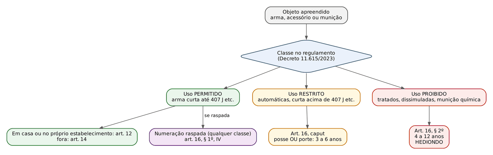
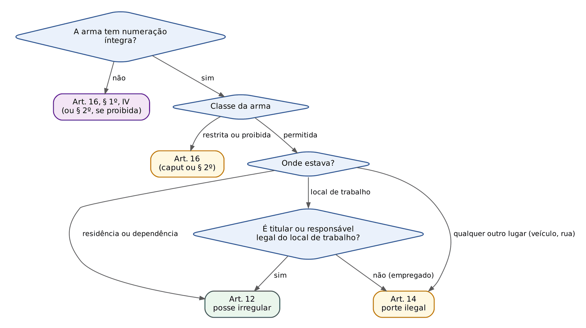
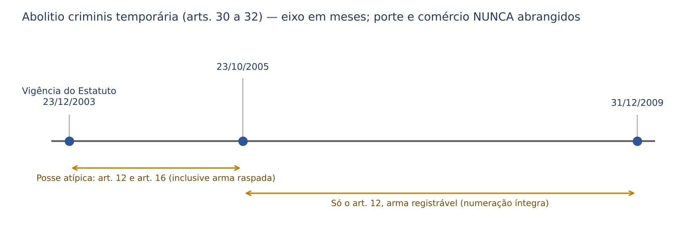
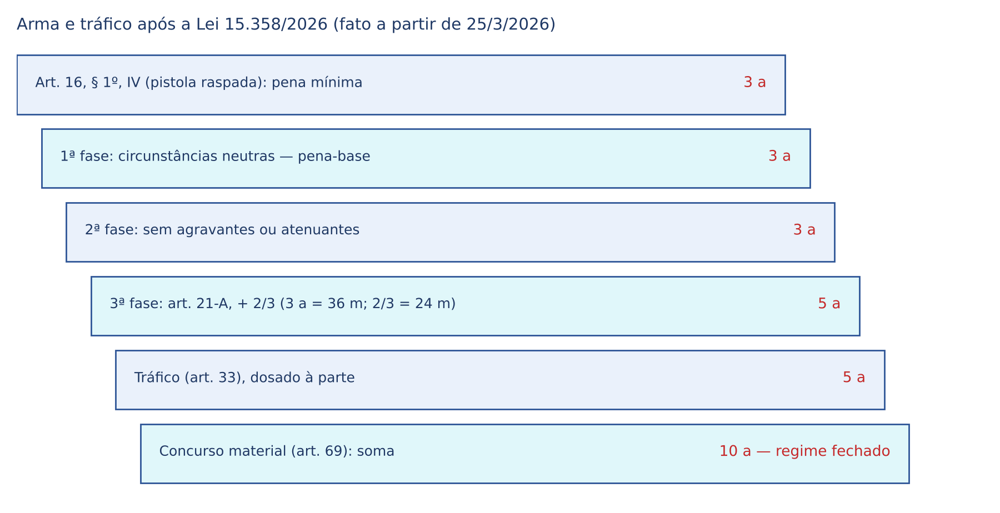

# CAPÍTULO 39 — ESTATUTO DO DESARMAMENTO (LEI 10.826/2003)

:::INCIDENCIA
TRF5 p. 10; TJRS p. 7; TJSC p. 53. Nível A. Lote: 7 questões (FGV 6, FCC 1), além de 6 correlatas em outros capítulos.
O que mais cai: posse x porte (local de trabalho, registro vencido, herdeiro), perigo abstrato (arma desmuniciada, munição isolada, arma inapta), numeração raspada e hediondez (Súmula 668 do STJ), concurso entre crimes de arma, tráfico internacional (internacionalidade da ação) e o novo art. 21-A (Lei 15.358/2026).
:::

## 39.1 Visão geral: o que a lei protege e como os tipos estão montados

O Estatuto do Desarmamento tem duas partes. A administrativa (arts. 1º a 11-A e 22 a 37) cria o Sistema Nacional de Armas (Sinarm, na Polícia Federal), disciplina o registro (que autoriza a POSSE, isto é, manter a arma em casa ou no próprio estabelecimento) e o porte (que autoriza CARREGAR a arma fora desses lugares), lista quem tem porte por força da função (art. 6º) e cuida da entrega e destruição de armas. A penal (arts. 12 a 21-A) pune quem foge desse controle.

Para quem vem do cível, a chave é esta: o Estado não pune o dano causado com a arma (isso é homicídio, lesão, roubo), e sim o simples fato de alguém ter ou trazer consigo uma arma FORA do controle estatal. Por isso o bem jurídico é coletivo — a segurança pública e a paz social, e não a integridade física de uma pessoa determinada (Jurisprudência em Teses do STJ, ed. 102, teses 1, 2 e 5). Daí decorrem quase todas as características cobradas:

| Característica | O que significa | Consequência prática |
|---|---|---|
| Crime de perigo abstrato | O perigo é presumido pela lei; não se prova que alguém correu risco | Arma desmuniciada e munição isolada configuram crime (39.3) |
| Crime de mera conduta | O tipo não descreve resultado naturalístico | Consuma-se com a conduta; laudo de eficácia não é indispensável |
| Tipo misto alternativo (ação múltipla) | Vários verbos ("portar, deter, adquirir, transportar...") | Praticar vários verbos no mesmo contexto = um só crime |
| Crime permanente (posse, guarda, depósito, ocultação) | A consumação se prolonga no tempo | Flagrante a qualquer momento (art. 303 do CPP); a lei nova mais grave alcança a permanência (Súmula 711 do STF — ver Cap. 3) |
| Norma penal em branco | "Uso permitido", "restrito" e "proibido" são definidos por decreto e ato do Exército | Mudança da classificação pode retroagir (39.2.2) |
| Crime comum (salvo o art. 13) | Qualquer pessoa pode praticar | Admite coautoria e participação, inclusive no "transportar" (STJ, REsp 1.887.992, Info 721) |

Que o perigo abstrato é constitucional, por legítima antecipação da tutela penal, é ponto já desenvolvido no Cap. 2 (STF, HC 104.410, porte de arma desmuniciada).

## 39.2 Objeto material e classificação das armas

### 39.2.1 Arma, acessório e munição; permitido, restrito e proibido

Os tipos falam em "arma de fogo, acessório ou munição": a munição sozinha basta, e o acessório (luneta, carregador, silenciador) também. Simulacro e arma de brinquedo NÃO são arma de fogo: portar simulacro não é crime do Estatuto (o art. 26 só proíbe fabricar, vender e importar, sem tipo penal correspondente), e usar simulacro num roubo gera grave ameaça, mas não a majorante da arma de fogo (Cap. 29). A arma branca também está fora do Estatuto; seu porte é, conforme o caso, a contravenção do art. 19 da LCP (Tema 857 do STF — ver Cap. 50; cobrado na Q4088261, FGV 2026, MPE-RJ, gabarito E).

Quem diz se a arma é de uso permitido, restrito ou proibido é o regulamento (art. 23 do Estatuto: ato do chefe do Poder Executivo federal, mediante proposta do Comando do Exército). Hoje vigora o Decreto 11.615/2023 (com alterações do Decreto 12.345/2024), complementado por portaria conjunta do Exército e da Polícia Federal com a lista de calibres. O critério principal é a energia do projétil na saída do cano:

| Classe | Regra geral do Decreto 11.615/2023 | Tipo penal |
|---|---|---|
| Uso permitido (art. 11) | Arma de porte (curta), de repetição ou semiautomática, com munição comum de até 407 joules (300 libras-pé); longa raiada de repetição até 1.620 joules; longa de alma lisa de repetição até calibre 12; longa raiada semiautomática até .22 LR | Art. 12 (posse) ou art. 14 (porte) |
| Uso restrito (art. 12) | Armas automáticas de qualquer calibre; curtas acima de 407 joules; longas raiadas acima de 1.620 joules; alma lisa acima do calibre 12 ou semiautomáticas; armas não portáteis | Art. 16, caput (posse OU porte, mesma pena) |
| Uso proibido (art. 14) | Armas e munições proibidas por tratados internacionais; armas dissimuladas, com aparência de objeto inofensivo (a "caneta-revólver"); munições incendiárias ou químicas | Art. 16, § 2º (4 a 12 anos, hediondo) |

:::DICA Na prova, o enunciado diz a classe
Questões objetivas quase sempre informam "arma de uso permitido" ou "de uso restrito". Não discuta o calibre contra o enunciado. Na sentença, a classe vem do laudo pericial, que deve indicar calibre e enquadramento normativo; sem laudo que permita classificar a arma como restrita, a dúvida resolve-se pelo tipo menos grave (art. 14).
:::

:::PEGADINHA "Uso proibido" não é sinônimo de "proibido ao cidadão comum"
O § 2º do art. 16 é reservado às armas que o regulamento classifica como de uso PROIBIDO (tratados, dissimuladas, munição química ou incendiária). Fuzil automático é de uso RESTRITO (art. 16, caput: 3 a 6 anos), e não proibido. O regulamento também menciona réplicas e simulacros entre os produtos proibidos, mas simulacro não é "arma de fogo" e não preenche o § 2º.
:::

### 39.2.2 Norma penal em branco e mudança de classificação

Como o complemento está num decreto, a alteração da classificação mexe no próprio tipo. Se um calibre passa de restrito a permitido, a conduta de quem o possuía deixa o art. 16 (3 a 6 anos) e vai para o art. 12 ou 14 (1 a 3 ou 2 a 4 anos): é norma mais benéfica e RETROAGE (art. 5º, XL, da CF; art. 2º, parágrafo único, do CP), inclusive após o trânsito em julgado, pelo juízo da execução (art. 66, I, da LEP; Súmula 611 do STF — ver Cap. 3). A razão é que o complemento não foi editado por situação excepcional ou temporária: houve mudança de valoração sobre a periculosidade do objeto, e não mera atualização técnica circunstancial (a distinção entre complemento que retroage e complemento ligado a situação temporária está no Cap. 3).

O ciclo recente ilustra: os Decretos de 2019 (9.785 e 9.847, com a Portaria 1.222/2019 do Exército) ampliaram o rol de calibres permitidos (9 mm, .40 e .45 em arma curta passaram a permitidos), o que levou à desclassificação de condenações do art. 16 para o art. 14; o Decreto 11.615/2023 voltou a classificar essas armas curtas, acima de 407 joules, como de uso restrito. A reclassificação gravosa de 2023 NÃO alcança fatos anteriores a ela.

:::EXEMPLO Sucessão de complementos
Fato 1: A foi preso em 2018 portando pistola 9 mm (então restrita). Condenado pelo art. 16 a 3 anos. Em 2019 a 9 mm passou a permitida: o juiz da execução desclassifica para o art. 14 e redimensiona a pena (pena mínima de 2 anos, mantidos os critérios da sentença).
Fato 2: B portava a mesma pistola em 2021 (permitida): art. 14. Mesmo julgado em 2024, após o Decreto 11.615/2023, continua no art. 14 (irretroatividade do complemento mais grave).
Fato 3: C portava a mesma pistola em 2025: art. 16, caput.
:::

## 39.3 Perigo abstrato: arma desmuniciada, munição isolada, arma inapta e insignificância

Este é o bloco que a FGV mais cobra. Quatro situações, com soluções diferentes:

| Situação | Solução | Fundamento |
|---|---|---|
| Arma desmuniciada, mas apta a disparar | CRIME | Perigo abstrato (STF, HC 95.073, Info 699; STJ, AgRg nos EAREsp 260.556) |
| Munição desacompanhada de arma | CRIME, em regra | Jurisprudência em Teses, ed. 108, tese 1; ed. 219, tese 8 |
| Pequena quantidade de munição, sem arma apta, fora do contexto de outro crime | Pode ser ATÍPICA (insignificância), conforme o caso concreto | Ed. 108, tese 2; ed. 219, tese 9; STF, RHC 143.449 (2017) |
| Arma comprovadamente inapta por laudo | ATÍPICA: crime impossível por ineficácia absoluta do meio (art. 17 do CP) | Ed. 108, tese 3 |

A lógica: a lei presume o perigo, mas a presunção pressupõe um objeto capaz de produzi-lo. A arma desmuniciada é perigosa (basta municiá-la); a arma quebrada de modo irreversível não é. Por isso o laudo, embora DISPENSÁVEL para condenar (o crime pode ser provado por testemunhas e pela apreensão — ed. 102, tese 2), é DECISIVO para absolver quando atesta a inaptidão absoluta. Laudo que aponta eficácia "parcial" ou "mínima" (dispara de forma intermitente) não afasta o crime.

A insignificância em munição é excepcional e exige os quatro vetores (Cap. 2), com três filtros práticos: quantidade ínfima (julgados com uma a poucas unidades), ausência de arma apta no mesmo contexto e ausência de outro crime. A Terceira Seção do STJ negou a insignificância a quem trazia uma única munição de uso restrito, porque também foi condenado por tráfico e associação para o tráfico (EREsp 1.856.980-SC, j. 22/9/2021, Info 710; ed. 219, tese 10); o STF decidiu no mesmo sentido (HC 206.977 AgR, 1ª Turma). Para armas, nunca se aplica (ed. 102, tese 11).

:::QUESTAO FGV 2026 — MPE-RJ — Promotor de Justiça Substituto (Q4088266)
Assertiva correta sobre os arts. 12, 14 e 16 segundo o STJ. Gabarito: B — são crimes de perigo abstrato, sendo despiciendo perquirir a potencialidade lesiva da arma apreendida. Armadilhas: exigir laudo de "eficiência total" (A) ou prova de perigo concreto (E); dizer que a numeração raspada equipara ao porte de uso permitido (C — equipara ao restrito, art. 16, § 1º, IV); insignificância "amplamente aplicável" à munição, "independentemente da quantidade" (D). Observe que a fórmula da alternativa B só convive com a tese da arma inapta porque esta exige laudo positivo de inaptidão: na falta dele, a potencialidade não precisa ser investigada.
:::

:::QUESTAO FGV 2025 — TJ-SC — Juiz Leigo (Q3592867)
Revólver .38 desmuniciado, apto a disparar, encontrado em busca domiciliar autorizada. Gabarito: C — posse irregular de arma de uso permitido (art. 12). Armadilhas: absolvição pela arma desmuniciada (A) ou por atipicidade material (B); "porte" (D), quando a arma estava dentro da residência; "uso restrito" (E), contra o dado do enunciado.
:::

:::SENTENCA Materialidade e laudo
Onde entra: na fundamentação da materialidade, logo após o auto de apreensão. O que fundamentar: apreensão, laudo (calibre, classe, numeração, aptidão) ou, na falta dele, a prova oral. Redação-modelo: "A materialidade está demonstrada pelo auto de exibição e apreensão e pelo laudo pericial, que atestou tratar-se de revólver calibre .38, de uso permitido, apto a efetuar disparos. O fato de a arma estar desmuniciada é irrelevante, pois o crime é de perigo abstrato." Erro que a banca pune: absolver pela ausência de munição ou condenar quando o laudo atesta inaptidão absoluta.
:::

## 39.4 Posse irregular (art. 12) x porte ilegal (art. 14)

:::LEI Lei 10.826/2003, arts. 12 e 14
Art. 12. Possuir ou manter sob sua guarda arma de fogo, acessório ou munição, de uso permitido, em desacordo com determinação legal ou regulamentar, no interior de sua residência ou dependência desta, ou, ainda no seu local de trabalho, desde que seja o titular ou o responsável legal do estabelecimento ou empresa: Pena – detenção, de 1 (um) a 3 (três) anos, e multa.
Art. 14. Portar, deter, adquirir, fornecer, receber, ter em depósito, transportar, ceder, ainda que gratuitamente, emprestar, remeter, empregar, manter sob guarda ou ocultar arma de fogo, acessório ou munição, de uso permitido, sem autorização e em desacordo com determinação legal ou regulamentar: Pena – reclusão, de 2 (dois) a 4 (quatro) anos, e multa. Parágrafo único. O crime previsto neste artigo é inafiançável, salvo quando a arma de fogo estiver registrada em nome do agente. (inconstitucional — ADI 3.112)
:::

### 39.4.1 O critério é o LUGAR, e não o verbo

Os dois tipos têm verbos parecidos ("manter sob guarda" aparece em ambos). O que os separa é o lugar: o art. 12 é um tipo restrito à residência (ou dependência dela) e ao local de trabalho de quem é TITULAR ou RESPONSÁVEL LEGAL pelo estabelecimento; em qualquer outro lugar, a conduta cai no art. 14. A razão de política criminal: a arma dentro de casa ameaça menos a coletividade do que a arma circulando. Por isso a posse é punida com detenção e tem pena menor.

Casos de fronteira:

- Empregado no local de trabalho: porte (art. 14). O frentista, o vigia sem vínculo com empresa de segurança e o gerente que não é responsável legal não estão no art. 12.
- Veículo: porte, inclusive o caminhão do motorista profissional, que é instrumento de trabalho e não "local de trabalho" nem extensão da residência (STJ, REsp 1.219.901-MG, Info 496).
- Imóvel rural: para o registro, toda a extensão do imóvel rural é considerada residência (art. 5º, § 5º, incluído pela Lei 13.870/2019); a arma levada pelo proprietário pelos campos da própria fazenda está no âmbito da posse.
- Pátio, garagem, quintal: dependências da residência (art. 12).
- Quem tem registro (posse legal) e sai de casa com a arma, sem porte: art. 14. O registro não autoriza o transporte.

### 39.4.2 Registro vencido, herdeiro e policial

O registro tem prazo de validade e precisa ser renovado. Três soluções, que a banca alterna:

| Situação | Solução | Fonte |
|---|---|---|
| Proprietário que registrou a arma e deixou o registro vencer, mantendo-a em casa | ATÍPICO; mera infração administrativa (apreensão e multa) | STJ, Corte Especial, APn 686-AP, j. 21/10/2015 (Info 572) |
| Mesmo registro vencido, mas a arma é PORTADA (art. 14) ou é de uso restrito (art. 16) | CRIME: a tese da APn 686 é restrita à posse de uso permitido | STJ, AgRg no AREsp 885.281-ES (Info 671) |
| Herdeiro que mantém em casa arma registrada em nome do falecido, com registro vencido e sem regularização sucessória | CRIME do art. 12 | STJ, 6ª Turma, REsp 2.201.660-RS, j. 19/5/2026 (Info 890) |
| Delegado com arma registrada apenas em órgão estadual, sem adequação ao Sinarm | CRIME | STJ, RHC 70.141-RJ (Info 597) |

Por que o herdeiro responde e o proprietário não? A atipicidade da APn 686 se apoia no fato de que o Estado já conhece a arma e o seu dono: o registro vencido não esconde nada. O herdeiro nunca passou pelo controle estatal (idoneidade, capacidade técnica, aptidão psicológica — art. 4º); a condição sucessória não substitui a autorização pessoal.

:::QUESTAO FGV 2026 — TJ-PE — Juiz Substituto (Q4349503)
Em maio de 2026, apreendida em casa de Valdecir arma de uso permitido registrada em nome do pai, falecido em 2025, com registro vencido desde 2024, sem transferência aos herdeiros. Gabarito: D — fato típico do art. 12, sem extensão da tese da mera irregularidade administrativa (REsp 2.201.660-RS). Armadilhas: estender a APn 686 ao herdeiro (A); afastar até a esfera administrativa (B); inventar um "crime autônomo de registro vencido" (C — não existe); condicionar o crime à partilha (E).
:::

### 39.4.3 Quem pode portar sem cometer crime

O art. 6º lista os portes funcionais (Forças Armadas, polícias, guardas municipais nas condições legais, agentes prisionais, entre outros), e leis orgânicas próprias garantem porte a magistrados (art. 33, V, da LOMAN) e membros do Ministério Público. Por isso conselheiro de Tribunal de Contas, equiparado a magistrado, que guarda arma de uso restrito não comete o art. 16 (STJ, Corte Especial, APn 657-PB, Info 572). O porte funcional não dispensa o registro da arma particular (RHC 70.141, acima) e não legitima condutas de outro tipo: quem tem porte legal e IMPORTA arma sem autorização comete o art. 18 (ed. 108, tese 10).

:::QUESTAO FGV 2024 — TJ-MT — Juiz Substituto (Q3086961)
Frentista leva ao trabalho revólver .38 registrado em seu nome, sem porte; vendo um assaltante (que portava simulacro) render um pedestre, saca a arma e atira para o alto, pondo-o em fuga. Gabarito: B — só porte ilegal (art. 14). Duas camadas: (1) não é posse porque o frentista não é titular nem responsável legal do posto; (2) o disparo (art. 15) está justificado pela legítima defesa de terceiro, pois havia agressão injusta atual ao pedestre — e o simulacro não muda isso, já que a grave ameaça com simulacro é agressão injusta. A excludente cobre o disparo, não o porte anterior, que já estava consumado. Armadilhas: "não cometeu crime" (A); posse (C, E); porte mais disparo (D).
:::

## 39.5 Omissão de cautela (art. 13)

O art. 13 pune quem deixa de observar as cautelas necessárias para impedir que pessoa com menos de 18 anos ou pessoa com deficiência mental se apodere de arma de fogo que esteja sob sua posse ou seja de sua propriedade (detenção de 1 a 2 anos e multa). Três adjetivos resolvem as questões:

- CULPOSO: é o único crime culposo do Estatuto; a culpa está no próprio verbo ("deixar de observar as cautelas"), na modalidade negligência. Não admite dolo eventual: se o pai entrega a arma ao filho, há dolo e o fato vai para o art. 16, § 1º, V (39.7).
- PRÓPRIO: só o possuidor ou o proprietário da arma.
- OMISSIVO PRÓPRIO: não admite tentativa. Prevalece na doutrina que o crime se consuma quando a criança, o adolescente ou a pessoa com deficiência efetivamente se apodera da arma; sem o apoderamento, não há crime.

O objeto é só ARMA DE FOGO (não munição nem acessório).

Parágrafo único: o proprietário ou diretor responsável de empresa de segurança e transporte de valores que deixa de registrar ocorrência policial E de comunicar à Polícia Federal a perda, furto, roubo ou extravio de arma, acessório ou munição sob sua guarda, nas primeiras 24 horas. Aqui a figura é omissiva e, para a maioria, dolosa; o prazo de 24 horas e o destinatário (Polícia Federal) são as pegadinhas literais.

Por ter pena máxima de 2 anos, o art. 13 é infração de menor potencial ofensivo (JECrim, transação penal).

## 39.6 Disparo de arma de fogo (art. 15)

:::LEI Lei 10.826/2003, art. 15
Disparar arma de fogo ou acionar munição em lugar habitado ou em suas adjacências, em via pública ou em direção a ela, desde que essa conduta não tenha como finalidade a prática de outro crime: Pena – reclusão, de 2 (dois) a 4 (quatro) anos, e multa. Parágrafo único. O crime previsto neste artigo é inafiançável. (inconstitucional — ADI 3.112)
:::

Elementos: (i) disparar arma ou acionar munição (a munição pode ser deflagrada sem arma); (ii) em lugar habitado ou adjacências, ou em via pública ou em direção a ela — tiro em área rural deserta não preenche o tipo; (iii) dolo: não há disparo culposo (o tiro acidental de quem amarrava o sapato deixa só o porte, se ilegal); (iv) cláusula de subsidiariedade expressa: "desde que essa conduta não tenha como finalidade a prática de outro crime". É crime de perigo abstrato (ed. 102, tese 4): não importa se havia alguém na rua.

A cláusula de subsidiariedade significa que o disparo é absorvido quando é meio de outro crime, MESMO que esse outro crime tenha pena menor? A doutrina diverge; a solução de prova é guiada pela finalidade:

| Finalidade do disparo | Resposta |
|---|---|
| Matar (acertando ou não) | Homicídio consumado ou tentado; o disparo é absorvido |
| Lesionar, com lesão grave ou gravíssima | Lesão grave ou gravíssima |
| Lesionar, com resultado de lesão leve | Prevalece na doutrina o art. 15, por ser mais grave que a lesão leve (a subsidiariedade não pode levar à pena menor) — ponto controvertido |
| Assustar, comemorar, "tiro para o alto" | Art. 15 |
| Ameaçar pessoa determinada | Ameaça absorvida pelo disparo, ou concurso, conforme o caso; prevalece o art. 15 |

Relação com o porte ou a posse da mesma arma:

- Porte adquirido no mesmo contexto e só para disparar (nexo de dependência): só o art. 15 (consunção — STJ, AgRg no AREsp 1.211.409).
- Porte preexistente, com desígnio autônomo, ou posse em casa e depois disparo na rua: concurso material (ed. 102, tese 10; STJ, AgRg no HC 544.206-MG). Se o porte é de arma restrita ou raspada (3 a 6 anos), não faz sentido o disparo (2 a 4) absorvê-lo: parte da doutrina (Gonçalves e Baltazar Junior) inverte a absorção ou mantém o concurso.
- Quem tem porte legal e dispara em via pública: só o art. 15.

O art. 15 tem pena mínima de 2 anos: NÃO cabe suspensão condicional do processo; cabe ANPP (pena mínima inferior a 4 anos e ausência de violência contra a pessoa), se presentes os demais requisitos (Cap. 25).

:::QUESTAO FGV 2024 — Câmara dos Deputados — Consultor Legislativo (Q2513047)
Três itens. Gabarito: D — só o II está correto. I: disparo em lugar habitado ou via pública é CRIME (art. 15), e não contravenção (o art. 28 da LCP, quanto à arma de fogo, foi substituído pelo Estatuto). II: recarregar ou reciclar munição sem autorização legal é figura equiparada do art. 16, § 1º, VI (3 a 6 anos). III: vender ou entregar arma a policial disfarçado em operação de importação NÃO isenta de pena; é crime (art. 18, parágrafo único).
:::

## 39.7 Posse ou porte de uso restrito e figuras equiparadas (art. 16)

:::LEI Lei 10.826/2003, art. 16 (redação da Lei 13.964/2019)
Possuir, deter, portar, adquirir, fornecer, receber, ter em depósito, transportar, ceder, ainda que gratuitamente, emprestar, remeter, empregar, manter sob sua guarda ou ocultar arma de fogo, acessório ou munição de uso restrito, sem autorização e em desacordo com determinação legal ou regulamentar: Pena – reclusão, de 3 (três) a 6 (seis) anos, e multa.
§ 1º Nas mesmas penas incorre quem: I – suprimir ou alterar marca, numeração ou qualquer sinal de identificação de arma de fogo ou artefato; II – modificar as características de arma de fogo, de forma a torná-la equivalente a arma de fogo de uso proibido ou restrito ou para fins de dificultar ou de qualquer modo induzir a erro autoridade policial, perito ou juiz; III – possuir, detiver, fabricar ou empregar artefato explosivo ou incendiário, sem autorização ou em desacordo com determinação legal ou regulamentar; IV – portar, possuir, adquirir, transportar ou fornecer arma de fogo com numeração, marca ou qualquer outro sinal de identificação raspado, suprimido ou adulterado; V – vender, entregar ou fornecer, ainda que gratuitamente, arma de fogo, acessório, munição ou explosivo a criança ou adolescente; e VI – produzir, recarregar ou reciclar, sem autorização legal, ou adulterar, de qualquer forma, munição ou explosivo.
§ 2º Se as condutas descritas no caput e no § 1º deste artigo envolverem arma de fogo de uso proibido, a pena é de reclusão, de 4 (quatro) a 12 (doze) anos.
:::

### 39.7.1 Diferenças estruturais em relação aos arts. 12 e 14

- No uso restrito NÃO há distinção entre posse e porte: o mesmo tipo (e a mesma pena de 3 a 6 anos) vale para a arma guardada em casa e para a arma levada na cintura. Na sentença, a capitulação é "posse ou porte ilegal de arma de fogo de uso restrito", indicando o verbo efetivamente praticado.
- O § 2º não é tipo autônomo: é uma qualificadora (pena-base própria, de 4 a 12 anos) que incide sobre o caput e TODOS os incisos do § 1º quando o objeto é de uso proibido. Arma de uso proibido com numeração raspada vai para o § 2º.

### 39.7.2 As figuras equiparadas do § 1º

| Inciso | Conduta | Pontos cobrados |
|---|---|---|
| I | Suprimir ou alterar a identificação | Pune quem raspa; vale para arma de qualquer classe ("arma de fogo ou artefato") |
| II | Modificar a arma para equipará-la a restrita/proibida ou para enganar autoridade, perito ou juiz | Ex.: transformar pistola semiautomática em automática; trocar o cano para frustrar o confronto balístico |
| III | Artefato explosivo ou incendiário | Granada de gás lacrimogêneo ou de pimenta não é artefato explosivo: fato atípico (STJ, REsp 1.627.028-SP, Info 599); granada de uso exclusivo das Forças Armadas para roubar banco: art. 16, sem motivação política que leve à antiga Lei de Segurança Nacional (STF, RC 1.472, Info 827) |
| IV | Portar, possuir, adquirir, transportar ou fornecer arma com identificação raspada | Pune quem tem a arma raspada, mesmo sem ter raspado; vale para arma de uso PERMITIDO (ed. 108, tese 4) |
| V | Vender, entregar ou fornecer arma, acessório, munição ou explosivo a criança ou adolescente | Para arma de fogo prevalece este inciso (especial e posterior) sobre o art. 242 do ECA, que continua a reger os demais objetos (arma branca, por exemplo — ver Cap. 42) |
| VI | Produzir, recarregar, reciclar ou adulterar munição ou explosivo | Recarga caseira de munição sem autorização legal |

A razão de a numeração raspada ser punida como restrita é a mesma do inciso I: a arma sem identificação está fora de qualquer rastreamento, e isso a torna instrumento típico do crime organizado. O art. 16 protege, além da segurança pública, a confiabilidade dos cadastros do Sinarm — argumento que o STJ usa para afastar o crime único quando há armas permitidas e restritas juntas (39.10).

A equiparação vale SÓ dentro do Estatuto: a arma de uso permitido com numeração raspada NÃO qualifica o homicídio (art. 121, § 2º, VIII, do CP), porque estender a equiparação ao CP seria analogia *in malam partem* (STJ, AgRg no REsp 2.104.061-MG — ver Cap. 3 e Cap. 27).

### 39.7.3 Hediondez do art. 16: só o uso proibido

:::LEI Lei 8.072/1990, art. 1º, parágrafo único (incisos relativos a armas)
Consideram-se também hediondos, tentados ou consumados: [...] II - o crime de posse ou porte ilegal de arma de fogo de uso proibido, previsto no art. 16 da Lei nº 10.826, de 22 de dezembro de 2003; III - o crime de comércio ilegal de armas de fogo, previsto no art. 17 da Lei nº 10.826, de 22 de dezembro de 2003; IV - o crime de tráfico internacional de arma de fogo, acessório ou munição, previsto no art. 18 da Lei nº 10.826, de 22 de dezembro de 2003.
:::

| Período | O que era hediondo no art. 16 |
|---|---|
| Até 26/10/2017 | Nada |
| Lei 13.497/2017 (vigente em 27/10/2017) até 22/1/2020 | Só o CAPUT (posse ou porte de uso restrito); as figuras do parágrafo único (hoje § 1º), inclusive a arma permitida raspada, NÃO eram hediondas (STJ, HC 525.249-RS, Info 684) |
| Desde a Lei 13.964/2019 (vigente em 23/1/2020) | Só o § 2º (uso PROIBIDO); o uso restrito deixou de ser hediondo — *novatio legis in mellius*, que retroage para as execuções em curso |

Daí a Súmula 668 do STJ (18/4/2024): "Não é hediondo o delito de porte ou posse de arma de fogo de uso permitido, ainda que com numeração, marca ou qualquer outro sinal de identificação raspado, suprimido ou adulterado."

Em contrapartida, os arts. 17 e 18 são hediondos qualquer que seja a classe da arma (incisos III e IV). A Lei 15.358/2026 incluiu o inciso VIII no mesmo parágrafo único (crimes de domínio social estruturado — Cap. 46), sem mexer nos incisos de armas. Os reflexos da hediondez (vedação de anistia, graça, indulto e fiança — art. 2º da Lei 8.072; frações de progressão do art. 112 da LEP, alteradas pela Lei 15.402/2026; livramento condicional) estão nos Caps. 40 e 24.

:::QUESTAO FCC 2026 — DPE-BA — Defensor Público (Q4037433)
Porte de pistola .380 (permitida) com numeração raspada e de 15 munições de calibre .38 (permitidas), incompatíveis com a pistola. Gabarito: E — art. 16, § 1º, IV, e art. 14, em concurso FORMAL, não hediondo. Por quê: (1) a arma raspada vai para o art. 16, § 1º, IV, mas não é hedionda (Súmula 668); (2) as munições, de outro calibre, configuram crime próprio do art. 14 — não há consunção, porque não são o "conteúdo" daquela arma; (3) a ação é uma só (portar ao mesmo tempo), por isso concurso formal, como o STJ decide para objetos de tipos penais diferentes apreendidos juntos. Armadilhas: atipicidade pela incompatibilidade (A — munição isolada é crime); crime único no art. 14 (B); consunção e hediondez (C); continuidade delitiva (D). A conta está no EXEMPLO de 39.13.
:::

No mesmo tema de hediondez, FGV: Q3752760 (MPE-ES 2025, Cap. 40 — gabarito A: a posse de arma de uso proibido É hedionda; não o é a organização criminosa voltada a crimes tributários), Q3171984 (2025, Cap. 40 — gabarito C: só a posse de arma de uso proibido era hedionda no rol) e Q3883101 (AL-RO 2026, Cap. 40 — gabarito B: porte de uso proibido é hediondo e insuscetível de anistia, graça, indulto e fiança).

## 39.8 Comércio ilegal (art. 17) e tráfico internacional (art. 18)

### 39.8.1 Comércio ilegal

O art. 17 pune 14 verbos (adquirir, alugar, receber, transportar, conduzir, ocultar, ter em depósito, desmontar, montar, remontar, adulterar, vender, expor à venda ou de qualquer forma utilizar), desde que praticados "em proveito próprio ou alheio, NO EXERCÍCIO DE ATIVIDADE COMERCIAL OU INDUSTRIAL", com arma, acessório ou munição, sem autorização (reclusão de 6 a 12 anos, desde a Lei 13.964/2019; antes, 4 a 8). Pontos-chave:

- É crime próprio de quem exerce atividade comercial ou industrial, mas o § 1º equipara a ela "qualquer forma de prestação de serviços, fabricação ou comércio irregular ou clandestino, inclusive o exercido em residência". O "armeiro de fundo de quintal" responde pelo art. 17.
- Habitualidade: parte da doutrina (Nucci) exige a reiteração inerente ao "exercício" de comércio; quem vende uma arma isolada, fora de qualquer atividade, responde pelo art. 14 ou 16 (verbos "fornecer", "ceder"). A tendência é aferir no caso se havia atividade comercial, ainda que informal.
- Tipo misto alternativo e de perigo abstrato (ed. 108, tese 5).
- Nunca foi abrangido pela *abolitio criminis* temporária (ed. 108, tese 6).
- § 2º (Lei 13.964/2019): incorre na mesma pena quem vende ou entrega arma, acessório ou munição a AGENTE POLICIAL DISFARÇADO, "quando presentes elementos probatórios razoáveis de conduta criminal preexistente". É a mesma técnica do art. 33, § 1º, IV, da Lei de Drogas, que afasta o flagrante preparado da Súmula 145 do STF (Cap. 8): o crime não é a venda ao policial em si (que seria impossível), mas a atividade criminosa já existente que a venda revela.
- Hediondo (art. 1º, parágrafo único, III, da Lei 8.072).

### 39.8.2 Tráfico internacional

:::LEI Lei 10.826/2003, art. 18 (redação da Lei 13.964/2019)
Importar, exportar, favorecer a entrada ou saída do território nacional, a qualquer título, de arma de fogo, acessório ou munição, sem autorização da autoridade competente: Pena - reclusão, de 8 (oito) a 16 (dezesseis) anos, e multa. Parágrafo único. Incorre na mesma pena quem vende ou entrega arma de fogo, acessório ou munição, em operação de importação, sem autorização da autoridade competente, a agente policial disfarçado, quando presentes elementos probatórios razoáveis de conduta criminal preexistente.
:::

- Especialidade: importar arma ou munição sem autorização é art. 18, e nunca contrabando (art. 334-A do CP), qualquer que seja a quantidade (ed. 102, tese 12) — inclusive uma única munição (ed. 108, tese 8: perigo abstrato, irrelevante estar desacompanhada da arma).
- Internacionalidade da AÇÃO: a origem estrangeira da arma não basta; é preciso provar que o agente importou, exportou ou favoreceu a entrada ou saída (ed. 108, tese 9). E a prova da transposição da fronteira deve ser segura: confissão extrajudicial informal não basta (STJ, AgRg no AREsp 2.512.800-SP, Info 857).
- Porte legal não exclui o crime: quem tem porte e importa sem autorização responde pelo art. 18 (ed. 108, tese 10).
- Competência da Justiça Federal (art. 109, V, da CF: crime previsto em tratado — a Convenção Interamericana contra a Fabricação e o Tráfico Ilícitos de Armas de Fogo e o Protocolo de armas da Convenção de Palermo — com execução iniciada no País e resultado no estrangeiro, ou vice-versa; ed. 108, tese 7).
- Hediondo (art. 1º, parágrafo único, IV, da Lei 8.072).

:::QUESTAO FGV 2026 — TJ-GO — Juiz Substituto (Q3966675)
Elmo transportava, numa rodovia estadual de Goiás, arma de uso restrito de fabricação norte-americana, escondida no painel. Gabarito: B — posse ou porte ilegal de uso restrito (art. 16), sem majorante. A fabricação estrangeira não prova a importação nem o favorecimento da entrada; sem internacionalidade da ação, não há art. 18 e a competência é estadual. Armadilhas: art. 18 (A, C, E) e "causa de aumento" (D — o art. 19 só se aplica aos arts. 17 e 18; o art. 20 exige agente das instituições dos arts. 6º a 8º ou reincidente específico).
:::

:::PROCESSO Competência nos crimes de arma
Regra: Justiça Estadual, inclusive para arma de uso restrito das Forças Armadas, porque a segurança pública não é interesse específico da União. Federal: art. 18 (tratado e transnacionalidade); conexão com crime federal (Súmula 122 do STJ). Na dúvida sobre a internacionalidade da ação, competência estadual (Q3966675).
:::

## 39.9 Causas de aumento: arts. 19, 20 e 21-A

:::ESQUEMA As três majorantes do Estatuto
| Dispositivo | Fração | Crimes alcançados | Hipótese |
|---|---|---|---|
| Art. 19 | Metade | Só arts. 17 e 18 | Arma, acessório ou munição de uso proibido ou restrito |
| Art. 20, I | Metade | Arts. 14, 15, 16, 17 e 18 | Crime praticado por integrante dos órgãos e empresas dos arts. 6º, 7º e 8º (policiais, guardas, agentes prisionais, empresas de segurança, entidades de tiro etc.) |
| Art. 20, II | Metade | Arts. 14, 15, 16, 17 e 18 | Agente reincidente específico "em crimes dessa natureza" |
| Art. 21-A (Lei 15.358/2026) | 2/3 | Só arts. 12, 14 e 16 | Crime em concurso com crime da Lei 11.343/2006; diretamente ligado ao comércio ilícito de entorpecentes; ou artefato usado para assegurar o sucesso da mercancia |
:::

Três observações de prova: (a) o art. 12 só é majorado pelo art. 21-A; (b) os arts. 13 e 15 ficam fora do art. 21-A, e o art. 13 fica fora de todos; (c) os arts. 17 e 18 não recebem o art. 21-A.

Art. 20, II, e agravante da reincidência: se a MESMA condenação anterior é usada para a majorante (reincidência específica em crime de arma), ela não pode ser usada de novo como agravante (art. 61, I, do CP), sob pena de *bis in idem*; havendo duas condenações anteriores aptas, uma pode fundamentar a agravante e a outra a majorante, raciocínio análogo ao da Súmula 241 do STJ (Cap. 14).

### 39.9.1 O art. 21-A e a nova relação entre arma e tráfico

:::LEI Lei 10.826/2003, art. 21-A (incluído pela Lei 15.358/2026)
Nos crimes previstos nos arts. 12, 14 e 16 desta Lei, a pena é aumentada de 2/3 (dois terços) se o crime for praticado em concurso com crime previsto na Lei nº 11.343, de 23 de agosto de 2006, estiver diretamente ligado ao comércio ilícito de entorpecentes ou o artefato tiver sido utilizado para assegurar o sucesso da mercancia.
:::

O lado da Lei de Drogas (Tema 1.259 do STJ, art. 40, IV, e o novo art. 40-A, com concurso material obrigatório para integrante de organização ultraviolenta, grupo paramilitar ou milícia) está em 37.6.4. Aqui interessa o lado do Estatuto:

- Linha do tempo. Fatos até 24/3/2026: Tema 1.259 — com nexo finalístico entre a arma e o tráfico, a arma é absorvida e incide o art. 40, IV; sem nexo, concurso material sem aumento sobre a arma. Fatos a partir de 25/3/2026 (Lei 15.358/2026, publicada e vigente nessa data): o crime de arma subsiste, em concurso material com o tráfico, e é majorado de 2/3. A nova disciplina é mais grave e não retroage.
- As três hipóteses são alternativas. A primeira ("praticado em concurso com crime previsto na Lei 11.343") é a mais ampla: lida literalmente, alcança até a arma sem nexo com a mercancia, desde que haja concurso com crime de drogas. A segunda e a terceira exigem vínculo com o comércio ilícito.
- *Bis in idem*: a leitura adotada nesta apostila (a mesma de 37.6.4) é que, aplicado o art. 21-A, a MESMA arma não fundamenta também o art. 40, IV, da Lei de Drogas; o inciso IV permanece para violência, grave ameaça e intimidação difusa.
- Dosagem: o 21-A é causa de aumento de terceira fase, com fração FIXA (2/3), sem margem de modulação. Concorrendo com o art. 20, aplica-se o art. 68, parágrafo único, do CP (Cap. 15).

:::QUESTAO FGV 2026 — TJ-PE — Juiz Substituto (Q4349504, Cap. 46)
Integrante de milícia preso em junho de 2026, guardando cocaína em ponto de venda e portando arma de uso restrito usada para assegurar a mercancia. Gabarito: C — concurso material entre tráfico e porte, com causa de aumento sobre o crime de arma. Armadilhas: absorção com art. 40, IV (A — regra do Tema 1.259, superada para fatos posteriores a 25/3/2026); concurso material sem aumento (B); concurso formal (D, E). Em sentido contrário quanto ao resultado, mas pela data e pela ausência de nexo, Q4289357 (DPE-RJ 2026, Cap. 37 — gabarito B: concurso material sem majorante do art. 40, IV, pela mera presença da arma); para fatos posteriores à Lei 15.358/2026, a primeira hipótese do art. 21-A, lida literalmente, faria incidir o aumento também ali.
:::

## 39.10 Concurso de crimes e conflito aparente

Duas perguntas resolvem quase tudo: (1) os objetos apreendidos cabem no MESMO tipo penal? (2) a arma foi obtida ou portada SÓ para o outro crime, no mesmo contexto?

| Situação | Solução | Fundamento |
|---|---|---|
| Várias armas, acessórios ou munições do MESMO tipo penal, no mesmo contexto | Crime único (a quantidade pode pesar na pena-base, como circunstância do crime) | Jurisprudência em Teses, ed. 23, tese 5 |
| Objetos de tipos DIFERENTES (ex.: art. 14 e art. 16), no mesmo contexto | Concurso formal (art. 70 do CP): bens jurídicos e tipos distintos; o art. 16 protege também a seriedade dos cadastros | STJ, AgRg no REsp 1.619.960-MG; AgRg nos EDcl no AREsp 1.122.758-MG; Q4037433 |
| Arma e munição compatíveis, mesmo tipo | Crime único | Mesmo raciocínio da ed. 23, tese 5 |
| Porte e disparo | Consunção se o porte foi só meio para o disparo, no mesmo contexto; concurso material se havia porte prévio ou desígnios autônomos | 39.6; ed. 102, tese 10 |
| Porte e roubo ou homicídio com a mesma arma | Absorção do porte quando a arma foi obtida para aquele crime e nele se esgotou; concurso material quando o porte é anterior ou posterior e autônomo (ex.: preso dias depois com a arma) | Cap. 29 (roubo); Cap. 3 (consunção) |
| Receptação da arma e porte | Concurso material: crimes autônomos, de natureza distinta | Ed. 87, tese 15 |
| Arma e tráfico | Até 24/3/2026, Tema 1.259; a partir de 25/3/2026, concurso material com art. 21-A | 39.9.1 e 37.6.4 |
| Uso de arma de uso restrito no homicídio | Qualificadora do art. 121, § 2º, VIII; o porte autônomo segue a regra da consunção | Cap. 27 |

:::PEGADINHA Crime único x concurso formal
"Apreensão de duas pistolas de uso permitido e cem munições de uso permitido: concurso formal" — ERRADO, é crime único (tudo no art. 14). "Revólver de uso permitido e fuzil de uso restrito na mesma casa: crime único pelo mais grave" — ERRADO segundo a orientação atual do STJ, que aplica o concurso formal. Houve precedentes antigos pelo crime único; a banca segue o concurso formal (Q4037433).
:::

## 39.11 *Abolitio criminis* temporária e entrega espontânea (arts. 30 a 32)

Quando o Estatuto entrou em vigor (23/12/2003), milhões de armas estavam sem registro. A lei deu prazo para que os possuidores as registrassem ou entregassem. Enquanto o prazo corria, punir a POSSE seria contraditório: o Estado convidava o cidadão a regularizar a arma que estava em casa. Por isso os tribunais chamaram o período de *abolitio criminis* temporária (ou *vacatio legis* indireta): a posse irregular ficou atípica durante a janela. O prazo foi prorrogado por medidas provisórias e leis sucessivas (o Cap. 2 trata da questão das medidas provisórias benéficas em matéria penal).

| Período | Condutas atípicas |
|---|---|
| 23/12/2003 a 23/10/2005 | Posse do art. 12 e posse do art. 16, inclusive arma de uso permitido com numeração raspada |
| 24/10/2005 a 31/12/2009 (prazo reaberto pela MP 417/2008, convertida na Lei 11.706/2008, até 31/12/2008, e prorrogado pela Lei 11.922/2009) | SÓ a posse do art. 12, de arma que pudesse ser registrada (numeração íntegra) |
| Nunca | Porte (arts. 14 e 16) e comércio (art. 17) |

Daí:

- Súmula 513 do STJ: a *abolitio* temporária alcança a posse de arma de uso permitido com numeração raspada praticada SOMENTE até 23/10/2005 (arma raspada não pode ser registrada; não faz sentido o prazo para registrar).
- Tema 596 do STJ (REsp 1.311.408-RN): é típica a posse de arma de uso permitido raspada praticada após 23/10/2005.
- A regra alcança também posses praticadas sob a Lei 9.437/1997, por retroatividade benéfica (ed. 102, tese 8).
- O porte nunca foi abrangido: por isso a distinção posse x porte decide o caso (o caminhoneiro do REsp 1.219.901 não se beneficiou).

Hoje a *abolitio* temporária tem interesse sobretudo para questões literais (Súmula 513). O que segue relevante para fatos atuais é o art. 32 (redação da Lei 11.706/2008): o possuidor ou proprietário que ENTREGA espontaneamente a arma à Polícia Federal, mediante recibo, presume-se de boa-fé, é indenizado e tem extinta a punibilidade de eventual posse irregular. É causa permanente de extinção da punibilidade, restrita à POSSE: não beneficia quem é surpreendido com a arma (a entrega deixa de ser espontânea) nem o porte.

:::DICA Três datas e três exclusões
Datas: 23/12/2003 (início), 23/10/2005 (fim para o art. 16 e para a arma raspada — Súmula 513) e 31/12/2009 (fim para o art. 12). Exclusões: porte, comércio (art. 17) e arma raspada após 23/10/2005.
:::

## 39.12 Liberdade provisória, fiança e benefícios

O Estatuto nasceu com vedações severas: os parágrafos únicos dos arts. 14 e 15 declaravam esses crimes inafiançáveis, e o art. 21 negava liberdade provisória aos arts. 16, 17 e 18. O STF, na ADI 3.112 (j. 2/5/2007), declarou inconstitucionais os três dispositivos: a inafiançabilidade de crimes que não estão no rol constitucional (art. 5º, XLII a XLIV) é desproporcional, e a vedação abstrata de liberdade provisória ofende a presunção de inocência e o devido processo legal (a prisão cautelar exige exame concreto). Os textos continuam impressos na lei: a banca cobra a literalidade como se vigorassem.

Consequências práticas: nos arts. 12, 13, 14 e 15 (pena máxima não superior a 4 anos), a própria autoridade policial pode arbitrar fiança (art. 322 do CPP). Nos crimes hediondos do Estatuto (art. 16, § 2º, 17 e 18) não cabe FIANÇA (art. 5º, XLIII, da CF; art. 2º, II, da Lei 8.072), mas cabe liberdade provisória SEM fiança, se ausentes os requisitos da preventiva.

### 39.12.1 Ficha dos crimes

| Crime | Pena | Elemento subjetivo | Consumação e tentativa | Ação e competência | Benefícios cabíveis (sem majorantes) | Hediondo |
|---|---|---|---|---|---|---|
| Art. 12 — posse irregular, uso permitido | Detenção, 1 a 3 anos, e multa | Dolo | Mera conduta; permanente; tentativa de difícil configuração | Pública incondicionada; estadual | Suspensão condicional do processo; ANPP; substituição; fiança pelo delegado | Não |
| Art. 13 — omissão de cautela | Detenção, 1 a 2 anos, e multa | Culpa (caput) | Omissivo próprio; sem tentativa | Idem; JECrim | Transação; suspensão do processo | Não |
| Art. 14 — porte ilegal, uso permitido | Reclusão, 2 a 4 anos, e multa | Dolo | Mera conduta; verbos permanentes e instantâneos | Idem | ANPP; substituição; fiança pelo delegado | Não |
| Art. 15 — disparo | Reclusão, 2 a 4 anos, e multa | Dolo | Mera conduta; subsidiário | Idem | ANPP; substituição | Não |
| Art. 16, caput e § 1º — uso restrito e equiparados | Reclusão, 3 a 6 anos, e multa | Dolo | Mera conduta; permanente | Idem | ANPP; substituição se a pena não passar de 4 anos | Não (Súmula 668; Lei 13.964) |
| Art. 16, § 2º — uso proibido | Reclusão, 4 a 12 anos, e multa | Dolo | Idem | Idem | Nenhum benefício despenalizador | Sim |
| Art. 17 — comércio ilegal | Reclusão, 6 a 12 anos, e multa | Dolo, no exercício de atividade comercial ou industrial | Mera conduta; tipo misto alternativo | Idem | Nenhum | Sim |
| Art. 18 — tráfico internacional | Reclusão, 8 a 16 anos, e multa | Dolo | Mera conduta; consuma-se com a entrada ou saída | Pública incondicionada; FEDERAL | Nenhum | Sim |

:::ATENCAO Majorantes contam para o ANPP e para a suspensão do processo
A pena mínima que define o ANPP (inferior a 4 anos) e a suspensão condicional do processo (igual ou inferior a 1 ano) é calculada com as causas de aumento e de diminuição (art. 28-A, § 1º, do CPP; Súmula 723 do STF e Súmula 243 do STJ — ver Cap. 25). Assim: art. 14 com art. 21-A (2 anos + 2/3 = 3 anos e 4 meses) ainda admite ANPP em tese; art. 16 com art. 21-A (3 anos + 2/3 = 5 anos) ou com art. 20 (3 anos + 1/2 = 4 anos e 6 meses) NÃO admite. E o art. 12 majorado pelo art. 21-A (1 ano + 2/3 = 1 ano e 8 meses) perde a suspensão condicional do processo.
:::

## 39.13 Dosimetria e sentença

Os crimes do Estatuto seguem o sistema trifásico comum (Caps. 13 a 15). Peculiaridades: na primeira fase, a quantidade e o poder de fogo do material apreendido (arsenal, munição em grande quantidade, arma de grosso calibre dentro do mesmo tipo) podem justificar a valoração negativa das circunstâncias ou das consequências, desde que não seja a própria elementar (a classe "restrita" já está no art. 16 e não pode pesar de novo). Na terceira fase, as majorantes dos arts. 19, 20 e 21-A têm frações FIXAS (metade, metade, 2/3).

:::EXEMPLO 1 — Porte de uso permitido por reincidente específico (art. 14 c/c art. 20, II)
Situação A: Bruno tem UMA condenação anterior transitada em julgado por porte ilegal (art. 14), cumprida há 2 anos, e é novamente preso portando revólver .38 sem porte. Circunstâncias judiciais neutras.
1ª fase: pena-base no mínimo — 2 anos.
2ª fase: a única condenação anterior será usada na majorante específica do art. 20, II (especialidade); não pode ser usada também como agravante (*bis in idem*). Pena intermediária: 2 anos.
3ª fase: art. 20, II, aumento de metade: 2 anos = 24 meses; 1/2 = 12 meses. Pena definitiva: 3 anos de reclusão.
Situação B: Bruno tem DUAS condenações anteriores aptas, ambas por crimes do Estatuto. Uma fundamenta a agravante: 2 anos + 1/6 (4 meses) = 2 anos e 4 meses. A outra fundamenta a majorante: 2 anos e 4 meses = 28 meses; 1/2 = 14 meses; total 3 anos e 6 meses.
Regime: reincidente com pena de até 4 anos — semiaberto, se favoráveis as circunstâncias judiciais (Súmula 269 do STJ — Cap. 17). Substituição: vedada, porque a reincidência se operou "em virtude da prática do mesmo crime" (art. 44, § 3º, do CP).
:::

:::EXEMPLO 2 — Arma raspada ligada ao tráfico, antes e depois da Lei 15.358/2026
Carla, primária, guarda em casa 300 g de cocaína para venda e uma pistola .380 (permitida) com numeração raspada, usada para proteger o ponto. Circunstâncias neutras; sem atenuantes ou agravantes; não se discute tráfico privilegiado.
Fato em 10/4/2026 (lei nova):
- Arma: art. 16, § 1º, IV — pena-base 3 anos; 3ª fase: art. 21-A, + 2/3 (36 meses x 2/3 = 24 meses) = 5 anos.
- Tráfico: art. 33 — 5 anos (sem o art. 40, IV, pela mesma arma; ver 39.9.1).
- Concurso material (art. 69): 5 + 5 = 10 anos. Regime inicial fechado (pena superior a 8 anos — art. 33, § 2º, "a", do CP).
Fato em 10/2/2026 (Tema 1.259, nexo finalístico provado):
- Arma absorvida; tráfico 5 anos + art. 40, IV, na fração mínima de 1/6 (10 meses) = 5 anos e 10 meses. Regime semiaberto, em tese (Cap. 17).
A diferença (10 anos x 5 anos e 10 meses) mostra por que a irretroatividade da lei mais grave importa: a mesma conduta, anterior a 25/3/2026, não pode receber o tratamento novo.
:::

:::EXEMPLO 3 — Comércio ilegal por policial, com arma de uso restrito (art. 17 c/c arts. 19 e 20, I)
Pena-base: 6 anos (mínimo). Duas majorantes de metade: art. 19 (uso restrito) e art. 20, I (integrante de órgão do art. 6º).
Variante A — art. 68, parágrafo único, do CP (as duas majorantes estão na parte especial; o juiz PODE limitar-se a um só aumento, o que mais aumente): 6 anos + 1/2 (3 anos) = 9 anos.
Variante B — aplicação de ambas, com fundamentação concreta (Súmula 443 do STJ, por analogia — Cap. 15), em incidência sucessiva: 6 anos + 1/2 = 9 anos; 9 anos + 1/2 (4 anos e 6 meses) = 13 anos e 6 meses.
Erro comum: somar as frações (1/2 + 1/2 = 1, dobro = 12 anos) sem dizer o critério. Prefira a variante A, salvo fundamento concreto para cumular.
:::

:::EXEMPLO 4 — Concurso formal entre arma raspada e munição de outro calibre (Q4037433)
Art. 16, § 1º, IV (pistola raspada): pena 3 anos. Art. 14 (munições .38): pena 2 anos. Uma só ação (portar tudo ao mesmo tempo), sem desígnios autônomos: concurso formal próprio (art. 70, primeira parte). Aplica-se a pena mais grave aumentada de 1/6 (dois crimes — Cap. 16): 3 anos + 6 meses = 3 anos e 6 meses. Conferência do cúmulo material benéfico (art. 70, parágrafo único): a soma seria 5 anos; 3 anos e 6 meses é menor, logo prevalece a exasperação. Regime aberto para primário; substituição cabível (pena não superior a 4 anos, crime sem violência ou grave ameaça); não hediondo (Súmula 668).
:::

:::SENTENCA Crimes de arma: o que não pode faltar
- Capitulação precisa: o verbo, a classe da arma e o inciso ("art. 16, § 1º, IV, da Lei 10.826/2003"); se houver objetos de tipos diferentes, o art. 70 do CP.
- Materialidade: auto de apreensão e laudo (classe, numeração, aptidão); enfrente a tese de arma desmuniciada ou de munição isolada (39.3).
- Lugar do fato: dentro da residência ou do estabelecimento próprio (art. 12) ou fora (art. 14) — é a desclassificação mais pedida pela defesa (*emendatio libelli*, art. 383 do CPP, quando os fatos estão descritos na denúncia).
- Majorantes: indique a hipótese do art. 20 ou do 21-A e, no 21-A, a data do fato (a partir de 25/3/2026).
- Destinação da arma: perdimento como instrumento cujo porte constitui fato ilícito (art. 91, II, "a", do CP) e encaminhamento ao Comando do Exército, após o laudo, quando não mais interessar ao processo, no prazo de até 48 horas (art. 25 do Estatuto). Redação-modelo: "Decreto a perda da arma e das munições apreendidas (art. 91, II, "a", do CP), que deverão ser encaminhadas ao Comando do Exército para destruição ou doação, nos termos do art. 25 da Lei 10.826/2003."
- Erro que a banca pune: reconhecer hediondez no uso permitido raspado ou no uso restrito; somar penas de armas apreendidas juntas no mesmo tipo.
:::

:::PROCESSO Flagrante e busca domiciliar
Posse e guarda são crimes permanentes: o estado de flagrância perdura (art. 303 do CPP), o que autoriza a prisão a qualquer tempo. O ingresso em domicílio sem mandado, porém, exige fundadas razões, devidamente justificadas *a posteriori*, de que ali ocorre crime (STF, RE 603.616, Tema 280); a apreensão posterior da arma não convalida a entrada ilegal. A prova ilícita contamina a materialidade e leva à absolvição.
:::

## 39.14 Resumo para revisão pré-prova

| Instituto | Regra | Exceções e detalhes | Fundamento |
|---|---|---|---|
| Natureza dos crimes | Perigo abstrato e mera conduta; bem jurídico: segurança pública | Arma inapta por laudo: atípico (crime impossível) | Ed. 102 e 108 |
| Classificação | Permitido, restrito ou proibido, pelo Decreto 11.615/2023 (curta até 407 J = permitida) | Reclassificação benéfica retroage; gravosa não | Art. 23; art. 5º, XL, da CF |
| Arma desmuniciada | Crime | — | STF, HC 95.073 |
| Munição isolada | Crime | Insignificância só em quantidade ínfima, sem arma apta e sem outro crime | Ed. 219, teses 8 a 10; EREsp 1.856.980 |
| Posse (art. 12) | Residência, dependência ou local de trabalho de quem é titular ou responsável legal; detenção 1 a 3 | Empregado no trabalho, veículo e caminhão: porte | REsp 1.219.901 |
| Registro vencido | Atípico para o proprietário que registrou (posse) | Crime no porte, no art. 16 e para o herdeiro | APn 686; AgRg no AREsp 885.281; REsp 2.201.660 |
| Porte (art. 14) | Fora da residência ou do estabelecimento; reclusão 2 a 4 | Inafiançabilidade do parágrafo único: inconstitucional | ADI 3.112 |
| Omissão de cautela (art. 13) | Único culposo; próprio; omissivo próprio; sem tentativa | Parágrafo único: empresa de segurança, 24 horas, Polícia Federal | Art. 13 |
| Disparo (art. 15) | Lugar habitado ou via pública; doloso; subsidiário | Absorvido se meio de crime mais grave; porte só para disparar é absorvido | Ed. 102, teses 4 e 10 |
| Uso restrito (art. 16) | Posse ou porte, 3 a 6 anos | § 2º, uso proibido: 4 a 12, hediondo | Lei 13.964/2019 |
| Numeração raspada | Art. 16, § 1º, IV, mesmo arma permitida | Não é hedionda; não qualifica o homicídio | Súmula 668; ed. 108, tese 4 |
| Comércio ilegal (art. 17) | 6 a 12; atividade comercial ou industrial, inclusive clandestina em residência | Agente disfarçado (§ 2º); nunca teve *abolitio* | Ed. 108, teses 5 e 6 |
| Tráfico internacional (art. 18) | 8 a 16; Justiça Federal | Exige internacionalidade da ação; especial em relação ao contrabando | Ed. 108, teses 7 a 10; ed. 102, tese 12 |
| Majorantes | Art. 19 (1/2: 17 e 18, restrita/proibida); art. 20 (1/2: 14 a 18, agente público ou reincidente específico); art. 21-A (2/3: 12, 14 e 16, tráfico) | 21-A só para fatos a partir de 25/3/2026 | Lei 15.358/2026 |
| Concurso | Mesmo tipo, mesmo contexto: crime único; tipos diferentes: concurso formal | Receptação e porte: concurso material | Ed. 23, tese 5; ed. 87, tese 15 |
| *Abolitio* temporária | Posse atípica de 23/12/2003 a 23/10/2005 (arts. 12 e 16) e até 31/12/2009 (art. 12, arma registrável) | Nunca o porte nem o comércio; raspada só até 23/10/2005 | Súmula 513; Tema 596 |
| Entrega espontânea (art. 32) | Extingue a punibilidade da posse irregular, a qualquer tempo | Não alcança o porte | Art. 32 |
| Hediondez | Só art. 16, § 2º, art. 17 e art. 18 | Uso restrito deixou de ser hediondo (retroage) | Art. 1º, p. ú., II a IV, da Lei 8.072 |
| Liberdade provisória | Cabível em todos | Vedação do art. 21: inconstitucional | ADI 3.112 |

## 39.15 Artigos de lei incidentes

- Lei 10.826/2003: arts. 4º, 5º (§ 5º), 6º, 12 a 21-A, 23, 25, 26, 30 a 32.
- Lei 15.358/2026: art. 37 (inclui o art. 21-A no Estatuto); inclusão do inciso VIII no art. 1º, parágrafo único, da Lei 8.072/1990.
- Lei 8.072/1990: art. 1º, parágrafo único, II, III e IV; art. 2º.
- Decreto 11.615/2023: arts. 11, 12 e 14 (com o Decreto 12.345/2024).
- Lei 11.343/2006: arts. 33, 40, IV, e 40-A (remissão).
- Código Penal: arts. 2º, parágrafo único, 17, 25, 44, § 3º, 61, I, 68, parágrafo único, 69, 70 e 91, II, "a".
- CPP: arts. 28-A, 303, 322 e 383.
- Constituição: art. 5º, XL e XLIII; art. 109, V.
- Lei 8.069/1990: art. 242 (remissão).

## 39.16 Julgados, temas e súmulas do capítulo

- Súmula 513 do STJ: *abolitio* temporária e arma raspada só até 23/10/2005.
- Súmula 668 do STJ: uso permitido com numeração raspada não é hediondo.
- Tema 596 do STJ (REsp 1.311.408): posse de arma raspada após 23/10/2005 é típica.
- STF, ADI 3.112: inconstitucionais a inafiançabilidade dos arts. 14 e 15 e a vedação de liberdade provisória do art. 21.
- STF, HC 95.073: porte de arma desmuniciada é crime.
- STF, RHC 143.449: insignificância excepcional em munição isolada.
- STJ, EREsp 1.856.980-SC: sem insignificância para munição apreendida no contexto de tráfico.
- STJ, APn 686-AP: registro vencido na posse é irregularidade administrativa.
- STJ, AgRg no AREsp 885.281-ES: registro vencido não beneficia o porte nem o art. 16.
- STJ, REsp 2.201.660-RS (Info 890): herdeiro com arma do falecido, registro vencido, responde pelo art. 12.
- STJ, RHC 70.141-RJ: policial com registro só estadual comete crime.
- STJ, APn 657-PB: conselheiro de Tribunal de Contas tem porte por equiparação à magistratura.
- STJ, REsp 1.219.901-MG: caminhão não é local de trabalho; porte.
- STJ, REsp 1.627.028-SP: granada de gás lacrimogêneo não é artefato explosivo.
- STF, RC 1.472: granada para roubo a banco é art. 16, não crime político.
- STJ, HC 525.249-RS: figuras do parágrafo único do art. 16 não eram hediondas sob a Lei 13.497/2017.
- STJ, AgRg no REsp 1.619.960-MG: armas permitida e restrita no mesmo contexto, concurso formal.
- STJ, AgRg no AREsp 2.512.800-SP (Info 857): tráfico internacional exige prova segura da transposição da fronteira.
- STJ, REsp 1.887.992-PR (Info 721): porte na modalidade transportar admite participação.
- Jurisprudência em Teses do STJ: ed. 102 (teses 1 a 5, 7, 8, 10 a 12), ed. 108 (teses 1 a 10), ed. 219 (teses 8 a 10), ed. 23 (tese 5), ed. 87 (tese 15).

Remissões a outros capítulos: HC 104.410 do STF e constitucionalidade do perigo abstrato (Cap. 2); AgRg no REsp 2.104.061 (arma raspada e homicídio), Súmulas 611 e 711 do STF e retroatividade do complemento (Cap. 3); Súmula 145 do STF e agente disfarçado (Cap. 8); Súmula 241 do STJ (Cap. 14); Súmula 443 do STJ e art. 68, parágrafo único (Cap. 15); Súmula 269 do STJ (Cap. 17); Súmula 723 do STF, Súmula 243 do STJ e ANPP (Cap. 25); arma no roubo e Jurisprudência em Teses ed. 51 (Cap. 29); Tema 1.259 do STJ e art. 40-A da Lei de Drogas (Cap. 37); hediondez e progressão (Caps. 40 e 24); Lei 15.358/2026 e domínio social estruturado (Cap. 46); Tema 857 do STF, porte de arma branca (Cap. 50).

:::NOTA Notas de verificação
Texto legal: conferidos no Planalto em 15/10/2026 os boxes LEI dos arts. 12, 14, 15, 16, 18 e 21-A da Lei 10.826/2003 (texto compilado; o art. 21-A foi incluído pela Lei 15.358/2026) e do art. 1º, parágrafo único, II a IV, da Lei 8.072/1990 — todos conferem literalmente; demais arts. 13 a 21, 23 e 25 a 32 conferidos na lei seca do Drive (atualizada em 20/7/2026); as Leis 14.967/2024 e 15.306/2025 alteraram só dispositivos administrativos do Estatuto (não os crimes); os arts. 11, 12 e 14 do Decreto 11.615/2023 (com o Decreto 12.345/2024), por resumo do LegJur, sem transcrição literal. Não localizei decreto de 2025 ou 2026 que altere esses artigos do regulamento — conferir.
Questões: lidas as 7 do lote, todas com gabarito oficial do banco atualizado (Q3966675 B; Q4349503 D; Q3086961 B; Q3592867 C; Q4088266 B; Q4037433 E; Q2513047 D), coincidentes com as resoluções fundamentadas; e as correlatas Q4349504, Q4289357, Q3752760, Q3171984, Q3883101 e Q4088261.
Fontes do Drive: lei seca anotada 10.826 (inclusive doutrina e julgados nela citados), Mapeamento FGV (índice) e Sinopse de Jurisprudência TJSC 2026 (trechos sobre armas). Não lidos: Capez (2019), Legislação 360, CP Coordenado e caderno do Dizer o Direito.
Pontos com segurança menor: data de julgamento da ADI 3.112 (2/5/2007) e do RC 1.472, citadas de memória; HC 206.977 AgR (STF) e AgRg nos EDcl no AREsp 1.122.758, extraídos da lei seca anotada; vigência da Lei 13.497/2017 em 27/10/2017 (DOU, vigente na publicação) conferida no Planalto em 15/10/2026; a prorrogação até 31/12/2009 segue a ed. 102, tese 7, do STJ (a lei seca anotada fala em 31/12/2008, que é o prazo da Lei 11.706/2008, depois prorrogado pela Lei 11.922/2009). A lei seca anotada menciona precedente do STF (RE 768.494) negando a aplicação retroativa da reabertura do prazo de 2008 a posses anteriores; não conferido e não usado no texto. A classificação do calibre .38 SPL após o Decreto 11.615/2023 gerou controvérsia administrativa (notícia de 2023 sobre negativa de registro pela Polícia Federal); o texto não afirma a classe de calibres específicos além do critério de energia.
Interpretações adotadas e não pacificadas: (1) alcance da primeira hipótese do art. 21-A (concurso com crime da Lei de Drogas, mesmo sem nexo) e vedação de cumular o art. 21-A com o art. 40, IV, pela mesma arma — coerente com 37.6.4 e com a Q4349504; acompanhar a jurisprudência; (2) vedação de usar a mesma condenação anterior na agravante e no art. 20, II (raciocínio por analogia à Súmula 241, sem precedente específico conferido); (3) prevalência do art. 16, § 1º, V, sobre o art. 242 do ECA para arma de fogo; (4) disparo com lesão leve resolvido pelo art. 15 (controvertido); (5) consumação do art. 13 com o apoderamento (doutrina majoritária, não conferida em obra específica).
Gabarito discutível: nenhum. Observação: a Q4289357 (Cap. 37) tem fatos sem data; se posteriores a 25/3/2026, a primeira hipótese do art. 21-A poderia incidir sobre o crime de arma.
:::
