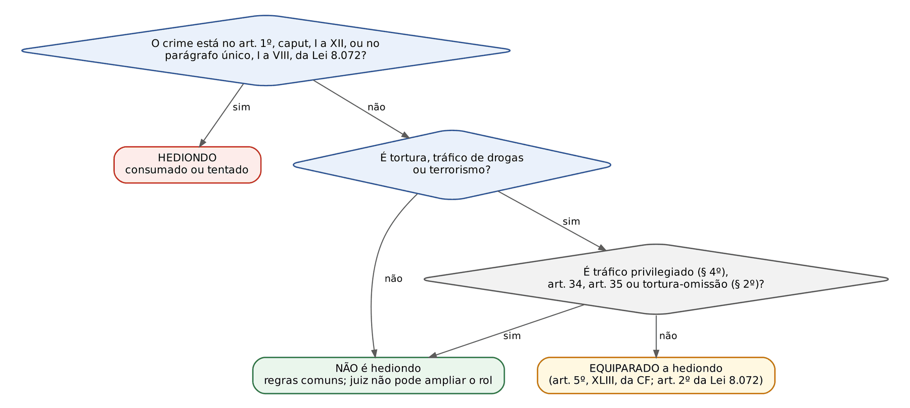
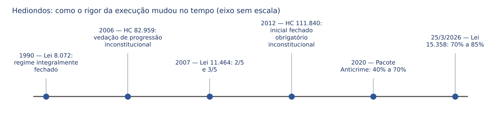
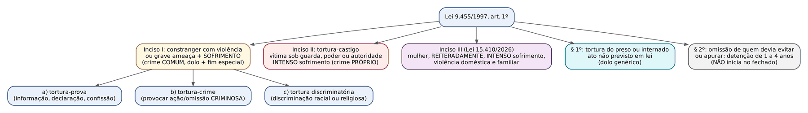
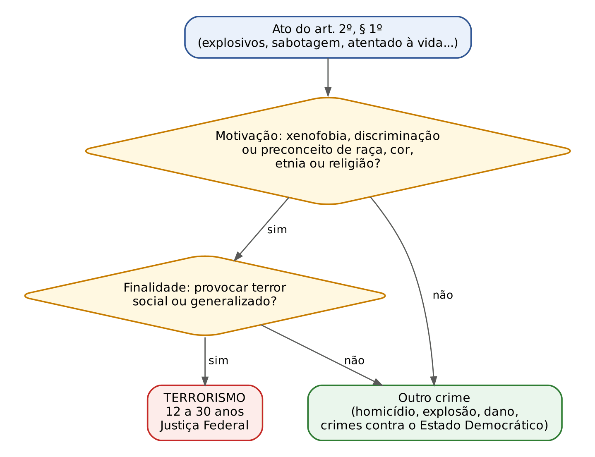

# CAPÍTULO 40 — CRIMES HEDIONDOS E EQUIPARADOS, TORTURA, TERRORISMO E GENOCÍDIO

:::INCIDENCIA
Pontos: TRF5 p. 10; TJRS p. 6 e 7; TJSC p. 54 e 55. Nível A. Lote: 18 questões (FGV 17, FCC 1).
O que mais cai, de longe: "qual destes crimes é hediondo?" (rol do art. 1º da Lei 8.072/1990 com as alterações de 2024 a 2026), seguido das consequências (fiança, prisão temporária de 30 dias, indulto) e da tortura-omissão.
:::

| Subtema | FGV | FCC | Padrão |
|---|---|---|---|
| Identificar crime hediondo no rol | 10 | 1 | três a cinco crimes parecidos; a diferença está num detalhe (gravíssima x grave, arma de fogo x arma branca, vítima com menos de 18 anos, orcrim "direcionada a") |
| Consequências da hediondez | 4 | 0 | fiança, prisão temporária (prazo), apelação em liberdade, vedação de anistia, graça e indulto |
| Equiparados: tráfico | 2 | 0 | art. 34 e tráfico privilegiado NÃO são hediondos |
| Tortura | 1 | 0 | omissão do superior que presencia (art. 1º, § 2º) |

## 40.1 Visão geral: por que existe um regime "hediondo"

A Constituição de 1988, no art. 5º, XLIII, deu uma ordem ao legislador: alguns crimes deveriam receber tratamento mais severo. É um MANDADO CONSTITUCIONAL DE CRIMINALIZAÇÃO, isto é, uma norma que obriga o legislador a punir (e a punir com rigor), ao contrário da maioria das normas constitucionais penais, que limitam o poder de punir.

:::LEI Constituição Federal, art. 5º, XLIII
a lei considerará crimes inafiançáveis e insuscetíveis de graça ou anistia a prática da tortura, o tráfico ilícito de entorpecentes e drogas afins, o terrorismo e os definidos como crimes hediondos, por eles respondendo os mandantes, os executores e os que, podendo evitá-los, se omitirem;
:::

Leia o dispositivo com atenção, porque ele separa duas categorias:

- Crimes HEDIONDOS em sentido estrito: a Constituição não os lista; delega à lei ("os definidos como crimes hediondos"). Quem define é a Lei 8.072/1990, no art. 1º.
- Crimes EQUIPARADOS (ou assemelhados) a hediondos: tortura, tráfico de drogas e terrorismo, os "3T". Já estão nomeados na própria Constituição. Não constam do art. 1º da Lei 8.072, mas recebem o mesmo regime por força do art. 2º dela (que os menciona expressamente) e do texto constitucional.

Consequência de prova: dizer que "a tortura é crime hediondo" é tecnicamente errado (é equiparado); dizer que "a tortura recebe o tratamento dos crimes hediondos" é certo.

Como identificar se um crime é hediondo? A doutrina descreve três sistemas possíveis: (1) LEGAL, em que a lei enumera os crimes, num rol fechado; (2) JUDICIAL, em que o juiz, diante da gravidade concreta, qualifica o fato como hediondo; (3) MISTO, em que a lei dá um conceito e o juiz o aplica. O Brasil adotou o sistema LEGAL (ou taxativo). Duas consequências decorrem disso:

- O juiz NÃO pode declarar hediondo um crime que não está no rol, por mais brutal que seja (analogia *in malam partem* é vedada). Um homicídio simples cruelmente executado, fora de atividade de grupo de extermínio, não é hediondo; a crueldade, aí, é qualificadora, e então o crime já seria qualificado.
- O juiz também NÃO pode retirar a hediondez de um crime que está no rol, por achar que o caso concreto é de pouca gravidade. Não existe "cláusula salvatória".

A leitura doutrinária dominante, já cobrada pela FGV (TJ-RJ, 2026), vê a lei como exemplo de direito penal simbólico e de emergência, ampliada por episódios de comoção social; o STF derrubou os excessos que feriam a individualização da pena (40.4).

## 40.2 O rol dos crimes hediondos (art. 1º da Lei 8.072/1990)

### 40.2.1 Regra de leitura: consumados ou tentados

O caput do art. 1º e o parágrafo único dizem que os crimes são hediondos "consumados ou tentados". A tentativa reduz a pena (art. 14, parágrafo único, do CP), mas NÃO retira a hediondez. O roubo com emprego de arma de fogo tentado é hediondo; a tentativa de estupro é hedionda. Essa é a primeira pegadinha da lei (Q2513050, item I, falso).

### 40.2.2 O rol completo e atualizado

A tabela abaixo é o centro do capítulo. Conferida com a lei seca do Drive atualizada em 19/7/2026 (inclui as Leis 15.159/2025, 15.358/2026 e 15.384/2026). Leia a coluna "o que NÃO entra": é dali que saem as alternativas erradas.

| Inciso | Crime hediondo | O que NÃO entra (pegadinha) | Lei que incluiu ou alterou |
|---|---|---|---|
| I | Homicídio simples em atividade típica de grupo de extermínio, ainda que por um só agente; homicídio qualificado (art. 121, § 2º) | homicídio simples comum; homicídio privilegiado; qualificado-privilegiado (Cap. 27) | 8.930/1994; 15.159/2025 |
| I-A | Lesão corporal GRAVÍSSIMA (art. 129, § 2º) e lesão SEGUIDA DE MORTE (art. 129, § 3º), quando praticadas: a) contra autoridade ou agente dos arts. 142 e 144 da CF, integrante do sistema prisional ou da Força Nacional, no exercício da função ou em decorrência dela, ou contra cônjuge, companheiro ou parente CONSANGUÍNEO até o 3º grau, em razão dessa condição; b) contra membro do Judiciário, do MP, da Defensoria ou da Advocacia Pública, ou oficial de justiça, idem, ou contra cônjuge, companheiro ou parente, INCLUSIVE POR AFINIDADE, até o 3º grau; c) nas dependências de instituição de ensino | lesão LEVE e lesão GRAVE (§ 1º), mesmo contra policial ou na escola; parente de 4º grau (primo); parlamentar | 13.142/2015; 15.159/2025 |
| I-B | Feminicídio (art. 121-A) | — | 14.994/2024 |
| I-C | Vicaricídio (art. 121-B) | fatos anteriores a 10/4/2026 (eram homicídio qualificado, já hediondo) | 15.384/2026 |
| II | Roubo: a) com restrição de liberdade da vítima (art. 157, § 2º, V); b) com emprego de arma de fogo (§ 2º-A, I) ou de arma de fogo de uso proibido ou restrito (§ 2º-B); c) qualificado pelo resultado lesão grave ou morte (§ 3º) | roubo simples; com concurso de pessoas; com arma BRANCA; de veículo levado ao exterior; de carga ou valores em transporte; de fios e cabos de energia | 13.964/2019 |
| III | Extorsão qualificada pela restrição da liberdade, ocorrência de lesão corporal ou morte (art. 158, § 3º) | extorsão simples ou majorada (§ 1º) | 13.964/2019 |
| IV | Extorsão mediante sequestro, simples e qualificada (art. 159, caput e §§ 1º a 3º) | — (todas as formas) | 8.930/1994 |
| V | Estupro (art. 213, caput e §§ 1º e 2º) | outros crimes sexuais (importunação, violação sexual mediante fraude, assédio) | 12.015/2009 |
| VI | Estupro de vulnerável (art. 217-A, caput e §§ 1º a 4º) | corrupção de menores do art. 218 | 12.015/2009 |
| VII | Epidemia com resultado morte (art. 267, § 1º) | epidemia simples | 8.930/1994 |
| VII-B | Falsificação, corrupção, adulteração ou alteração de produto destinado a fins terapêuticos ou medicinais (art. 273, caput e §§ 1º, 1º-A e 1º-B) | — | 9.695/1998 |
| VIII | Favorecimento da prostituição ou de outra forma de exploração sexual de criança, adolescente ou vulnerável (art. 218-B, caput e §§ 1º e 2º) | favorecimento da prostituição de adulto (art. 228), ainda que parente da vítima | 12.978/2014 |
| IX | Furto qualificado pelo emprego de explosivo ou artefato análogo que cause perigo comum (art. 155, § 4º-A) | todas as demais qualificadoras do furto | 13.964/2019 |
| X | Induzimento, instigação ou auxílio a suicídio ou automutilação pela rede de computadores, rede social ou transmitidos em tempo real (art. 122, caput e § 4º) | art. 122 praticado fora do ambiente digital | 14.811/2024 |
| XI | Sequestro e cárcere privado contra vítima com menos de 18 anos (art. 148, § 1º, IV) | sequestro simples; vítima de 18 anos ou mais | 14.811/2024 |
| XII | Tráfico de pessoas contra criança ou adolescente (art. 149-A, caput, I a V, e § 1º, II) | tráfico de pessoas contra adulto | 14.811/2024 |
| Par. ún., I | Genocídio (arts. 1º, 2º e 3º da Lei 2.889/1956) | — | 13.964/2019 |
| Par. ún., II | Posse ou porte ilegal de arma de fogo de uso PROIBIDO (art. 16 da Lei 10.826/2003) | uso RESTRITO; uso permitido com numeração raspada (Súmula 668 do STJ) | 13.497/2017; 13.964/2019 |
| Par. ún., III | Comércio ilegal de arma de fogo (art. 17 da Lei 10.826) | — | 13.964/2019 |
| Par. ún., IV | Tráfico internacional de arma de fogo, acessório ou munição (art. 18 da Lei 10.826) | — | 13.964/2019 |
| Par. ún., V | Organização criminosa, quando DIRECIONADA à prática de crime hediondo ou equiparado | orcrim voltada a estelionato, crimes tributários, corrupção | 13.964/2019 |
| Par. ún., VI | Crimes do Código Penal Militar que tenham identidade com os do art. 1º | — | 14.688/2023 |
| Par. ún., VII | Crimes do art. 240, § 1º, e do art. 241-B do ECA | demais crimes do ECA | 14.811/2024 |
| Par. ún., VIII | Domínio social estruturado e favorecimento ao domínio social estruturado (art. 2º, caput e §§ 1º e 3º, e art. 3º da Lei 15.358/2026) | — | 15.358/2026 (Cap. 46) |

:::DICA Como resolver a questão "qual é hediondo" em 30 segundos
Faça três perguntas, nesta ordem. (1) O crime-base está no rol? (lesão, roubo, extorsão, furto, sequestro, art. 122, armas, orcrim). (2) Se está, a FORMA específica é a do rol? (gravíssima, e não grave; arma de fogo, e não arma branca; restrição de liberdade, e não concurso de pessoas; explosivo, e não rompimento de obstáculo; vítima com menos de 18 anos). (3) Para lesão do inciso I-A e orcrim, há o elemento de ligação? (vítima qualificada ou escola; direcionamento a crime hediondo). Uma resposta "não" em qualquer etapa e o crime NÃO é hediondo.
:::

### 40.2.3 Homicídio: o "homicídio condicionado"

O homicídio simples só é hediondo em atividade típica de grupo de extermínio, mesmo por um só agente ("homicídio condicionado"). A lei não define o grupo; a doutrina o entende como reunião de pessoas que matam vítimas escolhidas por pertencerem a uma categoria ("justiçamento"). Na prática, esse homicídio costuma ser também qualificado (motivo torpe) e já seria hediondo; a atuação do grupo é ainda majorante (art. 121, § 6º — Cap. 27).

Todo homicídio qualificado é hediondo, inclusive o funcional (§ 2º, VII) e as qualificadoras incluídas em 2024 e 2025. Ficam de fora o privilegiado e o qualificado-privilegiado (Cap. 27, 27.4.4). A hediondez do novo § 2º-D (homicídio por integrante de organização criminosa ultraviolenta, Lei 15.358/2026) é controvertida, porque o rol fala em "art. 121, § 2º" e o § 2º-D é parágrafo autônomo; ver Cap. 27.

### 40.2.4 Lesão corporal do inciso I-A: o detalhe que mais derruba candidatos

Este é o inciso mais cobrado do lote (sete questões). A Lei 15.159/2025 reescreveu-o em três alíneas e acrescentou a escola. O que importa:

- Só a lesão GRAVÍSSIMA (art. 129, § 2º: incapacidade permanente para o trabalho, enfermidade incurável, perda ou inutilização de membro, sentido ou função, deformidade permanente, aborto) e a SEGUIDA DE MORTE (§ 3º). A lesão GRAVE do § 1º (incapacidade para as ocupações habituais por mais de 30 dias, perigo de vida, DEBILIDADE permanente, aceleração de parto) NÃO é hedionda, nem contra policial, nem na escola. Repare na armadilha: "debilidade permanente de membro" é lesão GRAVE (§ 1º, III); "perda ou inutilização de membro" é GRAVÍSSIMA (§ 2º, III).
- Parentes: consanguíneos até o 3º grau na alínea "a"; INCLUSIVE POR AFINIDADE (sogro, cunhado) na alínea "b"; primo é colateral de 4º grau, fora. A inclusão das guardas municipais (art. 144, § 8º, da CF) na alínea "a" é controvertida.
- Nexo funcional: "no exercício da função ou em decorrência dela"; para os familiares, "em razão dessa condição". Lesão gravíssima contra juiz por briga de trânsito, sem relação com a função, não é hedionda.
- Alínea "c": basta o local, "nas dependências de instituição de ensino", qualquer que seja a vítima.
- Direito intertemporal: as alíneas "b" e "c" valem para fatos a partir de 4/7/2025 (publicação da Lei 15.159/2025); a lei mais grave não retroage. É por isso que as questões de 2025 e 2026 informam a data do fato ("praticada em novembro de 2025").

:::QUESTAO FGV 2026 — MPE-GO — Promotor de Justiça Substituto (Q3865775)
Qual lesão (fato de novembro de 2025) é hedionda? Gabarito oficial: D — gravíssima nas dependências de instituição de ensino (I-A, "c"). Armadilhas: seguida de morte contra PRIMO de promotor (4º grau); gravíssima contra deputado estadual; lesão GRAVE contra juiz ou contra mulher em violência doméstica.
:::

:::QUESTAO FGV 2026 — PC-PI — Delegado de Polícia (Q3848983)
Lesão "qualificada" com debilidade permanente de membro contra policial em serviço; orcrim voltada a roubos com restrição da liberdade; comércio ilegal de arma. Gabarito oficial: D — hediondos só a orcrim e o comércio de arma; a debilidade permanente é lesão GRAVE (a palavra "qualificada" é isca). No mesmo sentido: Q3171984 (FGV 2025; gabarito C — só a posse de arma de uso proibido; lesão grave contra policial e roubo com arma branca não); Q3520640 (FGV 2025 — TJ-ES — Cartórios; gabarito B — comércio ilegal de arma e lesão GRAVÍSSIMA contra PM em serviço, não a corrupção ativa).
:::

:::QUESTAO FGV 2026 — PC-PI — Oficial Investigador (Q3846824)
Lesão GRAVE em escola (novembro de 2025), roubo com arma branca e extorsão com restrição da liberdade. Gabarito oficial: E — só a extorsão do art. 158, § 3º.
:::

### 40.2.5 Patrimoniais: roubo, extorsão, extorsão mediante sequestro e furto

O roubo é hediondo em apenas três situações (art. 1º, II): restrição da liberdade da vítima (§ 2º, V), emprego de arma de fogo, de qualquer espécie (§ 2º-A, I, e § 2º-B), e resultado lesão grave ou morte (§ 3º, inclusive o latrocínio). Todas as outras majorantes do § 2º (concurso de pessoas, transporte de valores, veículo levado a outro Estado ou ao exterior, arma branca do § 2º, VII, subtração de explosivos) deixam o roubo comum. O desenvolvimento dos tipos está no Cap. 29; as penas do roubo foram elevadas pela Lei 15.397/2026 (fatos a partir de 4/5/2026), mas isso não mexe na hediondez.

A extorsão é hedionda só na forma do § 3º do art. 158 (sequestro relâmpago e seus resultados lesão ou morte). A extorsão mediante sequestro (art. 159) é hedionda em TODAS as formas. O furto só é hediondo com explosivo ou artefato análogo que cause perigo comum (§ 4º-A).

:::QUESTAO FGV 2025 — TJ-CE — Juiz Substituto (Q3505801)
Extorsão mediante sequestro, roubo com restrição da liberdade e orcrim voltada a estelionatos. Gabarito oficial: A — hediondos os dois primeiros (IV e II, "a"); a orcrim não, porque estelionato não é hediondo (parágrafo único, V). No mesmo sentido: Q3878292 (FGV 2026 — TJ-RJ — Analista; gabarito D — roubo com restrição da liberdade; erradas transporte de valores, veículo levado ao exterior, fios de energia e arma branca).
:::

:::QUESTAO FGV 2025 — MPE-RJ — Analista do Ministério Público (Q3362532)
Condenado por crime hediondo: qual crime? Gabarito oficial: E — furto com explosivo (IX); erradas corrupção passiva majorada, lesão LEVE contra policial penal, roubo de veículo levado ao exterior e incêndio majorado. Inverso: Q3345952 (FGV 2025 — TJ-GO — Residente Jurídico; gabarito A — NÃO é hedionda a lesão LEVE contra integrante do sistema prisional).
:::

### 40.2.6 Crimes sexuais e contra crianças e adolescentes

Estupro e estupro de vulnerável são hediondos em todas as formas (simples, qualificadas e com resultado). O favorecimento da prostituição só é hediondo quando a vítima é criança, adolescente ou vulnerável (art. 218-B); se a vítima tem 18 anos ou mais e não é vulnerável, o crime é o do art. 228 (mesmo qualificado pelo parentesco do § 1º), que NÃO é hediondo.

A Lei 14.811/2024 incluiu os incisos X (art. 122 pela internet ou em tempo real), XI (sequestro e cárcere privado contra vítima com menos de 18 anos) e XII (tráfico de pessoas contra criança ou adolescente) e, no parágrafo único, VII, os crimes do ECA de agenciar ou intermediar a participação de criança ou adolescente em cena de sexo explícito ou pornográfica (art. 240, § 1º) e de adquirir, possuir ou armazenar esse material (art. 241-B).

:::QUESTAO FCC 2026 — DPE-BA — Defensor Público (Q4037437)
Roubo com arma de fogo TENTADO; cárcere privado contra vizinho de 20 anos; lesão GRAVE em escola; atrair à prostituição sobrinha de 18 anos. Gabarito oficial: D — só o roubo tentado (hediondo "consumado ou tentado"). A sobrinha adulta leva ao art. 228, § 1º, não ao art. 218-B.
:::

### 40.2.7 Parágrafo único: genocídio, armas, organização criminosa e outros

Armas de fogo (Cap. 39): são hediondos a posse ou porte de arma de uso PROIBIDO (art. 16, § 2º), o comércio ilegal (art. 17) e o tráfico internacional (art. 18). A Lei 13.497/2017 falava em uso "proibido ou restrito"; a Lei 13.964/2019 restringiu ao uso PROIBIDO, retroagindo em favor de quem respondia por arma de uso restrito. A arma de uso PERMITIDO com numeração raspada (art. 16, § 1º, IV) NÃO é hedionda (Súmula 668 do STJ — v. Cap. 39).

:::QUESTAO FGV 2026 — AL-RO — Analista Legislativo (Q3883101)
Condenação por roubo majorado pela subtração de fios de energia elétrica e por porte ilegal de arma de fogo de uso proibido, em concurso material. Gabarito oficial: B — o porte de arma de uso proibido é hediondo e insuscetível de anistia, graça, indulto e fiança (art. 2º); o roubo de fios não é hediondo. Armadilha da alternativa A: afirmar que o crime hediondo admite anistia, graça ou indulto.
:::

Organização criminosa (Lei 12.850/2013, art. 2º): por si só NÃO é hedionda; só o é quando direcionada à prática de crime hediondo ou equiparado (parágrafo único, V). Os novos crimes de domínio social estruturado da Lei 15.358/2026 entraram no rol (parágrafo único, VIII) e são tratados no Cap. 46. A associação criminosa (art. 288 do CP) e a milícia privada (art. 288-A) não são hediondas; a associação para fins de crimes hediondos tem apenas pena própria (art. 8º da Lei 8.072, 40.4.8).

:::QUESTAO FGV 2025 — MPE-ES — Promotor de Justiça Substituto (Q3752760)
Qual NÃO é hediondo (fatos de outubro de 2025)? Gabarito oficial: A — orcrim voltada a crimes tributários. São hediondos: sequestro de vítima com menos de 18 anos, lesão GRAVÍSSIMA contra membro do MP em razão da função, posse de arma de uso proibido e extorsão com restrição da liberdade. O enunciado cita a LEP, mas a resposta sai do art. 1º da Lei 8.072.
:::

## 40.3 Os equiparados: tráfico, tortura e terrorismo

Os três crimes equiparados recebem TODAS as consequências do art. 2º da Lei 8.072 e as frações próprias de progressão do art. 112 da LEP. Tortura e terrorismo têm leis próprias, desenvolvidas em 40.5 e 40.6. Sobre o tráfico de drogas (Cap. 37), basta fixar o que é e o que não é equiparado:

| Figura da Lei 11.343/2006 | Equiparada a hediondo? | Fundamento |
|---|---|---|
| Tráfico (art. 33, caput e § 1º) | SIM | art. 5º, XLIII, da CF; art. 2º da Lei 8.072 |
| Tráfico privilegiado (art. 33, § 4º) | NÃO | art. 112, § 5º, da LEP; Súmula Vinculante 63 (Cap. 37) |
| Maquinário (art. 34) | NÃO | não consta do rol; vedada analogia (Informativo 882 do STJ) |
| Associação para o tráfico (art. 35) | NÃO | jurisprudência consolidada do STJ (Cap. 37) |

:::JURIS STJ, HC 1.005.146-SP, j. 3/3/2026 (Informativo 882)
O crime de fabricação de maquinário destinado ao tráfico (art. 34 da Lei 11.343/2006) não possui natureza hedionda. A Constituição fala em "tráfico ilícito de entorpecentes", e a lei não estendeu a equiparação ao art. 34; ampliar o conceito para alcançar os atos que preparam o tráfico seria analogia em prejuízo do réu. Efeito prático: progressão pelas frações comuns do art. 112 da LEP.
:::

:::QUESTAO FGV 2026 — TJ-PE — Juiz Substituto (Q4349502)
Tribunal aplicou frações de hediondo ao condenado pelo art. 34. Gabarito oficial: A — ilegal: o art. 34 não é equiparado e não cabe analogia. Armadilhas: "integra o conceito de tráfico", "analogia se demonstrado no caso", "todos os crimes da Lei 11.343 são equiparados".
:::

:::QUESTAO FGV 2026 — MPE-RJ — Promotor de Justiça Substituto (Q4088260)
Gabarito oficial: D — o privilegiado não é hediondo, afastando-se os parâmetros mais rigorosos de progressão e de livramento (literalidade da SV 63 — Cap. 37). Erradas as alternativas que aplicam 40% ou 50%.
:::

## 40.4 Consequências de ser hediondo ou equiparado

### 40.4.1 Visão de conjunto

:::LEI Lei 8.072/1990, art. 2º
Art. 2º Os crimes hediondos, a prática da tortura, o tráfico ilícito de entorpecentes e drogas afins e o terrorismo são insuscetíveis de:
I - anistia, graça e indulto;
II - fiança.
§ 1º A pena por crime previsto neste artigo será cumprida inicialmente em regime fechado.
§ 2º (Revogado pela Lei nº 13.964, de 2019)
§ 3º Em caso de sentença condenatória, o juiz decidirá fundamentadamente se o réu poderá apelar em liberdade.
§ 4º A prisão temporária, sobre a qual dispõe a Lei no 7.960, de 21 de dezembro de 1989, nos crimes previstos neste artigo, terá o prazo de 30 (trinta) dias, prorrogável por igual período em caso de extrema e comprovada necessidade.
:::

O § 1º continua no texto, mas foi declarado inconstitucional pelo STF (40.4.4). O quadro abaixo reúne tudo o que muda quando o crime é hediondo ou equiparado e separa o que vale do que caiu.

| Consequência | Regra atual | Onde está | Status |
|---|---|---|---|
| Anistia, graça e indulto | vedados (inclusive comutação, segundo a jurisprudência) | CF, art. 5º, XLIII; Lei 8.072, art. 2º, I | vigente (Cap. 21) |
| Fiança | vedada | Lei 8.072, art. 2º, II; CPP, art. 323, II | vigente |
| Liberdade provisória sem fiança | possível | redação da Lei 11.464/2007 | vedação abstrata caiu |
| Regime inicial fechado obrigatório | inconstitucional; aplica-se o art. 33 do CP | HC 111.840; Tema 972 do STF | não se aplica (Cap. 17) |
| Progressão | frações próprias, maiores | LEP, art. 112, V a VIII | vigente (Cap. 24) |
| Livramento condicional | mais de 2/3; vedado ao reincidente específico e nas hipóteses da LEP | CP, art. 83, V; LEP, art. 112, VI e VIII | vigente |
| Apelar em liberdade | decisão fundamentada | Lei 8.072, art. 2º, § 3º | vigente |
| Prisão temporária | 30 + 30 dias | Lei 8.072, art. 2º, § 4º | vigente |
| Associação criminosa para hediondos | reclusão de 3 a 6 anos; delação de 1/3 a 2/3 | Lei 8.072, art. 8º | vigente |
| Majorante do art. 9º | revogada tacitamente | HC 100.181 | não se aplica |
| *Sursis*, substituição por restritivas | NÃO há vedação na Lei 8.072 | — | regras gerais do CP |

Pegadinha recorrente: a Lei 8.072 não proíbe *sursis* nem livramento condicional (Q2513050, item II).

### 40.4.2 Anistia, graça, indulto e comutação

A Constituição veda graça e anistia; a Lei 8.072 acrescentou o indulto, validamente, porque "graça" no art. 5º, XLIII, abrange o indulto (graça coletiva); pelo mesmo raciocínio, prevalece a vedação da comutação (indulto parcial). A Lei de Tortura (art. 1º, § 6º) fala só em graça e anistia, mas o art. 2º, I, da Lei 8.072 alcança a tortura. Detalhes no Cap. 21.

### 40.4.3 Fiança x liberdade provisória

"Inafiançável" NÃO quer dizer "o réu fica preso". Desde a Lei 11.464/2007, o art. 2º, II, veda só a fiança, e a proibição abstrata de liberdade provisória é inconstitucional (leading case do tráfico no Cap. 37). Preso em flagrante por crime hediondo, o juiz (1) converte em preventiva, se presentes os arts. 312 e 313 do CPP, ou (2) concede liberdade provisória SEM fiança, com ou sem cautelares do art. 319.

:::QUESTAO FGV 2026 — MPE-GO — Promotor de Justiça Substituto (Q3865789)
Preso em flagrante obtém liberdade provisória MEDIANTE FIANÇA; qual era o crime? Gabarito oficial: A — roubo majorado pelo concurso de pessoas, que não é hediondo e, portanto, é afiançável. Erradas: tráfico de pessoas contra adolescente (hediondo, art. 1º, XII), furto com explosivo (hediondo, IX) e tráfico de drogas (equiparado). Observação: a alternativa D (induzimento, instigação ou auxílio a suicídio, sem menção ao meio digital) também descreve crime afiançável, porque só a forma do art. 122 praticada pela internet ou transmitida em tempo real é hedionda; a banca parece ter tratado o art. 122 como hediondo por inteiro. Gabarito discutível (ver nota).
:::

### 40.4.4 Regime inicial: a hediondez não basta

A redação original da Lei 8.072 impunha regime INTEGRALMENTE fechado (sem progressão); o STF derrubou essa regra no HC 82.959 (2006). A Lei 11.464/2007 trocou para regime INICIALMENTE fechado, e o STF derrubou também essa regra no HC 111.840 (2012), depois em repercussão geral (Tema 972). Hoje, o regime inicial do condenado por crime hediondo ou equiparado é fixado pelo art. 33 do CP, como em qualquer outro crime, e a hediondez, sozinha, não justifica regime mais gravoso (gravidade abstrata). O desenvolvimento, inclusive da Súmula Vinculante 26, está no Cap. 17 (17.2.5). Para a tortura, cuja lei repete a regra do regime inicial fechado, ver 40.5.8.

### 40.4.5 Progressão e livramento condicional (visão do capítulo; cálculo no Cap. 24)

A progressão nos crimes hediondos já não está na Lei 8.072 (o antigo § 2º do art. 2º foi revogado em 2019); está no art. 112 da LEP. Como as frações mudaram três vezes, o que define a fração é a DATA DO FATO, e a lei mais grave não retroage. O quadro serve de orientação; regras de cálculo, exame criminológico (Lei 14.843/2024), reincidência não específica e falta grave estão no Cap. 24.

| Data do fato | Primário | Primário, com resultado morte | Reincidente em hediondo | Reincidente em hediondo com morte |
|---|---|---|---|---|
| até 28/3/2007 | 1/6 (regra geral) | 1/6 | 1/6 | 1/6 |
| 29/3/2007 a 22/1/2020 | 2/5 | 2/5 | 3/5 | 3/5 |
| 23/1/2020 a 24/3/2026 | 40% | 50%, vedado livramento | 60% | 70%, vedado livramento |
| desde 25/3/2026 | 70% | 75%, vedado livramento | 80% | 85%, vedado livramento |

Na redação vigente (Lei 15.358/2026), os 75% também se aplicam a quem exerce o comando de organização criminosa ultraviolenta estruturada para crime hediondo ou equiparado (vedado o livramento), ao condenado por milícia privada e ao condenado por feminicídio primário (vedado o livramento). O tráfico privilegiado não segue esse quadro (art. 112, § 5º).

:::EXEMPLO Mesma pena, frações diferentes conforme a data do fato
A, primário, é condenado a 10 anos de reclusão por roubo com emprego de arma de fogo (hediondo, art. 1º, II, "b"), em regime inicial fechado.
- Fato em 10/1/2026: fração de 40%. Conta: 10 anos = 120 meses; 40% de 120 = 48 meses = 4 anos no fechado para progredir ao semiaberto.
- Fato em 10/5/2026: fração de 70%. Conta: 70% de 120 = 84 meses = 7 anos no fechado.
A diferença (3 anos) decorre só da data do fato; aplicar 70% ao fato de janeiro seria retroatividade de lei mais grave (art. 5º, XL, da CF). Lembre também que as penas do roubo subiram em 4/5/2026 (Lei 15.397/2026 — Cap. 29): a pena de 10 anos foi tomada como dado.
:::

Livramento condicional: o art. 83, V, do CP (redação da Lei 13.344/2016) exige o cumprimento de MAIS DE 2/3 da pena nos crimes hediondos, tortura, tráfico de drogas, tráfico de pessoas e terrorismo, e o veda ao "reincidente específico em crimes dessa natureza". Prevalece no STJ que reincidente específico, aqui, é o reincidente em QUALQUER crime hediondo ou equiparado (natureza hedionda), e não necessariamente no mesmo tipo penal: condenado por estupro que comete latrocínio não tem direito ao livramento. Somam-se as vedações do art. 112 da LEP (resultado morte; comando de orcrim ultraviolenta; feminicídio).

### 40.4.6 Apelar em liberdade (art. 2º, § 3º)

Na sentença condenatória, o juiz decide FUNDAMENTADAMENTE se o réu pode apelar em liberdade (art. 387, § 1º, do CPP): não há prisão automática para recorrer (o art. 594 do CPP foi revogado), nem liberdade automática.

:::QUESTAO FGV 2024 — Câmara dos Deputados — Consultor Legislativo, Área XXII, reaplicação (Q2513050)
Gabarito oficial: D — só a afirmação III (apelar em liberdade por decisão fundamentada) é correta. A I erra ao dizer "somente os crimes consumados"; a II, ao incluir *sursis* e livramento entre as vedações.
:::

### 40.4.7 Prisão temporária de 30 + 30 dias

A Lei 7.960/1989 prevê prisão temporária de 5 dias, prorrogável por igual período em caso de extrema e comprovada necessidade (art. 2º). Nos crimes hediondos e equiparados, o prazo é de 30 dias, prorrogável por mais 30 (art. 2º, § 4º, da Lei 8.072). Prevalece que o § 4º amplia também o cabimento a todo crime hediondo ou equiparado, ainda que fora do rol do art. 1º, III, da Lei 7.960; valem os requisitos fixados pelo STF (imprescindibilidade, fundadas razões, contemporaneidade, adequação — ADIs 3.360 e 4.109, 2022).

:::QUESTAO FGV 2026 — PC-PI — Oficial Investigador (Q3846840)
Temporária por sequestro SIMPLES contra mulher adulta. Gabarito oficial: A — 5 dias, prorrogáveis por igual período, porque o crime não é hediondo (só o é contra vítima com menos de 18 anos, inciso XI). Armadilhas: 30 dias (só hediondo), 10 e 60 dias.
:::

:::PROCESSO Hediondez na fase pré-processual e cautelar
- Temporária: 30 + 30 dias, decretada pelo juiz mediante representação da autoridade policial ou requerimento do MP (nunca de ofício); conta-se o dia da prisão; vencido o prazo, o preso é solto independentemente de alvará (art. 2º, § 7º, da Lei 7.960).
- Flagrante: a autoridade policial não arbitra fiança; o juiz da custódia decide entre preventiva e liberdade provisória sem fiança.
- Benefícios consensuais: a pena da maioria dos hediondos afasta transação e suspensão condicional do processo; o ANPP é vedado nos crimes com violência ou grave ameaça e exige pena mínima inferior a 4 anos (art. 28-A do CPP — Cap. 25), o que exclui praticamente todo o rol.
:::

### 40.4.8 Associação criminosa e delação (art. 8º) e outras disposições

O art. 8º estabelece pena de reclusão de 3 a 6 anos para a associação criminosa do art. 288 do CP "quando se tratar de crimes hediondos, prática da tortura, tráfico ilícito de entorpecentes e drogas afins ou terrorismo". É uma forma qualificada do art. 288 (cuja pena básica é de 1 a 3 anos), não um crime hediondo: a associação continua não hedionda. Duas observações:

- No tráfico, prevalece o art. 35 da Lei 11.343 (especialidade); aos fatos da lei antiga, o STJ aplicou o art. 8º, mais benéfico que o art. 14 da Lei 6.368/1976 (Jurisprudência em Teses, ed. 131, tese 29).
- Parágrafo único: quem denuncia a associação, possibilitando seu DESMANTELAMENTO, tem redução de 1/3 a 2/3. Não confundir com o art. 159, § 4º, do CP (facilitar a LIBERTAÇÃO do sequestrado — Cap. 29) nem com a Lei 12.850 (Cap. 46).

O art. 3º prevê presídios federais de segurança máxima (Cap. 23); os arts. 5º, 6º, 7º e 10 apenas alteraram o CP e a lei de drogas de 1976.

:::JURIS STF, HC 100.181, Plenário, j. 15/8/2019 (Informativo 947)
O art. 9º da Lei 8.072 aumentava de metade as penas de vários crimes (latrocínio, extorsão qualificada, extorsão mediante sequestro, estupro) quando a vítima estava "em qualquer das hipóteses referidas no art. 224" do CP (presunção de violência: menor de 14 anos, alienada ou débil mental, sem possibilidade de resistência). A Lei 12.015/2009 revogou o art. 224; sem o complemento, a majorante perdeu o objeto e foi tacitamente revogada. Como é lei posterior mais benéfica, o aumento deve ser DECOTADO mesmo das condenações anteriores, inclusive transitadas em julgado (art. 2º, parágrafo único, do CP).
:::

:::SENTENCA A hediondez na sentença condenatória
Onde entra: a natureza hedionda não é "fase" da dosimetria nem circunstância judicial. Ela aparece (1) na capitulação (ex.: "art. 157, § 2º-A, I, do CP, c/c art. 1º, II, 'b', da Lei 8.072/1990"), para orientar a execução; (2) no capítulo das disposições finais, quando o juiz decide sobre a prisão ou a liberdade para recorrer (art. 2º, § 3º, da Lei 8.072 e art. 387, § 1º, do CPP), sem arbitrar fiança. Redação-modelo: "O delito é hediondo (art. 1º, II, 'b', da Lei 8.072/1990), circunstância que repercutirá na execução, mas não determina, por si, o regime inicial, fixado nos termos do art. 33 do CP. Persistindo os fundamentos da prisão preventiva, já reconhecidos, nego ao réu o direito de recorrer em liberdade." Erros que a banca pune: fixar o regime fechado "por se tratar de crime hediondo"; negar a substituição ou o *sursis* com base apenas na hediondez (o obstáculo, se houver, é a pena ou a violência, art. 44, I, do CP); arbitrar fiança em crime hediondo.
:::

## 40.5 Tortura (Lei 9.455/1997)

### 40.5.1 Bem jurídico, origem e a opção brasileira pelo crime comum

A tortura ofende a integridade física e psíquica e a dignidade humana; é vedada pela Constituição (art. 5º, III) e por tratados (Convenção da ONU de 1984; Convenção Interamericana de 1985). Antes de 1997, só havia o art. 233 do ECA, revogado pelo art. 4º da Lei 9.455.

A diferença mais cobrada entre a lei brasileira e os tratados: a Convenção da ONU define tortura como ato de funcionário público ou de pessoa no exercício de função pública (crime PRÓPRIO). A Lei 9.455 foi além e tipificou a tortura, em regra, como crime COMUM: qualquer pessoa pode praticá-la, e a condição de agente público é só causa de aumento (§ 4º, I). O STJ afirmou que isso não ofende a Convenção, que ressalva expressamente legislação nacional de alcance mais amplo (REsp 1.299.787/PR, 5ª Turma, DJe 3/2/2014). Exceções em que o crime é próprio: tortura-castigo (inciso II), tortura do preso (§ 1º, segundo parte da doutrina) e omissão (§ 2º).

:::LEI Lei 9.455/1997, art. 1º, caput e §§ 1º e 2º
Art. 1º Constitui crime de tortura:
I - constranger alguém com emprego de violência ou grave ameaça, causando-lhe sofrimento físico ou mental:
a) com o fim de obter informação, declaração ou confissão da vítima ou de terceira pessoa;
b) para provocar ação ou omissão de natureza criminosa;
c) em razão de discriminação racial ou religiosa;
II - submeter alguém, sob sua guarda, poder ou autoridade, com emprego de violência ou grave ameaça, a intenso sofrimento físico ou mental, como forma de aplicar castigo pessoal ou medida de caráter preventivo.
III - submeter mulher, reiteradamente, a intenso sofrimento físico ou mental, no contexto de violência doméstica e familiar, sem prejuízo da aplicação das penas correspondentes a outras infrações penais. (Incluído pela Lei nº 15.410, de 2026)
Pena - reclusão, de dois a oito anos.
§ 1º Na mesma pena incorre quem submete pessoa presa ou sujeita a medida de segurança a sofrimento físico ou mental, por intermédio da prática de ato não previsto em lei ou não resultante de medida legal.
§ 2º Aquele que se omite em face dessas condutas, quando tinha o dever de evitá-las ou apurá-las, incorre na pena de detenção de um a quatro anos.
:::

### 40.5.2 Inciso I: tortura-prova, tortura-crime e tortura discriminatória

Estrutura comum às três alíneas: (1) constranger alguém (forçar a fazer ou suportar algo), (2) com violência ou grave ameaça, (3) causando SOFRIMENTO físico ou mental (basta sofrimento; a lei não exige que seja intenso), (4) com uma das finalidades ou motivações das alíneas. Crime comum e doloso; não há forma culposa.

- Alínea "a", tortura-prova (probatória ou inquisitorial): fim de obter informação, declaração ou confissão da vítima ou de TERCEIRA pessoa; pode ser praticada por particular (o traficante que tortura o "olheiro"). Consuma-se com o sofrimento, ainda que a informação não seja obtida. O STJ dispensou o "intenso" sofrimento nesta alínea: basta o sofrimento, e a tortura-prova prevalece sobre a lesão corporal por especialidade (REsp 1.580.470/PA, 6ª Turma, j. 21/8/2018).
- Alínea "b", tortura-crime: para provocar ação ou omissão de natureza CRIMINOSA da vítima (torturar o gerente para que desvie dinheiro do banco). Se a conduta pretendida é contravenção penal, não há tortura da alínea "b" (analogia proibida); o fato será constrangimento ilegal ou outro crime. O torturador responde também pelo crime do coagido, como autor mediato, se a coação foi irresistível (art. 22 do CP — Cap. 11).
- Alínea "c", tortura discriminatória (ou tortura-racismo): em razão de discriminação RACIAL ou RELIGIOSA, apenas. Tortura por homofobia, por exemplo, não se enquadra na alínea "c" por falta de previsão (a equiparação da homotransfobia ao racismo feita pelo STF na ADO 26 refere-se à Lei 7.716/1989 — Cap. 41), podendo configurar outra modalidade ou outro crime.

### 40.5.3 Inciso II: tortura-castigo

Submeter alguém que está sob sua GUARDA, PODER ou AUTORIDADE, com violência ou grave ameaça, a INTENSO sofrimento físico ou mental, como forma de aplicar castigo pessoal ou medida de caráter preventivo. Três diferenças em relação ao inciso I, todas cobradas:

- Crime PRÓPRIO: só pratica quem tem a vítima sob guarda, poder ou autoridade (pais, tutores, cuidadores, carcereiros, diretores de instituição). STJ, REsp 1.738.264-DF (6ª Turma, j. 23/8/2018, Informativo 633). Em 2025, a 5ª Turma reafirmou que, sem posição de garante (obrigação de cuidado, proteção ou vigilância), não há tortura-castigo (Informativo de Jurisprudência n. 27, edição extraordinária, julgado em 1º/4/2025, processo em segredo de justiça): o vizinho ou o "justiceiro" que espanca alguém para "dar uma lição" pode responder por lesão corporal ou por tortura de outra modalidade, nunca pelo inciso II.
- Exige INTENSO sofrimento, e não apenas sofrimento.
- A finalidade é castigar ou prevenir (punição, disciplina), não obter informação.

A agravante do art. 61, II, "e", do CP (crime contra descendente, por exemplo) pode incidir na tortura-castigo praticada pelo pai contra a filha sem *bis in idem*, porque a relação de guarda, poder ou autoridade (elementar) não se confunde com o parentesco (STJ, REsp 2.096.542/MG, 5ª Turma, j. 12/12/2023, Informativo 799).

:::ESQUEMA Tortura-castigo x maus-tratos (art. 136 do CP) x lesão corporal
| Critério | Maus-tratos (art. 136) | Tortura-castigo (art. 1º, II) | Lesão corporal (art. 129) |
|---|---|---|---|
| Relação com a vítima | autoridade, guarda ou vigilância, para fim de educação, ensino, tratamento ou custódia | guarda, poder ou autoridade | qualquer |
| Elemento subjetivo | dolo de PERIGO: o agente quer corrigir e abusa dos meios | dolo de DANO: quer fazer sofrer intensamente, como castigo | dolo de lesionar |
| Intensidade | expõe a perigo a vida ou a saúde | intenso sofrimento físico ou mental | ofensa à integridade |
| Pena | detenção de 2 meses a 1 ano (formas qualificadas maiores) | reclusão de 2 a 8 anos; equiparado a hediondo | conforme o resultado |
| Exemplo | mãe que dá palmadas excessivas para "educar", deixando hematomas | pai que queima o filho com ferro de passar como punição por nota baixa | agressão sem relação de guarda e sem finalidade especial |
:::

Na prova, "intenso sofrimento" e "castigo" puxam para a tortura; "abusando de meios de correção ou disciplina" puxa para o art. 136.

### 40.5.4 Inciso III: tortura da mulher em violência doméstica (Lei 15.410/2026)

A Lei 15.410/2026 (de 20/5/2026, publicada e em vigor em 21/5/2026, conhecida como "Lei Barbara Penna") criou a modalidade do inciso III: submeter MULHER, REITERADAMENTE, a INTENSO sofrimento físico ou mental, no contexto de violência doméstica e familiar (art. 5º da Lei 11.340/2006 — Cap. 38). Pontos de prova:

- Agente sem qualidade especial; vítima mulher, no contexto do art. 5º da Lei 11.340.
- REITERAÇÃO é elementar: episódio isolado não basta (crime habitual, na leitura natural do advérbio).
- Sem finalidade especial (diferente do inciso I); exige INTENSO sofrimento (como o inciso II).
- Cúmulo de penas expresso: "sem prejuízo da aplicação das penas correspondentes a outras infrações penais" (lesões, ameaças, cárcere privado serão punidos em concurso).
- Pena de 2 a 8 anos; equiparado a hediondo; irretroativo (fatos a partir de 21/5/2026).
- A mesma lei alterou a LEP (arts. 50, 52 e 86) para reforçar a proteção da vítima durante a execução (Cap. 23).

### 40.5.5 § 1º: tortura do preso ou internado

Pune quem submete pessoa PRESA ou sujeita a MEDIDA DE SEGURANÇA a sofrimento físico ou mental, por ato não previsto em lei ou não resultante de medida legal (cela de castigo sem luz e sem ventilação por dias, privação de alimentação como sanção, "corredor polonês"). Diferenças: a vítima é qualificada; não exige violência ou grave ameaça nem finalidade especial (dolo genérico, segundo a doutrina majoritária); basta sofrimento. Quanto ao agente, prevalece que é crime próprio de quem tem o preso sob sua responsabilidade, embora haja quem o trate como comum.

:::JURIS STJ, 5ª Turma, Rel. Min. Ribeiro Dantas, j. 9/9/2026 (Informativo 904; processo em segredo de justiça)
A causa de aumento do § 4º, I (crime cometido por agente público), incide mesmo que a vítima seja pessoa presa (§ 1º). A condição de agente público é circunstância distinta da elementar "pessoa presa" (que se refere à vítima); não há *bis in idem*. Para a prova: no § 1º, o carcereiro que tortura o preso recebe o aumento de 1/6 a 1/3.
:::

### 40.5.6 § 2º: a tortura por omissão

O § 2º pune com DETENÇÃO de 1 a 4 anos quem se omite diante das condutas anteriores "quando tinha o dever de evitá-las ou apurá-las". Quatro consequências, que respondem a quase toda questão sobre o tema:

- Crime próprio: só quem tem o DEVER de evitar (o garantidor: o delegado diante do investigador que tortura, o diretor do presídio, a mãe que assiste ao pai torturar o filho) ou de APURAR (a corregedoria, o superior hierárquico que toma conhecimento e não instaura procedimento).
- Exceção pluralista à teoria monista (art. 29 do CP): sem o § 2º, o garante omisso responderia pela própria tortura, como partícipe ou autor por omissão imprópria (art. 13, § 2º — Cap. 6); a Lei 9.455 criou tipo autônomo, com pena menor.
- Regime: o § 7º exclui expressamente o § 2º da regra do regime inicial fechado.
- Hediondez: prevalece na doutrina que a omissão do § 2º NÃO é equiparada a hediondo, pela pena de detenção e pela distinção que a própria lei fez; há posição contrária, apoiada na parte final do art. 5º, XLIII, da CF ("os que, podendo evitá-los, se omitirem"). Com pena mínima de 1 ano, admite, em tese, suspensão condicional do processo (art. 89 da Lei 9.099).

:::QUESTAO FGV 2024 — Câmara dos Deputados — Consultor Legislativo, Área XXII, reaplicação (Q2513052)
Guarda municipal leva preso em flagrante por tráfico à sede da Prefeitura, cobre-lhe a cabeça com saco plástico, asfixia-o e ameaça-o de morte para obter a confissão; o chefe imediato apenas presencia, sem nada fazer. Gabarito oficial: B — o guarda pratica tortura por ação (tortura-prova, art. 1º, I, "a", com o aumento do § 4º, I, por ser agente público) e o chefe, tortura por omissão (§ 2º), porque tinha o dever de evitá-la. Armadilhas: "não há tortura por omissão" (A); "lesão corporal e partícipe" (C); "ameaça, constrangimento ilegal e prevaricação" (D).
:::

### 40.5.7 Qualificadoras, majorantes, efeitos e vedações

:::LEI Lei 9.455/1997, art. 1º, §§ 3º a 7º
§ 3º Se resulta lesão corporal de natureza grave ou gravíssima, a pena é de reclusão de quatro a dez anos; se resulta morte, a reclusão é de oito a dezesseis anos.
§ 4º Aumenta-se a pena de um sexto até um terço:
I - se o crime é cometido por agente público;
II - se o crime é cometido contra criança, gestante, portador de deficiência, adolescente ou maior de 60 (sessenta) anos;
III - se o crime é cometido mediante seqüestro.
§ 5º A condenação acarretará a perda do cargo, função ou emprego público e a interdição para seu exercício pelo dobro do prazo da pena aplicada.
§ 6º O crime de tortura é inafiançável e insuscetível de graça ou anistia.
§ 7º O condenado por crime previsto nesta Lei, salvo a hipótese do § 2º, iniciará o cumprimento da pena em regime fechado.
:::

Qualificadoras do § 3º: são resultados PRETERDOLOSOS (dolo na tortura, culpa no resultado lesão grave, gravíssima ou morte). Se o agente quer matar e usa a tortura como meio, ou assume o risco de matar, o crime é homicídio qualificado pela tortura (art. 121, § 2º, III, do CP), de competência do Júri, com pena de 12 a 30 anos; o desenvolvimento e o precedente do STJ sobre o "processo cruel" exigido pela qualificadora estão no Cap. 27.

| Critério | Tortura com resultado morte (§ 3º) | Homicídio qualificado pela tortura (art. 121, § 2º, III) |
|---|---|---|
| O que o agente quer | torturar | matar |
| A morte é | culposa (preterdolo) | dolosa (dolo direto ou eventual) |
| A tortura é | o fim | o meio |
| Pena | reclusão de 8 a 16 anos | reclusão de 12 a 30 anos |
| Competência | juiz singular | Tribunal do Júri |

Majorantes do § 4º (1/6 a 1/3): no inciso III, o sequestro usado para torturar é absorvido (sem concurso com o art. 148 do CP). Cuidado com o *bis in idem*: se a idade da vítima incide como majorante (§ 4º, II), não se soma a agravante do art. 61, II, "h".

Perda do cargo (§ 5º): é efeito AUTOMÁTICO da condenação, que dispensa fundamentação específica (STJ, AgRg no Ag 1.388.953/SP, 6ª Turma, j. 20/6/2013), ao contrário do art. 92, I, do CP, cujo efeito depende de declaração motivada (Cap. 18). Duas observações: a interdição para novo exercício dura o DOBRO da pena aplicada; e a lei não exige que a tortura tenha sido praticada no exercício da função, razão pela qual parte da doutrina aplica o efeito a qualquer servidor condenado, enquanto outra parte exige nexo entre o crime e o cargo (ponto não pacificado).

### 40.5.8 Regime inicial: a lei diz fechado, a jurisprudência não

O § 7º manda iniciar no fechado (salvo o § 2º). Depois que o STF declarou inconstitucional a regra idêntica do art. 2º, § 1º, da Lei 8.072 (HC 111.840), o STJ estendeu o raciocínio à tortura: o regime inicial é fixado pelo art. 33 c/c o art. 59 do CP (STJ, HC 286.925/RR, 5ª Turma, j. 13/5/2014, Informativo 540), sem ofensa à cláusula de reserva de plenário, porque o próprio STF já decidira a questão. Leia o comando da questão: "nos termos da Lei 9.455" leva ao fechado; "segundo a jurisprudência dos tribunais superiores" leva ao regime fixado em concreto.

Substituição por restritivas de direitos: incabível nas modalidades com violência ou grave ameaça à pessoa (art. 44, I, do CP; STJ, HC 459.851/SC, 6ª Turma, j. 11/12/2018). No § 1º (sem exigência de violência) e no § 2º (omissão), a vedação não decorre do tipo e depende do caso.

### 40.5.9 Extraterritorialidade e prescrição

:::LEI Lei 9.455/1997, art. 2º
Art. 2º O disposto nesta Lei aplica-se ainda quando o crime não tenha sido cometido em território nacional, sendo a vítima brasileira ou encontrando-se o agente em local sob jurisdição brasileira.
:::

São duas hipóteses: vítima brasileira (princípio da personalidade passiva) e agente em local sob jurisdição brasileira (princípio da justiça universal, porque o agente pode ser estrangeiro e a vítima também). Prevalece que ambas são de extraterritorialidade INCONDICIONADA, por não haver ressalva de condições (há quem classifique a segunda como condicionada, por depender da presença do agente). O enquadramento geral da extraterritorialidade está no Cap. 4.

Competência: a tortura praticada no exterior contra brasileiro é julgada, no Brasil, pela Justiça ESTADUAL; o fato de ter ocorrido no exterior não atrai, por si só, a Justiça Federal, porque não se enquadra em nenhum inciso do art. 109 da CF (STJ, CC 107.397/DF, 3ª Seção, j. 24/9/2014, Informativo 549).

Imprescritível? NÃO. A CF declara imprescritíveis só o racismo (art. 5º, XLII) e a ação de grupos armados contra a ordem constitucional (XLIV); para a tortura, o inciso XLIII nada diz sobre prescrição, e aplica-se o art. 109 do CP (Cap. 22). Para o TRF5: a Corte Interamericana rejeita prescrição e anistia em graves violações (casos Gomes Lund e Herzog), mas o STF manteve a Lei de Anistia (ADPF 153 — Cap. 21) e negou a imprescritibilidade de crimes contra a humanidade sem lei interna (Ext 1.362, 2016); na esfera CIVIL, são imprescritíveis as indenizações por perseguição política no regime militar (Súmula 647 do STJ).

### 40.5.10 Distinções com crimes vizinhos e concurso

- Lesão corporal e constrangimento ilegal (art. 146): a tortura é especial pela finalidade e pelo sofrimento; a lesão leve é absorvida, e as graves qualificam (§ 3º); sem sofrimento relevante ou sem a finalidade, fica o art. 129 ou o 146.
- Abuso de autoridade (Lei 13.869/2019, art. 13 e outros — Cap. 44): havendo sofrimento imposto com a finalidade da tortura, prevalece a Lei 9.455, mais grave e especial.

### 40.5.11 Ficha e dosimetria

| Modalidade | Pena | Elemento subjetivo | Consumação e tentativa | Ação e competência | Benefícios | Hediondo? |
|---|---|---|---|---|---|---|
| I, "a", "b", "c" | reclusão de 2 a 8 anos | dolo + finalidade ou motivação da alínea | com o sofrimento, ainda que não obtido o fim; tentativa possível | pública incondicionada; estadual em regra; federal se presente hipótese do art. 109 (ex.: policial federal no exercício da função); militar, se crime militar | nenhum (pena mínima e violência) | equiparado |
| II (castigo) | reclusão de 2 a 8 anos | dolo de castigar ou prevenir | com o intenso sofrimento; tentativa possível | idem | nenhum | equiparado |
| III (mulher, violência doméstica) | reclusão de 2 a 8 anos, sem prejuízo das penas de outros crimes | dolo | com a reiteração; tentativa de difícil configuração | idem; juizado de violência doméstica onde houver | nenhum (art. 41 da Lei 11.340 afasta a Lei 9.099) | equiparado |
| § 1º (preso ou internado) | reclusão de 2 a 8 anos | dolo genérico | com o sofrimento | idem | depende do caso | equiparado |
| § 2º (omissão) | detenção de 1 a 4 anos | dolo | crime omissivo próprio: com a omissão; sem tentativa | idem | suspensão condicional do processo, em tese | prevalece que NÃO |
| § 3º (resultado) | 4 a 10 anos (lesão grave ou gravíssima); 8 a 16 anos (morte) | preterdolo | com o resultado | juiz singular | nenhum | equiparado |

:::EXEMPLO Dosimetria de tortura com resultado e majorantes (passo a passo)
Fato: B, policial civil, tortura C, adolescente de 16 anos, para obter confissão (art. 1º, I, "a"); C sofre lesão GRAVÍSSIMA (deformidade permanente: cicatriz extensa no rosto). B é primário, circunstâncias judiciais neutras, sem agravantes ou atenuantes.
- Tipo: tortura-prova qualificada pela lesão gravíssima (§ 3º): reclusão de 4 a 10 anos. A idade e a condição de agente público são majorantes do § 4º, I e II.
- 1ª fase: circunstâncias neutras: pena-base = 4 anos (mínimo).
- 2ª fase: sem agravantes ou atenuantes: 4 anos. Atenção: não aplicar a agravante do art. 61, II, "g" (abuso de poder ou violação de dever inerente ao cargo), porque a condição de agente público já é majorante (§ 4º, I); seria *bis in idem*.
- 3ª fase: duas causas de aumento previstas no MESMO parágrafo, com uma única faixa (1/6 a 1/3). Não se aplicam duas vezes; aplica-se UM aumento, cuja fração pode ser elevada com fundamentação concreta pela presença de mais de uma hipótese (o número de majorantes, sozinho, não basta; raciocínio análogo à Súmula 443 do STJ — Cap. 15).
  - Variante 1 (fração mínima, 1/6): 4 anos = 48 meses; 48 ÷ 6 = 8 meses; pena = 4 anos e 8 meses.
  - Variante 2 (fração máxima, 1/3, fundamentada na concorrência das duas hipóteses e na gravidade concreta): 48 ÷ 3 = 16 meses; pena = 5 anos e 4 meses.
- Regime (variante 1): 4 anos e 8 meses, primário, circunstâncias favoráveis: semiaberto (art. 33, § 2º, "b", do CP), segundo o STJ (HC 286.925), apesar da letra do § 7º.
- Substituição: incabível (violência, art. 44, I).
- Efeito do § 5º: perda do cargo e interdição pelo dobro da pena: 4 anos e 8 meses × 2 = 9 anos e 4 meses.
:::

:::SENTENCA Tortura na sentença
Onde entra: na tipificação (enfrente a modalidade e a finalidade; a falta de prova do especial fim de agir desclassifica para lesão corporal ou constrangimento ilegal), na terceira fase (§ 4º) e no capítulo dos efeitos. Redação-modelo: "Nos termos do art. 1º, § 5º, da Lei 9.455/1997, a condenação acarreta a perda do cargo de investigador de polícia ocupado pelo réu e a interdição para seu exercício pelo dobro do prazo da pena aplicada, isto é, 9 anos e 4 meses, efeito automático que ora se declara." Erros que a banca pune: exigir fundamentação concreta para a perda do cargo (é automática; declará-la é apenas boa técnica); aplicar a agravante do art. 61, II, "g", junto com o § 4º, I; fixar o fechado só pela letra do § 7º sem enfrentar o art. 33 do CP; condenar o garante omisso como coautor (é o § 2º).
:::

:::PROCESSO Competência na tortura
- Regra: Justiça Estadual, inclusive quando praticada no exterior contra brasileiro (CC 107.397).
- Justiça Federal: quando presente hipótese do art. 109 da CF (agente federal no exercício da função, vítima indígena em disputa sobre direitos indígenas, fato em estabelecimento federal) ou deslocamento pelo IDC (40.8).
- Justiça Militar: desde a Lei 13.491/2017, crimes previstos na legislação penal comum praticados por militar em serviço podem ser crimes militares (art. 9º, II, do CPM); a tortura praticada por policial militar em serviço passou a ser discutida nesse âmbito (Cap. 51).
- Prova: o exame de corpo de delito direto pode ser suprido por exame indireto ou prova testemunhal (art. 167 do CPP) quando os vestígios desaparecem (STF, HC 88.878, 2ª Turma, j. 22/8/2006).
:::

## 40.6 Terrorismo (Lei 13.260/2016)

### 40.6.1 O conceito legal: atos + motivação + finalidade

A Lei 13.260/2016 regulamentou o art. 5º, XLIII, da CF (antes, discutia-se se o art. 20 da antiga Lei de Segurança Nacional bastava; a doutrina dizia que não, por falta de taxatividade) e adotou um conceito de dupla exigência subjetiva.

:::LEI Lei 13.260/2016, art. 2º, caput e § 2º
Art. 2º O terrorismo consiste na prática por um ou mais indivíduos dos atos previstos neste artigo, por razões de xenofobia, discriminação ou preconceito de raça, cor, etnia e religião, quando cometidos com a finalidade de provocar terror social ou generalizado, expondo a perigo pessoa, patrimônio, a paz pública ou a incolumidade pública.
(...)
§ 2º O disposto neste artigo não se aplica à conduta individual ou coletiva de pessoas em manifestações políticas, movimentos sociais, sindicais, religiosos, de classe ou de categoria profissional, direcionados por propósitos sociais ou reivindicatórios, visando a contestar, criticar, protestar ou apoiar, com o objetivo de defender direitos, garantias e liberdades constitucionais, sem prejuízo da tipificação penal contida em lei.
:::

Decomponha o art. 2º em três elementos cumulativos:

- Elemento objetivo: um dos ATOS do § 1º. Sobreviveram ao veto os incisos I (usar ou ameaçar usar, transportar, guardar, portar ou trazer consigo explosivos, gases tóxicos, venenos, conteúdos biológicos, químicos, nucleares ou outros meios capazes de causar danos ou promover destruição em massa), IV (sabotar o funcionamento ou apoderar-se, com violência, grave ameaça ou mecanismos cibernéticos, do controle de meios de comunicação ou transporte, portos, aeroportos, hospitais, escolas, estádios, instalações de energia, militares, de petróleo e gás, bancos e serviços públicos essenciais) e V (atentar contra a vida ou a integridade física de pessoa). Os incisos II e III foram vetados.
- Motivação: razões de xenofobia, discriminação ou preconceito de raça, cor, etnia e religião. Motivação POLÍTICA ou IDEOLÓGICA não está na lei (foi excluída no processo legislativo). Um atentado a bomba por vingança pessoal, por ódio político ou para extorquir não é terrorismo nesta lei.
- Finalidade: provocar terror social ou generalizado, expondo a perigo pessoa, patrimônio, paz pública ou incolumidade pública.

Faltando qualquer dos três, o fato será outro crime (homicídio, explosão, dano, atentado contra serviço de utilidade pública, crimes contra o Estado Democrático de Direito do Título XII do CP — Cap. 36). Por isso os ataques às sedes dos Poderes em 8/1/2023 foram processados como crimes contra o Estado Democrático de Direito, e não como terrorismo: faltava a motivação discriminatória exigida pelo art. 2º.

Outros traços do tipo:

- Pode ser praticado por UMA só pessoa ("um ou mais indivíduos"); não exige organização (o "lobo solitário" é alcançado).
- Pena: reclusão de 12 a 30 anos, "além das sanções correspondentes à ameaça ou à violência" (cúmulo material com os crimes de violência, por determinação legal).
- O inciso V usa o verbo "atentar", que a doutrina classifica como tipo de empreendimento (ou de atentado): a tentativa de matar é punida com a pena do crime consumado, porque a própria tentativa é a conduta típica. Se a bomba não explode, ainda assim há terrorismo consumado (ponto cobrado no ENAM 2024, segundo a lei seca do Drive).
- Cláusula de exclusão (§ 2º): manifestações políticas e movimentos sociais, sindicais, religiosos, de classe ou de categoria profissional, com propósitos reivindicatórios, não são terrorismo, "sem prejuízo da tipificação penal contida em lei": o manifestante que incendeia um ônibus responde por incêndio ou dano, não por terrorismo.

### 40.6.2 Organização terrorista, atos preparatórios e financiamento

| Crime | Conduta | Pena | Observação |
|---|---|---|---|
| Art. 2º | atos de terrorismo com motivação e finalidade | 12 a 30 anos + penas da violência | crime comum; tipo de empreendimento no inciso V |
| Art. 3º | promover, constituir, integrar ou prestar auxílio, pessoalmente ou por interposta pessoa, a organização terrorista | 5 a 8 anos e multa | conceito de organização terrorista: art. 1º, § 2º, II, da Lei 12.850 |
| Art. 5º, caput | realizar atos PREPARATÓRIOS de terrorismo com o propósito inequívoco de consumá-lo | pena do consumado diminuída de 1/4 até a metade | exceção à impunibilidade da preparação |
| Art. 5º, § 1º | recrutar, organizar, transportar ou municiar quem viaja a outro país, ou fornecer ou receber treinamento em outro país, com o propósito de terrorismo (*foreign fighters*) | mesma do caput | § 2º: sem viagem ou treinamento no exterior, redução de metade a 2/3 |
| Art. 6º | financiar: receber, prover, oferecer, obter, guardar, manter em depósito, solicitar, investir recursos para planejamento, preparação ou execução dos crimes da lei | 15 a 30 anos | a MAIOR pena mínima da lei |
| Art. 7º | resultado lesão grave (aumento de 1/3) ou morte (aumento de metade), salvo quando elementar | — | causas de aumento |

:::LEI Lei 13.260/2016, arts. 5º, caput, e 10
Art. 5º Realizar atos preparatórios de terrorismo com o propósito inequívoco de consumar tal delito:
Pena - a correspondente ao delito consumado, diminuída de um quarto até a metade.
Art. 10. Mesmo antes de iniciada a execução do crime de terrorismo, na hipótese do art. 5º desta Lei, aplicam-se as disposições do art. 15 do Decreto-Lei nº 2.848, de 7 de dezembro de 1940 - Código Penal.
:::

Por que punir a preparação, em regra impunível (Cap. 8)? Porque esperar a execução de um atentado em massa seria tarde demais. É antecipação da tutela penal criticada pela doutrina garantista, com dois freios: o "propósito inequívoco" e a motivação discriminatória do art. 2º.

:::JURIS STJ, HC 537.118-RJ, 6ª Turma, j. 5/12/2019 (Informativo 663)
A tipificação dos atos preparatórios do art. 5º exige a motivação por razões de xenofobia, discriminação ou preconceito de raça, cor, etnia e religião do art. 2º. O art. 5º não cria um "terrorismo" autônomo: pune a preparação do terrorismo tal como definido no art. 2º, com todos os seus elementos. Sem a motivação, não há terrorismo consumado nem atos preparatórios puníveis.
:::

O art. 10 é a outra peculiaridade: mesmo antes de iniciada a execução, aplica-se o art. 15 do CP. Isto é, o agente que pratica atos preparatórios e depois, voluntariamente, desiste de prosseguir, ou impede o resultado, responde só pelos atos já praticados (se forem típicos por si, como a posse de explosivo). É a "ponte de ouro" estendida à fase preparatória.

Atenção à distinção cobrada (CESPE, MPSC 2023, segundo a lei seca do Drive): PRESTAR AUXÍLIO a organização terrorista é o crime do art. 3º; realizar ATOS PREPARATÓRIOS é o art. 5º.

:::EXEMPLO Pena dos atos preparatórios (art. 5º): onde e como reduzir
D compra componentes, monta um artefato explosivo e estuda o horário de culto de um templo, movido por ódio religioso, com o propósito inequívoco de provocar terror; é preso antes de sair de casa. Crime: art. 5º c/c art. 2º, § 1º, I.
- Passo 1 (pena do "delito consumado"): dosimetria como se o terrorismo do art. 2º estivesse consumado. Circunstâncias neutras: pena-base de 12 anos; sem agravantes ou atenuantes: 12 anos.
- Passo 2 (terceira fase): a diminuição do art. 5º funciona como causa de diminuição (1/4 a 1/2). O critério da fração, por analogia com a tentativa, é a proximidade da execução: quanto mais avançada a preparação, menor a redução.
  - Preparação avançada (artefato pronto e alvo definido): redução de 1/4. 12 anos = 144 meses; 144 ÷ 4 = 36 meses; 144 − 36 = 108 meses = 9 anos.
  - Preparação incipiente (só pesquisa e compra de parte do material): redução de 1/2. 144 ÷ 2 = 72 meses = 6 anos.
- Se D tivesse desmontado o artefato por vontade própria antes da prisão, o art. 10 permitiria aplicar o art. 15 do CP: responderia apenas pelos atos já praticados que fossem típicos por si (por exemplo, a posse de artefato explosivo do art. 16, § 1º, III, do Estatuto do Desarmamento).
:::

### 40.6.3 Regras processuais e consequências

- Competência: Justiça FEDERAL, sempre, com investigação pela Polícia Federal (art. 11: crimes "praticados contra o interesse da União", art. 109, IV, da CF).
- Equiparado a hediondo (art. 17): sem anistia, graça, indulto e fiança; temporária de 30 + 30 dias (o art. 18 incluiu o terrorismo no rol da Lei 7.960).
- Meios de investigação da Lei 12.850 (art. 16 — Cap. 46) e medidas assecuratórias de bens (arts. 12 a 15).

| Ficha | Pena | Elemento subjetivo | Consumação | Ação e competência | Benefícios | Hediondo? |
|---|---|---|---|---|---|---|
| Terrorismo (art. 2º) | 12 a 30 anos + violência | dolo + motivação discriminatória + finalidade de terror | com o ato do § 1º; no inciso V, com o atentado | pública incondicionada; Justiça Federal | nenhum | equiparado |
| Organização terrorista (art. 3º) | 5 a 8 anos e multa | dolo | com a adesão ou o auxílio (permanente na modalidade integrar) | idem | nenhum | equiparado (art. 17) |
| Atos preparatórios (art. 5º) | consumado − 1/4 a 1/2 | dolo + propósito inequívoco + motivação do art. 2º | com o ato preparatório | idem | nenhum | equiparado |
| Financiamento (art. 6º) | 15 a 30 anos | dolo + destinação aos crimes da lei | com a conduta (formal) | idem | nenhum | equiparado |

## 40.7 Genocídio (Lei 2.889/1956)

### 40.7.1 Conceito e modalidades

O bem jurídico do genocídio não é a vida de cada vítima, mas a EXISTÊNCIA do grupo (bem supraindividual). A Lei 2.889/1956 internalizou a Convenção de 1948, com tipo praticamente igual ao do art. 6º do Estatuto de Roma (Cap. 47).

Estrutura do art. 1º: "Quem, com a intenção de destruir, no todo ou em parte, grupo nacional, étnico, racial ou religioso, como tal:" pratica uma das condutas abaixo, recebendo a pena do crime comum correspondente do CP.

| Alínea | Conduta | Pena (remissão ao CP) |
|---|---|---|
| a | matar membros do grupo | a do homicídio qualificado (art. 121, § 2º): 12 a 30 anos |
| b | causar lesão grave à integridade física ou mental de membros do grupo | a da lesão gravíssima (art. 129, § 2º): 2 a 8 anos |
| c | submeter intencionalmente o grupo a condições de existência capazes de ocasionar-lhe a destruição física total ou parcial | a do envenenamento de água ou alimento (art. 270): 10 a 15 anos |
| d | adotar medidas destinadas a impedir os nascimentos no seio do grupo | a do aborto provocado por terceiro sem consentimento (art. 125): 3 a 10 anos |
| e | efetuar a transferência forçada de crianças do grupo para outro grupo | a do sequestro (art. 148): 1 a 3 anos |

Pontos-chave:

- Elemento subjetivo especial: intenção de destruir o GRUPO "como tal"; sem ela, há homicídios ou lesões, não genocídio. Não se exige destruição efetiva: uma única morte com essa intenção basta.
- Grupos protegidos: só NACIONAIS, ÉTNICOS, RACIAIS e RELIGIOSOS; grupos políticos e sociais ficaram de fora.
- Outras figuras: associação de mais de três pessoas para praticar genocídio (art. 2º, pena de metade da cominada ao crime visado); incitação direta e pública (art. 3º, metade da pena; a mesma pena do crime, se este se consumar; aumento de 1/3 se pela imprensa); agravação de 1/3 quando cometido por governante ou funcionário público (art. 4º); tentativa punida com 2/3 da pena do consumado (art. 5º); não são crimes políticos para fins de extradição (art. 6º).
- Hediondez: arts. 1º, 2º e 3º (art. 1º, parágrafo único, I, da Lei 8.072; no rol desde a Lei 8.930/1994).
- Extraterritorialidade incondicionada quando o agente é brasileiro ou domiciliado no Brasil (art. 7º, I, "d", do CP — Cap. 4); no mesmo sentido, Q2450545 (alternativa D) e Q3387028 (FCC 2025 — DPE-RS; gabarito A, justiça universal).

:::PEGADINHA A tentativa do genocídio NÃO segue o art. 14 do CP
O art. 5º da Lei 2.889 manda punir a tentativa "com 2/3 (dois terços) das respectivas penas". Isso significa aplicar 2/3 da pena (reduzir 1/3), e não "reduzir de 1/3 a 2/3", como no CP. Conta: tentativa de genocídio na modalidade matar (alínea "a"), pena-base de 12 anos; 2/3 de 144 meses = 96 meses = 8 anos. Pelo CP, a mesma tentativa poderia ir de 4 anos (12 − 2/3) a 8 anos (12 − 1/3). A fração da lei especial é fixa e prevalece por especialidade.
:::

### 40.7.2 Concurso com homicídios e competência: o caso Haximu

:::JURIS STF, RE 351.487/RR, Plenário, j. 3/8/2006 (massacre de Haximu)
Garimpeiros mataram indígenas yanomami com a intenção de exterminar o grupo. O STF assentou: (1) o genocídio tutela a existência do grupo e não a vida individual, por isso NÃO é crime doloso contra a vida e, isoladamente, é da competência do juiz singular; (2) as mortes praticadas na execução do genocídio configuram homicídios em CONCURSO FORMAL (impróprio, por desígnios autônomos) com o genocídio, que é crime único ainda que haja várias vítimas; (3) havendo homicídios conexos, o julgamento caberia ao TRIBUNAL DO JÚRI (federal, no caso, pela matéria indígena), mas, como só a defesa recorrera, a condenação pelo juiz singular foi mantida, para não piorar a situação do réu.
:::

Competência: o genocídio não é, por si, crime federal. No caso Haximu, a competência foi federal porque o crime envolveu disputa sobre direitos indígenas (art. 109, XI, da CF). Fora disso, a competência é estadual, salvo outra hipótese do art. 109 (por exemplo, crime previsto em tratado com execução iniciada no Brasil e resultado no exterior, ou vice-versa, inciso V) ou deslocamento pelo IDC.

:::PROCESSO Genocídio
- Juiz singular, se imputado só o genocídio; Tribunal do Júri, se imputados também homicídios conexos (CPP, art. 78, I).
- Concurso formal impróprio (desígnios autônomos): penas somadas (art. 70, segunda parte, do CP — Cap. 16).
- Sem benefícios consensuais (penas e violência).
- O TPI só atua de forma complementar, se o Brasil não quiser ou não puder processar (Cap. 47).
:::

## 40.8 Graves violações de direitos humanos e incidente de deslocamento de competência

O TRF5 inclui, no mesmo ponto, "genocídio e graves violações de direitos humanos". No direito interno, o instrumento processual que conecta os dois é o incidente de deslocamento de competência (IDC), criado pela EC 45/2004.

:::LEI Constituição Federal, art. 109, § 5º
§ 5º Nas hipóteses de grave violação de direitos humanos, o Procurador-Geral da República, com a finalidade de assegurar o cumprimento de obrigações decorrentes de tratados internacionais de direitos humanos dos quais o Brasil seja parte, poderá suscitar, perante o Superior Tribunal de Justiça, em qualquer fase do inquérito ou processo, incidente de deslocamento de competência para a Justiça Federal.
:::

Lógica: quem responde perante os sistemas internacionais é a União, mas a apuração cabe, em regra, às Justiças Estaduais; se o Estado-membro falha, o IDC federaliza o caso.

:::PROCESSO O incidente de deslocamento de competência
- Legitimidade: EXCLUSIVA do Procurador-Geral da República. Nem a vítima, nem o MP estadual, nem o juiz podem suscitá-lo (podem apenas provocar o PGR).
- Competência: Superior Tribunal de Justiça (Terceira Seção).
- Momento: qualquer fase do inquérito ou do processo.
- Requisitos construídos pelo STJ desde o IDC 1 (caso Dorothy Stang, 2005, indeferido): (1) grave violação de direitos humanos; (2) risco de responsabilização internacional do Brasil por descumprimento de obrigações assumidas em tratados; (3) incapacidade, inércia, omissão ou ineficácia das autoridades estaduais em apurar e punir, demonstrada concretamente. O deslocamento é medida EXCEPCIONAL e subsidiária: o simples interesse ou a gravidade do fato não bastam.
- Precedentes de deferimento: IDC 2 (caso Manoel Mattos, defensor de direitos humanos assassinado na divisa PB/PE, 2010) e IDC 5 (assassinato de promotor de justiça em Pernambuco, 2014). Pedido indeferido no caso do assassinato da vereadora Marielle Franco (2020), porque as autoridades estaduais estavam atuando.
- Efeito: o caso passa à PF, ao MPF e à Justiça Federal; segundo o STJ, não ofende o juiz natural (critério constitucional, prévio e abstrato).
:::

Outros instrumentos ligados às graves violações, que aparecem como alternativas: a extraterritorialidade da Lei 9.455 (40.5.9); a imprescritibilidade apenas do racismo e da ação de grupos armados (40.5.9); a Lei de Anistia e a ADPF 153 (Cap. 21); o Estatuto de Roma, os crimes contra a humanidade e a entrega ao TPI (Cap. 47); a proteção penal de povos indígenas (Cap. 42).

## 40.9 Resumo para revisão pré-prova

| Instituto | Regra | Exceções e detalhes | Fundamento |
|---|---|---|---|
| Sistema | legal, rol taxativo; consumado ou tentado | juiz não amplia nem retira | Lei 8.072, art. 1º |
| Equiparados | tortura, tráfico, terrorismo | privilegiado, art. 34, art. 35 e tortura-omissão: não | CF, art. 5º, XLIII; SV 63; Inf. 882 |
| Homicídio | qualificado; simples só por grupo de extermínio | privilegiado e híbrido: não | art. 1º, I |
| Lesão (I-A) | só gravíssima ou seguida de morte, contra agentes e autoridades listados (parentes até 3º grau) ou na escola | lesão grave NUNCA; afinidade só na alínea "b" | Lei 15.159/2025 |
| Roubo, extorsão, furto | roubo: restrição de liberdade, arma de fogo, lesão grave ou morte; extorsão do § 3º; art. 159 inteiro; furto com explosivo | arma branca, concurso de pessoas: não | art. 1º, II a IV e IX |
| Crianças e adolescentes | art. 122 digital; sequestro e tráfico de pessoas contra vítima com menos de 18 anos; ECA 240, § 1º, e 241-B | vítima adulta: não | Lei 14.811/2024 |
| Armas e orcrim | arma de uso proibido, comércio ilegal, tráfico internacional; orcrim direcionada a hediondo | uso restrito, numeração raspada de arma permitida: não | par. ún.; Súmula 668 do STJ |
| Vedações | anistia, graça, indulto, comutação e fiança | liberdade provisória sem fiança; *sursis* e livramento não vedados | art. 2º |
| Regime e progressão | regime inicial pelo art. 33 do CP; progressão pela data do fato (70% a 85% desde 25/3/2026) | § 1º do art. 2º e § 7º da Lei 9.455 afastados | HC 111.840; HC 286.925; LEP, art. 112 |
| Livramento | mais de 2/3 | vedado: reincidente específico, morte, comando de orcrim, feminicídio | CP, art. 83, V |
| Temporária | 30 + 30 dias | regra geral 5 + 5 | art. 2º, § 4º |
| Arts. 8º e 9º | associação para hediondos 3 a 6 anos, delação 1/3 a 2/3; art. 9º revogado | decote retroativo do art. 9º | HC 100.181 |
| Tortura | crime comum; sofrimento (I) ou intenso sofrimento (II, III) | próprios: II, § 1º, § 2º; III exige reiteração | Lei 9.455, art. 1º |
| Omissão | detenção 1 a 4 anos; exceção pluralista | fora do fechado; prevalece não equiparada | §§ 2º e 7º |
| Resultado e majorantes | 4 a 10 / 8 a 16 (preterdolo); +1/6 a 1/3 | querer matar: art. 121, § 2º, III; agente público incide no § 1º | §§ 3º e 4º; Inf. 904 |
| Efeitos | perda do cargo automática; interdição pelo dobro | CP, art. 92: motivação | § 5º |
| Espaço e prescrição | extraterritorialidade (vítima brasileira ou agente sob jurisdição); prescritível | competência estadual, em regra | art. 2º; CC 107.397 |
| Terrorismo | ato + motivação discriminatória + finalidade de terror; 12 a 30 anos | motivação política e manifestações: não; uma pessoa basta | Lei 13.260, art. 2º |
| Preparação e financiamento | art. 5º: consumado − 1/4 a 1/2; art. 6º: 15 a 30 | art. 10: desistência antes da execução; Justiça Federal | HC 537.118; art. 11 |
| Genocídio | intenção de destruir grupo nacional, étnico, racial ou religioso | tentativa com 2/3 da pena; concurso formal com homicídios; Júri se conexos | Lei 2.889; RE 351.487 |
| IDC | PGR, no STJ: grave violação + risco internacional + ineficácia estadual | excepcional | CF, art. 109, § 5º |

## 40.10 Artigos de lei incidentes

- Constituição Federal: art. 5º, III, XL, XLII, XLIII e XLIV; art. 109, IV, V, XI e § 5º; art. 144.
- Lei 8.072/1990: arts. 1º (incisos I a XII e parágrafo único, I a VIII), 2º, 3º, 8º e 9º.
- Lei 9.455/1997: arts. 1º (incisos I a III e §§ 1º a 7º), 2º e 4º.
- Lei 13.260/2016: arts. 2º, 3º, 5º, 6º, 7º, 10, 11, 12, 16, 17 e 18.
- Lei 2.889/1956: arts. 1º a 6º.
- Código Penal: arts. 7º, I, "d"; 13, § 2º; 14; 15; 29; 33; 44, I; 61, II, "e", "g" e "h"; 70; 83, V; 92, I; 109; 121, § 2º, III; 129, §§ 1º a 3º; 136; 146; 148, § 1º, IV; 155, § 4º-A; 157, §§ 2º, V, 2º-A, I, 2º-B e 3º; 158, § 3º; 159; 218-B; 228; 288.
- Lei 7.210/1984: art. 112, V a VIII e § 5º.
- Lei 7.960/1989: arts. 1º, III, e 2º.
- CPP: arts. 167, 312, 313, 323, II, e 387, § 1º.
- Lei 10.826/2003: arts. 16, 17 e 18. Lei 11.343/2006: arts. 33, 34 e 35. Lei 12.850/2013: art. 1º, § 2º, II, e art. 2º.
- Leis de alteração a conhecer: 8.930/1994, 11.464/2007, 12.015/2009, 13.142/2015, 13.497/2017, 13.964/2019, 14.688/2023, 14.811/2024, 14.994/2024, 15.159/2025, 15.358/2026, 15.384/2026 e 15.410/2026.

## 40.11 Julgados, temas e súmulas do capítulo

- STJ, HC 1.005.146-SP (Informativo 882, 2026): art. 34 da Lei de Drogas não é hediondo.
- STF, HC 100.181 (Informativo 947): art. 9º da Lei 8.072 tacitamente revogado; decote retroativo.
- STJ, Jurisprudência em Teses, ed. 131, tese 29: art. 8º da Lei 8.072 aplicado ao art. 14 da Lei 6.368/1976.
- STF, ADIs 3.360 e 4.109: requisitos da prisão temporária.
- STJ, REsp 1.299.787/PR: tortura como crime comum é compatível com a Convenção da ONU.
- STJ, REsp 1.580.470/PA: tortura-prova dispensa intenso sofrimento e prevalece sobre a lesão.
- STJ, REsp 1.738.264-DF (Informativo 633): tortura-castigo é crime próprio.
- STJ, Informativo de Jurisprudência n. 27, edição extraordinária (j. 1º/4/2025): sem posição de garante, não há tortura-castigo.
- STJ, REsp 2.096.542/MG (Informativo 799): agravante de parentesco na tortura-castigo sem *bis in idem*.
- STJ, Informativo 904 (j. 9/9/2026): majorante de agente público incide na tortura do preso.
- STJ, AgRg no Ag 1.388.953/SP: perda do cargo na tortura é automática.
- STJ, HC 286.925/RR (Informativo 540): regime inicial na tortura segue o art. 33 do CP.
- STJ, HC 459.851/SC: tortura com violência não admite substituição.
- STJ, CC 107.397/DF (Informativo 549): tortura contra brasileiro no exterior: Justiça Estadual.
- STF, HC 88.878: corpo de delito indireto na tortura.
- STF, Ext 1.362: imprescritibilidade de crimes contra a humanidade não aplicada sem lei interna.
- STJ, Súmula 647: imprescritibilidade das indenizações por perseguição política no regime militar.
- STJ, HC 537.118-RJ (Informativo 663): atos preparatórios de terrorismo exigem a motivação do art. 2º.
- STF, RE 351.487/RR (Haximu): genocídio, concurso formal com homicídios e competência.
- STJ, IDC 1, IDC 2 e IDC 5: requisitos e casos de deslocamento de competência.

Remissões: Súmula 668 do STJ (arma permitida raspada não é hedionda — Cap. 39); Súmula Vinculante 26, HC 111.840 e Tema 972 do STF (regime inicial — Cap. 17); HC 82.959 (Cap. 24); Súmula 471 do STJ, Tema 1.084 do STJ e Tema 1.169 do STF (progressão — Cap. 24 e Cap. 2); Jurisprudência em Teses, ed. 139, tese 11, e Tema 1.400 do STF (indulto e comutação — Cap. 21); ADPF 153 (Cap. 21); Súmula Vinculante 63, Tema 600 do STJ e HC 118.533 (tráfico privilegiado — Cap. 37); AgRg no AREsp 1.886.886 (homicídio qualificado pela tortura — Cap. 27); homicídio qualificado-privilegiado e § 2º-D (Cap. 27); Súmula 443 do STJ (Cap. 15); ADO 26 (Cap. 41).

:::NOTA Notas de verificação
Lei: boxes LEI das Leis 8.072 (art. 2º), 9.455 (arts. 1º e 2º, inclusive o inciso III do art. 1º incluído pela Lei 15.410/2026) e 13.260 (arts. 2º, 5º e 10) conferidos literalmente no Planalto em 15/10/2026; o rol do art. 1º da Lei 8.072 foi conferido nas leis secas do Drive (atualizadas em 19 e 20/7/2026) e, no Planalto, quanto ao parágrafo único, II a IV e VIII; Leis 15.159/2025 e 15.410/2026 (DOU de 21/5/2026) conferidas também nas páginas da Câmara. Conferidos no Planalto em 15/10/2026: CF, art. 5º, XLIII, e art. 109, § 5º (boxes LEI literais); Lei 2.889/1956, arts. 1º a 6º (remissões das alíneas aos arts. 121, § 2º, 129, § 2º, 270, 125 e 148 do CP, cujas penas foram conferidas no CP compilado; associação, incitação, agravação de 1/3, tentativa com 2/3 e regra da extradição); art. 83, V, do CP, que segue na redação da Lei 13.344/2016 — a Lei 15.358/2026 (de 24/3/2026, DOU e vigência em 25/3/2026) não o alterou, e a Lei 15.402/2026 (promulgada após derrubada de veto, DOU de 8/5/2026) alterou apenas o caput e os incisos I a III do art. 112 da LEP e incluiu os arts. 359-M-A e 359-M-B do CP; art. 112, V a VIII, da LEP na redação da Lei 15.358/2026 e o inciso VIII do parágrafo único do art. 1º da Lei 8.072 (art. 34 da Lei 15.358/2026).
A conferir (memória): ementa do RE 351.487 (concurso formal impróprio; Júri federal); Ext 1.362; Súmula 647 do STJ; ADIs 3.360 e 4.109; números e anos dos IDCs 1, 2 e 5 e do caso Marielle Franco (2020). Informativos 904 e 27 extraordinário vieram do Radar (processos em segredo de justiça).
Interpretações adotadas, não pacíficas: tortura-omissão não equiparada; § 1º como crime próprio; alcance do § 5º; guardas municipais no I-A, "a"; inciso III como crime habitual; temporária de 30 dias para hediondos fora do rol da Lei 7.960.
Gabarito discutível: Q3865789 (a alternativa D, art. 122 sem meio digital, também é afiançável; a banca deu A). Questões: 18 do lote lidas, respostas coincidentes com os gabaritos oficiais; Q3171984 sem identificação da prova no banco.
:::
