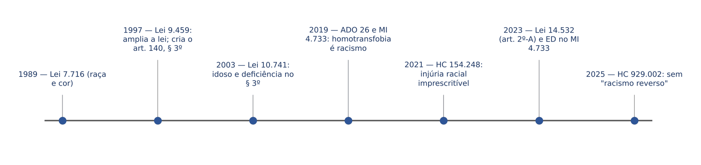
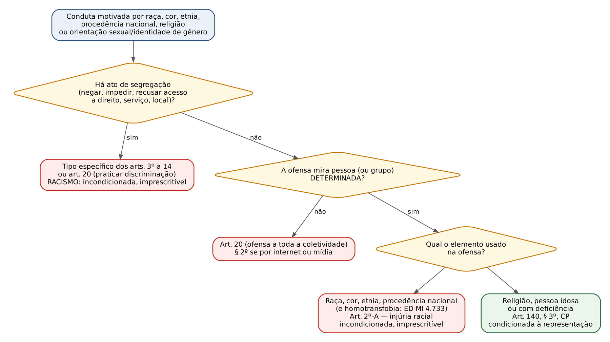
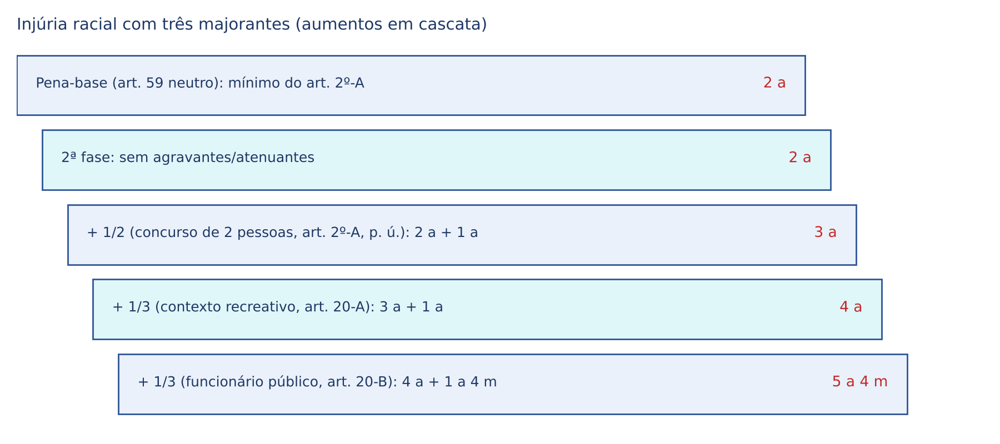

# CAPÍTULO 41 — RACISMO, INJÚRIA RACIAL, DISCRIMINAÇÃO E PRECONCEITO, CRIMES DE ÓDIO E PROTEÇÃO PENAL ANTIDISCRIMINATÓRIA

:::INCIDENCIA
TRF5 p. 1 e 10; TJRS p. 7; TJSC p. 56 e 57. Nível B; 12 questões no lote (FGV 10, FCC 2).
O que mais cai: distinguir injúria racial (art. 2º-A), racismo (art. 20) e injúria do art. 140, § 3º, do CP; imprescritibilidade e ação penal; homotransfobia (ADO 26 e embargos no MI 4.733); majorantes da Lei 14.532/2023.
:::

| Subtema | FGV | FCC | Padrão |
|---|---|---|---|
| Classificar ofensas (art. 2º-A x art. 20 x art. 140, § 3º) e seus regimes | 5 | 0 | caso com 2 ou 3 condutas; pergunta qual é imprescritível, qual é incondicionada |
| Lei 14.532/2023 (majorantes, figuras novas) | 3 | 1 | literalidade das frações e de quem incide |
| Homotransfobia (ADO 26) e liberdade religiosa | 1 | 1 | trecho da tese; "discurso de ódio" como limite |
| Dolo específico e embriaguez | 1 | 0 | jurisprudência do STJ |

## 41.1 A lógica do sistema: do mandado constitucional aos tipos

### 41.1.1 Por que existe um "direito penal antidiscriminatório"

O Direito Penal comum protege bens individuais (vida, patrimônio, honra). A legislação antidiscriminatória protege, além disso, um bem jurídico coletivo: a IGUALDADE e a dignidade de grupos historicamente subordinados. Daí três características que explicam quase todas as regras do capítulo: (i) o legislador pune não só o ataque a uma pessoa, mas o ato de SEGREGAR (negar acesso a um direito, serviço ou lugar) e o de propagar o preconceito; (ii) o Estado assume a persecução por inteiro (ação penal pública incondicionada); (iii) a Constituição retira do tempo o poder de apagar o crime (imprescritibilidade).

A Constituição contém dois comandos dirigidos ao legislador penal, chamados "mandados de criminalização" (ordens constitucionais para que certas condutas sejam tratadas como crime):

- art. 5º, XLI: a lei punirá qualquer discriminação atentatória dos direitos e liberdades fundamentais;
- art. 5º, XLII: a prática do RACISMO constitui crime INAFIANÇÁVEL e IMPRESCRITÍVEL, sujeito à pena de RECLUSÃO, nos termos da lei.

:::PEGADINHA Incisos trocados
Imprescritíveis são SOMENTE o racismo (XLII) e a ação de grupos armados contra a ordem constitucional (XLIV). Tortura, tráfico, terrorismo e hediondos (XLIII) são inafiançáveis e insuscetíveis de graça ou anistia, mas PRESCREVEM (ver 22.2). E "inafiançável" não significa "preso até o fim": a liberdade provisória sem fiança continua possível (art. 310, III, e art. 321 do CPP); o art. 323, I, do CPP só veda a FIANÇA.
:::

O plano internacional reforça o sistema: a Convenção Internacional sobre a Eliminação de Todas as Formas de Discriminação Racial (Decreto 65.810/1969) — relevante para a competência federal (41.8) — e a Convenção Interamericana contra o Racismo, a Discriminação Racial e Formas Correlatas de Intolerância (Decreto 10.932/2022), aprovada pelo rito do art. 5º, § 3º, da CF e, portanto, com status de emenda constitucional. Ela NÃO cria tipos penais (tratado não tipifica crime — ver Cap. 2), mas orienta a interpretação.

### 41.1.2 O conceito de "raça" é social, não biológico

O ponto de partida é o caso Ellwanger (STF, Plenário, HC 82.424/RS, j. 17/9/2003): um editor publicava livros antissemitas e alegava que judeus não são "raça", logo não haveria racismo imprescritível. O STF rejeitou a tese: geneticamente só existe uma raça humana; "raça" no texto constitucional é construção histórico-social usada para inferiorizar e dominar um grupo. Portanto, o antissemitismo é racismo. Essa ideia de "racismo em sua dimensão social" é a chave de tudo o que veio depois: dela derivam a extensão a judeus, indígenas e estrangeiros (art. 1º da Lei 7.716/1989), a equiparação da homotransfobia (ADO 26) e a negativa do "racismo reverso" (HC 929.002).

:::QUESTAO FGV 2024 — Câmara dos Deputados — Consultor Legislativo, Área XXII (Q2513054)
Cobrou o alcance subjetivo da Lei 7.716/1989. Gabarito: A — além de pessoas de determinada raça, indígenas, judeus e nacionais de outros países podem ser sujeitos passivos (art. 1º: raça, cor, etnia, religião ou procedência nacional; conceito social de raça). Armadilhas: (C) a suástica só é crime se houver finalidade de DIVULGAR O NAZISMO (art. 20, § 1º); (D) a internet QUALIFICA o crime (art. 20, § 2º), não o atenua; (E) a majorante do funcionário público incide justamente quando ele age NO EXERCÍCIO das funções ou a pretexto delas (art. 20-B). Sobre (B), "racismo recreativo" praticado por comediante em teatro com aumento de 1/3 até a metade, ver a nota de verificação: o item parece conforme o art. 20-A, e a banca provavelmente o considerou errado por enxergar no palco o "contexto de atividade artística" do art. 20, § 2º-A (qualificadora do art. 20, não majorante da injúria). Gabarito discutível nesse ponto, mas a letra A é inequívoca.
:::

### 41.1.3 Linha do tempo

A Lei 7.716/1989 nasceu punindo preconceito de raça ou cor. A Lei 9.459/1997 fez duas coisas que o TJSC lista expressamente no edital: (i) ampliou o art. 1º e o art. 20 para etnia, religião e procedência nacional; (ii) criou, no art. 140, § 3º, do CP, a INJÚRIA QUALIFICADA pelo preconceito (então chamada injúria racial), com reclusão de 1 a 3 anos. A Lei 10.741/2003 acrescentou ao § 3º a pessoa idosa e a pessoa com deficiência. A Lei 12.033/2009 tornou essa injúria de ação pública condicionada à representação. Por fim, a Lei 14.532, de 11/1/2023, retirou do § 3º raça, cor, etnia e origem e criou o art. 2º-A na Lei 7.716/1989, com pena maior e ação incondicionada.

## 41.2 Injúria racial, racismo e injúria do art. 140, § 3º: a distinção que decide a questão

### 41.2.1 Os três tipos lado a lado

A dúvida mais cobrada não é "o que é racismo", e sim "qual tipo incide no caso". A pergunta de ouro é: QUEM foi atingido e COMO.

| Critério | Injúria racial (art. 2º-A da Lei 7.716) | Racismo (art. 20 e arts. 3º a 14 da Lei 7.716) | Injúria qualificada (art. 140, § 3º, do CP) |
|---|---|---|---|
| Conduta | xingar, ofender a dignidade ou o decoro de alguém | segregar (negar acesso, recusar, impedir) ou praticar, induzir, incitar discriminação contra a coletividade | xingar alguém |
| Elemento | raça, cor, etnia ou procedência nacional (+ orientação sexual e identidade de gênero, ED no MI 4.733) | raça, cor, etnia, religião, procedência nacional (+ homotransfobia, ADO 26) | RELIGIÃO, pessoa IDOSA ou com DEFICIÊNCIA |
| Vítima | pessoa ou grupo determinado | coletividade indeterminada, ou pessoa privada de um direito | pessoa determinada |
| Bem jurídico | honra subjetiva + igualdade | igualdade | honra subjetiva |
| Pena | reclusão, 2 a 5 anos, e multa | art. 20: reclusão, 1 a 3 anos, e multa (2 a 5 nas formas dos §§ 1º, 2º e 2º-A) | reclusão, 1 a 3 anos, e multa |
| Ação penal | pública incondicionada | pública incondicionada | pública condicionada à representação (art. 145, parágrafo único) |
| Prescrição | IMPRESCRITÍVEL | IMPRESCRITÍVEL | prescreve normalmente |
| Exemplo | "seu macaco" dito a um colega | "neste clube não entram negros"; "todo judeu é ladrão" postado na rede | "macumbeira endemoniada" dito à vítima; "velha maluca" |

:::PEGADINHA A religião ficou no Código Penal
A Lei 14.532/2023 levou para a Lei 7.716 a injúria por raça, cor, etnia e procedência nacional, mas DEIXOU no art. 140, § 3º, do CP a injúria por RELIGIÃO (além da pessoa idosa e com deficiência). Resultado assimétrico que a FGV explora: xingar alguém por sua religião = injúria qualificada do CP (condicionada, prescritível); segregar por religião ou incitar o ódio contra os fiéis de uma religião = racismo da Lei 7.716 (incondicionado, imprescritível). Há doutrina sustentando que a injúria religiosa também seria espécie de racismo (pela lógica do HC 154.248), mas o texto legal e as provas tratam-na como art. 140, § 3º.
:::

:::QUESTAO FGV 2024 — ENAM 2024.2 (Q3058677)
Porteiro chama a entregadora, vestida de branco e com guias de candomblé, de "macumbeira endemoniada" e, em razão da religião, impõe-lhe a entrada e o elevador de serviço. Gabarito: E — injúria qualificada (art. 140, § 3º, do CP: ofensa pessoal por religião) e racismo (art. 11 da Lei 7.716: impedir acesso às entradas sociais e elevadores, por preconceito religioso), em concurso. Armadilha: achar que a injúria por religião migrou para o art. 2º-A (não migrou) ou que a ofensa é absorvida pelo ato de segregação (são condutas e bens jurídicos distintos).
:::

:::QUESTAO FGV 2025 — TRF 1ª Região — Juiz Federal Substituto (Q3425287)
Em perfil público de turismo de um Estado: (i) "cambada de macumbeiro safado" (ofensa genérica aos adeptos de religião de matriz africana); (ii) homem trans xingado de "sapatão sem vergonha"; (iii) idosa xingada de "velha maluca". Gabarito: B — há DUAS condutas imprescritíveis: (i) é racismo religioso do art. 20, § 2º (coletividade, pela internet); (ii) é injúria homotransfóbica, equiparada à injúria racial (ED no MI 4.733). A (iii) é art. 140, § 3º, do CP (pessoa idosa), prescritível. Armadilhas: (A) a (iii) é condicionada à representação; (C) a pena em triplo do art. 141, § 2º, do CP vale para os crimes contra a honra do Código, não para o art. 20 (que tem qualificadora própria, § 2º); (D) o aumento de metade por concurso de pessoas é exclusivo do art. 2º-A; (E) nenhuma conduta é atípica.
:::

:::QUESTAO FGV 2025 — DPE-PE — Defensor Público (Q3390857)
(I) Diretor de escola recusa matrícula de criança negra ("preferimos crianças mais clarinhas"); (II) "cala a boca, negão" em reunião de condomínio; (III) aluno diz ao professor gay "você me paga, viadinho". Gabarito: E — as três são imprescritíveis: (I) art. 6º da Lei 7.716 (recusar inscrição de aluno; vítima com menos de 18 anos, pena agravada de 1/3); (II) art. 2º-A; (III) injúria homotransfóbica, equiparada ao art. 2º-A. Armadilhas: (A) a injúria racial é INCONDICIONADA desde 2023; (B) a injúria homofóbica não é de ação privada; (C) não há pena em triplo para essas figuras; (D) a ofensa homofóbica não é atípica.
:::

No mesmo sentido, sobre a classificação de ofensa homofóbica como art. 2º-A: Q2365388 (FGV 2024 — PC-SC; gabarito B, "veadinho" dito ao vizinho por conta da orientação sexual).

### 41.2.2 O art. 2º-A em detalhe

:::LEI Lei 7.716/1989, art. 2º-A
Injuriar alguém, ofendendo-lhe a dignidade ou o decoro, em razão de raça, cor, etnia ou procedência nacional.
Pena: reclusão, de 2 (dois) a 5 (cinco) anos, e multa.
Parágrafo único. A pena é aumentada de metade se o crime for cometido mediante concurso de 2 (duas) ou mais pessoas.
:::

- Conduta e consumação: como em toda injúria, consuma-se quando a ofensa chega ao conhecimento da VÍTIMA (honra subjetiva); não é preciso que terceiros ouçam. Tentativa só na forma escrita interceptada.
- Elementos: "procedência nacional" substituiu a antiga palavra "origem" (lugar, nação de onde a pessoa vem). Xingar alguém por ser nordestino é tema discutido: a doutrina majoritária enquadra a origem regional na "procedência nacional" em sentido amplo, mas não há tese firme dos tribunais superiores (ver nota).
- Elemento subjetivo: dolo + especial fim de ofender POR CAUSA da raça, cor etc. (dolo específico, ou "elemento subjetivo especial do tipo"). Embriaguez voluntária e ânimo exaltado NÃO o afastam (STJ, AREsp 2.835.056 — ver Cap. 10).
- Majorante do parágrafo único: concurso de 2 ou mais pessoas, aumento FIXO de metade (terceira fase).
- Benefícios: pena mínima de 2 anos afasta transação e suspensão condicional do processo; ANPP vedado pela jurisprudência (41.7.2).

:::QUESTAO FGV 2026 — MPE-RJ — Promotor de Justiça Substituto (Q4088268)
Elemento subjetivo da injúria racial segundo o STJ. Gabarito: E — a intenção de ofender a honra subjetiva usando elementos de raça ou cor configura o dolo específico, sendo irrelevante a embriaguez voluntária. Armadilhas: (A) e (B) embriaguez e discussão acalorada não excluem o dolo (art. 28, I e II, do CP); (C) a retratação do art. 143 do CP é causa de extinção da punibilidade só da calúnia e da difamação, e não se aplica à Lei 7.716; (D) injúria protege a honra SUBJETIVA, dispensa a presença de terceiros. Fundamento: AREsp 2.835.056 (desenvolvido no Cap. 10).
:::

:::QUESTAO FCC 2026 — SEFAZ-CE — Auditor Fiscal (Q4221399)
Dois garçons, juntos e sem nenhum contexto de brincadeira, injuriam um cliente em razão de sua procedência nacional. Gabarito: E — art. 2º-A, reclusão de 2 a 5 anos e multa, AUMENTADA DE METADE pelo concurso de duas pessoas. Conta: mínimo de 2 anos + 1/2 (1 ano) = 3 anos. Armadilhas: (A) e (B) a pena é de reclusão, não detenção; (C) esquece a majorante do parágrafo único; (D) procedência nacional está no tipo. O racismo recreativo (art. 20-A) foi expressamente excluído pelo enunciado ("sem contexto de brincadeira").
:::

No mesmo sentido, sobre os elementos do art. 2º-A: Q2375392 (FGV 2024 — TJ-RJ; gabarito B: cor, etnia ou procedência nacional; armadilha: "religião" e "orientação sexual" não estão no texto legal).

### 41.2.3 Imprescritibilidade da injúria racial: o HC 154.248

:::JURIS STF, Plenário, HC 154.248/DF, Rel. Min. Edson Fachin, j. 28/10/2021 (Info 1036)
Condenada por injúria racial (então art. 140, § 3º, do CP) pedia o reconhecimento da prescrição, reduzida à metade por ter mais de 70 anos. O STF denegou a ordem: a injúria racial é ESPÉCIE do gênero racismo, porque emprega os mesmos estereótipos raciais para inferiorizar a vítima; não há diferença ontológica entre ela e os crimes da Lei 7.716/1989. Logo, incide o art. 5º, XLII, da CF: é imprescritível (e inafiançável). Relevância atual: a imprescritibilidade NÃO nasceu com a Lei 14.532/2023; vale também para fatos anteriores a ela, porque decorre diretamente da Constituição.
:::

O STJ já decidia assim antes (6ª Turma, AgRg no REsp 1.849.696/SP, 2020). A Lei 14.532/2023 apenas positivou o entendimento ao deslocar o tipo para a Lei do Racismo.

:::ATENCAO Fatos anteriores a 12/1/2023
Para injúria racial praticada antes da Lei 14.532/2023 não houve *abolitio criminis*: houve continuidade normativo-típica (STJ, REsp 2.135.321 — ver Cap. 3). Consequências: (i) aplica-se a PENA antiga (1 a 3 anos), porque a nova é mais grave e não retroage; (ii) a imprescritibilidade incide de qualquer modo (HC 154.248); (iii) quanto à ação penal, o entendimento mais seguro é exigir a representação para fatos anteriores, porque a regra que a dispensou é mais gravosa e tem conteúdo material (ver nota).
:::

### 41.2.4 Não existe "racismo reverso"

:::JURIS STJ, 6ª Turma, HC 929.002-AL, Rel. Min. Og Fernandes, j. 4/2/2025 (Info 839)
A injúria racial NÃO se configura em ofensa dirigida a pessoa branca exclusivamente por essa condição: o racismo é fenômeno estrutural, e a Lei 7.716/1989, lida à luz do art. 20-C e dos tratados, protege grupos minoritários historicamente discriminados. A ação penal por art. 2º-A foi trancada, ficando ressalvada a eventual tipificação como injúria comum do art. 140 do CP.
:::

O art. 20-C ajuda a entender o julgado: o juiz deve considerar discriminatória a atitude dada "à pessoa ou a grupos minoritários" que cause constrangimento, humilhação, vergonha, medo ou exposição indevida e que usualmente não se dispensaria a outros grupos em razão da cor, etnia, religião ou procedência. A norma interpretativa direciona a proteção aos grupos vulnerabilizados.

:::DICA Como a ofensa a pessoa branca aparece na prova
Não é atípica: é injúria do art. 140, caput, do CP (ação privada, prescritível). O que não existe é a FORMA RACIAL (art. 2º-A). Cuidado com ofensa por procedência nacional: o estrangeiro de país europeu, xingado por ser estrangeiro, continua protegido pelo art. 2º-A, porque o elemento é a procedência, não a cor (raciocínio da doutrina; o HC 929.002 tratou de ofensa pela cor branca).
:::

## 41.3 Homotransfobia: ADO 26, MI 4.733 e os embargos de 2023

:::JURIS STF, Plenário, ADO 26/DF (Rel. Min. Celso de Mello) e MI 4.733/DF (Rel. Min. Edson Fachin), j. 13/6/2019 (Info 944)
1) Declarada a mora inconstitucional do Congresso em editar a lei exigida pelos incisos XLI e XLII do art. 5º. 2) Até que sobrevenha essa lei, as condutas homofóbicas e transfóbicas, reais ou supostas, que envolvem aversão odiosa à orientação sexual ou à identidade de gênero de alguém, por traduzirem expressões de racismo em sua dimensão social, ajustam-se, por identidade de razão e mediante adequação típica, aos preceitos primários da Lei 7.716/1989, constituindo também, no homicídio doloso, circunstância que o qualifica por motivo torpe. 3) A repressão penal NÃO alcança nem restringe a liberdade religiosa: fiéis e ministros podem pregar e divulgar suas convicções, em espaço público ou privado, desde que tais manifestações não configurem discurso de ódio (exteriorizações que incitem discriminação, hostilidade ou violência contra pessoas em razão da orientação sexual ou da identidade de gênero). 4) Efeitos prospectivos (a partir da conclusão do julgamento).
:::

Por que não é analogia *in malam partem*? Porque o STF não criou tipo nem pena: interpretou o elemento normativo "raça" (e "racismo") já contido na Lei 7.716/1989 segundo o conceito social fixado no caso Ellwanger. O próprio acórdão afirma a impossibilidade de o STF tipificar delitos (reserva legal). A banca cobra exatamente essa formulação (Q3373856, Cap. 2).

Em embargos de declaração no MI 4.733 (Plenário, sessão virtual concluída em 21/8/2023, Rel. Min. Edson Fachin), o STF esclareceu que a ofensa homotransfóbica dirigida a PESSOA determinada configura INJÚRIA RACIAL (hoje art. 2º-A), e não mera injúria do CP: incondicionada, imprescritível, com pena de 2 a 5 anos. Antes dos embargos, havia dúvida porque a tese de 2019 falava em "preceitos primários" da Lei 7.716 e a injúria racial, então, estava no CP.

:::QUESTAO FGV 2024 — ENAM (Reaplicação) (Q2507011)
Pediu a tese da ADO 26. Gabarito: B — reprodução da tese 2 acima (enquadramento na Lei 7.716 e motivo torpe no homicídio). Armadilhas: (A) e (E) inventam prazo (180 dias, 1 ano) e falam em "autoaplicabilidade" após o prazo e "analogia *pro societate*": o STF NÃO fixou prazo para o enquadramento, que valeu desde logo, nem usou analogia; (C) inverte a tese 3 (a liberdade religiosa NÃO é restringida, salvo discurso de ódio); (D) troca racismo por terrorismo.
:::

:::QUESTAO FCC 2026 — DPE-MA — Defensor Público (Q4012654)
Liberdade religiosa e homotransfobia. Gabarito: E — a repressão penal não alcança nem restringe a liberdade religiosa, qualquer que seja a confissão, desde que as manifestações não configurem discurso de ódio. Armadilhas: (A) fala em "novo tipo penal criado" e inverte o proselitismo (que é protegido); (B) "de forma irrestrita" contraria a tese; (C) a distinção entre templo e esfera pública não existe na tese (vale "independentemente do espaço, público ou privado"); (D) o critério não é a identidade de crença entre ofensor e ofendido.
:::

## 41.4 Racismo religioso, proselitismo e liberdade de expressão

O art. 20 pune o discurso que inferioriza um grupo religioso, mas a liberdade religiosa inclui o PROSELITISMO (tentar converter, inclusive dizendo que a própria fé é superior). O STF traçou a fronteira em dois precedentes que precisam ser lidos juntos:

| Precedente | Fato | Resultado | Critério |
|---|---|---|---|
| STF, 1ª Turma, RHC 134.682/BA, j. 29/11/2016 (Info 849) | padre publica livro, para fiéis católicos, criticando o espiritismo e religiões de matriz africana | atípico | comparar religiões e afirmar a superioridade da própria fé é proselitismo; o art. 20 exige o especial fim de suprimir ou reduzir a dignidade do diferente |
| STF, 2ª Turma, RHC 146.303/RJ, j. 6/3/2018 (Info 893) | líder religioso difunde em vídeos ataques de ódio a outras denominações e a seus seguidores | racismo (art. 20, § 2º) | a incitação ao ódio público contra outras religiões não está protegida pela liberdade de expressão |

A chave: o discurso SOBRE A PRÓPRIA CRENÇA (ainda que comparativo) é protegido; o discurso CONTRA A CRENÇA ALHEIA, para rebaixá-la e a seus fiéis, com fim de dominação ou eliminação, é crime. Raciocínio semelhante ao do Inq 4.694 (STF, 1ª Turma, j. 11/9/2018): declarações de deputado federal sobre quilombolas e estrangeiros, em palestra, foram consideradas manifestação política protegida pela liberdade de expressão e pela imunidade parlamentar, sem o fim de inferiorização exigido pelo art. 20.

A Lei 14.532/2023 criou o RACISMO RELIGIOSO em sentido estrito (art. 20, § 2º-B): incorre nas penas do caput (reclusão de 1 a 3 anos e multa) quem obstar, impedir ou empregar violência contra quaisquer manifestações ou práticas religiosas, "sem prejuízo da pena correspondente à violência" (cúmulo material com a lesão, o dano etc.).

| Figura | Onde | Conduta | Ação |
|---|---|---|---|
| Racismo religioso | art. 20, § 2º-B, Lei 7.716 | obstar, impedir ou usar violência contra manifestação ou prática religiosa | incondicionada; imprescritível |
| Incitação ao ódio religioso | art. 20, caput ou § 2º | praticar, induzir ou incitar discriminação por religião | incondicionada; imprescritível |
| Injúria religiosa | art. 140, § 3º, CP | xingar pessoa por sua religião | condicionada |
| Ultraje a culto | art. 208, CP | escarnecer de alguém por motivo de crença, perturbar culto, vilipendiar objeto de culto | incondicionada; prescritível (ver Cap. 32) |

:::QUESTAO FGV 2024 — TJ-RJ — Programa de Residência (Q2375393)
Afirmativas sobre a Lei 14.532/2023. Gabarito: C (I e II corretas) — (I) a lei passou a punir quem obstar, impedir ou empregar violência contra manifestações ou práticas religiosas (art. 20, § 2º-B); (II) o art. 140, § 3º, do CP ficou restrito a religião, pessoa idosa ou com deficiência, com reclusão de 1 a 3 anos e multa. Armadilha: (III) a lei não alterou a Lei de Crimes Ambientais nem criou crime de "racismo ambiental".
:::

## 41.5 Os crimes de segregação (arts. 3º a 14)

### 41.5.1 Estrutura comum

Os arts. 3º a 14 descrevem a forma mais clássica de racismo: a SEGREGAÇÃO, isto é, privar alguém de um direito, de um serviço ou de um espaço em razão de raça, cor, etnia, religião ou procedência nacional (e, desde a ADO 26, de orientação sexual ou identidade de gênero). Os tipos não repetem a motivação no texto, mas ela integra todos eles por força do art. 1º ("crimes resultantes de discriminação ou preconceito"): é o elemento subjetivo especial. Sem a motivação discriminatória, recusar atendimento não é crime da Lei 7.716 (pode ser infração consumerista ou nada).

Características: crimes dolosos (NÃO há modalidade culposa na lei), comuns (qualquer pessoa, inclusive o empregado que cumpre ordem discriminatória do patrão), em regra formais e instantâneos. A pessoa jurídica NÃO responde penalmente (falta previsão legal; ver Cap. 5), mas o estabelecimento pode ter o funcionamento suspenso como efeito da condenação de seu responsável (41.9).

### 41.5.2 Quadro dos tipos

| Art. | Conduta (síntese) | Pena (reclusão) |
|---|---|---|
| 3º | impedir ou obstar acesso de pessoa habilitada a cargo da Administração direta ou indireta ou de concessionária; parágrafo único: obstar promoção funcional por discriminação | 2 a 5 anos |
| 4º | negar ou obstar emprego em empresa privada; § 1º: negar equipamentos, impedir ascensão funcional, tratamento diferenciado (sobretudo salarial) | 2 a 5 anos |
| 4º, § 2º | exigir, em anúncio ou recrutamento, aspectos de aparência próprios de raça ou etnia sem justificativa | SÓ multa e prestação de serviços à comunidade (incluindo atividades de promoção da igualdade racial) |
| 5º | recusar ou impedir acesso a estabelecimento comercial, negando-se a servir, atender ou receber cliente | 1 a 3 anos |
| 6º | recusar, negar ou impedir inscrição ou ingresso de aluno em estabelecimento de ensino de qualquer grau; vítima com menos de 18 anos: pena agravada de 1/3 | 3 a 5 anos |
| 7º | impedir acesso ou recusar hospedagem em hotel, pensão ou similar | 3 a 5 anos |
| 8º | impedir acesso ou recusar atendimento em restaurantes, bares, confeitarias e similares | 1 a 3 anos |
| 9º | idem em estabelecimentos esportivos, casas de diversões, clubes sociais abertos ao público | 1 a 3 anos |
| 10 | idem em salões de cabeleireiro, barbearias, termas, casas de massagem | 1 a 3 anos |
| 11 | impedir acesso às entradas sociais em edifícios públicos ou residenciais e a elevadores ou escadas de acesso | 1 a 3 anos |
| 12 | impedir acesso ou uso de transportes públicos | 1 a 3 anos |
| 13 | impedir ou obstar acesso ao serviço em qualquer ramo das Forças Armadas | 2 a 4 anos |
| 14 | impedir ou obstar, por qualquer meio, casamento ou convivência familiar e social | 2 a 4 anos |

:::DICA Memorização pelas penas
Maiores (3 a 5): ESCOLA e HOTEL (arts. 6º e 7º). Médias (2 a 5): cargo público e emprego privado (arts. 3º e 4º). Forças Armadas e casamento: 2 a 4. Todo o resto (comércio, bar, clube, salão, elevador, transporte): 1 a 3. Única figura sem prisão: anúncio de emprego com exigência de aparência (art. 4º, § 2º).
:::

:::EXEMPLO Especialidade entre os tipos e o art. 20
Gerente de loja manda o segurança barrar um cliente por ser cigano. Há art. 5º (recusar acesso a estabelecimento comercial), tipo específico, que prevalece sobre o genérico "praticar discriminação" do art. 20 (princípio da especialidade; ver Cap. 3). Gerente e segurança são coautores, se o segurança aderiu conscientemente ao motivo discriminatório; se cumpriu a ordem sem conhecer o motivo, falta-lhe o dolo específico. Se, além de barrar, o gerente grita "cigano ladrão" ao cliente, soma-se a injúria racial (art. 2º-A, por etnia), em concurso material.
:::

## 41.6 O art. 20 e as novidades da Lei 14.532/2023

### 41.6.1 O tipo central

:::LEI Lei 7.716/1989, art. 20, caput e §§ 1º, 2º e 2º-A
Art. 20. Praticar, induzir ou incitar a discriminação ou preconceito de raça, cor, etnia, religião ou procedência nacional.
Pena: reclusão de um a três anos e multa.
§ 1º Fabricar, comercializar, distribuir ou veicular símbolos, emblemas, ornamentos, distintivos ou propaganda que utilizem a cruz suástica ou gamada, para fins de divulgação do nazismo.
Pena: reclusão de dois a cinco anos e multa.
§ 2º Se qualquer dos crimes previstos neste artigo for cometido por intermédio dos meios de comunicação social, de publicação em redes sociais, da rede mundial de computadores ou de publicação de qualquer natureza:
Pena: reclusão de dois a cinco anos e multa.
§ 2º-A Se qualquer dos crimes previstos neste artigo for cometido no contexto de atividades esportivas, religiosas, artísticas ou culturais destinadas ao público:
Pena: reclusão, de 2 (dois) a 5 (cinco) anos, e proibição de frequência, por 3 (três) anos, a locais destinados a práticas esportivas, artísticas ou culturais destinadas ao público, conforme o caso.
:::

- "Praticar" a discriminação abrange qualquer ato discriminatório não previsto nos arts. 3º a 14 (tipo residual); "induzir" é fazer nascer a ideia em terceiros; "incitar" é estimular a que já existe. Crime comum, formal (não exige que alguém efetivamente passe a discriminar), de forma livre; sujeito passivo é a coletividade atingida.
- § 1º: a suástica só é crime com a finalidade de DIVULGAR O NAZISMO; o uso em contexto religioso (budista, hindu), histórico ou didático é atípico.
- §§ 2º e 2º-A são QUALIFICADORAS (alteram mínimo e máximo, 2 a 5 anos), não causas de aumento. O § 2º-A responde a episódios de racismo em estádios e combina a prisão com uma pena de interdição de direitos (proibição de frequência por 3 anos).
- § 3º (medidas cautelares no caso do § 2º): o juiz pode determinar, ouvido o MP ou a pedido dele, AINDA ANTES DO INQUÉRITO, sob pena de desobediência, o recolhimento ou a busca e apreensão do material, a cessação das transmissões e a interdição das mensagens ou páginas na internet. § 4º: destruição do material apreendido, após o trânsito em julgado, como efeito da condenação.

:::PEGADINHA Internet: qualificadora do art. 20 x pena em triplo do art. 141, § 2º, do CP
O art. 141, § 2º, do CP manda aplicar em TRIPLO a pena dos crimes contra a honra do Código cometidos ou divulgados em redes sociais (Lei 13.964/2019). Ele NÃO se aplica ao art. 20 (que tem qualificadora própria, 2 a 5 anos) nem, pela letra da lei, ao art. 2º-A (que está fora do Código). Para a injúria religiosa ou contra pessoa idosa pela internet (art. 140, § 3º), o triplo incide.
:::

### 41.6.2 As majorantes: racismo recreativo e funcionário público

:::LEI Lei 7.716/1989, arts. 20-A e 20-B
Art. 20-A. Os crimes previstos nesta Lei terão as penas aumentadas de 1/3 (um terço) até a metade, quando ocorrerem em contexto ou com intuito de descontração, diversão ou recreação.
Art. 20-B. Os crimes previstos nos arts. 2º-A e 20 desta Lei terão as penas aumentadas de 1/3 (um terço) até a metade, quando praticados por funcionário público, conforme definição prevista no Decreto-Lei nº 2.848, de 7 de dezembro de 1940 (Código Penal), no exercício de suas funções ou a pretexto de exercê-las.
:::

O RACISMO RECREATIVO (expressão de Adilson Moreira) é o preconceito disfarçado de piada: a "brincadeira" reforça estereótipos e, por ser socialmente tolerada, é especialmente eficaz na manutenção da hierarquia racial. A lei virou do avesso a velha defesa do *animus jocandi* (intenção de brincar): o contexto humorístico não exclui o dolo, ele AUMENTA a pena. Atenção ao alcance: o art. 20-A vale para TODOS os crimes da lei; o art. 20-B só para os arts. 2º-A e 20.

| Majorante | Fração | Incide sobre | Fundamento |
|---|---|---|---|
| Concurso de 2 ou mais pessoas | 1/2 (fixa) | só art. 2º-A | art. 2º-A, parágrafo único |
| Contexto ou intuito recreativo | 1/3 até 1/2 | todos os crimes da lei | art. 20-A |
| Funcionário público no exercício ou a pretexto | 1/3 até 1/2 | arts. 2º-A e 20 | art. 20-B |
| Vítima com menos de 18 anos | 1/3 ("agravada", mas é fração: terceira fase) | só art. 6º | art. 6º, parágrafo único |

:::QUESTAO FGV 2024 — Câmara dos Deputados — Consultor Legislativo, Área XIX (Q2511996)
Novidades da Lei 14.532/2023. Gabarito: B — previsão de aumento quando o crime ocorre em contexto ou com intuito de descontração, diversão ou recreação (racismo recreativo). Armadilhas: (A) a injúria racial É equiparada ao racismo e imprescritível; (C) o funcionário público tem a pena AUMENTADA, não diminuída; (D) não há decisão do Plenário admitindo ANPP em crimes raciais (a jurisprudência é em sentido oposto — 41.7.2); (E) a apuração na internet é possível, com cautelares específicas (art. 20, § 3º).
:::

### 41.6.3 Calculando a pena com várias majorantes

:::EXEMPLO Injúria racial com três causas de aumento
Dois guardas municipais em serviço, A e B, abordam C, homem negro, e, entre risadas, dizem-lhe que "macaco não precisa de documento". Primários, sem circunstâncias judiciais negativas. Crime: art. 2º-A (2 a 5 anos), com três majorantes: concurso de pessoas (1/2), contexto recreativo (art. 20-A, 1/3 a 1/2) e funcionário público no exercício (art. 20-B, 1/3 a 1/2).
Primeira fase: circunstâncias neutras, pena-base no mínimo = 2 anos.
Segunda fase: sem agravantes nem atenuantes = 2 anos. (Não use a agravante do art. 61, II, "g", do CP — violação de dever inerente ao cargo — porque a condição funcional já é a majorante do art. 20-B: seria *bis in idem*, punir duas vezes o mesmo dado.)
Terceira fase (aumentos sucessivos, cada um sobre a pena já aumentada, conforme o entendimento corrente do STJ — ver Cap. 15):
- + 1/2 de 2 anos (1 ano) = 3 anos;
- + 1/3 de 3 anos (1 ano) = 4 anos;
- + 1/3 de 4 anos (1 ano e 4 meses) = 5 anos e 4 meses.
Frações no mínimo (1/3) porque nada no caso concreto justificaria ir além; para subir até a metade, o juiz deve apontar dado concreto (por exemplo, a humilhação pública prolongada). Pena definitiva: 5 anos e 4 meses de reclusão, mais multa.
Variante: se o juiz aplicar o art. 68, parágrafo único, do CP (concurso de causas de aumento "previstas na parte especial": pode limitar-se a um só aumento, o que mais aumente), ficaria em 2 anos + 1/2 = 3 anos. A aplicação desse dispositivo a causas previstas em lei especial é discutida (ver Cap. 15 e a nota de verificação); na prova, mostre as duas contas e fundamente a escolha.
Consequências: com 5 anos e 4 meses e réus primários, regime inicial semiaberto (art. 33, § 2º, "b") e sem substituição por restritivas (pena acima de 4 anos, art. 44, I); com 3 anos, regime aberto e substituição possível (injúria verbal não envolve violência ou grave ameaça). A perda do cargo depende de declaração motivada (art. 16 c/c art. 18 — 41.9).
:::

## 41.7 Ação penal, benefícios e o veto jurisprudencial ao ANPP

### 41.7.1 Ação penal e benefícios

Todos os crimes da Lei 7.716/1989 são de ação penal pública INCONDICIONADA (a lei não exige representação). O que era condicionado — a antiga injúria racial do CP — deixou de sê-lo com a Lei 14.532/2023. O art. 20-D impõe que, em todos os atos processuais, cíveis e criminais, a vítima dos crimes de racismo esteja acompanhada de advogado ou defensor público (dever do Estado de garantir assistência, que se cumpre, por exemplo, com a intimação da Defensoria; ver nota sobre a consequência do descumprimento).

| Crime | Transação penal | Suspensão condicional do processo | ANPP |
|---|---|---|---|
| Art. 20, caput; arts. 5º, 8º a 12 (máx. 3 anos, mín. 1) | NÃO (máximo acima de 2) | SIM em tese (mínimo de 1 ano) | vedado (jurisprudência) |
| Art. 2º-A; arts. 3º, 4º, 13, 14; art. 20, §§ 1º, 2º, 2º-A | NÃO | NÃO (mínimo acima de 1) | vedado (jurisprudência) |
| Arts. 6º e 7º (3 a 5) | NÃO | NÃO | vedado |
| Art. 4º, § 2º (multa e prestação de serviços) | SIM (infração de menor potencial ofensivo) | — | — |
| Art. 140, § 3º, CP (1 a 3) | NÃO | SIM em tese | cabível, se presentes os requisitos (não é crime racial) |

### 41.7.2 ANPP nos crimes raciais

:::JURIS STF, 2ª Turma, RHC 222.599, Rel. Min. Edson Fachin, j. 7/2/2023; STJ, 5ª Turma, AREsp 2.607.962-GO, Rel. Min. Reynaldo Soares da Fonseca, j. 13/8/2024 (Info 821)
Não cabe acordo de não persecução penal nos crimes raciais, o que inclui as condutas resultantes de atos homofóbicos. Fundamentos: o art. 28-A do CPP exige que o acordo seja "necessário e suficiente para reprovação e prevenção do crime", e o mandado constitucional de criminalização (art. 5º, XLII) e os compromissos internacionais de combate ao racismo indicam que a solução negociada é insuficiente, por analogia com a vedação expressa do § 2º, IV, do art. 28-A (violência contra a mulher). Precedentes de Turma, não de Plenário.
:::

:::PROCESSO Reflexos processuais essenciais
- Ação: pública incondicionada em toda a Lei 7.716; a vítima pode habilitar-se como assistente de acusação.
- Prisão: inafiançável (art. 323, I, CPP), mas cabe liberdade provisória sem fiança ou com cautelares diversas.
- Prescrição: não corre para nenhum crime da Lei 7.716, nem para a injúria racial anterior a 2023; corre normalmente para o art. 140, § 3º, do CP e para as Leis 9.029 e 12.984.
- Cautelares de conteúdo (art. 20, § 3º): antes mesmo do inquérito, a pedido do MP ou com sua oitiva.
- Prova típica: testemunhas presenciais, prints com metadados (ata notarial ou perícia), áudios e vídeos; a palavra da vítima tem relevo especial, como nos crimes praticados sem testemunhas.
:::

## 41.8 Competência

A regra é a Justiça ESTADUAL. A Justiça Federal entra quando presente alguma hipótese do art. 109 da CF:

- art. 109, V: crime previsto em tratado (a Convenção sobre a Eliminação de Todas as Formas de Discriminação Racial obriga a punir a difusão de ideias racistas) + TRANSNACIONALIDADE (início no Brasil e resultado no exterior, ou vice-versa). Na internet, a publicação aberta, com potencial de acesso no exterior, basta: o STJ fixou a competência federal para postagens antissemitas no Facebook "ainda que o conteúdo não tenha sido efetivamente visualizado fora do território nacional" (STJ, 3ª Seção, CC 163.420/PR, Rel. Min. Joel Ilan Paciornik, 2020), aplicando o raciocínio do STF no Tema 393 (RE 628.624, pornografia infantil na internet). Mensagens privadas entre pessoas no Brasil (conversa de aplicativo, e-mail a um destinatário) não têm essa potencialidade e ficam na Justiça Estadual;
- art. 109, IV: crime contra servidor federal em razão da função, ou em detrimento de bens, serviços ou interesse da União (Súmula 147 do STJ — ver Cap. 47);
- art. 109, IX: crime cometido a bordo de navio ou aeronave.

Foro: no racismo pela internet, consuma-se o crime no local de onde partiram as manifestações (STJ, 3ª Seção, CC 102.454/RJ, 2009); no CC 163.420 a competência foi fixada na Seção Judiciária de onde as postagens foram feitas.

## 41.9 Efeitos da condenação e a sentença

:::LEI Lei 7.716/1989, arts. 16 e 18
Art. 16. Constitui efeito da condenação a perda do cargo ou função pública, para o servidor público, e a suspensão do funcionamento do estabelecimento particular por prazo não superior a três meses.
Art. 18. Os efeitos de que tratam os arts. 16 e 17 desta Lei não são automáticos, devendo ser motivadamente declarados na sentença.
:::

Comparação que cai: na Lei 7.716, a perda do cargo NÃO depende do quantum da pena (diferente do art. 92, I, do CP, que exige pena mínima de 1 ou 4 anos conforme o caso), mas também NÃO é automática; na Lei de Tortura (art. 1º, § 5º, da Lei 9.455/1997), a perda do cargo é automática (ver Cap. 40). Os efeitos gerais da condenação estão no Cap. 18.

:::SENTENCA Crimes raciais na sentença
- Tipificação: explique por que é art. 2º-A (pessoa determinada) ou art. 20/arts. 3º a 14 (coletividade ou segregação), e não art. 140, § 3º. Afaste expressamente teses de "brincadeira" (art. 20-A) e de embriaguez (art. 28, II, do CP).
- Dosimetria: majorantes na terceira fase, com fração fundamentada; não duplique a condição de funcionário (art. 20-B) com a agravante do art. 61, II, "g".
- Efeitos: declare motivadamente a perda do cargo ou a suspensão do estabelecimento (art. 18); no art. 20, § 2º, determine a destruição do material após o trânsito (§ 4º); no § 2º-A, fixe a proibição de frequência por 3 anos.
- Reparação: fixe valor mínimo para o dano moral (art. 387, IV, do CPP), se houver pedido expresso na denúncia.
- Prescrição: não a examine para os crimes da Lei 7.716 senão para afirmar a imprescritibilidade.
Redação-modelo: "A ofensa foi dirigida à vítima, pessoa determinada, com a evidente finalidade de inferiorizá-la por sua cor, o que caracteriza a injúria racial do art. 2º-A da Lei 7.716/1989, crime imprescritível (art. 5º, XLII, da CF; STF, HC 154.248). O contexto jocoso alegado pela defesa não exclui o dolo; ao contrário, atrai a causa de aumento do art. 20-A."
Erro comum punido pela banca: aplicar o art. 145, parágrafo único, do CP e extinguir o processo por falta de representação em fato posterior a 2023.
:::

## 41.10 Discriminação na relação de trabalho (Lei 9.029/1995)

A Lei 9.029/1995 nasceu para coibir uma prática então corrente: exigir da candidata a emprego atestado de gravidez ou de esterilização. O art. 1º (redação da Lei 13.146/2015) proíbe qualquer prática discriminatória e limitativa para acesso à relação de trabalho ou sua manutenção por motivo de sexo, origem, raça, cor, estado civil, situação familiar, deficiência, reabilitação profissional, idade, entre outros (ressalvada a proteção a crianças e adolescentes do art. 7º, XXXIII, da CF). Mas atenção: o art. 1º é norma PROIBITIVA, não tipo penal. Crime é só o que está no art. 2º.

:::LEI Lei 9.029/1995, art. 2º
Art. 2º Constituem crime as seguintes práticas discriminatórias:
I - a exigência de teste, exame, perícia, laudo, atestado, declaração ou qualquer outro procedimento relativo à esterilização ou a estado de gravidez;
II - a adoção de quaisquer medidas, de iniciativa do empregador, que configurem:
a) indução ou instigamento à esterilização genética;
b) promoção do controle de natalidade, assim não considerado o oferecimento de serviços e de aconselhamento ou planejamento familiar, realizados através de instituições públicas ou privadas, submetidas às normas do Sistema Único de Saúde (SUS).
Pena: detenção de um a dois anos e multa.
Parágrafo único. São sujeitos ativos dos crimes a que se refere este artigo:
I - a pessoa física empregadora;
II - o representante legal do empregador, como definido na legislação trabalhista;
III - o dirigente, direto ou por delegação, de órgãos públicos e entidades das administrações públicas direta, indireta e fundacional de qualquer dos Poderes da União, dos Estados, do Distrito Federal e dos Municípios.
:::

- Crime PRÓPRIO: só os sujeitos do parágrafo único; o empregado de RH que exige o exame por ordem do diretor pode responder como partícipe (art. 30 do CP: a condição pessoal elementar se comunica, se conhecida). A pessoa jurídica empregadora não responde penalmente; sofre as sanções administrativas do art. 3º (multa de dez vezes o maior salário pago pelo empregador, elevada em 50% na reincidência, e proibição de empréstimo ou financiamento em instituições financeiras oficiais).
- Crime formal: consuma-se com a EXIGÊNCIA, ainda que a candidata não apresente o exame ou seja contratada.
- Infração de menor potencial ofensivo (máximo de 2 anos): Juizado Especial Criminal, transação penal e suspensão condicional do processo cabíveis. Ação pública incondicionada. Competência estadual em regra (crime contra a candidata individualmente, não contra a organização geral do trabalho); federal se o sujeito ativo for dirigente de órgão ou entidade federal, pela lesão a serviço da União.
- Reflexos trabalhistas (art. 4º): rompida a relação por ato discriminatório, além do dano moral, o empregado escolhe entre a reintegração com ressarcimento integral do período de afastamento ou a percepção em dobro da remuneração do período.

:::PEGADINHA Discriminação racial no emprego: qual lei?
Negar emprego por raça ou cor é o art. 4º da Lei 7.716 (reclusão de 2 a 5 anos, imprescritível), não a Lei 9.029. Esta pune só as condutas ligadas a gravidez, esterilização e controle de natalidade. Já a exigência de laudo de esterilização feita pelo médico, fora da relação de emprego, pode ser crime da Lei 9.263/1996 (planejamento familiar — ver Cap. 42).
:::

## 41.11 Discriminação de pessoas vivendo com HIV (Lei 12.984/2014)

A Lei 12.984/2014 tem um único tipo: constitui crime punível com reclusão de 1 a 4 anos e multa as condutas discriminatórias contra o portador do HIV ou o doente de aids, em razão dessa condição: (I) recusar, procrastinar, cancelar ou segregar a inscrição ou impedir a permanência como aluno em creche ou estabelecimento de ensino de qualquer curso ou grau; (II) negar emprego ou trabalho; (III) exonerar ou demitir de cargo ou emprego; (IV) segregar no ambiente de trabalho ou escolar; (V) divulgar a condição do portador ou doente com intuito de ofender-lhe a dignidade; (VI) recusar ou retardar atendimento de saúde.

- Tipo misto alternativo; dolo + motivação (em razão da condição sorológica). No inciso V há especial fim de ofender: a divulgação sem esse fim (por exemplo, comunicação compulsória à autoridade sanitária) é atípica, embora possa gerar responsabilidade civil.
- Não é racismo: prescritível e afiançável. Ação pública incondicionada; cabe suspensão condicional do processo (mínimo de 1 ano); não cabe transação.

## 41.12 Crimes de ódio e perspectiva racial no julgamento

"Crime de ódio" (*hate crime*) não é categoria legal no Brasil: é o crime comum cuja motivação é a hostilidade a um grupo (raça, religião, orientação sexual, gênero, deficiência). O ordenamento responde por várias vias, cada uma tratada no capítulo próprio:

| Via | Exemplo | Onde |
|---|---|---|
| Tipos antidiscriminatórios autônomos | Lei 7.716, Leis 9.029 e 12.984; art. 88 da Lei 13.146/2015 e art. 96 da Lei 10.741/2003 | este capítulo; Cap. 42 |
| Qualificadora por motivo torpe | homicídio motivado por homotransfobia (ADO 26) | Cap. 27 |
| Elemento de tipos graves | tortura-discriminação (art. 1º, I, "c", da Lei 9.455/1997); terrorismo por xenofobia ou preconceito (art. 2º da Lei 13.260/2016); genocídio (Lei 2.889/1956) | Cap. 40 |
| Gênero | feminicídio (art. 121-A), violência doméstica | Caps. 27 e 38 |
| Circunstâncias judiciais | motivos e consequências do crime (art. 59) | Cap. 13 |

No plano da jurisdição, o Protocolo para Julgamento com Perspectiva Racial, de observância obrigatória (Resolução CNJ 598, de 22/11/2024), orienta o juiz a identificar o racismo estrutural e institucional na prova e na decisão (abordagem policial, reconhecimento de pessoas, valoração da palavra da vítima negra, estereótipos na dosimetria) — fundamentos teóricos e seletividade no Cap. 1. Em ação sobre o tema, o STF reconheceu a existência de racismo estrutural no Brasil, mas afastou a declaração de estado de coisas inconstitucional diante das políticas públicas em curso (ADPF 973, Plenário, j. 18/12/2025, Info 1203).

## 41.13 Fichas dos crimes

| Crime | Pena | Elemento subjetivo | Consumação / tentativa | Ação | Competência | Benefícios | Imprescritível |
|---|---|---|---|---|---|---|---|
| Injúria racial (art. 2º-A) | reclusão 2 a 5 + multa; +1/2 se 2 ou mais pessoas | dolo + fim de ofender pela raça, cor, etnia, procedência (ou homotransfobia) | quando a vítima toma conhecimento; tentativa só na forma escrita | incondicionada | estadual; federal se transnacional na internet | nenhum (ANPP vedado) | sim |
| Racismo (art. 20, caput) | reclusão 1 a 3 + multa | dolo + fim discriminatório | formal; tentativa possível na forma plurissubsistente | incondicionada | idem | sursis processual em tese; ANPP vedado | sim |
| Art. 20, §§ 1º, 2º e 2º-A | reclusão 2 a 5 + multa (§ 2º-A: + proibição de frequência 3 anos) | dolo (§ 1º: fim de divulgar o nazismo) | formal | incondicionada | federal se internet com potencial transnacional | nenhum | sim |
| Racismo religioso (art. 20, § 2º-B) | reclusão 1 a 3 + multa + pena da violência | dolo | com o impedimento ou a violência | incondicionada | estadual | sursis processual em tese | sim |
| Segregação (arts. 3º a 14) | 1 a 3; 2 a 4; 2 a 5; 3 a 5 (ver 41.5.2) | dolo + motivação discriminatória | com a recusa ou o impedimento | incondicionada | estadual (federal: art. 13, Forças Armadas, e órgãos federais) | sursis processual só nas de mínimo 1 ano | sim |
| Injúria qualificada (art. 140, § 3º, CP) | reclusão 1 a 3 + multa; triplo se em rede social | dolo de ofender por religião, idade, deficiência | conhecimento da vítima | condicionada à representação | estadual | sursis processual em tese; ANPP | não |
| Lei 9.029, art. 2º | detenção 1 a 2 + multa | dolo | formal (com a exigência) | incondicionada | estadual, em regra | transação, sursis processual | não |
| Lei 12.984, art. 1º | reclusão 1 a 4 + multa | dolo + motivação; inciso V: fim de ofender | com a conduta discriminatória | incondicionada | estadual, em regra | sursis processual | não |

Nenhum desses crimes é hediondo ou equiparado.

## 41.14 Resumo para revisão pré-prova

| Instituto | Regra | Exceções / detalhes | Fundamento |
|---|---|---|---|
| Mandado constitucional | racismo: inafiançável, imprescritível, reclusão | liberdade provisória sem fiança é possível | art. 5º, XLI e XLII, CF; art. 323, I, CPP |
| Conceito de raça | social, não biológico | judeus, indígenas, estrangeiros, LGBTI+ | HC 82.424; ADO 26 |
| Injúria racial | art. 2º-A: 2 a 5 anos; +1/2 por concurso de pessoas | incondicionada; imprescritível (já antes de 2023) | Lei 14.532/2023; HC 154.248 |
| Fatos anteriores a 2023 | continuidade normativo-típica | pena antiga (1 a 3); representação (ver nota) | REsp 2.135.321 (Cap. 3) |
| Racismo reverso | não há injúria racial contra branco por ser branco | pode haver injúria comum | HC 929.002; art. 20-C |
| Art. 140, § 3º, CP | religião, pessoa idosa ou com deficiência | condicionada; prescritível; triplo na rede social | arts. 140, 141, § 2º, 145 CP |
| Homotransfobia | enquadra-se na Lei 7.716; ofensa pessoal = injúria racial | homicídio: motivo torpe; liberdade religiosa salvo discurso de ódio | ADO 26; MI 4.733 e ED (2023) |
| Religião | proselitismo é lícito; incitar ódio contra outra fé é racismo | racismo religioso: § 2º-B, com cúmulo da violência | RHC 134.682; RHC 146.303 |
| Segregação | arts. 3º a 14, motivação discriminatória implícita | anúncio com exigência de aparência: só multa e PSC | art. 1º e 4º, § 2º |
| Art. 20 | 1 a 3; qualificadoras §§ 1º, 2º, 2º-A (2 a 5) | suástica só para divulgar nazismo; cautelares antes do inquérito | art. 20, §§ 1º a 4º |
| Majorantes | 20-A (recreativo, todos os crimes); 20-B (funcionário, só 2º-A e 20) | 1/3 até 1/2; cuidado com *bis in idem* com art. 61, II, "g" | arts. 20-A e 20-B |
| ANPP | vedado nos crimes raciais e homofóbicos | precedentes de Turma | RHC 222.599; AREsp 2.607.962 |
| Competência | estadual | federal: tratado + potencial transnacional na internet | CC 163.420; art. 109, V, CF |
| Efeitos | perda do cargo; suspensão do estabelecimento até 3 meses | não automáticos; independem do quantum | arts. 16 e 18 |
| Assistência à vítima | advogado ou defensor em todos os atos | cíveis e criminais | art. 20-D |
| Lei 9.029 | exigir atestado de gravidez ou esterilização; induzir esterilização; controle de natalidade | crime próprio; detenção 1 a 2 (JECrim) | arts. 2º a 4º |
| Lei 12.984 | 6 condutas contra pessoa com HIV/aids; reclusão 1 a 4 | não é racismo; prescritível | art. 1º |
| Crimes de ódio | sem categoria legal própria | motivo torpe, tortura-discriminação, terrorismo, genocídio | Caps. 27 e 40 |
| Perspectiva racial | Protocolo obrigatório | não cria crime; orienta prova e fundamentação | Resolução CNJ 598/2024 |

## 41.15 Artigos de lei incidentes

- Constituição Federal: art. 5º, XLI, XLII e § 3º; art. 109, IV, V e IX.
- Lei 7.716/1989: arts. 1º, 2º-A, 3º a 14, 16, 18, 20 (§§ 1º, 2º, 2º-A, 2º-B, 3º e 4º), 20-A, 20-B, 20-C e 20-D.
- Lei 14.532/2023; Lei 9.459/1997; Lei 12.033/2009.
- Código Penal: arts. 28, 33, § 2º, 44, 61, II, "g", 68, parágrafo único, 92, I, 140, § 3º, 141, § 2º, 143, 145, parágrafo único, 208.
- Código de Processo Penal: arts. 28-A, 310, 321, 323, I, 387, IV.
- Lei 9.029/1995: arts. 1º a 4º.
- Lei 12.984/2014: art. 1º.
- Lei 9.099/1995: arts. 61, 76 e 89.
- Decreto 65.810/1969 (Convenção sobre a Eliminação de Todas as Formas de Discriminação Racial); Decreto 10.932/2022 (Convenção Interamericana contra o Racismo).
- Resolução CNJ 598/2024.

## 41.16 Julgados, temas e súmulas do capítulo

- STF, HC 82.424 (caso Ellwanger, 2003): raça é conceito social; antissemitismo é racismo.
- STF, ADO 26 e MI 4.733 (2019): homotransfobia enquadra-se na Lei 7.716; motivo torpe; liberdade religiosa salvo discurso de ódio.
- STF, ED no MI 4.733 (2023): ofensa homotransfóbica a pessoa determinada é injúria racial.
- STF, HC 154.248 (2021): injúria racial é espécie de racismo, imprescritível.
- STJ, AgRg no REsp 1.849.696 (2020): injúria racial imprescritível (antecedente do HC 154.248).
- STJ, HC 929.002 (2025): não há injúria racial contra pessoa branca por essa condição.
- STF, RHC 134.682 (2016): proselitismo comparativo não é racismo.
- STF, RHC 146.303 (2018): incitação ao ódio contra outras religiões é racismo.
- STF, Inq 4.694 (2018): manifestação política de parlamentar sem fim de inferiorização não é racismo.
- STF, RHC 222.599 (2023) e STJ, AREsp 2.607.962 (2024): ANPP incabível em crimes raciais e homofóbicos.
- STJ, CC 163.420 (2020): racismo em rede social aberta é de competência federal pelo potencial transnacional.
- STJ, CC 102.454 (2009): racismo na internet consuma-se onde partiram as mensagens.
- STF, ADPF 973 (2025): racismo estrutural reconhecido, sem estado de coisas inconstitucional.

Remissões a outros capítulos: REsp 2.135.321 — continuidade normativo-típica (Cap. 3); AREsp 2.835.056 — embriaguez e dolo na injúria racial (Cap. 10); HC 96.007 e legalidade na ADO 26 (Cap. 2); Tema 393 do STF e Súmula 147 do STJ (Cap. 47); Resolução CNJ 598/2024 e HC 208.240 (Cap. 1); art. 68, parágrafo único, e aumentos sucessivos (Cap. 15); ANPP em geral (Cap. 25).

:::NOTA Notas de verificação
- Conferidos no Planalto em 15/10/2026: Lei 7.716/1989 (boxes dos arts. 2º-A, 16, 18, 20, caput e §§ 1º, 2º e 2º-A, 20-A e 20-B conferem literalmente; nenhuma alteração posterior à Lei 14.532/2023 no texto compilado); Lei 9.029/1995, art. 2º (box confere literalmente com o texto oficial); Lei 12.984/2014, art. 1º (pena e seis incisos conferem).
- ED no MI 4.733: data da sessão virtual (21/8/2023) conforme material de apoio do Drive e notícias; placar não conferido.
- RHC 222.599 (STF, 2ª Turma, 7/2/2023) e AREsp 2.607.962 (Info 821) conferidos em fonte secundária (Dizer o Direito). CC 163.420: número e relator conferidos em notícia; data exata do julgamento não conferida (notícia de 20/5/2020). ADPF 973 (Info 1203): conferida só em material do Drive.
- Pontos interpretativos sem tese firme: (i) exigência de representação para injúria racial anterior a 12/1/2023; (ii) "procedência nacional" abrangendo origem regional (nordestinos); (iii) aplicação do art. 68, parágrafo único, do CP a majorantes de lei especial; (iv) consequência processual do descumprimento do art. 20-D; (v) imprescritibilidade da injúria religiosa do art. 140, § 3º (a lei a mantém no CP; tratada como prescritível); (vi) competência federal no crime da Lei 9.029 quando o dirigente for de órgão federal e no art. 13 da Lei 7.716 (Forças Armadas) — inferências do art. 109, IV.
- Gabarito discutível: Q2513054, alternativa B (racismo recreativo de comediante em teatro, aumento de 1/3 até a metade) parece conforme o art. 20-A; o gabarito oficial (A) está correto, mas a questão teria duas respostas defensáveis.
- Questões do lote (12): todas usadas. Correlata: Q3373856 (Cap. 2).
:::
