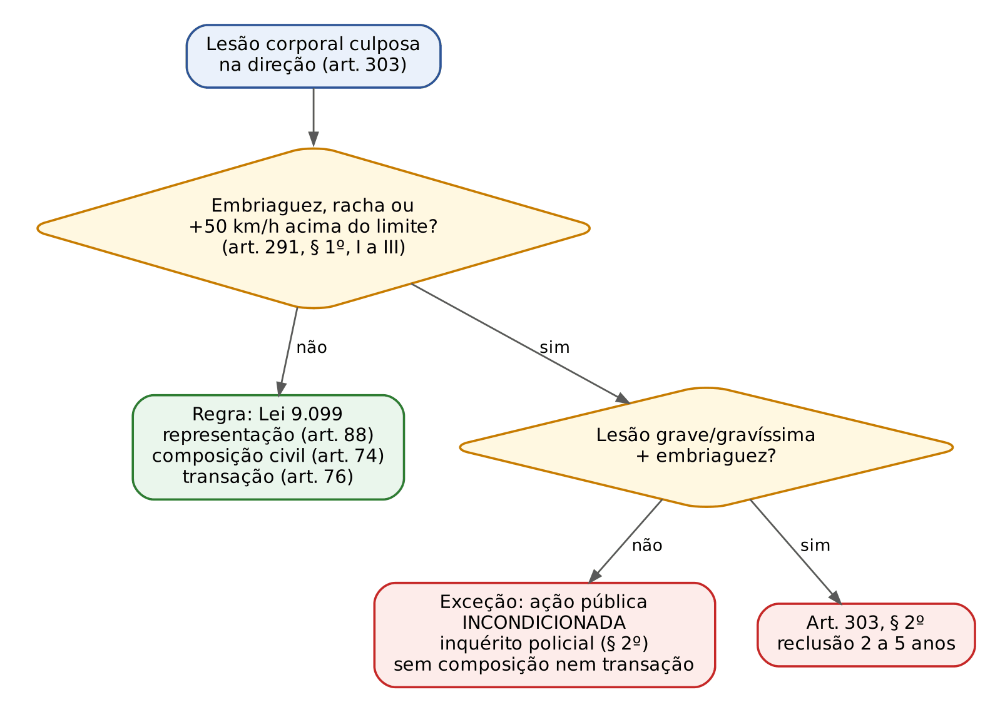
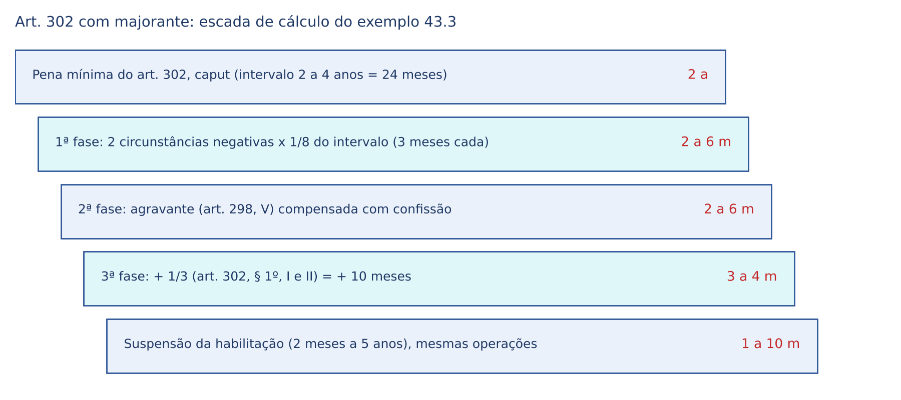
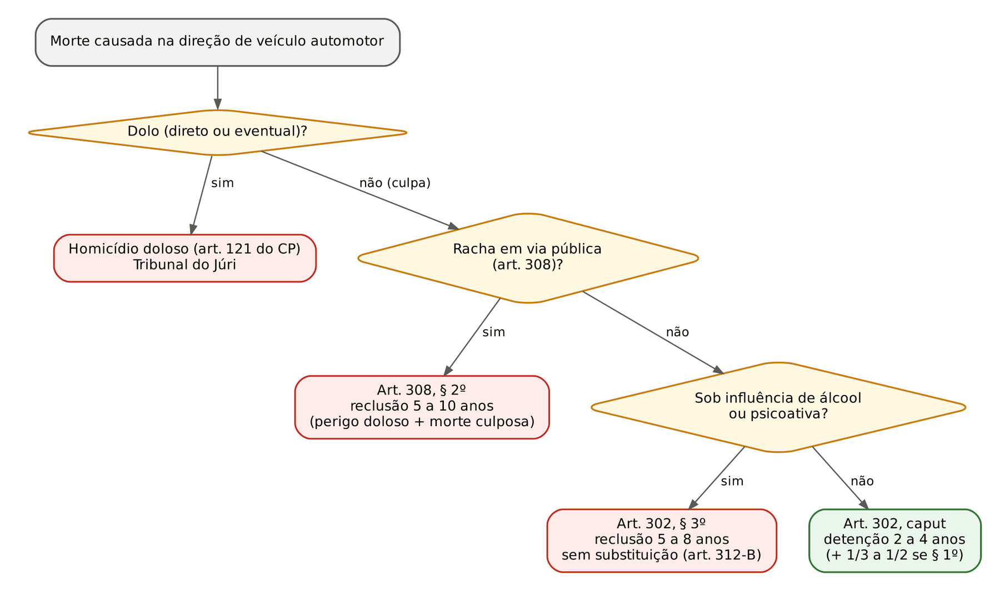

# CAPÍTULO 43 — CRIMES DE TRÂNSITO (CÓDIGO DE TRÂNSITO BRASILEIRO)

:::INCIDENCIA
Pontos: TRF5 p. 10; TJRS p. 7; TJSC p. 62. Nível A. Lote: 2 questões (FGV 2, FCC 0), mais 3 correlatas FGV/FCC de outros capítulos.
O que mais cai: ação penal na lesão culposa (art. 291, § 1º), concurso e consunção entre os arts. 303, 306 e 309, perigo abstrato x concreto, embriaguez (meios de prova), as formas qualificadas pela embriaguez e as restritivas específicas (arts. 312-A e 312-B).
:::

## 43.1 Panorama: a lógica do capítulo XIX do CTB

O Código de Trânsito Brasileiro (Lei 9.503/1997) reúne no Capítulo XIX (arts. 291 a 312-B) duas coisas: uma parte geral própria (Seção I, arts. 291 a 301) e onze tipos penais (Seção II, arts. 302 a 312). Os tipos se dividem em três famílias, e enxergar essa divisão resolve metade das questões:

| Família | Crimes | O que se pune | Pergunta-chave |
|---|---|---|---|
| Crimes de dano culposos | homicídio culposo (art. 302) e lesão culposa (art. 303) | o resultado lesivo causado por quebra do dever de cuidado | houve culpa demonstrada e descrita na denúncia? |
| Crimes de perigo | embriaguez (306), racha (308), direção sem habilitação (309), entrega da direção (310), velocidade incompatível (311) | a criação de risco, sem necessidade de dano | o tipo exige perigo CONCRETO (308, 309, 311) ou basta a conduta (306, 310)? |
| Crimes contra a administração da justiça e de omissão | omissão de socorro (304), fuga do local (305), violação da suspensão (307), fraude processual (312) | o comportamento depois do sinistro ou contra decisões e provas | quem é o sujeito e o que a lei quis proteger? |

Dois conceitos atravessam tudo:

- Veículo automotor: o veículo a motor de propulsão que circula por seus próprios meios e serve para o transporte de pessoas ou coisas (Anexo I do CTB). Bicicleta e carroça não são veículos automotores: o ciclista que mata culposamente um pedestre responde pelo art. 121, § 3º, do CP, não pelo art. 302.
- "Na direção": o agente precisa estar conduzindo. O passageiro que abre a porta e atinge o motociclista responde pelo CP. Já o local é, em regra, irrelevante: os arts. 302, 303 e 306 NÃO exigem via pública (acidente no estacionamento do shopping ou na fazenda continua sendo crime de trânsito); exigem via pública, por texto expresso, apenas o racha (art. 308) e a direção sem habilitação (art. 309).

:::PEGADINHA "Via pública" só onde a lei diz
A redação original do art. 306 exigia "via pública"; a Lei 12.760/2012 suprimiu a expressão. Hoje dirigir embriagado dentro de condomínio ou estacionamento privado também é crime. Já o art. 309 ("em via pública") e o art. 308 ("em via pública") mantêm a exigência, e a banca troca uma coisa pela outra.
:::

Terminologia. A Lei 14.599/2023 (de 19/6/2023, publicada e vigente em 20/6/2023) substituiu, nos arts. 301, 302, § 1º, III, 304, 305 e 312, a palavra "acidente" por "sinistro" de trânsito, e fez o mesmo nos incisos II a IV do art. 312-A ("vítimas de sinistro de trânsito", "sinistrados de trânsito"). A troca é só de nomenclatura: não houve *abolitio criminis* nem mudança de pena. A banca já usa "sinistro" nos enunciados (Q3345949).

### 43.1.1 Aplicação subsidiária do CP, do CPP e da Lei 9.099 (art. 291)

O art. 291, caput, manda aplicar aos crimes cometidos na direção de veículos automotores as normas gerais do CP e do CPP, se o capítulo não dispuser de modo diverso, e a Lei 9.099/1995, no que couber. Consequência prática: tudo o que foi estudado na parte geral (culpa, concurso, dosimetria, prescrição, substituição) vale aqui, salvo regra especial do CTB. As regras especiais são justamente o que a banca cobra: a ação penal da lesão culposa (§ 1º), a suspensão da habilitação como pena (arts. 292 e 293), as agravantes próprias (art. 298), a vedação do flagrante (art. 301) e as restritivas específicas (arts. 312-A e 312-B).

O § 4º do art. 291 (Lei 13.546/2017) manda o juiz fixar a pena-base pelo art. 59 do CP, "dando especial atenção à culpabilidade do agente e às circunstâncias e consequências do crime". Não cria circunstância nova nem altera o método (Cap. 13); apenas sinaliza que, no trânsito, o grau de desatenção, o modo do sinistro e a extensão dos danos são os vetores mais relevantes.

### 43.1.2 Lesão culposa: ação penal e institutos da Lei 9.099 (art. 291, §§ 1º e 2º)

A lesão corporal culposa do CP é de ação pública condicionada à representação por força do art. 88 da Lei 9.099. O CTB repete a regra para a lesão culposa de trânsito, mas cria três exceções em que a infração fica mais grave do ponto de vista processual.

:::LEI CTB, art. 291, §§ 1º e 2º
§ 1º Aplica-se aos crimes de trânsito de lesão corporal culposa o disposto nos arts. 74, 76 e 88 da Lei nº 9.099, de 26 de setembro de 1995, exceto se o agente estiver:
I - sob a influência de álcool ou qualquer outra substância psicoativa que determine dependência;
II - participando, em via pública, de corrida, disputa ou competição automobilística, de exibição ou demonstração de perícia em manobra de veículo automotor, não autorizada pela autoridade competente;
III - transitando em velocidade superior à máxima permitida para a via em 50 km/h (cinquenta quilômetros por hora).
§ 2º Nas hipóteses previstas no § 1º deste artigo, deverá ser instaurado inquérito policial para a investigação da infração penal.
:::

Leitura em três camadas:

- Regra (sem as exceções): a lesão culposa de trânsito (art. 303, caput) admite composição civil dos danos, que extingue a punibilidade (art. 74 da Lei 9.099), transação penal (art. 76) e depende de representação (art. 88), sujeita à decadência de 6 meses contados do conhecimento da autoria (art. 38 do CPP; art. 103 do CP).
- Exceções (incisos I a III): a ação passa a ser pública INCONDICIONADA, não cabem composição civil nem transação penal, e a investigação se faz por inquérito policial, não por termo circunstanciado (§ 2º).
- O que a exceção NÃO afasta: a suspensão condicional do processo (art. 89 da Lei 9.099) não está entre os artigos mencionados no § 1º; depende só da pena mínima (até 1 ano) e dos requisitos próprios (Cap. 25).

:::ATENCAO A exceção do inciso III é numérica
É velocidade superior à máxima permitida para a via EM 50 km/h: numa via de 60 km/h, só acima de 110 km/h. Dirigir a 100 km/h nessa via é grave, mas não tira a lesão culposa do regime da Lei 9.099.
:::

:::PROCESSO Representação, decadência e infração de menor potencial ofensivo
A lesão culposa do art. 303, caput (detenção de 6 meses a 2 anos), é infração de menor potencial ofensivo (pena máxima até 2 anos: art. 61 da Lei 9.099). Mas, se incidir a majorante do § 1º (1/3 até a metade), a pena máxima vai a 3 anos (2 anos + 1/2) e a infração deixa de ser de menor potencial: o cálculo do teto considera o aumento MÁXIMO (Cap. 25). A representação dispensa forma; basta a manifestação inequívoca da vítima (registro da ocorrência pedindo providências, por exemplo). Sem ela em 6 meses, extingue-se a punibilidade pela decadência (art. 107, IV, do CP).
:::

### 43.1.3 Competência e outros reflexos processuais

- Justiça Estadual, em regra, mesmo que o sinistro ocorra em rodovia federal: o local não gera interesse da União (art. 109, IV, da CF). A competência federal só surge em situações excepcionais (por exemplo, crime conexo de competência federal ou ofensa direta a bem, serviço ou interesse da União), e o tema interessa ao TRF5 mais pelo contraste com os crimes conexos do que pelos crimes de trânsito em si.
- Viatura militar: a Súmula 6 do STJ atribui à Justiça Comum Estadual o delito decorrente de acidente de trânsito envolvendo viatura da Polícia Militar, salvo se autor e vítima forem policiais militares em atividade. A súmula é anterior à Lei 13.491/2017, que ampliou o conceito de crime militar, e seu alcance atual é discutido: em prova, cite-a com essa ressalva (Cap. 51).
- Homicídio com dolo eventual: Tribunal do Júri (43.5).
- Denúncia: no crime culposo, a inicial deve descrever em que consistiu a imprudência, a negligência ou a imperícia; dizer apenas que o réu "dirigia o veículo e colidiu" é inépcia, porque equivale a responsabilidade penal objetiva (STJ, 6ª Turma, HC 305.194-PB, j. 11/11/2014, Info 553).

## 43.2 Sanções e regras próprias da parte geral do CTB

### 43.2.1 Suspensão ou proibição de obter a habilitação como PENA (arts. 292, 293 e 296)

No CP, a suspensão da habilitação é pena restritiva de direitos SUBSTITUTIVA (interdição temporária, art. 47, III, do CP — Cap. 12): o juiz primeiro fixa a prisão e depois a troca. No CTB é diferente: a suspensão (para quem já é habilitado) ou a proibição de obter a permissão ou a habilitação (para quem não é) é pena PRINCIPAL, cominada no próprio preceito secundário de alguns tipos, cumulativamente com a privativa de liberdade.

- Onde está cominada: arts. 302, 303, 306 e 308 (cumulativa com a prisão) e art. 307 (nova imposição de idêntico prazo). Nos demais tipos, não há.
- Pode ser imposta isolada ou cumulativamente com outras penalidades (art. 292).
- Duração: 2 meses a 5 anos (art. 293). Fixa-se com fundamentação e proporcionalidade em relação à pena privativa, seguindo o mesmo raciocínio trifásico (exemplo em 43.3.5).
- Reincidência em crime do CTB: o juiz aplica a suspensão mesmo nos tipos que não a cominam (art. 296: "o juiz aplicará"), sem prejuízo das demais sanções.
- Execução: transitada em julgado a condenação, o réu é intimado a entregar a permissão ou a carteira em 48 horas (art. 293, § 1º; a recusa é crime do art. 307, parágrafo único). A suspensão não corre enquanto o condenado estiver recolhido a estabelecimento prisional (art. 293, § 2º), para não se cumprir "de graça" durante a prisão.
- Comunicação ao Contran e ao órgão de trânsito do Estado de domicílio (art. 295).

:::JURIS STF, Tema 486 (RE 607.107-MG, Plenário, j. 12/2/2020)
É constitucional a imposição da pena de suspensão da habilitação ao motorista profissional condenado por homicídio culposo no trânsito. O direito ao livre exercício profissional (art. 5º, XIII, da CF) não é absoluto, e a restrição é razoável. No mesmo sentido, o STJ entende que ser motorista profissional não autoriza trocar a suspensão por outra sanção, pois é justamente dele que se espera maior cuidado (Jurisprudência em Teses, ed. 114, tese 2).
:::

Também não cabe *habeas corpus* contra a imposição isolada da suspensão do direito de dirigir, porque ela não ameaça a liberdade de locomoção (Jurisprudência em Teses, ed. 114, tese 3).

### 43.2.2 Suspensão como medida cautelar (art. 294)

Em qualquer fase da investigação ou do processo, havendo necessidade para a garantia da ordem pública, o juiz pode decretar a suspensão da permissão ou da habilitação, ou a proibição de sua obtenção, de ofício, a requerimento do MP ou por representação da autoridade policial. Cabe recurso em sentido estrito, sem efeito suspensivo, da decisão que decreta a medida ou que indefere o requerimento do MP (parágrafo único). Pós-Lei 13.964/2019, a decretação de ofício de medidas cautelares é criticada (art. 282, § 2º, do CPP); em prova objetiva, prevalece a literalidade do art. 294, mas na sentença prefira fundamentar em requerimento das partes. Se o réu for condenado, o tempo de cautelar deve ser computado na pena de suspensão, por analogia com a detração (art. 42 do CP).

### 43.2.3 Multa reparatória (art. 297)

É o pagamento, mediante depósito judicial em favor da vítima ou de seus sucessores, de quantia calculada pelo critério do dia-multa (art. 49, § 1º, do CP), sempre que houver prejuízo MATERIAL resultante do crime. Limites: não pode superar o prejuízo demonstrado no processo (§ 1º); aplicam-se a ela os arts. 50 a 52 do CP (§ 2º); o valor é descontado na indenização civil (§ 3º).

| | Multa reparatória (art. 297 do CTB) | Valor mínimo de reparação (art. 387, IV, do CPP) |
|---|---|---|
| Natureza | sanção penal com finalidade reparatória | efeito da condenação (título executivo civil) |
| Dano | só prejuízo material | danos materiais e morais (com pedido e contraditório) |
| Cálculo | critério do dia-multa, até o prejuízo provado | estimativa mínima |
| Destinatário | vítima ou sucessores, por depósito judicial | vítima |

### 43.2.4 Agravantes específicas (art. 298)

São circunstâncias que "sempre agravam" as penas dos crimes de trânsito ter o condutor cometido a infração: (I) com dano potencial para duas ou mais pessoas ou grande risco de grave dano patrimonial a terceiros; (II) com veículo sem placas, com placas falsas ou adulteradas; (III) sem permissão ou habilitação; (IV) com habilitação de categoria diferente da do veículo; (V) quando a profissão ou atividade exigir cuidados especiais com transporte de passageiros ou de carga; (VI) com veículo cujos equipamentos ou características de segurança ou de velocidade tenham sido adulterados; (VII) sobre faixa destinada a pedestres.

Três cuidados para a sentença:

- Aplicam-se na SEGUNDA fase, como as do art. 61 do CP (Cap. 14), sem fração legal (a jurisprudência usa, em regra, 1/6).
- Valem para os crimes CULPOSOS. No CP, as agravantes do art. 61, II, são em regra incompatíveis com a culpa (salvo a reincidência); as do art. 298 foram feitas para o trânsito, que é essencialmente culposo, e o STJ admite, por exemplo, a do inciso I no homicídio e na lesão culposos (AgRg no AREsp 2.391.112-SP, 5ª Turma, j. 12/9/2023).
- Proibição de *bis in idem* (dupla valoração do mesmo fato): a agravante não incide quando o mesmo dado já é elementar ou majorante. Quem mata sem habilitação recebe a majorante do art. 302, § 1º, I, e NÃO a agravante do art. 298, III; o atropelamento na faixa recebe a majorante do art. 302, § 1º, II, e não a agravante do inciso VII; quem responde pelo art. 309 não sofre a agravante do inciso III.

### 43.2.5 Prisão em flagrante de quem presta socorro (art. 301)

Ao condutor de veículo, nos casos de sinistros de trânsito que resultem em vítima, não se imporá a prisão em flagrante nem se exigirá fiança, se prestar pronto e integral socorro àquela. A lógica é de política criminal: incentivar o socorro, retirando do motorista o medo da prisão. Observações:

- O benefício é para quem socorre; quem foge pode ser preso em flagrante e responde, se for o caso, pela majorante da omissão de socorro (art. 302, § 1º, III) ou pelos arts. 304 e 305.
- A regra não impede a prisão por OUTRO crime em flagrante (por exemplo, embriaguez ao volante, art. 306, que é crime autônomo).
- Fiança: nos crimes com pena máxima até 4 anos, o próprio delegado pode arbitrá-la (art. 322 do CPP). Assim, no art. 302, caput (máximo de 4 anos), a fiança é policial; no art. 302, § 3º (máximo de 8 anos), só o juiz.
- Prisão preventiva: os crimes culposos, em regra, não a admitem (art. 313, I, do CPP exige crime doloso com pena máxima superior a 4 anos). No art. 306 (doloso, máximo de 3 anos), ela só cabe na hipótese do art. 313, II (reincidente em crime doloso), com risco concreto de reiteração (STJ, 6ª Turma, RHC 132.611-GO, j. 2/2/2021).

### 43.2.6 Substituição por restritivas: arts. 312-A e 312-B

As duas regras ficam topograficamente no fim do capítulo, mas são parte geral e repercutem em toda sentença de trânsito.

Art. 312-A (Lei 13.281/2016). Nos crimes dos arts. 302 a 312, quando o juiz substituir a pena privativa de liberdade por restritiva de direitos, esta "deverá ser" de prestação de serviço à comunidade ou a entidades públicas, em uma das seguintes atividades: (I) trabalho, aos fins de semana, em equipes de resgate dos corpos de bombeiros e em outras unidades móveis especializadas no atendimento a vítimas de trânsito; (II) trabalho em unidades de pronto-socorro de hospitais da rede pública que recebem vítimas de sinistro de trânsito e politraumatizados; (III) trabalho em clínicas ou instituições especializadas na recuperação de sinistrados de trânsito; (IV) outras atividades relacionadas a resgate, atendimento e recuperação de vítimas de sinistros de trânsito (incisos II a IV com a redação da Lei 14.599/2023). A ideia é pedagógica: o condenado convive com as consequências reais do trânsito violento.

Observe que o art. 312-A NÃO cria hipótese de substituição: os requisitos continuam sendo os do art. 44 do CP (Cap. 17). Ele apenas direciona a modalidade. Quando a pena superar 1 ano, a substituição é por duas restritivas ou por uma restritiva e multa (art. 44, § 2º): uma delas será a prestação de serviços do art. 312-A.

:::QUESTAO FGV 2025 — TJ-GO — Residente Jurídico (Q3345949)
Condenado por embriaguez ao volante, o réu terá a pena substituída por prestação de serviços à comunidade; pergunta-se em quais das três atividades descritas (resgate nos fins de semana com bombeiros, pronto-socorro da rede pública que recebe vítimas de sinistro, clínicas de recuperação de sinistrados) ela pode ser cumprida. Gabarito oficial: E — as três (art. 312-A, I a III).
Armadilhas: as alternativas que excluem uma das atividades apostam na falta de memória do rol; o inciso IV ainda deixa a lista aberta a "outras atividades" relacionadas a vítimas de trânsito. Note que o art. 306 é doloso e a substituição depende do art. 44 do CP (pena até 4 anos, sem violência ou grave ameaça), presente no caso.
:::

:::JURIS STJ, AgRg no REsp 2.204.178-MG, 5ª Turma, j. 14/4/2026 (Info 885)
Em recurso exclusivo da defesa, o tribunal pode trocar a modalidade da restritiva fixada na sentença (por exemplo, prestação pecuniária) pela prestação de serviços exigida pelo art. 312-A, sem *reformatio in pejus* (piora da situação do réu em recurso só dele), desde que mantido o *quantum* da sanção substitutiva. Julgamento por maioria.
:::

Art. 312-B (Lei 14.071/2020). Aos crimes do art. 302, § 3º (homicídio culposo sob influência de álcool ou psicoativa), e do art. 303, § 2º (lesão grave ou gravíssima com capacidade psicomotora alterada), NÃO se aplica o inciso I do art. 44 do CP. Por que o legislador precisou dizer isso? Porque o art. 44, I, admite substituição em crime CULPOSO qualquer que seja a pena; sem o art. 312-B, o motorista embriagado condenado a 6 anos por homicídio culposo teria direito a restritivas. Com ele, nesses dois crimes a substituição fica vedada. É norma penal mais grave: não alcança fatos anteriores à vigência da Lei 14.071/2020.

:::PEGADINHA O art. 312-B não veda tudo
A vedação alcança apenas os arts. 302, § 3º, e 303, § 2º. O homicídio culposo simples (art. 302, caput), o racha qualificado (art. 308, §§ 1º e 2º) e a embriaguez do art. 306 continuam admitindo a substituição, se presentes os requisitos do art. 44 (e, no racha qualificado, que é crime doloso de perigo, respeitado o limite de 4 anos). Também não se confunda vedação da substituição com vedação do ANPP ou do *sursis*: o art. 312-B só fala no art. 44.
:::

:::SENTENCA Pena de trânsito: o que não pode faltar no dispositivo
Onde entra: depois da pena privativa e da multa, antes do regime e da substituição. Fundamente a suspensão (ou proibição) da habilitação com o mesmo raciocínio trifásico e proporcional ao da pena privativa; na substituição, indique uma das atividades do art. 312-A.
Redação-modelo: "Aplico ainda a pena de suspensão da habilitação para dirigir veículo automotor por 1 (um) ano e 10 (dez) meses (arts. 293 e 302 do CTB), a ser cumprida após o trânsito em julgado, intimando-se o réu para entregar a CNH em 48 horas (art. 293, § 1º). Substituo a pena privativa por prestação de serviços em unidade de pronto-socorro da rede pública que receba vítimas de sinistros de trânsito (art. 312-A, II) e por prestação pecuniária."
Erros que a banca pune: esquecer a suspensão cumulativa; fixar a suspensão no máximo sem fundamentação; substituir a pena no art. 302, § 3º, ou no art. 303, § 2º (art. 312-B).
:::

## 43.3 Homicídio culposo na direção de veículo automotor (art. 302)

### 43.3.1 Tipo e relação com o CP

Pena: detenção de 2 a 4 anos, e suspensão ou proibição de obter a permissão ou a habilitação. O homicídio culposo do CP (art. 121, § 3º) tem detenção de 1 a 3 anos. O art. 302 é tipo ESPECIAL: tem todos os elementos do art. 121, § 3º, mais o especializante "na direção de veículo automotor" (Cap. 3, conflito aparente de normas). A diferença de pena foi questionada por violar a isonomia; a jurisprudência a mantém, porque o legislador pode tratar com mais rigor a culpa numa atividade de risco massificado como a condução de veículos.

A estrutura do crime culposo (dever objetivo de cuidado, previsibilidade, imprudência, negligência e imperícia, culpa consciente) está no Cap. 7. Para o trânsito, dois lembretes:

- A culpa não se presume no Direito Penal. Dirigir sem habilitação, acima da velocidade ou embriagado não prova, por si, que a morte decorreu dessa violação: é preciso nexo entre a quebra do cuidado e o resultado (imputação objetiva, Cap. 6). Se o pedestre se lança repentinamente à frente do carro que trafegava regularmente, não há crime, ainda que o motorista não tivesse CNH.
- Não há compensação de culpas no Direito Penal: a culpa concorrente da vítima não exclui a do motorista; apenas pode ser valorada no art. 59 (comportamento da vítima). Só a culpa EXCLUSIVA da vítima afasta o crime.

Perdão judicial: aplica-se ao art. 302 o perdão do art. 121, § 5º, do CP quando as consequências atingirem o agente de forma tão grave que a sanção se torne desnecessária (o pai que, por imprudência, mata o próprio filho no acidente); sobre a extensão do perdão no concurso formal, ver Cap. 21 (REsp 1.444.699-RS). Arrependimento posterior: incabível no art. 302, porque a vida não é reparável (Cap. 8, REsp 1.561.276-BA).

### 43.3.2 Majorantes do § 1º (1/3 até a metade)

:::LEI CTB, art. 302, § 1º
§ 1º No homicídio culposo cometido na direção de veículo automotor, a pena é aumentada de 1/3 (um terço) à metade, se o agente:
I - não possuir Permissão para Dirigir ou Carteira de Habilitação;
II - praticá-lo em faixa de pedestres ou na calçada;
III - deixar de prestar socorro, quando possível fazê-lo sem risco pessoal, à vítima do sinistro;
IV - no exercício de sua profissão ou atividade, estiver conduzindo veículo de transporte de passageiros.
:::

| Inciso | Alcance fixado pela jurisprudência | Fonte |
|---|---|---|
| I — sem permissão ou habilitação | NÃO abrange CNH vencida: o condutor é habilitado; a validade vencida é infração administrativa, e estender a majorante seria analogia *in malam partem* | STJ, 6ª Turma, HC 226.128-TO, j. 7/4/2016 (Info 581) |
| II — faixa de pedestres ou calçada | Basta que a vítima seja atingida na calçada, ainda que o carro viesse pela pista e subisse nela ao perder o controle, ou saísse de uma garagem | STJ, 5ª Turma, AgRg nos EDcl no REsp 1.499.912-SP, j. 5/3/2020 (Info 668) |
| III — omissão de socorro | Incide mesmo que a morte tenha sido instantânea: não cabe ao agente presumir o estado da vítima | STF, 1ª Turma, HC 195.497 AgR, j. 23/3/2021 |
| IV — transporte de passageiros | Basta estar no exercício da atividade de transporte de passageiros; é irrelevante haver passageiros no momento | STJ, 6ª Turma, AgRg no REsp 1.255.562-RS, j. 4/2/2014 (Info 537) |

Os mesmos incisos majoram a lesão culposa (art. 303, § 1º). Pluralidade de incisos: como todos estão no mesmo parágrafo e com a mesma fração variável, há UM só aumento; o número de hipóteses pode justificar fração acima do mínimo, desde que com fundamentação concreta (raciocínio análogo ao da Súmula 443 do STJ — Cap. 15).

:::ATENCAO Omissão de socorro: majorante ou art. 304?
O condutor que CAUSOU culposamente o sinistro e não socorre a vítima responde pelo art. 302 ou 303 com a majorante do inciso III. O art. 304 é subsidiário ("se o fato não constituir elemento de crime mais grave") e serve ao condutor ENVOLVIDO no sinistro sem culpa. O terceiro que passa pelo local e não socorre responde pelo art. 135 do CP (43.6).
:::

Histórico que a banca explora: o inciso V (embriaguez como majorante, de 2006) foi revogado pela Lei 11.705/2008; a Lei 12.971/2014 criou um § 2º que previa embriaguez com pena igual à do caput (mal redigido) e que foi revogado pela Lei 13.281/2016; finalmente a Lei 13.546/2017 criou o atual § 3º, forma QUALIFICADA (vigente desde 19/4/2018).

### 43.3.3 Qualificadora da embriaguez (§ 3º)

:::LEI CTB, art. 302, § 3º
§ 3º Se o agente conduz veículo automotor sob a influência de álcool ou de qualquer outra substância psicoativa que determine dependência:
Penas - reclusão, de cinco a oito anos, e suspensão ou proibição do direito de se obter a permissão ou a habilitação para dirigir veículo automotor.
:::

Pontos essenciais:

- É qualificadora (novos limites de pena), não majorante: entra na pena-base, não na terceira fase.
- Continua sendo homicídio CULPOSO. A embriaguez não transforma o fato em doloso (43.5); se houver dolo eventual, sai-se do CTB para o art. 121 do CP.
- A expressão é "sob a influência", e não "com capacidade psicomotora alterada" (usada no art. 303, § 2º, e no art. 306). Na prática, a prova é a mesma do art. 306 (43.7): exame, sinais, vídeo, testemunhas.
- O art. 306 fica ABSORVIDO: a embriaguez é elementar da forma qualificada; puni-la duas vezes seria *bis in idem*. Contraste com a lesão LEVE: aí não há forma qualificada, e o STJ reconhece concurso de crimes entre o art. 303, caput, e o art. 306 (43.12).
- Consequências: reclusão; não cabe suspensão condicional do processo (mínimo de 5 anos) nem ANPP (mínimo não inferior a 4 anos); não cabe substituição (art. 312-B); *sursis* só se a pena não exceder 2 anos, impossível aqui. O regime inicial segue o art. 33 do CP: pena até 8 anos, réu primário, regime semiaberto em regra (Cap. 17).

### 43.3.4 Ficha

| Crime | Pena | Elemento subjetivo | Tentativa | Ação | Benefícios | Hediondo |
|---|---|---|---|---|---|---|
| Art. 302, caput | detenção 2 a 4 anos + suspensão/proibição | culpa | não | pública incondicionada | ANPP sim (mínimo 2 anos, mesmo com a majorante mínima: 2 anos e 8 meses); sem *sursis* processual (mínimo superior a 1 ano); substituição sim (culposo, art. 44, I) | não |
| Art. 302, § 1º | + 1/3 a 1/2 | culpa | não | incondicionada | idem | não |
| Art. 302, § 3º | reclusão 5 a 8 anos + suspensão/proibição | culpa (com embriaguez dolosa ou não) | não | incondicionada | sem ANPP, sem *sursis* processual, sem substituição (art. 312-B) | não |

### 43.3.5 Dosimetria do art. 302 com majorante (exemplo completo)

:::EXEMPLO Homicídio culposo majorado: as três fases e a suspensão da habilitação
Caso: P, primário, caminhoneiro, dirigindo sem CNH (nunca se habilitou), digita no celular, invade a calçada e mata um pedestre. Confessa. O juiz reconhece culpabilidade elevada (uso deliberado do celular em caminhão carregado) e consequências graves (a vítima deixou três filhos pequenos dependentes). Não há embriaguez.
Tipificação: art. 302, caput, com § 1º, I (sem habilitação) e II (calçada). O art. 309 fica absorvido (43.10).
1ª fase (art. 59 do CP e art. 291, § 4º, do CTB). Intervalo da pena: 4 anos − 2 anos = 2 anos = 24 meses. Critério de 1/8 do intervalo por circunstância (o mais usado no STJ, Cap. 13): 24 ÷ 8 = 3 meses por circunstância. Duas negativas: 6 meses. Pena-base: 2 anos + 6 meses = 2 anos e 6 meses.
Variante (1/6 sobre a pena mínima): 1/6 de 24 meses = 4 meses por circunstância; duas = 8 meses; pena-base de 2 anos e 8 meses. Ambos os critérios são aceitos desde que fundamentados; a escolha é discricionária (Cap. 13).
2ª fase. Agravante do art. 298, V (profissão que exige cuidados especiais no transporte de carga) e atenuante da confissão (art. 65, III, "d", do CP). Repare: a agravante do art. 298, III (sem habilitação), NÃO entra, porque o dado já é majorante. A compensação entre agravante e atenuante de igual peso (Cap. 14) mantém 2 anos e 6 meses.
3ª fase. Dois incisos do mesmo § 1º = um único aumento, entre 1/3 e 1/2. Com 1/3: 30 meses × 1/3 = 10 meses; pena definitiva = 3 anos e 4 meses de detenção. Se o juiz, fundamentando concretamente a maior reprovabilidade, aplicar 1/2: 30 × 1/2 = 15 meses; pena = 3 anos e 9 meses.
Suspensão da habilitação (2 meses a 5 anos; intervalo de 58 meses), pelo mesmo método: 1/8 de 58 = 7,25 meses = 7 meses e 7 dias (0,25 mês = 7,5 dias; despreza-se a fração de dia, art. 11 do CP). Duas circunstâncias = 14,5 meses = 14 meses e 15 dias. Base = 2 meses + 14 meses e 15 dias = 16 meses e 15 dias. Segunda fase compensada. Terceira fase: 16,5 meses × 1/3 = 5,5 meses = 5 meses e 15 dias. Total: 22 meses = 1 ano e 10 meses (aqui o uso de "proibição de obter" seria o correto, pois P nunca se habilitou).
Regime: detenção não admite regime inicial fechado; primário, pena até 4 anos: aberto (art. 33, § 2º, "c", do CP).
Substituição: crime culposo, cabível qualquer que seja a pena (art. 44, I); acima de 1 ano, duas restritivas ou uma restritiva e multa (art. 44, § 2º), uma delas a prestação de serviços do art. 312-A.
:::

:::DICA Suspensão proporcional
Não há fórmula legal para a suspensão. O STJ exige fundamentação e proporcionalidade com a pena privativa; replicar as frações das três fases sobre o intervalo de 2 meses a 5 anos é o modo mais seguro de demonstrar essa proporcionalidade na prova de sentença. Fixar a suspensão no máximo com pena privativa no mínimo é o erro típico.
:::

## 43.4 Lesão corporal culposa na direção de veículo automotor (art. 303)

Pena: detenção de 6 meses a 2 anos, e suspensão ou proibição de obter a permissão ou a habilitação (o art. 129, § 6º, do CP tem detenção de 2 meses a 1 ano). Aumenta-se de 1/3 à metade nas hipóteses do art. 302, § 1º (art. 303, § 1º). A ação penal e os institutos da Lei 9.099 foram vistos em 43.1.2.

:::LEI CTB, art. 303, § 2º
§ 2º A pena privativa de liberdade é de reclusão de dois a cinco anos, sem prejuízo das outras penas previstas neste artigo, se o agente conduz o veículo com capacidade psicomotora alterada em razão da influência de álcool ou de outra substância psicoativa que determine dependência, e se do crime resultar lesão corporal de natureza grave ou gravíssima.
:::

A qualificadora exige os DOIS requisitos cumulativos: embriaguez (capacidade psicomotora alterada) + lesão grave ou gravíssima (conceitos do art. 129, §§ 1º e 2º, do CP — Cap. 28). Combinações possíveis:

| Situação | Enquadramento | Ação penal |
|---|---|---|
| Lesão leve, sem exceções do art. 291, § 1º | art. 303, caput | condicionada à representação; composição e transação |
| Lesão leve com embriaguez | art. 303, caput + art. 306, em concurso (43.12) | incondicionada (art. 291, § 1º, I) |
| Lesão grave ou gravíssima sem embriaguez | art. 303, caput (a gravidade vai ao art. 59: consequências) | condicionada (se ausentes as exceções do § 1º) |
| Lesão grave ou gravíssima com embriaguez | art. 303, § 2º (306 absorvido) | incondicionada |

:::PEGADINHA Lesão grave sem embriaguez continua no caput
O CTB não tem forma qualificada pela simples gravidade da lesão. Ao contrário do CP, onde a natureza da lesão define o tipo doloso, no art. 303 a lesão grave sem embriaguez fica no caput e, ausentes as exceções do art. 291, § 1º, a ação depende de representação.
:::

Absorção do art. 309. Quem dirige sem habilitação e, por imprudência, fere alguém responde pelo art. 303 com a majorante do § 1º (inciso I do art. 302, § 1º); o art. 309 é absorvido, pois a direção sem habilitação passa a ser circunstância do crime de dano (Jurisprudência em Teses, ed. 114, tese 4). A absorção pressupõe um mesmo contexto: se houve desígnios autônomos (o agente dirigia sem habilitação gerando perigo muito antes e em outro ponto), há concurso.

Questão mais delicada: e se a vítima da lesão culposa não representar? Duas correntes.

- Corrente 1 (STF, 2ª Turma, HC 128.921-RJ, j. 25/8/2015, Info 796): o art. 309 já foi absorvido pela lesão culposa, crime de ação condicionada; a extinção da punibilidade pela decadência abrange também a direção sem habilitação. O MP não pode "ressuscitar" o crime-meio.
- Corrente 2: extinta a punibilidade do crime de dano por causa processual (falta de representação), nada impede a persecução do crime de perigo, que é de ação incondicionada e tem objetividade própria (segurança viária); a consunção é técnica para evitar dupla punição, e, se não haverá punição pelo crime de dano, não há o que evitar.

:::QUESTAO FGV 2026 — TJ-PE — Juiz Substituto (Q4349512)
Motorista não habilitado, distraído com mensagens de celular, avança o sinal e fere levemente um pedestre conhecido seu, que nunca manifesta vontade de vê-lo processado; passam-se mais de 6 meses desde o fato, com autoria conhecida. Gabarito oficial: B — responde pelo crime de direção sem habilitação gerando perigo (art. 309).
Por que a banca chegou aí: a lesão culposa (art. 303 com a majorante do § 1º) é de ação condicionada, pois nenhuma das exceções do art. 291, § 1º, está presente (distração com celular não é embriaguez, racha nem excesso de 50 km/h); decorridos 6 meses sem representação, extingue-se a punibilidade pela decadência. A FGV adotou a corrente 2: com a lesão fora do processo, subsiste o art. 309, crime de perigo concreto (o avanço do sinal com atropelamento demonstra o perigo) e de ação incondicionada.
Erros das demais: C, D e E pressupõem processo pela lesão, já extinta; D e E falam em forma "qualificada", que só existe com embriaguez e lesão grave (art. 303, § 2º); E soma lesão e art. 309, o que nem a corrente 2 admite enquanto a lesão é punível.
Gabarito discutível: a alternativa A (nenhum crime) corresponde à corrente 1, adotada pela 2ª Turma do STF no HC 128.921 e reproduzida pelos principais materiais de jurisprudência. Na prova, siga a FGV quando o enunciado for idêntico; na sentença, registre a controvérsia.
:::

:::SENTENCA Lesão culposa de trânsito
Onde entra: antes do mérito, verifique a condição de procedibilidade (representação) e se há alguma das exceções do art. 291, § 1º. Se o fato for de ação condicionada e não houver representação válida em 6 meses, a sentença é de extinção da punibilidade (art. 107, IV, do CP), não de absolvição.
Redação-modelo: "Ausente qualquer das hipóteses do art. 291, § 1º, do CTB, a ação penal pelo crime do art. 303 depende de representação (art. 88 da Lei 9.099/1995), que não foi oferecida no prazo do art. 38 do CPP; declaro extinta a punibilidade pela decadência."
Erro que a banca pune: tratar como incondicionada a lesão culposa simples, ou exigir representação quando o condutor estava embriagado.
:::

## 43.5 Dolo eventual x culpa consciente no trânsito; racha com resultado

A teoria (dolo eventual = assumir o risco e aceitar o resultado; culpa consciente = prever, mas confiar sinceramente que não ocorrerá) e as balizas jurisprudenciais sobre embriaguez, velocidade e fuga estão no Cap. 7 (07.4.2). Aqui interessa saber ONDE cada solução leva, porque a diferença de pena e de competência é enorme.

| Situação típica | Enquadramento | Pena | Competência |
|---|---|---|---|
| Desatenção, imprudência comum | art. 302, caput (com § 1º se houver majorante) | detenção 2 a 4 anos | juiz singular |
| Embriaguez, sem aceitação do resultado | art. 302, § 3º | reclusão 5 a 8 anos | juiz singular |
| Racha com morte, sem aceitação do resultado | art. 308, § 2º | reclusão 5 a 10 anos | juiz singular |
| Racha, embriaguez extrema, contramão em alta velocidade, com aceitação do resultado | art. 121 do CP (dolo eventual), eventualmente qualificado | reclusão 6 a 20 anos (simples) | Tribunal do Júri |

- Havendo elementos que indiquem possível dolo eventual, a escolha entre ele e a culpa consciente cabe ao Júri, juiz natural (Jurisprudência em Teses, ed. 114, tese 1); a pronúncia deve apontar circunstâncias concretas, não a embriaguez isolada (Cap. 7).
- O STF reconheceu dolo eventual em quem dirigia sob efeito de álcool E na contramão (1ª Turma, HC 124.687-MS, j. 29/5/2018, Info 904): a soma de circunstâncias revela indiferença ao resultado.
- Dolo eventual admite tentativa (Cap. 7 e 8) e a qualificadora do meio cruel (Q3387035, FCC 2025, gabarito D — Cap. 27).
- No racha, o art. 308, §§ 1º e 2º, é expressamente PRETERDOLOSO: dolo no perigo (participar da disputa) e culpa no resultado ("as circunstâncias demonstrarem que o agente não quis o resultado nem assumiu o risco de produzi-lo"). Se assumiu o risco, a cláusula afasta o CTB e incide o art. 121 do CP.

:::DICA Como a banca monta o enunciado
"Embriagado" sozinho = culposo (art. 302, § 3º). "Embriagado, em velocidade muito superior, na contramão, ignorando alertas dos passageiros" = indícios de dolo eventual, Júri. "Disputava corrida e, sem querer nem aceitar, atropela" = art. 308, § 2º. O verbo do enunciado ("pouco se importando", "confiando que conseguiria desviar") decide.
:::

## 43.6 Omissão de socorro (art. 304) e fuga do local (art. 305)

### 43.6.1 Omissão de socorro do condutor envolvido (art. 304)

Deixar o condutor do veículo, na ocasião do sinistro, de prestar imediato socorro à vítima, ou, não podendo fazê-lo diretamente, por justa causa, deixar de solicitar auxílio da autoridade pública. Pena: detenção de 6 meses a 1 ano, ou multa, se o fato não constituir elemento de crime mais grave.

| Quem omite | Enquadramento |
|---|---|
| Condutor que causou culposamente a morte ou a lesão | art. 302 ou 303 com a majorante do § 1º, III (o art. 304 é expressamente subsidiário) |
| Condutor envolvido no sinistro SEM culpa | art. 304 |
| Terceiro não envolvido (pedestre, outro motorista que passava) | art. 135 do CP |

O parágrafo único é a pegadinha clássica: incide nas penas o condutor "ainda que a sua omissão seja suprida por terceiros ou que se trate de vítima com morte instantânea ou com ferimentos leves". Parte da doutrina (Nucci, Capez) critica a menção à morte instantânea, porque não se socorre cadáver (crime impossível por absoluta impropriedade do objeto); em prova objetiva, vale a literalidade, e o STF aplicou o mesmo raciocínio à majorante do art. 302, § 1º, III (43.3.2). Crime omissivo próprio e doloso: não admite tentativa.

### 43.6.2 Fuga do local do sinistro (art. 305)

Afastar-se o condutor do veículo do local do sinistro, para fugir à responsabilidade penal ou civil que lhe possa ser atribuída. Pena: detenção de 6 meses a 1 ano, ou multa. O especial fim de agir ("para fugir à responsabilidade") é elemento subjetivo do tipo: quem se afasta para buscar socorro, ou por risco de linchamento, não comete o crime.

:::JURIS STF, Tema 907 (RE 971.959-RS, Plenário, j. 14/11/2018)
É constitucional o art. 305 do CTB: o tipo não ofende o princípio da não autoincriminação (*nemo tenetur se detegere*), porque exige apenas a permanência no local para identificação, sem obrigar o condutor a confessar ou produzir prova contra si; ficam garantidos o direito ao silêncio e as hipóteses de exclusão da tipicidade e da ilicitude. O Plenário reafirmou a constitucionalidade na ADC 35 (j. 9/10/2020).
:::

Concurso: art. 302 ou 303 com a fuga posterior. A omissão de socorro já é majorante do crime culposo; a fuga com o fim de escapar da responsabilidade é conduta distinta, que atinge a administração da justiça, e prevalece a possibilidade de concurso material com o crime culposo. Parte da doutrina vê *bis in idem* quando o único dado do caso é o afastamento do local, valorado ao mesmo tempo como omissão de socorro (majorante) e como fuga (art. 305); na sentença, demonstre que são fatos distintos (deixar de socorrer e ocultar-se para não ser identificado).

## 43.7 Embriaguez ao volante (art. 306)

### 43.7.1 Tipo e evolução

:::LEI CTB, art. 306, caput e §§ 1º e 2º
Art. 306. Conduzir veículo automotor com capacidade psicomotora alterada em razão da influência de álcool ou de outra substância psicoativa que determine dependência:
Penas - detenção, de seis meses a três anos, multa e suspensão ou proibição de se obter a permissão ou a habilitação para dirigir veículo automotor.
§ 1º As condutas previstas no caput serão constatadas por:
I - concentração igual ou superior a 6 decigramas de álcool por litro de sangue ou igual ou superior a 0,3 miligrama de álcool por litro de ar alveolar; ou
II - sinais que indiquem, na forma disciplinada pelo Contran, alteração da capacidade psicomotora.
§ 2º A verificação do disposto neste artigo poderá ser obtida mediante teste de alcoolemia ou toxicológico, exame clínico, perícia, vídeo, prova testemunhal ou outros meios de prova em direito admitidos, observado o direito à contraprova.
:::

A redação passou por três fases, e saber qual vigorava na data do fato é essencial (lei penal no tempo, Cap. 3):

| Período | Exigência típica | Prova |
|---|---|---|
| Redação original (1997 a 19/6/2008) | dirigir sob influência de álcool, em via pública, "expondo a dano potencial a incolumidade de outrem" | perigo concreto |
| Lei 11.705/2008 ("Lei Seca") até a Lei 12.760/2012 | concentração igual ou superior a 6 dg/L de sangue, em via pública | o índice era elementar objetiva: só etilômetro ou exame de sangue provavam o crime (STJ, Temas 446 e 447, REsp 1.111.566-DF); a recusa do motorista inviabilizava a condenação |
| Lei 12.760/2012 (desde 21/12/2012) em diante | capacidade psicomotora alterada, constatada por índice OU por sinais; sem "via pública" | qualquer meio de prova (§ 2º) |

A Lei 12.760/2012 corrigiu a falha que tornava a recusa ao bafômetro uma "porta de saída": hoje o índice é apenas UM dos modos de constatação. Para fatos entre 2008 e 2012, a jurisprudência continua exigindo o exame técnico (Jurisprudência em Teses, ed. 114, teses 7 e 9), e o Tema 1.216 do STJ, que discutia a matéria, foi cancelado.

### 43.7.2 Natureza: perigo abstrato

O art. 306 é crime de perigo ABSTRATO: basta conduzir com a capacidade psicomotora alterada; não é preciso provar direção anormal, zigue-zague ou risco a pessoa determinada (Jurisprudência em Teses, ed. 114, tese 6). Atenção à sutileza: o índice ou os sinais demonstram a ALTERAÇÃO da capacidade (elementar), não um perigo concreto. A defesa que alega "dirigia normalmente" não afasta o crime se o etilômetro registrou 0,3 mg/L ou mais.

Crime de mão própria: só quem conduz é autor. Quem entrega o carro ao embriagado responde pelo art. 310 (43.10); a doutrina admite participação por instigação no art. 306, mas a situação típica de quem "empresta o carro" está tipificada como crime autônomo.

### 43.7.3 Meios de prova e recusa

- Etilômetro: 0,3 mg/L de ar alveolar ou mais. O Contran disciplina a margem de erro do equipamento e os sinais de alteração (a regulamentação vigente é a Resolução Contran 432/2013, cuja tabela de tolerância eleva o valor considerado para fins criminais); qualquer aparelho homologado pelo Inmetro pode ser usado (§ 4º).
- Exame de sangue: 6 dg/L ou mais.
- Sinais (inciso II) e outros meios (§ 2º): exame clínico, vídeo, testemunho do policial descrevendo odor etílico, fala pastosa, desequilíbrio, olhos avermelhados (Jurisprudência em Teses, ed. 114, tese 10). Sempre "observado o direito à contraprova".
- Recusa ao teste: o condutor não é obrigado a soprar o etilômetro nem a fornecer sangue (*nemo tenetur se detegere*; Jurisprudência em Teses, ed. 114, tese 8), e a recusa, sozinha, não prova o crime. Mas gera sanção ADMINISTRATIVA própria (art. 165-A do CTB: multa e suspensão do direito de dirigir), que o STF declarou constitucional no Tema 1.079 (RE 1.224.374, j. 19/5/2022): não viola a Constituição impor sanções administrativas a quem se recusa a se submeter a teste, exame clínico ou perícia. Pena criminal pela recusa, não há.
- Auto de infração: a lavratura do auto administrativo NÃO é condição de procedibilidade da ação penal pelo art. 306; esferas independentes (STJ, AgRg no AREsp 2.943.421-BA, 5ª Turma, j. 7/4/2026, Info 884).

:::DICA Esferas administrativa e penal
O art. 165 do CTB (infração gravíssima: dirigir sob influência de álcool) incide com QUALQUER concentração (tolerância zero, ressalvada a margem do aparelho); o crime do art. 306 exige capacidade psicomotora alterada, demonstrada pelo índice do § 1º, I, ou por sinais. Motorista com 0,1 mg/L, sem sinais: infração administrativa, não crime.
:::

:::SENTENCA Embriaguez ao volante: fundamentação da materialidade
Onde entra: na materialidade. Indique o meio de constatação (§ 1º, I ou II) e, se não houve exame, quais sinais foram descritos e por quem, com a contraprova assegurada.
Redação-modelo: "A alteração da capacidade psicomotora está demonstrada pelo teste de etilômetro, que registrou 0,62 mg/L de ar alveolar, acima do índice do art. 306, § 1º, I, do CTB, e pelo depoimento dos policiais, que descreveram odor etílico, fala pastosa e desequilíbrio. Tratando-se de crime de perigo abstrato, é irrelevante a alegação de condução regular."
Erro que a banca pune: exigir perigo concreto ou absolver só porque o réu se recusou ao teste, sem examinar as demais provas.
:::

### 43.7.4 Ficha e benefícios

Pena de detenção de 6 meses a 3 anos, multa e suspensão ou proibição. Não é infração de menor potencial (máximo de 3 anos): não há transação penal; cabem a suspensão condicional do processo (mínimo de 6 meses) e o ANPP. Ação penal pública incondicionada. Substituição: cabível (doloso, sem violência, pena até 4 anos), na modalidade do art. 312-A (Q3345949).

Questão correlata: Q3179517 (FGV 2025, TRF3, Cap. 36) combina embriaguez ao volante (etilômetro), falsa identidade e cigarros estrangeiros; gabarito D — embriaguez e falsa identidade, sendo atípico, por insignificância, o fato quanto aos cigarros (quantidade inferior ao parâmetro do STJ — ver Cap. 36). A condenação anterior por embriaguez não impede a insignificância do contrabando, porque não é reiteração na mesma conduta. Q3029139 (FGV 2024, TRF1, Cap. 35): policial que solicita dinheiro ao motorista embriagado para liberá-lo pratica corrupção passiva (gabarito C).

## 43.8 Violação da suspensão ou da proibição (art. 307)

Violar a suspensão ou a proibição de se obter a permissão ou a habilitação imposta com fundamento no CTB. Pena: detenção de 6 meses a 1 ano e multa, com nova imposição adicional de idêntico prazo de suspensão ou de proibição. Incorre nas mesmas penas o condenado que não entrega a permissão ou a carteira no prazo de 48 horas do art. 293, § 1º (parágrafo único).

Ponto cobrado: só configura o crime a violação de suspensão ou proibição imposta por decisão JUDICIAL (pena ou cautelar do art. 294). Dirigir com a habilitação suspensa por decisão ADMINISTRATIVA do Detran é atípico para o art. 307, podendo configurar infração administrativa (STJ, 6ª Turma, HC 427.472-SP, j. 23/8/2018, Info 641). E, como o motorista suspenso administrativamente é habilitado, também não comete o art. 309 (que fala em "sem a devida permissão ou habilitação ou se cassado o direito de dirigir").

## 43.9 Participação em competição não autorizada: "racha" (art. 308)

:::LEI CTB, art. 308
Art. 308. Participar, na direção de veículo automotor, em via pública, de corrida, disputa ou competição automobilística ou ainda de exibição ou demonstração de perícia em manobra de veículo automotor, não autorizada pela autoridade competente, gerando situação de risco à incolumidade pública ou privada:
Penas - detenção, de 6 (seis) meses a 3 (três) anos, multa e suspensão ou proibição de se obter a permissão ou a habilitação para dirigir veículo automotor.
§ 1º Se da prática do crime previsto no caput resultar lesão corporal de natureza grave, e as circunstâncias demonstrarem que o agente não quis o resultado nem assumiu o risco de produzi-lo, a pena privativa de liberdade é de reclusão, de 3 (três) a 6 (seis) anos, sem prejuízo das outras penas previstas neste artigo.
§ 2º Se da prática do crime previsto no caput resultar morte, e as circunstâncias demonstrarem que o agente não quis o resultado nem assumiu o risco de produzi-lo, a pena privativa de liberdade é de reclusão de 5 (cinco) a 10 (dez) anos, sem prejuízo das outras penas previstas neste artigo.
:::

Elementos:

- Condutas: corrida, disputa ou competição (exige ao menos dois participantes: crime plurissubjetivo, de concurso necessário) OU exibição/demonstração de perícia em manobra (cavalo de pau, "zerinho", empinar a moto), que pode ser praticada por uma só pessoa (incluída pela Lei 12.971/2014 e ajustada pela Lei 13.546/2017).
- Em via pública e sem autorização da autoridade competente.
- "Gerando situação de risco à incolumidade pública ou privada": a redação de 2014 trocou o antigo "dano potencial" por "situação de risco". A doutrina diverge sobre a natureza; prevalece que o tipo exige perigo concreto, demonstrado no caso (pessoas, veículos ou bens efetivamente expostos), embora parte da doutrina leia "situação de risco" como perigo abstrato de perigosidade. Em prova, a resposta mais segura é que o risco deve ser demonstrado, não presumido.
- Sem risco (racha em estrada deserta de madrugada): só infração administrativa (arts. 173 e 174 do CTB).
- Formas qualificadas pelo resultado (§§ 1º e 2º): preterdolosas (43.5). Lesão LEVE não qualifica; a solução para ela (concurso com o art. 303 ou absorção) é controvertida na doutrina e pouco cobrada.

| Forma | Pena | Benefícios |
|---|---|---|
| Caput | detenção 6 meses a 3 anos + multa + suspensão | *sursis* processual e ANPP; sem transação |
| § 1º (lesão grave culposa) | reclusão 3 a 6 anos | ANPP (mínimo inferior a 4 anos), sem *sursis* processual |
| § 2º (morte culposa) | reclusão 5 a 10 anos | nenhum benefício consensual |

Racha e lesão culposa: o art. 291, § 1º, II, retira da Lei 9.099 a lesão culposa causada por quem participava de racha (ação incondicionada, inquérito policial).

## 43.10 Direção sem habilitação (art. 309) e entrega da direção a pessoa inapta (art. 310)

### 43.10.1 Art. 309: perigo concreto

Dirigir veículo automotor, em via pública, sem a devida permissão para dirigir ou habilitação ou, ainda, se cassado o direito de dirigir, gerando perigo de dano. Pena: detenção de 6 meses a 1 ano, ou multa.

O tipo exige perigo CONCRETO ("gerando perigo de dano"). Sem ele, há apenas infração administrativa (art. 162 do CTB). Foi essa exigência que levou o STF a reconhecer a derrogação da contravenção do art. 32 da LCP, que punia a simples direção sem habilitação (perigo abstrato).

:::JURIS STF, Súmula 720
O art. 309 do Código de Trânsito Brasileiro, que reclama decorra do fato perigo de dano, derrogou o art. 32 da Lei das Contravenções Penais no tocante à direção sem habilitação em vias terrestres.
Consequência: a direção sem habilitação em via terrestre, sem perigo concreto, é atípica penalmente (só administrativa). O art. 32 da LCP sobrevive apenas para embarcações a motor em águas públicas (Cap. 50).
:::

O que NÃO é art. 309:

| Situação | Solução |
|---|---|
| CNH vencida | infração administrativa; o condutor é habilitado (mesma lógica do HC 226.128 para a majorante) |
| Habilitação de categoria diferente | infração administrativa (art. 162, III); no crime de trânsito praticado, agravante do art. 298, IV |
| Suspensão administrativa do direito de dirigir | infração administrativa; se a suspensão for judicial, art. 307 |
| Direção sem habilitação em área privada | atípico para o art. 309 (exige via pública) |
| Sem habilitação e sem perigo concreto | infração administrativa (Súmula 720) |

### 43.10.2 Art. 310: perigo abstrato

Permitir, confiar ou entregar a direção de veículo automotor a pessoa não habilitada, com habilitação cassada ou com o direito de dirigir suspenso, ou, ainda, a quem, por seu estado de saúde, física ou mental, ou por embriaguez, não esteja em condições de conduzi-lo com segurança. Pena: detenção de 6 meses a 1 ano, ou multa.

:::JURIS STJ, Súmula 575 e Tema 901 (REsp 1.485.830-MG, 3ª Seção, j. 11/3/2015)
Constitui crime a conduta de permitir, confiar ou entregar a direção de veículo automotor a pessoa que não seja habilitada, ou que se encontre em qualquer das situações previstas no art. 310 do CTB, independentemente da ocorrência de lesão ou de perigo de dano concreto na condução do veículo. O art. 310 é de perigo ABSTRATO: o tipo não descreve resultado nem exige perigo; basta entregar o veículo a quem se sabe inapto.
:::

O contraste é assimétrico e cai sempre: quem DIRIGE sem habilitação só comete crime se gerar perigo concreto (art. 309); quem ENTREGA o carro ao não habilitado comete crime pela simples entrega (art. 310). Pode ocorrer, portanto, de o dono do carro responder pelo art. 310 e o condutor não responder por nada (se dirigiu sem gerar perigo). A justificativa: o legislador quis punir com rigor quem, tendo o domínio do veículo, o põe nas mãos de pessoa inapta, como o pai que entrega o carro ao filho adolescente.

Elemento subjetivo: dolo, que inclui o conhecimento da inaptidão do condutor (sem habilitação, suspenso, cassado, embriagado ou sem condições de saúde). Repare que o art. 310 abrange "direito de dirigir suspenso", hipótese que o art. 309 não abrange para o próprio condutor.

| | Art. 306 | Art. 309 | Art. 310 |
|---|---|---|---|
| Conduta | conduzir com capacidade alterada | dirigir sem habilitação ou com direito cassado | permitir, confiar, entregar a direção a inapto |
| Perigo | abstrato | CONCRETO | abstrato (Súmula 575) |
| Via pública | não exige | exige | não exige |
| Pena | detenção 6 meses a 3 anos + multa + suspensão | detenção 6 meses a 1 ano ou multa | detenção 6 meses a 1 ano ou multa |

## 43.11 Velocidade incompatível (art. 311) e fraude processual (art. 312)

Art. 311. Trafegar em velocidade incompatível com a segurança nas proximidades de escolas, hospitais, estações de embarque e desembarque de passageiros, logradouros estreitos, ou onde haja grande movimentação ou concentração de pessoas, gerando perigo de dano. Pena: detenção de 6 meses a 1 ano, ou multa. Perigo concreto ("gerando perigo de dano") e lugar qualificado (o rol de locais é elementar).

:::JURIS STJ, AgRg no AREsp 2.295.304-DF, 5ª Turma, j. 9/6/2026 (Info 897)
A condenação pelo art. 311 exige prova segura e objetiva de que o agente trafegou em velocidade incompatível com a segurança, com extrapolação do limite aplicável à via; não basta a percepção testemunhal de "condução perigosa". Na sentença, indique o dado objetivo (radar, perícia, vídeo com cálculo de velocidade).
:::

Art. 312. Inovar artificiosamente, em caso de sinistro automobilístico com vítima, na pendência do procedimento policial preparatório, do inquérito ou do processo penal, o estado de lugar, de coisa ou de pessoa, a fim de induzir a erro o agente policial, o perito ou o juiz. Pena: detenção de 6 meses a 1 ano, ou multa. Aplica-se ainda que não iniciados o procedimento, o inquérito ou o processo (parágrafo único). É forma especial da fraude processual do art. 347 do CP (Cap. 36), restrita ao sinistro com vítima: mudar a posição dos veículos, lavar o sangue do para-choque, trocar o motorista. Crime formal: consuma-se com a inovação idônea, ainda que ninguém seja enganado.

Desobediência à ordem de parada: o STJ distingue. A ordem dada por agente de TRÂNSITO, em fiscalização de trânsito, gera só a sanção administrativa do art. 195 do CTB, sem crime de desobediência (Jurisprudência em Teses, ed. 114, tese 12). Já a ordem de parada dada por policiais em policiamento ostensivo de prevenção e repressão de crimes, se desobedecida, configura o art. 330 do CP (STJ, Tema 1.060 — Cap. 36).

## 43.12 Concurso entre crimes de trânsito: quadro de soluções

| Combinação | Solução | Fundamento |
|---|---|---|
| 306 + 309 (embriagado e sem habilitação) | concurso de crimes; NÃO há consunção | Súmula 664 do STJ; concurso material quando demonstradas ações distintas (AgRg no HC 749.440-SC — Cap. 16) |
| 306 + 303, caput (embriagado fere levemente) | concurso material: momentos consumativos e bens jurídicos distintos | Jurisprudência em Teses, ed. 114, tese 5; REsp 2.198.744-MG, Info 860 (Cap. 16) |
| 306 + 303, § 2º, ou 306 + 302, § 3º | absorção do 306 pela forma qualificada (embriaguez é elementar) | vedação de *bis in idem* |
| 309 + 303 ou 302 | absorção do 309, que vira majorante (§ 1º, I), salvo desígnios autônomos | Jurisprudência em Teses, ed. 114, tese 4 |
| 302/303 + 304 | só o 302/303 com a majorante do inciso III | subsidiariedade expressa do 304 |
| 302/303 + 305 | concurso material (condutas e bens distintos), sem dupla valoração do mesmo afastamento | 43.6.2 |
| 310 (dono) + 306 ou 309 (condutor) | cada um responde pelo seu crime (exceção pluralística à teoria monista) | Súmula 575 |

:::JURIS STJ, Súmula 664 (Terceira Seção, 8/11/2023)
É inaplicável a consunção entre o delito de embriaguez ao volante e o de condução de veículo automotor sem habilitação.
Por quê: o art. 306 protege a segurança viária contra o risco da alteração psicomotora; o art. 309, contra o risco da falta de aptidão técnica. Um não é meio necessário nem fase normal do outro; o agente pode cometer qualquer deles sem o outro. Se praticados na mesma ação, a forma do concurso (formal ou material) depende do caso; tendo havido ações distintas, é material (Cap. 16).
:::

## 43.13 Ficha geral dos crimes de trânsito

| Crime | Pena privativa | Suspensão/proibição cominada | IMPO (transação) | *Sursis* processual | ANPP | Perigo |
|---|---|---|---|---|---|---|
| 302, caput | detenção 2 a 4 a | sim | não | não | sim | dano (culposo) |
| 302, § 3º | reclusão 5 a 8 a | sim | não | não | não | dano (culposo) |
| 303, caput | detenção 6 m a 2 a | sim | sim, salvo art. 291, § 1º | sim | não se aplica se cabível transação (art. 28-A, § 2º, I, do CPP); fora disso, sim | dano (culposo) |
| 303, § 1º | 8 m a 3 a | sim | não (máximo de 3 anos) | sim | sim | dano |
| 303, § 2º | reclusão 2 a 5 a | sim | não | não | sim | dano |
| 304 | detenção 6 m a 1 a ou multa | não | sim | sim | — (transação antes) | omissivo |
| 305 | detenção 6 m a 1 a ou multa | não | sim | sim | — | formal |
| 306 | detenção 6 m a 3 a + multa | sim | não | sim | sim | abstrato |
| 307 | detenção 6 m a 1 a + multa | nova imposição | sim | sim | — | — |
| 308, caput | detenção 6 m a 3 a + multa | sim | não | sim | sim | concreto (prevalente) |
| 308, § 1º | reclusão 3 a 6 a | sim | não | não | sim | preterdoloso |
| 308, § 2º | reclusão 5 a 10 a | sim | não | não | não | preterdoloso |
| 309 | detenção 6 m a 1 a ou multa | não | sim | sim | — | concreto |
| 310 | detenção 6 m a 1 a ou multa | não | sim | sim | — | abstrato |
| 311 | detenção 6 m a 1 a ou multa | não | sim | sim | — | concreto |
| 312 | detenção 6 m a 1 a ou multa | não | sim | sim | — | formal |

Observações à ficha: (i) nenhum crime de trânsito é hediondo; (ii) todos são de ação pública incondicionada, salvo a lesão culposa do art. 303 fora das exceções do art. 291, § 1º; (iii) no ANPP, para crimes culposos com resultado violento, prevalece que o requisito "sem violência ou grave ameaça" se refere à violência DOLOSA, admitindo-se o acordo no homicídio e na lesão culposos (Cap. 25); (iv) a reincidência em crime do CTB impõe a suspensão da habilitação mesmo onde não cominada (art. 296).

## 43.14 Resumo para revisão pré-prova

| Instituto | Regra | Exceções/detalhes | Fundamento |
|---|---|---|---|
| Aplicação subsidiária | CP, CPP e Lei 9.099 no que couber | pena-base com atenção a culpabilidade, circunstâncias e consequências | art. 291, caput e § 4º |
| Lesão culposa: ação | condicionada; composição e transação | incondicionada e inquérito se embriaguez, racha ou +50 km/h; *sursis* processual não é afastado | art. 291, §§ 1º e 2º |
| Suspensão/proibição da habilitação | pena principal cumulativa (302, 303, 306, 308; nova imposição no 307); 2 meses a 5 anos | reincidente em crime do CTB: sempre (art. 296); não corre durante a prisão; entrega da CNH em 48h | arts. 292, 293, 296; Tema 486 STF |
| Cautelar de suspensão | qualquer fase, para garantia da ordem pública | RESE sem efeito suspensivo | art. 294 |
| Multa reparatória | dia-multa, só prejuízo material, até o prejuízo provado | descontada na indenização civil | art. 297 |
| Agravantes | sete hipóteses; valem para os culposos | não incidem quando o dado já é elementar ou majorante | art. 298 |
| Flagrante | não há flagrante nem fiança para quem presta pronto e integral socorro | não alcança outro crime autônomo (306) | art. 301 |
| Homicídio culposo | detenção 2 a 4 anos; tipo especial em relação ao CP | perdão judicial cabível; arrependimento posterior não | art. 302 |
| Majorantes (302 e 303) | + 1/3 a 1/2: sem habilitação, faixa ou calçada, omissão de socorro, transporte de passageiros | CNH vencida não; morte instantânea não afasta o III; um só aumento | arts. 302, § 1º, e 303, § 1º |
| Embriaguez qualificando | 302, § 3º (5 a 8, reclusão); 303, § 2º (2 a 5, reclusão, só lesão grave ou gravíssima) | 306 absorvido; sem substituição | arts. 302, § 3º, 303, § 2º, 312-B |
| Dolo eventual | Júri; exige circunstâncias além da embriaguez | racha com morte sem aceitação: 308, § 2º | Cap. 7; JT 114, tese 1 |
| Omissão de socorro | 304 só para o condutor envolvido sem culpa | causador: majorante; terceiro: art. 135 CP; morte instantânea não exclui | art. 304 |
| Fuga do local | constitucional; exige fim de fugir à responsabilidade | concurso com o crime culposo | art. 305; Tema 907 STF |
| Embriaguez ao volante | perigo abstrato; 0,3 mg/L ou 6 dg/L, ou sinais; qualquer prova | recusa: sanção só administrativa (Tema 1.079 STF); fatos de 2008 a 2012 exigem exame | art. 306 |
| Violação da suspensão | só suspensão ou proibição judicial | administrativa: atípico | art. 307 |
| Racha | via pública, sem autorização, situação de risco | §§ 1º e 2º preterdolosos | art. 308 |
| Sem habilitação | perigo concreto, via pública | CNH vencida, categoria diversa, suspensão administrativa: não | art. 309; Súmula 720 STF |
| Entrega da direção | perigo abstrato | inclui suspenso e embriagado | art. 310; Súmula 575 e Tema 901 STJ |
| Velocidade incompatível | perigo concreto, locais do tipo | prova objetiva da velocidade | art. 311 |
| Fraude processual | sinistro com vítima; formal | antes mesmo do inquérito | art. 312 |
| Restritivas | PSC nas atividades ligadas a vítimas de trânsito | troca da modalidade em recurso da defesa não é *reformatio* | art. 312-A |
| Vedação da substituição | 302, § 3º, e 303, § 2º | só afasta o art. 44, I | art. 312-B |
| Concurso | 306 + 309 e 306 + 303 caput: concurso | 309 absorvido por 302/303; 306 absorvido pelas formas qualificadas | Súmula 664 STJ |

## 43.15 Artigos de lei incidentes

- Código de Trânsito Brasileiro (Lei 9.503/1997): arts. 162, 165, 165-A, 173, 174, 195 (por remissão); arts. 291 a 312-B; Anexo I (conceitos de veículo automotor e de sinistro).
- Código Penal: arts. 11, 33, 44, 47, III, 49, 59, 61, 65, III, "d", 107, IV, 121, §§ 3º e 5º, 129, § 6º, 135, 330, 347.
- Código de Processo Penal: arts. 28-A, 38, 41, 313, 322, 387, IV.
- Lei 9.099/1995: arts. 61, 74, 76, 88 e 89.
- Decreto-Lei 3.688/1941 (LCP): art. 32.
- Leis alteradoras citadas: 11.705/2008, 12.760/2012, 12.971/2014, 13.281/2016, 13.546/2017, 14.071/2020 e 14.599/2023.

## 43.16 Julgados, temas e súmulas do capítulo

- Súmula 720 do STF: art. 309 exige perigo concreto e derrogou o art. 32 da LCP nas vias terrestres.
- Súmula 575 do STJ e Tema 901 do STJ (REsp 1.485.830-MG): entrega da direção a inapto é crime de perigo abstrato.
- Súmula 664 do STJ: sem consunção entre embriaguez ao volante e direção sem habilitação.
- Temas 446 e 447 do STJ (REsp 1.111.566-DF): na redação de 2008, índice de 6 dg/L elementar e prova técnica; Tema 1.216 do STJ cancelado.
- Tema 486 do STF (RE 607.107-MG): suspensão da habilitação de motorista profissional é constitucional.
- Tema 907 do STF (RE 971.959-RS) e ADC 35: art. 305 constitucional.
- Tema 1.079 do STF (RE 1.224.374): sanções administrativas pela recusa ao teste são constitucionais.
- STF, HC 128.921-RJ (Info 796): falta de representação na lesão culposa alcança o art. 309 absorvido.
- STF, HC 124.687-MS (Info 904): álcool e contramão indicam dolo eventual.
- STF, HC 195.497 AgR: majorante da omissão de socorro mesmo com morte instantânea.
- STJ, HC 226.128-TO (Info 581): CNH vencida não atrai a majorante do art. 302, § 1º, I.
- STJ, AgRg nos EDcl no REsp 1.499.912-SP (Info 668): majorante da calçada.
- STJ, AgRg no REsp 1.255.562-RS (Info 537): majorante do transporte de passageiros sem passageiros a bordo.
- STJ, HC 305.194-PB (Info 553): denúncia de homicídio culposo deve descrever a culpa.
- STJ, HC 427.472-SP (Info 641): art. 307 só para suspensão judicial.
- STJ, AgRg no AREsp 2.391.112-SP: agravante do art. 298, I, nos crimes culposos.
- STJ, RHC 132.611-GO: preventiva no art. 306 só com reincidência e risco concreto.
- STJ, AgRg no REsp 2.204.178-MG (Info 885): adequação ao art. 312-A em recurso da defesa sem *reformatio in pejus*.
- STJ, AgRg no AREsp 2.943.421-BA (Info 884): auto de infração não é condição de procedibilidade do art. 306.
- STJ, AgRg no AREsp 2.295.304-DF (Info 897): art. 311 exige prova objetiva da velocidade.
- STJ, Jurisprudência em Teses, ed. 114 (crimes de trânsito): teses 1 a 12.

Remissões a outros capítulos: REsp 1.444.699-RS (Cap. 21); REsp 1.561.276-BA (Cap. 8); REsp 2.198.744-MG e AgRg no HC 749.440-SC (Cap. 16); REsp 1.689.173-SC, AgRg no AREsp 2.519.852-SC, AgRg no AREsp 2.795.012-SP, HC 101.698 e HC 107.801 (Cap. 7); Súmula 443 do STJ (Cap. 15); Súmula 6 do STJ e Lei 13.491/2017 (Cap. 51); Tema 1.060 do STJ (Cap. 36); interdição temporária do art. 47, III, do CP (Cap. 12); ANPP e Lei 9.099 (Cap. 25).

:::NOTA Notas de verificação
- Arts. 291 a 312-B conferidos no Planalto (CTB compilado) em 15/10/2026: boxes LEI dos arts. 291, §§ 1º e 2º, 302, §§ 1º e 3º, 303, § 2º, 306 e 308 conferem literalmente; penas dos arts. 302 a 312 conferem. A Lei 14.599/2023 (DOU de 20/6/2023, vigente na publicação) deu a redação com "sinistro" aos arts. 301, 302, § 1º, III, 304, 305 e 312 e também aos incisos II a IV do art. 312-A (inciso III: "sinistrados de trânsito"); a paráfrase do art. 312-A foi ajustada à letra da lei. Correção menor: o art. 301 diz "sinistros de trânsito que resultem em vítima" (estava "de que resulte vítima").
- Nenhuma lei de 2024 a 2026 alterou os arts. 291 a 312-B (texto compilado do Planalto conferido em 15/10/2026; última alteração no capítulo dos crimes: Lei 14.599/2023).
- Q4349512 (FGV 2026, TJ-PE): gabarito oficial B, divergente do STF, HC 128.921 (que levaria à alternativa A). Explicado no box como gabarito discutível.
- Não conferidos na fonte primária: número e data do Tema 1.079 do STF (RE 1.224.374, j. 19/5/2022); Tema 1.060 do STJ (desobediência à ordem de parada policial); Resolução Contran 432/2013 como norma vigente sobre sinais e tolerância do etilômetro. Vigência da Lei 12.760/2012 em 21/12/2012 (DOU, vigente na publicação) e da Lei 13.546/2017 em 19/4/2018 (DOU de 20/12/2017 + 120 dias) conferidas no Planalto em 15/10/2026.
- Afirmações doutrinárias sem obra consultada nesta sessão (Capez, Sinopse TJSC e Caderno Dizer o Direito não foram abertos; o conteúdo do Dizer o Direito chegou pelas notas da Legislação 360): natureza do perigo no art. 308; *bis in idem* entre majorante do inciso III e art. 305; absorção do art. 306 pelos arts. 302, § 3º, e 303, § 2º.
- O método de dosimetria da suspensão da habilitação (replicar as frações sobre o intervalo de 2 meses a 5 anos) é técnica proposta pela apostila para demonstrar proporcionalidade, não fórmula fixada pelo STJ.
:::
