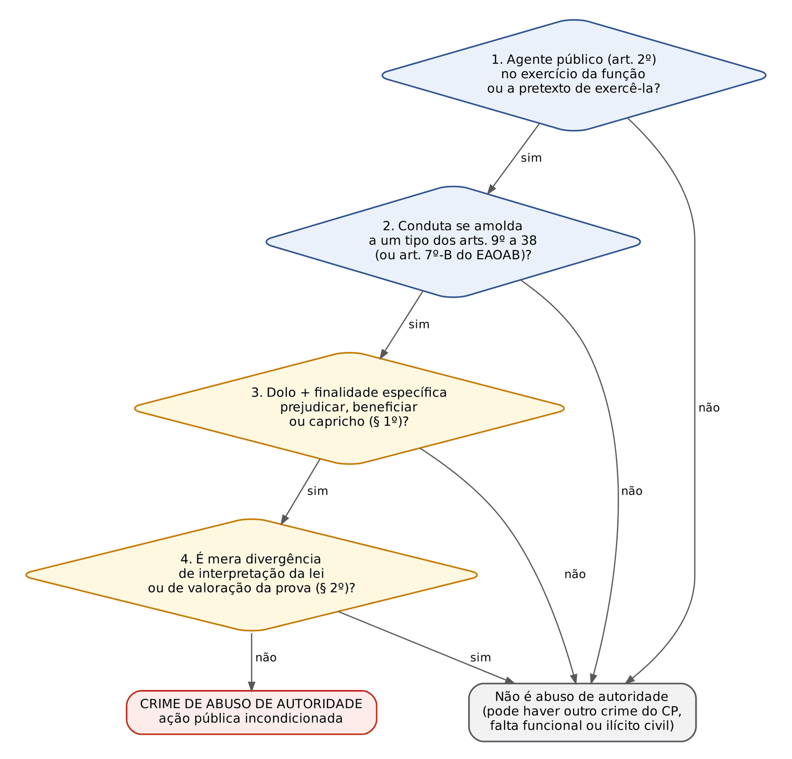
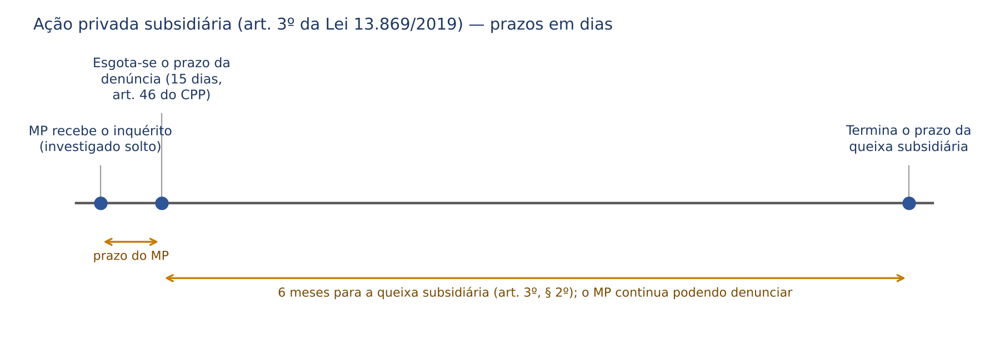
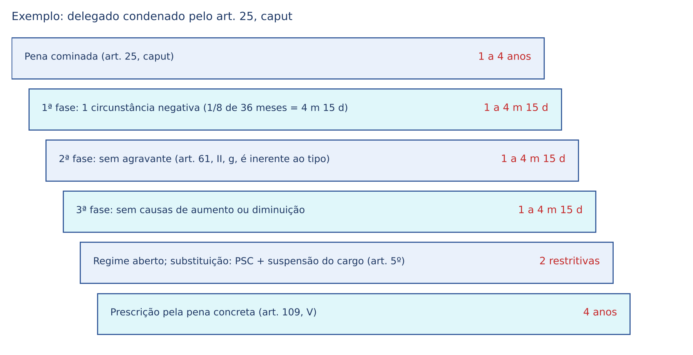
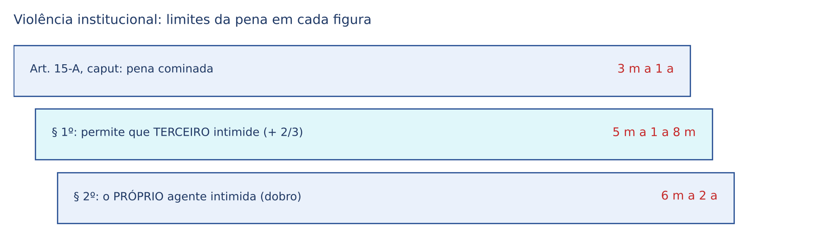

# CAPÍTULO 44 — ABUSO DE AUTORIDADE (LEI 13.869/2019)

:::INCIDENCIA
TRF5 p. 10; TJRS p. 7; TJSC p. 77; SEFAZ p. 5. Nível A. Lote: 20 questões (FGV 11, FCC 9).
O que mais cai: disposições gerais (finalidade específica do art. 1º, § 1º; sujeito ativo amplo do art. 2º; ação pública incondicionada com subsidiária do art. 3º), efeitos da condenação condicionados à reincidência (art. 4º), restritivas próprias (art. 5º) e independência das instâncias (arts. 6º a 8º); entre os tipos, os ligados à prisão e a violência institucional (art. 15-A).
:::

| Subtema | FGV | FCC | Padrão de cobrança |
|---|---|---|---|
| Sujeito ativo (art. 2º) | 2 | 0 | militar, estagiário voluntário e conselheiro de contas podem ser autores; rol exemplificativo |
| Disposições gerais em bloco (arts. 1º a 3º) | 0 | 4 | "limitando-se a" (errado); "mero capricho" (certo); MP pode repudiar a queixa |
| Ação penal (art. 3º) | 0 | 1 | literalidade do § 1º; prazo de 6 meses do § 2º |
| Efeitos da condenação e restritivas (arts. 4º e 5º) | 3 | 1 | inabilitação de 1 a 5 anos; reincidência específica; não automáticos; indenização com valor mínimo; suspensão de 1 a 6 meses |
| Instâncias (arts. 6º a 8º) | 4 | 1 | excludentes de ilicitude fazem coisa julgada no cível E no disciplinar; falta residual |
| Crimes em espécie | 2 | 2 | art. 15-A, § 1º (+ 2/3); art. 15 (sigilo profissional); art. 19, parágrafo único; art. 10 (condução coercitiva) |

## 44.1 Visão geral: o que a lei pune e por que foi escrita assim

### 44.1.1 A ideia central

Abuso de autoridade é o uso do poder público contra a finalidade para a qual ele foi conferido. Todo agente público recebe poderes (prender, fiscalizar, investigar, julgar, bloquear bens) porque precisa deles para servir ao interesse público; quando os usa para perseguir, favorecer ou satisfazer vaidade, ele desvia o poder. O Direito Penal intervém nos desvios mais graves, ao lado das esferas administrativa (falta disciplinar) e civil (indenização, inclusive a responsabilidade objetiva do Estado, art. 37, § 6º, da CF).

O crime tem, por isso, dupla objetividade jurídica: protege a regularidade e a dignidade da função pública e, ao mesmo tempo, os direitos fundamentais do cidadão atingido (liberdade, intimidade, domicílio, ampla defesa, patrimônio). Daí o sujeito passivo duplo: o Estado e a pessoa física ou jurídica prejudicada.

### 44.1.2 Da Lei 4.898/1965 à Lei 13.869/2019

A lei antiga tinha tipos abertos ("qualquer atentado à liberdade de locomoção", "à incolumidade física do indivíduo") e penas irrisórias (detenção de 10 dias a 6 meses), o que gerava, ao mesmo tempo, insegurança e impunidade. A Lei 13.869/2019 (publicada em 5/9/2019, vigente 120 dias depois, em 3/1/2020 — art. 45) fez três escolhas que explicam quase toda a cobrança:

- tipos fechados, com condutas descritas uma a uma (arts. 9º a 38);
- um filtro subjetivo comum a TODOS os tipos: a finalidade específica do art. 1º, § 1º, mais a cláusula de proteção do intérprete do § 2º (44.3);
- penas maiores (em regra, detenção de 6 meses a 2 anos ou de 1 a 4 anos, sempre com multa), restritivas próprias e efeitos de condenação condicionados.

A lei também revogou expressamente a Lei 4.898/1965, o § 2º do art. 150 do CP (violação de domicílio por funcionário, hoje coberta pelo art. 22) e o art. 350 do CP (exercício arbitrário ou abuso de poder) — art. 44. A violência arbitrária do art. 322 do CP NÃO foi revogada expressamente; a discussão sobre sua vigência está no Cap. 35 (35.7).

:::PEGADINHA Direito intertemporal
Revogar a Lei 4.898/1965 não significa que todos os fatos antigos ficaram impunes. Onde a conduta antiga encontra correspondência num tipo novo (ex.: prisão ilegal → art. 9º; deixar de comunicar prisão → art. 12), há continuidade normativo-típica: o fato continua punível, mas com a pena ANTIGA, mais branda (a nova, mais grave, não retroage). Onde a conduta só cabia nos tipos abertos antigos e não tem correspondente na lei nova, houve *abolitio criminis* quanto ao abuso, sem prejuízo de o fato configurar crime comum (lesão corporal, constrangimento ilegal, ameaça). A teoria está no Cap. 3.
:::

### 44.1.3 Os vetos e a derrubada parcial

O projeto sofreu dezenas de vetos presidenciais; o Congresso derrubou parte deles e as partes foram promulgadas em 27/9/2019. Isso é cobrado porque alguns tipos "famosos" NÃO existem.

| Situação | Dispositivos | O que tratavam |
|---|---|---|
| Vetos DERRUBADOS (estão em vigor) | arts. 3º, 9º, 13, III, 15, parágrafo único, 16, 20, 30, 32, 38 e 43 | ação penal; prisão ilegal; obrigar preso a produzir prova; interrogatório de quem invocou o silêncio; identificação ao preso; entrevista com advogado; persecução sem justa causa; acesso aos autos; antecipação de culpa; crime de violação de prerrogativas do advogado (art. 7º-B do EAOAB) |
| Vetos MANTIDOS (não há crime na lei) | arts. 5º, III, 11, 14, 17, 22, § 1º, II, 26, 29, parágrafo único, 34 e 35 | proibição de exercer funções policiais ou militares no município do crime e no de residência ou trabalho da vítima; captura, prisão ou busca sem flagrante nem ordem judicial escrita; fotografar ou filmar preso, internado, investigado, indiciado ou vítima sem consentimento, para expô-lo; uso de algemas sem resistência, ameaça de fuga ou risco; busca domiciliar com aparato ostensivo e desproporcional ou extrapolando o mandado; induzir alguém a praticar infração para prendê-lo em flagrante; omitir dado ou informação juridicamente relevante e não sigiloso (art. 29, parágrafo único); deixar de corrigir erro relevante; coibir ou impedir reunião pacífica |

:::ATENCAO Algemas
O tipo específico de uso indevido de algemas (art. 17) foi VETADO e o veto foi mantido. O tema continua regido pela Súmula Vinculante 11 (uso só em caso de resistência, fundado receio de fuga ou perigo, justificado por escrito, sob pena de responsabilidade disciplinar, civil e penal e de nulidade do ato) e pelo art. 474, § 3º, do CPP (júri). A responsabilidade penal, hoje, só existe se a conduta se encaixar em outro tipo — por exemplo, o art. 13, II (constranger o preso, mediante violência, a situação vexatória não autorizada em lei), presentes a finalidade específica e os demais elementos.
:::

### 44.1.4 Características comuns aos crimes da lei

São crimes PRÓPRIOS (exigem agente público), todos DOLOSOS com elemento subjetivo especial e sem forma culposa, todos punidos com DETENÇÃO e multa, de ação pública incondicionada, nenhum hediondo, e a maioria admite os institutos despenalizadores (fichas em 44.8).

## 44.2 Sujeito ativo: o agente público (arts. 1º e 2º)

### 44.2.1 Conceito amplíssimo

O art. 1º exige que o agente pratique a conduta "no exercício de suas funções ou a pretexto de exercê-las". O art. 2º define o autor e é o dispositivo mais cobrado da lei.

:::LEI Lei 13.869/2019, art. 2º
É sujeito ativo do crime de abuso de autoridade qualquer agente público, servidor ou não, da administração direta, indireta ou fundacional de qualquer dos Poderes da União, dos Estados, do Distrito Federal, dos Municípios e de Território, compreendendo, mas não se limitando a:
I - servidores públicos e militares ou pessoas a eles equiparadas;
II - membros do Poder Legislativo;
III - membros do Poder Executivo;
IV - membros do Poder Judiciário;
V - membros do Ministério Público;
VI - membros dos tribunais ou conselhos de contas.
Parágrafo único. Reputa-se agente público, para os efeitos desta Lei, todo aquele que exerce, ainda que transitoriamente ou sem remuneração, por eleição, nomeação, designação, contratação ou qualquer outra forma de investidura ou vínculo, mandato, cargo, emprego ou função em órgão ou entidade abrangidos pelo caput deste artigo.
:::

Três chaves de leitura:

- "compreendendo, mas NÃO se limitando a": o rol dos incisos é EXEMPLIFICATIVO. Toda alternativa que diga "limitando-se a" ou "exceto" está errada.
- "servidor ou não": o conceito vai além do servidor estatutário; abrange empregados públicos (celetistas de estatais), agentes políticos, militares, jurados, mesários, conciliadores, estagiários e voluntários.
- "ainda que transitoriamente ou sem remuneração": o vínculo precário ou gratuito NÃO afasta a condição de agente.

O conceito se parece com o do art. 327 do CP (Cap. 35, 35.2), mas é próprio desta lei e prevalece por especialidade.

| Pessoa | Pode ser autor? | Por quê |
|---|---|---|
| Juiz, desembargador, ministro | SIM | inciso IV; a proteção do julgador está no § 2º do art. 1º, não na exclusão do sujeito ativo |
| Membro do MP | SIM | inciso V |
| Conselheiro de Tribunal de Contas | SIM | inciso VI (alternativas com "exceto membros dos tribunais de contas" são falsas) |
| Deputado, senador, vereador | SIM | inciso II; a imunidade material (opiniões, palavras e votos) afasta a tipicidade só quanto a essas manifestações, não exclui o parlamentar da lei |
| Militar das Forças Armadas ou policial militar | SIM | inciso I, expresso |
| Estagiário voluntário do MP ou do Judiciário | SIM | parágrafo único: transitoriamente e sem remuneração |
| Empregado de empresa pública ou sociedade de economia mista | SIM | administração indireta, "servidor ou não" |
| Particular agindo sozinho | NÃO | responde, se for o caso, por crime comum (constrangimento ilegal, violação de domicílio etc.) |
| Particular em concurso com o agente, ciente dessa condição | SIM, como coautor ou partícipe | art. 30 do CP: a condição de agente público é elementar e se comunica (Cap. 11, 11.8) |

:::QUESTAO FGV 2025 — CGE-SP — Auditor Estadual de Controle (Q3781242)
Na plateia de uma palestra sobre a lei estavam um oficial do Exército, um estagiário voluntário e sem remuneração do MP e um conselheiro do Tribunal de Contas estadual; quem pode ser sujeito ativo? Gabarito oficial: E — os três. Armadilhas: excluir o militar (inciso I o inclui expressamente), o estagiário (parágrafo único: "transitoriamente ou sem remuneração") ou o conselheiro (inciso VI).
:::

:::QUESTAO FGV 2024 — Câmara dos Deputados — Consultor Legislativo (Q2513053)
Três assertivas: I) sujeito ativo é qualquer agente público, "exceto membros dos Tribunais de Contas" (falsa: inciso VI); II) conceito de agente público do parágrafo único do art. 2º (verdadeira, literal); III) ação pública incondicionada, admitida ação privada "se a denúncia não for ajuizada no prazo de 6 (seis) meses". Gabarito oficial: C (II e III). Gabarito discutível: pela letra do art. 3º, a subsidiária cabe quando a denúncia não é oferecida no PRAZO LEGAL (5 ou 15 dias, art. 46 do CPP); os 6 meses são o prazo para o ofendido oferecer a queixa subsidiária, contado do fim daquele prazo (§ 2º). A banca leu a assertiva III de forma tolerante (ver nota).
:::

### 44.2.2 "No exercício da função ou a pretexto de exercê-la"

O crime exige nexo funcional. "No exercício" é a conduta praticada durante o desempenho das atribuições; "a pretexto de exercê-la" é a conduta de quem, mesmo fora do serviço ou fora de sua competência, invoca a qualidade de agente para impor-se (o policial de folga que se identifica como tal e invade uma casa). Sem esse nexo (o servidor que agride o vizinho por desavença pessoal, sem invocar o cargo), não há abuso de autoridade: há crime comum.

:::EXEMPLO Particular partícipe
A, delegado, decide prender ilegalmente C para agradar B, empresário desafeto de C, que pagou ao delegado e o acompanhou na diligência, sabendo que ele era delegado. A responde pelo art. 9º (e eventualmente por corrupção passiva, em concurso); B responde pelo mesmo art. 9º como partícipe, porque a condição de agente público de A é elementar do tipo e B a conhecia (art. 30 do CP). Se B agisse sozinho, responderia por sequestro ou cárcere privado (art. 148 do CP), não por abuso de autoridade.
:::

:::PROCESSO Competência
- Justiça Federal: em regra, quando o agente é federal e o abuso ocorre no exercício da função federal (ofensa a serviço da União, art. 109, IV, da CF). Agente estadual ou municipal: Justiça Estadual.
- Justiça Militar: depois da Lei 13.491/2017, que alterou o art. 9º, II, do Código Penal Militar, crime previsto na legislação penal comum praticado por militar em serviço ou em razão da função passou a ser crime militar. Por isso o abuso de autoridade de policial militar em serviço vai à Justiça Militar estadual, e a Súmula 172 do STJ ("compete à Justiça Comum processar e julgar militar por crime de abuso de autoridade, ainda que praticado em serviço") ficou SUPERADA (Cap. 51).
- Foro por prerrogativa de função: segue as regras constitucionais (juiz estadual e promotor: Tribunal de Justiça; juiz federal e procurador da República: TRF; desembargador: STJ).
:::

## 44.3 Elemento subjetivo: a finalidade específica e a proibição do "crime de hermenêutica"

### 44.3.1 O § 1º: dolo mais um "porquê" especial

:::LEI Lei 13.869/2019, art. 1º, §§ 1º e 2º
§ 1º As condutas descritas nesta Lei constituem crime de abuso de autoridade quando praticadas pelo agente com a finalidade específica de prejudicar outrem ou beneficiar a si mesmo ou a terceiro, ou, ainda, por mero capricho ou satisfação pessoal.
§ 2º A divergência na interpretação de lei ou na avaliação de fatos e provas não configura abuso de autoridade.
:::

Elemento subjetivo especial (também chamado "dolo específico" ou "especial fim de agir") é um propósito que vai além da simples vontade de realizar a conduta (Cap. 7). O § 1º o exige para TODOS os tipos da lei, sem exceção, o que é técnica incomum: em vez de repetir a finalidade em cada artigo, o legislador a pôs na parte geral. São quatro finalidades alternativas (basta uma):

- prejudicar outrem (perseguição);
- beneficiar a si mesmo (vantagem própria, não necessariamente econômica);
- beneficiar terceiro (favorecimento);
- mero capricho ou satisfação pessoal (vaidade, demonstração de poder, birra).

Consequências práticas:

- Não existe abuso de autoridade CULPOSO: a negligência do delegado que esquece de comunicar a prisão é falta funcional, não crime do art. 12.
- O dolo eventual é, na doutrina majoritária, incompatível com a finalidade específica: quem age "para prejudicar" quer o resultado; não se limita a aceitá-lo.
- A finalidade precisa ser narrada na denúncia e provada; denúncia que descreve só a conduta objetiva é inepta. Como a intenção não se vê, prova-se por indícios (inimizade prévia, ausência de qualquer fundamento, reiteração, desproporção gritante, declarações públicas do agente).

:::DICA Mnemônico "P-B-C"
Prejudicar, Beneficiar (a si ou a terceiro), Capricho (ou satisfação pessoal). Alternativa que trata a finalidade como dispensável, ou que inventa outra (ex.: "com o fim de obter vantagem econômica"), está errada.
:::

### 44.3.2 O § 2º: divergência interpretativa não é crime

A cláusula protege a independência de quem decide (juiz, membro do MP, delegado, auditor fiscal): adotar uma interpretação minoritária da lei, valorar a prova de modo diferente do tribunal, ter a decisão reformada — nada disso é crime. Na expressão consagrada, a lei veda o "crime de hermenêutica" (punir alguém por interpretar). Antes da lei nova, a Corte Especial do STJ já rejeitara denúncia contra magistrado por decisão que a acusação reputava abusiva, afirmando que proferir decisões com vícios *in judicando* ou *in procedendo* faz parte da atividade jurisdicional e que a configuração do abuso exige demonstração mínima de má-fé, de intenção evidente de causar dano (STJ, Corte Especial, APn 858/DF, j. 24/10/2018).

O § 2º, porém, não é salvo-conduto absoluto: se a "divergência" é só fachada para perseguir ou favorecer (o juiz que decide contra a jurisprudência pacífica para atingir um desafeto, com prova dessa finalidade), há crime. Os §§ 1º e 2º se leem juntos: o § 2º afasta o crime na divergência legítima; o § 1º o mantém quando a finalidade espúria está provada.

:::QUESTAO FCC 2026 — SEFAZ-GO — Auditor Fiscal da Receita Estadual (Q4066832)
Gabarito oficial: E — as condutas são crime quando praticadas "ainda que por mero capricho ou satisfação pessoal" (art. 1º, § 1º). Armadilhas: A troca "juízo criminal" por "juízo civil" no art. 7º; B exclui os membros dos tribunais de contas; C diz que a excludente reconhecida faz coisa julgada no cível mas NÃO no administrativo (o art. 8º diz que faz nos dois); D reproduz o art. 10 da Lei 9.296/1996 trocando "autorização judicial" por "autorização policial" (44.7.3).
:::

:::QUESTAO FCC 2025 — MPE-PI — Analista Ministerial (Q3530362)
Gabarito oficial: C — admite-se ação privada se a pública não for intentada no prazo legal, o que não impede o MP de repudiar a queixa (art. 3º, § 1º). Armadilhas: A (independência "absoluta", desmentida pelos arts. 7º e 8º); B (parlamentares estão no art. 2º, II); D ("dispensa o dolo específico" — é o contrário); E (interpretação desconforme a precedentes qualificados não é, por si, crime: art. 1º, § 2º).
:::

:::QUESTAO FCC 2024 — TRT 20ª Região (SE) — Técnico Judiciário (Q3169941)
Três assertivas: I (finalidade específica do § 1º) e II (ação pública incondicionada) verdadeiras; III falsa porque diz que o sujeito ativo compreende "e limita-se a" os agentes dos incisos. Gabarito oficial: B (I e II). A troca de "mas não se limitando a" por "limitando-se a" é a pegadinha mais frequente da lei.
No mesmo sentido: Q4221400 (FCC 2026, SEFAZ-CE, alternativa A — "limitando-se a" membros de Poder e do MP; e alternativa E — exclui quem exerce função transitoriamente e sem remuneração; ambas erradas).
:::

:::SENTENCA Como a finalidade específica aparece na sentença
Na fundamentação da tipicidade, depois de demonstrar a conduta objetiva, dedique um parágrafo próprio ao elemento subjetivo especial, apontando os FATOS que o revelam. Modelo: "O dolo e a finalidade específica de prejudicar a vítima (art. 1º, § 1º, da Lei 13.869/2019) estão demonstrados pela inimizade pública entre réu e ofendido, comprovada pelas mensagens de fls., e pela ausência de qualquer elemento, nos autos do inquérito, que justificasse a medida." Na absolvição: "Ausente prova da finalidade específica exigida pelo art. 1º, § 1º, a conduta é atípica (art. 386, III, do CPP)". Erro comum: condenar com base apenas na ilegalidade objetiva do ato ("a prisão foi relaxada, logo houve abuso") ou absolver por "falta de dolo" sem enfrentar o § 1º.
:::

## 44.4 Ação penal (art. 3º)

Todos os crimes da lei são de ação penal pública INCONDICIONADA (art. 3º, caput, cujo veto foi derrubado). A vontade da vítima é irrelevante para a persecução: se ela declara não ter interesse, o MP denuncia do mesmo modo (Q3032286, em 44.5). A Lei 4.898/1965 previa uma "representação" que a jurisprudência já entendia ser mero direito de petição, não condição de procedibilidade; a lei nova encerrou a discussão.

:::LEI Lei 13.869/2019, art. 3º, §§ 1º e 2º
§ 1º Será admitida ação privada se a ação penal pública não for intentada no prazo legal, cabendo ao Ministério Público aditar a queixa, repudiá-la e oferecer denúncia substitutiva, intervir em todos os termos do processo, fornecer elementos de prova, interpor recurso e, a todo tempo, no caso de negligência do querelante, retomar a ação como parte principal.
§ 2º A ação privada subsidiária será exercida no prazo de 6 (seis) meses, contado da data em que se esgotar o prazo para oferecimento da denúncia.
:::

O dispositivo repete o art. 5º, LIX, da CF, o art. 29 do CPP e o art. 100, § 3º, do CP (a teoria da subsidiária está no Cap. 20, 20.8). O que a banca cobra é a literalidade:

- pressuposto: INÉRCIA do MP no prazo legal (5 dias, investigado preso; 15 dias, solto — art. 46 do CPP). Se o MP pediu arquivamento ou requisitou diligências, não houve inércia e não cabe a subsidiária;
- prazo: 6 meses contados do esgotamento do prazo da denúncia (não da data do fato, nem do conhecimento da autoria, nem "um ano");
- poderes do MP: aditar, REPUDIAR a queixa e oferecer denúncia substitutiva, intervir, produzir prova, recorrer e retomar a ação em caso de negligência do querelante. O MP não perde a titularidade: passado o prazo de 6 meses, a vítima perde o direito de queixa, mas o MP ainda pode denunciar enquanto não prescrito o crime.

:::QUESTAO FCC 2026 — ARTESP — Analista de Suporte à Regulação (Q3910532)
Membro do Executivo comete abuso com finalidade de prejudicar terceiro; qual a ação penal? Gabarito oficial: A — pública incondicionada, admitida a privada se a pública não for intentada no prazo legal, com os poderes do MP de aditar, repudiar, oferecer denúncia substitutiva etc. Armadilhas: B (prazo de "um ano" e MP que "não pode repudiar" a queixa); C a E (ação "condicionada"); E (prazo contado "da data em que foi praticado o crime").
No mesmo sentido: Q4221400 (FCC 2026, SEFAZ-CE, gabarito D — literalidade do art. 3º).
:::

:::PROCESSO Rito, Juizado e acordos
- O art. 39 manda aplicar, no que couber, o CPP e a Lei 9.099/1995. Não há rito especial.
- Juizado, *sursis* processual e ANPP: o enquadramento de cada tipo está nas fichas (44.8); a teoria, no Cap. 25. Os crimes de 1 a 4 anos seguem o rito ordinário (máximo igual a 4 anos, art. 394, § 1º, I, do CPP).
- Defesa preliminar dos arts. 513 a 518 do CPP (crimes de responsabilidade de funcionário público): há divergência sobre sua aplicação aos crimes desta lei; quem a admite aplica também a Súmula 330 do STJ (dispensável quando a denúncia se baseia em inquérito — Cap. 35).
:::

## 44.5 Efeitos da condenação e penas restritivas de direitos (arts. 4º e 5º)

### 44.5.1 Os três efeitos do art. 4º

:::LEI Lei 13.869/2019, art. 4º
São efeitos da condenação:
I - tornar certa a obrigação de indenizar o dano causado pelo crime, devendo o juiz, a requerimento do ofendido, fixar na sentença o valor mínimo para reparação dos danos causados pela infração, considerando os prejuízos por ele sofridos;
II - a inabilitação para o exercício de cargo, mandato ou função pública, pelo período de 1 (um) a 5 (cinco) anos;
III - a perda do cargo, do mandato ou da função pública.
Parágrafo único. Os efeitos previstos nos incisos II e III do caput deste artigo são condicionados à ocorrência de reincidência em crime de abuso de autoridade e não são automáticos, devendo ser declarados motivadamente na sentença.
:::

| Efeito | Quando incide | Automático? |
|---|---|---|
| I - certeza da obrigação de indenizar + valor mínimo | em TODA condenação; o valor mínimo depende de requerimento do ofendido | a obrigação, sim (efeito genérico); o valor mínimo, só se pedido e fundamentado |
| II - inabilitação para cargo, mandato ou função por 1 a 5 anos | só se o réu for REINCIDENTE EM CRIME DE ABUSO DE AUTORIDADE (reincidência específica) | NÃO: declaração motivada na sentença |
| III - perda do cargo, mandato ou função | idem | NÃO: declaração motivada na sentença |

A lógica é de gradação: o primeiro abuso gera pena e indenização; a reiteração revela incompatibilidade com o cargo e permite afastá-lo. Os incisos II e III podem ser aplicados juntos (perde o cargo atual e fica inabilitado para outros por até 5 anos), desde que fundamentados.

Relação com o art. 92, I, do CP (perda do cargo para crime com abuso de poder e pena igual ou superior a 1 ano — Cap. 18, 18.6.1): prevalece que a Lei 13.869/2019 é ESPECIAL e afasta o CP, de modo que o primário condenado por abuso de autoridade não perde o cargo, ainda que a pena alcance 1 ano; do contrário, a exigência de reincidência seria letra morta. O legislador confirmou essa intenção ao inserir, pela mesma lei, o art. 227-A no ECA: nos crimes do ECA praticados por servidor com abuso de autoridade, o efeito do art. 92, I, do CP fica condicionado à reincidência, e a perda, nesse caso, independe da pena aplicada. O contraste com outras leis especiais (tortura e organização criminosa, em que a perda é automática) está no Cap. 18.

:::QUESTAO FGV 2026 — PC-PI — Oficial Investigador (Q3846828)
Condenação definitiva por abuso de autoridade; qual é o efeito da condenação? Gabarito oficial: A — inabilitação de 1 a 5 anos, condicionada à reincidência em crime de abuso e não automática, declarada motivadamente. Armadilhas: B (prazo de 2 a 8 anos); C (independe da reincidência); D e E (perda "automática").
No mesmo sentido: Q2365390, item II (FGV 2024, PC-SC: a perda NÃO é automática) e Q4221400, alternativa B (FCC 2026, SEFAZ-CE: perda "não sujeita a qualquer condição" — errada).
:::

:::QUESTAO FCC 2026 — TJ-CE — Analista Judiciário (Q4231764)
Qual efeito decorre da condenação "em todas as tipificações" da lei? Gabarito oficial: C — obrigação de indenizar, com valor mínimo fixado judicialmente considerando os prejuízos do ofendido. Armadilhas: perda só do cargo em comissão; proibição de contratar com o poder público (é sanção da improbidade, não desta lei); suspensão de direitos políticos (decorre de qualquer condenação definitiva, pelo art. 15, III, da CF, mas não é efeito previsto na lei); inabilitação "até 6 anos".
:::

:::QUESTAO FGV 2024 — TRF 1ª Região — Técnico Judiciário (Q3032286)
Agente federal primário deixa dolosamente de comunicar ao juiz, no prazo legal, a prisão em flagrante de C, que declara não ter interesse na persecução. Gabarito oficial: B — responde pelo art. 12 e fica sujeito à obrigação de indenizar como efeito da condenação. Armadilhas: inabilitação "de dois a quatro anos" (é de 1 a 5, e exige reincidência); desinteresse da vítima impedindo a ação (é incondicionada); perda do cargo (primário); "não é membro de Poder" (o rol do art. 2º é exemplificativo). Observação: o enunciado diz que o agente agiu "de forma dolosa", sem mencionar a finalidade específica; a banca a pressupôs. Em questão discursiva ou sentença, a finalidade precisa estar descrita.
:::

### 44.5.2 As restritivas de direitos próprias (art. 5º)

A lei prevê duas penas restritivas de direitos "substitutivas das privativas de liberdade":

- I - prestação de serviços à comunidade ou a entidades públicas;
- II - suspensão do exercício do cargo, da função ou do mandato, pelo prazo de 1 a 6 meses, COM perda dos vencimentos e das vantagens;
- (o inciso III, que proibia o condenado de exercer funções de natureza policial ou militar, por 1 a 3 anos, no município da prática do crime e naquele em que residir ou trabalhar a vítima, foi vetado).

O parágrafo único permite aplicá-las "autônoma ou cumulativamente". Não são penas cominadas nos tipos (os tipos cominam detenção e multa): são substitutivas, aplicadas depois da dosimetria, se presentes os requisitos do art. 44 do CP (Cap. 17, 17.4), que a lei não afastou. A doutrina majoritária entende que as restritivas do CP (prestação pecuniária, limitação de fim de semana, interdição temporária de direitos) continuam disponíveis subsidiariamente (art. 12 do CP), cabendo ao juiz escolher a mais adequada; há quem sustente que, por especialidade, só as duas do art. 5º seriam cabíveis. A suspensão do cargo (inciso II) é a mais "pedagógica" e a mais cobrada.

:::QUESTAO FGV 2024 — Prefeitura de Niterói — Auditor Municipal de Controle Interno (Q3099315)
Qual destas é restritiva de direitos substitutiva prevista na lei? Gabarito oficial: E — suspensão do exercício do cargo, função ou mandato por 1 a 6 meses, com perda dos vencimentos e vantagens. Armadilhas: cassação ou suspensão de direitos políticos; multa "de até 20 salários mínimos"; prestação de serviços "com prazo máximo de 5 anos" (a lei não fixa esse prazo; a duração segue a pena substituída, art. 46 do CP).
No mesmo sentido: Q4221400, alternativa C (FCC 2026, SEFAZ-CE: é falso que a prestação de serviços não possa ser cumulada com outra restritiva — o parágrafo único admite a cumulação).
:::

:::EXEMPLO Sentença completa: dosimetria, substituição, efeitos e prescrição
Fato: o delegado D, para prejudicar o investigado V, com quem tinha inimizade, obteve prova por meio manifestamente ilícito (art. 25, caput: detenção de 1 a 4 anos e multa). D é primário. O juiz reconhece UMA circunstância judicial negativa (consequências: a prova ilícita levou V a ficar preso cautelarmente por semanas).
1) Primeira fase (Cap. 13). Intervalo entre mínimo e máximo: 4 anos − 1 ano = 3 anos = 36 meses. Critério de 1/8 do intervalo por circunstância (prevalente no STJ): 36 ÷ 8 = 4,5 meses = 4 meses e 15 dias. Pena-base: 1 ano + 4 meses e 15 dias = 1 ano, 4 meses e 15 dias. Pelo critério alternativo de 1/6 sobre a pena mínima: 12 meses ÷ 6 = 2 meses; pena-base de 1 ano e 2 meses. O STJ admite ambos, desde que fundamentados; adota-se aqui o 1/8.
2) Segunda fase (Cap. 14). A agravante do art. 61, II, "g" (abuso de poder ou violação de dever inerente ao cargo) NÃO incide: o abuso é a essência do tipo, e aplicá-la seria *bis in idem*. Sem atenuantes. Pena intermediária: 1 ano, 4 meses e 15 dias.
3) Terceira fase: sem causas de aumento ou de diminuição. Pena definitiva: 1 ano, 4 meses e 15 dias de detenção, mais multa (dosada à parte, Cap. 15).
4) Regime: aberto (primário, pena até 4 anos, art. 33, § 2º, "c", do CP; detenção não começa no fechado).
5) Substituição: crime sem violência ou grave ameaça, pena não superior a 4 anos, primário, circunstâncias majoritariamente favoráveis (art. 44 do CP). Pena SUPERIOR a 1 ano: duas restritivas ou uma restritiva e multa (art. 44, § 2º). Escolha: prestação de serviços à comunidade (art. 5º, I) pelo tempo da pena, mais suspensão do cargo por 3 meses (art. 5º, II), com perda dos vencimentos.
6) Efeitos: D é primário. Logo, só o art. 4º, I: obrigação de indenizar e, se V tiver requerido, valor mínimo fundamentado (ex.: 20.000 (vinte mil) reais pelo dano moral da prisão indevida). NÃO há perda do cargo nem inabilitação (exigem reincidência em abuso de autoridade).
7) Prescrição pela pena concreta: 1 ano, 4 meses e 15 dias está entre 1 e 2 anos; art. 109, V, do CP: 4 anos (Cap. 22).
:::

:::SENTENCA Dispositivo e efeitos
No dispositivo, depois da pena: "Substituo a pena privativa de liberdade por duas restritivas de direitos (art. 44, § 2º, do CP c/c art. 5º, I e II, da Lei 13.869/2019): prestação de serviços à comunidade, pelo tempo da pena, e suspensão do exercício do cargo por 3 (três) meses, com perda dos vencimentos e vantagens. Fixo em 20.000 (vinte mil) reais o valor mínimo da reparação (art. 4º, I), a pedido do ofendido. Deixo de declarar a perda do cargo e a inabilitação (art. 4º, II e III), por não ser o réu reincidente em crime de abuso de autoridade." Erros que a banca pune: declarar a perda do cargo de réu primário com base no art. 92, I, do CP; omitir a motivação da perda no reincidente; fixar valor mínimo sem pedido do ofendido.
:::

## 44.6 Independência das instâncias (arts. 6º a 8º)

### 44.6.1 A regra e as duas exceções

O mesmo fato pode gerar processo penal, processo administrativo disciplinar (PAD), ação de improbidade e ação civil de indenização. A lei afirma a independência (art. 6º: as penas aplicam-se "independentemente das sanções de natureza civil ou administrativa cabíveis"), mas a relativiza nos arts. 7º e 8º. A base é a mesma do Direito Civil (art. 935 do CC e arts. 65 a 67 do CPP), explicada no Cap. 18 (18.3.3); o que esta lei acrescenta é a extensão expressa ao âmbito ADMINISTRATIVO-DISCIPLINAR.

:::LEI Lei 13.869/2019, arts. 7º e 8º
Art. 7º As responsabilidades civil e administrativa são independentes da criminal, não se podendo mais questionar sobre a existência ou a autoria do fato quando essas questões tenham sido decididas no juízo criminal.
Art. 8º Faz coisa julgada em âmbito cível, assim como no administrativo-disciplinar, a sentença penal que reconhecer ter sido o ato praticado em estado de necessidade, em legítima defesa, em estrito cumprimento de dever legal ou no exercício regular de direito.
:::

| Fundamento da sentença penal | Efeito no cível | Efeito no PAD | Base |
|---|---|---|---|
| Condenação definitiva | torna certa a obrigação de indenizar (título executivo) | vincula quanto à existência e à autoria; a sanção disciplinar segue o regime próprio | arts. 4º, I, e 7º |
| Absolvição: inexistência do fato provada | impede a discussão | impede a discussão | art. 7º |
| Absolvição: provado que o réu não foi o autor (negativa de autoria) | impede a discussão | impede a discussão | art. 7º |
| Absolvição: excludente de ilicitude reconhecida (estado de necessidade, legítima defesa, estrito cumprimento do dever legal, exercício regular de direito) | coisa julgada | coisa julgada | art. 8º |
| Absolvição por falta de provas, por atipicidade (inclusive falta da finalidade específica) ou extinção da punibilidade | NÃO vincula | NÃO vincula: cabe punição pela falta residual | arts. 6º e 7º, a contrário; Súmula 18 do STF |

Duas observações de precisão:

- "Falta residual" (Súmula 18 do STF — v. Cap. 18): a absolvição penal porque o fato não é crime (por exemplo, por ausência da finalidade do § 1º) não impede que o mesmo fato seja infração disciplinar. É o cenário mais comum nesta lei, cujo filtro subjetivo é exigente.
- A coisa julgada sobre a licitude da conduta (art. 8º) não apaga a regra civil de que o terceiro inocente lesado em estado de necessidade agressivo ainda pode ser indenizado, com regresso contra o causador do perigo (arts. 929 e 930 do CC). A banca de concurso, porém, cobra a literalidade do art. 8º: excludente reconhecida = coisa julgada no cível e no disciplinar.

O parágrafo único do art. 6º completa o sistema: a notícia de crime desta lei que também descreva falta funcional deve ser comunicada à autoridade disciplinar competente, para apuração.

:::QUESTAO FGV 2024 — TJ-AP — Analista Judiciário (Q2442911)
Servidora processada por abuso de autoridade alega estrito cumprimento do dever legal; qual a repercussão da sentença penal no disciplinar? Gabarito oficial: C — a sentença que reconheça o estrito cumprimento do dever legal faz coisa julgada na esfera administrativo-disciplinar (art. 8º). Armadilhas: "nenhuma" absolvição repercute; "apenas" a negativa de autoria; "qualquer" absolvição, inclusive por falta de provas; independência absoluta.
No mesmo sentido: Q2387516 (FGV 2024, CGM-BH, Auditor: gabarito D, as quatro excludentes de ilicitude); Q3593206 (FGV 2025: absolvição definitiva por legítima defesa impede a responsabilização civil E administrativa — gabarito D; armadilha: "independência das instâncias" permitindo as duas).
:::

:::QUESTAO FGV 2024 — Servidora do Estado do Pará (Q2566527)
Servidora responde por abuso de autoridade e será alvo de PAD pelos mesmos fatos. Gabarito oficial: C — questões decididas no juízo criminal quanto à negativa de autoria não podem ser rediscutidas no disciplinar, apesar da independência (art. 7º). Armadilhas: nenhuma decisão absolutória vincula; as penas da lei "abarcam" as sanções administrativas e impedem o PAD; qualquer absolvição, ainda que por falta de provas, vincula; "apenas" a inexistência do fato vincula (esquece a autoria e as excludentes).
:::

:::QUESTAO FCC 2024 — TRT 7ª Região (CE) — Oficial de Justiça Avaliador Federal (Q3088364)
Servidor investigado em inquérito por abuso de autoridade praticado no exercício do cargo. Gabarito oficial: E — pode responder também a PAD, pela independência das instâncias, em especial se identificada infração residual. Armadilhas: impedir a improbidade "por identidade de natureza" ou o PAD por "natureza preferencial" da esfera criminal; suspensão automática dos vencimentos ou do cômputo do tempo de serviço (não há previsão na lei).
:::

## 44.7 Crimes em espécie

Lembre, antes de cada tipo: todos exigem agente público (44.2), a finalidade específica do art. 1º, § 1º (44.3), e não abrangem a mera divergência de interpretação (art. 1º, § 2º). Para não repetir, esses elementos NÃO são reiterados nas tabelas. O adjetivo "manifesta" ou "manifestamente", presente em vários tipos, reforça o filtro: só o ato claramente ilegal, perceptível sem esforço interpretativo, é típico.

### 44.7.1 Crimes ligados à prisão, à condução e à custódia do preso

| Art. | Conduta (síntese) | Pena (detenção e multa) | Pontos cobrados |
|---|---|---|---|
| 9º, caput | decretar medida de privação da liberdade em manifesta desconformidade com as hipóteses legais | 1 a 4 anos | "decretar" = determinar, ordenar: alcança também o delegado que lavra flagrante fora das hipóteses legais (corrente majoritária) |
| 9º, par. único | autoridade JUDICIÁRIA que, em prazo razoável, deixa de relaxar prisão manifestamente ilegal, de substituir a preventiva por cautelar diversa ou conceder liberdade provisória, ou de deferir liminar ou ordem de HC, quando manifestamente cabíveis | 1 a 4 anos | crime omissivo próprio, exclusivo do juiz |
| 10 | decretar condução coercitiva de testemunha ou investigado manifestamente descabida ou sem prévia intimação de comparecimento ao juízo | 1 a 4 anos | ADPFs 395 e 444 |
| 12, caput | deixar injustificadamente de comunicar prisão em flagrante à autoridade judiciária no prazo legal | 6 meses a 2 anos | prazo de 24 horas (art. 306, § 1º, do CPP) |
| 12, par. único | I - não comunicar imediatamente ao juiz a execução de temporária ou preventiva; II - não comunicar imediatamente a prisão e o local à família ou pessoa indicada; III - não entregar a nota de culpa em 24 horas; IV - prolongar a prisão, a medida de segurança ou a internação, deixando de cumprir o alvará imediatamente ou de soltar o preso esgotado o prazo | 6 meses a 2 anos | inciso IV conversa com a Lei 7.960/1989 (temporária com data de soltura) |
| 13 | constranger o preso ou detento, mediante violência, grave ameaça ou redução de sua capacidade de resistência, a: I - exibir-se ou ter o corpo exibido à curiosidade pública; II - submeter-se a situação vexatória ou constrangimento não autorizado em lei; III - produzir prova contra si ou contra terceiro | 1 a 4 anos, sem prejuízo da pena da violência | "exposição à mídia"; concurso material com a lesão; distinção com a tortura |
| 15, caput | constranger a depor, sob ameaça de prisão, pessoa que deva guardar segredo ou resguardar sigilo em razão de função, ministério, ofício ou profissão | 1 a 4 anos | advogado, médico, sacerdote, jornalista quanto à fonte |
| 15, par. único | prosseguir no interrogatório de quem decidiu exercer o direito ao silêncio, ou de quem optou por ser assistido por advogado ou defensor, sem a presença dele | 1 a 4 anos | veto derrubado |
| 16 | deixar de identificar-se ou identificar-se falsamente ao preso na captura ou quando deva fazê-lo; par. único: responsável por interrogatório que não se identifica ou se atribui falsa identidade, cargo ou função | 6 meses a 2 anos | art. 5º, LXIV, da CF |
| 18 | submeter o preso a interrogatório policial durante o repouso noturno, salvo flagrante ou consentimento do preso devidamente assistido | 6 meses a 2 anos | só interrogatório POLICIAL |
| 19 | impedir ou retardar, injustificadamente, o envio de pleito do preso ao juiz competente para apreciar a legalidade da prisão ou da custódia; par. único: magistrado que, ciente, não sana a demora ou, incompetente, não remete o pedido ao competente | 1 a 4 anos (mesma pena no par. único) | Q4092718 |
| 20 | impedir, sem justa causa, a entrevista pessoal e reservada do preso com seu advogado; par. único: impedir preso, réu solto ou investigado de entrevistar-se com o advogado antes da audiência e de sentar-se ao seu lado e comunicar-se com ele durante a audiência (salvo no interrogatório ou em videoconferência) | 6 meses a 2 anos | veto derrubado |
| 21 | manter presos de ambos os sexos na mesma cela ou espaço de confinamento; par. único: manter criança ou adolescente na mesma cela com maior de idade ou em ambiente inadequado | 1 a 4 anos | ECA |

Comentários seletivos:

- Art. 9º, caput, e a polêmica do sujeito ativo: uma corrente restringe o caput ao juiz (só ele "decreta" prisão, por reserva de jurisdição); prevalece que "decretar" foi usado em sentido amplo (ordenar, determinar), alcançando o delegado que ratifica um flagrante sabidamente inexistente, o oficial militar que manda recolher alguém fora das hipóteses legais etc. O parágrafo único, ao contrário, fala expressamente em "autoridade judiciária". Para o juiz, o tipo mais sensível é o do parágrafo único, mas a dupla barreira ("manifestamente" + finalidade específica do § 1º) e o § 2º afastam a criminalização da decisão juridicamente defensável.
- Art. 10 e condução coercitiva: o STF declarou incompatível com a Constituição a condução coercitiva de investigados ou réus para INTERROGATÓRIO (ADPFs 395 e 444, Plenário, j. 14/6/2018), porque o investigado tem direito ao silêncio e não está obrigado a comparecer para se autoincriminar. A condução de testemunha que, intimada, falta sem justificativa continua possível (art. 218 do CPP). O art. 10 pune a condução "manifestamente descabida" (a do investigado para interrogatório, depois das ADPFs, é o exemplo típico) ou feita SEM PRÉVIA INTIMAÇÃO.
- Art. 13, I, e a "exposição à mídia": o tipo exige constranger o preso (por violência, grave ameaça ou redução da capacidade de resistência) a exibir-se ou ter o corpo exibido. A simples presença de imprensa na prisão não basta. O tipo autônomo de fotografar ou filmar o preso para expô-lo (art. 14) foi VETADO.
- Art. 13: a ressalva "sem prejuízo da pena cominada à violência" impõe concurso material com o crime resultante da violência (lesão corporal). Se o constrangimento causar intenso sofrimento físico ou mental com a finalidade de obter informação ou confissão, ou como castigo, a conduta é TORTURA (Lei 9.455/1997, crime equiparado a hediondo e mais grave — Cap. 40, 40.5.10).
- Art. 15: o jornalista está incluído quanto ao sigilo da fonte (art. 5º, XIV, da CF). Sem a "ameaça de prisão", o constrangimento pode ser outro crime (art. 146 do CP).
- Art. 18: a lei não define "repouso noturno". A doutrina tem usado, por coerência sistemática, o intervalo do art. 22, § 1º, III (21h às 5h); há quem defenda o critério do costume local. A exceção do flagrante permite o interrogatório imediato do autuado; a do consentimento exige que o preso esteja "devidamente assistido" (por advogado).

:::QUESTAO FCC 2026 — MPE-AL — Analista de Ministério Público (Q4092721)
Jornalista intimado a depor sobre reportagem invoca o sigilo da fonte; o delegado o constrange a depor e a revelar a fonte sob ameaça de prisão. Gabarito oficial: B — crime de abuso de autoridade (art. 15, caput), detenção de 1 a 4 anos e multa. Armadilhas: "não há crime porque testemunha tem o dever de depor" (o sigilo profissional e o da fonte afastam o dever); penas de outros tipos (reclusão de 2 a 4 anos; detenção de 6 meses a 2 anos; 3 meses a 1 ano). Observações: o enunciado cita a lei como "13.689/2019" e a alternativa correta diz "de uma quatro anos" — erros materiais da prova, irrelevantes para a resposta.
:::

:::QUESTAO FCC 2026 — MPE-AL — Analista de Ministério Público (Q4092718)
O enunciado transcreve o art. 19, caput (impedir ou retardar o envio do pleito do preso ao juiz: detenção de 1 a 4 anos) e pergunta a pena do magistrado que, ciente, não sana a demora ou, incompetente, não remete o pedido. Gabarito oficial: E — a MESMA pena (parágrafo único). Armadilhas: só suspensão do cargo; aumento de 2/3 ou dobro (frações do art. 15-A); só multa.
:::

:::QUESTAO FGV 2024 — PC-SC — Psicólogo Policial Civil (Q2365390)
Três assertivas: I) militares não estão sujeitos à lei (falsa: art. 2º, I); II) a condenação implica automaticamente a perda do cargo (falsa: art. 4º, parágrafo único); III) determinar a condução coercitiva de investigado sem prévia intimação para comparecimento em juízo é crime (verdadeira: art. 10). Gabarito oficial: E (III, apenas).
:::

:::DICA Comunicações da prisão: quem, a quem, em quanto tempo
Flagrante: comunicação ao JUIZ no prazo legal (24 horas, com o auto) — art. 12, caput. Temporária ou preventiva executada: comunicação IMEDIATA ao juiz que a decretou — inciso I. Qualquer prisão: comunicação IMEDIATA à família ou pessoa indicada, com o LOCAL — inciso II. Nota de culpa ao preso: 24 horas — inciso III. Soltura: IMEDIATA ao receber o alvará ou ao esgotar o prazo — inciso IV. Para a temporária, a lei também alterou a Lei 7.960/1989: o mandado deve conter o prazo e o dia da soltura, o preso é solto ao fim do prazo independentemente de nova ordem, e o dia do cumprimento entra na contagem (art. 2º, §§ 4º-A, 7º e 8º).
:::

### 44.7.2 Violência institucional (art. 15-A, incluído pela Lei 14.321/2022)

A Lei 14.321/2022 (de 31/3/2022) criou o crime para combater a revitimização (ou vitimização secundária): o sofrimento que o próprio sistema de justiça impõe a quem já foi vítima, obrigando-a a repetir o relato, a submeter-se a exames desnecessários ou a ouvir insinuações sobre sua responsabilidade. Dialoga com a Lei 14.245/2021 (dignidade da vítima em audiência — arts. 400-A e 474-A do CPP) e com o depoimento especial da Lei 13.431/2017 (Cap. 42).

:::LEI Lei 13.869/2019, art. 15-A
Submeter a vítima de infração penal ou a testemunha de crimes violentos a procedimentos desnecessários, repetitivos ou invasivos, que a leve a reviver, sem estrita necessidade:
I - a situação de violência; ou
II - outras situações potencialmente geradoras de sofrimento ou estigmatização:
Pena - detenção, de 3 (três) meses a 1 (um) ano, e multa.
§ 1º Se o agente público permitir que terceiro intimide a vítima de crimes violentos, gerando indevida revitimização, aplica-se a pena aumentada de 2/3 (dois terços).
§ 2º Se o agente público intimidar a vítima de crimes violentos, gerando indevida revitimização, aplica-se a pena em dobro.
:::

Detalhes de redação que viram pegadinha:

- Sujeito passivo: a VÍTIMA de QUALQUER infração penal (inclusive não violenta) ou a TESTEMUNHA de crime VIOLENTO. A testemunha de crime sem violência está fora do caput.
- Nas majorantes, a referência é só à "vítima de crimes violentos".
- Meio: procedimentos desnecessários, repetitivos OU invasivos (alternativos), que levem a reviver a violência ou outra situação de sofrimento ou estigmatização, "sem estrita necessidade". A repetição justificada (nova oitiva para esclarecer contradição relevante) não é crime.
- Sujeito ativo: qualquer agente público (delegado, juiz, promotor, defensor, perito, servidor do cartório), não só os responsáveis pela investigação.
- § 1º (+ 2/3): o agente PERMITE que terceiro (outro servidor, o advogado do réu, um familiar do agressor) intimide a vítima — é uma forma de omissão punida com aumento.
- § 2º (dobro): o PRÓPRIO agente intimida.

:::EXEMPLO Calculando os limites das majorantes
Caput: 3 meses a 1 ano.
§ 1º (+ 2/3): mínimo 3 meses + 2/3 de 3 meses (2 meses) = 5 meses; máximo 12 meses + 2/3 de 12 meses (8 meses) = 20 meses = 1 ano e 8 meses.
§ 2º (dobro): mínimo 6 meses; máximo 2 anos.
Reflexos: nas três figuras, a pena máxima não passa de 2 anos — é sempre infração de menor potencial ofensivo (transação penal, Juizado). Prescrição em abstrato: máximo de 1 ano (caput) → 4 anos (art. 109, V, do CP: pena igual a 1 ano); máximo de 1 ano e 8 meses ou 2 anos → também 4 anos (art. 109, V). As majorantes, como causas de aumento, entram na terceira fase da dosimetria e são consideradas no cálculo da prescrição em abstrato pela fração que mais aumenta (Cap. 22).
:::

:::QUESTAO FGV 2026 — ENAM — Exame Nacional da Magistratura 2026.1 (Q4102466)
Vítima de estupro, já ouvida e periciada, é obrigada pelo delegado a narrar de novo, com minúcias, diante de servidores que transitavam, sem justificativa; o delegado permite que um investigador faça comentários intimidatórios ("tem certeza de que não foi você quem provocou isso?"). Gabarito oficial: C — violência institucional com pena aumentada de 2/3, porque o delegado PERMITIU que terceiro intimidasse a vítima de crime violento. Armadilhas: atipicidade por não haver procedimento físico invasivo (a repetição desnecessária basta); pena sem aumento porque a intimidação partiu de outro; pena em dobro por "imputação direta" da conduta do subordinado (o dobro é para quem intimida pessoalmente); proteção só de testemunhas (a vítima de qualquer infração está no caput). Na sentença, a finalidade específica do art. 1º, § 1º (aqui, o mero capricho ou a satisfação pessoal) também precisa ser demonstrada.
:::

:::ATENCAO Art. 15-A x coação no curso do processo (art. 344 do CP)
Não houve revogação do art. 344. Na coação, o autor é qualquer pessoa, o meio é violência ou grave ameaça e a finalidade é favorecer interesse próprio ou alheio no processo; a pena é de reclusão de 1 a 4 anos (Cap. 36, 36.10.4). No art. 15-A, o autor é agente público, o meio é o procedimento desnecessário ou repetitivo e o resultado é a revitimização. O policial que ameaça a vítima para que ela retire a acusação contra um colega pratica coação no curso do processo.
:::

### 44.7.3 Domicílio, fraude na investigação e prova ilícita

| Art. | Conduta (síntese) | Pena (detenção e multa) | Pontos cobrados |
|---|---|---|---|
| 22, caput | invadir ou adentrar, clandestina ou astuciosamente, ou à revelia do ocupante, imóvel alheio ou dependências, ou nele permanecer, sem determinação judicial ou fora das condições legais | 1 a 4 anos | substituiu o art. 150, § 2º, do CP |
| 22, § 1º, I | coagir alguém, mediante violência ou grave ameaça, a franquear acesso ao imóvel | 1 a 4 anos | "consentimento" viciado |
| 22, § 1º, III | cumprir mandado de busca e apreensão domiciliar após as 21h ou antes das 5h | 1 a 4 anos | critério cronológico |
| 22, § 2º | NÃO há crime se o ingresso for para prestar socorro, ou se houver fundados indícios de flagrante delito ou de desastre | — | espelha o art. 5º, XI, da CF |
| 23 | inovar artificiosamente, no curso de diligência, investigação ou processo, o estado de lugar, coisa ou pessoa, para eximir-se de responsabilidade, responsabilizar criminalmente alguém ou agravar-lhe a responsabilidade; par. único: para eximir-se de responsabilidade civil ou administrativa por excesso, ou para omitir dados ou divulgar dados incompletos e desviar o curso da investigação | 1 a 4 anos | fraude processual do agente ("forjar" flagrante) |
| 24 | constranger, com violência ou grave ameaça, funcionário de hospital a admitir para tratamento pessoa já morta, para alterar local ou momento do crime e prejudicar a apuração | 1 a 4 anos, além da pena da violência | o "socorro" de cadáver |
| 25 | proceder à obtenção de prova, em procedimento de investigação ou FISCALIZAÇÃO, por meio manifestamente ilícito; par. único: usar a prova contra o investigado ou fiscalizado, conhecendo previamente sua ilicitude | 1 a 4 anos | alcança o auditor fiscal |

- Art. 22 e o horário: a CF permite a busca domiciliar por ordem judicial só "durante o dia" (art. 5º, XI) e o CPP também fala em "dia" (art. 245), sem definir. O § 1º, III, fixou um critério objetivo para o crime. A Terceira Seção do STJ, no RHC 196.496/RN (j. 10/12/2025, Informativo de Jurisprudência, Edição Extraordinária 30), afirmou que, depois da Lei 13.869/2019, é válido o cumprimento do mandado entre 5h e 21h, superando o critério astronômico (nascer e pôr do sol): busca iniciada às 5h05, antes do nascer do sol, não é ilegal por isso. Fora dessa janela, além do possível crime, a prova é ilícita.
- O § 2º do art. 22 deve ser lido com a jurisprudência sobre ingresso sem mandado em flagrante de crime permanente (exigência de fundadas razões, justificadas *a posteriori*), cuja sede própria é o Processo Penal e, quanto ao tráfico, o Cap. 37.
- Art. 23 x fraude processual (art. 347 do CP — Cap. 36, 36.10.6): o art. 23 é especial (agente público, no curso de diligência, investigação ou processo, com a finalidade de eximir-se ou de incriminar alguém). O policial que "planta" droga para forjar flagrante comete o art. 23 (além de eventual denunciação caluniosa, art. 339, se der causa à instauração de procedimento contra quem sabe inocente).
- Art. 25 e a fiscalização (ponto SEFAZ): o tipo expressamente inclui o procedimento de FISCALIZAÇÃO. O auditor que, para prejudicar o contribuinte, obtém documentos mediante coação, devassa ilegal ou invasão do estabelecimento sem as formalidades legais, e o que usa contra o fiscalizado prova que sabe ilícita (parágrafo único), praticam o crime.

:::ATENCAO A interceptação ilegal não é crime da Lei 13.869/2019 (mas foi reescrita por ela)
O art. 41 da Lei 13.869/2019 deu nova redação ao art. 10 da Lei 9.296/1996: constitui crime realizar interceptação de comunicações telefônicas, de informática ou telemática, promover escuta ambiental ou quebrar segredo da Justiça, sem autorização JUDICIAL ou com objetivos não autorizados em lei — reclusão de 2 a 4 anos e multa; o parágrafo único pune a autoridade JUDICIAL que determina a execução com objetivo não autorizado em lei. A alternativa da Q4066832 que trocou "judicial" por "policial" estava errada. Visão penal da interceptação: Cap. 49.
:::

### 44.7.4 Persecução abusiva, publicidade e acesso aos autos

| Art. | Conduta (síntese) | Pena (detenção e multa) | Pontos cobrados |
|---|---|---|---|
| 27 | requisitar instauração ou instaurar procedimento investigatório de infração penal ou administrativa, contra alguém, à falta de QUALQUER indício de crime, ilícito funcional ou infração administrativa | 6 meses a 2 anos | par. único: não há crime na sindicância ou investigação preliminar sumária devidamente justificada |
| 28 | divulgar gravação ou trecho sem relação com a prova pretendida, expondo a intimidade ou a vida privada ou ferindo a honra ou a imagem do investigado ou acusado | 1 a 4 anos | "vazamento" de conversas irrelevantes |
| 29 | prestar informação falsa sobre procedimento judicial, policial, fiscal ou administrativo para prejudicar interesse de investigado | 6 meses a 2 anos | par. único vetado |
| 30 | dar início ou proceder à persecução penal, civil ou administrativa SEM JUSTA CAUSA FUNDAMENTADA ou contra quem sabe inocente | 1 a 4 anos | veto derrubado; mais amplo que o art. 27 |
| 31 | estender injustificadamente a investigação, procrastinando-a em prejuízo do investigado ou fiscalizado; par. único: estender de forma imotivada procedimento sem prazo legal | 6 meses a 2 anos | alcança a fiscalização |
| 32 | negar ao interessado, a seu defensor ou advogado acesso aos autos de investigação preliminar, termo circunstanciado, inquérito ou qualquer procedimento investigatório de infração penal, CIVIL ou administrativa, ou impedir a obtenção de cópias, ressalvadas as peças de diligências em curso ou futuras cujo sigilo seja imprescindível | 6 meses a 2 anos | Súmula Vinculante 14 |
| 38 | antecipar o responsável pelas investigações, por meio de comunicação, inclusive rede social, atribuição de culpa, antes de concluídas as apurações e formalizada a acusação | 6 meses a 2 anos | veto derrubado; só o "responsável pelas investigações" |

- Arts. 27 e 30: o art. 27 pune instaurar ou requisitar investigação sem NENHUM indício; o art. 30, iniciar ou conduzir a persecução (penal, civil ou administrativa) sem justa causa fundamentada ou contra quem o agente sabe inocente. Se o agente dá causa a investigação ou processo imputando crime a quem sabe inocente, pode haver concurso aparente com a denunciação caluniosa (art. 339 do CP, reclusão de 2 a 8 anos), mais grave; a solução depende do caso (Cap. 36).
- Art. 32 e a Súmula Vinculante 14: a súmula garante ao defensor acesso amplo aos elementos de prova JÁ DOCUMENTADOS no procedimento investigatório; o art. 32 criminaliza a negativa abusiva, com a mesma ressalva das diligências em curso. A lei alcança procedimento de infração "civil ou administrativa" (inquérito civil, PAD, procedimento fiscal) — alternativa que restringe à infração penal está errada.
- Art. 38: o sujeito ativo é só o "responsável pelas investigações" (delegado, membro do MP que preside o procedimento). O tipo não proíbe informar a sociedade sobre a investigação; proíbe ATRIBUIR CULPA antes da conclusão e da acusação formal, o que viola a presunção de inocência.

:::NOTA ADIs pendentes
As ADIs 6.234, 6.236, 6.238, 6.239, 6.266 e 6.302 questionam vários dispositivos da lei (entre eles os arts. 27, 29, 30, 31, 32 e 38), sob o argumento de tipos vagos e ofensa à independência funcional de juízes e membros do MP. O relator, Ministro Alexandre de Moraes, indeferiu a medida cautelar em 2020 e levou o caso diretamente ao Plenário (art. 12 da Lei 9.868/1999); as sustentações orais ocorreram em 27/2/2025 e, até a data desta redação, não houve julgamento de mérito. A lei está integralmente em vigor.
:::

### 44.7.5 Fiscalização, exigências sem amparo legal e atos judiciais

| Art. | Conduta (síntese) | Pena (detenção e multa) | Pontos cobrados |
|---|---|---|---|
| 33, caput | exigir informação ou cumprimento de obrigação, inclusive de fazer ou não fazer, sem expresso amparo legal | 6 meses a 2 anos | ponto SEFAZ |
| 33, par. único | utilizar-se do cargo ou invocar a condição de agente público para eximir-se de obrigação legal ou obter vantagem ou privilégio indevido | 6 meses a 2 anos | a "carteirada" |
| 36 | decretar, em processo judicial, indisponibilidade de ativos financeiros em quantia que extrapole exacerbadamente o valor estimado da dívida E, demonstrada pela parte a excessividade, deixar de corrigi-la | 1 a 4 anos | crime do juiz cível (SISBAJUD) |
| 37 | demorar demasiada e injustificadamente no exame de processo de que pediu vista em órgão colegiado, para procrastinar o andamento ou retardar o julgamento | 6 meses a 2 anos | crime do julgador em colegiado |

- Art. 33 x excesso de exação (art. 316, § 1º, do CP — Cap. 35, 35.5.3): exigir TRIBUTO ou contribuição social que sabe ou deveria saber indevido é excesso de exação, crime especial e muito mais grave (reclusão de 3 a 8 anos). O art. 33 é residual: exigências de informação ou de obrigações não tributárias sem base legal (o fiscal que exige documento que nenhuma norma prevê, só para embaraçar o contribuinte desafeto). Se a exigência visa vantagem indevida para o agente, é concussão (art. 316, caput). Correlata: Q3917713 (FCC 2026, SEFAZ-SP — exigência de ICMS sobre mercadoria isenta, ciente da isenção: excesso de exação, e não abuso de autoridade "subsidiário"; comentada no Cap. 35).
- Art. 33, parágrafo único: pune a "carteirada" — o agente que invoca o cargo para não pagar a conta, furar a fila, livrar-se da multa de trânsito.
- Art. 36 (interessa ao juiz cível): são DOIS momentos cumulativos — (1) decretar a indisponibilidade em valor que extrapole EXACERBADAMENTE o estimado para a dívida; (2) depois de a parte demonstrar o excesso, deixar de corrigi-lo. O bloqueio em várias contas que, somado, supera o débito, corrigido assim que a parte demonstra o excesso, não é crime. A indisponibilidade fora de processo judicial (bloqueio administrativo) não se enquadra.
- Art. 37: protege a razoável duração do processo nos tribunais (o pedido de vista "de gaveta"). Exige intenção de procrastinar ou retardar o julgamento, além da finalidade do § 1º.

:::DICA Pacote SEFAZ: os tipos que alcançam o auditor fiscal
Art. 25 (prova ilícita em FISCALIZAÇÃO e uso dela contra o "fiscalizado"); art. 27 (instaurar procedimento de infração ADMINISTRATIVA sem indício); art. 29 (informação falsa sobre procedimento FISCAL); art. 30 (persecução administrativa sem justa causa); art. 31 (estender a investigação em prejuízo do "fiscalizado"); art. 32 (negar acesso a autos de procedimento de infração administrativa); art. 33 (exigir obrigação sem amparo legal; "carteirada"). E a distinção decisiva: tributo indevido exigido = excesso de exação (CP), não abuso de autoridade.
:::

### 44.7.6 Violação de prerrogativas do advogado (art. 7º-B do EAOAB)

O art. 43 da Lei 13.869/2019 (veto derrubado) inseriu no Estatuto da Advocacia (Lei 8.906/1994) o art. 7º-B: constitui crime violar direito ou prerrogativa de advogado previstos nos incisos II, III, IV e V do caput do art. 7º. Esses incisos tratam da inviolabilidade do escritório, dos instrumentos de trabalho e das comunicações profissionais (II), da comunicação pessoal e reservada com o cliente preso (III), da presença de representante da OAB na prisão em flagrante por motivo ligado ao exercício da advocacia (IV) e do recolhimento em sala de Estado-Maior antes do trânsito em julgado (V).

A pena original era de detenção de 3 meses a 1 ano e multa; a Lei 14.365/2022 elevou-a para DETENÇÃO DE 2 A 4 ANOS e multa. Consequências: deixou de ser infração de menor potencial ofensivo, não admite suspensão condicional do processo (mínimo superior a 1 ano), mas admite ANPP, em tese (mínimo inferior a 4 anos). Material de cursinho anterior a 2022 traz a pena antiga.

Há divergência sobre a exigência, neste tipo, da finalidade específica do art. 1º, § 1º (o tipo está no EAOAB, mas foi criado pela lei de abuso). Não confundir com o art. 20 da Lei 13.869/2019, que protege o PRESO impedido de entrevistar-se com o advogado (6 meses a 2 anos).

## 44.8 Fichas dos crimes

Elementos COMUNS a todas as linhas, para não repetir: sujeito ativo agente público (art. 2º); dolo com finalidade específica (art. 1º, § 1º), sem forma culposa; ação penal pública incondicionada com subsidiária (art. 3º); competência conforme a esfera do agente (federal, estadual ou militar); nenhum crime hediondo; restritivas do art. 5º como substitutivas, se presentes os requisitos do art. 44 do CP.

| Grupo de pena | Artigos | Prescrição em abstrato (art. 109 do CP) | Transação penal / Juizado | Suspensão condicional do processo | ANPP |
|---|---|---|---|---|---|
| Detenção de 3 meses a 1 ano (e majorantes até 2 anos) | 15-A | 4 anos | SIM | SIM | SIM, em tese (se não houver violência ou grave ameaça) |
| Detenção de 6 meses a 2 anos | 12, 16, 18, 20, 27, 29, 31, 32, 33, 37, 38 | 4 anos | SIM | SIM | SIM, em tese |
| Detenção de 1 a 4 anos | 9º, 10, 13, 15, 19, 21, 22, 23, 24, 25, 28, 30, 36 | 8 anos | NÃO | SIM (mínimo de 1 ano) | SIM, em tese, salvo violência ou grave ameaça (arts. 13, 22, § 1º, I, e 24; art. 15 discutível) |
| Detenção de 2 a 4 anos (art. 7º-B do EAOAB) | violação de prerrogativas do advogado | 8 anos | NÃO | NÃO | SIM, em tese |

| Crime | Consumação | Tentativa |
|---|---|---|
| Arts. 9º, caput, e 10 (decretar prisão ou condução) | com a decretação (crime formal); a efetiva privação da liberdade é exaurimento | admissível em tese, mas de difícil configuração |
| Arts. 9º, parágrafo único, 12, 16, caput, e 19, parágrafo único (omissões) | esgotado o prazo legal ou razoável sem a providência | NÃO (omissivos próprios) |
| Art. 13 (constranger o preso) | quando o preso se exibe, se submete ou produz a prova; para parte da doutrina, já com o emprego do constrangimento | SIM |
| Art. 15-A (violência institucional) | com a submissão ao procedimento desnecessário, repetitivo ou invasivo | SIM, em tese |
| Art. 22 (domicílio) | com o ingresso, ou com a permanência indevida (modalidade permanente) | SIM no ingresso |
| Art. 25 (prova ilícita) | com a obtenção; o uso é figura própria (parágrafo único) | SIM |
| Arts. 27 e 30 (persecução abusiva) | com a requisição, instauração ou início da persecução | SIM, em tese (instauração frustrada) |

:::SENTENCA Fundamentação mínima de uma condenação por abuso de autoridade
Roteiro: (1) qualidade de agente público e nexo funcional (art. 2º e "no exercício ou a pretexto"); (2) subsunção da conduta ao tipo, enfrentando o advérbio "manifestamente" quando houver; (3) finalidade específica do art. 1º, § 1º, com os fatos que a revelam; (4) afastamento da tese de divergência interpretativa (§ 2º), se alegada; (5) dosimetria sem a agravante do art. 61, II, "g"; (6) substituição pelo art. 5º; (7) efeitos do art. 4º (indenização a pedido; perda e inabilitação só no reincidente específico, motivadamente). Modelo para o item 4: "A tese defensiva de mera divergência interpretativa (art. 1º, § 2º) não se sustenta: não havia controvérsia razoável sobre a ilegalidade da medida, e o réu a manteve mesmo após alertado, o que revela o propósito de prejudicar."
:::

## 44.9 Distinções com crimes vizinhos

As distinções já feitas no texto (art. 15-A x art. 344, art. 23 x art. 347, art. 33 x excesso de exação e concussão, interceptação ilegal) não são repetidas aqui.

| Situação | Crime | Por quê |
|---|---|---|
| Agente impõe intenso sofrimento físico ou mental ao preso para obter confissão ou como castigo | Tortura (Lei 9.455/1997 — Cap. 40) | finalidade e intensidade próprias; tipo mais grave e especial; o art. 13 fica para constrangimentos sem esse sofrimento |
| Agente retarda ou deixa de praticar ato de ofício para satisfazer interesse ou sentimento pessoal | Prevaricação (art. 319 do CP — Cap. 35) | omissão genérica; se a omissão estiver tipificada na Lei 13.869/2019 (ex.: art. 12, art. 19), prevalece a lei especial |
| Agente pratica violência no exercício da função, sem tipo específico na lei | Violência arbitrária (art. 322 do CP) em concurso com a lesão, para quem o considera vigente (Cap. 35, 35.7) | a lei nova não tem tipo genérico de "atentado à incolumidade física" |
| Agente entra em casa alheia, sem ordem judicial e fora das hipóteses legais | Art. 22 da Lei 13.869/2019 | o § 2º do art. 150 do CP foi revogado; particular comete o art. 150 |
| Agente prende alguém por vingança pessoal, sem invocar o cargo | Sequestro ou cárcere privado (art. 148 do CP) | sem nexo funcional não há abuso de autoridade |
| Crime comum praticado com abuso do cargo (ex.: estupro cometido por policial que invoca a função) | O crime comum, com a agravante do art. 61, II, "g", do CP (Cap. 14) | a agravante só não incide quando o abuso é elementar |

## 44.10 Resumo para revisão pré-prova

| Instituto | Regra | Exceções e detalhes | Fundamento |
|---|---|---|---|
| Sujeito ativo | qualquer agente público, servidor ou não, de qualquer Poder e ente, inclusive transitório e sem remuneração, no exercício da função ou a pretexto de exercê-la | rol EXEMPLIFICATIVO ("mas não se limitando a"); inclui militares, juízes, MP, tribunais de contas, estagiário voluntário; particular só em concurso (art. 30 do CP) | arts. 1º e 2º |
| Elemento subjetivo | dolo + finalidade de prejudicar, beneficiar a si ou a terceiro, ou mero capricho ou satisfação pessoal, em TODOS os tipos | sem forma culposa; divergência de interpretação ou de valoração da prova não é crime ("crime de hermenêutica") | art. 1º, §§ 1º e 2º |
| Ação penal | pública incondicionada | subsidiária se o MP não agir no prazo legal; 6 meses contados do fim do prazo da denúncia; MP pode aditar, repudiar, oferecer denúncia substitutiva e retomar | art. 3º |
| Efeitos da condenação | obrigação de indenizar, com valor mínimo a requerimento do ofendido | inabilitação (1 a 5 anos) e perda do cargo, mandato ou função só na REINCIDÊNCIA EM ABUSO e com motivação; não automáticos; afasta o art. 92, I, do CP (prevalece) | art. 4º; art. 227-A do ECA |
| Restritivas | prestação de serviços; suspensão do cargo por 1 a 6 meses com perda dos vencimentos | aplicáveis autônoma ou cumulativamente; requisitos do art. 44 do CP | art. 5º |
| Instâncias | independentes | inexistência do fato e autoria decididas no crime vinculam cível e administrativo; excludentes de ilicitude fazem coisa julgada no cível E no disciplinar; falta residual pode ser punida | arts. 6º a 8º; Súmula 18 do STF |
| Prisão (art. 9º) | decretar privação de liberdade em manifesta desconformidade: 1 a 4 anos | caput: qualquer agente (majoritário); par. único: só o juiz (não relaxar, não substituir, não conceder HC manifestamente cabível) | art. 9º |
| Condução coercitiva | manifestamente descabida ou sem prévia intimação: 1 a 4 anos | condução de investigado para interrogatório é incompatível com a CF | art. 10; ADPFs 395 e 444 |
| Comunicações da prisão | omissões nas comunicações, na nota de culpa e na soltura: 6 meses a 2 anos | prazos no quadro DICA de 44.7.1 | art. 12 |
| Preso | constranger (violência, grave ameaça ou redução da resistência) a exibir-se, a situação vexatória ou a produzir prova: 1 a 4 anos + pena da violência | algemas: tipo vetado (SV 11); sofrimento intenso com finalidade = tortura | art. 13 |
| Sigilo e interrogatório | constranger a depor, sob ameaça de prisão, quem deve guardar sigilo; prosseguir interrogatório de quem invocou silêncio ou pediu advogado: 1 a 4 anos | jornalista e sigilo da fonte | art. 15 |
| Violência institucional | revitimização de vítima de qualquer infração ou testemunha de crime violento: 3 meses a 1 ano | + 2/3 se permite que terceiro intimide; dobro se o próprio agente intimida | art. 15-A (Lei 14.321/2022) |
| Pleito do preso | impedir ou retardar o envio ao juiz: 1 a 4 anos | magistrado que não sana ou não remete: MESMA pena | art. 19 |
| Domicílio | invadir, adentrar ou permanecer sem ordem judicial ou fora das condições legais: 1 a 4 anos | mandado cumprido após 21h ou antes de 5h; não há crime em socorro, flagrante ou desastre com fundados indícios | art. 22; STJ, RHC 196.496 |
| Prova ilícita | obter em investigação ou FISCALIZAÇÃO por meio manifestamente ilícito, ou usá-la sabendo da ilicitude: 1 a 4 anos | interceptação ilegal é o art. 10 da Lei 9.296/1996 (sem autorização JUDICIAL) | art. 25; art. 41 |
| Persecução abusiva | instaurar sem qualquer indício (6 meses a 2 anos); persecução sem justa causa ou contra inocente (1 a 4 anos) | sindicância ou investigação preliminar justificada não é crime | arts. 27 e 30 |
| Acesso aos autos | negar acesso ou cópias de procedimento penal, civil ou administrativo: 6 meses a 2 anos | ressalvadas diligências em curso cujo sigilo seja imprescindível | art. 32; SV 14 |
| Atos do juiz | indisponibilidade exacerbada + não correção após demonstração (1 a 4 anos); vista procrastinatória em colegiado (6 meses a 2 anos) | — | arts. 36 e 37 |
| Exigência sem amparo legal | 6 meses a 2 anos; "carteirada" no par. único | tributo indevido = excesso de exação | art. 33 |
| Antecipar culpa | responsável pelas investigações, em comunicação ou rede social, antes da acusação: 6 meses a 2 anos | — | art. 38 |
| Prerrogativas do advogado | violar direitos dos incisos II a V do art. 7º do EAOAB: 2 a 4 anos | pena elevada pela Lei 14.365/2022 | art. 7º-B do EAOAB |
| Militar | crime militar se em serviço ou em razão da função | Súmula 172 do STJ superada (Lei 13.491/2017) | art. 9º, II, do CPM |
| Revogações | Lei 4.898/1965; art. 150, § 2º, e art. 350 do CP | art. 322 do CP não revogado expressamente | art. 44 |

## 44.11 Artigos de lei incidentes

- Lei 13.869/2019: arts. 1º a 10, 12, 13, 15, 15-A, 16, 18 a 25, 27 a 33, 36 a 45 (vetados: arts. 5º, III, 11, 14, 17, 22, § 1º, II, 26, 29, parágrafo único, 34 e 35).
- Lei 14.321/2022 (art. 15-A).
- Lei 8.906/1994 (EAOAB): art. 7º, II a V, e art. 7º-B (redação da Lei 14.365/2022).
- Lei 9.296/1996: art. 10 (redação do art. 41 da Lei 13.869/2019).
- Lei 7.960/1989: art. 2º, §§ 4º-A, 7º e 8º.
- Lei 8.069/1990 (ECA): art. 227-A.
- Constituição Federal: art. 5º, XI, XIV, LIX, LXII, LXIII e LXIV; art. 37, § 6º; art. 109, IV.
- Código Penal: arts. 30, 44, 61, II, "g", 92, I, 109, 150, 316, 319, 322, 339, 344, 347 e 350 (revogado).
- Código de Processo Penal: arts. 29, 46, 65 a 67, 218, 245, 306, 394, 513 a 518.
- Código Civil: arts. 188, 929, 930 e 935.
- Lei 9.099/1995: arts. 61, 76 e 89; CPP, art. 28-A.
- Código Penal Militar: art. 9º, II (redação da Lei 13.491/2017).

## 44.12 Julgados, temas e súmulas do capítulo

- STF, ADPFs 395 e 444 (j. 14/6/2018): condução coercitiva de investigado ou réu para interrogatório é incompatível com a CF.
- STF, ADIs 6.234, 6.236, 6.238, 6.239, 6.266 e 6.302: questionam a lei; cautelar indeferida, mérito pendente.
- STF, Súmula Vinculante 11: algemas só com justificativa escrita (o tipo do art. 17 foi vetado).
- STF, Súmula Vinculante 14: acesso do defensor aos elementos já documentados (base do art. 32).
- STJ, Súmula 172: abuso de autoridade de militar na Justiça Comum — SUPERADA pela Lei 13.491/2017.
- STJ, Corte Especial, APn 858/DF (j. 24/10/2018): vícios da decisão judicial não bastam; exige-se demonstração mínima de má-fé (vedação ao "crime de hermenêutica").
- STJ, Terceira Seção, RHC 196.496/RN (j. 10/12/2025): busca domiciliar válida entre 5h e 21h (critério cronológico do art. 22, § 1º, III).

Remissões: Súmula 18 do STF (falta residual — Cap. 18); continuidade normativo-típica e *abolitio criminis* (Cap. 3); dolo e elemento subjetivo especial (Cap. 7); comunicabilidade do art. 30 do CP (Cap. 11); critérios de 1/6 e 1/8 na pena-base (Cap. 13); agravante do art. 61, II, "g" (Cap. 14); regime e substituição (Cap. 17); efeitos da condenação do art. 92 do CP e independência das instâncias no cível (Cap. 18); ação privada subsidiária (Cap. 20); prescrição (Cap. 22); Juizado, transação, *sursis* processual e ANPP (Cap. 25); conceito de funcionário público, excesso de exação, concussão, prevaricação, violência arbitrária e Súmula 330 do STJ (Cap. 35); coação no curso do processo, fraude processual e denunciação caluniosa (Cap. 36); ingresso domiciliar no tráfico (Cap. 37); tortura (Cap. 40); Lei 13.431/2017 (Cap. 42); interceptação ilegal (Cap. 49); Justiça Militar (Cap. 51).

:::NOTA Notas de verificação
Texto legal: conferido no Planalto em 15/10/2026 — os boxes LEI dos arts. 1º, §§ 1º e 2º, 2º, 3º, §§ 1º e 2º, 4º, 7º, 8º e 15-A conferem literalmente, as penas dos arts. 9º a 38 conferem com as fichas e o texto compilado não registra alteração posterior à Lei 14.321/2022. Não localizei lei de 2025 ou 2026 que tenha alterado a Lei 13.869/2019 (inclusive a Lei 15.358/2026). Pena do art. 7º-B do EAOAB (detenção de 2 a 4 anos e multa, Lei 14.365/2022) conferida no Planalto em 15/10/2026.
Vetos: a lista de vetos derrubados e mantidos segue a lei seca do Drive e confere com o texto do Planalto (dispositivos com "(VETADO)"); a descrição do conteúdo dos dispositivos vetados (arts. 5º, III, 11, 14, 17, 22, § 1º, II, 26, 29, parágrafo único, 34 e 35) foi conferida na Mensagem de veto 406/2019 no Planalto em 15/10/2026 e completada (faltava o art. 29, parágrafo único). Data da promulgação das partes vetadas (27/9/2019) não reconferida.
Vigência: 3/1/2020 (120 dias após a publicação no DOU de 5/9/2019, edição extra; art. 45), conferida no Planalto em 15/10/2026.
ADIs: situação (mérito pendente) conferida na Nota Técnica Atricon 02/2026 (julho de 2026) e em notícias de 27/2/2025 (Conjur, Migalhas); a lista exata dos dispositivos impugnados em cada ADI não foi conferida — os artigos citados são exemplificativos. Acompanhar eventual julgamento posterior a julho de 2026.
Julgados: RHC 196.496/RN conferido no Dizer o Direito (fev. 2026) e na lei seca do Drive; o resultado do recurso no caso concreto não foi conferido. APn 858/DF conferida só na lei seca do Drive. ADPFs 395 e 444 e Súmulas citados de memória (alta segurança).
Pontos doutrinários sem pacificação: sujeito ativo do art. 9º, caput (adotada a corrente ampla, majoritária segundo o Enunciado 5 do CNPG/GNCCRIM); prevalência do art. 4º sobre o art. 92, I, do CP; disponibilidade das restritivas do CP além das do art. 5º; aplicabilidade dos arts. 513 a 518 do CPP; "grave ameaça" no art. 15 para fins de ANPP; exigência da finalidade do art. 1º, § 1º, no art. 7º-B do EAOAB; horário do "repouso noturno" do art. 18; vigência do art. 322 do CP (alinhado ao Cap. 35).
Questões: lidas as 20 do lote e buscadas correlatas por "abuso de autoridade", "13.869", "violência institucional" e "revitimiza" (encontradas Q3917713 — Cap. 35 — e Q3390852 — Cap. 37, só tangencial). Gabarito discutível: Q2513053 (FGV 2024) — a assertiva III fala em ação privada se a denúncia não for ajuizada "no prazo de 6 meses", quando a lei condiciona a subsidiária ao esgotamento do prazo LEGAL da denúncia e fixa em 6 meses o prazo da queixa; a banca considerou a assertiva verdadeira. Q3032286 e Q4092721 têm imprecisões de enunciado (finalidade específica não narrada; número da lei e pena com erro de digitação) que não alteram o gabarito.
Drive: lidos a lei seca comentada da Lei 13.869/2019, trechos do material de E. B. S. Teixeira (2025) e o Mapeamento FGV (sem tópico de abuso); não lidos Legislação 360, Sinopse TJSC, caderno do Dizer o Direito e CP Coordenado.
:::
