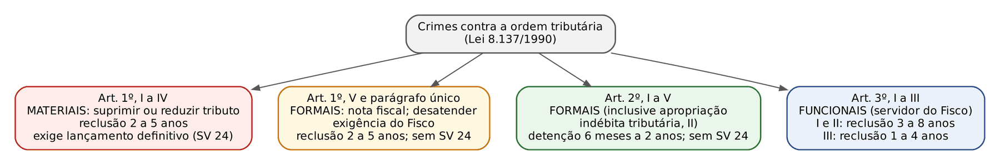
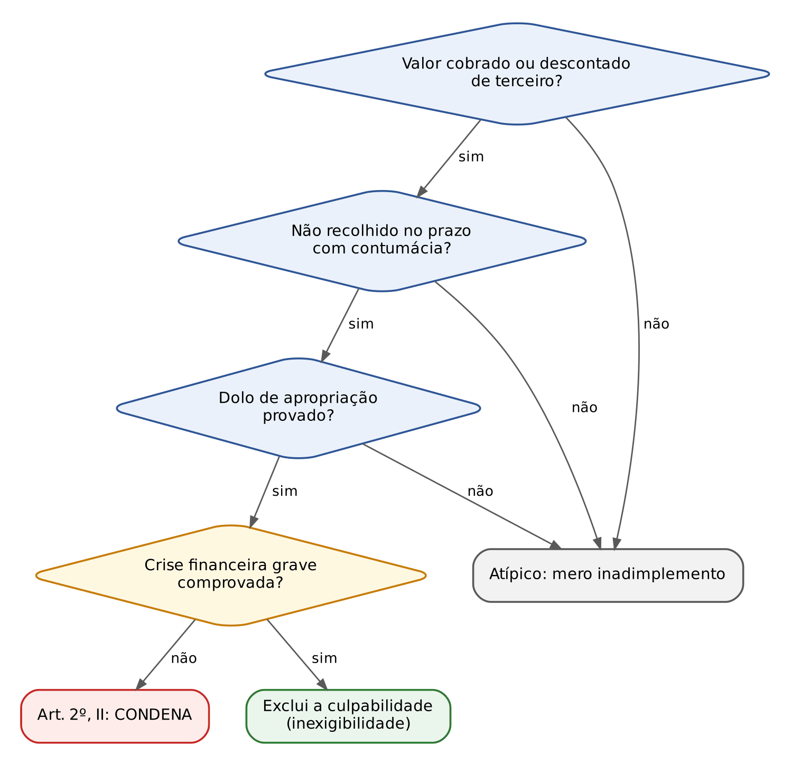
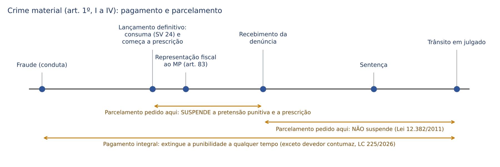
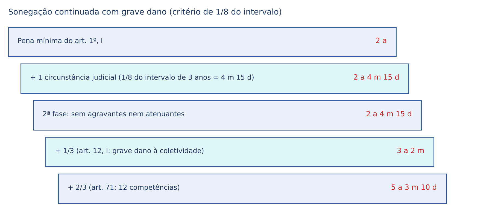

# CAPÍTULO 45 — CRIMES CONTRA A ORDEM TRIBUTÁRIA, ECONÔMICA E AS RELAÇÕES DE CONSUMO; ECONOMIA POPULAR (LEIS 8.137/1990, 8.176/1991, 1.521/1951 E CDC)

:::INCIDENCIA
TRF5 p. 10; TJRS p. 7; TJSC p. 68 e 69; SEFAZ p. 4. Nível A. Lote: 16 questões (FGV 11, FCC 5).
O que mais cai: alcance da Súmula Vinculante 24 (crime material x formal, lançamento definitivo, prescrição), literalidade e penas do art. 3º (crimes funcionais), majorantes do art. 12, art. 11 (autoria "inclusive por meio de pessoa jurídica"), pagamento e parcelamento; nos crimes de consumo, agravantes do art. 76 do CDC.
:::

| Subtema | FGV | FCC | Padrão de cobrança |
|---|---|---|---|
| SV 24: material x formal, lançamento, prescrição | 4 | 0 | SV 24 estendida a crime formal; prescrição; denúncia antes do lançamento |
| Crimes funcionais (art. 3º) | 2 | 2 | penas trocadas; conduta de particular apresentada como funcional |
| Majorantes do art. 12 | 2 | 0 | servidor fora da função; bens essenciais à saúde; "agravante" x "causa de aumento" |
| Arts. 10, 11 e 16 (multa, autoria, delação) | 2 | 1 | "exceto por meio de pessoa jurídica"; redução de 1/3 a 2/3; dolo de cada concorrente |
| Penas e tipos dos arts. 1º e 2º | 0 | 1 | distinguir o art. 1º (reclusão 2 a 5) do art. 2º (detenção 6 meses a 2 anos) |
| Conceitos tributários (evasão x elisão) | 0 | 1 | fraude na escrituração = evasão |
| Crimes do CDC | 1 | 0 | art. 74 (termo de garantia) e agravante do art. 76, V |

## 45.1 Visão geral: três leis, três bens jurídicos

O capítulo reúne crimes que protegem bens SUPRAINDIVIDUAIS ligados à economia: a arrecadação tributária (o dinheiro que financia o Estado), a livre concorrência e o abastecimento (ordem econômica), e a confiança e segurança do consumidor (relações de consumo). Quase todos têm um "irmão" administrativo (auto de infração, processo no CADE, multa do Procon); a pergunta constante da prova é o que transforma o ilícito administrativo em crime. Em regra, a FRAUDE, o DOLO e, nos crimes tributários materiais, o RESULTADO (tributo efetivamente suprimido).

| Diploma | O que tutela | Dispositivos centrais |
|---|---|---|
| Lei 8.137/1990 | ordem tributária (arts. 1º a 3º), ordem econômica (art. 4º) e relações de consumo (art. 7º) | arts. 1º, 2º, 3º, 4º, 7º, 11, 12, 15 e 16 |
| Lei 8.176/1991 | ordem econômica no setor de combustíveis e patrimônio da União (usurpação de matéria-prima) | arts. 1º, 1º-A a 1º-D (Lei 15.517/2026) e 2º |
| Lei 8.078/1990 (CDC) | relações de consumo (informação, segurança, publicidade, cobrança, cadastros) | arts. 61 a 80 |
| Lei 1.521/1951 | economia popular (usura, pirâmide, fraudes contra número indeterminado de pessoas) | arts. 2º, IX, 4º, 7º e 10 |

Ficam FORA deste capítulo, com remissão: apropriação indébita previdenciária (art. 168-A do CP — Cap. 30) e sonegação de contribuição previdenciária (art. 337-A — Cap. 36); descaminho e contrabando (Cap. 36); excesso de exação (art. 316, § 1º — Cap. 35); crimes contra o Sistema Financeiro Nacional (Lei 7.492/1986 — Cap. 47); lavagem (Cap. 46); crimes contra a saúde pública dos arts. 272 e 273 do CP (Cap. 33); furto e roubo de combustíveis (Lei 15.517/2026 — Cap. 29).

## 45.2 Ordem tributária: noções que a prova pressupõe

### 45.2.1 Vocabulário tributário mínimo

Conceitos tributários usados como elementos normativos dos tipos:

- Tributo e contribuição social: o objeto material dos crimes dos arts. 1º e 2º. Preço público e tarifa NÃO são tributo; por isso a fraude na conta de energia é furto ou estelionato, e não crime tributário (ver Cap. 29). Quem frauda supondo que a exação é tarifa incide em erro de tipo (art. 20 do CP; Cap. 7).
- Lançamento (art. 142 do CTN): ato da autoridade fiscal que verifica o fato gerador, calcula o montante e identifica o devedor. Ele se torna DEFINITIVO quando não cabe mais impugnação ou recurso na via administrativa (fim do processo administrativo fiscal, PAF).
- Sujeito passivo: o contribuinte (quem realiza o fato gerador) ou o responsável (quem a lei obriga a pagar, como o substituto tributário que retém ou cobra o imposto de terceiro).
- Nos tributos declarados pelo próprio contribuinte (ICMS em guia), a declaração já constitui o crédito.

:::QUESTAO FCC 2025 — DPE-SP — Analista de Defensoria (Q3304066)
Empresa que frauda a fiscalização inserindo elementos inexatos ou omitindo operação em documento ou livro exigido pela lei fiscal pratica o quê? Gabarito: E, evasão fiscal. A conduta é a própria descrição do art. 1º, II, da Lei 8.137/1990. Armadilha: elisão fiscal é economia LÍCITA de tributo (planejamento antes do fato gerador, por meios permitidos); elusão é o planejamento abusivo, com negócios artificiais, que o Fisco pode desconsiderar (art. 116, parágrafo único, do CTN), mas que em si não é fraude penal; "conluio" e "corrupção" não designam a conduta. Correlata: Q2611629 (Cap. 35), em que a elisão fiscal não integra o conceito de corrupção.
:::

| Instituto | Momento | Licitude | Reflexo penal |
|---|---|---|---|
| Elisão | antes do fato gerador | lícita | nenhum |
| Elusão | negócio aparente, sem propósito, para fugir do fato gerador | ilícita no plano tributário (desconsideração) | em regra nenhum, salvo se houver falsidade ou simulação que caracterize fraude |
| Evasão (sonegação) | depois do fato gerador, por fraude ou omissão | ilícita | arts. 1º e 2º da Lei 8.137/1990 |
| Inadimplemento | tributo declarado e não pago | ilícito tributário | em regra atípico; crime só no art. 2º, II, com cobrança de terceiro, contumácia e dolo de apropriação (45.4.2) |

### 45.2.2 O crime tributário não é prisão por dívida

A objeção clássica da defesa é que punir o não pagamento de tributo seria prisão civil por dívida (art. 5º, LXVII, da CF). O STF rejeitou: os crimes da Lei 8.137/1990 punem fraude, falsidade ou apropriação de valores de terceiros, e não o mero inadimplemento.

:::JURIS STF, Tema 937 (ARE 999.425, j. 2/3/2017)
Os crimes previstos na Lei 8.137/1990 não violam o disposto no art. 5º, LXVII, da Constituição. A prisão civil é meio coercitivo de pagamento; a pena criminal é sanção por conduta que a lei define como crime, com dolo e, nos casos do art. 1º, fraude.
:::

## 45.3 Art. 1º: sonegação fiscal (crimes materiais) e a Súmula Vinculante 24

### 45.3.1 Estrutura do tipo

O art. 1º tem uma estrutura que confunde quem lê rápido: o caput descreve o RESULTADO ("suprimir ou reduzir tributo, ou contribuição social e qualquer acessório") e os incisos descrevem os MEIOS ("mediante as seguintes condutas"). Pena única: reclusão de 2 a 5 anos e multa.

| Inciso | Meio | Exemplo |
|---|---|---|
| I | omitir informação ou prestar declaração falsa às autoridades fazendárias | declarar ao Fisco faturamento menor que o real; omitir receitas na declaração de IRPJ |
| II | fraudar a fiscalização inserindo elementos inexatos ou omitindo operação em documento ou livro fiscal | "caixa 2"; escrituração paralela; deixar de lançar vendas no livro de saídas |
| III | falsificar ou alterar nota fiscal, fatura, duplicata, nota de venda ou documento relativo à operação tributável | "nota calçada" (valor menor na via do Fisco) |
| IV | elaborar, distribuir, fornecer, emitir ou utilizar documento que sabe ou deve saber falso ou inexato | usar notas "frias" de fornecedores inexistentes para gerar crédito de ICMS |
| V | negar ou deixar de fornecer nota fiscal obrigatória relativa a venda ou serviço efetivamente realizado, ou fornecê-la em desacordo com a legislação | comerciante que recusa a nota ao consumidor |

O parágrafo único equipara ao inciso V a falta de atendimento, no prazo de 10 dias (conversível em horas conforme a complexidade), de exigência da autoridade fiscal. Funciona como uma desobediência específica ao Fisco e se consuma com a simples inobservância do prazo (Jurisprudência em Teses do STJ, ed. 99, tese 8).

Elemento subjetivo: dolo genérico, sem exigência de especial fim de agir (Jurisprudência em Teses, ed. 90, tese 7). Não há forma culposa: o contador que erra por desatenção não comete crime. A "fraude" (falsidade, omissão, documento inidôneo) é o que separa o crime do mero inadimplemento.

O falso (documento falso, falsidade ideológica na escrituração) usado exclusivamente como meio para sonegar é ABSORVIDO pelo crime tributário (consunção; ver Cap. 3). Se o falso tem potencialidade lesiva autônoma, há concurso.

:::QUESTAO FCC 2025 — PGE-TO — Procurador do Estado (Q3745567)
Pedia o crime tributário de particular punido com reclusão de 2 a 5 anos e multa. Gabarito: A, suprimir ou reduzir tributo mediante elaboração, distribuição, fornecimento, emissão ou utilização de documento que sabe ou deve saber falso ou inexato (art. 1º, IV). Armadilha principal: a alternativa D usa a redação do art. 2º, I ("fazer declaração falsa ... para eximir-se ... de pagamento de tributo"), crime FORMAL com pena de detenção de 6 meses a 2 anos, misturada com a abertura do art. 1º. As demais: B é o art. 3º, III (funcional, reclusão 1 a 4); C é o art. 2º, II; E é o art. 2º, IV (ambos detenção 6 meses a 2 anos).
:::

:::DICA Como separar o art. 1º, I, do art. 2º, I
Os dois falam em declaração falsa ou omissão. A diferença está no resultado: no art. 1º o tributo FOI suprimido ou reduzido (crime material, depende do lançamento); no art. 2º, I, basta a declaração falsa ou a fraude "para eximir-se" do pagamento, mesmo que o Fisco perceba a tempo e nada se perca (crime formal, com especial fim de agir). Por isso o art. 2º funciona como tipo SUBSIDIÁRIO: sem o resultado do art. 1º, pune-se pelo art. 2º, I, sem necessidade de recorrer à tentativa.
:::

### 45.3.2 A Súmula Vinculante 24: o que diz e o que NÃO diz

:::LEI STF, Súmula Vinculante 24
Não se tipifica crime material contra a ordem tributária, previsto no artigo 1º, incisos I a IV, da Lei nº 8.137/90, antes do lançamento definitivo do tributo.
:::

A lógica: se o crime é "suprimir ou reduzir tributo", é preciso saber SE há tributo devido e QUANTO. Quem diz isso, com definitividade, é a Administração Tributária ao fim do PAF. Enquanto o contribuinte discute administrativamente, o resultado do crime ainda não está certificado. Por isso o STF tratou o lançamento definitivo como elemento normativo do tipo (para outros, condição objetiva de punibilidade; a natureza é controvertida, ver Cap. 20), com uma consequência prática que a banca adora: o crime só se CONSUMA com o lançamento definitivo.

Consequências do lançamento definitivo como marco consumativo:

| Efeito | Regra | Fundamento |
|---|---|---|
| Justa causa | sem lançamento definitivo, não há crime: denúncia deve ser rejeitada e ação penal trancada | SV 24 |
| Prescrição | o prazo começa no lançamento definitivo, não na data da fraude | Jurisprudência em Teses, ed. 90, tese 8; art. 111, I, CP (Cap. 22) |
| Competência territorial | foro do lugar da constituição definitiva do crédito | Jurisprudência em Teses, ed. 90, tese 11 |
| Fatos anteriores à SV | a SV 24 aplica-se a eles: é consolidação de jurisprudência, não lei mais grave | Jurisprudência em Teses, ed. 90, tese 6 (Cap. 3) |
| Prova | basta a prova da constituição definitiva; não é preciso juntar o PAF inteiro | STJ, RHC 94.288, j. 22/5/2018 (Info 627) |
| Prescrição TRIBUTÁRIA posterior | não apaga o crime: o lançamento já tipificou a conduta | Jurisprudência em Teses, ed. 90, tese 9 |

O que a SV 24 NÃO alcança:

- O art. 1º, V, e o parágrafo único: são FORMAIS (Jurisprudência em Teses, ed. 90, tese 10; STJ, RHC 209.207, 6ª Turma, j. 12/8/2025, Info 865). Recusar a nota fiscal já é o crime, ainda que o caput fale em suprimir tributo.
- Todo o art. 2º, inclusive a apropriação indébita tributária (Jurisprudência em Teses, ed. 174, tese 3).
- O descaminho (art. 334 do CP), crime formal (Cap. 36).
- A investigação: o inquérito pode ser instaurado antes do lançamento quando a fraude já está delineada, quando a investigação é essencial para viabilizar a própria fiscalização ou quando há indícios de outros crimes não fiscais (STJ, AgRg no RHC 182.363, 10/9/2024, Info 825). O que não se admite é a DENÚNCIA pelo crime material antes do lançamento.

:::ATENCAO Apropriação indébita PREVIDENCIÁRIA é material
Ao contrário da apropriação indébita tributária da Lei 8.137 (art. 2º, II, formal), o STF e o STJ tratam a apropriação indébita previdenciária (art. 168-A do CP) e a sonegação previdenciária (art. 337-A) como crimes materiais que também dependem da constituição definitiva do crédito. A FGV cobrou isso em Q3786409 (TJ-MS 2025) e Q3265487 (abaixo). Desenvolvimento dos tipos nos Caps. 30 e 36.
:::

:::QUESTAO FGV 2024 — AL-TO — Procurador Jurídico (Q2457297)
Pedia a afirmativa correta sobre crimes tributários. Gabarito: D, o termo inicial da prescrição é a data do lançamento definitivo, quando ocorre a consumação. Armadilhas: A (dolo genérico NÃO basta: falso, basta sim); B (omissão de informação para reduzir tributo, art. 1º, I, tipificada antes do lançamento: falso, é a SV 24); C (pagamento antes da denúncia não extingue: falso, ver 45.7); E (insignificância com juros e multa e relevância da continuidade: falso, o parâmetro é o tributo sem juros e multa — ver Cap. 2).
:::

:::QUESTAO FGV 2025 — Prefeitura de Canaã dos Carajás — Procurador Municipal (Q3265487)
Sócio-administrador denunciado por apropriação indébita previdenciária ANTES da constituição definitiva do crédito. Gabarito: D, a denúncia não pode ser oferecida antes da constituição do crédito, por falta de justa causa. Armadilhas: tratar o crime como formal (A); remeter a ausência de lançamento à dosimetria (B); dizer que se consuma com o ajuizamento da execução fiscal (C: o marco é o lançamento definitivo, não a execução); negar a extinção pelo pagamento (E).
:::

:::QUESTAO FGV 2024 — TCE-PA — Auditor de Controle Externo (Q2564267)
Três afirmativas V ou F. Gabarito oficial: B (V, F, V). (1) Sonegação por omissão de informação exige prévio lançamento definitivo: V (SV 24). (2) Punir o não recolhimento de tributo descontado ou cobrado seria prisão civil por dívida: F (Tema 937 do STF). (3) Insignificância calculada pelo montante do crédito definitivamente constituído, excluídos juros e multa, "sendo irrelevante" a continuidade delitiva: V para a banca. Ressalva: a primeira parte é pacífica (Tema 157 do STJ, Cap. 2); a afirmação de que a continuidade é irrelevante é discutível, porque a jurisprudência soma os débitos para aferir o valor e trata a reiteração como óbice (Tema 1.218 do STJ, Cap. 2). Na mesma linha, a FGV considerou errada, em Q2457297, a alternativa que dizia ser "relevante" a continuidade. Fixe o padrão da banca, mas registre a divergência numa discursiva.
:::

### 45.3.3 Autonomia das instâncias e o processo administrativo

Depois do lançamento definitivo, a esfera penal caminha sozinha:

- Ação anulatória, embargos à execução, pedido de compensação ou garantia do juízo (fiança bancária, seguro-garantia) NÃO suspendem a ação penal nem equivalem a pagamento (Jurisprudência em Teses, ed. 90, tese 13; ed. 99, teses 7 e 4; ed. 174, tese 1).
- Nulidades do PAF não se discutem no processo criminal (ed. 99, teses 4 e 5).
- Exceção 1: se o juízo cível ANULA o lançamento com trânsito em julgado, desaparece o elemento do tipo e a conduta deixa de ser crime (STJ, AgRg no REsp 1.966.379, 6ª Turma, j. 23/8/2022).
- Exceção 2: suspensão da ação penal pelo art. 93 do CPP, se a discussão cível for plausível e repercutir no crime, com suspensão da prescrição (art. 116, I, CP) (STJ, AgRg no AREsp 2.667.847, 5ª Turma, j. 3/6/2025).
- Ônus da prova: a omissão do contribuinte em provar, no PAF, a regularidade das operações (presunções fiscais) não basta, sozinha, como prova da materialidade da sonegação mediante fraude; a acusação deve provar a fraude no processo penal (STJ, AREsp 3.111.920, 5ª Turma, j. 3/3/2026, Info 880). Ponto valioso para a sentença absolutória.

:::SENTENCA Materialidade no crime tributário material
Onde entra: na fundamentação da materialidade, antes da autoria. O que fundamentar: (a) a constituição definitiva do crédito, com data (que também fixa a consumação e a prescrição); (b) a fraude (o meio do inciso), provada no processo penal, e não apenas a presunção fiscal; (c) o valor suprimido, que servirá para o art. 12, I, ou para o art. 59, mas não para ambos. Redação-modelo: "A materialidade está comprovada pela constituição definitiva do crédito tributário em 10/3/2023 (certidão de fls.), que encerra o processo administrativo fiscal, e pela prova pericial e documental de que a ré omitiu do livro de saídas operações efetivamente realizadas (art. 1º, II, da Lei 8.137/1990)". Erro que a banca pune: tomar a data da fraude como data do fato para a prescrição.
:::

### 45.3.4 Inciso V e parágrafo único: crime formal

:::QUESTAO FGV 2024 — MPE-GO — Promotor de Justiça Substituto (Q2367591)
Comerciante se recusa a fornecer nota fiscal de venda de bens essenciais à saúde e comemora a supressão do tributo. Gabarito: A, crime contra a ordem tributária (art. 1º, V) com CAUSA DE AUMENTO (art. 12, III), sendo prescindível o lançamento definitivo. Armadilhas: chamar o art. 12 de "agravante" (B e C) — embora a lei diga "circunstâncias que podem agravar", a fração de 1/3 até a metade faz dele majorante de terceira fase (Cap. 14); exigir lançamento (C e E), estendendo a SV 24 a crime formal; negar a majorante (D e E).
:::

## 45.4 Art. 2º: crimes formais (detenção de 6 meses a 2 anos)

### 45.4.1 Os cinco incisos

| Inciso | Conduta | Observação |
|---|---|---|
| I | declaração falsa, omissão de declaração ou outra fraude "para eximir-se" do pagamento | especial fim de agir; prescrição conta da fraude, não da descoberta (STJ, RHC 36.024, j. 25/8/2015, Info 568) |
| II | deixar de recolher, no prazo legal, tributo ou contribuição DESCONTADO ou COBRADO, na qualidade de sujeito passivo, que deveria recolher aos cofres públicos | apropriação indébita tributária (45.4.2) |
| III | exigir, pagar ou receber percentagem sobre parcela dedutível ou deduzida de imposto como incentivo fiscal | "pedágio" sobre incentivo fiscal |
| IV | deixar de aplicar, ou aplicar em desacordo, incentivo fiscal ou parcelas de imposto liberadas por órgão de desenvolvimento | desvio de verbas de incentivo (ex.: SUDAM): é este crime, e não estelionato contra entidade pública (Jurisprudência em Teses, ed. 99, tese 10); o falso usado só como meio é absorvido mesmo se mais grave (ed. 174, tese 7) |
| V | utilizar ou divulgar programa de processamento de dados que permita ao sujeito passivo ter informação contábil diversa da fornecida ao Fisco | software de "duplo caixa" |

Todos são de menor potencial ofensivo (pena máxima de 2 anos): transação penal e Juizado Especial Criminal (Cap. 25). Prescrição em abstrato: 4 anos (art. 109, V).

### 45.4.2 Apropriação indébita tributária (art. 2º, II): o tema mais moderno

Situação típica: o comerciante vende a mercadoria e embute no preço o ICMS, que o consumidor paga; declara o imposto ao Fisco (em guia própria), mas não recolhe, mês após mês, e usa o dinheiro no capital de giro. Isso é crime ou mera dívida?

:::JURIS STF, RHC 163.334, Plenário, j. 18/12/2019 (Info 964)
O contribuinte que deixa de recolher, de forma contumaz e com dolo de apropriação, o ICMS cobrado do adquirente da mercadoria ou serviço incide no tipo penal do art. 2º, II, da Lei 8.137/1990. O valor do ICMS cobrado do consumidor não integra o patrimônio do comerciante, que é mero depositário desse ingresso de caixa. É crime próprio do sujeito passivo da obrigação, sem distinção entre contribuinte e responsável, substituto ou substituído. Ficou expressamente afastada a punição do devedor eventual: a criminalização se volta ao inadimplente CONTUMAZ, que faz do não recolhimento modelo de negócio.
:::

O STJ já havia admitido o crime tanto no ICMS próprio quanto no ICMS-ST (HC 399.109, 3ª Seção, j. 22/8/2018), entendimento sumulado: "O crime de apropriação indébita tributária pode ocorrer tanto em operações próprias, como em razão de substituição tributária" (Súmula 658 do STJ, 2023). Depois do RHC 163.334, o STJ ajustou o elemento subjetivo:

- É indispensável o dolo de apropriação (elemento subjetivo especial), não bastando o dolo genérico de não recolher (HC 675.289, 6ª Turma, j. 16/11/2021, Info 718). A Jurisprudência em Teses, ed. 174, tese 4, que falava em dolo genérico, deve ser lida como SUPERADA nesse ponto.
- Contumácia é reiteração com aspecto de habitualidade: um único mês sem recolhimento é atípico (AgRg no REsp 1.867.109, 6ª Turma, j. 25/8/2020, Info 679); seis meses alternados e aleatórios também não bastaram (HC 569.856, 6ª Turma, j. 11/10/2022, Info 753).
- Declarar o imposto em guia não afasta o crime: a clandestinidade não é elementar (ed. 174, tese 6). Paradoxo para memorizar: o tipo não exige fraude, mas exige dolo de apropriação, inferido sobretudo da contumácia.
- A crise financeira grave e comprovada pode excluir a culpabilidade por inexigibilidade de conduta diversa (ed. 176, tese 12 — desenvolvida no Cap. 10).

:::EXEMPLO Três comerciantes que declaram e não pagam ICMS
A declarou e não recolheu o ICMS de março de 2024, por um atraso de caixa, e pagou com multa em maio: um mês, sem contumácia, fato atípico. B deixou de recolher em quatro meses espaçados ao longo de dois anos: falta habitualidade (Info 753). C declarou e não recolheu por 30 meses seguidos, enquanto distribuía lucros aos sócios e abria filiais: contumácia e dolo de apropriação evidentes (o dinheiro do imposto financiou a expansão); responde pelo art. 2º, II, em continuidade delitiva (cada competência é um crime; fração pelo número de infrações, Cap. 16). Se C provasse que deixou de recolher para pagar salários durante crise grave e documentada, a defesa de inexigibilidade seria examinável; mas distribuir lucros no mesmo período a afasta.
:::

:::PEGADINHA Formal, mas com dolo especial
Não confunda as duas classificações. O art. 2º, II, é FORMAL (não depende de lançamento nem de prejuízo apurado: o crédito declarado já está constituído, e o prazo prescricional corre da data em que o recolhimento deveria ter sido feito). E exige DOLO DE APROPRIAÇÃO. Alternativas que dizem "por ser formal, basta o dolo genérico" ou "por exigir dolo de apropriação, é material" estão erradas.
:::

## 45.5 Art. 3º: crimes funcionais contra a ordem tributária

O art. 3º pune o servidor (em regra o fiscal) que se corrompe ou trai a função fazendária. São crimes ESPECIAIS em relação aos crimes funcionais do CP, e o caput diz expressamente que valem "além dos previstos" no Título XI do CP. O conceito de funcionário é o do art. 327 do CP (Cap. 35).

:::LEI Lei 8.137/1990, art. 3º
Constitui crime funcional contra a ordem tributária, além dos previstos no Decreto-Lei n° 2.848, de 7 de dezembro de 1940 - Código Penal (Título XI, Capítulo I):
I - extraviar livro oficial, processo fiscal ou qualquer documento, de que tenha a guarda em razão da função; sonegá-lo, ou inutilizá-lo, total ou parcialmente, acarretando pagamento indevido ou inexato de tributo ou contribuição social;
II - exigir, solicitar ou receber, para si ou para outrem, direta ou indiretamente, ainda que fora da função ou antes de iniciar seu exercício, mas em razão dela, vantagem indevida; ou aceitar promessa de tal vantagem, para deixar de lançar ou cobrar tributo ou contribuição social, ou cobrá-los parcialmente. Pena - reclusão, de 3 (três) a 8 (oito) anos, e multa.
III - patrocinar, direta ou indiretamente, interesse privado perante a administração fazendária, valendo-se da qualidade de funcionário público. Pena - reclusão, de 1 (um) a 4 (quatro) anos, e multa.
:::

| Inciso | Corresponde no CP a | Diferença decisiva | Pena |
|---|---|---|---|
| I | extravio, sonegação ou inutilização de documento (art. 314) | o resultado: pagamento indevido ou inexato de tributo | reclusão 3 a 8 anos |
| II | concussão (art. 316) e corrupção passiva (art. 317) numa só figura | a finalidade: deixar de lançar ou cobrar tributo, ou cobrá-lo parcialmente | reclusão 3 a 8 anos |
| III | advocacia administrativa (art. 321: detenção 1 a 3 meses) | perante a ADMINISTRAÇÃO FAZENDÁRIA | reclusão 1 a 4 anos |

Pontos de prova:

- O inciso II reúne verbos de concussão (exigir) e de corrupção (solicitar, receber, aceitar promessa). Hoje a concussão e a corrupção passiva do CP têm pena de 2 a 12 anos: o especial é mais brando, mas prevalece pela especialidade.
- O particular que oferece a vantagem ao fiscal responde por corrupção ativa (art. 333 do CP), e não pelo art. 3º. Se ele, além disso, sonegou, há concurso; e o pagamento posterior do tributo extingue a punibilidade da sonegação, mas não a da corrupção ativa (STJ, RHC 95.557, 6ª Turma, j. 21/6/2018, Info 631).
- O fiscal que exige TRIBUTO indevido para os cofres públicos, ou cobra com meio vexatório, comete excesso de exação (art. 316, § 1º — Cap. 35; correlatas Q3157921 e Q3593802).
- O art. 12 (majorantes) NÃO se aplica ao art. 3º: o caput do art. 12 menciona "arts. 1º, 2º e 4º a 7º". A qualidade de servidor já é elementar.

:::QUESTAO FCC 2024 — PIAUÍPREV — Analista Previdenciário (Q3884636)
Auditor fiscal estadual aceita promessa de 50.000 (cinquenta mil) reais para não lavrar o auto de infração e certifica a regularidade da empresa. Gabarito: E, crime funcional contra a ordem tributária (art. 3º, II), reclusão de 3 a 8 anos e multa. Armadilhas: concussão (A) e corrupção passiva (B) do CP, afastadas pela especialidade; peculato (C) e inserção de dados falsos (D) não descrevem a troca de vantagem pelo não lançamento.
:::

:::QUESTAO FGV 2024 — Prefeitura de Macaé — Auditor Fiscal Tributário (Q3047246)
Três afirmativas sobre o art. 3º. Gabarito: B (só a II). (I) extraviar livro oficial com pena de reclusão de 2 a 6 anos: falsa, a pena é de 3 a 8 anos. (II) aceitar promessa de vantagem para deixar de lançar tributo, reclusão de 3 a 8 anos: verdadeira. (III) patrocinar interesse privado perante a administração fazendária com DETENÇÃO de 1 a 4 anos: falsa, é RECLUSÃO de 1 a 4 anos. Mesmo padrão: FCC 2026, PGM-Manaus (Q4338781), gabarito C (patrocinar interesse privado perante a administração fazendária é a figura funcional; as demais alternativas eram condutas de particulares dos arts. 1º e 2º).
:::

:::QUESTAO FGV 2024 — Prefeitura de Nova Iguaçu — Auditor Fiscal do Tesouro Municipal (Q3039640)
Gabarito: C, extraviar livro oficial, processo fiscal ou documento de que tenha a guarda em razão da função é crime funcional (art. 3º, I). Armadilhas: deixar de fornecer nota fiscal é CRIME (art. 1º, V), não contravenção (A); falsificar nota fiscal é crime de PARTICULAR (art. 1º, III), não funcional (B); desviar incentivo fiscal é crime (art. 2º, IV), não contravenção (D); o software de contabilidade paralela é crime de particular (art. 2º, V), não funcional (E).
:::

:::PEGADINHA Advocacia administrativa: fazendária ou comum?
A especialidade do art. 3º, III, depende de o interesse ser patrocinado PERANTE A ADMINISTRAÇÃO FAZENDÁRIA. Na Q3049085 (FGV 2024, Cap. 35), um fiscal da receita patrocinou interesses ilegítimos de amigo "perante a Administração Pública", sem referência a matéria fazendária, e o gabarito foi advocacia administrativa do CP (art. 321, com a forma qualificada do parágrafo único por ser ilegítimo o interesse). Leia o enunciado: cargo fazendário não basta; o órgão perante o qual se patrocina é que define.
:::

## 45.6 Disposições comuns da Lei 8.137/1990

### 45.6.1 Autoria nos crimes societários (art. 11)

:::LEI Lei 8.137/1990, art. 11, caput
Quem, de qualquer modo, inclusive por meio de pessoa jurídica, concorre para os crimes definidos nesta lei, incide nas penas a estes cominadas, na medida de sua culpabilidade.
:::

O dispositivo repete a teoria monista do art. 29 do CP e deixa claro duas coisas. Primeira: usar a empresa não blinda a pessoa física (não é responsabilidade penal da pessoa jurídica, que a Lei 8.137 não prevê; ver Cap. 5). Segunda: "na medida de sua culpabilidade" veda a responsabilidade objetiva: ser sócio ou administrador, por si só, não faz ninguém autor.

- A denúncia nos crimes societários pode ser "geral" (sem minúcia de cada ato), desde que mostre um vínculo mínimo entre o agir do denunciado e o fato (Jurisprudência em Teses, ed. 176, tese 3); a mera condição de sócio não basta (STJ, HC 224.728, Info 543; teoria do domínio do fato e REsp 1.854.893 — ver Cap. 11).
- Autor não precisa ser sócio nem constar do PAF: o administrador de fato, o "testa de ferro" consciente e o contador que monta a fraude respondem (ed. 176, tese 2). O sócio que deixa a empresa antes do lançamento responde se praticou a conduta antes de sair (ed. 176, tese 1).
- O sócio-administrador que sabe da fraude conduzida pelo outro sócio ou pelo contador e se omite pode responder como autor por omissão imprópria (art. 13, § 2º, do CP), desde que tenha o dever e o poder de evitar e haja dolo (ed. 176, tese 4).
- Parágrafo único do art. 11: na venda por sistema de entrega ao consumo com preço fixado ou sugerido pelo fabricante, o ato do fabricante não alcança o distribuidor ou revendedor.

:::QUESTAO FCC 2026 — SEFAZ-SP — Auditor Fiscal da Receita Estadual (Q3917715)
Administrador determina a omissão de operações; o contador deixa de lançá-las e mantém escrituração paralela; um funcionário apenas guarda documentos em local separado sem conhecer o conteúdo. Gabarito: D, respondem administrador e contador, desde que tenham agido dolosamente, o que não se verificou quanto ao funcionário operacional. Armadilhas: punir o funcionário sem dolo (A: responsabilidade objetiva); só quem obtém vantagem é autor (B: falso, art. 11); só o contador por ter domínio do fato (C); condicionar a responsabilidade ao lançamento (E): para a CONDENAÇÃO pelo art. 1º o lançamento é necessário, mas a alternativa o coloca como critério de quem responde, que é o dolo.
:::

:::QUESTAO FGV 2024 — CGM de Belo Horizonte — Auditor Interno (Q2387537)
Gabarito: B, quem concorre para os crimes da lei incide nas penas na medida de sua culpabilidade, inclusive quando praticados por meio de pessoa jurídica (art. 11). Armadilhas: ressalva inexistente para quem usa o dinheiro para pagar salários (A: a crise pode, no máximo, ser examinada como inexigibilidade, Cap. 10); "todos os crimes tributários são formais" (C: SV 24); exceção à independência das instâncias (D).
:::

### 45.6.2 Majorantes (art. 12)

:::LEI Lei 8.137/1990, art. 12
São circunstâncias que podem agravar de 1/3 (um terço) até a metade as penas previstas nos arts. 1°, 2° e 4° a 7°:
I - ocasionar grave dano à coletividade;
II - ser o crime cometido por servidor público no exercício de suas funções;
III - ser o crime praticado em relação à prestação de serviços ou ao comércio de bens essenciais à vida ou à saúde.
IV - ser o crime relacionado a bens alcançados pelas imunidades tributárias dispostas no inciso VI do caput do art. 150 da Constituição Federal. (incluído pela LC 224/2025, com efeitos a partir de 1/1/2026)
:::

Natureza: causa de aumento (terceira fase), apesar do verbo "agravar" (Cap. 14). Não se aplica ao art. 3º.

- Inciso I, grave dano à coletividade: não é qualquer valor. O STJ (REsp 1.849.120, 3ª Seção, j. 11/3/2020, Info 668) fixou que a majorante se restringe a dano relevante, aferido pelo critério que a própria Fazenda usa para definir créditos prioritários: nos tributos federais, débitos a partir de 1.000.000 (um milhão) de reais (Portaria PGFN 320/2008, art. 14); nos estaduais e municipais, o patamar de "grande devedor" da legislação local. Nessa aferição, o valor inclui juros, multa e acréscimos (diferente da insignificância, que exclui juros e multa).
- Proibição de *bis in idem*: o mesmo valor elevado não pode, ao mesmo tempo, negativar as consequências do crime no art. 59 e justificar o art. 12, I. Use-o em uma fase só. Omissão de receitas e informações falsas são ínsitas ao art. 1º, I, e não negativam as circunstâncias do crime (ed. 176, tese 8).
- Art. 12, I, e continuidade delitiva convivem: a primeira mede a gravidade de cada crime; a segunda, a pluralidade de crimes (ed. 176, tese 10).
- *Emendatio libelli*: se a denúncia descreve o montante sonegado, o juiz pode aplicar o art. 12, I, ainda que a majorante não tenha sido capitulada (ed. 90, tese 2).
- Inciso II: exige que o crime seja cometido pelo servidor NO EXERCÍCIO das funções. O servidor que sonega o próprio imposto de renda, sem relação com o cargo, responde pelo crime simples.
- Inciso IV (novidade): crimes relacionados a bens alcançados por imunidade (templos, partidos e entidades sem fins lucrativos, livros, jornais e o papel destinado à sua impressão etc.). Exemplo: desviar para uso comercial papel adquirido com imunidade. É lei mais grave: só para fatos a partir de 1/1/2026.

:::QUESTAO FGV 2024 — prova não identificada no banco (Q3157922)
Servidor estadual faz declaração falsa sobre rendas e bens para eximir-se parcialmente de tributo, sem grave dano e sem relação com a função. Gabarito: C, crime contra a ordem tributária sem qualificadoras ou causas de aumento. Armadilhas: majorar só por ser servidor (A: o art. 12, II, exige o exercício das funções); atipicidade por desvinculação do cargo (B), por ilícito apenas administrativo (D) ou por ausência de grave dano (E: o dano grave é majorante, não elementar).
:::

:::QUESTAO FGV 2026 — MPE-MT — Promotor de Justiça Substituto (Q4116991)
O MP pediu, em alegações finais, aumento de 1/3 até a metade "em observância à legislação de regência" num crime do art. 1º. Gabarito: B, crime praticado em relação ao comércio de bens essenciais à saúde (art. 12, III). Armadilhas: isenções tributárias (A: a lei nova fala em IMUNIDADES do art. 150, VI, não em isenções); bens imóveis (C); prejuízo superior a 20.000 (vinte mil) reais (D: esse valor é o teto da insignificância federal, não critério de majorante); dano à indústria local (E).
:::

### 45.6.3 Multa (arts. 8º a 10), ação penal (art. 15) e delação (art. 16)

- Multa dos arts. 1º a 3º: 10 a 360 dias-multa; dia-multa de 14 a 200 BTN (art. 8º). Extinto o BTN, a prática dominante calcula o dia-multa pelos parâmetros do art. 49, § 1º, do CP (ver nota de verificação).
- Art. 9º: conversão da pena privativa em multa nos crimes contra a ordem econômica e as relações de consumo (arts. 4º e 7º).
- Art. 10: considerando o ganho ilícito e a situação econômica do réu, o juiz pode DIMINUIR a multa até a décima parte ou ELEVÁ-LA ao décuplo. Não é "na proporção que entender justa".
- Art. 15 e Súmula 609 do STF: ação penal pública incondicionada. Qualquer pessoa pode provocar o MP por escrito (art. 16, caput).
- Art. 16, parágrafo único (delação premiada): nos crimes da lei "cometidos em quadrilha ou co-autoria", o coautor ou partícipe que, por confissão espontânea, revelar à autoridade policial ou judicial toda a trama delituosa tem a pena reduzida de 1/3 a 2/3. Não prevê perdão judicial (diferente da Lei 12.850/2013, Cap. 46).

:::QUESTAO FGV 2024 — Câmara dos Deputados — Consultor Legislativo (Q2510975)
Três afirmativas. Gabarito: C (só a II). (I) o juiz pode reduzir as penas pecuniárias "na proporção que entender justa, com base na razoabilidade": falsa, o limite é a décima parte (ou elevação ao décuplo, art. 10). (II) coautor ou partícipe que, por confissão espontânea, revela toda a trama tem a pena reduzida de um a dois terços: verdadeira (art. 16, parágrafo único). (III) responde quem concorre para o crime "exceto se cometido por meio de pessoa jurídica": falsa, o art. 11 diz "inclusive".
:::

### 45.6.4 Competência, insignificância e benefícios

- Competência material: tributos federais (IR, PIS, COFINS, IPI, contribuições) → Justiça Federal (art. 109, IV, CF); ICMS, ISS, IPVA, ITCMD → Justiça Estadual. Foro: lugar do lançamento definitivo nos crimes materiais.
- Insignificância: 20.000 (vinte mil) reais nos tributos federais, sem juros e multa (Tema 157 do STJ); nos estaduais, só se houver lei local equivalente (ed. 174, tese 10); em Santa Catarina, divergência sobre a retroação da portaria que elevou o piso para 50.000 (cinquenta mil) reais (desenvolvido nos Caps. 2 e 3).
- Benefícios: arts. 1º e 3º, III, admitem ANPP (pena mínima inferior a 4 anos, sem violência; Cap. 25); o art. 2º é infração de menor potencial ofensivo; o art. 3º, I e II (mínimo de 3 anos), admite ANPP mas não suspensão condicional do processo. A reparação do dano costuma ser condição do ANPP e se conecta ao pagamento (45.7).

## 45.7 Pagamento, parcelamento e representação fiscal

### 45.7.1 Por que o pagamento extingue a punibilidade

A política criminal tributária é arrecadatória. Ao contrário do furto e do estelionato (em que a reparação, antes da denúncia, só gera arrependimento posterior — Cap. 8), nos crimes tributários o PAGAMENTO INTEGRAL extingue a punibilidade e o PARCELAMENTO suspende a pretensão punitiva. A lei aplicável é a do tempo do fato (ou a mais benéfica):

| Diploma | Pagamento | Parcelamento |
|---|---|---|
| Lei 9.249/1995, art. 34 | extingue se feito antes do recebimento da denúncia | (silente) |
| Lei 10.684/2003, art. 9º | extingue o pagamento integral dos débitos, inclusive acessórios, sem limite temporal (§ 2º) | suspende a pretensão punitiva e a prescrição enquanto a pessoa jurídica estiver no parcelamento (caput e § 1º) |
| Lei 11.941/2009, arts. 68 e 69 | idem | idem |
| Lei 12.382/2011 (art. 83, §§ 1º a 4º, da Lei 9.430/1996) | extingue o pagamento integral dos débitos parcelados (§ 4º) | só suspende se o pedido de parcelamento foi formalizado ANTES do recebimento da denúncia (§ 2º); a prescrição não corre na suspensão (§ 3º) |
| LC 225/2026 (arts. 49 a 54: art. 83, §§ 5º, II, e 7º, da Lei 9.430; art. 9º, §§ 3º e 4º, da Lei 10.684; art. 34, §§ 3º e 4º, da Lei 9.249; art. 69, §§ 2º e 3º, da Lei 11.941; arts. 168-A e 337-A, §§ 5º e 6º, do CP) | NÃO extingue para o agente declarado DEVEDOR CONTUMAZ em decisão administrativa definitiva e inscrito no Cadin | NÃO suspende para o devedor contumaz; deixar de ser contumaz não afasta a vedação quanto aos atos do período |

Regras jurisprudenciais firmes:

- Pagamento a qualquer tempo: o STJ entende que o pagamento integral extingue a punibilidade mesmo após o recebimento da denúncia e até depois da condenação, porque o art. 9º, § 2º, da Lei 10.684/2003 não fixou marco temporal (ed. 99, tese 6). A 5ª Turma admitiu a extinção inclusive após o trânsito em julgado (HC 362.478, j. 14/9/2017, Info 611).
- Pagamento tem de ser INTEGRAL, com juros e multa. Quitar só o principal não basta.
- Garantia da execução fiscal (penhora, fiança, seguro) não é pagamento nem parcelamento: não extingue nem suspende (ed. 174, tese 1).
- Parcelamento após o recebimento da denúncia: para créditos constituídos depois da Lei 12.382/2011, não suspende a ação penal (STJ, AgRg no RHC 200.315, 6ª Turma, j. 4/11/2024). Para créditos anteriores, vale o regime da Lei 10.684/2003 (suspende a qualquer tempo; ed. 90, tese 12).
- Pagamento da MULTA isolada pelo descumprimento de obrigação acessória não extingue o crime do art. 1º, V (STJ, REsp 1.630.109, j. 14/2/2017, Info 598).

:::ATENCAO LC 225/2026 (Código de Defesa do Contribuinte)
A LC 225, de 8/1/2026 (DOU de 9/1/2026), criou a figura do devedor contumaz: inadimplência simultaneamente SUBSTANCIAL (no âmbito federal, créditos irregulares de 15.000.000 (quinze milhões) de reais ou mais e superiores a 100% do patrimônio conhecido; nos demais entes, conforme lei local), REITERADA (4 períodos de apuração consecutivos ou 6 alternados em 12 meses) e INJUSTIFICADA. Para o declarado contumaz em decisão administrativa definitiva e inscrito no Cadin, acabam a suspensão e a extinção (arts. 1º e 2º da Lei 8.137 e 168-A e 337-A do CP). Por ser norma penal mais gravosa (restringe causa extintiva), não retroage: aplica-se a fatos posteriores à vigência. Não confunda com a "contumácia" do RHC 163.334, que é requisito de tipicidade do art. 2º, II, e não depende de declaração administrativa.
:::

### 45.7.2 Representação fiscal para fins penais (art. 83 da Lei 9.430/1996)

O art. 83 manda a Receita encaminhar ao MP a representação fiscal para fins penais relativa aos crimes dos arts. 1º e 2º da Lei 8.137 e 168-A e 337-A do CP somente APÓS a decisão final, na esfera administrativa, sobre a exigência do crédito; e, havendo parcelamento, só depois da exclusão do contribuinte do programa (§ 1º). O STF julgou a regra constitucional (ADI 4.980, Rel. Min. Nunes Marques, j. 10/3/2022).

Isso NÃO é condição de procedibilidade: o MP pode agir com base em outros elementos, desde que, nos crimes materiais, exista o lançamento definitivo. A regra disciplina a conduta da Administração, não limita a ação penal pública.

## 45.8 Da tipicidade à pena: exemplo completo para a sentença

:::EXEMPLO Sonegação de IRPJ em continuidade, com grave dano
Fatos: sócio-administrador omitiu receitas nas declarações mensais de tributos federais em 12 competências seguidas de 2023 (art. 1º, I). O PAF terminou com lançamento definitivo em 5/2/2025, crédito de 3.000.000 (três milhões) de reais com acréscimos (principal de 1.800.000 (um milhão e oitocentos mil) reais). Réu primário; circunstância judicial negativa: utilização de interpostas pessoas ("laranjas") no quadro social para dificultar a responsabilização (circunstâncias do crime). Sem agravantes nem atenuantes.
Passo 1, tipicidade: crime material consumado em 5/2/2025 (SV 24); 12 crimes da mesma espécie, mesmas condições, intervalos mensais → continuidade (art. 71; Cap. 16).
Passo 2, pena-base (art. 59): pena 2 a 5 anos; intervalo 3 anos = 36 meses. Critério de 1/8 do intervalo por circunstância (prevalente no STJ, Cap. 13): 36 ÷ 8 = 4,5 meses = 4 meses e 15 dias. Pena-base: 2 anos, 4 meses e 15 dias. Variante (1/6 da pena mínima): 24 ÷ 6 = 4 meses → 2 anos e 4 meses.
Passo 3, segunda fase: sem alteração.
Passo 4, terceira fase, art. 12, I: crédito de 3.000.000 (três milhões) de reais supera 1.000.000 (um milhão) de reais (critério do REsp 1.849.120). Aumento mínimo de 1/3, pois o valor não é excepcional a ponto de justificar fração maior (fundamentar). 28,5 meses × 4/3 = 38 meses = 3 anos e 2 meses. Variante: 28 × 4/3 = 37,33 meses = 3 anos, 1 mês e 10 dias.
Passo 5, continuidade (art. 71): 12 infrações → fração máxima de 2/3 (7 ou mais infrações; Cap. 16). 38 × 5/3 = 63,33 meses = 5 anos, 3 meses e 10 dias (0,33 mês = 10 dias). Variante: 37,33 × 5/3 = 62,22 meses = 5 anos, 2 meses e 6 dias (0,22 mês = 6,7 dias; desprezada a fração de dia, art. 11 do CP).
Passo 6, multa: dias-multa entre 10 e 360 (art. 8º), dosados em proporção à pena; no crime continuado, o STJ afasta o art. 72 do CP e aplica à multa o mesmo critério de exasperação (Caps. 15 e 16).
Passo 7, regime e substituição: 5 anos e 3 meses → semiaberto para primário (art. 33, § 2º, "b"); pena acima de 4 anos impede a substituição (art. 44, I).
Passo 8, prescrição: calcula-se sobre a pena de cada crime, sem o acréscimo da continuidade (Súmula 497 do STF): 3 anos e 2 meses → 8 anos (art. 109, IV), contados de 5/2/2025, e não de 2023.
:::

:::SENTENCA Dosimetria no crime tributário
Onde entra: terceira fase (art. 12) e, depois, concurso de crimes. O que fundamentar: o patamar do art. 12, I, com o critério da Fazenda credora e o valor atualizado; a fração do art. 71 pelo número de competências; a escolha entre art. 59 e art. 12 para o valor (nunca os dois). Redação-modelo: "Incide o art. 12, I, da Lei 8.137/1990, pois o crédito constituído supera o patamar de créditos prioritários da Fazenda Nacional; elevo a pena em 1/3, sem valorar o montante na primeira fase, para evitar *bis in idem*". Erro comum: aplicar o art. 12 ao art. 3º, ou contar a prescrição da data da omissão.
:::

## 45.9 Crimes contra a ordem econômica

### 45.9.1 Art. 4º da Lei 8.137/1990: abuso do poder econômico e cartel

Depois da Lei 12.529/2011 (lei do CADE), o art. 4º ficou com dois incisos, ambos punidos com reclusão de 2 a 5 anos e multa (antes a multa era alternativa); os arts. 5º e 6º foram revogados.

| Inciso | Conduta | Ponto de prova |
|---|---|---|
| I | abusar do poder econômico, dominando o mercado ou eliminando, total ou parcialmente, a concorrência mediante qualquer forma de ajuste ou acordo de empresas | exige ajuste entre empresas e efeito de dominação ou eliminação |
| II | formar acordo, convênio, ajuste ou aliança entre ofertantes visando: a) fixação artificial de preços ou quantidades; b) controle regionalizado do mercado; c) controle, em detrimento da concorrência, de rede de distribuição ou de fornecedores | é o CARTEL; o STJ exige demonstrar que o acordo visa ao domínio do mercado (Jurisprudência em Teses, ed. 174, tese 8) |

- Acordo de leniência (art. 87 da Lei 12.529/2011): celebrado com o CADE, suspende a prescrição e impede a denúncia contra o beneficiário pelos crimes contra a ordem econômica, pelos crimes ligados ao cartel (como os licitatórios e a associação criminosa); cumprido o acordo, extingue-se automaticamente a punibilidade.
- Competência: Justiça Estadual, salvo lesão a bens, serviços ou interesses da União ou hipótese do art. 109, VI, da CF (ed. 99, tese 1). A Constituição prevê crimes contra a ordem econômica na Justiça Federal só "nos casos determinados por lei" (art. 109, VI), e a Lei 8.137 não fez essa determinação.

### 45.9.2 Lei 8.176/1991: combustíveis e usurpação de bens da União

| Dispositivo | Conduta | Pena | Observação |
|---|---|---|---|
| Art. 1º, I | adquirir, distribuir e revender derivados de petróleo, gás natural, álcool etílico hidratado carburante e demais combustíveis líquidos carburantes em desacordo com as normas estabelecidas na forma da lei | detenção de 1 a 5 anos | norma penal em branco (regulação da ANP); perigo abstrato, mas exige dolo, vedada a responsabilidade objetiva (STJ, AgRg no AgRg no AREsp 2.310.819, 5ª Turma, j. 4/2/2025, Info 845) |
| Art. 1º, II | usar gás liquefeito de petróleo (GLP) para fins automotivos em desacordo com as normas | detenção de 1 a 5 anos | redação da Lei 15.348/2026 (de 13/2/2026, vigente na publicação): deixou de abranger o uso em motores de qualquer espécie, saunas, caldeiras e aquecimento de piscinas (*abolitio criminis* parcial para esses usos; Cap. 3) |
| Art. 1º-A (Lei 15.517/2026) | adquirir, receber, transportar, armazenar, vender, distribuir ou utilizar, no exercício de atividade comercial ou industrial (inclusive irregular ou em residência), petróleo, derivados, gás natural, combustíveis e óleos lubrificantes que SABE ser produto de crime | reclusão de 3 a 8 anos e multa | "receptação qualificada" de combustível; punível ainda que desconhecido ou isento de pena o autor do crime antecedente; efeito da condenação: interdição do estabelecimento pelo dobro da pena |
| Art. 1º-B (Lei 15.517/2026) | adquirir, receber ou manter esses produtos que, pela natureza, desproporção entre valor e preço ou condição de quem oferece, DEVAM presumir-se obtidos por meio criminoso | reclusão de 1 a 4 anos e multa | estrutura da receptação culposa (art. 180, § 3º, CP); primário: redução de 1/3 a 2/3 ou dispensa da multa |
| Arts. 1º-C e 1º-D | perda do cargo, função ou emprego público, com inabilitação pelo dobro da pena (1º-A e 1º-B); alienação antecipada dos bens deterioráveis (art. 144-A do CPP) | — | efeito automático previsto na lei especial |
| Art. 2º | produzir bens ou explorar matéria-prima pertencentes à União sem autorização legal ou em desacordo com o título autorizativo (crime contra o patrimônio, modalidade usurpação); § 1º: adquirir, transportar, industrializar, ter consigo, consumir ou comercializar o produto | detenção de 1 a 5 anos e multa | Justiça Federal (bem da União, art. 20, IX, CF: recursos minerais) |

A Lei 15.517/2026 (de 22/9/2026, vigente na publicação) é lei mais grave: só alcança fatos posteriores. Antes dela, a mesma conduta era receptação do CP (art. 180). Ela também criou o furto e o roubo de combustíveis majorados (Cap. 29).

:::DICA Extração ilegal de minério: dois crimes
Quem extrai areia, cascalho ou ouro sem autorização comete, em CONCURSO FORMAL, o art. 2º da Lei 8.176/1991 (usurpação de bem da União, tutela o patrimônio da União) e o art. 55 da Lei 9.605/1998 (extração sem licença, tutela o meio ambiente). Não há conflito aparente, porque os bens jurídicos são distintos, e a lei ambiental posterior não revogou a usurpação: essa é a posição consolidada do STF e do STJ. Competência federal (Cap. 49).
:::

:::PROCESSO Combustível adulterado
A competência para o art. 1º, I, da Lei 8.176 é, em regra, da Justiça Estadual: a fiscalização da ANP (autarquia federal) não gera, por si, lesão direta a interesse da União. A denúncia deve indicar a norma regulamentar violada (norma penal em branco) e se apoiar em laudo do combustível. Se o combustível adulterado é vendido ao consumidor como puro, avalie o concurso com o art. 7º, III, da Lei 8.137 (mistura vendida como pura).
:::

## 45.10 Crimes contra as relações de consumo

### 45.10.1 Art. 7º da Lei 8.137/1990

Pena para todos os incisos: detenção de 2 a 5 anos, OU multa (alternativa). Parágrafo único: nos incisos II, III e IX pune-se a forma culposa, reduzindo-se a pena de detenção de 1/3 ou a de multa à quinta parte.

| Inciso | Conduta (síntese) |
|---|---|
| I | favorecer ou preferir comprador ou freguês sem justa causa |
| II | vender ou expor à venda mercadoria com embalagem, tipo, especificação, peso ou composição em desacordo com as prescrições legais ou com a classificação oficial |
| III | misturar gêneros de espécies diferentes para vendê-los como puros, ou de qualidades desiguais para vendê-los pelo preço dos de mais alto custo |
| IV | fraudar preços (alteração aparente sem mudança essencial; dividir ou juntar bens habitualmente vendidos de outro modo; anunciar insumo não empregado) |
| V | elevar o valor das vendas a prazo mediante comissão ou juros ilegais |
| VI | sonegar insumos ou bens, recusando vendê-los nas condições ofertadas, ou retê-los para especulação |
| VII | induzir o consumidor a erro por indicação ou afirmação falsa ou enganosa sobre natureza ou qualidade do bem ou serviço, inclusive por publicidade |
| VIII | destruir, inutilizar ou danificar matéria-prima ou mercadoria para provocar alta de preço |
| IX | vender, ter em depósito para vender, expor à venda ou entregar matéria-prima ou mercadoria em condições impróprias ao consumo |

O inciso IX é o mais cobrado na prática (mercadoria vencida, deteriorada, sem procedência). "Impróprio ao consumo" é conceito do CDC (art. 18, § 6º: prazo de validade vencido; deteriorado, alterado, adulterado, avariado, falsificado, corrompido, fraudado, nocivo à vida ou à saúde, perigoso ou em desacordo com normas; ou inadequado ao fim). Crime formal e de perigo abstrato, mas o STJ exige PERÍCIA para comprovar a impropriedade (Jurisprudência em Teses, ed. 99, tese 9): a mera constatação de prazo vencido em auto de apreensão não basta. A questão foi afetada como repetitivo (Tema 1.358 do STJ, ProAfR no REsp 2.148.137, j. 3/6/2025), ainda sem tese firmada até o fechamento desta apostila.

Se o produto foi falsificado ou corrompido a ponto de se tornar nocivo, o crime é contra a saúde pública (arts. 272 e 273 do CP, Cap. 33).

:::SENTENCA Absolvição por falta de laudo no art. 7º, IX
Redação-modelo: "Embora o auto de apreensão registre produtos com prazo de validade expirado, não se realizou exame pericial apto a demonstrar a impropriedade para consumo, exigido pela jurisprudência do Superior Tribunal de Justiça para a materialidade do art. 7º, IX, da Lei 8.137/1990. Absolvo, com fundamento no art. 386, II, do CPP." Erro comum: condenar com base apenas no auto da vigilância sanitária. Acompanhe o Tema 1.358.
:::

### 45.10.2 Crimes do CDC (arts. 61 a 80)

O CDC criou crimes próprios "sem prejuízo do disposto no Código Penal e leis especiais" (art. 61). Todos têm pena máxima de até 2 anos: são infrações de menor potencial ofensivo (Juizado, transação, Cap. 25). Ação penal pública incondicionada (a vítima não precisa representar; a inércia do consumidor é irrelevante).

| Art. | Conduta | Pena |
|---|---|---|
| 63 | omitir dizeres ou sinais ostensivos sobre nocividade ou periculosidade de produtos (embalagens, invólucros, recipientes, publicidade); § 1º: deixar de alertar sobre periculosidade do serviço | detenção 6 meses a 2 anos e multa; culposo (§ 2º): 1 a 6 meses ou multa |
| 64 | deixar de comunicar à autoridade e aos consumidores nocividade conhecida após a colocação no mercado (*recall*); parágrafo único: deixar de retirar do mercado quando determinado | detenção 6 meses a 2 anos e multa |
| 65 | executar serviço de alto grau de periculosidade contrariando determinação da autoridade; § 1º: sem prejuízo das penas de lesão e morte; § 2º (Lei 13.425/2017, após o incêndio da boate Kiss): permitir ingresso de consumidores acima da lotação máxima (art. 39, XIV) | detenção 6 meses a 2 anos e multa |
| 66 | fazer afirmação falsa ou enganosa, ou omitir informação relevante sobre natureza, característica, qualidade, quantidade, segurança, desempenho, durabilidade, preço ou garantia; § 1º: quem patrocinar a oferta | detenção 3 meses a 1 ano e multa; culposo: 1 a 6 meses ou multa |
| 67 | fazer ou promover publicidade que sabe ou deveria saber ser enganosa ou abusiva | detenção 3 meses a 1 ano e multa |
| 68 | publicidade que sabe ou deveria saber capaz de induzir comportamento prejudicial ou perigoso à saúde ou segurança | detenção 6 meses a 2 anos e multa |
| 69 | deixar de organizar dados fáticos, técnicos e científicos que dão base à publicidade | detenção 1 a 6 meses ou multa |
| 70 | empregar na reparação peças ou componentes de reposição usados sem autorização do consumidor | detenção 3 meses a 1 ano e multa |
| 71 | utilizar, na cobrança de dívidas, ameaça, coação, constrangimento físico ou moral, afirmações falsas, incorretas ou enganosas ou procedimento que exponha o consumidor, injustificadamente, a ridículo ou interfira com seu trabalho, descanso ou lazer | detenção 3 meses a 1 ano e multa |
| 72 | impedir ou dificultar o acesso do consumidor às informações sobre ele em cadastros e bancos de dados | detenção 6 meses a 1 ano ou multa |
| 73 | deixar de corrigir imediatamente informação inexata sobre consumidor em cadastro | detenção 1 a 6 meses ou multa |
| 74 | deixar de entregar ao consumidor o termo de garantia adequadamente preenchido e com especificação clara de seu conteúdo | detenção 1 a 6 meses ou multa |

Disposições gerais do CDC penal:

- Art. 75: quem concorre responde na medida da culpabilidade, assim como o diretor, administrador ou gerente da pessoa jurídica que promover, permitir ou aprovar o fornecimento ou a oferta nas condições proibidas.
- Art. 76 (agravantes, segunda fase): I, época de grave crise econômica ou calamidade; II, grave dano individual ou coletivo; III, dissimulação da natureza ilícita; IV, cometidos (a) por servidor público ou por pessoa de condição econômico-social manifestamente superior à da vítima, (b) em detrimento de operário ou rurícola, de pessoa com menos de 18 ou mais de 60 anos, ou de pessoa com deficiência mental, interditada ou não; V, em operações que envolvam alimentos, medicamentos ou quaisquer outros produtos ou serviços essenciais.
- Art. 77: multa em dias-multa, em número correspondente ao mínimo e ao máximo de DIAS de duração da pena privativa cominada (ex.: art. 74, de 1 a 6 meses → 30 a 180 dias-multa), observado o art. 60, § 1º, do CP (aumento até o triplo).
- Art. 78: penas cumulativas ou alternativas, observados os arts. 44 a 47 do CP: interdição temporária de direitos; publicação, às expensas do condenado, de notícia sobre os fatos e a condenação em órgão de grande circulação; prestação de serviços à comunidade.
- Art. 80: podem intervir como assistentes do MP, e propor ação penal subsidiária se a denúncia não for oferecida no prazo, os legitimados do art. 82, III e IV (órgãos públicos de defesa do consumidor, ainda que sem personalidade jurídica, e associações constituídas há pelo menos 1 ano).

:::QUESTAO FGV 2024 — TJ-AP — Analista Judiciário (Q2442323)
Comerciante deixa dolosamente de entregar a consumidor de 19 anos o termo de garantia preenchido de produto ESSENCIAL; o consumidor fica inerte por dez meses. Gabarito: C, crime do CDC (art. 74) com a AGRAVANTE do art. 76, V (produto essencial). Armadilhas: não é contravenção (A); não há aumento por vítima com menos de 21 anos (A e B): o art. 76, IV, "b", protege quem tem menos de 18 ou mais de 60 anos, e a idade de 21 anos é a da atenuante do CP para o AUTOR (Cap. 14); não há decadência por falta de representação, porque a ação é pública incondicionada (D); o fato é típico (E).
:::

:::ATENCAO Conflito entre o CDC e o art. 7º da Lei 8.137
Publicidade enganosa: o art. 67 do CDC pune fazer ou promover a publicidade (crime formal, de mera conduta); o art. 7º, VII, da Lei 8.137 pune INDUZIR o consumidor a erro por afirmação falsa, inclusive publicitária (resultado: erro do consumidor), com pena muito maior (2 a 5 anos ou multa). Se houve indução efetiva, prevalece o art. 7º, VII; se só a veiculação, o art. 67.
:::

## 45.11 Economia popular (Lei 1.521/1951)

Vários incisos do art. 2º (favorecer freguês, misturar mercadorias) foram reproduzidos no art. 7º da Lei 8.137 e por ele substituídos. Têm relevância prática a pirâmide (art. 2º, IX), a usura (art. 4º) e as regras processuais.

| Dispositivo | Conteúdo | Pena / efeito |
|---|---|---|
| Art. 2º, IX | obter ou tentar obter ganhos ilícitos em detrimento do povo ou de número indeterminado de pessoas mediante especulações ou processos fraudulentos ("bola de neve", "cadeias", "pichardismo" e equivalentes) | detenção 6 meses a 2 anos e multa |
| Art. 2º, XI | fraudar pesos ou medidas padronizados; possuí-los para comércio sabendo-os fraudados | idem |
| Art. 3º | crimes mais graves (destruir matéria-prima para alta de preços, gestão fraudulenta de caixas e cooperativas etc.), em boa parte superados pela Lei 8.137 e pela Lei 7.492/1986 | detenção 2 a 10 anos e multa |
| Art. 4º, "a" | usura pecuniária: cobrar juros, comissões ou descontos superiores à taxa permitida por lei; ágio cambial acima da taxa oficial; emprestar sob penhor privativo de instituição oficial | detenção 6 meses a 2 anos e multa |
| Art. 4º, "b" | usura real: obter ou estipular em contrato, abusando da premente necessidade, inexperiência ou leviandade da outra parte, lucro patrimonial que exceda o QUINTO do valor corrente ou justo da prestação | idem |
| Art. 4º, §§ 1º e 2º | respondem procuradores, mediadores e cessionários cientes; agravantes da usura (grave crise, grave dano individual, dissimulação, agente militar, funcionário ou ministro de culto, vítima operário, agricultor, com menos de 18 anos ou com deficiência mental) | — |
| Art. 7º | os juízes recorrerão DE OFÍCIO da absolvição e do arquivamento do inquérito nos crimes contra a economia popular e contra a saúde pública | reexame necessário (ver nota) |
| Art. 10 | rito sumário; inquérito em 10 dias (preso ou solto); denúncia em 2 dias; sentença em 30 dias | prazos especiais |
| Arts. 12 a 30 | júri de economia popular | prejudicados desde a EC 1/1969: hoje o julgamento é do juiz singular |

Competência: Justiça Estadual, em ambas as instâncias (Súmula 498 do STF).

### 45.11.1 Pirâmide financeira

A pirâmide promete rendimentos altos que só são pagos com o dinheiro dos novos ingressantes; ela colapsa quando a entrada de novos participantes diminui. O STJ a enquadra no art. 2º, IX, da Lei 1.521/1951, e não na Lei 7.492/1986 (captação de poupança popular por pirâmide não é atividade financeira em sentido próprio), firmando a competência ESTADUAL (CC 146.153, 3ª Seção; CC 170.392, 3ª Seção, pirâmide com criptomoedas). A competência só se desloca para a Justiça Federal se houver crime contra o sistema financeiro, evasão de divisas, lavagem em detrimento da União ou outra lesão a bens e interesses federais.

Pirâmide x estelionato: o estelionato exige vítima determinada induzida a erro; a pirâmide atinge número indeterminado de pessoas e protege a economia popular. Quando a captação é dirigida ao público em geral, o STJ afastou o estelionato e manteve só o crime contra a economia popular (HC 464.608, 6ª Turma; RHC 132.655, 6ª Turma). Diante da pena baixa (máximo de 2 anos), costuma-se investigar também lavagem e organização criminosa (Cap. 46).

:::PEGADINHA Usura x crime financeiro x extorsão
O agiota que empresta dinheiro próprio a juros acima do limite legal comete usura (art. 4º, "a", Lei 1.521). Se capta recursos de terceiros e opera como instituição financeira clandestina, pode haver o art. 16 da Lei 7.492/1986 (Cap. 47); se cobra com violência ou grave ameaça, extorsão (Cap. 29). Lucro superior a 1/5 do justo valor, com abuso da necessidade da vítima, é usura REAL (art. 4º, "b"), que não depende de empréstimo em dinheiro.
:::

## 45.12 Fichas dos crimes

| Crime | Pena | Elemento subjetivo | Consumação e tentativa | Ação penal e competência | Benefícios | Hediondo |
|---|---|---|---|---|---|---|
| Art. 1º, I a IV, Lei 8.137 | reclusão 2 a 5 anos e multa | dolo genérico | material: lançamento definitivo (SV 24); tentativa em tese possível, na prática punida pelo art. 2º, I (subsidiário) | pública incondicionada (Súmula 609 do STF); JF (tributo federal) ou JE | ANPP; SCP não (mínimo 2); substituição se até 4 anos | não |
| Art. 1º, V e parágrafo único | reclusão 2 a 5 anos e multa | dolo | formal: recusa da nota; fim do prazo de 10 dias | idem | ANPP | não |
| Art. 2º, I a V | detenção 6 meses a 2 anos e multa | dolo; no I, fim de eximir-se; no II, dolo de apropriação e contumácia | formal | idem | transação; JECrim | não |
| Art. 3º, I e II | reclusão 3 a 8 anos e multa | dolo; no II, fim de não lançar ou cobrar | II formal (exigir, solicitar, aceitar promessa); I material (pagamento indevido ou inexato) | idem | ANPP; sem SCP | não |
| Art. 3º, III | reclusão 1 a 4 anos e multa | dolo | formal | idem | ANPP; SCP | não |
| Art. 4º, I e II, Lei 8.137 | reclusão 2 a 5 anos e multa | dolo; fim de dominar o mercado | formal (acordo) | JE, salvo interesse federal; leniência (art. 87, Lei 12.529) | ANPP | não |
| Art. 7º, Lei 8.137 | detenção 2 a 5 anos ou multa (culposa nos II, III e IX) | dolo ou culpa (II, III, IX) | formal; no IX, perícia da impropriedade | JE | multa alternativa: a jurisprudência admite SCP (Cap. 25); ANPP | não |
| Art. 1º, Lei 8.176 | detenção 1 a 5 anos | dolo | perigo abstrato | em regra JE | ANPP; SCP | não |
| Art. 1º-A, Lei 8.176 | reclusão 3 a 8 anos e multa | dolo direto ("sabe") | formal | JE em regra | ANPP; sem SCP | não |
| Art. 2º, Lei 8.176 | detenção 1 a 5 anos e multa | dolo | consuma com a exploração | JF | ANPP; SCP | não |
| CDC, arts. 63 a 74 | até 2 anos (ver tabela 45.10.2) | dolo; culpa nos arts. 63 e 66 | formais | JE; assistência e subsidiária do art. 80 | transação; JECrim | não |
| Art. 2º, IX, e art. 4º, Lei 1.521 | detenção 6 meses a 2 anos e multa | dolo | formal ("obter ou tentar obter") | JE (Súmula 498 do STF) | transação; JECrim | não |

## 45.13 Resumo para revisão pré-prova

| Instituto | Regra | Exceções e detalhes | Fundamento |
|---|---|---|---|
| Natureza dos crimes tributários | art. 1º, I a IV, material; art. 1º, V, parágrafo único e art. 2º, formais | apropriação previdenciária (168-A) é material | SV 24; JT 90, tese 10; JT 174, tese 3 |
| SV 24 | sem lançamento definitivo não há crime material | inquérito pode começar antes; aplica-se a fatos anteriores | SV 24; Info 825; JT 90, tese 6 |
| Consumação, prescrição e foro | todos no lançamento definitivo | art. 2º, I: prescrição da data da fraude | JT 90, teses 8 e 11; Info 568 |
| Instâncias | ação cível, garantia ou compensação não suspendem a ação penal | anulação do lançamento com trânsito torna atípico; suspensão pelo art. 93 do CPP | JT 90, tese 13; AgRg no REsp 1.966.379 |
| Apropriação indébita tributária | ICMS próprio ou ST, declarado e não recolhido, com contumácia e dolo de apropriação | um mês ou meses esparsos: atípico; crise comprovada exclui culpabilidade | RHC 163.334; Súmula 658 do STJ; Infos 679, 718 e 753 |
| Prisão por dívida | não há | crime pune fraude ou apropriação | Tema 937 do STF |
| Crimes funcionais | art. 3º, I e II: 3 a 8 anos; III: 1 a 4 anos (reclusão) | especiais frente aos arts. 314, 316, 317 e 321 do CP; art. 12 não incide | Lei 8.137, art. 3º |
| Autoria | quem concorre, inclusive por meio de PJ, na medida da culpabilidade | ser sócio não basta; administrador de fato responde | art. 11; JT 176, teses 1 a 4 |
| Majorantes | 1/3 até a metade: grave dano, servidor no exercício, bens essenciais, bens imunes (desde 1/1/2026) | grave dano = critério de crédito prioritário (1.000.000 (um milhão) de reais na esfera federal), com juros e multa; sem *bis in idem* com o art. 59; cumula com continuidade | art. 12; REsp 1.849.120; JT 176, teses 9 e 10 |
| Multa e delação | 10 a 360 dias-multa; juiz reduz a 1/10 ou eleva ao décuplo; delação reduz 1/3 a 2/3 | delação exige quadrilha ou coautoria e toda a trama | arts. 8º, 10 e 16 |
| Pagamento | integral, com acessórios, extingue a punibilidade a qualquer tempo | não para devedor contumaz (LC 225/2026); garantia não equivale | Lei 10.684, art. 9º, § 2º; HC 362.478 |
| Parcelamento | suspende pretensão punitiva e prescrição se pedido antes do recebimento da denúncia | créditos anteriores à Lei 12.382/2011: a qualquer tempo; devedor contumaz: não | Lei 9.430, art. 83, §§ 2º, 3º e 5º |
| Representação fiscal | só após decisão administrativa final | não é condição de procedibilidade | art. 83; ADI 4.980 |
| Ordem econômica | cartel e abuso: 2 a 5 anos e multa; exige domínio de mercado | leniência impede denúncia e extingue punibilidade | art. 4º; art. 87 da Lei 12.529; JT 174, tese 8 |
| Combustíveis | art. 1º da Lei 8.176 exige dolo; receptação de combustível (arts. 1º-A e 1º-B, 2026) | GLP só "fins automotivos" (Lei 15.348/2026) | Info 845; Leis 15.348 e 15.517/2026 |
| Usurpação mineral | art. 2º da Lei 8.176 + art. 55 da Lei 9.605 em concurso formal | Justiça Federal | bens jurídicos distintos |
| Art. 7º, IX | mercadoria imprópria: perícia indispensável | Tema 1.358 pendente | JT 99, tese 9 |
| CDC | crimes de menor potencial ofensivo; ação pública incondicionada | agravantes do art. 76 (essenciais; menos de 18 ou mais de 60 anos); multa em dias pela duração da pena | arts. 61 a 80 |
| Economia popular | pirâmide (art. 2º, IX) e usura (art. 4º): 6 meses a 2 anos | competência estadual; sem júri; recurso de ofício do art. 7º | Súmula 498 do STF; CC 146.153 |

## 45.14 Artigos de lei incidentes

- Lei 8.137/1990: arts. 1º a 4º, 7º a 12, 15 e 16.
- Lei 8.176/1991: arts. 1º, 1º-A a 1º-D e 2º.
- Lei 8.078/1990 (CDC): arts. 18, § 6º, 39, XIV, e 61 a 80.
- Lei 1.521/1951: arts. 2º, 3º, 4º, 7º, 10 e 12 a 30.
- Lei 9.430/1996: art. 83. Lei 10.684/2003: art. 9º. Lei 11.941/2009: arts. 68 e 69. Lei 9.249/1995: art. 34. LC 225/2026 (devedor contumaz). LC 224/2025 (art. 12, IV, da Lei 8.137).
- Lei 12.529/2011: art. 87. Lei 15.348/2026 e Lei 15.517/2026.
- Código Penal: arts. 11, 13, § 2º, 20, 29, 49, 71, 109, 111, 116, I, 168-A, 316, 317, 321, 327, 333 e 337-A. CPP: arts. 93 e 386.
- Constituição: arts. 5º, LXVII, 20, IX, 109, IV e VI, e 150, VI. CTN: arts. 116, parágrafo único, e 142.

## 45.15 Julgados, temas e súmulas do capítulo

- Súmula Vinculante 24: crime material só com lançamento definitivo.
- Súmulas 609 e 498 do STF: ação pública na sonegação; economia popular na Justiça Estadual.
- Súmula 658 do STJ: apropriação indébita tributária em operação própria e na ST.
- Tema 937 do STF: crimes da Lei 8.137 não são prisão por dívida.
- STF, RHC 163.334: ICMS declarado e não recolhido, contumácia e dolo de apropriação.
- STF, ADI 4.980: representação fiscal só após o PAF.
- STJ, HC 399.109; HC 675.289 (Info 718); AgRg no REsp 1.867.109 (Info 679); HC 569.856 (Info 753): alcance e dolo do art. 2º, II.
- STJ, REsp 1.849.120 (Info 668): grave dano pelo critério do crédito prioritário.
- STJ, RHC 209.207 (Info 865): SV 24 não alcança o art. 1º, V.
- STJ, AgRg no RHC 182.363 (Info 825); RHC 94.288 (Info 627); AREsp 3.111.920 (Info 880): inquérito antes do lançamento; prova do lançamento; fraude provada no processo penal.
- STJ, AgRg no REsp 1.966.379 e AgRg no AREsp 2.667.847: anulação cível do lançamento; suspensão pelo art. 93 do CPP.
- STJ, RHC 36.024 (Info 568): art. 2º, I, prescrição da data da fraude.
- STJ, HC 362.478 (Info 611); AgRg no RHC 200.315; REsp 1.630.109 (Info 598); RHC 95.557 (Info 631): pagamento e parcelamento.
- STJ, AgRg no AgRg no AREsp 2.310.819 (Info 845): dolo no art. 1º da Lei 8.176.
- STJ, Tema 1.358 (afetado): laudo no art. 7º, IX.
- STJ, CC 146.153, CC 170.392, HC 464.608 e RHC 132.655: pirâmide financeira.
- STJ, Jurisprudência em Teses, eds. 90, 99, 174 e 176 (teses citadas no texto).

Remissões a outros capítulos: Temas 157 e 1.218 do STJ e AgRg nos HCs 920.735 e 863.522 (Caps. 2 e 3); SV 24 e fatos anteriores (Cap. 3); natureza do lançamento (Cap. 20); JT ed. 176, tese 12 (Cap. 10); REsp 1.854.893 e HC 224.728 (Cap. 11); frações da pena-base (Cap. 13); Súmula 231 do STJ (Cap. 14); Súmula 497 do STF (Caps. 16 e 22); ANPP (Cap. 25); arts. 168-A e 337-A (Caps. 30 e 36); excesso de exação, Q3157921, Q3593802 e Q3049085 (Cap. 35); Lei 7.492/1986 (Cap. 47); art. 55 da Lei 9.605/1998 (Cap. 49); Lei 15.517/2026, furto e roubo (Cap. 29).

:::NOTA Notas de verificação
Texto legal: Lei 8.137/1990 conferida na lei seca do Drive (atualizada em 19/7/2026) e na Legislação 360; art. 12, IV (art. 11 da LC 224, de 26/12/2025, com efeitos desde 1/1/2026 pelo seu art. 14, III) conferido no Planalto em 15/10/2026. CDC (arts. 61 a 80) e Lei 1.521/1951 conferidos na Legislação 360. Lei 8.176/1991 (arts. 1º, 1º-A a 1º-D e 2º), Lei 15.348/2026 (de 13/2/2026, vigente na publicação) e Lei 15.517/2026 (de 22/9/2026, DOU de 23/9/2026, vigente na publicação) conferidas no Planalto em 15/10/2026.
LC 225/2026 (de 8/1/2026, DOU de 9/1/2026): conceito de devedor contumaz (art. 11) e alterações penais (arts. 49 a 54) conferidos no Planalto em 15/10/2026; esses dispositivos vigoram desde a publicação (art. 58, II). A irretroatividade da vedação é inferência do texto (lei penal mais grave).
Menor segurança: dia-multa em BTN substituído pelo art. 49 do CP (sem precedente conferido); competência estadual do art. 1º da Lei 8.176 e concurso formal entre o art. 2º da Lei 8.176 e o art. 55 da Lei 9.605 citados sem número de precedente; subsistência do recurso de ofício do art. 7º da Lei 1.521 quanto ao arquivamento, após o novo art. 28 do CPP, é discutida; datas dos CCs 146.153 e 170.392, do HC 464.608 e do RHC 132.655 não conferidas.
Registro: a SV 24 consta como desenvolvida no Cap. 3 só quanto à retroatividade; os Caps. 3, 4, 20 e 22 remetem seu conteúdo ao Cap. 45. A Jurisprudência em Teses ed. 174, tese 4 (dolo genérico no art. 2º, II) foi tratada como superada (RHC 163.334; Info 718).
Gabaritos discutíveis: Q2564267, item 3 ("irrelevante" a continuidade para a insignificância) — seguida a banca, com ressalva. Q3157922: prova não identificada no banco; a conduta corresponde à letra do art. 2º, I.
Fontes do Drive: lei seca da Lei 8.137 (integral), Legislação Penal Especial 360 (CDC, Leis 1.521 e 8.137), Mapeamento FGV (índice) e Caderno Dizer o Direito (crimes tributários). Não lidos: Capez (2019), Sinopse TJSC 2026 e CP Coordenado. Lidas as 16 questões do lote e 9 correlatas.
Para o Cap. 29: a Lei 15.517/2026 criou majorantes de furto e roubo de combustíveis (art. 155, §§ 10 a 12; art. 157, § 2º, XI, e § 2º-A, III).
:::
