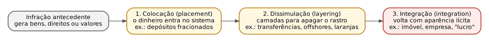
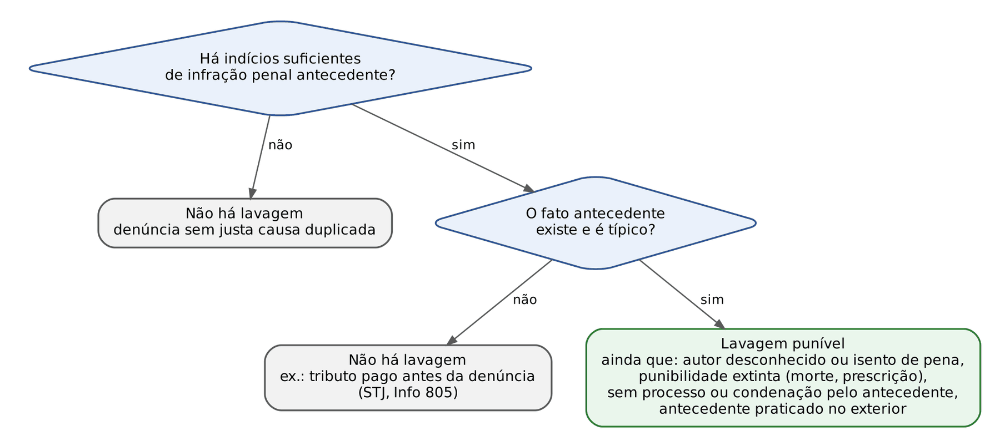
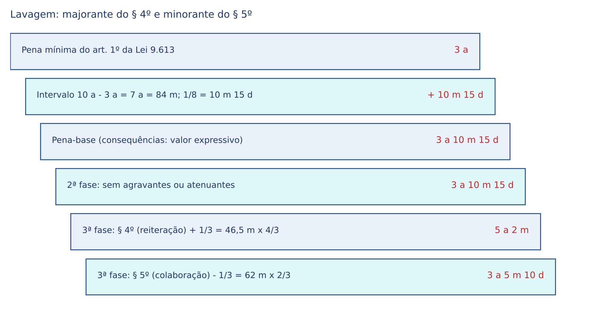
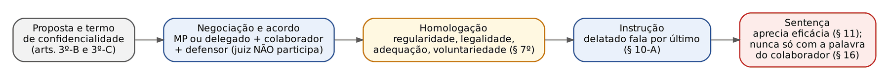
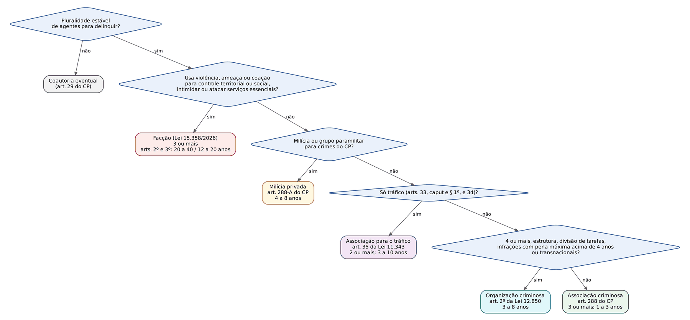

# CAPÍTULO 46 — LAVAGEM DE CAPITAIS, ORGANIZAÇÕES CRIMINOSAS, MILÍCIAS E FACÇÕES (LEIS 9.613/1998, 12.850/2013, 12.694/2012 E 15.358/2026)

:::INCIDENCIA
TRF5 p. 10 e 11; TJRS p. 6 e 7; TJSC p. 70 e 71. Nível A. Lote: 22 questões (FGV 21, FCC 1).
O que mais cai: autonomia da lavagem em relação à infração antecedente (prescrição, morte do autor, contravenção), autolavagem, crime permanente na modalidade ocultar, medidas assecuratórias e alienação antecipada, deveres das pessoas obrigadas e COAF; em 2026, a Lei Antifacção (15.358/2026).
:::

| Subtema | FGV | FCC | Padrão |
|---|---|---|---|
| Tipo da lavagem, antecedente, autonomia, autolavagem, permanência | 9 | 0 | caso com antecedente prescrito, não julgado, contravenção ou autor morto; "basta um verbo" |
| Processo e competência da lavagem | 2 | 0 | literalidade do art. 2º (II, III e § 2º) |
| Medidas assecuratórias, alienação antecipada, perdimento | 3 | 1 | percentuais e prazos; bens de PJ não investigada; liberação parcial com conta |
| COAF, pessoas obrigadas, sanções administrativas | 4 | 0 | literalidade dos arts. 9º a 12 e Tema 990 do STF |
| Colaboração (art. 1º, § 5º, da Lei 9.613) | 1 | 0 | benefícios do § 5º |
| Milícias, facções e Lei 15.358/2026 | 2 | 0 | conceito de milícia; tráfico com arma após a lei |

## 46.1 Lavagem de capitais: noção, bem jurídico, gerações e fases

### 46.1.1 O que é lavar dinheiro

Lavar é fazer o dinheiro "sujo" (produto ou proveito de infração penal) parecer "limpo", rompendo a ligação visível entre o bem e o crime de origem. Quem furta um carro e o usa não lava nada; quem vende o carro furtado, deposita o valor em conta de um terceiro (o "laranja"), transfere para uma empresa de fachada e depois "recebe" o dinheiro como lucro dessa empresa está construindo camadas de aparência lícita: isso é lavagem.

Bem jurídico: prevalece que o crime é pluriofensivo, atingindo a administração da Justiça (a lavagem dificulta a descoberta do crime antecedente e a recuperação do produto) e a ordem socioeconômica (o capital ilícito distorce a concorrência). É crime comum: qualquer pessoa pode praticá-lo.

### 46.1.2 Gerações de leis e o fim do rol taxativo

A doutrina divide as leis de lavagem em três gerações, conforme o que pode ser infração antecedente.

| Geração | Infração antecedente | Brasil |
|---|---|---|
| 1ª | só o tráfico de drogas (leis editadas após a Convenção de Viena de 1988) | não |
| 2ª | rol taxativo de crimes graves | redação original da Lei 9.613/1998 (art. 1º, incisos I a VIII) |
| 3ª | qualquer infração penal (crime ou contravenção) | desde a Lei 12.683/2012 (vigente em 10/7/2012) |

Duas consequências práticas da mudança de 2012:

- Antes da Lei 12.683/2012, a lavagem só existia se o antecedente estivesse no rol (Jurisprudência em Teses do STJ, ed. 166, tese 4). Organização criminosa constava do rol (inciso VII), mas, como não havia definição legal de organização criminosa até a Lei 12.850/2013, a lavagem com esse antecedente é atípica antes de 2013 (ed. 167, tese 6), e não se pode "trocar" por associação criminosa, que não estava no rol (ed. 167, tese 7).
- Depois de 2012, até contravenção penal serve de antecedente (jogo do bicho, por exemplo). A Lei 12.683/2012 é *novatio legis in pejus*: não retroage para alcançar fatos anteriores com antecedente fora do rol; mas, na modalidade permanente "ocultar", se a ocultação continuou depois da vigência da lei nova, aplica-se a lei mais grave (Súmula 711 do STF — ver Cap. 3; e 46.2.4).

:::QUESTAO FGV 2025 — TCE-PE — Procurador do Tribunal de Contas (Q3592189)
Empresário compra imóveis de luxo em nome de terceiros com dinheiro do jogo do bicho; a defesa alega que o antecedente é mera contravenção e não há condenação definitiva. Gabarito oficial: C — a consumação da lavagem prescinde de condenação definitiva pelo antecedente. Armadilhas: dizer que contravenção não serve de antecedente (serve, desde 2012) e exigir processamento ou punibilidade do antecedente (art. 2º, II e § 1º).
:::

### 46.1.3 As três fases (modelo do GAFI)

O Grupo de Ação Financeira Internacional (GAFI/FATF) descreve o ciclo da lavagem em três etapas. São um modelo didático, não elementos do tipo.

- Colocação (*placement*): o dinheiro em espécie ingressa no sistema econômico. Técnica típica: *smurfing* ou estruturação, isto é, fracionar uma grande quantia em vários depósitos pequenos, abaixo do limite que obriga o banco a registrar e comunicar a operação.
- Dissimulação (*layering*): sucessivas operações para apagar o rastro (transferências entre contas, empresas de fachada, *offshores*, contratos simulados, criptoativos).
- Integração (*integration*): o capital retorna com aparência de licitude (compra de imóveis, participação em empresas, "lucro" de negócio fictício). Exemplo clássico de integração é o *reverse flip*: compra-se um imóvel declarando valor inferior ao real, pagando a diferença "por fora", e revende-se pelo valor real; a diferença aparece como lucro imobiliário lícito.

:::PEGADINHA Não é preciso completar o ciclo
O tipo do art. 1º é de ação múltipla e se consuma com QUALQUER ato de ocultação ou dissimulação, em qualquer das fases. Não se exige demonstrar colocação, dissimulação e integração (STJ, APn 923, Corte Especial; Jurisprudência em Teses, ed. 166, tese 5; no STF, RHC 80.816). Alternativa que diz "exige-se a conclusão sucessiva das três etapas para a consumação" está errada.
:::

:::QUESTAO FGV 2026 — TJ-PE — Juiz Substituto (Q4349558)
Questão sobre governança, *compliance* e lavagem. Gabarito oficial: E — o *smurfing* (estruturação) consiste em fracionar grande quantia em pequenos valores para escapar ao controle administrativo das instituições financeiras. As demais alternativas tratam de acordo de leniência, Lei das Estatais e teoria da agência (matéria de Direito Empresarial e Administrativo), todas com afirmações incorretas.
:::

No mesmo sentido do box anterior (fases não exigidas para a consumação): Q2513042, alternativa B, examinada em 46.2.5.

## 46.2 O tipo penal (art. 1º da Lei 9.613/1998)

:::LEI Lei 9.613/1998, art. 1º, caput, §§ 1º e 2º (redação da Lei 12.683/2012)
Art. 1º Ocultar ou dissimular a natureza, origem, localização, disposição, movimentação ou propriedade de bens, direitos ou valores provenientes, direta ou indiretamente, de infração penal.
Pena: reclusão, de 3 (três) a 10 (dez) anos, e multa.
§ 1º Incorre na mesma pena quem, para ocultar ou dissimular a utilização de bens, direitos ou valores provenientes de infração penal:
I - os converte em ativos lícitos;
II - os adquire, recebe, troca, negocia, dá ou recebe em garantia, guarda, tem em depósito, movimenta ou transfere;
III - importa ou exporta bens com valores não correspondentes aos verdadeiros.
§ 2º Incorre, ainda, na mesma pena quem:
I - utiliza, na atividade econômica ou financeira, bens, direitos ou valores provenientes de infração penal;
II - participa de grupo, associação ou escritório tendo conhecimento de que sua atividade principal ou secundária é dirigida à prática de crimes previstos nesta Lei.
:::

### 46.2.1 Condutas: ocultar e dissimular

Ocultar é esconder, encobrir (o bem some da vista). Dissimular é disfarçar, dar aparência enganosa (o bem continua visível, mas com origem, titularidade ou natureza falseadas). O objeto material são bens, direitos ou valores provenientes de infração penal "direta ou indiretamente": tanto o produto (o dinheiro da propina) quanto o proveito (o apartamento comprado com a propina).

A linha que separa lavagem de simples usufruto do crime é a mais cobrada:

| NÃO é lavagem (exaurimento impunível) | É lavagem |
|---|---|
| depositar o dinheiro em conta própria, pagar contas, gastar em viagens e restaurantes (STJ, APn 458, Corte Especial) | comprar bens em nome de interposta pessoa (Jurisprudência em Teses, ed. 166, tese 9) |
| esconder as cédulas no corpo para viajar em voo doméstico; mentir sobre a origem depois de descoberto (STF, Inq 3.515, 1ª T., Info 955) | simular empréstimos sucessivos para justificar ingressos patrimoniais, sem redução do padrão de vida (ed. 166, tese 10) |
| comprar imóvel em nome próprio, com escritura verdadeira | receber propina no exterior por meio de *offshore* (STF, HC 165.036, 2ª T., Info 937) |

### 46.2.2 Tipos equiparados (§§ 1º e 2º) e a mesma pena

O § 1º alcança quem, com a finalidade de ocultar ou dissimular a UTILIZAÇÃO dos bens, os converte em ativos lícitos, os adquire, recebe em garantia, guarda, movimenta ou transfere, ou importa e exporta com subfaturamento ou superfaturamento. O § 2º dispensa a finalidade especial: basta utilizar o bem sujo na atividade econômica ou financeira (I) ou participar, com conhecimento, de grupo ou escritório dedicado à lavagem (II). Todos têm a MESMA pena do caput.

:::QUESTAO FGV 2026 — PC-PI — Perito Criminal (Q3849665)
José recebeu os bens em garantia, João os converteu em ativos lícitos e Joaquim importou bens com valores não correspondentes aos verdadeiros, todos para ocultar a utilização de valores ilícitos. Pede-se quem incorre em pena maior. Gabarito oficial: E — os três incorrem na mesma pena (§ 1º, II, I e III: "incorre na mesma pena").
:::

### 46.2.3 Elemento subjetivo: dolo direto, dolo eventual e cegueira deliberada

Não há lavagem culposa. Prevalece que basta o dolo eventual: na AP 470 (Mensalão), o STF o admitiu, com referência à teoria da cegueira deliberada (*willful blindness*), e o STJ a aplica com cautela.

Cegueira deliberada é a situação de quem, percebendo a alta probabilidade de que os bens têm origem ilícita, cria barreiras para não confirmar essa suspeita. Requisitos usualmente exigidos: (a) consciência da elevada probabilidade da origem criminosa; (b) possibilidade de aprofundar o conhecimento; (c) escolha deliberada de permanecer na ignorância (STJ, AgRg no REsp 1.793.377, 5ª T., DJe 31/3/2022). Aplicação automática seria responsabilidade objetiva, e vínculos familiares não permitem presumir o dever de desconfiança das relações comerciais. Minoritária (Capez): nega o dolo eventual na lavagem.

Exemplo: o doleiro A recebe 3.000.000 (três milhões de) reais em espécie de cliente desconhecido, recusa-se a identificar a origem, cobra comissão muito acima do mercado e pede que o dinheiro seja entregue em mochilas. Há dolo eventual (ou dolo direto). Já B, esposa do corrupto, que vê o marido comprar um carro, não responde por lavagem só por não ter desconfiado.

:::QUESTAO FGV 2024 — AL-TO — Procurador Jurídico (Q2457302)
Três afirmativas: (I) não há rol taxativo de antecedentes; (II) a jurisprudência admite a cegueira deliberada; (III) na modalidade ocultar, o crime é permanente. Gabarito oficial: E — todas corretas. Fundamentos: Lei 12.683/2012 (46.1.2), 46.2.3 e 46.2.4.
:::

### 46.2.4 Consumação, permanência, tentativa e prescrição

Na modalidade OCULTAR, a lavagem é crime permanente: quem oculta e mantém oculto prolonga a consumação enquanto o bem permanece escondido, até que se torne conhecido (STF, AP 863, 1ª T., j. 23/5/2017, Info 866; STJ, Jurisprudência em Teses, ed. 166, tese 8). Três consequências:

- prescrição: só começa a correr quando cessa a permanência (art. 111, III, do CP — ver Cap. 22);
- lei no tempo: lei mais grave que entra em vigor durante a permanência aplica-se (Súmula 711 do STF — ver Cap. 3);
- flagrante: cabe a qualquer tempo enquanto durar a ocultação.

Na modalidade DISSIMULAR, prevalece a natureza instantânea (de efeitos permanentes): consuma-se com o ato de disfarce.

A tentativa é punível (§ 3º remete ao art. 14, parágrafo único, do CP). Exemplo: o agente é preso no momento em que tentava depositar, na conta de um laranja, o resgate recebido em extorsão mediante sequestro.

:::QUESTAO FGV 2026 — MPE-RJ — Promotor de Justiça Substituto (Q4088262)
Servidor recebeu propina em 2011 e a escondeu em fundo falso de parede até a apreensão em 2024; no intervalo entrou em vigor a Lei 12.683/2012. Gabarito oficial: E — na modalidade ocultar, com atos autônomos em relação à corrupção, o crime é permanente, e aplica-se a lei mais grave se sua vigência é anterior à cessação da permanência (Súmula 711). Armadilhas: tratar como crime instantâneo de efeitos permanentes (A), como mero exaurimento da corrupção (B) e exigir ingresso no sistema financeiro para haver "ocultar" (D).
:::

:::ATENCAO Fundo falso x dinheiro no paletó
Não confunda a Q4088262 com o Inq 3.515: esconder cédulas no corpo para transportá-las é exaurimento da corrupção (ato de recebimento); construir compartimento oculto e ali manter o dinheiro por anos é ato autônomo de ocultação. A diferença está na autonomia do ato, examinada em 46.4.
:::

### 46.2.5 Sujeito ativo: quem não participou do antecedente também lava

É desnecessário que o autor da lavagem tenha sido autor ou partícipe da infração antecedente; basta que saiba da origem ilícita e concorra para a ocultação ou dissimulação (STJ, Jurisprudência em Teses, ed. 166, tese 1). O inverso também vale: o autor do antecedente pode responder pela lavagem (autolavagem — 46.4.1).

:::QUESTAO FGV 2024 — Câmara dos Deputados — Consultor Legislativo (Q2513042)
Gabarito oficial: E — para a lavagem, é prescindível comprovar a intervenção do acusado no delito que gerou os bens. Erradas: A (prescrição do antecedente não gera atipicidade — 46.3), B (não se exige concluir as três fases), C (a perda não é sempre em favor da União: na Justiça Estadual vai para o Estado — art. 7º, I, com a redação da Lei 15.358/2026) e D (inquérito não depende de prévia condenação pelo antecedente).
:::

## 46.3 Autonomia em relação à infração antecedente

A lavagem é crime acessório (sem infração anterior que gere bens, não há o que lavar), mas AUTÔNOMO quanto ao processo: o processo e julgamento da lavagem "independem do processo e julgamento das infrações penais antecedentes, ainda que praticados em outro país" (art. 2º, II); a denúncia vem instruída com "indícios suficientes da existência da infração penal antecedente", e a lavagem é punível "ainda que desconhecido ou isento de pena o autor, ou extinta a punibilidade da infração penal antecedente" (§ 1º). É a lógica da acessoriedade limitada (Cap. 11): basta que o antecedente seja típico e ilícito.

- Justa causa duplicada: lastro mínimo quanto à lavagem E quanto ao antecedente (Jurisprudência em Teses, ed. 166, tese 2), sem descrição exaustiva do crime prévio (tese 3).
- Prescrição do antecedente (ed. 167, tese 4) e morte do seu autor não afastam a lavagem.
- Inexistência do antecedente afasta: sócios que pagaram integralmente o tributo após o recebimento da denúncia tiveram reconhecida a insubsistência da lavagem e da organização criminosa (STJ, RHC 161.701, 6ª T., j. 19/3/2024, Info 805). É precedente de Turma, ligado à peculiaridade do crime tributário; não o generalize para as causas de extinção da punibilidade que o § 1º declara irrelevantes.
- Não há lavagem de bem proveniente de infração cometida DEPOIS dos atos de ocultação.

:::QUESTAO FGV 2025 — MPE-RJ — Promotor de Justiça Substituto (Q3532375)
Lucros de tráfico de 2004 e 2005 ocultados em imóveis em nome de terceiros, descobertos em 2025; a defesa alega prescrição do tráfico. Gabarito oficial: C — a prescrição do antecedente não impede a persecução da lavagem, bastando indícios suficientes. Armadilhas: "crime acessório que depende da punibilidade" (A), "prescrição afasta a materialidade" (B), exigência de condenação definitiva (D). No mesmo sentido: FGV 2026 — ENAM (Q4102461), gabarito D, que também descarta o antecedente como "condição objetiva de punibilidade" com prova cabal (C) e o *bis in idem* na autolavagem (E).
:::

:::QUESTAO FCC 2025 — TRF 4ª Região — Analista Judiciário, Oficial de Justiça Avaliador Federal (Q3562228)
Doleiro oculta 5.000.000 (cinco milhões de) reais de traficante que morre em confronto policial. Gabarito oficial: C — os recursos da alienação antecipada de bens do tráfico objeto de lavagem seguem a lei específica (art. 4º-A, § 13). Erradas: A (piso de 75%, não 60%), B (só efeito devolutivo, § 9º), D (rito comum, art. 2º, I) e E (a morte do autor do antecedente não afasta a lavagem, § 1º).
:::

## 46.4 Autolavagem e concurso de crimes

### 46.4.1 Autolavagem (*self-laundering*)

É a imputação, ao mesmo réu, do crime antecedente e da lavagem. O Brasil não tem "reserva de autolavagem" (cláusula legal que a excluiria), e a jurisprudência a admite, desde que demonstrados atos DIVERSOS e AUTÔNOMOS daqueles que compõem o crime antecedente; nesse caso não há consunção (Jurisprudência em Teses, ed. 166, tese 7; STJ, APn 989, Corte Especial, Info 726). A razão: o autor do antecedente, já com o proveito nas mãos, poderia simplesmente usá-lo; se recomeça uma série de atos para lhe dar aparência lícita, lesa outro bem jurídico (administração da Justiça e ordem econômica). A corrente contrária (lavagem como *post factum* impunível) é minoritária.

:::QUESTAO FGV 2025 — MPE-RJ — Promotor de Justiça Substituto (Q3532373)
Empresário obtém 5.000.000 (cinco milhões de) reais com fraude em licitação, simula venda de imóvel a empresa de fachada e compra iate em nome de laranja, sem ajuda de terceiros. Gabarito oficial: A — há lavagem (autolavagem): atos subsequentes e autônomos de dissimulação, sendo irrelevante a ausência de terceiros. Armadilhas: consunção automática (B), exigência de participação de terceiros (C), "mero exaurimento" (D).
:::

### 46.4.2 Corrupção passiva e lavagem: a tese do STF

Receber vantagem "direta ou indiretamente" faz parte do tipo do art. 317 do CP (Cap. 35). Por isso, no julgamento dos embargos infringentes na AP 470 (2014), o STF entendeu que o recebimento da propina por interposta pessoa, de modo clandestino, integra a própria corrupção passiva e não configura, por si, lavagem autônoma. Haverá concurso material com a lavagem quando, além do recebimento, existirem atos autônomos de ocultação ou dissimulação, como o recebimento por meio de *offshore* no exterior (HC 165.036, 2ª T., Info 937). A coincidência temporal entre o recebimento indireto e os atos de ocultação não autoriza reconhecer crime único se estiver presente a tipicidade própria da lavagem (STJ, APn 1.076, Corte Especial, j. 6/5/2026, Info 894).

Exemplo: A, servidor, manda o corruptor entregar o dinheiro à sua irmã, que o leva a A no mesmo dia: corrupção passiva apenas. Se A, depois, usa o dinheiro para comprar cotas de empresa registrada em nome da irmã e passa a receber "lucros" dela: corrupção passiva em concurso material com lavagem.

Correlata: FGV 2025 — TRF 3ª Região — Juiz Federal (Q3179522, Cap. 35): servidor recebe propina em conta não declarada no exterior e compra imóvel lá em nome de seu motorista; gabarito A — corrupção passiva, evasão de divisas e lavagem.

### 46.4.3 Outros concursos

- Evasão de divisas (art. 22 da Lei 7.492/1986) é crime autônomo e antecedente da lavagem, sem consunção (Jurisprudência em Teses, ed. 167, tese 5; cobrado em FGV 2025 — TRF 6ª Região, Q3742362, gabarito D — Cap. 47).
- Organização criminosa e lavagem: concurso material; e o mesmo fato "por intermédio de organização criminosa" pode majorar a lavagem (§ 4º), o que exige cuidado para não punir duas vezes a mesma circunstância.
- Continuidade delitiva x majorante da reiteração: aplicar ao mesmo tempo o aumento do crime continuado (art. 71 do CP) e a majorante do § 4º pela reiteração é *bis in idem* (Jurisprudência em Teses, ed. 167, tese 9); prevalece a majorante, por especialidade.

## 46.5 Pena: majorantes, colaboração e dosimetria

### 46.5.1 Causa de aumento do § 4º

A pena aumenta de 1/3 a 2/3 se o crime é cometido de forma reiterada, por intermédio de organização criminosa ou por meio da utilização de ativo virtual (este último incluído pela Lei 14.478/2022). Habitualidade não é elementar: uma única operação já configura o crime; a reiteração apenas o majora. "Organização criminosa", aqui, é a definida na Lei 12.850/2013 (46.9).

### 46.5.2 Delação do § 5º: ato unilateral

:::LEI Lei 9.613/1998, art. 1º, § 5º (redação da Lei 12.683/2012)
§ 5º A pena poderá ser reduzida de um a dois terços e ser cumprida em regime aberto ou semiaberto, facultando-se ao juiz deixar de aplicá-la ou substituí-la, a qualquer tempo, por pena restritiva de direitos, se o autor, coautor ou partícipe colaborar espontaneamente com as autoridades, prestando esclarecimentos que conduzam à apuração das infrações penais, à identificação dos autores, coautores e partícipes, ou à localização dos bens, direitos ou valores objeto do crime.
:::

Pontos de prova:

- Natureza: delação premiada UNILATERAL (independe de acordo com o MP), diferente da colaboração negociada da Lei 12.850/2013 (46.11). Seus efeitos são endoprocessuais: não se estendem a outras ações penais (Jurisprudência em Teses, ed. 167, tese 11; ed. 193, tese 4). Por isso está errada a afirmação de que a "sanção premial" da Lei de Lavagem "tem natureza de negócio jurídico processual" (Q3742362, alternativa E).
- Requisitos: colaboração ESPONTÂNEA (mais que voluntária: iniciativa do agente) e resultado útil em UMA das três frentes (apuração das infrações, identificação dos agentes OU localização dos bens). Os resultados são alternativos.
- Benefícios: redução de 1/3 a 2/3; regime aberto ou semiaberto, mesmo que a pena final indique o fechado; perdão judicial ("deixar de aplicá-la"); substituição por restritiva de direitos "a qualquer tempo", inclusive na execução, e sem os limites do art. 44 do CP.

:::QUESTAO FGV 2024 — TJ-RJ — Programa de Residência Jurídica (Q2375305)
Ré primária condenada por lavagem a 5 anos, que colaborou espontaneamente. Gabarito oficial: E — pode ser beneficiada com pena restritiva de direitos (§ 5º permite a substituição a qualquer tempo). Erradas: B (prisão albergue domiciliar não é benefício do § 5º), C (*sursis* exige pena até 2 anos — Cap. 17), D (o regime não "deverá" ser semiaberto: o § 5º faculta aberto ou semiaberto). A alternativa A ("atenuada de um a dois terços") foi considerada errada: a colaboração é causa de diminuição da terceira fase, não atenuante, e a lei diz "reduzida". É o tipo de imprecisão terminológica que a FGV usa como distrator.
:::

### 46.5.3 Dosimetria: o que muda na lavagem

Na primeira fase, é legítimo valorar negativamente as consequências quando a quantia movimentada é expressiva (Jurisprudência em Teses, ed. 167, tese 8). Não use a mesma reiteração para pena-base, continuidade e § 4º.

:::EXEMPLO Dosimetria da lavagem com § 4º e § 5º
Caso: Réu primário, sem antecedentes, condenado por lavagem de 8.000.000 (oito milhões de) reais, em quatro operações sucessivas (reiteração reconhecida como majorante, não como continuidade). Colaborou espontaneamente, permitindo localizar parte dos bens.
Passo 1 — pena-base. Mínimo 3 anos; máximo 10 anos; intervalo 7 anos = 84 meses. Critério de 1/8 do intervalo por circunstância (prevalente no STJ — Cap. 13): 84 ÷ 8 = 10,5 meses = 10 meses e 15 dias. Uma circunstância negativa (consequências: valor expressivo): 3 anos + 10 meses e 15 dias = 3 anos, 10 meses e 15 dias (46,5 meses).
Passo 2 — segunda fase. Sem agravantes ou atenuantes: 3 anos, 10 meses e 15 dias.
Passo 3 — majorante do § 4º. Quatro operações: fração de 1/3 (fundamentar a escolha; o número de atos pode orientar a fração). 46,5 × 4/3 = 62 meses = 5 anos e 2 meses.
Passo 4 — minorante do § 5º. Colaboração com resultado parcial (só localização de parte dos bens): redução de 1/3. 62 × 2/3 = 41,33 meses = 3 anos, 5 meses e 10 dias (0,33 mês = 10 dias; frações de dia desprezadas, art. 11 do CP).
Passo 5 — regime e substituição. O § 5º autoriza regime aberto ou semiaberto; pena inferior a 4 anos, crime sem violência: cabível a substituição por restritivas de direitos (art. 44 do CP ou, diretamente, o § 5º).
Variante (1/6 sobre a pena mínima por circunstância, critério também aceito): 3 anos + 6 meses = 3 anos e 6 meses (42 meses); × 4/3 = 56 meses (4 anos e 8 meses); × 2/3 = 37,33 meses = 3 anos, 1 mês e 10 dias.
:::

:::SENTENCA Lavagem na sentença
Onde entra: na tipicidade, demonstre (1) a prova de que o bem provém de infração penal (na sentença não bastam indícios, mas dispensa-se condenação pelo antecedente), (2) o ato concreto de ocultar ou dissimular e (3) o dolo, explicando por que não é mero usufruto. Aplique § 4º e § 5º na terceira fase; no dispositivo, declare os efeitos do art. 7º e decida sobre os bens constritos.
Redação-modelo: "A aquisição do imóvel em nome de pessoa interposta, com recursos comprovadamente provenientes da corrupção narrada no fato 1, constitui ato autônomo de dissimulação da propriedade, que extrapola o mero recebimento da vantagem e afasta a consunção."
Erro que a banca pune: absolver da lavagem porque o antecedente prescreveu ou porque o autor do antecedente morreu; ou condenar por lavagem quem apenas gastou o dinheiro.
:::

### 46.5.4 Ficha da lavagem

| Crime | Conduta nuclear | Pena | Elemento subjetivo | Consumação e tentativa | Ação penal e competência | Benefícios | Hediondo |
|---|---|---|---|---|---|---|---|
| Lavagem (art. 1º, caput, §§ 1º e 2º) | ocultar ou dissimular natureza, origem, localização, disposição, movimentação ou propriedade de bens de infração penal; figuras equiparadas | reclusão, 3 a 10 anos, e multa; + 1/3 a 2/3 (§ 4º); − 1/3 a 2/3, perdão ou substituição (§ 5º) | dolo (direto ou eventual; cegueira deliberada) | ocultar: permanente; dissimular: instantâneo; tentativa punível (§ 3º) | pública incondicionada; federal nas hipóteses do art. 2º, III | sem transação e sem suspensão do processo (mínimo 3 anos); ANPP em tese cabível na forma simples (mínimo inferior a 4 anos, sem violência — Cap. 25), afastado com o § 4º (mínimo passa a 4 anos); substituição se pena até 4 anos | NÃO (prisão temporária de 5 + 5 dias) |

## 46.6 Processo e competência da lavagem

:::PROCESSO Regras processuais da Lei 9.613/1998
- Rito: procedimento comum dos crimes punidos com reclusão, da competência do juiz singular (art. 2º, I) — não há rito especial.
- Unidade de processo: o juiz da lavagem decide se reúne ou não os processos com o do antecedente (art. 2º, II, parte final; Jurisprudência em Teses, ed. 167, tese 3). Não há vedação à reunião por conexão.
- Competência da Justiça Federal (art. 2º, III): (a) crime contra o sistema financeiro e a ordem econômico-financeira, ou em detrimento de bens, serviços ou interesses da União, suas autarquias ou empresas públicas; (b) quando a infração antecedente for de competência federal. Fora disso, Justiça Estadual. Lavagem no Brasil de proveito de crime cometido no exterior contra a administração pública: competência da autoridade brasileira (ed. 167, tese 2). Muitos agentes em vários Estados: pode prevalecer o foro do domicílio do investigado (ed. 167, tese 1).
- Revelia: NÃO se aplica o art. 366 do CPP (art. 2º, § 2º). Citado por edital, o réu que não comparece nem constitui advogado não suspende o processo nem a prescrição; o feito prossegue com defensor dativo.
- Meios de prova: ação controlada e infiltração de agentes admitidas também na lavagem (art. 1º, § 6º, incluído pela Lei 13.964/2019), mesmo sem organização criminosa.
- Dados cadastrais (art. 17-B): delegado e MP acessam, sem ordem judicial, SÓ qualificação pessoal, filiação e endereço (constitucional — STF, ADI 4.906, j. 11/9/2024; Jurisprudência em Teses, ed. 167, tese 13).
- Afastamento automático do servidor indiciado (art. 17-D): inconstitucional (STF, ADI 4.911, j. 20/11/2020); o afastamento exige decisão judicial fundamentada em risco concreto.
- Atuação do GAECO não ofende o promotor natural (ed. 167, tese 12).
:::

:::QUESTAO FGV 2025 — TRF 6ª Região — Juiz Federal Substituto (Q3742371)
Gabarito oficial: D — no processo por lavagem, não se suspendem o processo e a prescrição se o réu citado por edital não comparecer nem constituir advogado (art. 2º, § 2º). Erradas: A (o perdimento alargado do art. 91-A do CP é aplicável — Cap. 18), B (dados meramente cadastrais dispensam autorização judicial, art. 17-B), C (não há vedação de reunião por conexão; o juiz da lavagem decide) e E (troca o critério: a competência federal da alínea "b" depende de o antecedente ser federal, não de ter sido praticado no estrangeiro).
:::

:::QUESTAO FGV 2026 — TJ-MS — Outorga de Delegações de Notas e de Registro (Q3914319)
Denúncia estadual por lavagem envolvendo imóveis. Gabarito oficial: A — literalidade do art. 2º, II. Erradas: B (basta indício suficiente, não "prova inconteste", do antecedente — § 1º), C (rito comum, não o dos crimes funcionais), D (crime contra o sistema financeiro é federal) e E (admite-se citação por edital — § 2º).
:::

## 46.7 Medidas assecuratórias, alienação antecipada e efeitos da condenação

### 46.7.1 Medidas assecuratórias (art. 4º)

O juiz pode decretar medidas assecuratórias (sequestro, arresto, indisponibilidade) sobre bens do investigado ou acusado, ou em nome de interpostas pessoas, que sejam instrumento, produto ou proveito da lavagem ou do antecedente, havendo indícios suficientes de infração penal. A lei fala em decretação "de ofício"; após a Lei 13.964/2019 (estrutura acusatória, art. 3º-A do CPP), a decretação de ofício na fase de investigação é questionada pela doutrina — em prova objetiva, siga a literalidade do art. 4º; em sentença ou prova discursiva, registre a controvérsia.

Regras de detalhe (as preferidas da banca):

- § 1º: alienação antecipada sempre que o bem estiver sujeito a deterioração, depreciação ou houver dificuldade de manutenção.
- § 2º: comprovada a licitude da origem, o juiz libera total ou parcialmente os bens, MANTENDO a constrição dos necessários e suficientes à reparação dos danos e ao pagamento de prestações pecuniárias, multas e custas decorrentes da infração.
- § 3º: nenhum pedido de liberação será conhecido sem o comparecimento PESSOAL do acusado ou da interposta pessoa.
- § 4º: as medidas podem garantir a reparação do dano do antecedente ou da lavagem e o pagamento de prestação pecuniária, multa e custas.
- Art. 4º-B: a ordem de prisão ou as medidas assecuratórias podem ser suspensas pelo juiz, ouvido o MP, se a execução imediata puder comprometer as investigações.
- Natureza processual: aplicam-se imediatamente, inclusive a fatos anteriores à Lei 12.683/2012 (*tempus regit actum* — Jurisprudência em Teses, ed. 167, tese 15).
- Recurso contra a decisão que decreta a medida: apelação (art. 593, II, do CPP), segundo o STJ.

:::QUESTAO FGV 2026 — PC-PI — Perito Criminal (Q3849666)
Comprovada a licitude da mercadoria constrita, o juiz a libera parcialmente; valores estimados: frete 3.000 (três mil) reais, custas 4.000 (quatro mil) reais, multas 5.000 (cinco mil) reais. Gabarito oficial: D — mantém-se constrição suficiente para 9.000 (nove mil) reais. Conta: o § 2º só preserva o necessário à reparação de danos, prestações pecuniárias, multas e custas; frete não entra. Custas 4.000 + multas 5.000 = 9.000. Armadilha: somar o frete (12.000).
:::

Bens de pessoa jurídica que não é investigada: é possível a medida assecuratória sobre bens de PJ que se beneficia do produto da lavagem, ainda que fora do polo passivo (Jurisprudência em Teses, ed. 167, tese 14), sem necessidade de incidente de desconsideração da personalidade jurídica: a PJ usada como instrumento de ocultação é a própria "interposta pessoa" do caput do art. 4º.

:::QUESTAO FGV 2025 — TJ-CE — Juiz Substituto (Q3505809)
Imóvel registrado em nome de sociedade não investigada, mas constituída pelo investigado para ocultar valores ilícitos. Gabarito oficial: C — deferir o sequestro ou a indisponibilidade, independentemente de incidente de desconsideração. Armadilhas: exigir que a PJ seja investigada (A), exigir IDPJ do CPC (B), só após a denúncia (D) e condicionar à inclusão da PJ no polo passivo em 60 dias (E).
:::

### 46.7.2 Alienação antecipada (art. 4º-A) e administração dos bens

- Pode ser decretada de ofício, a requerimento do MP ou por solicitação da parte interessada, em petição autônoma, autuada em apartado.
- O juiz manda avaliar, homologa o valor por sentença e determina leilão ou pregão, preferencialmente eletrônico, por valor NÃO INFERIOR A 75% da avaliação (§ 3º).
- O valor fica em conta judicial remunerada: na Justiça Federal, Caixa ou instituição pública, com repasse à Conta Única do Tesouro; na Justiça Estadual, em instituição designada em lei, com repasse à conta única do Estado ou do DF (§ 4º, com redação da Lei 15.358/2026).
- Recursos contra decisões no procedimento: apenas efeito DEVOLUTIVO (§ 9º).
- Bens de lavagem do TRÁFICO: os recursos seguem a disciplina da lei específica (§ 13; Lei 11.343/2006 e Funad — Cap. 37).
- Administração (arts. 5º e 6º): quando as circunstâncias aconselharem, o JUIZ, ouvido o MP, nomeia pessoa física ou jurídica qualificada para administrar os bens, mediante termo de compromisso; o administrador é remunerado com o produto dos bens e presta informações periódicas.

### 46.7.3 Efeitos da condenação (art. 7º) e bens no exterior

:::LEI Lei 9.613/1998, art. 7º, I e II (inciso I com redação da Lei 15.358/2026)
Art. 7º São efeitos da condenação, além dos previstos no Código Penal:
I - a perda, em favor da União, e, nos casos de competência da Justiça Estadual ou da Justiça do Distrito Federal, em favor dos Estados ou do Distrito Federal, de todos os bens, direitos e valores relacionados, direta ou indiretamente, à prática dos crimes previstos nesta Lei, inclusive aqueles utilizados para prestar a fiança, ressalvado o direito do lesado ou de terceiro de boa-fé;
II - a interdição do exercício de cargo ou função pública de qualquer natureza e de diretor, de membro de conselho de administração ou de gerência das pessoas jurídicas referidas no art. 9º, pelo dobro do tempo da pena privativa de liberdade aplicada.
:::

São efeitos AUTOMÁTICOS (decorrem da lei), mas convém declará-los na sentença. A interdição dura o DOBRO da pena privativa aplicada. Os instrumentos sem valor econômico são inutilizados ou doados a museu criminal ou entidade pública (§ 2º).

Bens no exterior e perda por equivalente: quando o produto ou proveito não é encontrado ou está no exterior, a perda pode recair sobre bens ou valores equivalentes (art. 91, § 1º, do CP), e as medidas assecuratórias podem abranger esses bens equivalentes desde a investigação (art. 91, § 2º). Já a perda alargada (art. 91-A do CP: diferença entre o patrimônio e o compatível com o rendimento lícito, em crimes com pena máxima superior a 6 anos) exige requerimento expresso do MP na denúncia e apuração da diferença — ver Cap. 18.

:::QUESTAO FGV 2025 — TJ-MS — Juiz Substituto (Q3786383)
Investigado por lavagem, corrupção e extorsão; bens do produto ou proveito só no exterior; não se apurou a diferença patrimonial. Gabarito oficial: A — o MP pode requerer o sequestro de bens pelo equivalente ao produto ou proveito (art. 91, §§ 1º e 2º, do CP). Erradas: perda alargada de ofício (B), requerida só nas alegações finais (C) — o art. 91-A, § 3º, exige pedido na denúncia e, de todo modo, a diferença não foi apurada — e o inexistente "arresto alargado" (D e E). Correlatas sobre confisco alargado: Q3752756 e Q3532362 (Cap. 18).
:::

Cooperação internacional (art. 8º): havendo tratado ou promessa de reciprocidade, o juiz determina medidas assecuratórias sobre bens de lavagem praticada no estrangeiro, a pedido de autoridade estrangeira; sem tratado, os bens (ou o produto da alienação) são repartidos pela METADE entre o Brasil e o Estado requerente, ressalvado o lesado e o terceiro de boa-fé.

## 46.8 Prevenção administrativa: pessoas obrigadas, COAF e relatórios de inteligência

### 46.8.1 Por que existe um sistema administrativo

A lei aposta em "porteiros" (*gatekeepers*): setores por onde o dinheiro sujo precisa passar (bancos, corretoras, imobiliárias, joalherias, cartórios) recebem deveres de identificar clientes, registrar operações e comunicar suspeitas ao COAF (Conselho de Controle de Atividades Financeiras), a unidade de inteligência financeira brasileira. Desde a Lei 13.974/2020, o COAF é vinculado administrativamente ao Banco Central.

### 46.8.2 Quem é obrigado (art. 9º)

Pessoas físicas e jurídicas que exerçam, em caráter permanente ou eventual, como atividade principal ou acessória: captação, intermediação e aplicação de recursos de terceiros; câmbio e ouro; títulos e valores mobiliários. O parágrafo único estende a bolsas, seguradoras e previdência complementar, cartões, *leasing*, *factoring*, Empresas Simples de Crédito, loterias e apostas de quota fixa, imobiliárias, comércio de joias, arte e antiguidades, bens de luxo, JUNTAS COMERCIAIS E REGISTROS PÚBLICOS, consultores e contadores em operações societárias e imobiliárias, agentes de atletas e artistas, empresas de TRANSPORTE E GUARDA DE VALORES, comércio de bens de alto valor de origem rural ou animal e prestadoras de serviços de ativos virtuais (Lei 14.478/2022).

:::QUESTAO FGV 2025 — ENAC — Exame Nacional dos Cartórios (Q3328214)
Gabarito oficial: E — agentes obrigados podem ser pessoas físicas ou jurídicas, entre elas seguradoras, empresas de transporte e guarda de valores, juntas comerciais e registros públicos. Erradas: A (multa cabe por culpa OU dolo — art. 12, § 2º), B (inabilitação de até DEZ anos, não oito), C (a abstenção de dar ciência inclui a própria pessoa a quem a informação se refere — art. 11, II) e D (a lei não impõe o dever de abster-se da operação; impõe comunicar).
:::

### 46.8.3 Deveres (arts. 10 e 11) e sanções (art. 12)

| Dever | Conteúdo |
|---|---|
| Identificar clientes (art. 10, I) | cadastro atualizado; se PJ, inclui representantes e proprietários (§ 1º) |
| Registrar transações (art. 10, II) | toda operação acima do limite fixado pela autoridade, inclusive com ativos virtuais; conservação por no mínimo 5 anos (§ 2º) |
| Controles internos e cadastro no regulador ou no COAF (art. 10, III e IV) | políticas compatíveis com porte e volume (*compliance*) |
| Comunicar ao COAF em 24 horas (art. 11, II) | operações suspeitas e as que superem o limite, SEM dar ciência a ninguém, nem ao próprio cliente; comunicação de boa-fé não gera responsabilidade civil ou administrativa (§ 2º) |
| Comunicar a não ocorrência (art. 11, III) | declaração negativa periódica ao regulador ou ao COAF |
| Cadastro de clientes (art. 10-A) | o Banco Central mantém o cadastro geral de correntistas e clientes de instituições financeiras e seus procuradores |

Sanções administrativas (art. 12), cumulativas ou não: advertência; multa pecuniária variável não superior ao DOBRO do valor da operação, ao DOBRO do lucro real ou presumido, ou a 20.000.000 (vinte milhões de) reais; inabilitação temporária de até 10 anos para administrar as pessoas do art. 9º; cassação ou suspensão da autorização. A multa cabe por culpa ou dolo.

:::QUESTAO FGV 2025 — CGE-SP — Auditor Estadual de Controle (Q3781236)
Pede-se o teto da multa do art. 12. Gabarito oficial: C — dobro da operação, dobro do lucro ou 20.000.000 (vinte milhões de) reais. Mnemônico: "dobro, dobro, vinte milhões".
:::

:::QUESTAO FGV 2024 — CFC — Banco Central do Brasil (Q3183586)
Relacionar COAF, Banco Central, juiz e banco comercial às funções descritas. Gabarito oficial: D (4 – 1 – 2 – 3): o banco comercial registra as transações acima do limite (art. 10, II); o COAF disciplina, aplica penas administrativas e examina ocorrências suspeitas (art. 14); o Banco Central mantém o cadastro geral de correntistas (art. 10-A); o juiz nomeia o administrador dos bens constritos (art. 5º).
:::

Pessoas politicamente expostas (PEP) e seus familiares sujeitam-se ao controle reforçado dos arts. 10 e 11 (Jurisprudência em Teses, ed. 167, tese 10); a Lei 14.478/2022 criou o Cadastro Nacional de PEP (art. 12-A).

### 46.8.4 Relatório de Inteligência Financeira (RIF): Tema 990 e Tema 1.404 do STF

O COAF não investiga nem quebra sigilo: analisa as comunicações e, havendo indícios de crime, comunica às autoridades por meio do RIF (art. 15).

:::JURIS STF, Tema 990 (RE 1.055.941, Plenário, j. 4/12/2019)
Tese (síntese fiel): (1) é constitucional o compartilhamento dos relatórios de inteligência financeira da UIF (COAF) e da íntegra do procedimento fiscalizatório da Receita Federal que define o lançamento do tributo com os órgãos de persecução penal, para fins criminais, sem obrigatoriedade de prévia autorização judicial, devendo ser resguardado o sigilo das informações em procedimentos formalmente instaurados e sujeitos a posterior controle jurisdicional; (2) o compartilhamento deve ser feito unicamente por comunicações formais, com garantia de sigilo, certificação do destinatário e instrumentos efetivos de apuração e correção de desvios.
:::

A controvérsia seguinte foi o RIF "por encomenda" (solicitado pelo MP ou pela polícia ao COAF, e não enviado espontaneamente). O STJ, em 2025, chegou a anular provas obtidas dessa forma sem autorização judicial; o STF reconheceu repercussão geral (Tema 1.404, RE 1.537.165, relator Min. Alexandre de Moraes). Em liminar de 27/3/2026, o relator admitiu o pedido direto ao COAF desde que: (1) haja procedimento formalmente instaurado (inquérito, PIC ou processo sancionador), não notícia de fato ou apuração preliminar; (2) o investigado esteja objetivamente identificado; (3) haja pertinência temática estrita com o objeto da apuração; (4) o RIF não seja a primeira nem a única medida (vedada a *fishing expedition*); (5) as mesmas regras valham para pedidos judiciais e de CPI. Em 21/4/2026, esclareceu que esses critérios valem só para o futuro (efeitos *ex nunc*). O mérito ainda não foi julgado pelo Plenário (situação em agosto de 2026).

:::QUESTAO FGV 2025 — TJ-SE — Juiz Substituto (Q3301267)
RIF espontâneo sobre casal com movimentação atípica; após diligências, o MP reúne o caso a PIC já instaurado contra contraventor do jogo do bicho, solicita ao COAF RIF sobre ele e pede ao juiz a quebra de sigilos de todos. Gabarito oficial: A — deferir integralmente. Fundamentos: envio espontâneo legítimo (Tema 990); contravenção serve de antecedente; a solicitação ao COAF ocorreu dentro de PIC formalmente instaurado, com investigado identificado e elementos prévios, compatível inclusive com os critérios posteriores da liminar do Tema 1.404; a quebra de sigilo foi pedida ao juiz.
:::

## 46.9 Organização criminosa: o conceito da Lei 12.850/2013

:::LEI Lei 12.850/2013, art. 1º, § 1º
§ 1º Considera-se organização criminosa a associação de 4 (quatro) ou mais pessoas estruturalmente ordenada e caracterizada pela divisão de tarefas, ainda que informalmente, com objetivo de obter, direta ou indiretamente, vantagem de qualquer natureza, mediante a prática de infrações penais cujas penas máximas sejam superiores a 4 (quatro) anos, ou que sejam de caráter transnacional.
:::

Decomponha o conceito em cinco requisitos cumulativos:

| Requisito | O que significa | Detalhe cobrado |
|---|---|---|
| 4 ou mais pessoas | número mínimo de integrantes | contam inimputáveis (inclusive adolescentes), não identificados e isentos de pena |
| estruturalmente ordenada | alguma organização interna | NÃO exige hierarquia rígida |
| divisão de tarefas, ainda que informal | cada um tem função | não precisa ser formalizada |
| estabilidade e permanência | elemento implícito | reunião ocasional para um crime é coautoria, não organização |
| finalidade: vantagem de qualquer natureza mediante infrações com pena MÁXIMA SUPERIOR a 4 anos, ou transnacionais | o "programa" do grupo | "infrações" inclui contravenções transnacionais; no caso transnacional a pena é irrelevante; "superior a 4" exclui crimes com máximo de exatamente 4 anos |

A lei também se aplica às infrações previstas em tratado quando, iniciada a execução no país, o resultado ocorreu ou deveria ocorrer no estrangeiro (ou vice-versa), e às organizações terroristas (art. 1º, § 2º — terrorismo no Cap. 40).

Convenção de Palermo (Decreto 5.015/2004): "grupo criminoso organizado" é o grupo estruturado de 3 ou mais pessoas, existente há algum tempo, para cometer infrações graves (pena máxima de pelo menos 4 anos). No Brasil vale o conceito da Lei 12.850/2013 (4 pessoas e sem exigência expressa de tempo mínimo); antes de 2013 tentou-se usar a definição da Convenção para preencher o antigo inciso VII da Lei 9.613/1998, mas o STF a recusou, porque tratado não supre a exigência de lei interna em matéria penal (HC 96.007 — ver Cap. 2).

Onde o conceito repercute fora do art. 2º: majorante da lavagem (46.5.1); progressão especial da gestante e da mãe (art. 112, § 3º, V, da LEP — só condenação pela Lei 12.850/2013, Tema 1.374 do STJ — ver Cap. 24); hediondez da organização voltada a crimes hediondos (art. 1º, parágrafo único, V, da Lei 8.072/1990 — ver Cap. 40); RDD por suspeita de envolvimento (art. 52, § 1º, II, da LEP — ver Cap. 23); e, desde 2026, o art. 4º, parágrafo único, da Lei 15.358/2026, que trata as facções e a milícia do art. 288-A como formas especiais de organização criminosa (46.14).

## 46.10 O crime de organização criminosa (art. 2º) e os crimes correlatos

### 46.10.1 Tipo, classificação e concurso

:::LEI Lei 12.850/2013, art. 2º, caput e § 1º (§ 1º com redação da Lei 15.245/2025)
Art. 2º Promover, constituir, financiar ou integrar, pessoalmente ou por interposta pessoa, organização criminosa:
Pena - reclusão, de 3 (três) a 8 (oito) anos, e multa, sem prejuízo das penas correspondentes às demais infrações penais praticadas.
§ 1º Nas mesmas penas incorre quem impede ou, de qualquer forma, embaraça a investigação de infração penal que envolva organização criminosa, se o fato não constituir crime mais grave.
:::

Verbos: promover (fomentar, impulsionar), constituir (fundar), financiar (custear) e integrar (fazer parte). É tipo misto alternativo: praticar mais de um verbo no mesmo contexto é crime único.

Classificação: crime comum, plurissubjetivo (concurso necessário), formal e de perigo abstrato (consuma-se com a associação estável, ainda que nenhum crime-fim seja praticado), permanente (a consumação dura enquanto o agente integra o grupo) e doloso, sem forma culposa; a tentativa é inadmissível na modalidade integrar (o simples ajuste anterior à associação é atípico).

Concurso: a cláusula "sem prejuízo das penas correspondentes às demais infrações" impõe concurso MATERIAL entre o crime de organização e os crimes-fim (tráfico, roubo, corrupção). O integrante só responde pelos crimes-fim de que participou ou que ingressaram em sua esfera de conhecimento e vontade; pertencer ao grupo não basta (vedação à responsabilidade objetiva — art. 29 do CP, Cap. 11). Outros pontos:

- Organização criminosa e associação para o tráfico (art. 35 da Lei 11.343/2006): podem coexistir sem *bis in idem* quando o grupo, além do tráfico, dedica-se a outros crimes ou há contextos fáticos distintos (STF, RHC 242.673 AgR, 2ª T., j. 2/9/2024). Questão correlata: FGV 2025 — TJ-SE — Juiz Substituto (Q3301268, Cap. 37), gabarito E.
- Não há conexão necessária entre o crime de organização e os crimes-fim: as acusações podem tramitar em juízos distintos (STF, Inq 3.989, 2ª T.).
- O recebimento da denúncia cessa a permanência; se o agente persiste no grupo, nova denúncia não configura dupla imputação (STJ, AgRg no AREsp 1.619.918, 5ª T.).
- A natureza formal do crime não impede o sequestro de bens relacionados à atividade da organização (STJ, AgRg no REsp 2.219.963, 5ª T., j. 3/3/2026, Info 880).

### 46.10.2 Embaraço à investigação (§ 1º)

O § 1º pune com a mesma pena quem impede ou embaraça investigação de infração que envolva organização criminosa. Pontos:

- "Investigação" abrange o inquérito e a ação penal (STJ, HC 487.962, 5ª T., Info 650).
- Embaraçar é verbo de resultado: exige que se produza algum efeito na investigação, ainda que momentâneo e reversível (STJ, REsp 1.817.416, 5ª T., Info 703).
- O tipo é aberto, mas constitucional (STF, ADI 5.567, Plenário, j. 21/11/2023).
- Desde a Lei 15.245/2025, é expressamente subsidiário ("se o fato não constituir crime mais grave"); se o embaraço se dá por violência ou grave ameaça contra agente público, testemunha, colaborador etc., incidem os novos arts. 21-A e 21-B (46.10.4).

### 46.10.3 Majorantes, agravante e efeitos (§§ 2º a 9º)

| Dispositivo | Natureza | Hipótese | Quantum ou efeito |
|---|---|---|---|
| § 2º | causa de aumento | emprego de arma de fogo na atuação da organização | até a METADE |
| § 3º | AGRAVANTE (2ª fase) | exercer o comando, individual ou coletivo, ainda que sem praticar atos de execução | fração da 2ª fase (usualmente 1/6 — Cap. 14) |
| § 4º | causas de aumento | I: participação de criança ou adolescente ou organização destinada aos crimes do ECA (esta parte incluída pela Lei 15.487/2026, para fatos desde 7/8/2026); II: concurso de funcionário público, valendo-se a organização dessa condição; III: produto ou proveito destinado ao exterior; IV: conexão com outras organizações independentes; V: transnacionalidade | 1/6 a 2/3 |
| § 5º | cautelar | indícios de que funcionário público integra a organização | afastamento do cargo, sem prejuízo da remuneração |
| § 6º | efeito da condenação AUTOMÁTICO | condenação transitada do funcionário público | perda do cargo, função, emprego ou mandato e interdição por 8 anos SUBSEQUENTES ao cumprimento da pena (constitucional — ADI 5.567) |
| § 7º | investigação | indícios de participação de policial | Corregedoria instaura inquérito e comunica ao MP, que designa membro para acompanhar (constitucional — ADI 5.567) |
| § 8º | execução | lideranças de organizações armadas ou com armas à disposição | início do cumprimento em estabelecimento de SEGURANÇA MÁXIMA |
| § 9º | execução | condenado expressamente por integrar organização, com prova da manutenção do vínculo | não progride, não obtém livramento nem outros benefícios (Cap. 24) |

:::PEGADINHA Comando é agravante, não majorante
O § 3º diz "a pena é agravada": é circunstância da segunda fase, que não pode levar a pena abaixo do mínimo nem acima do máximo. Já na Lei 15.358/2026 o comando é causa de AUMENTO de 2/3 ao dobro (46.14.3). E compare frações: criança ou adolescente na organização: 1/6 a 2/3 (§ 4º, I); na associação criminosa do art. 288: até a metade (parágrafo único). Transnacionalidade é causa de aumento do § 4º, V (cobrado em FGV 2025 — TRF5 — Juiz Federal).
:::

:::EXEMPLO Dosimetria do art. 2º com agravante e duas majorantes
Caso: Líder de organização armada (fuzis) que recruta adolescentes. Circunstâncias judiciais favoráveis.
Passo 1 — pena-base: 3 anos (mínimo).
Passo 2 — agravante do comando (§ 3º): + 1/6. 36 meses × 7/6 = 42 meses = 3 anos e 6 meses.
Passo 3 — majorantes (§ 2º e § 4º, I). Ambas são de lei especial e de natureza especial: o juiz pode aplicar só a que mais aumenta (art. 68, parágrafo único) ou cumular com fundamentação concreta (ver 15.3.2 e 15.3.3; cumulação em cascata sob exame no Tema 1.422 do STJ).
- Opção A, só a mais grave: § 2º em 1/2 (fuzis justificam o teto). 42 × 3/2 = 63 meses = 5 anos e 3 meses.
- Opção B, cumulação em cascata: 63 meses × 7/6 (§ 4º, I, na fração mínima de 1/6) = 73,5 meses = 6 anos, 1 mês e 15 dias.
Passo 4 — efeitos: segurança máxima para início do cumprimento (§ 8º); concurso material com os crimes-fim (art. 69 do CP).
Observação: o § 2º fixa só o teto ("até a metade"); fundamente a fração escolhida com dados concretos (quantidade e calibre das armas).
:::

### 46.10.4 Crimes correlatos (arts. 18 a 21-B)

| Artigo | Conduta | Pena |
|---|---|---|
| 18 | revelar a identidade, fotografar ou filmar o colaborador sem sua prévia autorização por escrito | reclusão, 1 a 3 anos, e multa |
| 19 | imputar falsamente, sob pretexto de colaboração, infração a pessoa que sabe inocente, ou revelar informações inverídicas sobre a estrutura da organização | reclusão, 1 a 4 anos, e multa |
| 20 | descumprir determinação de sigilo de investigação com ação controlada ou infiltração | reclusão, 1 a 4 anos, e multa |
| 21 | recusar ou omitir dados cadastrais, registros, documentos e informações requisitados por juiz, MP ou delegado; parágrafo único: apossar-se, propalar, divulgar ou usar indevidamente esses dados | reclusão, 6 meses a 2 anos, e multa |
| 21-A (Lei 15.245/2025) | SOLICITAR, mediante promessa ou concessão de vantagem, ou ORDENAR a alguém violência ou grave ameaça contra agente público, advogado, defensor dativo, jurado, testemunha, colaborador ou perito (ou seus familiares até o 3º grau), para impedir, embaraçar ou retaliar processo ou investigação de crimes de organização criminosa ou a aprovação de medida contra o crime organizado | reclusão, 4 a 12 anos, e multa, mais a pena da violência ou ameaça tentada ou consumada |
| 21-B (Lei 15.245/2025) | AJUSTAREM-SE duas ou mais pessoas para a mesma violência ou grave ameaça (conspiração) | reclusão, 4 a 12 anos, e multa, mais a pena da violência ou ameaça tentada ou consumada |

Nos arts. 21-A e 21-B, tanto o condenado (início do cumprimento) quanto o preso provisório ficam em estabelecimento penal FEDERAL de segurança máxima (§§ 3º e 4º). O art. 21-B é raro caso de punição autônoma da conspiração (simples ajuste), exceção ao art. 31 do CP.

### 46.10.5 Ficha dos crimes da Lei 12.850/2013

| Crime | Pena | Elemento subjetivo | Consumação e tentativa | Ação e competência | Benefícios | Hediondo |
|---|---|---|---|---|---|---|
| Organização criminosa (art. 2º) | reclusão, 3 a 8 anos, e multa; § 2º até 1/2; § 4º 1/6 a 2/3 | dolo + fim de obter vantagem por infrações graves | formal, permanente; tentativa inadmissível em regra | pública incondicionada; Justiça Estadual em regra; federal se os crimes-fim forem federais ou houver interesse da União | ANPP em tese possível na forma simples (sem violência; mínimo 3 anos), raramente suficiente; substituição se pena até 4 anos e requisitos do art. 44 | só se voltada a crime hediondo ou equiparado (Lei 8.072/1990, art. 1º, parágrafo único, V — Cap. 40) |
| Embaraço (art. 2º, § 1º) | idem | dolo | material (exige resultado) | idem | idem | não |
| Arts. 18 a 21 | ver tabela 46.10.4 | dolo | conforme o verbo | pública incondicionada | suspensão condicional do processo nos de pena mínima de 1 ano ou menos (arts. 18 a 21); transação só no art. 21 (máximo 2 anos) | não |
| Arts. 21-A e 21-B | reclusão, 4 a 12 anos, e multa | dolo + fim de obstruir ou retaliar | 21-A: com a solicitação ou ordem; 21-B: com o ajuste | pública incondicionada | nenhum (pena mínima 4 anos e violência visada) | não (não constam do rol) |

:::SENTENCA Organização criminosa na sentença
Onde entra: um capítulo próprio da fundamentação para o art. 2º, separado dos crimes-fim. Demonstre, com prova concreta (interceptações, divisão de funções, contabilidade, hierarquia), os requisitos do art. 1º, § 1º, inclusive a estabilidade; individualize a função de cada réu e o verbo praticado.
Redação-modelo: "As interceptações demonstram que os réus, ao menos desde março de 2025, mantinham estrutura estável de quatro ou mais pessoas, com funções definidas (gerência, contabilidade, transporte e venda), voltada à prática de tráfico e de extorsões, crimes com pena máxima superior a quatro anos; o réu A exercia o comando, circunstância que agrava a pena (art. 2º, § 3º)."
Erros que a banca pune: condenar pelo art. 2º com base apenas em coautoria ocasional; tratar o comando como causa de aumento; dar a pena da organização e esquecer o concurso material com os crimes-fim; aplicar o § 6º do art. 92 do CP (perda não automática) em vez do § 6º do art. 2º (perda automática).
:::

## 46.11 Colaboração premiada (Lei 12.850/2013, arts. 3º-A a 7º)

### 46.11.1 Natureza e lógica

Colaboração premiada é o acordo em que o investigado ou acusado fornece informações e provas úteis em troca de benefícios penais. A Lei 13.964/2019 positivou o que o STF dizia desde o HC 127.483 (Plenário, j. 27/8/2015): é "negócio jurídico processual e meio de obtenção de prova, que pressupõe utilidade e interesse públicos" (art. 3º-A). Para o leitor do cível: lembra os negócios do art. 190 do CPC, mas é personalíssimo, depende de homologação e o juiz não negocia.

Duas consequências da natureza de meio de obtenção de prova: (1) as declarações do colaborador não são, sozinhas, prova suficiente (precisam de corroboração — 46.11.5); (2) o acordo é personalíssimo: o delatado não tem, em regra, legitimidade para impugná-lo, mas pode confrontar as declarações e as provas no contraditório (HC 127.483; Jurisprudência em Teses do STJ, ed. 193, tese 3). A 6ª Turma do STJ, em 2024, admitiu que o delatado questione ilegalidade formal do acordo que o prejudique (REsp 1.954.842, Info 814) — divergência a conhecer.

Colaboração (gênero, negociada, Lei 12.850) x delação premiada (espécie, unilateral, em leis esparsas): a colaboração é negócio jurídico bilateral; a delação é ato unilateral do acusado, sem prévio acordo (ed. 193, teses 1 e 2). Delações unilaterais: Lei 9.613/1998, art. 1º, § 5º (46.5.2); Lei 9.807/1999, arts. 13 (perdão judicial) e 14 (redução de 1/3 a 2/3), com requisitos cumulativos (ed. 193, tese 7); Lei 11.343/2006, art. 41 (Cap. 37); Lei 8.072/1990, art. 8º, parágrafo único (Cap. 40); CP, art. 159, § 4º (Cap. 29). A colaboração da Lei 12.850 pode ser celebrada também em crimes praticados em concurso de agentes fora de organização criminosa (STJ, HC 582.678, 6ª T., Info 742), mas a vítima não pode ser colaboradora (HC 750.946, Info 754).

### 46.11.2 Quem celebra e como (arts. 3º-B, 3º-C, 4º, §§ 6º e 7º)

- Partes: MP (a qualquer tempo) e delegado de polícia (no inquérito, com manifestação do MP), sempre com o colaborador assistido por defensor em todos os atos (§ 15). O STF declarou constitucional o acordo firmado pelo delegado (ADI 5.508, j. 20/6/2018) e, depois, assentou que a anuência do MP é condição de eficácia desse acordo (Pet 8.482 AgR, Plenário, j. 31/5/2021).
- Não há direito subjetivo ao acordo: a recusa do MP deve ser motivada e pode ser revista pelo órgão superior (art. 28 do CPP, por analogia); sem acordo, o réu ainda pode colaborar e o juiz pode premiá-lo na sentença (STF, MS 35.693 AgR, 2ª T., Info 942).
- Tratativas: o recebimento da proposta é marco de confidencialidade; segue o termo de confidencialidade; se o acordo não for celebrado por iniciativa do celebrante, ele não pode usar as informações dadas de boa-fé pelo colaborador (art. 3º-B, § 6º).
- O JUIZ NÃO PARTICIPA das negociações (§ 6º).
- Registro obrigatório das tratativas e atos por meio audiovisual ou similar, com cópia ao colaborador (§ 13).

### 46.11.3 Requisitos e resultados (art. 4º, caput e § 1º)

:::LEI Lei 12.850/2013, art. 4º, caput
Art. 4º O juiz poderá, a requerimento das partes, conceder o perdão judicial, reduzir em até 2/3 (dois terços) a pena privativa de liberdade ou substituí-la por restritiva de direitos daquele que tenha colaborado efetiva e voluntariamente com a investigação e com o processo criminal, desde que dessa colaboração advenha um ou mais dos seguintes resultados:
I - a identificação dos demais coautores e partícipes da organização criminosa e das infrações penais por eles praticadas;
II - a revelação da estrutura hierárquica e da divisão de tarefas da organização criminosa;
III - a prevenção de infrações penais decorrentes das atividades da organização criminosa;
IV - a recuperação total ou parcial do produto ou do proveito das infrações penais praticadas pela organização criminosa;
V - a localização de eventual vítima com a sua integridade física preservada.
:::

- Colaboração VOLUNTÁRIA (sem coação; pode ser sugerida por terceiro) e EFETIVA (que produza ao menos UM dos resultados). Compare: na lavagem exige-se espontaneidade (46.5.2).
- Na concessão do benefício o juiz considera a personalidade do colaborador, a natureza, circunstâncias, gravidade e repercussão social do fato e a eficácia da colaboração (§ 1º).

### 46.11.4 Benefícios: o quadro completo

| Momento | Benefício | Condições |
|---|---|---|
| Antes da denúncia | NÃO OFERECIMENTO da denúncia (§ 4º) | infração de cuja existência o MP não tinha prévio conhecimento (há conhecimento prévio se já instaurado inquérito ou procedimento sobre os fatos — § 4º-A) + colaborador NÃO é o líder + é o PRIMEIRO a colaborar efetivamente |
| Investigação ou processo | perdão judicial; redução da pena privativa em até 2/3; substituição por restritiva de direitos (caput) | resultados do caput; perdão pode ser pedido pelo MP a qualquer tempo, ou pelo delegado no inquérito com manifestação do MP, ainda que não previsto na proposta inicial (§ 2º) |
| Suspensão | prazo para denúncia ou o processo suspensos por até 6 meses, prorrogáveis por igual período, com suspensão da prescrição (§ 3º) | até o cumprimento das medidas de colaboração |
| Depois da sentença | redução até a METADE ou progressão de regime ainda que ausentes os requisitos OBJETIVOS (§ 5º) | colaboração posterior à sentença |

Limites e liberdade negocial:

- São NULAS as cláusulas que violem o critério de fixação do regime inicial do art. 33 do CP, as regras dos regimes e os requisitos de progressão não abrangidos pelo § 5º (§ 7º, II, incluído em 2019). Antes, acordos fixavam "regimes diferenciados"; hoje isso é vedado.
- São nulas as cláusulas de renúncia ao direito de impugnar a decisão homologatória (§ 7º-B).
- Sanções premiais atípicas (não listadas no caput) são admitidas pelo STJ desde que não violem a Constituição, o ordenamento, a moral ou a ordem pública (AgRg na Pet 12.673, Corte Especial, Info 798), observado o § 7º, II.
- O inadimplemento da multa compensatória pactuada, por comprovada hipossuficiência, não impede a progressão de regime acordada (STJ, 5ª T., j. 4/2/2025, Info 839).
- O acordo pressupõe que o colaborador cesse o envolvimento ilícito ligado ao objeto da colaboração (§ 18) e pode ser rescindido por omissão dolosa sobre os fatos (§ 17).
- Nos depoimentos, o colaborador renuncia, na presença do defensor, ao direito ao silêncio e presta compromisso de dizer a verdade (§ 14); o STF deu interpretação conforme a esse dispositivo na ADI 5.567, para entendê-lo como opção voluntária de não exercer o silêncio quanto aos fatos do acordo, e não como renúncia irrevogável a direito fundamental.
- Retratação da proposta: as provas autoincriminatórias do colaborador não podem ser usadas EXCLUSIVAMENTE contra ele (§ 10).

### 46.11.5 Homologação, sentença e valor probatório

Homologação (§§ 7º e 8º): recebido o termo, o juiz ouve sigilosamente o colaborador com seu defensor e examina (I) regularidade e legalidade, (II) adequação dos benefícios aos previstos em lei, (III) adequação dos resultados aos do caput e (IV) voluntariedade, sobretudo se o colaborador está ou esteve preso. Não examina a veracidade das declarações nem a conveniência do acordo (STF, Pet 7.074, Plenário, 2017; Jurisprudência em Teses do STJ, ed. 193, tese 6). Pode recusar e devolver às partes para adequação. O pedido é distribuído sigilosamente e decidido em 48 horas (art. 7º, § 1º); acordo e depoimentos permanecem em sigilo até o recebimento da denúncia, vedado ao juiz decidir por sua publicidade antes disso (art. 7º, § 3º). Com delator ou delatado com foro por prerrogativa, homologa o tribunal competente.

:::LEI Lei 12.850/2013, art. 4º, § 16 (redação da Lei 13.964/2019)
§ 16. Nenhuma das seguintes medidas será decretada ou proferida com fundamento apenas nas declarações do colaborador:
I - medidas cautelares reais ou pessoais;
II - recebimento de denúncia ou queixa-crime;
III - sentença condenatória.
:::

Regra de corroboração: as declarações do colaborador precisam de elementos externos que as confirmem. Para o STF, outro depoimento de colaborador não basta como corroboração (a chamada corroboração cruzada ou recíproca é insuficiente — AP 1.003, 2ª T., 2018). Exemplo: se o único reforço à delação de A contra B é a delação de C, não há prova; extratos, registros de entrada e mensagens corroboram.

Contraditório: o réu delatado tem direito de se manifestar depois do prazo concedido ao colaborador, em todas as fases (§ 10-A; antes da lei, STF, HC 166.373, Plenário, j. 30/11/2022, desde que haja pedido expresso da defesa no momento processual adequado). A gravação ambiental feita pelo colaborador, interlocutor da conversa, é lícita mesmo sem autorização judicial (ed. 193, tese 9).

Na sentença (§§ 7º-A e 11), o juiz analisa fundamentadamente o mérito da denúncia, o perdão e as primeiras etapas da dosimetria ANTES de conceder os benefícios pactuados, e aprecia os termos do acordo e sua eficácia. O acordo homologado vincula o juiz quanto aos benefícios, se o colaborador cumpriu suas obrigações (Pet 7.074); o descumprimento autoriza negar o prêmio.

:::SENTENCA Réu colaborador na sentença
Ordem prática: (1) condene ou absolva normalmente, com prova independente da palavra do colaborador (§ 16); (2) faça a dosimetria completa até a pena que seria aplicada sem o acordo (§ 7º-A); (3) em tópico próprio, examine a eficácia da colaboração (quais resultados do caput foram atingidos) e aplique o benefício pactuado: perdão judicial (extinção da punibilidade, art. 107, IX, do CP — Súmula 18 do STJ, Cap. 21), redução na terceira fase ou substituição.
Redação-modelo: "Comprovado que a colaboração permitiu identificar os demais integrantes e recuperar parte do produto (art. 4º, I e IV), e cumpridas as obrigações do acordo homologado, aplico a redução pactuada de 2/3 sobre a pena de 6 anos, resultando 2 anos de reclusão, que substituo por duas restritivas de direitos."
Erro que a banca pune: usar a palavra do colaborador como única prova contra o corréu; ou aplicar o prêmio sem antes fixar a pena (o § 7º-A exige a dosimetria).
:::

### 46.11.6 Outros meios de obtenção de prova (só remissão)

A Lei 12.850/2013 (art. 3º) também disciplina, em qualquer fase da persecução: captação ambiental, ação controlada, acesso a registros e dados cadastrais, interceptação (Lei 9.296/1996), afastamento de sigilos, infiltração de agentes e cooperação entre órgãos. Para o direito material, guarde apenas: a ação controlada (arts. 8º e 9º) exige só COMUNICAÇÃO PRÉVIA ao juiz, que fixa limites; a infiltração (arts. 10 a 14) exige AUTORIZAÇÃO judicial circunstanciada, motivada e sigilosa, é subsidiária e dura até 6 meses renováveis (a virtual, art. 10-A, até 720 dias no total); o agente infiltrado responde pelos excessos desproporcionais (art. 13), e não é punível o crime cometido na infiltração quando inexigível conduta diversa (art. 13, parágrafo único). Os detalhes são matéria de Processo Penal. A Lei 9.613/1998 (art. 1º, § 6º) e a Lei 15.358/2026 (arts. 8º e 32) mandam aplicar esses meios também à lavagem e às facções.

## 46.12 Lei 12.694/2012: julgamento colegiado em primeiro grau

Objetivo: proteger o juiz que atua contra organizações criminosas, diluindo a responsabilidade pessoal por decisões sensíveis.

| | Colegiado do art. 1º | Varas Criminais Colegiadas do art. 1º-A (Lei 13.964/2019) |
|---|---|---|
| Natureza | órgão eventual, formado para um ATO | órgão permanente, instalado por resolução de TJ ou TRF |
| Iniciativa | o juiz natural, em decisão fundamentada que indique o risco à sua integridade, com ciência ao órgão correicional | o tribunal ("poderão instalar") |
| Composição | juiz do processo + 2 juízes criminais de 1º grau sorteados eletronicamente | definida pelo tribunal |
| Competência | só o ato para o qual foi convocado (prisão, medidas assecuratórias, sentença, progressão, livramento, transferência, RDD etc.) | todos os atos, da investigação à execução, em crimes de organizações ARMADAS ou com armas à disposição, no art. 288-A do CP e nos conexos |
| Publicidade | reuniões podem ser sigilosas; decisão assinada por todos, SEM referência a voto divergente | regras do tribunal |

O art. 2º da Lei 12.694/2012 traz conceito próprio de organização criminosa (associação de 3 ou mais pessoas, estruturalmente ordenada e com divisão de tarefas, para obter vantagem mediante crimes com pena máxima IGUAL OU SUPERIOR a 4 anos ou de caráter transnacional). Prevalece que foi tacitamente superado pelo da Lei 12.850/2013, posterior e que regula inteiramente a matéria; em prova objetiva, a resposta segura é o conceito da Lei 12.850.

A Lei 15.358/2026 mandou às Varas Colegiadas os homicídios de membros de facção, grupo paramilitar ou milícia conexos ao domínio social estruturado (art. 2º, § 8º) e excepcionou a prevalência do júri no art. 78, I, do CPP; a compatibilidade com o art. 5º, XXXVIII, "d", da CF é o ponto mais discutido (Cap. 27).

## 46.13 Milícias e grupos paramilitares

Milícia é grupo armado, em geral integrado ou chefiado por agentes ou ex-agentes estatais, que impõe controle territorial sobre comunidades e explora economicamente a população (taxa de "segurança", gás, transporte, internet clandestina) sob o pretexto de protegê-la. Grupo paramilitar é o que imita a organização de força militar (hierarquia, armamento, treinamento) sem ser força oficial.

Respostas penais: o crime autônomo do art. 288-A do CP (constituir, organizar, integrar, manter ou custear milícia, grupo paramilitar ou esquadrão para praticar crimes do CP; reclusão de 4 a 8 anos — desenvolvido no Cap. 33); majorantes no homicídio (art. 121, § 6º) e na lesão (art. 129, § 7º) — Caps. 27 e 28; a Lei 15.358/2026, que pune o integrante de milícia que pratica o domínio social estruturado e trata o art. 288-A como forma especial de organização criminosa (46.14.4); e a competência das Varas Colegiadas (46.12).

Não confunda com o art. 5º, XLIV, da CF: é inafiançável e IMPRESCRITÍVEL a ação de grupos armados contra a ordem constitucional e o Estado Democrático (Cap. 36). A milícia do art. 288-A não é imprescritível.

:::QUESTAO FGV 2025 — CNU — Bloco 7: Justiça e Defesa (Q3645136)
Gabarito oficial: C — controle territorial e participação de agentes ou ex-agentes estatais são características típicas das milícias. Erradas: A (milícia nunca é "permitida"), B (confunde organização criminosa com grupo paramilitar), D (o encarceramento de lideranças não tem sido associado ao enfraquecimento das facções) e E (constituir milícia é crime autônomo — art. 288-A).
:::

## 46.14 Lei 15.358/2026: Marco Legal do Combate ao Crime Organizado (Lei Antifacção)

### 46.14.1 Visão geral e vigência

A Lei 15.358, de 24/3/2026 (oficialmente "Lei Raul Jungmann"), publicada no DOU de 25/3/2026 e em vigor na data da publicação (art. 44), tem três eixos: (1) cria dois crimes — domínio social estruturado (art. 2º) e favorecimento ao domínio social estruturado (art. 3º) —, ambos hediondos; (2) cria regras processuais e patrimoniais próprias (prazos de inquérito, medidas assecuratórias, intervenção judicial em empresas, ação civil autônoma de perdimento, banco de dados de facções); (3) altera o CP, o CPP, a Lei de Crimes Hediondos, a LEP, a Lei de Drogas, o Estatuto do Desarmamento, a Lei de Lavagem, o Código Eleitoral e leis financeiras e de apostas.

A Lei 12.850/2013 CONTINUA em vigor para a organização criminosa "comum". A Lei 15.358/2026 incide quando o grupo é uma organização criminosa ultraviolenta (facção), um grupo paramilitar ou uma milícia privada e quando a conduta se insere no "domínio social estruturado". Por ser mais grave, só alcança fatos praticados a partir de 25/3/2026 (art. 5º, XL, da CF; Cap. 3).

### 46.14.2 Facção criminosa: o conceito

:::LEI Lei 15.358/2026, art. 2º, § 2º
§ 2º Para os fins desta Lei, considera-se organização criminosa ultraviolenta, denominada facção criminosa, o agrupamento de 3 (três) ou mais pessoas que emprega violência, grave ameaça ou coação para impor controle territorial ou social, intimidar populações ou autoridades ou atacar serviços, infraestrutura ou equipamentos essenciais ou que pratica atos destinados à execução dos crimes tipificados nesta Lei.
:::

Compare com a organização criminosa da Lei 12.850/2013: aqui bastam 3 pessoas (não 4); a lei não exige estrutura ordenada, divisão de tarefas nem infrações com pena máxima superior a 4 anos; o elemento distintivo é o MODO de atuar (violência, ameaça ou coação) e o FIM (controle territorial ou social, intimidação, ataque a serviços essenciais). A lei não define milícia privada nem grupo paramilitar: a doutrina tem buscado o sentido no art. 288-A do CP (46.13).

### 46.14.3 Domínio social estruturado (art. 2º)

Crime PRÓPRIO: só o pratica o INTEGRANTE de facção, grupo paramilitar ou milícia privada que realiza alguma das dez condutas do caput, "independentemente de suas razões ou motivações". Em síntese, os incisos punem: (I) violência ou grave ameaça para impor controle sobre territórios ou comunidades; (II) emprego ou ameaça de armas, explosivos, gases, venenos ou agentes químicos, biológicos ou nucleares, com perigo à incolumidade pública; (III) barricadas, bloqueios e incêndios para obstruir a ação policial; (IV) controle social, mediante violência ou ameaça, de atividade econômica ou de serviços (a "taxa" da milícia); (V) ataques com explosivos ou armas a instituições financeiras e carros-fortes, ou interrupção de vias para obstruir o Estado ("novo cangaço"); (VI) ataques a presídios; (VII) apoderamento ou destruição de meios de transporte; (VIII) apoderamento ou sabotagem de aeronaves; (IX) sabotagem de portos, aeroportos, hospitais, escolas, energia e outros serviços essenciais; (X) ataque a bancos de dados e serviços de telecomunicação de interesse coletivo.

Pena: reclusão de 20 a 40 anos, "sem prejuízo das sanções correspondentes à ameaça, à violência ou a de outros crimes" — cúmulo material com os crimes-meio.

Causas de aumento (§ 1º), de 2/3 ao DOBRO, entre outras: comando ou liderança, ainda que sem executar os atos (I); financiamento (II); violência contra juiz, membro do MP, agentes de segurança ou vulneráveis (III); conexão com outras facções (IV); concurso de funcionário público ou infiltração no setor público (V e VI); arma de uso restrito ou proibido ou explosivo (VII); recrutamento de criança ou adolescente (VIII); transnacionalidade (IX); garimpo ou exploração ambiental ilegal (X); drones e tecnologias de vigilância ou criptografia (XI).

Demais regras do art. 2º:

- § 4º: insuscetível de anistia, graça e indulto, de FIANÇA e de LIVRAMENTO CONDICIONAL.
- § 5º: atos PREPARATÓRIOS com "propósito inequívoco" de consumar recebem a pena do consumado reduzida de 1/3 até a metade (técnica semelhante à do art. 5º da Lei 13.260/2016, terrorismo — Cap. 40). Exceção ao art. 31 do CP (Cap. 8).
- § 6º e art. 30: vedado o auxílio-reclusão aos dependentes.
- § 7º: lideranças cumprem pena ou custódia OBRIGATORIAMENTE em presídio federal de segurança máxima.
- § 8º: homicídios conexos de membros da facção vão às Varas Criminais Colegiadas (46.12).
- § 9º: a prática desses crimes é "causa suficiente" para a preventiva (e o novo art. 313, V, do CPP).

:::EXEMPLO Pena do domínio social estruturado e dos atos preparatórios
Caso 1: O líder de milícia ordena, sem participar da execução, a cobrança de "taxa" de comerciantes mediante grave ameaça (inciso IV), com fuzis (§ 1º, VII). Circunstâncias judiciais neutras.
Passo 1 — pena-base: 20 anos.
Passo 2 — segunda fase: nada (o comando é majorante do § 1º, I; não o use também como agravante).
Passo 3 — § 1º: duas hipóteses (I e VII), mas uma só faixa de 2/3 ao dobro; a pluralidade justifica fração acima do mínimo. Com 2/3: 240 meses × 5/3 = 400 meses = 33 anos e 4 meses. Com o dobro: 40 anos.
Passo 4 — concurso material com as extorsões praticadas (art. 158, § 4º, do CP — Cap. 29); limite de cumprimento de 40 anos (art. 75 — Cap. 16).
Caso 2: Três integrantes de facção são presos comprando explosivos e mapas de agência bancária, com plano detalhado de ataque (inciso V, § 5º). Tomando a pena mínima de 20 anos: redução de 1/2 = 10 anos; de 1/3 = 13 anos e 4 meses. A fração considera a proximidade da execução.
:::

### 46.14.4 Favorecimento (art. 3º), hediondez (art. 4º) e "formas especiais de organização criminosa"

Favorecimento ao domínio social estruturado (art. 3º), crime COMUM (não exige ser integrante), reclusão de 12 a 20 anos e multa:

- I: promover ou fundar facção, grupo paramilitar ou milícia, ou a eles ADERIR, ou apoiá-los de qualquer forma;
- II: distribuir ou disponibilizar ao público material com mensagem destinada a incitar os atos do art. 2º;
- III: adquirir, importar, exportar, produzir, manter em depósito ou remeter explosivo ou arma de fogo para os atos do art. 2º;
- IV: usar ou ceder local ou bem de que tem a posse, propriedade ou guarda para os atos do art. 2º;
- V: fornecer informações em apoio à facção que pratique atos do art. 2º;
- VI: alegar FALSAMENTE pertencer a facção, grupo paramilitar ou milícia, para obter vantagem ou intimidar terceiros (o "falso faccionado").

Aplicam-se ao art. 3º os §§ 4º a 8º do art. 2º (parágrafo único): vedações de anistia, graça, indulto, fiança e livramento; punição dos atos preparatórios; vedação do auxílio-reclusão; presídio federal para lideranças; Varas Colegiadas.

Hediondez (art. 4º e novo inciso VIII do parágrafo único do art. 1º da Lei 8.072/1990): os crimes do caput e dos §§ 1º e 3º do art. 2º e do art. 3º são hediondos "para todos os fins". O § 3º do art. 2º foi vetado, de modo que a remissão a ele é inócua. Consequências: Cap. 40 (regime da Lei 8.072) e Cap. 24 (frações do art. 112 da LEP; o inciso VI, "b", com 75% e vedação de livramento para o comando de organização ultraviolenta estruturada para crime hediondo).

"Formas especiais de organização criminosa" (art. 4º, parágrafo único): as condutas da Lei 15.358/2026 e o art. 288-A do CP aplicam, no que couber, as disposições MATERIAIS da Lei 12.850/2013. Na prática: colaboração premiada com os prêmios do art. 4º da Lei 12.850, efeitos do art. 2º, §§ 5º a 9º, e o conceito para fins de majorantes e de execução. Os meios de obtenção de prova da Lei 12.850 e as disposições da Lei 9.613/1998 aplicam-se por força dos arts. 8º e 32.

### 46.14.5 Concurso de crimes e conflito com a Lei 12.850/2013

A lei é nova e não há jurisprudência consolidada; as soluções abaixo são as mais coerentes com o texto.

- Integrante que pratica conduta do art. 2º responde por ele em concurso material com os crimes-meio. A simples adesão é punida pelo art. 3º, I; quem adere e depois pratica o domínio tende a responder só pelo art. 2º, que absorve a adesão (progressão criminosa) — ponto não pacificado.
- Para o grupo que é facção, a adesão do art. 3º, I, é especial em relação ao "integrar" do art. 2º da Lei 12.850, que fica afastado.
- O mesmo contexto faccional não pode servir, ao mesmo tempo, de majorante do art. 2º, § 1º, e de qualificadora ou majorante do crime-meio (quadro de 46.14.6).
- Drogas e armas: o art. 40-A da Lei de Drogas aplica em DOBRO as penas dos arts. 33 a 37 se o crime for praticado por integrante no contexto do art. 2º e impõe concurso material com o crime de arma; o art. 21-A do Estatuto aumenta de 2/3 os arts. 12, 14 e 16 quando a arma está ligada ao tráfico (Caps. 37 e 39).

:::QUESTAO FGV 2026 — TJ-PE — Juiz Substituto (Q4349504)
Miliciano preso em junho de 2026 guardando cocaína para venda e portando arma de uso restrito usada para assegurar a mercancia. Gabarito oficial: C — concurso material entre tráfico e porte, com aumento sobre o crime de arma (art. 21-A). Não A: a absorção pelo art. 40, IV (Tema 1.259 do STJ) vale só até 24/3/2026. Não o dobro do art. 40-A: o enunciado não situa o tráfico no contexto do domínio social estruturado. Desenvolvimento no Cap. 39 (39.9.1).
:::

### 46.14.6 Alterações em outras leis (mapa de remissões)

| Diploma | Alteração | Onde estudar |
|---|---|---|
| CP, arts. 91-A, § 5º, e 92, IV | perda de instrumentos de organizações e milícias mesmo sem perigo; suspensão do CNPJ usado para receptação | Cap. 18 |
| CP, arts. 121, § 2º-D, e 129, §§ 3º-A e 8º-A | homicídio e lesão seguida de morte no contexto do art. 2º: 20 a 40 anos; demais lesões: + 2/3 | Caps. 27 e 28 |
| CP, arts. 147-C e 148, § 3º | ameaça faccional (1 a 3 anos); sequestro nesse contexto (12 a 20 anos) | Cap. 28 |
| CP, arts. 155, § 9º; 157, §§ 4º e 5º; 158, § 4º; 159, § 5º; 180, § 8º | furto 4 a 10; roubo e extorsão em TRIPLO; latrocínio 20 a 40; art. 159 e receptação + 2/3 | Caps. 29 e 30 (correlata: FCC 2026 — TJ-CE, Q4240024, gabarito C) |
| Leis 8.072/1990, 11.343/2006 e 10.826/2003 | inciso VIII do rol de hediondos; art. 40-A; art. 21-A | Caps. 40, 37 e 39 |
| LEP | arts. 41-A, 41-B, 52, § 6º, 86 e 112 | Caps. 23 e 24 |
| CPP | custódia por videoconferência; art. 78, I; art. 313, V | Processo Penal |
| Lei 9.613/1998 | perda e destinação também em favor de Estados e DF | 46.7 |
| Código Eleitoral | preso provisório sem voto | debate com o art. 15, III, da CF |

### 46.14.7 Medidas patrimoniais e ação civil de perdimento

- Medidas cautelares (art. 9º): sequestro, bloqueio e indisponibilidade (inclusive criptoativos e bens no exterior), suspensão de atividades, bloqueio de Pix e meios de pagamento, afastamento do cargo, retenção de passaporte, com contraditório diferido. O investigado tem 10 dias para provar a origem lícita (§ 6º); se clara a origem ilícita, cabe "perdimento extraordinário" independentemente de condenação (§ 8º), ressalvado o terceiro de boa-fé.
- Intervenção judicial em pessoa jurídica beneficiada pela facção (art. 10): afastamento dos sócios e interventor por 6 meses prorrogáveis; ao final, restituição, liquidação ou perdimento.
- Medidas definitivas após o trânsito (art. 11): conversão das cautelares em perda, confisco ampliado de bens incompatíveis com a renda dos 5 anos anteriores ao fato, dissolução da PJ, proibição de contratar com o poder público por 12 a 15 anos.
- Ação civil autônoma de perdimento (arts. 12 a 28), inspirada no *civil forfeiture*: proposta pelos entes federativos ou pelo MP; IMPRESCRITÍVEL; admite perda por EQUIVALENTE; independe do desfecho penal, salvo absolvição que reconheça a INEXISTÊNCIA DO FATO (art. 17); improcedência por falta de provas permite nova ação com prova nova; terceiro colaborador recebe até 5% do produto.
- Banco Nacional de Dados (art. 29): a inclusão cadastral "presumirá o vínculo" com a facção para fins administrativos (§ 6º), ponto muito criticado.

### 46.14.8 Reflexos processuais e controvérsias

:::PROCESSO Lei 15.358/2026: o que importa para o juiz
- Inquérito: 90 dias com preso e 270 dias solto, prorrogável por igual período; o descumprimento dos prazos não gera relaxamento automático (art. 5º).
- Preventiva: art. 313, V, do CPP e art. 2º, § 9º ("causa suficiente"). O STF e o STJ rejeitam preventiva automática: continue a fundamentar o *periculum libertatis* (art. 312 do CPP).
- Competência: Varas Colegiadas para os homicídios conexos. Execução: presídio federal para lideranças, sem livramento condicional, frações do art. 112 da LEP (Cap. 24).
:::

Controvérsias (há ações diretas e audiência pública no STF em 2026, sem decisão de mérito conhecida): punição de atos preparatórios; vedação abstrata do livramento (o STF já derrubou vedações abstratas semelhantes — Cap. 40); retirada de homicídios do júri; perdimento sem condenação, ônus da prova ao réu e imprescritibilidade da ação civil; presunção de vínculo por cadastro; monitoramento da conversa com advogado (art. 41-B da LEP); voto do preso provisório. Em prova objetiva, aplique a literalidade; em discursiva e sentença, registre a controvérsia.

### 46.14.9 Ficha dos crimes da Lei 15.358/2026

| Crime | Conduta nuclear | Pena | Elemento subjetivo | Consumação e tentativa | Ação e competência | Benefícios | Hediondo |
|---|---|---|---|---|---|---|---|
| Domínio social estruturado (art. 2º) | integrante de facção, grupo paramilitar ou milícia pratica uma das condutas dos incisos I a X | reclusão, 20 a 40 anos; § 1º: + 2/3 ao dobro; § 5º: atos preparatórios com pena do consumado − 1/3 a 1/2 | dolo, com o propósito do inciso (motivação irrelevante) | conforme o inciso; tentativa e até atos preparatórios punidos | pública incondicionada; Justiça Estadual em regra, federal se presente interesse da União (art. 109 da CF); homicídios conexos: Varas Colegiadas | nenhum: sem fiança, anistia, graça, indulto, livramento; sem ANPP e sem substituição | SIM |
| Favorecimento (art. 3º) | promover, fundar, aderir, apoiar; incitar; fornecer armas ou explosivos; ceder local; informar; alegar falsamente pertencer | reclusão, 12 a 20 anos, e multa | dolo (inciso VI: fim de vantagem ou intimidação) | inciso I (aderir): permanente; demais, instantâneos | idem | nenhum (mesmas vedações) | SIM |
| Ameaça faccional (art. 147-C do CP) | ameaça no contexto da atuação ou para a consecução das condutas do art. 2º | reclusão, 1 a 3 anos | dolo | formal | pública incondicionada (o tipo não exige representação) | sem transação (máximo 3 anos); suspensão condicional do processo em tese cabível; sem ANPP (grave ameaça) | não |

## 46.15 Quadro comparativo dos grupos criminosos

| Figura | Base | Mínimo de pessoas | Estrutura exigida | Finalidade | Pena | Hediondo |
|---|---|---|---|---|---|---|
| Associação criminosa | art. 288 do CP | 3 | estabilidade, sem estrutura | crimes em geral (fim específico) | reclusão, 1 a 3 anos; aumento até a metade se armada ou com criança ou adolescente | não |
| Associação para crimes hediondos | art. 8º da Lei 8.072/1990 | 3 (é o art. 288 com pena própria) | idem | hediondos, tortura, tráfico, terrorismo | reclusão, 3 a 6 anos | não |
| Associação para o tráfico | art. 35 da Lei 11.343/2006 | 2 | estabilidade e permanência | arts. 33, caput e § 1º, e 34 (e 36, pelo parágrafo único) | reclusão, 3 a 10 anos, e multa | não (Cap. 37) |
| Organização criminosa | art. 2º da Lei 12.850/2013 | 4 | estrutura ordenada e divisão de tarefas | vantagem por infrações com pena máxima acima de 4 anos ou transnacionais | reclusão, 3 a 8 anos, e multa | só se voltada a hediondos (Cap. 40) |
| Milícia privada | art. 288-A do CP | a lei não fixa (Cap. 33) | organização paramilitar, milícia, grupo ou esquadrão | crimes do CP | reclusão, 4 a 8 anos | não |
| Facção (organização criminosa ultraviolenta) | art. 2º, § 2º, da Lei 15.358/2026 | 3 | não exige | violência, ameaça ou coação para controle territorial ou social, intimidação ou ataque a serviços essenciais | adesão e apoio: 12 a 20 anos (art. 3º); condutas de domínio: 20 a 40 anos (art. 2º) | SIM |

:::DICA Como memorizar os números
"2, 3, 4": tráfico se associa a DOIS; o CP (art. 288), Palermo e a facção pedem TRÊS; a organização criminosa da Lei 12.850 pede QUATRO. E a pena máxima: a Lei 12.850 fala em "superior a 4 anos"; a Lei 12.694 e Palermo, em "igual ou superior".
:::

## 46.16 Resumo para revisão pré-prova

| Instituto | Regra | Exceções e detalhes | Fundamento |
|---|---|---|---|
| Lavagem: antecedente | qualquer infração penal, inclusive contravenção (3ª geração) | antes de 10/7/2012, só o rol; organização criminosa como antecedente só após a Lei 12.850/2013 | Lei 12.683/2012; JT 166.4, 167.6 |
| Lavagem: condutas | ocultar ou dissimular; basta um verbo, em qualquer fase | mero usufruto (gastar, depositar em conta própria) não é lavagem | art. 1º; APn 923 e APn 458 do STJ |
| Lavagem: permanência | ocultar é permanente | prescrição corre da cessação; Súmula 711 | AP 863 do STF; JT 166.8 |
| Lavagem: dolo | dolo direto ou eventual; cegueira deliberada admitida com cautela | sem forma culposa | AP 470; STJ |
| Autonomia | indícios suficientes do antecedente; irrelevantes autor desconhecido, isento, morto, prescrição | inexistência do antecedente afasta a lavagem | art. 2º, II e § 1º; JT 167.4 |
| Autolavagem | possível com atos autônomos | recebimento indireto de propina é corrupção (AP 470 EI) | JT 166.7 |
| Pena | 3 a 10 anos e multa; § 4º + 1/3 a 2/3; § 5º − 1/3 a 2/3, aberto ou semiaberto, perdão, substituição | continuidade + § 4º = *bis in idem* | arts. 1º, §§ 4º e 5º; JT 167.9 |
| Processo | rito comum; sem art. 366 do CPP; federal se sistema financeiro, interesse da União ou antecedente federal | juiz da lavagem decide sobre unidade de processos | art. 2º |
| Medidas assecuratórias | sobre bens do investigado ou de interpostas pessoas, inclusive PJ não investigada | liberação mantém o necessário a danos, prestações, multas e custas; comparecimento pessoal | art. 4º; JT 167.14 |
| Alienação antecipada | autos apartados; leilão por no mínimo 75% da avaliação | recursos só devolutivos; bens do tráfico seguem lei específica | art. 4º-A, §§ 3º, 9º e 13 |
| Efeitos | perda (União, ou Estado/DF na Justiça Estadual); interdição pelo dobro da pena | automáticos | art. 7º (Lei 15.358/2026) |
| Pessoas obrigadas | identificar, registrar (5 anos), comunicar ao COAF em 24 h sem avisar o cliente | multa: dobro da operação, dobro do lucro ou 20 milhões; inabilitação até 10 anos | arts. 9º a 12 |
| RIF | compartilhamento sem autorização judicial (Tema 990) | RIF por encomenda: requisitos da liminar no Tema 1.404 (27/3/2026), efeitos *ex nunc* | STF |
| Organização criminosa | 4+, estrutura, divisão de tarefas, pena máxima acima de 4 anos ou transnacional | pena 3 a 8 + concurso material com crimes-fim | Lei 12.850, arts. 1º e 2º |
| Art. 2º: aumentos | arma: até 1/2; § 4º: 1/6 a 2/3; comando: AGRAVANTE | perda do cargo automática + 8 anos de interdição | §§ 2º a 6º |
| Embaraço | material; abrange inquérito e ação; subsidiário | violência contra agentes: arts. 21-A e 21-B (4 a 12 anos, presídio federal) | § 1º; Lei 15.245/2025 |
| Colaboração | negócio jurídico processual e meio de obtenção de prova; voluntária e efetiva | perdão, até 2/3, substituição; não denúncia (não líder, primeiro, fato desconhecido); pós-sentença até 1/2 ou progressão | arts. 3º-A e 4º |
| Homologação | regularidade, legalidade, adequação, voluntariedade | juiz não negocia; nulas cláusulas sobre regime | § 7º |
| Corroboração | nada de cautelar, recebimento de denúncia ou condenação só com a palavra do colaborador | delatado fala por último | §§ 10-A e 16 |
| Lei 12.694 | colegiado para atos (juiz + 2 sorteados); Varas Colegiadas para organizações armadas e milícia | sem voto divergente publicado | arts. 1º e 1º-A |
| Facção | 3+, violência ou coação para controle territorial ou social | não exige estrutura nem pena mínima dos crimes visados | Lei 15.358, art. 2º, § 2º |
| Domínio social estruturado | 20 a 40 anos; + 2/3 ao dobro | atos preparatórios: − 1/3 a 1/2; sem fiança, graça, indulto, anistia, livramento | art. 2º |
| Favorecimento | 12 a 20 anos e multa; inclui o falso faccionado | crime comum | art. 3º |
| Hediondez | arts. 2º e 3º da Lei 15.358 são hediondos | lavagem e organização comum não são (salvo § ún., V) | art. 4º; Lei 8.072, art. 1º, § ún., VIII |
| Vigência | fatos desde 25/3/2026 | lei mais grave não retroage | art. 44 |

## 46.17 Artigos de lei incidentes

- Lei 9.613/1998: arts. 1º (caput, §§ 1º a 6º), 2º, 4º, 4º-A, 4º-B, 5º, 6º, 7º, 8º, 9º, 10, 10-A, 11, 11-A, 12, 12-A, 14, 15, 17-A a 17-E.
- Lei 12.850/2013: arts. 1º, 2º (§§ 1º a 9º), 3º, 3º-A a 3º-C, 4º a 7º, 8º a 14, 15, 18 a 21-B, 22.
- Lei 12.694/2012: arts. 1º, 1º-A e 2º.
- Lei 15.358/2026: arts. 1º a 13, 17, 29, 30, 32 a 39 e 44.
- Código Penal: arts. 14, parágrafo único; 31; 68, parágrafo único; 69; 71; 75; 91, §§ 1º e 2º; 91-A; 107, I e IX; 111, III; 121, § 2º-D; 129, §§ 3º-A e 8º-A; 147-C; 148, § 3º; 155, § 9º; 157, §§ 4º e 5º; 158, § 4º; 159, § 5º; 180, § 8º; 288; 288-A; 317.
- Código de Processo Penal: arts. 3º-A, 78, I, 310, 312, 313, V, 366, 593, II.
- Lei 8.072/1990: art. 1º, parágrafo único, V e VIII; art. 8º.
- Lei 11.343/2006: arts. 35 e 40-A. Lei 10.826/2003: art. 21-A. Lei 9.807/1999: arts. 13 e 14. Lei 13.260/2016: art. 5º. LEP: arts. 52, 112.
- Constituição: art. 5º, XXXVIII, "d", XL, XLIII e XLIV; art. 15, III.
- Leis de alteração a conhecer: 12.683/2012; 13.964/2019; 13.974/2020; 14.478/2022; 15.245/2025; 15.358/2026.

## 46.18 Julgados, temas e súmulas do capítulo

- STF, Tema 990 (RE 1.055.941): RIF compartilhado sem autorização judicial.
- STF, Tema 1.404 (RE 1.537.165): requisitos do RIF por encomenda (liminar de 27/3/2026).
- STF, AP 863: lavagem por ocultação é permanente.
- STF, AP 470 e embargos infringentes: dolo eventual; recebimento indireto integra a corrupção.
- STF, Inq 3.515: dinheiro escondido no corpo não é lavagem.
- STF, HC 165.036: propina via *offshore* é lavagem autônoma.
- STF, ADI 4.906 e ADI 4.911: art. 17-B constitucional; art. 17-D inconstitucional.
- STF, ADI 5.567: §§ 1º, 6º e 7º do art. 2º da Lei 12.850 válidos; § 14 do art. 4º conforme.
- STF, HC 127.483: colaboração como negócio jurídico processual personalíssimo.
- STF, ADI 5.508 e Pet 8.482 AgR: acordo pelo delegado; anuência do MP.
- STF, Pet 7.074: limites da homologação.
- STF, MS 35.693 AgR: sem direito subjetivo ao acordo.
- STF, HC 166.373: delatado fala por último.
- STF, AP 1.003: corroboração cruzada insuficiente.
- STF, RHC 242.673 AgR: organização criminosa e associação para o tráfico sem *bis in idem*.
- STJ, Jurisprudência em Teses, eds. 166 e 167 (lavagem) e 193 (colaboração premiada).
- STJ, APn 989: autolavagem.
- STJ, APn 1.076 (Info 894): coincidência temporal não gera crime único.
- STJ, RHC 161.701 (Info 805): tributo pago e insubsistência da lavagem.
- STJ, AgRg no REsp 1.793.377: requisitos da cegueira deliberada.
- STJ, REsp 1.817.416 e HC 487.962: embaraço material, também na ação penal.
- STJ, AgRg no AREsp 1.619.918: denúncia cessa a permanência da organização.
- STJ, AgRg no REsp 2.219.963 (Info 880): sequestro no crime formal de organização.
- STJ, REsp 1.954.842 (Info 814): delatado impugna ilegalidade do acordo.
- STJ, AgRg na Pet 12.673 (Info 798): sanções premiais atípicas.
- STJ, Info 839: multa compensatória e progressão.
- STJ, HC 582.678 e HC 750.946: colaboração fora de organização; vítima não colabora.

Remissões a outros capítulos: Súmula 711 do STF (Cap. 3); HC 96.007 do STF (Cap. 2); Tema 1.374 do STJ (Cap. 24); Tema 1.259 do STJ (Caps. 37 e 39); Tema 1.422 do STJ (Cap. 15); Súmula 18 do STJ (Cap. 21); art. 91-A do CP (Cap. 18); art. 288-A do CP (Cap. 33); Lei 8.072/1990 (Cap. 40); arts. 121, § 2º-D, e 157, §§ 4º e 5º, do CP (Caps. 27 e 29).

:::NOTA Notas de verificação
- Lei 15.358/2026: lida na íntegra no PDF do Drive (atualizado em 20/7/2026) e conferida no Planalto em 15/10/2026 quanto à data (24/3/2026, DOU de 25/3/2026), à vigência na publicação (art. 44), ao box do art. 2º, § 2º, às penas dos arts. 2º e 3º, ao § 1º (incisos I a XI), aos §§ 4º, 5º, 8º e 9º do art. 2º, ao parágrafo único do art. 3º, ao art. 4º, ao art. 5º, aos arts. 9º, §§ 6º e 8º, 11, VI, e 17, e aos vetos (art. 2º, § 3º, e art. 43). Demais dispositivos seguem o PDF.
- Leis 9.613/1998 e 12.850/2013: boxes LEI conferidos nas leis secas do Drive (atualizadas em 19/7/2026), inclusive as redações das Leis 15.245/2025 e 15.358/2026; o art. 7º, I e II, da Lei 9.613 foi conferido também no Planalto em 15/10/2026. Lei 12.694/2012 (arts. 1º, 1º-A e 2º) conferida no Planalto em 15/10/2026; art. 2º, § 4º, I, da Lei 12.850 com a redação da Lei 15.487, de 6/8/2026 (DOU de 7/8/2026, vigente na publicação), conferido no Planalto em 15/10/2026 e acrescentado ao quadro (organização destinada aos crimes do ECA); a Lei 15.181/2025 pretendeu elevar a pena do art. 1º da Lei 9.613, mas o dispositivo (art. 2º) foi vetado e o Planalto mantém reclusão de 3 a 10 anos; o conceito do art. 2º foi completado (estrutura ordenada e divisão de tarefas).
- Tema 1.404 do STF: informações de imprensa especializada (Conjur, Estratégia, Poder360) sobre a liminar de 27/3/2026 e o esclarecimento de 21/4/2026; não conferido o inteiro teor; mérito pendente em agosto de 2026. Tese do Tema 990 transcrita em síntese.
- ADIs contra a Lei 15.358/2026: há notícias de ações e de audiência pública no STF em 2026; números, relator e pedidos não conferidos.
- Precedentes citados de memória, sem conferência do inteiro teor: AP 1.003 (corroboração cruzada, 2ª T., 2018), embargos infringentes na AP 470 (2014), HC 127.483 (data 27/8/2015), interpretação conforme do § 14 na ADI 5.567 (conteúdo resumido conforme o material do Drive).
- Soluções de concurso entre os arts. 2º e 3º da Lei 15.358/2026 e o art. 2º da Lei 12.850/2013 (46.14.5) são interpretação adotada nesta apostila, sem jurisprudência.
- Gabaritos: Q2375305 — alternativa A ("atenuada de um a dois terços") considerada errada pela banca por imprecisão terminológica; explicado no box. Q3301267 — gabarito de 2025 permanece compatível com os critérios da liminar do Tema 1.404. Q4349504 — já comentada no Cap. 39; aqui só remissão ampliada.
- Sinopse TJSC 2026, Dizer o Direito e IURIS não foram consultados; usados o Mapeamento FGV, as leis secas comentadas do Drive e o Radar.
- Art. 147-C do CP: o texto não prevê representação; tratado como de ação pública incondicionada (regra do art. 100 do CP), interpretação a confirmar.
- Tamanho: o capítulo ficou acima da faixa do nível A (cerca de 14.800 palavras, sem contar os separadores de tabela), por reunir quatro diplomas, um deles inteiramente novo (Lei 15.358/2026); as remissões evitaram repetir o que está nos Caps. 18, 24, 27, 29, 33, 37, 39 e 40.
:::
