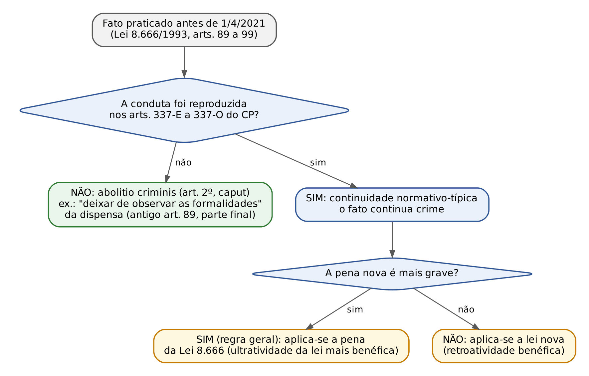
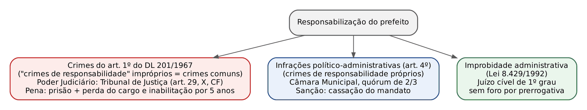
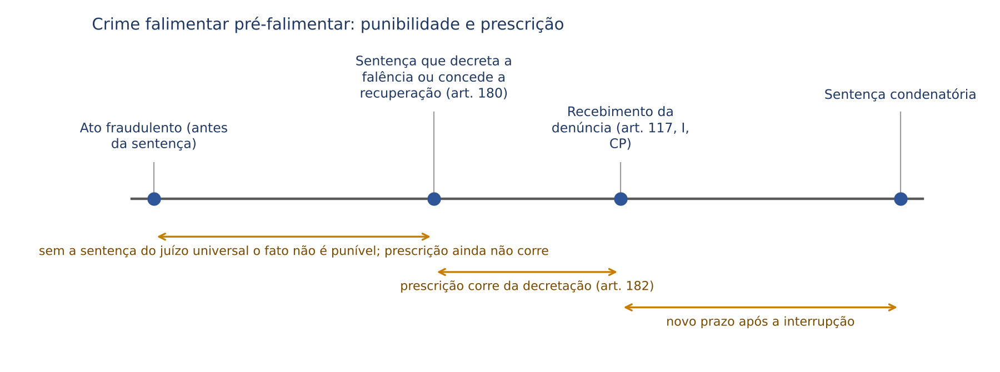

# CAPÍTULO 48 — CRIMES EM LICITAÇÕES, DE PREFEITOS E VEREADORES, FALIMENTARES, ELEITORAIS E DA LEI GERAL DO ESPORTE

:::INCIDENCIA
TRF5 p. 10; TJRS p. 7; TJSC p. 58, 72, 73, 74 e 76. Nível B; lote de 9 questões (FGV 6, FCC 3), TODAS sobre crimes em licitações.
O que mais cai: identificar o tipo do CP (arts. 337-E a 337-O) a partir do verbo descrito no caso; sucessão Lei 8.666 x Lei 14.133 (abolitio parcial do antigo art. 89); multa mínima de 2%; nos demais blocos, competência (Súmulas 702 e 703 do STF; Inq 4.435) e condição objetiva de punibilidade falimentar.
:::

| Subtema | FGV | FCC | Padrão |
|---|---|---|---|
| Identificar o tipo pelo verbo (337-E, 337-H, 337-M, 337-N) | 4 | 3 | caso curto, alternativas com os nomes dos crimes |
| Sucessão de leis (art. 89 x art. 337-E) | 1 | 0 | abolitio parcial x continuidade (TJ-PE 2026, Juiz) |
| Regras comuns (multa de 2%, progressão, inexistência de culpa) | 2 | 0 | itens I, II, III e "modalidade culposa" |

Em cada um dos cinco microssistemas, pergunte: QUAL o tipo, QUEM pratica, QUEM julga e QUE benefício cabe.

## 48.1 Crimes em licitações e contratos administrativos (CP, arts. 337-E a 337-P)

### 48.1.1 De onde vieram: a Lei 14.133/2021 e a sucessão de leis

A Lei 14.133/2021, vigente desde 1/4/2021, revogou de imediato os crimes dos arts. 89 a 99 da Lei 8.666/1993 e os levou para o Código Penal (Capítulo II-B do Título XI, arts. 337-E a 337-P). Consequências:

- Estando no Título XI, valem as regras gerais dos crimes contra a Administração Pública: conceito de funcionário público (art. 327), progressão condicionada à reparação do dano (art. 33, § 4º) — ambos no Cap. 35 — e perda do cargo (art. 92, I — Cap. 18).
- As penas foram, em regra, ELEVADAS (de detenção para reclusão). O fato antigo continua punível, porque a conduta reaparece em outro tipo (continuidade normativo-típica — ver Cap. 3), mas com a pena antiga (irretroatividade da lei mais grave).

| Lei 8.666/1993 (pena) | CP após a Lei 14.133/2021 (pena) | Efeito para fato antigo |
|---|---|---|
| Art. 89 — dispensa/inexigibilidade fora das hipóteses legais (detenção 3 a 5 anos) | Art. 337-E — contratação direta ilegal (reclusão 4 a 8 anos) | continuidade na 1ª parte; ABOLITIO na parte "deixar de observar as formalidades"; aplica-se a pena antiga |
| Art. 90 — frustrar ou fraudar o caráter competitivo (detenção 2 a 4 anos) | Art. 337-F (reclusão 4 a 8 anos) | continuidade; pena antiga |
| Art. 91 — patrocínio de interesse privado (detenção 6 meses a 2 anos) | Art. 337-G (reclusão 6 meses a 3 anos) | continuidade; pena antiga |
| Art. 92 — modificação ou pagamento irregular (detenção 2 a 4 anos) | Art. 337-H (reclusão 4 a 8 anos) | continuidade; pena antiga |
| Art. 93 — impedir, perturbar ou fraudar ato do procedimento (detenção 6 meses a 2 anos) | Art. 337-I (detenção 6 meses a 3 anos) | continuidade; pena antiga |
| Art. 94 — devassar sigilo de proposta (detenção 2 a 3 anos) | Art. 337-J (detenção 2 a 3 anos) | continuidade; pena idêntica |
| Art. 95 — afastar licitante (detenção 2 a 4 anos) | Art. 337-K (reclusão 3 a 5 anos) | continuidade; pena antiga |
| Art. 96 — fraude em licitação para aquisição ou venda de bens (detenção 3 a 6 anos) | Art. 337-L (reclusão 4 a 8 anos), que passou a abranger também serviços | continuidade quanto a bens; para serviços, o novo tipo é incriminação nova (não retroage) |
| Art. 97 — admitir inidôneo (detenção 6 meses a 2 anos) | Art. 337-M (reclusão 1 a 3 anos; contratar: 3 a 6 anos) | continuidade; pena antiga |
| Art. 98 — obstar inscrição em registro cadastral (detenção 6 meses a 2 anos) | Art. 337-N (reclusão 6 meses a 2 anos) | continuidade; pena antiga (detenção) |
| sem correspondente | Art. 337-O — omissão grave de dado por projetista | tipo novo: só para fatos a partir de 1/4/2021 |
| Art. 99 — multa de 2% a 5% do contrato | Art. 337-P — multa pelo CP, com piso de 2% | piso igual; desapareceu o teto de 5% (ver 48.1.4) |

O ponto mais cobrado é a *abolitio criminis* PARCIAL do antigo art. 89, que punia (a) dispensar ou inexigir licitação fora das hipóteses legais e (b) deixar de observar as formalidades da dispensa ou inexigibilidade. O art. 337-E reproduziu só (a); (b) deixou de ser crime, inclusive para fatos já julgados (art. 2º, caput, CP).

:::JURIS STJ, AgRg no AREsp 2.079.040-SP, j. 10/2/2026 (Informativo 883)
A parte final do art. 89 ("deixar de observar as formalidades pertinentes à dispensa ou à inexigibilidade"), não reproduzida no art. 337-E, sofreu *abolitio criminis*.
:::

:::QUESTAO FGV 2026 — TJ-PE — Juiz Substituto (Q4349509)
Particular condenado pelo antigo art. 89 só por inobservância das formalidades de dispensa de pequeno valor (que a lei autorizava); sobrevém a Lei 14.133. Gabarito oficial: B — recurso especial provido por *abolitio criminis* da parte final. Armadilhas: continuidade das duas condutas (A), *novatio legis in mellius* (C), abolitio total (D). O particular, antes alcançado pelo parágrafo único do art. 89, hoje responde pelo 337-E via art. 29 do CP.
:::

:::EXEMPLO Fato antigo com lei nova mais grave
Dispensa indevida em 10/3/2020, sentença em 2026. (1) O fato foi reproduzido no 337-E: continua crime. (2) Art. 89: detenção de 3 a 5 anos; 337-E: reclusão de 4 a 8 anos. (3) Aplica-se a pena antiga: base a partir de 3 anos de DETENÇÃO, sem regime inicial fechado (Cap. 17). (4) Capitulação: "art. 89, caput, primeira parte, da Lei 8.666/1993, com correspondência no art. 337-E do CP". Fato de 5/4/2021: base a partir de 4 anos de reclusão.
:::

### 48.1.2 Os tipos, um a um

A banca descreve um comportamento e pede o nome do crime: ancore cada tipo no VERBO e no MOMENTO. Todos são dolosos; NÃO há modalidade culposa (art. 18, parágrafo único, CP).

| Momento | Verbo-chave no enunciado | Crime |
|---|---|---|
| Contratação SEM licitação | "admitir, possibilitar ou dar causa à contratação direta fora das hipóteses legais" | contratação direta ilegal (337-E) |
| Durante a licitação, contra a competição | "frustrar ou fraudar o caráter competitivo" (combinação de preços, cartel, direcionamento) | frustração do caráter competitivo (337-F) |
| Atuação de servidor em favor de particular | "patrocinar interesse privado", com licitação/contrato depois INVALIDADO pelo Judiciário | patrocínio de contratação indevida (337-G) |
| Execução do contrato | "modificação ou vantagem, inclusive prorrogação", sem autorização; "pagar fatura com preterição da ordem cronológica" | modificação ou pagamento irregular (337-H) |
| Ato do procedimento | "impedir, perturbar ou fraudar qualquer ato" | perturbação de processo licitatório (337-I) |
| Proposta sigilosa | "devassar o sigilo de proposta" | violação de sigilo em licitação (337-J) |
| Concorrente | "afastar ou tentar afastar licitante" por violência, ameaça, fraude ou vantagem; "abster-se ou desistir de licitar em razão de vantagem" | afastamento de licitante (337-K) |
| Fraude que onera a Administração | entrega diversa, mercadoria falsificada ou vencida, troca de mercadoria, alteração de substância, meio fraudulento que encarece | fraude em licitação ou contrato (337-L) |
| Empresa punida | "admitir à licitação" ou "celebrar contrato" com declarado inidôneo; o próprio inidôneo que participa ou contrata | contratação inidônea (337-M) |
| Registro cadastral | "obstar, impedir ou dificultar injustamente a inscrição"; alterar, suspender ou cancelar indevidamente o registro | impedimento indevido (337-N) |
| Projetos | projetista que omite ou distorce "levantamento cadastral ou condição de contorno" | omissão grave de dado por projetista (337-O) |

#### Contratação direta ilegal (art. 337-E)

É norma penal em branco (hipóteses de dispensa e inexigibilidade nos arts. 72 a 75 da Lei 14.133): mudança favorável da norma complementar retroage. O particular que concorre responde pelo art. 29 do CP.

:::JURIS STJ, AgRg no HC 669.347-SP, j. 13/12/2021 (Informativo 723)
A contratação direta ilegal exige dolo específico de causar dano ao erário e efetivo prejuízo. Sem isso, a irregularidade é administrativa ou de improbidade, não penal (orientação herdada do antigo art. 89).
:::

:::PEGADINHA
Dolo de lesar e prejuízo são exigências do 337-E. NÃO as transporte para o 337-F, que é crime FORMAL (Súmula 645 do STJ).
:::

#### Frustração do caráter competitivo (art. 337-F)

Exige o fim especial de obter vantagem decorrente da adjudicação. Exemplos: cartel, rodízio de vencedores, edital direcionado.

:::JURIS STJ, Súmula 645 (10/2/2021)
O crime de fraude à licitação é formal, e sua consumação prescinde da comprovação do prejuízo ou da obtenção de vantagem. Editada para o antigo art. 90, aplica-se ao 337-F, que o sucedeu.
:::

#### Demais tipos: as notas que a banca explora

- 337-G: advocacia administrativa específica (prevalece sobre o art. 321 — Cap. 35), mas só se a licitação ou o contrato for INVALIDADO PELO PODER JUDICIÁRIO (para a maioria, condição objetiva de punibilidade — Cap. 20).
- 337-H: duas condutas — modificação ou vantagem ao contratado, inclusive PRORROGAÇÃO, sem autorização; e pagamento com preterição da ordem cronológica (art. 141 da Lei 14.133).
- 337-J revogou tacitamente o art. 326 do CP (Cap. 35).
- 337-K é crime de atentado ("afastar ou tentar afastar"), com cúmulo da pena da violência; o parágrafo único pune quem se abstém ou desiste de licitar pela vantagem.
- 337-L exige prejuízo ("em prejuízo da Administração"): crime material para a maioria (ex.: merenda com carne de segunda vendida como de primeira). Fraudes em licitações distintas, com desígnios autônomos: concurso material (FGV 2025, TRF6, Q3742366 — Cap. 16).

:::QUESTAO FCC 2024 — PIAUÍPREV — Analista Previdenciário (Q3884635)
Funcionário dá causa a prorrogação contratual sem autorização. Gabarito oficial: D — art. 337-H ("prorrogação" e "durante a execução" são a chave).
Correlata, FGV 2024, Prefeitura de Caraguatatuba (Q3049086): gabarito E — pagar fatura com preterição da ordem cronológica é o 337-H. Erros das demais: "inobservância das formalidades" saiu do 337-E (A); modificação contratual não é contratação inidônea (C); dificultar inscrição cadastral é impedimento indevido (D); fraude em arrematação judicial é o art. 358 do CP, não afastamento de licitante (B).
:::

#### Contratação inidônea (art. 337-M)

A inidoneidade (art. 156, IV, da Lei 14.133) impede licitar e contratar. O tipo é uma "escada":

| Conduta | Quem pratica | Pena |
|---|---|---|
| Admitir à licitação empresa ou profissional inidôneo (caput) | agente público | reclusão de 1 a 3 anos e multa |
| Celebrar contrato com inidôneo (§ 1º) | agente público | reclusão de 3 a 6 anos e multa |
| Participar de licitação sendo inidôneo (§ 2º, 1ª parte) | o próprio inidôneo | mesma pena do caput |
| Contratar com a Administração sendo inidôneo (§ 2º, 2ª parte) | o próprio inidôneo | mesma pena do § 1º |

:::QUESTAO FCC 2024 — TRF3 — Analista Judiciário (Q2564494)
Funcionários admitem inidônea à licitação. Gabarito oficial: C — art. 337-M, caput.
Correlata, FGV 2025 — CGE-SP (Q3781272): admissão por NEGLIGÊNCIA. Gabarito oficial: C — fato atípico (não há culpa). Armadilhas: "modalidade qualificada" (o § 1º é figura autônoma), ação condicionada (todos são de ação pública INCONDICIONADA), "culpa com grave dano".
:::

:::QUESTAO FGV 2024 — TJ-MT — Analista Judiciário (Q3114281)
I (dias-multa com piso de 2%), II (progressão condicionada à reparação do dano), III (inidôneo que contrata não comete crime). Gabarito oficial: C — I e II. I: art. 337-P; II: art. 33, § 4º (Título XI); III: falsa (337-M, § 2º).
:::

#### Impedimento indevido (337-N) e omissão por projetista (337-O)

O 337-N protege os registros cadastrais (art. 87 da Lei 14.133; SICAF na esfera federal) e não tem forma qualificada. O 337-O, tipo novo, é próprio do projetista que distorce levantamento cadastral ou "condição de contorno" (sondagens, topografia, estudos de demanda — § 1º); com fim de benefício, pena EM DOBRO (§ 2º, terceira fase).

:::QUESTAO FGV 2026 — TJ-RJ — Analista Judiciário (Q3868596)
Servidor que dificulta injustamente a inscrição cadastral. Gabarito oficial: C — impedimento indevido, modalidade simples (não há qualificada).
No mesmo sentido, FCC 2026 — TJ-CE (Q4240023): servidor que, por antipatia, retarda o cadastro e impede a participação. Gabarito oficial: A — art. 337-N. O enunciado atribui o crime ao empresário ("Ricardo cometeu"), erro material: o autor é o servidor. Não é 337-K, pois não há violência, ameaça, fraude ou vantagem para afastar licitante.
:::

### 48.1.3 Ficha dos crimes licitatórios

| Crime | Pena | Dolo / fim especial | Consumação | Benefícios cabíveis |
|---|---|---|---|---|
| 337-E Contratação direta ilegal | reclusão 4 a 8 anos e multa | dolo + (jurisprudência) intenção de lesar o erário | com a contratação; exige prejuízo (STJ) | nenhum benefício consensual (mínimo 4: ANPP exige pena mínima inferior a 4 anos) |
| 337-F Frustração do caráter competitivo | reclusão 4 a 8 anos e multa | intuito de vantagem decorrente da adjudicação | formal (Súmula 645 do STJ) | nenhum |
| 337-G Patrocínio de contratação indevida | reclusão 6 meses a 3 anos e multa | dolo | com a invalidação judicial | suspensão do processo e ANPP |
| 337-H Modificação ou pagamento irregular | reclusão 4 a 8 anos e multa | dolo | com a modificação ou o pagamento | nenhum |
| 337-I Perturbação | detenção 6 meses a 3 anos e multa | dolo | com o ato perturbador | suspensão do processo e ANPP |
| 337-J Violação de sigilo | detenção 2 a 3 anos e multa | dolo | com a devassa | ANPP |
| 337-K Afastamento de licitante | reclusão 3 a 5 anos e multa + pena da violência | dolo | crime de atentado (tentar = consumar) | ANPP (se sem violência ou grave ameaça) |
| 337-L Fraude em licitação ou contrato | reclusão 4 a 8 anos e multa | dolo | com o prejuízo à Administração (material) | nenhum |
| 337-M Contratação inidônea | caput e § 2º (participar): 1 a 3 anos; § 1º e § 2º (contratar): 3 a 6 anos; reclusão e multa | dolo (ciência da inidoneidade) | com a admissão ou a celebração | caput: suspensão e ANPP; contratar: ANPP |
| 337-N Impedimento indevido | reclusão 6 meses a 2 anos e multa | dolo; "injustamente" | com o obstáculo | menor potencial ofensivo: transação |
| 337-O Omissão por projetista | reclusão 6 meses a 3 anos e multa; em dobro com fim de benefício | dolo | com a entrega ou omissão | suspensão e ANPP (também na forma do § 2º, cujo mínimo dobrado é 1 ano) |

Em todos: ação penal pública incondicionada; nenhum é hediondo; competência da Justiça Federal quando o certame envolver ente federal ou recursos da União sujeitos a fiscalização federal (raciocínio das Súmulas 208 e 209 do STJ — ver 48.2.3), e da Justiça Estadual nos demais casos. Benefícios: ver Cap. 25 para os requisitos de cada instituto (transação: pena máxima até 2 anos; suspensão: mínima até 1 ano; ANPP: mínima inferior a 4 anos, sem violência ou grave ameaça).

### 48.1.4 Regras comuns: multa, sujeito ativo e Sistema S

A multa segue os dias-multa do CP (art. 49 — Cap. 15), com PISO de 2% do valor do contrato (art. 337-P). A lei antiga tinha piso de 2% e teto de 5%; hoje não há teto específico.

:::EXEMPLO Multa no art. 337-P
Art. 337-F; contrato de 3.000.000 (três milhões) de reais; salário mínimo hipotético de 1.500 (mil e quinhentos) reais. (1) CP: 10 dias-multa x 1/30 do salário mínimo (50 reais) = 500 (quinhentos) reais. (2) Piso: 2% de 3.000.000 = 60.000 (sessenta mil) reais. (3) Como 500 fica abaixo do piso, a multa é de 60.000 (sessenta mil) reais. Registre as duas operações na sentença.
:::

Sujeito ativo: 337-E, 337-H, 337-M (caput e § 1º) e 337-N são próprios de quem tem poder no certame (inclusive funcionário por equiparação); 337-F, 337-I a 337-L, qualquer pessoa; 337-O, o projetista.

:::JURIS STJ, RHC 163.470-DF, j. 21/6/2022
Dirigentes do "Sistema S" (SESI, SENAI, SESC) não se submetem à lei geral de licitações nem aos crimes funcionais do Capítulo I do Título XI do CP.
:::

:::SENTENCA Crimes licitatórios
Fundamente o verbo e o inciso, o dolo e, no 337-E, o prejuízo; calcule a multa com o piso; decida sobre reparação mínima (art. 387, IV, CPP) e perda do cargo (art. 92, I, CP). Modelo: "A contratação direta, fora das hipóteses do art. 75 da Lei 14.133/2021, foi determinada pelo réu para favorecer a empresa X, com prejuízo ao erário de 200.000 (duzentos mil) reais apurado pelo Tribunal de Contas; configurado o art. 337-E do CP." Erros punidos: pena do CP para fato anterior a 1/4/2021; condenação pelo 337-E por mera irregularidade formal.
:::

## 48.2 Responsabilidade de prefeitos e vereadores (Decreto-Lei 201/1967)

### 48.2.1 O problema do nome: "crime de responsabilidade" com dois sentidos

- Art. 1º: apesar do nome "crimes de responsabilidade", são CRIMES COMUNS (funcionais e próprios do prefeito), punidos com prisão e julgados pelo Judiciário "independentemente do pronunciamento da Câmara" (crimes de responsabilidade impróprios).
- Art. 4º: infrações político-administrativas (crimes de responsabilidade próprios), julgadas pela Câmara, com sanção única de cassação.

As vias são independentes entre si e da improbidade administrativa.

:::JURIS STF, Súmula Vinculante 46
A definição dos crimes de responsabilidade e o estabelecimento das respectivas normas de processo e julgamento são da competência legislativa privativa da União. Constituição estadual ou Lei Orgânica NÃO podem criar infrações político-administrativas nem rito de cassação (apesar da ressalva do art. 5º do DL 201).
:::

### 48.2.2 Os crimes do art. 1º

São 23 incisos; só os dois primeiros têm reclusão:

| Inciso | Conduta (paráfrase) | Paralelo no CP | Pena |
|---|---|---|---|
| I | apropriar-se de bens ou rendas públicas, ou desviá-los em proveito próprio ou alheio | peculato-apropriação e peculato-desvio (art. 312) | reclusão de 2 a 12 anos |
| II | utilizar-se indevidamente, em proveito próprio ou alheio, de bens, rendas ou serviços públicos | peculato de uso, ATÍPICO no CP (ver Cap. 35) | reclusão de 2 a 12 anos |
| III e IV | desviar ou aplicar indevidamente rendas ou verbas; empregar subvenções e recursos em desacordo com os planos a que se destinam | emprego irregular de verbas (art. 315) | detenção de 3 meses a 3 anos |
| V a XV | despesas não autorizadas; não prestar contas; empréstimos, alienações e subvenções sem autorização da Câmara; aquisição de bens e serviços sem licitação nos casos exigidos (XI); antecipar ou inverter a ordem de pagamento a credores sem vantagem para o erário (XII); nomear servidor contra lei (XIII); negar execução a lei ou ordem judicial sem motivar por escrito (XIV); não fornecer certidões (XV) | vários | detenção de 3 meses a 3 anos |
| XVI a XXIII | crimes fiscais incluídos pela Lei 10.028/2000 (dívida consolidada, operações de crédito, antecipação de receita, transferências voluntárias) | arts. 359-A a 359-H (ver Cap. 35) | detenção de 3 meses a 3 anos |

- Especialidade: para o prefeito, o DL 201 prevalece sobre o CP; por isso o uso indevido de bem público, atípico para o funcionário comum, é crime grave para ele (inciso II: máquinas da prefeitura na fazenda do prefeito). Corrupção passiva, concussão e prevaricação seguem no CP.
- Sujeito ativo: o prefeito e o vice ou substituto, "ainda que tenha cessado a substituição" (art. 3º); o particular partícipe responde pelo mesmo crime (art. 30 do CP — Cap. 11).
- Vereador: o DL 201 NÃO tipifica crime de vereador (arts. 7º e 8º só tratam de cassação e extinção do mandato). Ele responde pelo CP, em primeiro grau, sem foro na CF (ver Q3865756, MPE-GO 2026 — Cap. 18).
- Inciso XI x art. 337-E (contratação sem licitação): há divergência sobre qual prevalece; os tribunais têm capitulado a contratação direta indevida no tipo licitatório (antigo art. 89, hoje 337-E).

:::LEI Decreto-Lei 201/1967, art. 1º, § 2º
A condenação definitiva em qualquer dos crimes definidos neste artigo, acarreta a perda de cargo e a inabilitação, pelo prazo de cinco anos, para o exercício de cargo ou função pública, eletivo ou de nomeação, sem prejuízo da reparação civil do dano causado ao patrimônio público ou particular.
:::

O efeito alcança QUALQUER inciso e independe da quantidade de pena (diferença em relação ao art. 92, I, do CP). São sanções autônomas, com prescrição própria (Informativo 884 do STJ — ver Cap. 22). Ação penal: pública incondicionada (§ 1º).

### 48.2.3 Quem julga o prefeito: competência e foro

A CF (art. 29, X) assegura ao prefeito julgamento perante o Tribunal de Justiça; as súmulas completam o quadro:

| Situação | Órgão competente | Fundamento |
|---|---|---|
| Crime comum (inclusive DL 201) da competência da Justiça Estadual | Tribunal de Justiça | art. 29, X, CF |
| Crime da competência da Justiça Federal (ex.: desvio de verba federal sujeita a prestação de contas a órgão federal) | Tribunal Regional Federal | Súmula 702 do STF; Súmula 208 do STJ |
| Desvio de verba transferida e já incorporada ao patrimônio municipal | Tribunal de Justiça | Súmula 209 do STJ |
| Crime eleitoral | Tribunal Regional Eleitoral | Súmula 702 do STF |
| Crime doloso contra a vida | Tribunal de Justiça (o foro constitucional prevalece sobre o júri) | art. 29, X, CF |
| Infração político-administrativa (art. 4º) | Câmara Municipal | art. 4º e 5º do DL 201 |
| Improbidade administrativa | juízo cível de primeiro grau | Lei 8.429/1992 |

:::JURIS STF, Súmula 702
A competência do Tribunal de Justiça para julgar prefeitos restringe-se aos crimes de competência da Justiça comum estadual; nos demais casos, a competência originária caberá ao respectivo tribunal de segundo grau. As Súmulas 208 e 209 do STJ dão o critério federal x estadual: quem fiscaliza a aplicação da verba.
:::

A extinção do mandato NÃO impede o processo pelos crimes do art. 1º (Súmula 703 do STF; Súmula 164 do STJ): são crimes comuns, cuja punibilidade não depende do cargo. Quanto ao órgão julgador, pela AP 937 (2018) o foro cessava com o mandato; em 11/3/2025, no HC 232.627, o STF fixou que o foro para crimes praticados no cargo e em razão das funções subsiste após o afastamento, ainda que a ação comece depois. Como os crimes do art. 1º são, por definição, funcionais, a tendência é o ex-prefeito seguir no tribunal (ver nota de verificação).

:::PROCESSO Rito do DL 201
Art. 2º: procedimento comum com (I) defesa prévia em 5 dias antes do recebimento; (II) decisão obrigatória e motivada sobre preventiva (incisos I e II) e afastamento do cargo (todos); (III) RESE em 5 dias, com efeito suspensivo contra prisão ou afastamento. No tribunal, rito da Lei 8.038/1990 (Lei 8.658/1993), com resposta em 15 dias antes do recebimento. Benefícios: incisos I e II admitem ANPP; incisos III a XXIII, suspensão do processo e ANPP; transação, nunca.
:::

### 48.2.4 Infrações político-administrativas (arts. 4º a 8º)

Rito do art. 5º: denúncia por qualquer eleitor; recebimento pela maioria dos presentes; comissão de 3 vereadores sorteados; defesa em 10 dias, até 10 testemunhas; cassação por 2/3 dos membros, em votação nominal por infração; conclusão em 90 dias da notificação, sob pena de arquivamento (sem impedir nova denúncia). A extinção do mandato (arts. 6º e 8º, ex.: condenação por crime funcional ou eleitoral) é declarada pelo Presidente da Câmara. O vereador pode ser cassado (art. 7º) pelo mesmo rito.

:::SENTENCA Prefeito
Capitule no inciso exato do art. 1º, fundamente a especialidade, use as penas do § 1º e declare a perda do cargo e a inabilitação (art. 1º, § 2º). Modelo: "O réu, então Prefeito, utilizou caminhões e servidores do Município em obra particular; incide o art. 1º, II, do Decreto-Lei 201/1967, tipo especial em relação ao Código Penal." Erro comum: negar a perda do cargo pelo art. 92, I, do CP porque a pena ficou abaixo de 1 ano.
:::

## 48.3 Crimes falimentares (Lei 11.101/2005, arts. 168 a 188)

### 48.3.1 Lógica do sistema

Protegem a satisfação igualitária dos credores (*par condicio creditorum*) e a regularidade da falência e da recuperação. Três ideias organizam tudo:

- Momento: crimes ANTEFALIMENTARES (antes da sentença, puníveis só com ela) e PÓS-FALIMENTARES; vários tipos dizem "antes ou depois da sentença" (arts. 168, 172, 178).
- Sujeitos: crimes PRÓPRIOS do devedor (arts. 168, 172, 176, 178), equiparados sócios, diretores, gerentes, administradores e conselheiros, de fato ou de direito, e o administrador judicial (art. 179); crimes de qualquer pessoa (arts. 169, 170, 173 a 175); e crime próprio dos agentes do processo (art. 177).
- Condição objetiva de punibilidade (art. 180): a sentença que decreta a falência ou concede a recuperação judicial ou extrajudicial. Não integra o tipo nem precisa ser abrangida pelo dolo; sem ela, não há crime falimentar punível (teoria no Cap. 20).

Pelo princípio tradicional da UNICIDADE, vários atos falimentares no contexto da mesma falência formam crime único, com a pena do mais grave (princípio da lei anterior, questionado por parte da doutrina na Lei 11.101).

### 48.3.2 Os tipos

| Art. | Crime (nomen iuris legal) | Núcleo (paráfrase) | Pena |
|---|---|---|---|
| 168 | Fraude a credores | ato fraudulento, antes ou depois da sentença, de que resulte OU POSSA RESULTAR prejuízo aos credores, para obter vantagem indevida | reclusão 3 a 6 anos e multa |
| 169 | Violação de sigilo empresarial | violar, explorar ou divulgar sigilo empresarial, contribuindo para levar o devedor à inviabilidade | reclusão 2 a 4 anos e multa |
| 170 | Divulgação de informações falsas | divulgar informação falsa sobre devedor EM RECUPERAÇÃO JUDICIAL, para levá-lo à falência ou obter vantagem | reclusão 2 a 4 anos e multa |
| 171 | Indução a erro | sonegar, omitir ou falsear informações no processo para induzir a erro juiz, MP, credores, comitê ou administrador | reclusão 2 a 4 anos e multa |
| 172 | Favorecimento de credores | ato de disposição ou oneração para favorecer um ou alguns credores em prejuízo dos demais; o credor em conluio responde junto (parágrafo único) | reclusão 2 a 5 anos e multa |
| 173 | Desvio, ocultação ou apropriação de bens | apropriar-se, desviar ou ocultar bens do devedor em recuperação ou da massa, inclusive por interposta pessoa | reclusão 2 a 4 anos e multa |
| 174 | Aquisição, recebimento ou uso ilegal de bens | adquirir, receber ou usar bem que SABE pertencer à massa (espécie de receptação falimentar) | reclusão 2 a 4 anos e multa |
| 175 | Habilitação ilegal de crédito | apresentar relação, habilitação ou reclamação de crédito falsa, ou juntar título falso ou simulado | reclusão 2 a 4 anos e multa |
| 176 | Exercício ilegal de atividade | exercer atividade para a qual foi inabilitado por decisão judicial nos termos da lei | reclusão 1 a 4 anos e multa |
| 177 | Violação de impedimento | juiz, MP, administrador, perito, avaliador, escrivão, oficial de justiça ou leiloeiro que adquire bens da massa ou especula com eles, tendo atuado no processo | reclusão 2 a 4 anos e multa |
| 178 | Omissão dos documentos contábeis obrigatórios | deixar de elaborar, escriturar ou autenticar a escrituração obrigatória | detenção 1 a 2 anos e multa, se não constituir crime mais grave (subsidiariedade expressa) |

- Art. 168 é crime de PERIGO ("possa resultar"). § 1º: +1/6 a 1/3 por contabilidade falsa, omissão de lançamentos, destruição de dados ou documentos, simulação do capital. § 2º (Lei 14.112/2020): +1/3 até metade pela contabilidade paralela ("caixa dois"), inclusive distribuição de lucros vedada pelo art. 6º-A. § 3º: contadores e auditores que concorrem respondem pelas mesmas penas. § 4º: falência de ME ou EPP sem fraude habitual: redução de 1/3 a 2/3 ou substituição por restritivas.
- Art. 170 só protege devedor em RECUPERAÇÃO JUDICIAL.
- Art. 172 x 168: no favorecimento, o devedor quebra a igualdade entre credores (paga o credor parente na véspera da quebra), sem buscar vantagem para si.

:::EXEMPLO Fraude a credores com duas majorantes e a minorante do § 4º
Administrador de microempresa falida, primário, sem habitualidade, com caixa dois (§ 2º) e balanço inexato (§ 1º, I); 1ª e 2ª fases no mínimo: 3 anos.
- Opção A (art. 68, parágrafo único — Cap. 15: só a majorante que mais aumenta): 3 anos + 1/3 = 4 anos; - 1/3 do § 4º (1 ano e 4 meses) = 2 anos e 8 meses.
- Opção B (ambas, em cascata): 3 anos + 1/6 = 3 anos e 6 meses; + 1/3 = 4 anos e 8 meses; - 1/3 (1 ano, 6 meses e 20 dias) = 3 anos, 1 mês e 10 dias.
- Em ambas: regime aberto e substituição cabível (o § 4º a autoriza diretamente).
:::

### 48.3.3 Efeitos da condenação, prescrição e processo

- Efeitos (art. 181): inabilitação empresarial, impedimento para cargos de administração, impossibilidade de gerir empresa. NÃO são automáticos: declaração motivada na sentença; duram até 5 anos após a extinção da punibilidade, salvo reabilitação anterior.
- Prescrição (art. 182): prazos e interrupções do CP (Súmula 592 do STF — Cap. 22), mas o TERMO INICIAL é a decretação da falência, a concessão da recuperação judicial ou a homologação da extrajudicial, não o dia do fato. A falência posterior INTERROMPE a prescrição iniciada com a recuperação. A Súmula 147 do STF (lei antiga) está superada.

:::PROCESSO Crimes falimentares
Juiz CRIMINAL do local da falência ou recuperação (art. 183), na Justiça Estadual. Ação pública incondicionada; esgotado o prazo do MP, credor habilitado ou administrador judicial pode propor queixa subsidiária em 6 meses (art. 184). O MP denuncia no prazo do art. 46 do CPP ou, réu solto, aguarda a exposição circunstanciada do administrador (art. 186) e denuncia em 15 dias (art. 187, § 1º). Rito: arts. 531 a 540 do CPP (sumário), por remissão expressa (art. 185). Benefícios: art. 178 admite transação; 176 e 178, suspensão do processo; os demais, ANPP (Cap. 25).
:::

:::SENTENCA Crime falimentar
Registre a condição objetiva (data da sentença de falência ou recuperação), conte dela a prescrição e DECLARE motivadamente os efeitos do art. 181. Modelo: "Presente a condição objetiva do art. 180 da Lei 11.101/2005 (sentença de falência de 3/2/2025), marco inicial da prescrição (art. 182)." Erro comum: contar a prescrição do ato fraudulento.
:::

## 48.4 Crimes eleitorais (Código Eleitoral e leis eleitorais)

### 48.4.1 Regras gerais próprias do Código Eleitoral

Estão no Código Eleitoral (arts. 289 a 354-A), na Lei 9.504/1997, na Lei 6.091/1974 e na LC 64/1990 (art. 25). O CP é subsidiário (art. 287), mas há regras próprias:

| Regra | Conteúdo | Art. |
|---|---|---|
| Funcionário para fins penais | além do conceito geral, são membros e funcionários da Justiça Eleitoral os cidadãos nomeados para mesas receptoras e juntas apuradoras e os requisitados (mesário é funcionário público para fins penais — ver Cap. 35) | 283 |
| Pena mínima não indicada | muitos tipos dizem só "reclusão até 4 anos": o mínimo é de 1 ano para reclusão e de 15 dias para detenção | 284 |
| Agravação ou atenuação sem quantum | quando a lei manda agravar ou atenuar sem dizer quanto, o juiz fixa entre 1/5 e 1/3 | 285 |
| Multa | de 1 a 300 dias-multa; dia-multa entre o salário mínimo diário e o salário mínimo mensal; pode ser triplicada | 286 |
| Ação penal | TODOS os crimes eleitorais são de ação pública (incondicionada), inclusive calúnia, difamação e injúria eleitorais; cabe ação privada subsidiária (art. 5º, LIX, CF) | 355 |
| Denúncia | prazo de 10 dias; arquivamento discordado pelo juiz vai ao Procurador Regional Eleitoral | 357 |
| Processo | CPP subsidiário, inclusive nos crimes comuns conexos (art. 364); interrogatório ao final, como nos demais ritos especiais (HC 127.900 do STF — ver Cap. 37) | 359 a 364 |

:::EXEMPLO Dosimetria com as regras dos arts. 284 e 285
Funcionário que, prevalecendo-se do cargo, insere declaração falsa em documento público para fins eleitorais (art. 350, parágrafo único: "a pena é agravada", sem quantum). (1) "Reclusão até cinco anos": mínimo de 1 ano (art. 284); 1ª e 2ª fases: 1 ano. (2) Agravação entre 1/5 e 1/3 (art. 285): 1 ano + 1/5 (2 meses e 12 dias) = 1 ano, 2 meses e 12 dias; ou + 1/3 = 1 ano e 4 meses. (3) Multa: 5 a 15 dias-multa, dia-multa entre 1/30 do salário mínimo e um salário mínimo (art. 286, § 1º).
:::

### 48.4.2 Os tipos mais cobrados

| Tipo | Conduta (paráfrase) | Pena | Observações |
|---|---|---|---|
| Corrupção eleitoral (CE, 299) | dar, oferecer, prometer, solicitar ou receber vantagem para obter ou dar voto ou abstenção, "ainda que a oferta não seja aceita" | reclusão até 4 anos (mínimo 1) e multa | ativa e passiva no MESMO tipo; formal; fim de obter o voto; eleitor determinado ou determinável |
| Coação eleitoral (CE, 301) | violência ou grave ameaça para coagir o voto, ainda que sem êxito | reclusão até 4 anos e multa | formal |
| Concentração de eleitores (CE, 302) e transporte ou refeição ilegais (Lei 6.091/1974, art. 11, III) | no dia da eleição, concentrar eleitores para impedir ou fraudar o voto; transportar eleitores (da véspera ao dia seguinte) ou fornecer transporte ou refeição a eleitores urbanos | reclusão 4 a 6 anos e 200 a 300 dias-multa | exige finalidade eleitoral |
| Crimes do dia da eleição (Lei 9.504, art. 39, § 5º) | alto-falante, comício ou carreata; arregimentação ou BOCA DE URNA; propaganda; novos conteúdos ou impulsionamento na internet | detenção 6 meses a 1 ano (alternativa de serviços) e multa | menor potencial ofensivo; manifestação individual e silenciosa é lícita (art. 39-A) |
| Fatos inverídicos (CE, 323) | divulgar, na propaganda ou na campanha, fatos que SABE inverídicos e capazes de influir no eleitorado; § 1º: vídeo inverídico | detenção 2 meses a 1 ano ou multa; +1/3 a 1/2 (internet, tempo real, menosprezo à mulher, cor, raça ou etnia) | *fake news* eleitorais (Lei 14.192/2021) |
| Calúnia, difamação e injúria eleitorais (CE, 324 a 326) | ofensa "na propaganda eleitoral, ou visando fins de propaganda" | calúnia 6 meses a 2 anos; difamação 3 meses a 1 ano; injúria até 6 meses ou multa | ação PÚBLICA; +1/3 a 1/2 nas hipóteses do art. 327 (inclusive internet) |
| Denunciação caluniosa eleitoral (CE, 326-A) | provocar investigação ou processo contra quem sabe inocente, com finalidade eleitoral; § 3º: divulgar a falsa imputação | reclusão 2 a 8 anos e multa | Lei 13.834/2019 |
| Violência política de gênero (CE, 326-B) | assediar, constranger, humilhar, perseguir ou ameaçar candidata ou mandatária, com menosprezo à condição de mulher, cor, raça ou etnia, para dificultar campanha ou mandato | reclusão 1 a 4 anos e multa; +1/3 (gestante, maior de 60, com deficiência) | não confundir com o art. 359-P do CP (Cap. 36) |
| Falsidade ideológica eleitoral (CE, 350) | omitir declaração devida ou inserir declaração falsa, para fins eleitorais | reclusão até 5 anos (documento público) ou até 3 (particular) e multa | "caixa dois" na prestação de contas; especial em relação ao art. 299 do CP (Cap. 34) |
| Apropriação de recursos de campanha (CE, 354-A) | candidato ou administrador financeiro que se apropria de recursos da campanha | reclusão 2 a 6 anos e multa | Lei 13.488/2017 |
| Ataque à urna (Lei 9.504, art. 72) | acessar ou alterar sistema eleitoral; danificar urna | reclusão 5 a 10 anos | a pena mais alta |
| Pesquisa fraudulenta (Lei 9.504, art. 33, § 4º) | divulgar pesquisa fraudulenta | detenção 6 meses a 1 ano e multa | pesquisa sem registro é só multa (§ 3º) |

:::PEGADINHA Corrupção eleitoral x captação ilícita de sufrágio
O art. 299 do CE é crime; o art. 41-A da Lei 9.504/1997 (captação ilícita de sufrágio) é ilícito NÃO penal (multa e cassação do registro ou diploma). Comprar votos gera as duas responsabilidades, em processos distintos. E a honra ELEITORAL é sempre de ação pública incondicionada, ao contrário da regra do CP.
:::

### 48.4.3 Competência: a Justiça Eleitoral e a conexão

A Justiça Eleitoral é ramo do Judiciário da UNIÃO, mas não é a Justiça Federal comum (art. 109, IV, CF, ressalva expressa). Julga o juiz eleitoral (juiz de direito no exercício da função eleitoral); a polícia judiciária é, em regra, a Polícia Federal; o MP Eleitoral é chefiado pelo MPF, com promotores designados em primeiro grau. É o sentido do edital do TRF5 ("crimes eleitorais de competência federal"): interesse da União, mas o juiz federal comum NÃO os julga.

:::JURIS STF, Inq 4.435 AgR-quarto, Plenário, j. 14/3/2019
A Justiça Eleitoral julga os crimes eleitorais e os comuns conexos (art. 35, II, CE; art. 78, IV, CPP) e ela própria decide sobre a conexão; inexistente, remete os crimes comuns ao juízo competente. Levou à Justiça Eleitoral casos de corrupção e lavagem ligados a "caixa dois" (art. 350 do CE).
:::

Foro: prefeito, TRE (Súmula 702 do STF). Benefícios conforme as penas (art. 39, § 5º, da Lei 9.504: transação; art. 299: suspensão do processo e ANPP).

:::ATENCAO Lei 15.358/2026 (alteração não penal)
Incluiu entre os inalistáveis os presos "ainda que sem condenação definitiva" (CE, art. 5º, IV) e a prisão provisória entre as causas de cancelamento da inscrição (art. 71, VI). Discute-se a compatibilidade com o art. 15, III, da CF.
:::

## 48.5 Crimes da Lei Geral do Esporte (Lei 14.597/2023)

### 48.5.1 Sucessão: o Estatuto do Torcedor foi revogado

A Lei Geral do Esporte (LGE), vigente desde 15/6/2023, revogou INTEGRALMENTE o Estatuto do Torcedor (Lei 10.671/2003 — art. 217, III), ainda citado no edital do TJRS. Os crimes do Estatuto (arts. 41-B a 41-G) foram reproduzidos com as MESMAS penas: continuidade normativo-típica, sem *abolitio*; para fatos anteriores, muda só a capitulação.

| Estatuto do Torcedor (revogado) | Lei Geral do Esporte | Pena |
|---|---|---|
| Art. 41-B — tumulto, violência, invasão; torcedor no raio de 5.000 m, com instrumentos de violência | Art. 201 | reclusão 1 a 2 anos e multa |
| Art. 41-C — solicitar ou aceitar vantagem para alterar resultado | Art. 198 | reclusão 2 a 6 anos e multa |
| Art. 41-D — dar ou prometer vantagem para alterar resultado | Art. 199 | reclusão 2 a 6 anos e multa |
| Art. 41-E — fraudar resultado | Art. 200 | reclusão 2 a 6 anos e multa |
| Art. 41-F — vender ingresso acima do preço (cambismo) | Art. 166 | reclusão 1 a 2 anos e multa |
| Art. 41-G — fornecer ou desviar ingressos para venda acima do preço | Art. 167 (com nova majorante) | reclusão 2 a 4 anos e multa |
| sem correspondente | Art. 165 — corrupção privada no esporte; arts. 168 a 171 — propriedade intelectual e marketing de emboscada | tipos novos: não retroagem |

### 48.5.2 Os tipos

Corrupção privada no esporte (art. 165): exigir, solicitar, aceitar ou receber vantagem indevida, como REPRESENTANTE DE ORGANIZAÇÃO ESPORTIVA PRIVADA, para praticar ou omitir ato de suas atribuições; o parágrafo único pune quem oferece ou paga. Primeira criminalização brasileira da corrupção privada, restrita ao esporte: dirigentes de clubes e federações não são funcionários públicos (art. 203), e o art. 317 do CP não os alcança.

Manipulação de resultados (arts. 198 a 200): solicitar ou aceitar vantagem, patrimonial ou NÃO, para alterar ou falsear resultado de competição ou evento associado (198 — o atleta que força cartão combinado com apostadores); dar ou prometer essa vantagem (199); fraudar ou contribuir para fraudar o resultado (200). Crimes formais.

Cambismo (166 e 167): vender ou portar para venda ingresso acima do preço estampado; fornecer ou desviar ingressos para isso, com aumento de 1/3 até a metade se o agente é servidor, dirigente, funcionário de organização esportiva ou de empresa de ingressos, ou de torcida organizada. Propriedade intelectual (168 a 171: falsificação de símbolos, comércio e marketing de emboscada): ação condicionada à representação da organização, salvo o art. 169 (art. 172).

Paz no esporte (art. 201): promover tumulto, praticar ou incitar violência ou invadir local restrito em eventos esportivos; nas mesmas penas o torcedor que o faz num raio de 5.000 metros ou no trajeto, que porta instrumentos de violência ou que participa de briga de torcidas (§ 1º). Sistema próprio de pena:

- § 2º: na sentença, o juiz DEVE converter a reclusão em pena impeditiva de comparecimento às proximidades de arenas e a eventos esportivos, por 3 meses a 3 anos, se o agente for primário, de bons antecedentes e sem punição anterior por este artigo; com a obrigação de permanecer em local indicado das 2 horas antes às 2 horas depois das partidas (§ 4º); descumprida, reconverte-se (§ 3º).
- § 5º: na transação penal, a sanção aplicada é a do § 2º.
- § 6º: quem organiza, prepara ou incita o tumulto tem aumento de 1/3 até a metade e NÃO recebe as medidas dos §§ 2º a 5º.
- § 7º: penas EM DOBRO em casos de racismo ou de infrações contra as mulheres.

A torcida organizada responde civilmente de forma objetiva e solidária (art. 178, § 5º) e pode ser proibida de comparecer a eventos por até 5 anos (art. 183, § 2º).

:::EXEMPLO Art. 201: conversão obrigatória x organizador
Caso 1. Torcedor primário, de bons antecedentes, em briga de torcidas (§ 1º, III); pena de 1 ano: o juiz DEVE convertê-la em pena impeditiva (ex.: 6 meses), com a obrigação do § 4º.
Caso 2. O líder que organizou a briga: 1 ano + 1/2 (§ 6º, fração máxima fundamentada na liderança) = 1 ano e 6 meses, sem conversão; substituição do art. 44 do CP vedada se houve violência à pessoa (Cap. 17).
Caso 3. Agressão a torcedoras em razão da condição de mulher ou com motivação racista: penas em dobro (§ 7º), 2 a 4 anos, fora do Juizado.
:::

### 48.5.3 Ficha dos crimes da Lei Geral do Esporte

| Crime | Pena | Ação penal | Benefícios |
|---|---|---|---|
| 165 Corrupção privada no esporte | reclusão 2 a 4 anos e multa | pública incondicionada | ANPP |
| 166 Cambismo | reclusão 1 a 2 anos e multa | pública incondicionada | transação e suspensão (menor potencial ofensivo) |
| 167 Fornecimento ou desvio de ingressos | reclusão 2 a 4 anos e multa (+1/3 a 1/2) | pública incondicionada | ANPP |
| 168, 170 e 171 Símbolos e marketing de emboscada | detenção 3 meses a 1 ano, ou multa | condicionada à representação | transação |
| 169 Comercialização de símbolos falsificados | reclusão 2 a 4 anos e multa | pública incondicionada | ANPP |
| 198 a 200 Manipulação de resultados | reclusão 2 a 6 anos e multa | pública incondicionada | ANPP |
| 201 Tumulto e violência | reclusão 1 a 2 anos e multa (dobro no § 7º; +1/3 a 1/2 no § 6º) | pública incondicionada | transação com a sanção do § 2º; conversão obrigatória na sentença |

Competência: Justiça Estadual; os Estados podem criar Juizados do Torcedor, com competência cível e criminal (art. 180). Nenhum dos crimes é hediondo. Lesões praticadas por torcedores em grupo continuam sendo crimes do CP em concurso de pessoas (FGV 2024, PC-SC, Q2360683 — ver Cap. 11), em concurso com o art. 201 quando presentes as suas elementares.

## 48.6 Resumo para revisão pré-prova

| Instituto | Regra | Exceções e detalhes | Fundamento |
|---|---|---|---|
| Sucessão Lei 8.666 x CP | conduta reproduzida: continuidade; pena antiga se mais branda | abolitio da parte final do antigo art. 89 (formalidades); 337-O e serviços no 337-L são novos | arts. 2º e 337-E a 337-O, CP; Informativo 883 do STJ |
| Crimes licitatórios: elemento subjetivo | todos dolosos; NÃO há culpa | 337-E exige dolo de lesar e prejuízo (jurisprudência); 337-F com fim de vantagem | art. 18, parágrafo único, CP |
| Consumação | 337-F formal; 337-L exige prejuízo; 337-K atentado; 337-G exige invalidação judicial | | Súmula 645 do STJ |
| Contratação inidônea | admitir/participar: 1 a 3; contratar/celebrar: 3 a 6 | punível o agente público E o próprio inidôneo | art. 337-M |
| Multa licitatória | dias-multa do CP com piso de 2% do contrato | sem teto específico | art. 337-P |
| DL 201, art. 1º | crimes comuns, julgados pelo Judiciário sem depender da Câmara | I e II: reclusão 2 a 12; demais: detenção 3 meses a 3 anos | art. 1º, § 1º |
| DL 201, efeitos | perda do cargo e inabilitação por 5 anos, qualquer que seja a pena | sanções autônomas, prescrição própria | art. 1º, § 2º; Informativo 884 |
| DL 201, art. 4º | infrações político-administrativas: Câmara, 2/3, cassação | prazo de 90 dias; legislação privativa da União | arts. 4º e 5º; SV 46 |
| Vereador | não há crime no DL 201; responde pelo CP, sem foro | só cassação (art. 7º) | arts. 7º e 8º |
| Competência do prefeito | TJ; TRF se competência federal; TRE se eleitoral | verba federal fiscalizada pela União: federal; incorporada ao município: estadual | art. 29, X, CF; Súmula 702 do STF; Súmulas 208 e 209 do STJ |
| Fim do mandato | não impede o processo | foro subsiste para crimes no cargo e em razão dele (HC 232.627, 2025) | Súmula 703 do STF; Súmula 164 do STJ |
| Condição objetiva falimentar | sentença de falência, concessão da RJ ou da RE | não integra o dolo | art. 180 da Lei 11.101 |
| Prescrição falimentar | regras do CP; termo inicial na decretação da falência ou concessão da recuperação | falência interrompe a prescrição iniciada na RJ | art. 182 |
| Efeitos falimentares | inabilitação etc., NÃO automáticos; até 5 anos após a extinção da punibilidade | cessam com reabilitação | art. 181 |
| Fraude a credores | crime de perigo; aumento de 1/6 a 1/3 e de 1/3 a 1/2 (caixa dois) | ME/EPP: redução de 1/3 a 2/3 ou substituição | art. 168 |
| Regras penais eleitorais | mínimo omitido: 15 dias (detenção) ou 1 ano (reclusão); agravação sem quantum: 1/5 a 1/3 | dia-multa entre SM diário e SM mensal | arts. 284 a 286 do CE |
| Ação penal eleitoral | sempre pública incondicionada, inclusive honra | privada subsidiária | art. 355 do CE |
| Corrupção eleitoral | ativa e passiva no mesmo tipo; formal | não confundir com art. 41-A da Lei 9.504 (não penal) | art. 299 do CE |
| Competência eleitoral | Justiça Eleitoral, inclusive para crimes comuns conexos | ela decide sobre a conexão; JF comum nunca julga crime eleitoral | Inq 4.435; art. 109, IV, CF |
| Estatuto do Torcedor | revogado; tipos migraram para a LGE com as mesmas penas | corrupção privada (165) e marketing de emboscada são novos | art. 217, III, LGE |
| Art. 201 da LGE | conversão obrigatória em pena impeditiva (3 meses a 3 anos) para primário | organizador: +1/3 a 1/2 sem conversão; dobro em racismo ou contra mulheres | art. 201, §§ 2º a 7º |

## 48.7 Artigos de lei incidentes

- Código Penal: arts. 2º; 18, parágrafo único; 29; 30; 33, § 4º; 49; 60; 68, parágrafo único; 92, I; 312; 315; 321; 326; 327; 337-E a 337-P; 358; 359-A a 359-H; 359-P.
- Lei 8.666/1993 (revogada na parte penal): arts. 89 a 99. Lei 14.133/2021: arts. 72 a 75, 87, 141, 156, 193 e 194.
- Decreto-Lei 201/1967: arts. 1º a 8º. CF: arts. 15, III; 29, X; 109, IV.
- Lei 8.038/1990 e Lei 8.658/1993 (rito nos tribunais).
- Lei 11.101/2005: arts. 6º-A; 168 a 188 (com a Lei 14.112/2020).
- Código Eleitoral (Lei 4.737/1965): arts. 5º, IV, e 71, VI (Lei 15.358/2026); 35, II; 283 a 288; 289; 299; 301; 302; 323 a 327; 350; 354-A; 355 a 364.
- Lei 9.504/1997: arts. 33, § 4º; 34, §§ 2º e 3º; 39, § 5º; 39-A; 40; 41-A; 57-H, §§ 1º e 2º; 72; 87, § 4º; 90; 91, parágrafo único. Lei 6.091/1974: arts. 5º, 10 e 11.
- Lei 14.597/2023 (Lei Geral do Esporte): arts. 165 a 172; 178, § 5º; 180; 183, § 2º; 198 a 201; 203; 217, III. Lei 10.671/2003 (revogada): arts. 41-B a 41-G.
- CPP: arts. 46; 78, IV; 386, III; 387, IV; 394; 531 a 540. Lei 9.099/1995: arts. 61, 76 e 89. Lei 8.429/1992.

## 48.8 Julgados, temas e súmulas do capítulo

- Súmula 645 do STJ: fraude à licitação (antigo art. 90, hoje 337-F) é crime formal.
- STJ, AgRg no AREsp 2.079.040-SP (Informativo 883): abolitio da parte final do antigo art. 89.
- STJ, AgRg no HC 669.347-SP (Informativo 723): 337-E exige dolo de lesar o erário e prejuízo.
- STJ, RHC 163.470-DF: Sistema S fora dos crimes licitatórios e funcionais.
- Súmula Vinculante 46: crimes de responsabilidade e seu processo são de lei federal.
- Súmula 702 do STF: TJ só para crimes da Justiça Estadual; demais, tribunal de segundo grau respectivo.
- Súmula 703 do STF e Súmula 164 do STJ: fim do mandato não impede o processo do art. 1º do DL 201.
- Súmulas 208 e 209 do STJ: verba federal sujeita a prestação de contas federal x verba incorporada ao município.
- STF, HC 232.627 (11/3/2025): foro subsiste após o afastamento para crimes no cargo e em razão dele.
- STF, Inq 4.435 AgR-quarto: Justiça Eleitoral julga crimes comuns conexos aos eleitorais.
- Súmula 147 do STF: termo inicial da prescrição falimentar na lei antiga (superada pelo art. 182).

Remissões a outros capítulos: Súmula 592 do STF e Informativo 884 do STJ, AgRg no AREsp 2.130.713 (Cap. 22); HC 127.900 do STF (Cap. 37); art. 33, § 4º, do CP e art. 327 (Cap. 35); continuidade normativo-típica (Cap. 3); condições objetivas de punibilidade (Cap. 20); art. 68, parágrafo único (Cap. 15); concurso material em fraudes licitatórias, Q3742366 (Cap. 16); benefícios consensuais (Cap. 25).

:::NOTA Notas de verificação
- Conferidos no Planalto em 15/10/2026: CP, arts. 337-E a 337-P; DL 201/1967 integral; Lei 11.101/2005, arts. 168 a 188; Código Eleitoral, arts. 283 a 289, 299, 301, 302, 323 a 327, 350, 354-A, 355 a 357, 364 e as alterações da Lei 15.358/2026 (arts. 5º e 71, não penais); Lei 9.504/1997, arts. 33, 34, 39, 40, 57-H, 72, 87, 90 e 91; Lei 6.091/1974, arts. 5º, 10 e 11; Lei 14.597/2023, arts. 165 a 217. Nenhum desses tipos foi alterado em 2024 a 2026.
- Leis revogadas conferidas no Planalto em 15/10/2026 (texto consolidado com as redações revogadas): penas dos arts. 89 a 98 e percentuais do art. 99, § 1º (2% a 5%), da Lei 8.666/1993; penas dos arts. 41-B a 41-G da Lei 10.671/2003 (a página compilada desta não anota a revogação, mas o art. 217, III, da Lei 14.597/2023 a revoga, conferido no Planalto). Sem divergência com o texto.
- AgRg no HC 669.347-SP: tese conferida em resumo do Informativo 723; órgão julgador não confirmado. HC 232.627: data e tese conferidas em comentário ao Informativo 1.168 do STF; conferir a aplicação a ex-prefeitos pelo STJ e pelos TJs.
- Orientações doutrinárias sem precedente numerado: unicidade do crime falimentar; natureza da invalidação judicial no 337-G; prevalência do 337-E sobre o art. 1º, XI, do DL 201; eleitor determinado no art. 299; finalidade eleitoral no art. 11 da Lei 6.091; constitucionalidade da Lei 15.358/2026 quanto aos presos provisórios (não há julgado conferido).
- Q4240023: enunciado oficial atribui o crime ao empresário; erro material, gabarito A coerente só com o servidor como autor. Súmula 645 do STJ: o Radar a liga ao 337-L; aqui aplicada ao 337-F, sucessor do art. 90.
- Drive: Mapeamento FGV e Caderno Dizer o Direito (pertinentes só RHC 163.470 e o tema do Sistema S).
:::
