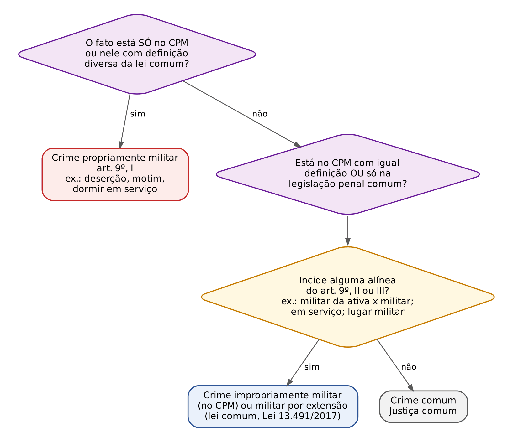
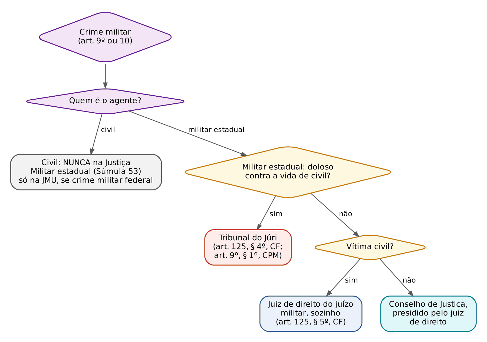
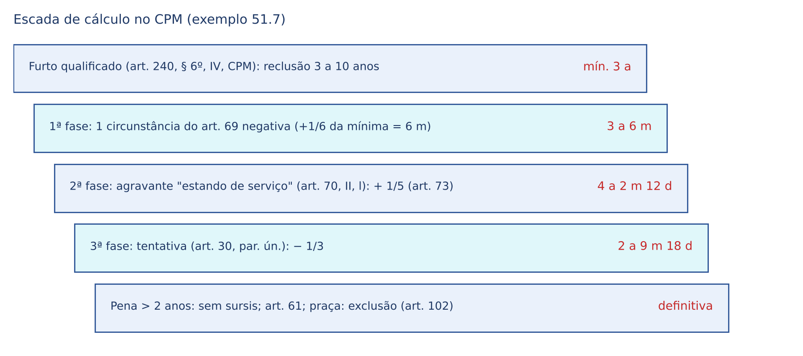
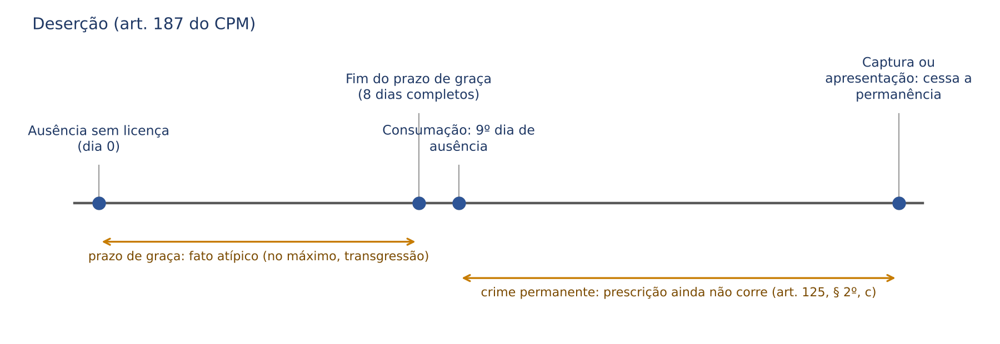

# CAPÍTULO 51 — DIREITO PENAL MILITAR

:::INCIDENCIA
Pontos: TJSC p. 80. Nível B. Lote: 0 questões (FGV 0, FCC 0); correlatas sobre reincidência e crime militar no Cap. 14 (Q3453260, Q3086954, Q3362379, Q2459915) e 3 itens de fixação próprios.
O que mais cai: conceito e classificação do crime militar após a Lei 13.491/2017, competência da Justiça Militar estadual, diferenças CP x CPM (art. 73: 1/5 a 1/3), deserção e as mudanças da Lei 14.688/2023.
:::

## 51.1 Conceito, autonomia e fontes

Direito Penal Militar é o ramo especial do Direito Penal que define os crimes militares e suas sanções, tendo como bens jurídicos centrais a hierarquia e a disciplina (arts. 42 e 142 da CF), o serviço militar e a regularidade das instituições militares. Tem código próprio (Código Penal Militar, Decreto-Lei 1.001/1969, CPM), processo próprio (CPPM, Decreto-Lei 1.002/1969) e Justiça própria (arts. 122 a 125 da CF).

A autonomia não é isolamento:

- O CPM tem parte geral completa (arts. 1º a 135), que se aplica ao crime militar no lugar da do CP. Mas o art. 12 do CP manda aplicar as regras gerais do CP às leis especiais que não dispuserem de modo diverso; o STJ usou esse artigo para suprir lacuna do CPM em favor do réu na prescrição retroativa (HC 1.037.843 — ver Cap. 22, 22.10.1).
- Não se combinam os dois códigos para extrair um terceiro regime, mais benéfico: o STF rejeitou esse "hibridismo" (HC 104.923). É a vedação de combinação de leis (Cap. 3) aplicada a dois sistemas que coexistem.

A Lei 14.688/2023 (de 20/9/2023, DOU de 21/9/2023, retificada em 27/9/2023; *vacatio* de 60 dias pelo art. 5º, vigente desde 20/11/2023) foi a grande reforma do CPM: revogou as penas de suspensão do exercício do posto e de reforma, afirmou a inimputabilidade de quem tem menos de 18 anos, positivou o sistema trifásico, separou concurso material, formal e continuado, reescreveu o *sursis*, admitiu a ação privada subsidiária, unificou o estupro e criou a figura do tráfico no art. 290, § 5º. Na prova, desconfie de alternativa que reproduz a redação antiga.

:::DICA Como estudar vindo do CP
Estude por DIFERENÇA. Nexo causal, dolo, culpa, crime impossível, legítima defesa, desistência voluntária e arrependimento eficaz funcionam como no CP. A banca cobra as peculiaridades, reunidas nas tabelas deste capítulo e no resumo final.
:::

## 51.2 Crime militar: conceito e classificação

### 51.2.1 Critério legal e o art. 9º

A CF não define crime militar: atribui à Justiça Militar "os crimes militares definidos em lei" (arts. 124 e 125, § 4º). Adota-se o critério *ratione legis*: crime militar é o que os arts. 9º (tempo de paz) e 10 (tempo de guerra) do CPM dizem que é. Os critérios doutrinários (*ratione materiae*, *personae*, *loci*, *temporis*) aparecem dentro das alíneas, como elementos escolhidos pelo legislador.

| Inciso do art. 9º | Hipótese | Agente |
|---|---|---|
| I | crimes do CPM definidos de modo diverso na lei comum, ou nela não previstos | qualquer pessoa, salvo disposição especial |
| II | crimes do CPM E da legislação penal comum, praticados: a) por militar da ativa contra militar na mesma situação; b) por militar da ativa, em lugar sujeito à administração militar, contra militar inativo ou civil; c) por militar em serviço ou em razão da função, em comissão militar ou formatura, ainda que fora do lugar militar; d) durante manobras ou exercício; e) contra o patrimônio sob administração militar ou a ordem administrativa militar | militar |
| III | crimes de militar da reserva, reformado ou CIVIL contra as instituições militares (patrimônio ou ordem administrativa militar; em lugar militar contra militar da ativa ou servidor em função; contra militar em formatura, prontidão, vigilância ou manobras; contra militar em função militar ou policiamento requisitado) | inativo ou civil |

A alínea que tornava militar o crime cometido com arma da corporação, mesmo fora de serviço, foi revogada pela Lei 9.299/1996; com ela perdeu base a Súmula 47 do STJ.

### 51.2.2 Classificação

| Classe | Conceito | Exemplos | Efeitos |
|---|---|---|---|
| Propriamente militar | só existe no CPM e viola dever exclusivamente militar (art. 9º, I) | deserção, abandono de posto, dormir em serviço, motim, violência contra superior | não gera reincidência no CP (art. 64, II — Cap. 14); prisão sem flagrante nem ordem judicial (art. 5º, LXI, CF) |
| Impropriamente militar | tem correspondente na lei comum e se torna militar por circunstância do art. 9º, II ou III | furto, roubo, peculato, lesão do CPM | GERA reincidência |
| Militar por extensão (expressão doutrinária) | previsto só na lei comum e praticado nas hipóteses do art. 9º, II (Lei 13.491/2017) | abuso de autoridade, crimes do CTB, do ECA, de licitações cometidos por militar em serviço | tipo e pena da lei comum; processo e juízo militares |

Para a doutrina processual (Jorge Alberto Romeiro), propriamente militar é o crime cuja ação penal só pode ser proposta contra militar. A divergência aparece na insubmissão (art. 183), praticada pelo convocado ainda civil. A banca costuma adotar o critério clássico: tipo exclusivo do CPM.

:::PEGADINHA "Crime militar não gera reincidência"
ERRADO como regra. Só o crime militar PRÓPRIO é excluído pelo art. 64, II, do CP; a corrupção passiva do CPM praticada por policial militar gera reincidência (Q2459915; no mesmo sentido Q3453260, Q3086954 e Q3362379 — Cap. 14, 14.2.2). Dentro da Justiça Militar a regra é outra: o art. 71 do CPM não exclui crime algum pela natureza; desconsidera só os ANISTIADOS e as condenações extintas há mais de 5 anos.
:::

### 51.2.3 A Lei 13.491/2017 e o "militar da ativa"

A Lei 13.491/2017 incluiu no art. 9º, II, "os previstos na legislação penal". Consequências cobradas:

- Aplicação imediata aos processos em curso, porque a lei amplia competência; mas o juiz militar aplica a lei material mais benéfica do tempo do fato (STJ, CC 161.898, Terceira Seção, j. 13/2/2019).
- Superação da Súmula 172 do STJ: o abuso de autoridade cometido por militar em serviço passou a ser crime militar por extensão (v. Cap. 44).
- O civil continua sujeito só ao inciso III (e, nos Estados, nem a ele — 51.3).

"Militar da ativa" é o que não está na reserva nem reformado, ainda que de folga. Mas a jurisprudência soma ao critério subjetivo um critério objetivo: o fato deve atingir bem jurídico ligado ao serviço ou à instituição. Crime de policial militar de folga, fora de lugar militar e sem relação com a função, é comum (STJ, HC 764.059, Quinta Turma, j. 7/2/2023); o PM de folga que foge atirando contra os colegas e a viatura enviados para atender a ocorrência que ele provocou ofende a hierarquia e a disciplina e comete crime militar (HC 550.998, Quinta Turma, j. 23/6/2020). No STF, entre militares, exige-se vínculo com a atividade militar (HC 135.019, Primeira Turma, j. 20/9/2016).

Outras regras de enquadramento:

- Vale a condição do agente na data do fato; o licenciamento posterior é irrelevante (STF, HC 132.847, Primeira Turma, j. 26/6/2018).
- O militar da reserva ou reformado empregado na administração militar equipara-se ao da ativa (art. 12). Militar é quem está incorporado ou matriculado em instituição militar (art. 22), o que abrange policiais e bombeiros militares (art. 42 da CF); a figura do "assemelhado" foi extinta.
- Superior é quem tem posto ou graduação mais alta, ou exerce autoridade em razão da função sobre outro de igual posto (art. 24). A condição de superior ou inferior deixa de ser elementar se o agente a desconhecia ou se a ação é repulsa a agressão (art. 47).

## 51.3 Competência da Justiça Militar

O tema vem antes das penas porque a sentença começa pela pergunta "este juízo pode julgar?".

| | Justiça Militar da União (JMU) | Justiça Militar estadual (JME) |
|---|---|---|
| Base | art. 124 da CF | art. 125, §§ 3º a 5º, da CF |
| Réus | militares das Forças Armadas e CIVIS | só MILITARES DOS ESTADOS; civil nunca (Súmula 53 do STJ) |
| Primeiro grau | Conselhos de Justiça e juiz federal da Justiça Militar | juiz de direito do juízo militar, sozinho, nos crimes militares contra civis e nas ações contra atos disciplinares; Conselho de Justiça, presidido pelo juiz de direito, nos demais (art. 125, § 5º) |
| Segundo grau | STM | Tribunal de Justiça Militar (MG, SP e RS) ou o Tribunal de Justiça (caso de SC) — art. 125, § 3º |
| Doloso contra a vida de civil | JMU nas missões do art. 9º, § 2º, do CPM (atribuições do Presidente da República ou do Ministro da Defesa, segurança de instituição ou missão militar, GLO, operação de paz e atividades da LC 97/1999, do Código Brasileiro de Aeronáutica, do CPPM e do Código Eleitoral) | TRIBUNAL DO JÚRI (art. 125, § 4º, CF; art. 9º, § 1º, CPM) |

Súmulas do STJ: 6 (acidente de trânsito com viatura da PM é da Justiça comum, salvo se autor e vítima forem policiais militares em atividade); 75 (promover ou facilitar fuga de preso de estabelecimento penal comum é crime comum, ainda que praticado por PM); 78 (o PM é julgado pela Justiça Militar do seu Estado, ainda que o crime ocorra em outra unidade da Federação); 90 (crime militar na JME e crime comum simultâneo na Justiça comum, sem reunião por conexão — art. 79, I, do CPP; art. 102, "a", do CPPM). Execução: Súmula 192 do STJ (Cap. 23).

:::JURIS STJ, CC 218.865, Terceira Seção, j. 8/4/2026 (Informativo 884)
O feminicídio praticado por militar, ainda que em dependência militar, é doloso contra a vida e vai ao Tribunal do Júri. Os crimes conexos que atingem bens castrenses (incêndio e dano em instalações militares, furto de arma de serviço, fraude processual) ficam na Justiça Militar da União. A separação obrigatória dos processos não viola o *ne bis in idem*.
:::

Também é da Justiça Militar (da União) o furto, por civil, de bem sob administração militar nas dependências desta (STJ, CC 145.721, Terceira Seção, j. 22/2/2018). Já o civil que usa farda da Polícia Militar comete a contravenção do art. 46 da LCP (Cap. 50), porque a JME não julga civil.

:::PROCESSO Juiz singular x Conselho na JME
Desde a EC 45/2004, o crime militar de PM contra civil (salvo o doloso contra a vida) é julgado monocraticamente pelo juiz de direito do juízo militar. Os crimes sem vítima civil (deserção, violência contra superior, peculato contra a corporação) vão ao Conselho de Justiça (Especial, para oficiais; Permanente, para praças), colegiado de juiz togado e oficiais. Em SC, o recurso vai ao TJSC; no RS, ao Tribunal de Justiça Militar.
:::

## 51.4 Aplicação da lei penal militar

| Tema | CPM | Diferença em relação ao CP |
|---|---|---|
| *Abolitio criminis* e lei mais benéfica | cessam a execução e os efeitos penais (art. 2º); a comparação é entre as leis "cada qual no conjunto de suas normas" (§ 2º) | o § 2º positiva a vedação da combinação de leis |
| Medidas de segurança | lei do tempo da sentença, prevalecendo a do tempo da execução, se diversa (art. 3º) | sem equivalente no CP |
| Tempo do crime | atividade (art. 5º) | igual |
| Lugar do crime | ubiquidade nos comissivos; nos omissivos, onde deveria realizar-se a ação omitida (art. 6º) | o CP adota ubiquidade para ambos |
| Espaço | aplica-se ao crime cometido no território OU FORA DELE, ainda que o agente tenha sido processado ou julgado no estrangeiro (art. 7º); a pena cumprida lá é computada ou atenua (art. 8º) | no CP, a extraterritorialidade é exceção, muitas vezes condicionada (Cap. 4) |
| Território por extensão | navios e aeronaves brasileiros sob comando militar ou militarmente utilizados, onde estiverem (art. 7º, § 1º) | |
| Tempo de guerra | da declaração ou reconhecimento do estado de guerra à ordem de cessação das hostilidades (art. 15); crimes de paz praticados em guerra: + 1/3 (art. 20) | |
| Infração disciplinar | fora do CPM (art. 19); sanção disciplinar e penal pelo mesmo fato coexistem | |

## 51.5 Teoria do crime no CPM: o que muda

| Instituto | CPM | CP |
|---|---|---|
| Pena da tentativa | redução de 1/3 a 2/3, mas, "no caso de excepcional gravidade", o juiz pode aplicar a pena do consumado (art. 30, parágrafo único) | 1/3 a 2/3, sem exceção |
| Arrependimento posterior | NÃO existe (art. 31 só prevê desistência e arrependimento eficaz); a reparação do dano é atenuante (art. 72, III, "b") | art. 16 |
| Erro de direito | se escusável, a pena PODE ser atenuada ou substituída; nunca isenta; e não vale para crime contra o dever militar (art. 35) | erro de proibição inevitável isenta (art. 21) |
| Erro de fato | isenta quem, por erro plenamente escusável, supõe inexistente circunstância constitutiva do crime ou supõe situação que tornaria a ação legítima; erro culposo responde por culpa; erro provocado, o terceiro (art. 36) | erro de tipo e descriminante putativa fática (art. 20) |
| Estado de necessidade | teoria DIFERENCIADORA: justificante se o mal causado é "consideravelmente inferior" ao evitado (art. 43); exculpante se o agente sacrifica direito alheio, ainda que superior, para salvar direito próprio ou de pessoa ligada por parentesco ou afeição, sendo inexigível outra conduta (art. 39) | teoria UNITÁRIA (art. 24) |
| Coação irresistível | exclui a culpabilidade (art. 38, "a"); nos crimes contra o dever militar, só a coação FÍSICA (art. 40) | coação moral (art. 22) |
| Obediência hierárquica | não é culpado quem cumpre ordem direta de superior em matéria de serviço; se a ordem tem por objeto ato MANIFESTAMENTE CRIMINOSO ou há excesso, o inferior também responde (art. 38, "b", e § 2º); se resistível a coação ou a ordem não era manifestamente ilegal, o juiz pode atenuar (art. 41) | ordem não manifestamente ilegal (art. 22) |
| Excesso | culposo responde por culpa; doloso pode ter a pena atenuada; o excesso por "escusável surpresa ou perturbação de ânimo" não é punível (arts. 45 e 46) | sem excesso exculpante expresso |

O art. 35 conserva a lógica do *error iuris nocet*, e parte da doutrina o reputa incompatível com o princípio da culpabilidade. O estado de necessidade é a diferença mais cobrada da parte geral.

Imputabilidade (arts. 48 a 50). Critério biopsicológico, como no CP; o semi-imputável tem redução facultativa de 1/3 a 2/3 ou substituição por internação ou tratamento (art. 113). Só a embriaguez completa por caso fortuito ou força maior isenta (art. 49); a voluntária, além de não excluir, AGRAVA a pena do militar (art. 70, II, "c"). Quem tem menos de 18 anos é inimputável (art. 50, Lei 14.688/2023): a redação antiga, que punia o agente de 16 anos com "suficiente desenvolvimento psíquico", não fora recepcionada pelo art. 228 da CF.

Concurso de agentes (arts. 53 e 54). Teoria monista e incomunicabilidade das circunstâncias pessoais não elementares, como no CP. Peculiaridades:

- A participação "de somenos importância" é ATENUANTE (art. 53, § 3º), não causa de diminuição: entra na segunda fase, com o quantum do art. 73 e sem romper o mínimo. No CP, é minorante de 1/6 a 1/3 (Cap. 11).
- Cabeças: nos crimes de autoria coletiva necessária, os que dirigem, provocam, instigam ou excitam a ação; havendo oficiais entre os agentes, eles são SEMPRE cabeças (art. 53, §§ 4º e 5º). No motim e na revolta, os cabeças têm pena aumentada de 1/3.
- Ajuste, instigação e auxílio não são puníveis se o crime não chega a ser tentado, salvo disposição em contrário (art. 54), como a conspiração (art. 152).

## 51.6 Penas em espécie

- Penas principais (art. 55): morte (só em guerra declarada, por fuzilamento — art. 5º, XLVII, "a", CF), reclusão, detenção, prisão e impedimento. NÃO há multa nem penas restritivas de direitos; prevalece no STF e no STM que a substituição do art. 44 do CP não se aplica aos crimes militares. Existem penas acessórias (51.9). A suspensão do exercício do posto e a reforma foram revogadas pela Lei 14.688/2023.
- Limites genéricos (art. 58): reclusão de 1 a 30 anos; detenção de 30 dias a 10 anos. Quando o tipo diz "reclusão, até seis anos" (furto simples), o mínimo é o genérico, de 1 ano.
- Prisão (art. 59): a reclusão ou detenção de até 2 anos aplicada a militar, não cabendo *sursis*, é convertida em prisão, cumprida pelo oficial em recinto militar e pela praça em estabelecimento penal militar.
- Mais de 2 anos (art. 61): penitenciária militar ou, na falta, estabelecimento civil, com regime e benefícios da legislação comum. O civil cumpre em estabelecimento civil (art. 62).
- Impedimento (art. 63): permanência no recinto da unidade; só cominada à insubmissão.

## 51.7 Aplicação da pena

### 51.7.1 Sistema trifásico e circunstâncias

O art. 77 (Lei 14.688/2023) positivou o sistema trifásico e a regra que no CP é jurisprudencial (Súmula 231 do STJ — Cap. 14): salvo nas causas de aumento e de diminuição, a pena não fica aquém do mínimo nem além do máximo cominados.

Primeira fase (art. 69): gravidade do crime e personalidade do réu, com intensidade do dolo ou grau da culpa, extensão do dano ou perigo, meios, modo de execução, motivos, circunstâncias de tempo e lugar, antecedentes e atitude após o crime. Os rótulos do CP se equivalem: não há nulidade em falar de "culpabilidade" e "consequências" (STF, HC 109.545, Segunda Turma, j. 16/12/2014). O CPM não fixa fração por circunstância; a prática repete os critérios de proporcionalidade do CP (Cap. 13).

Segunda fase (arts. 70 a 75):

- Agravantes que só incidem se o agente for militar: embriaguez não preordenada, "estando de serviço", emprego de arma ou material de serviço procurado para esse fim e crime em país estrangeiro (art. 70, parágrafo único).
- Atenuantes próprias: comportamento anterior meritório e ser maior de 70 anos AO TEMPO DO CRIME (art. 72, I e II).
- Confissão: só atenua se a autoria era IGNORADA ou IMPUTADA A OUTREM (art. 72, III, "d"); não se aplica o art. 65, III, "d", do CP (STF, HC 115.189, Primeira Turma, j. 3/5/2016).
- QUANTUM (art. 73): quando a lei manda agravar ou atenuar sem dizer quanto, o juiz fixa ENTRE 1/5 E 1/3. Vale também para os tipos que dizem apenas "a pena é agravada" (deserção de oficial, art. 187).
- Pluralidade: o juiz pode limitar-se a uma só agravação ou atenuação (art. 74). No concurso, preponderam motivos, personalidade e reincidência; se equivalentes, anulam-se (art. 75).

Terceira fase (art. 76): as majorantes e minorantes podem ultrapassar os limites do tipo, mas não os da espécie de pena (art. 58); havendo várias, o juiz pode aplicar só a que mais aumente ou diminua.

:::EXEMPLO Dosimetria completa no CPM
Soldado PM A, em serviço, tenta subtrair com o soldado B equipamento particular de um colega no alojamento (art. 240, § 6º, IV: reclusão de 3 a 10 anos), mas é surpreendido pelo sargento de dia com o bem nas mãos. O modo de execução (aproveitou o horário de instrução, com o alojamento vazio) é negativo.
1ª fase: 1/6 da pena mínima = 6 meses; pena-base de 3 anos e 6 meses (42 meses). Pelo critério de 1/8 do intervalo (84 meses), seriam 10 meses e 15 dias a mais: 3 anos, 10 meses e 15 dias.
2ª fase: agravante "estando de serviço" (art. 70, II, "l"; o serviço não integra o tipo). Pelo art. 73, no mínimo 1/5: 42 ÷ 5 = 8,4 meses = 8 meses e 12 dias. Pena intermediária: 4 anos, 2 meses e 12 dias (50,4 meses). No CP, pelo critério jurisprudencial de 1/6, seriam só 7 meses.
3ª fase: tentativa muito próxima da consumação: redução mínima de 1/3: 50,4 ÷ 3 = 16,8 meses = 1 ano, 4 meses e 24 dias. Pena definitiva: 2 anos, 9 meses e 18 dias de reclusão.
Consequências: pena superior a 2 anos: sem *sursis* e sem conversão em prisão; cumprimento pelo art. 61, com regime da lei comum (Cap. 17). Praça condenada a mais de 2 anos: perda da graduação (51.9). Sem multa e sem restritivas.
:::

### 51.7.2 Concurso de crimes

A Lei 14.688/2023 copiou o modelo do CP (Cap. 16): concurso material com soma das penas, executando-se primeiro a reclusão (art. 79); concurso formal com a mais grave aumentada de 1/6 até 1/2, ou cúmulo se houver desígnios autônomos (art. 79-A); crime continuado com aumento de 1/6 a 2/3 e, nos dolosos com violência ou grave ameaça contra vítimas diferentes, até o triplo (art. 80). Duas particularidades sobreviveram:

- Limite da pena unificada: 30 anos (reclusão) ou 15 anos (detenção) (art. 81).
- Redução facultativa da pena unificada de 1/6 a 1/4 no concurso formal ou no crime continuado (art. 81, § 1º), sem equivalente no CP.

:::SENTENCA Dosimetria de crime militar
Onde entra: na aplicação da pena. Cite o art. 69 do CPM (e não o art. 59 do CP), o art. 73 para o quantum e o art. 77 para as fases.
Redação-modelo: "Presente a agravante do art. 70, II, 'l', do CPM, sem fração legal específica, agravo a pena em 1/5 (art. 73), fixando-a em 4 (quatro) anos, 2 (dois) meses e 12 (doze) dias de reclusão. Não reconheço a confissão, pois a autoria não era ignorada nem imputada a outrem (art. 72, III, 'd')."
Erros que a banca pune: 1/6 nas agravantes; confissão nos moldes do CP; multa ou restritivas; omitir as penas acessórias que exigem menção expressa (art. 107).
:::

## 51.8 Suspensão condicional da pena e livramento condicional

| | CPM | CP (Caps. 17 e 24) |
|---|---|---|
| *Sursis*: pena e prova | até 2 anos; prova de 3 a 5 anos (reclusão) ou 2 a 4 (detenção); etário ou humanitário: pena até 4 anos, prova de 4 a 6 (art. 84) | até 2 anos; prova de 2 a 4 |
| *Sursis*: requisito | sem condenação irrecorrível anterior a pena privativa (salvo a do art. 71, § 1º) e circunstâncias favoráveis | não reincidente em crime doloso |
| *Sursis*: alcance e revogação | não se estende à pena acessória (art. 84, § 1º); revogação obrigatória por condenação por crime doloso ou não reparação do dano; facultativa por descumprimento ou punição disciplinar grave (art. 86) | |
| *Sursis*: VEDAÇÕES | crime em tempo de guerra; em paz: segurança nacional, aliciação e incitamento, violência contra superior ou militar de serviço, desrespeito a superior, insubordinação, deserção e os arts. 160, 161, 162, 235 e 291 (art. 88) | sem rol de crimes |
| Livramento: fração | METADE se primário; 2/3 se reincidente; pena de 2 anos ou mais; primário com menos de 21 ou mais de 70 anos: até 1/3 (art. 89) | mais de 1/3, 1/2 ou 2/3 conforme o caso |
| Livramento: casos especiais | 2/3 para segurança externa, revolta, motim, aliciação, incitamento e violência contra superior ou militar de serviço (art. 97); vedado em guerra (art. 96); revogado, não se concede de novo (art. 94) | |

As vedações do art. 88, II, "a", do CPM são constitucionais (STF, HC 119.567, Plenário, j. 22/5/2014). Para o STM, o *sursis* não é pena, e o período de prova não satisfaz o requisito do indulto (Súmula 16).

## 51.9 Penas acessórias e efeitos da condenação

Penas acessórias (art. 98): perda de posto e patente, indignidade e incompatibilidade com o oficialato, exclusão das Forças Armadas, perda da função pública, inabilitação para função pública (2 a 20 anos, art. 104), incapacidade para o poder familiar, tutela ou curatela (art. 105, facultativa e no melhor interesse da criança) e suspensão dos direitos políticos. Devem constar EXPRESSAMENTE da sentença, salvo a perda de posto e patente, a perda da função pública do art. 103, II, e a suspensão dos direitos políticos (art. 107). Sua execução é IMPRESCRITÍVEL (art. 130).

A perda do cargo militar tem regra constitucional própria:

| Quem | Regra | Fundamento |
|---|---|---|
| Oficial das Forças Armadas | só perde posto e patente se julgado indigno ou incompatível por tribunal militar permanente; o condenado a mais de 2 anos é submetido a esse julgamento | art. 142, § 3º, VI e VII, CF; art. 99 CPM |
| Praça das Forças Armadas | exclusão automática como pena acessória da condenação a mais de 2 anos | art. 102 CPM; STF, RE 447.859, Plenário, j. 21/5/2015 |
| Oficiais e praças dos Estados | o TJM, onde houver, ou o TJ decide sobre a perda do posto, da patente e da graduação | art. 125, § 4º, CF; Tema 1.200 do STF |

:::JURIS STF, Tema 1.200 (ARE 1.320.744, Plenário, j. 26/6/2023)
1) A perda da graduação da praça pode ser declarada como efeito secundário da sentença condenatória por crime militar ou comum (art. 102 do CPM e art. 92, I, "b", do CP). 2) O Tribunal de Justiça Militar, onde houver, ou o Tribunal de Justiça decide, em processo autônomo decorrente de representação do Ministério Público, sobre a perda do posto e da patente dos oficiais e da graduação das praças condenados, qualquer que seja a natureza do crime. Em SC, a representação é julgada pelo TJSC.
:::

O oficial condenado por traição, espionagem, cobardia ou pelos crimes dos arts. 161, 235, 240, 242 a 245, 251, 252, 303, 304, 311 e 312 fica sujeito à declaração de indignidade QUALQUER QUE SEJA A PENA (art. 100). Efeitos da condenação: certeza da obrigação de reparar e perda, em favor da Fazenda Pública, dos instrumentos ilícitos e do produto ou proveito do crime (art. 109; regime geral no Cap. 18). Reabilitação: 5 ANOS após a extinção ou o fim da execução, contra 2 no CP (art. 134).

## 51.10 Medidas de segurança

O CPM mantém sistema próprio (arts. 110 a 120), aplicado em diálogo com o Cap. 19: medidas pessoais detentivas (internação) e não detentivas (tratamento ambulatorial, interdição de licença para dirigir, exílio local e proibição de frequentar lugares) e medidas patrimoniais (interdição de estabelecimento ou associação e confisco). O militar só as sofre se inimputável, se condenado a mais de 2 anos ou se já perdeu posto, função ou foi excluído (art. 111). Internação e tratamento têm prazo mínimo de 1 a 3 anos, perícia anual e desinternação condicional por 1 ano (art. 112). O confisco de instrumentos e produtos ilícitos, ou de bens das Forças Armadas em poder de quem não está autorizado, cabe mesmo sem autoria apurada (art. 119).

## 51.11 Ação penal e institutos despenalizadores

Todo crime militar é de ação penal pública incondicionada, promovida pelo Ministério Público (art. 121); desde a Lei 14.688/2023, admite-se expressamente a ação privada subsidiária (parágrafo único; art. 5º, LIX, CF). Não há crimes de ação privada nem condicionados à representação: a ameaça e os crimes contra a honra do CPM são incondicionados. Nos crimes contra a segurança externa dos arts. 136 a 141 praticados por militar, a ação depende de REQUISIÇÃO do Comando da Força; no art. 141, sendo o agente civil sem coautor militar, do Ministério da Justiça (art. 122).

:::PEGADINHA Causas de extinção da punibilidade no CPM
Sem ação privada exclusiva, o art. 123 NÃO traz perdão do ofendido, decadência, renúncia nem perempção. Traz: morte, anistia, graça ou indulto, *abolitio criminis*, prescrição, ressarcimento do dano no peculato culposo (art. 303, § 4º) e perdão judicial nos casos legais (inclusive no homicídio e na lesão culposos, arts. 206, § 3º, e 210, § 3º). A retratação aparece pontualmente no falso testemunho (art. 346, § 2º).
:::

:::PROCESSO Lei 9.099, ANPP e insignificância
Lei 9.099/1995: "As disposições desta Lei não se aplicam no âmbito da Justiça Militar" (art. 90-A). Nada de transação, composição civil ou suspensão condicional do processo, qualquer que seja a pena; a regra é constitucional (STF, HC 119.567; STJ, AgRg no HC 916.829, Sexta Turma, j. 9/9/2024). Regra geral no Cap. 25 (25.2.3).
ANPP: a Súmula 18 do STM nega o acordo na JMU, mas a Segunda Turma do STF determinou que o MP avaliasse a proposta a militar denunciado por porte de droga (HC 232.254) e a Quinta Turma do STJ afirmou que o art. 28-A do CPP se aplica aos crimes militares (HC 993.294, Informativo 857). O art. 28-A não veda o crime militar (Cap. 25, 25.6).
Insignificância: em regra NÃO, quando atingidas hierarquia e disciplina (STF, HC 103.684, droga em quartel — Cap. 2; HC 137.741, Primeira Turma, j. 25/6/2019, violência contra inferior). Mas o CPM tem válvulas legais: no furto atenuado (art. 240, § 1º), no dano atenuado (art. 260) e na lesão levíssima (art. 209, § 6º), o juiz pode "considerar a infração como disciplinar".
:::

## 51.12 Prescrição

Os prazos da pretensão punitiva (art. 125) são os do art. 109 do CP (20, 16, 12, 8, 4 e 3 anos), acrescidos de 30 anos para a pena de morte. As peculiaridades:

- Termo inicial (art. 125, § 2º): nos crimes de FALSIDADE, a data em que o fato se tornou conhecido.
- Interrupção (§ 5º): instauração do processo (recebimento da denúncia), sentença ou acórdão condenatórios recorríveis, início ou continuação da execução e reincidência; estende-se a todos os autores e aos crimes conexos do mesmo processo (§ 6º). Concurso de crimes: cada um isoladamente (§ 3º).
- Retroativa: o § 1º só regula o período entre a última causa interruptiva e a sentença; a lacuna quanto ao período anterior foi suprida pelo STJ em favor do réu para fatos anteriores à Lei 12.234/2010 (Cap. 22). Não se admite prescrição virtual (STF, HC 125.777, Segunda Turma, j. 21/6/2016).
- Executória (art. 126): pela pena fixada, nos mesmos prazos.
- Redução pela METADE para o agente com menos de 21 ou MAIS DE 70 ANOS AO TEMPO DO CRIME (art. 129; no CP, maior de 70 na data da sentença).
- Insubmissão: a prescrição só corre a partir dos 30 anos do insubmisso (art. 131). Deserção: ainda que decorrido o prazo, a punibilidade só se extingue quando o desertor atinge 45 anos, ou 60 se oficial (art. 132), regra compatível com a CF (STF, HC 112.005, Primeira Turma, j. 10/2/2015).
- Declaração de ofício (art. 133); penas acessórias imprescritíveis (art. 130).

:::EXEMPLO Prescrição na deserção
Soldado de 20 anos deserta em 10/1/2026 e não é capturado. A pena máxima é de 2 anos: prazo de 4 anos (art. 125, VI), reduzido à metade por ter menos de 21 anos ao tempo do crime (art. 129): 2 anos. Mas a deserção é permanente: enquanto ele está ausente, o prazo não começa (art. 125, § 2º, "c"); para evitar a perseguição perpétua, a punibilidade se extingue quando completar 45 anos (art. 132). Se ele se apresentar em 10/1/2027, cessa a permanência e, segundo a leitura corrente, o prazo de 2 anos corre dessa data, interrompendo-se com a instauração do processo.
:::

## 51.13 Crimes militares em tempo de paz

Importam três coisas: os crimes propriamente militares clássicos, as DIFERENÇAS de pena e de estrutura dos crimes impropriamente militares em relação ao CP e as decisões do STF que corrigiram o CPM.

### 51.13.1 Contra a autoridade ou a disciplina militar e contra o serviço e o dever militar

| Crime | Conduta nuclear | Pena | Pontos de prova |
|---|---|---|---|
| Motim (art. 149) | reunirem-se militares agindo contra ordem, recusando obediência, assentindo em recusa conjunta ou ocupando quartel ou meio militar | reclusão 4 a 8 anos; cabeças + 1/3 | plurissubjetivo (2 ou mais); a recusa individual é insubordinação (art. 163) |
| Revolta (art. 149, parágrafo único) | motim com agentes ARMADOS | reclusão 8 a 20 anos; cabeças + 1/3 | sem *sursis* nem livramento antes de 2/3 (arts. 88 e 97) |
| Conspiração (art. 152) | concertarem-se militares para o motim | reclusão 3 a 5 anos | pune ato preparatório; isento quem denuncia o ajuste antes da execução |
| Violência contra superior (art. 157) | praticar violência contra superior | detenção 3 meses a 2 anos; reclusão 3 a 9 anos se comandante ou oficial-general; + 1/3 com arma; + 1/6 em serviço; morte: 12 a 30 | lesão: soma-se a pena do crime contra a pessoa (§ 3º); se o resultado não foi querido, a pena do crime contra a pessoa cai à metade (art. 159) |
| Desrespeito a superior (art. 160) | desrespeitar superior DIANTE DE OUTRO MILITAR | detenção 3 meses a 1 ano; + 1/2 se comandante, oficial-general ou oficial de serviço | sem testemunha militar, não há o crime (pode haver transgressão) |
| Recusa de obediência (art. 163) | recusar obedecer ordem do superior sobre matéria de serviço ou dever legal | detenção 1 a 2 anos | insubordinação; vedado o *sursis* |
| Publicação ou crítica indevida (art. 166) | publicar sem licença ato oficial ou criticar publicamente ato de superior, assunto disciplinar ou resolução do Governo | detenção 2 meses a 1 ano | compatível com a CF (STF, ADPF 475, Plenário, j. 13/4/2023); panfleto por melhores salários e jornada não é crime (HC 106.808, Segunda Turma, j. 9/4/2013) |
| Rigor excessivo, violência e ofensa aviltante contra inferior (arts. 174 a 176) | abuso do superior | detenção 1 a 2 anos (174 e 176); 3 meses a 2 anos (175) | sem insignificância: o bem é a disciplina (HC 137.741); a perda posterior da condição de militar não impede a ação |
| Insubmissão (art. 183) | o convocado não se apresenta à incorporação no prazo, ou se ausenta antes dela | IMPEDIMENTO 3 meses a 1 ano; − 1/3 por erro escusável ou apresentação voluntária em 1 ano | única pena de impedimento do CPM; prescrição a partir dos 30 anos (art. 131) |
| Deserção (art. 187) | ausentar-se sem licença da unidade ou do lugar em que deve permanecer, POR MAIS DE 8 DIAS | detenção 6 meses a 2 anos; agravada se oficial | ver abaixo |
| Abandono de posto (art. 195) | abandonar, sem ordem, o posto ou o serviço antes de terminá-lo | detenção 3 meses a 1 ano | crime de perigo abstrato; absorvido pela deserção no mesmo contexto (STF, RHC 125.112) |
| Descumprimento de missão (art. 196) | deixar de desempenhar a missão confiada | detenção 6 meses a 2 anos; + 1/3 oficial; + 1/2 comando; forma culposa | ausência injustificada a patrulha que deveria comandar (STJ, REsp 1.301.155, Info 540) |
| Embriaguez em serviço (art. 202) | embriagar-se em serviço ou apresentar-se embriagado para prestá-lo | detenção 6 meses a 2 anos | crime de mera conduta; prova por exame clínico ou outros meios idôneos |
| Dormir em serviço (art. 203) | dormir como oficial de quarto ou de ronda, sentinela, vigia, plantão às máquinas ou ao leme | detenção 3 meses a 1 ano | perigo abstrato; só nas funções de vigilância descritas |

Deserção: é o crime propriamente militar por excelência.

- Consumação no 9º dia de ausência; os 8 primeiros são o "prazo de graça". Na deserção especial (art. 190), a falta à partida do navio, aeronave ou unidade já consuma. Apresentação voluntária em até 8 dias após a consumação reduz a pena de metade; de 9 a 60 dias, de 1/3 (art. 189, I).
- Crime permanente: a prescrição só corre da cessação, com a idade-limite do art. 132 (51.12).
- Condição de procedibilidade e de prosseguibilidade: a praça sem estabilidade só pode ser denunciada depois de readquirir a condição de militar pela reinclusão; a estável, pela reversão ao serviço ativo (Súmula 12 do STM; procedimento nos arts. 451 a 457 do CPPM). Perdida a condição de militar no curso do processo (ex.: incapacidade em inspeção de saúde), o processo não prossegue (STF, HC 90.838, j. 14/10/2008).
- Alegações de ordem particular ou familiar sem prova não excluem a culpabilidade (Súmula 3 do STM). O favorecimento a desertor (art. 193) isenta ascendente, descendente, cônjuge ou irmão.

:::QUESTAO Questão de fixação elaborada para esta apostila (não é questão de banca)
Soldado PM com 3 anos de serviço deixa de comparecer ao quartel por 12 dias, sem licença, e se apresenta espontaneamente. Afirma-se: (I) houve deserção, consumada no 9º dia de ausência; (II) cabe suspensão condicional do processo, porque a pena mínima é de 6 meses; (III) a pena será reduzida de metade pela apresentação em até 8 dias após a consumação; (IV) condenado, poderá obter *sursis*. Corretas: I e III. II está errada pelo art. 90-A da Lei 9.099/1995; IV, pelo art. 88, II, "a", do CPM (vedação do *sursis* na deserção, constitucional segundo o STF).
:::

### 51.13.2 Contra a pessoa, o patrimônio e a incolumidade pública: o que difere do CP

| Crime | CPM | CP | Observação |
|---|---|---|---|
| Homicídio simples (art. 205) | reclusão 6 a 20 | 6 a 20 | qualificadora própria: "prevalecendo-se o agente da situação de serviço" (art. 205, § 2º, VI); privilégio: redução de 1/6 a 1/3 |
| Genocídio (art. 208) | reclusão 15 a 30 (matar); 4 a 15 (casos assimilados) | Lei 2.889/1956 (Cap. 40) | é crime militar quando presente hipótese do art. 9º; em tempo de guerra, arts. 401 e 402 |
| Ameaça (art. 223) | detenção até 6 meses; + 1/3 se motivada por serviço militar | condicionada à representação | no CPM, incondicionada |
| Estupro (art. 232) | reclusão 6 a 10; qualificado 8 a 12 e 12 a 30 | art. 213, mesmas penas | unificado pela Lei 14.688/2023 |
| Estupro de vulnerável (art. 232, § 3º) | o STF declarou inconstitucional o regime mais brando do CPM e não recepcionada a presunção RELATIVA do art. 236, I a III; aplica-se toda a disciplina do art. 217-A do CP (ADI 7.555, Plenário, j. 15/9/2025, efeitos a partir da ata) | art. 217-A | proibição de proteção deficiente |
| Ato de libidinagem (art. 235) | militar que pratica ou permite ato libidinoso em lugar sujeito à administração militar ou no exercício de função militar | sem equivalente | a redação antiga ("pederastia", "homossexual ou não") foi suprimida; oficial: indignidade (art. 100) |
| Furto simples (art. 240) | reclusão ATÉ 6 anos (mínimo genérico de 1) | 1 a 6 anos (Lei 15.397/2026) | furto atenuado: primário e coisa de até 1/10 do salário mínimo: detenção, redução de 1/3 a 2/3 ou infração disciplinar (§ 1º) |
| Furto noturno (art. 240, § 4º) | QUALIFICADORA: reclusão 2 a 8 | causa de aumento de 1/2 (Lei 15.397/2026) | outra diferença estrutural |
| Furto qualificado (art. 240, §§ 6º e 6º-A) | reclusão 3 a 10; inclui subtração de arma, munição ou material de uso restrito militar | 2 a 8 | |
| Furto de uso (art. 241) | É CRIME: detenção até 6 meses; + 1/2 se veículo, embarcação, aeronave ou arma | atípico | pegadinha clássica |
| Roubo (art. 242) | reclusão 4 a 15; + 1/3 a 1/2 (arma, concurso, vítima em serviço militar, veículo levado a outro Estado, restrição da liberdade, material militar); lesão grave dolosa e morte preterdolosa são MAJORANTES | 6 a 10 (Lei 15.397/2026) | para fatos anteriores a 4/5/2026, vale a pena antiga do CP (4 a 10) |
| Latrocínio (art. 242, § 3º) | morte DOLOSA: reclusão 15 a 30; vale a regra do CP de que a consumação independe da subtração | 24 a 30 (Lei 15.397/2026) | morte culposa no roubo: majorante do § 2º, VI |
| Estelionato (art. 251) | reclusão 2 a 7 | 1 a 5 | formas equiparadas só são militares no art. 9º, II, "a" e "e" (§ 2º) |
| Drogas (art. 290) | receber, ter em depósito, trazer consigo, "ainda que para uso próprio", substância entorpecente em lugar sujeito à administração militar: reclusão até 5 anos; tráfico: 5 a 15 (§ 5º, Lei 14.688/2023) | Lei 11.343/2006 (Cap. 37) | a Lei de Drogas não se aplica na JMU (Súmula 14 do STM); sem insignificância (HC 103.684 — Cap. 2); o porte para uso em quartel é crime, não medida do art. 28 |

:::JURIS STJ, AREsp 3.046.912, Quinta Turma, j. 7/4/2026 (Informativo 886)
Sem exame de corpo de delito e sem justificativa para sua falta, não se reconhece a materialidade da lesão corporal exigida para o concurso de penas do art. 157, § 3º, do CPM (violência contra superior com lesão). A regra do art. 158 do CPP (indispensabilidade do exame nos crimes que deixam vestígios) vale também no crime militar.
:::

### 51.13.3 Contra a administração militar e a administração da Justiça Militar

| Crime | CPM | CP (Cap. 35) |
|---|---|---|
| Desacato a superior (art. 298) | reclusão até 4 anos; agravada se oficial-general ou comandante | — |
| Desacato a militar (art. 299) e a servidor em lugar militar (art. 300) | detenção 6 meses a 2 anos | art. 331: 6 meses a 2 anos, ou multa |
| Desobediência (art. 301) | ordem legal de autoridade militar: detenção até 6 meses | 15 dias a 6 meses e multa |
| Peculato (art. 303) | reclusão 3 a 15; + 1/3 se o objeto vale mais de 20 salários mínimos; peculato-furto (§ 2º) | 2 a 12 |
| Concussão (art. 305) | reclusão 2 a 8 | 2 a 12 (Lei 13.964/2019) |
| Corrupção passiva (art. 308) | reclusão 2 a 12 (Lei 14.688/2023); + 1/3 se infringe o dever; privilegiada: detenção 3 meses a 1 ano | 2 a 12 |
| Corrupção ativa (art. 309) | reclusão até 8 (mínimo genérico de 1); verbos: dar, oferecer ou prometer | 2 a 12; verbos: oferecer ou prometer |
| Prevaricação (art. 319) | detenção 6 meses a 2 anos | 3 meses a 1 ano e multa |

Na concussão praticada por militar em serviço, incide a agravante "estando de serviço" (art. 70, II, "l"), porque o serviço não é elementar do tipo.

Contra a administração da Justiça Militar (arts. 340 a 354), as figuras espelham o CP (Cap. 36): desacato a autoridade judiciária militar (reclusão até 4 anos), denunciação caluniosa (2 a 8 anos), falso testemunho (2 a 6 anos, impunível com retratação antes da sentença), favorecimento pessoal (isentos os parentes próximos) e desobediência a decisão da Justiça Militar.

:::QUESTAO Questão de fixação elaborada para esta apostila (não é questão de banca)
Dois policiais militares de SC, em serviço, abordam um civil. Um deles, sem motivo, desfere-lhe golpes, causando lesão corporal leve; o outro, depois, mata outro civil com dolo durante a mesma ocorrência. Competências: a lesão leve é crime militar (art. 9º, II, "c", do CPM) julgado pelo juiz de direito do juízo militar, sozinho (art. 125, § 5º, da CF), sem transação nem *sursis* processual (art. 90-A); o homicídio doloso de civil é do Tribunal do Júri (art. 125, § 4º, da CF; art. 9º, § 1º, do CPM). Se o crime fosse cometido por militares das Forças Armadas em operação de GLO, o homicídio seria da JMU (art. 9º, § 2º, III).
:::

## 51.14 Crimes militares em tempo de guerra (visão geral)

O Livro II da Parte Especial (arts. 355 a 408) só incide em tempo de guerra (art. 15) e é onde está a pena de morte, sempre como "grau máximo", com reclusão como "grau mínimo" (ex.: traição, art. 355: morte ou reclusão de 20 anos). Pela regra do art. 81, § 2º, a morte equivale a 30 anos de reclusão para graduar a pena entre os dois graus. Os crimes de tempo de paz praticados em guerra têm pena aumentada de 1/3 (art. 20), e não cabem *sursis* nem livramento condicional (arts. 88, I, e 96).

| Título | Destaques |
|---|---|
| Favorecimento ao inimigo (arts. 355 a 397) | traição (nacional que toma armas contra o Brasil), traição imprópria (estrangeiro), cobardia, espionagem, rendição, deserção e abandono de posto em presença do inimigo; "presença do inimigo" = zona de efetivas operações, iminência ou situação de hostilidade (art. 25); deserção comum em guerra: pena + 1/2 e prazos de consumação pela metade (art. 391) |
| Hostilidade e ordem arbitrária (arts. 398 e 399) | prolongar hostilidades após saber da paz ou do armistício; ordenar contribuição de guerra sem autorização |
| Pessoa e patrimônio (arts. 400 a 406) | homicídio qualificado em presença do inimigo e genocídio em zona ocupada (morte no grau máximo); furto em zona de operações (dobro da pena de paz); saque (sem correspondente em paz) |
| Rapto e violência carnal (arts. 407 e 408) | redação anacrônica: "mulher honesta" (art. 407) e remissão ao art. 233, revogado (art. 408) |

:::QUESTAO Questão de fixação elaborada para esta apostila (não é questão de banca)
Cabo, em serviço, comete crime e alega (a) que supunha lícita a conduta por erro escusável de interpretação de regulamento e (b) que agiu para salvar o irmão de perigo atual, sacrificando bem de valor superior. Respostas: (a) o erro de direito escusável não isenta; só permite atenuar ou substituir a pena, e nem isso no crime contra o dever militar (art. 35); (b) o estado de necessidade exculpante (art. 39) exclui a culpabilidade, ainda que o bem sacrificado seja superior, se inexigível conduta diversa; se exigível, cabe atenuação (art. 41). No CP, o caso (b) daria, no máximo, redução de pena (art. 24, § 2º).
:::

## 51.15 Resumo para revisão pré-prova

| Instituto | Regra | Exceções e detalhes | Fundamento |
|---|---|---|---|
| Crime militar | o que os arts. 9º e 10 do CPM definem | próprio, impróprio e por extensão (lei comum + art. 9º, II) | art. 124 CF; Lei 13.491/2017 |
| Militar da ativa de folga | crime militar só se atingido bem ligado ao serviço ou à instituição | fora de lugar militar e sem relação com a função: crime comum | STJ, HC 764.059 e HC 550.998 |
| Justiça Militar estadual | só militares dos Estados; civil nunca | doloso contra a vida de civil: júri; contra civil: juiz singular; demais: Conselho | art. 125, §§ 4º e 5º, CF; Súmulas 53, 78 e 90 STJ |
| JMU | julga também civis; doloso contra a vida de civil nas missões do art. 9º, § 2º | feminicídio por militar: júri | CC 218.865 |
| Espaço | extraterritorialidade incondicionada | cômputo da pena cumprida no estrangeiro | arts. 7º e 8º CPM |
| Tentativa | 1/3 a 2/3 | excepcional gravidade: pena do consumado | art. 30 CPM |
| Erro de direito | atenua ou substitui; nunca isenta | inaplicável a crime contra o dever militar | art. 35 CPM |
| Estado de necessidade | justificante (art. 43) e exculpante (art. 39) | CP: teoria unitária | |
| Coação e obediência | coação física só, no dever militar; ordem direta em serviço exclui a culpabilidade | ato manifestamente criminoso: o inferior também responde | arts. 38 e 40 CPM |
| Penas | morte (guerra), reclusão, detenção, prisão, impedimento | sem multa e sem restritivas; até 2 anos a militar: prisão | arts. 55, 58, 59 e 61 CPM |
| Dosimetria | trifásica; agravantes e atenuantes de 1/5 a 1/3 | confissão só com autoria ignorada ou imputada a outrem | arts. 69, 73, 77 CPM; HC 115.189 |
| Concurso | como no CP | limite de 30/15 anos; redução facultativa de 1/6 a 1/4 | arts. 79 a 81 CPM |
| *Sursis* | pena até 2 anos; prova 3 a 5 (reclusão) ou 2 a 4 (detenção) | vedado na guerra, deserção, insubordinação, violência contra superior | arts. 84 e 88 CPM |
| Livramento | 1/2 (primário) ou 2/3 (reincidente) | 2/3 nos crimes do art. 97; vedado na guerra | arts. 89, 96 e 97 CPM |
| Perda do cargo | oficial federal: tribunal militar; praça federal: acessória automática | militares estaduais: TJM ou TJ | art. 142, § 3º, e art. 125, § 4º, CF; Tema 1.200 |
| Ação penal | pública incondicionada; privada subsidiária | requisição nos arts. 136 a 141 | arts. 121 e 122 CPM |
| Despenalizadores | Lei 9.099 não se aplica | ANPP admitido por STF e STJ, contra a Súmula 18 do STM | art. 90-A Lei 9.099 |
| Insignificância | em regra não | infração disciplinar nos arts. 209, § 6º, 240, § 1º, e 260 | HC 103.684; HC 137.741 |
| Prescrição | prazos do CP + 30 anos (morte) | falsidade: do conhecimento; maior de 70 ao tempo do crime; insubmissão: 30 anos; deserção: 45/60 anos | arts. 125 a 133 CPM |
| Deserção | ausência por mais de 8 dias; permanente | status de militar como condição de procedibilidade | art. 187 CPM; Súmula 12 STM |
| Patrimônio | furto até 6 anos; noturno é qualificadora; furto de uso é crime; roubo 4 a 15; latrocínio 15 a 30 | furto atenuado: infração disciplinar | arts. 240 a 242 CPM |
| Drogas | art. 290, inclusive uso próprio; tráfico 5 a 15 | Lei 11.343 não se aplica na JMU | Súmula 14 STM |
| Estupro de vulnerável | regime integral do art. 217-A do CP | presunção relativa do art. 236 não recepcionada | ADI 7.555 |
| Tempo de guerra | morte no grau máximo (= 30 anos para graduar) | crimes de paz em guerra: + 1/3 | arts. 20, 81 e 355 a 408 CPM |

## 51.16 Artigos de lei incidentes

- Constituição Federal: art. 5º, XLVII, LIX e LXI; arts. 42, 122 a 125 e 142, § 3º, VI e VII.
- Código Penal Militar (Decreto-Lei 1.001/1969, com a Lei 14.688/2023): arts. 1º a 135 (parte geral); 136 a 354 (tempo de paz, com destaque para 149, 152, 157 a 166, 174 a 176, 183, 187 a 196, 202, 203, 205, 208, 209, 223, 232, 235, 236, 240 a 242, 251, 290, 298 a 309, 319 e 340 a 354); 355 a 408 (tempo de guerra).
- CPPM: arts. 102, 451 a 457 e 617, II, "a". CP: arts. 12 e 64, II. CPP: arts. 28-A e 79, I. Lei 9.099/1995: art. 90-A.
- Leis 9.299/1996, 13.491/2017 e 14.688/2023.

## 51.17 Julgados, temas e súmulas do capítulo

- STF, Tema 1.200 (ARE 1.320.744): perda do posto, da patente e da graduação de militares estaduais pelo TJM ou TJ.
- STF, RE 447.859: exclusão da praça é acessória automática; oficial exige julgamento próprio.
- STF, ADI 7.555: estupro de vulnerável por militar segue integralmente o art. 217-A do CP.
- STF, ADPF 475: constitucionalidade do art. 166 do CPM.
- STF, HC 119.567: vedações de *sursis* do art. 88 constitucionais; tratamento processual mais rigoroso.
- STF, HC 115.189: confissão no CPM exige autoria ignorada ou imputada a outrem.
- STF, HC 109.545: vetores do art. 69 do CPM equivalem a culpabilidade e consequências.
- STF, HC 104.923: vedada a combinação dos regimes comum e militar.
- STF, HC 112.005: idade-limite da prescrição na deserção é constitucional.
- STF, HC 90.838: perda do status de militar impede o prosseguimento na deserção.
- STF, RHC 125.112: deserção absorve o abandono de posto no mesmo contexto.
- STF, HC 137.741: sem insignificância na violência contra inferior.
- STF, HC 106.808: panfleto reivindicatório não é incitamento nem crítica indevida.
- STF, HC 125.777: sem prescrição virtual no crime militar.
- STF, HC 132.847 e HC 135.019: data do fato define a condição de militar; entre militares, exige-se vínculo com a atividade.
- STF, HC 232.254, e STJ, HC 993.294 (Informativo 857): ANPP na Justiça Militar.
- STJ, CC 218.865 (Informativo 884): feminicídio por militar vai ao júri; conexos castrenses na JMU.
- STJ, AREsp 3.046.912 (Informativo 886): sem corpo de delito, não se reconhece a lesão do art. 157, § 3º, do CPM.
- STJ, CC 161.898: aplicação imediata da Lei 13.491/2017 com a lei material mais benéfica.
- STJ, HC 764.059 e HC 550.998: critério subjetivo somado ao objetivo para o militar de folga.
- STJ, CC 145.721: furto por civil de bem sob administração militar na Justiça Militar.
- STJ, AgRg no HC 916.829: art. 90-A da Lei 9.099/1995 constitucional.
- STJ, REsp 1.301.155: falta à patrulha que deveria comandar é descumprimento de missão.
- STJ, Súmulas 6, 53, 75, 78 e 90; Súmula 47 (sem base desde a Lei 9.299/1996).
- STM, Súmulas 3, 8, 12, 14, 16 e 18.

Remissões: Súmula 172 do STJ, superada (Cap. 44); HC 1.037.843 (Cap. 22); HC 103.684 (Cap. 2); Súmula 192 do STJ (Cap. 23); Súmula 231 do STJ (Cap. 14).

:::NOTA Notas de verificação
Conferido: CPM na Legislação 360 (Drive, atualizada até a Lei 14.688/2023; o texto extraído termina no art. 236) e, para os arts. 237 a 410, na página compilada do Planalto (lida em 15/10/2026, sem alteração posterior à Lei 14.688/2023). Precedentes das notas da Legislação 360 (com transcrições do Dizer o Direito) e do Radar (Informativos 884 e 886 do STJ).
Conferida no Planalto em 15/10/2026: data de vigência da Lei 14.688/2023 (art. 5º: 60 dias da publicação de 21/9/2023, o que dá 20/11/2023 pela contagem do art. 8º, § 1º, da LC 95/1998). Não conferido na fonte primária: data e órgão do HC 232.254 do STF (fonte secundária: Segunda Turma, 2024) e data do HC 993.294 do STJ (Informativo 857, 2025); teor da Súmula 18 do STM; data do RHC 125.112 (a fonte indica 10/2/2014 com Informativo 774, incompatíveis); data do HC 104.923; superação da Súmula 172 do STJ (doutrina, sem cancelamento formal localizado); inaplicabilidade do art. 44 do CP e uso das frações de 1/6 ou 1/8 na pena-base militar (orientação prevalente, sem precedente numerado); a leitura de que, reincluído o desertor, o prazo do art. 125 corre da apresentação (doutrina, sem precedente conferido).
Questões: nenhuma atribuída ao capítulo. O Mapeamento FGV registra três questões com tema militar (TJSC 2024, Q54; TJCE 2025, Q47; TRF1 2025, Q28), sem enunciado completo nem gabarito no banco; não foram usadas. Incluídos 3 itens de fixação próprios. Sinopse TJSC 2026 não consultada.
:::
