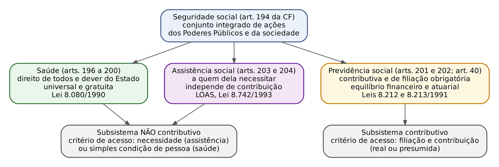
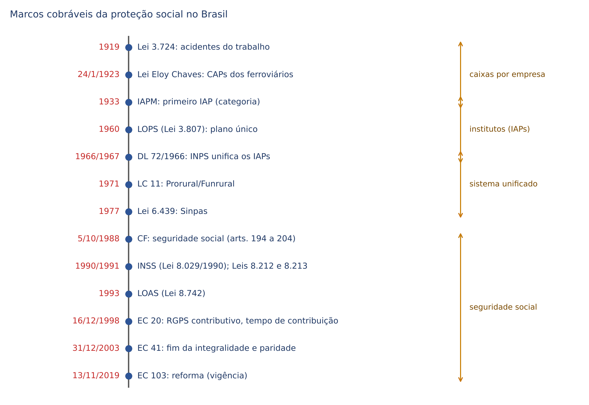
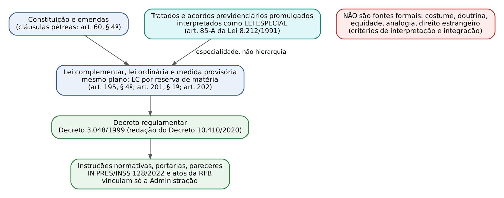
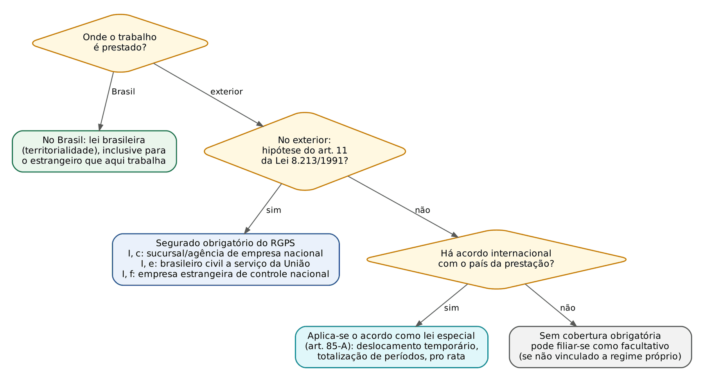
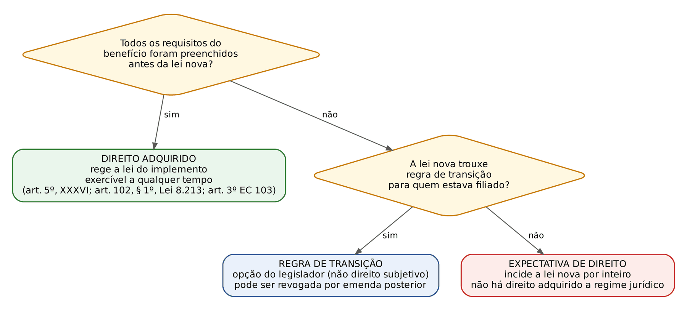

# CAPÍTULO 01 — SEGURIDADE SOCIAL: CONCEITO, PRINCÍPIOS, ORGANIZAÇÃO, FONTES E APLICAÇÃO DAS NORMAS

:::INCIDENCIA
TRF5 p. 1 (seguridade, saúde, previdência e assistência; princípios, organização e fontes; interpretação, aplicação, integração e eficácia; direito intertemporal; direito adquirido, expectativa e confiança). Nível A.
Lote: 31 questões (FGV 28, FCC 3). Cai, acima de tudo, a LETRA do art. 194, parágrafo único, da CF comparada com as listas da Lei 8.212/1991, da Lei 8.213/1991 e do Decreto 3.048/1999, com troca de uma palavra (gestão "tripartite", "centralizada", "redutibilidade", "unicidade da base").
Em seguida: composição do CNPS, art. 201 da CF (eventos cobertos), seletividade (salário-família e auxílio-reclusão), equilíbrio financeiro e atuarial (TRF5 2025) e marcos históricos (Eloy Chaves, IAPs, LOPS, INPS, INSS).
:::

| Subtema | FGV | FCC | Padrão de cobrança |
|---|---|---|---|
| Objetivos do art. 194, parágrafo único, e listas legais (Lei 8.212, art. 1º; Lei 8.213, art. 2º; Decreto 3.048, arts. 1º a 4º) | 10 | 1 | Identificar o princípio verdadeiro entre quatro adulterados; diferenciar diretriz da saúde, da assistência e da previdência |
| Conceito, as três áreas e art. 201 da CF | 7 | 1 | Contributividade só na previdência; eventos cobertos (maternidade, e não "natalidade"; "dependentes" dos segurados de baixa renda); piso do salário mínimo |
| Gestão quadripartite e CNPS | 4 | 0 | 6 do Governo + 3 aposentados + 3 trabalhadores + 3 empregadores = 15; mandato de 2 anos; reunião mensal |
| Solidariedade, financiamento, modelo de repartição | 3 | 0 | Art. 195, caput; nova fonte só por lei complementar; União cobre insuficiências |
| Seletividade e distributividade | 2 | 0 | Salário-família e auxílio-reclusão (baixa renda) |
| Evolução histórica | 2 | 1 | Fases; LOPS x INPS; INSS = INPS + IAPAS; gabarito discutível da FCC |

## 01.1 Conceito, natureza e estrutura da seguridade social

### 01.1.1 Conceito constitucional

:::LEI CF, art. 194, caput (e Lei 8.212/1991, art. 1º, caput; Decreto 3.048/1999, art. 1º)
Art. 194. A seguridade social compreende um conjunto integrado de ações de iniciativa dos Poderes Públicos e da sociedade, destinadas a assegurar os direitos relativos à saúde, à previdência e à assistência social.
:::

Três elementos do conceito são explorados pelas bancas. Primeiro, é um conjunto INTEGRADO de ações: as três áreas compartilham orçamento próprio (orçamento da seguridade social, art. 165, § 5º, III, e art. 195, § 2º, da CF; ver Cap. 2), princípios comuns e uma lei orgânica comum (a Lei 8.212/1991, que no art. 5º chama o conjunto de Sistema Nacional de Seguridade Social). Segundo, a iniciativa é dos Poderes Públicos E DA SOCIEDADE: a participação privada aparece na saúde complementar (art. 199), nas entidades beneficentes de assistência (art. 204, I) e na previdência complementar (art. 202). Terceiro, o rol é FECHADO em três áreas: saúde, previdência e assistência. Educação, moradia, lazer e segurança são direitos sociais (art. 6º), mas NÃO integram a seguridade; é a pegadinha recorrente da FGV (incluir "educação" entre as áreas).

Quanto à natureza, a seguridade é direito fundamental social (art. 6º) de feição prestacional, situado no Título VIII (Da Ordem Social), cuja base é o primado do trabalho e cujo objetivo é o bem-estar e a justiça sociais (art. 193). O Direito da Seguridade Social é ramo do direito público: a filiação é compulsória, os beneficiários são enumerados em lei, o direito ao benefício é irrenunciável e não há espaço para autonomia da vontade.

O ramo cuida de DUAS relações jurídicas distintas, e essa separação resolve muitas questões de aplicação da norma:

| | Relação de custeio | Relação de proteção (prestacional) |
|---|---|---|
| Partes | Contribuinte x ente arrecadador (hoje a Receita Federal do Brasil) | Beneficiário (segurado ou dependente) x ente concedente (INSS) |
| Natureza | Tributária (contribuições sociais são tributos) | Estatutária (decorre da lei, não de contrato) |
| Regime | CTN e Sistema Tributário Nacional, com as adaptações do art. 195 (anterioridade nonagesimal, competência residual por lei complementar) | Leis 8.213/1991 e 8.742/1993, *tempus regit actum* quanto ao fato gerador do benefício |
| Onde se estuda | Caps. 2 a 5; Apostila de Direito Tributário, Cap. 3 | Caps. 7 a 22 |

:::DICA
Filiação não depende de pagamento. A filiação ao RGPS decorre automaticamente do exercício de atividade remunerada (segurado obrigatório); quem trabalha e nada recolhe é segurado inadimplente, e o empregado que se acidenta no primeiro dia de trabalho tem cobertura sem nenhuma contribuição vertida. O desenvolvimento está no Cap. 7.
:::

### 01.1.2 Seguro social e seguridade; risco, contingência e necessidade

Seguro social é a técnica de proteção mediante contribuição do próprio protegido (modelo de Bismarck, Alemanha, 1883 a 1889: seguros de doença, acidente, invalidez e velhice, custeados por trabalhadores e empregadores). Seguridade social é noção mais larga, que alcança também quem nunca contribuiu (modelo de Beveridge, Reino Unido, relatório de 1942, implantação no pós-guerra: proteção universal financiada por toda a sociedade). O Brasil de 1988 adotou solução MISTA: a previdência é bismarckiana (contributiva), a saúde e a assistência são beveridgianas (universais e financiadas por tributos em geral). A classificação dos modelos e a repartição x capitalização ficam no Cap. 6.

A doutrina encadeia três noções: risco social (evento futuro e incerto que retira ou reduz a capacidade de subsistência: doença, acidente, idade avançada, maternidade, desemprego involuntário, reclusão, morte); contingência (o risco já materializado, que faz nascer a pretensão); e necessidade social (a carência produzida pela contingência, que o sistema se propõe a cobrir). A Convenção 102 da OIT (1952) arrola nove contingências clássicas: assistência médica, auxílio-doença, desemprego, velhice, acidente do trabalho e doença profissional, prestações familiares, maternidade, invalidez e morte do provedor.

As prestações da seguridade dividem-se em benefícios (prestações pecuniárias, obrigação de pagar) e serviços (prestações de fazer: serviço social, habilitação e reabilitação profissional; ver Cap. 15).

### 01.1.3 As três áreas

| Critério | Saúde | Previdência social | Assistência social |
|---|---|---|---|
| Sede constitucional | Arts. 196 a 200 | Art. 201 (RGPS), art. 40 (RPPS), art. 202 (complementar) | Arts. 203 e 204 |
| Destinatário | Todos ("direito de todos e dever do Estado") | Segurados e seus dependentes | "A quem dela necessitar" |
| Contribuição do beneficiário | Não | SIM (caráter contributivo, filiação obrigatória) | Não ("independentemente de contribuição à seguridade social") |
| Critério de acesso | Ser pessoa | Qualidade de segurado ou dependente, carência, evento | Necessidade (vulnerabilidade) |
| Diretrizes próprias | Descentralização com direção única em cada esfera; atendimento integral com prioridade para as atividades preventivas; participação da comunidade (art. 198) | Contributivo; filiação obrigatória; equilíbrio financeiro e atuarial (art. 201, caput) | Descentralização político-administrativa; participação da população por organizações representativas (art. 204) |
| Lei de regência | Lei 8.080/1990 (e Lei 8.142/1990) | Lei 8.212/1991 (custeio) e Lei 8.213/1991 (benefícios); Decreto 3.048/1999 | Lei 8.742/1993 (LOAS) |
| Gestor federal | Ministério da Saúde (SUS) | INSS (RGPS) | Ministério responsável pela assistência; o INSS operacionaliza o BPC |
| Prestações típicas | Ações e serviços de promoção, proteção e recuperação; medicamentos | Aposentadorias, auxílios, pensão, salário-maternidade, salário-família, reabilitação | BPC (art. 203, V), serviços socioassistenciais, programas |

:::LEI Lei 8.212/1991, arts. 2º a 4º (a FCC e a FGV cobram as diretrizes por área)
Art. 2º, parágrafo único. As atividades de saúde são de relevância pública e sua organização obedecerá aos seguintes princípios e diretrizes: a) acesso universal e igualitário; b) provimento das ações e serviços através de rede regionalizada e hierarquizada, integrados em sistema único; c) descentralização, com direção única em cada esfera de governo; d) atendimento integral, com prioridade para as atividades preventivas; e) participação da comunidade na gestão, fiscalização e acompanhamento das ações e serviços de saúde; f) participação da iniciativa privada na assistência à saúde, obedecidos os preceitos constitucionais.
Art. 3º A Previdência Social tem por fim assegurar aos seus beneficiários meios indispensáveis de manutenção, por motivo de incapacidade, idade avançada, tempo de serviço, desemprego involuntário, encargos de família e reclusão ou morte daqueles de quem dependiam economicamente.
Parágrafo único. A organização da Previdência Social obedecerá aos seguintes princípios e diretrizes: a) universalidade de participação nos planos previdenciários, mediante contribuição; b) valor da renda mensal dos benefícios, substitutos do salário-de-contribuição ou do rendimento do trabalho do segurado, não inferior ao do salário mínimo; c) cálculo dos benefícios considerando-se os salários-de-contribuição, corrigidos monetariamente; d) preservação do valor real dos benefícios; e) previdência complementar facultativa, custeada por contribuição adicional.
Art. 4º A Assistência Social é a política social que provê o atendimento das necessidades básicas, traduzidas em proteção à família, à maternidade, à infância, à adolescência, à velhice e à pessoa portadora de deficiência, independentemente de contribuição à Seguridade Social.
Parágrafo único. A organização da Assistência Social obedecerá às seguintes diretrizes: a) descentralização político-administrativa; b) participação da população na formulação e controle das ações em todos os níveis.
:::

:::PEGADINHA
Cada área tem a SUA diretriz de descentralização, e a banca troca uma pela outra. Saúde: "descentralização, com direção única em cada esfera de governo". Assistência: "descentralização político-administrativa". Seguridade como um todo: "caráter democrático e descentralizado da administração, mediante gestão quadripartite". Nenhuma lista fala em "centralização" (alternativa sempre errada). "Participação da comunidade na gestão, fiscalização e acompanhamento" é da SAÚDE; "participação da população na formulação e controle das ações em todos os níveis" é da ASSISTÊNCIA; nenhuma das duas é objetivo do art. 194.
:::

:::QUESTAO FGV 2025 — AgSUS — Analista de Gestão (Q3660326)
Pedia a diretriz vinculada à assistência social, transcrevendo os arts. 1º a 3º do Decreto 3.048/1999. Gabarito: B (descentralização político-administrativa). Armadilhas: "descentralização, com direção única em cada esfera de governo" e "atendimento integral, com prioridade para as atividades preventivas" são da saúde (art. 198, I e II); seletividade e irredutibilidade são objetivos da seguridade como um todo. Fundamento: art. 204, I, da CF; art. 4º, parágrafo único, da Lei 8.212/1991.
:::

:::QUESTAO FGV 2025 — CNU — Bloco 1 (Q3641523)
Afirmações sobre os subsistemas. Gabarito: A (tanto o RGPS quanto o regime dos servidores são, por comando constitucional expresso, contributivos: art. 201, caput, e art. 40, caput, "regime de previdência de caráter contributivo e solidário"). Erradas: previdência "gratuita" e sem contribuição prévia; carência como requisito da saúde; "aposentadoria por velhice" assistencial aos 65 anos (o que existe é o BPC, que não é aposentadoria, exige miserabilidade e não é devido a "todo e qualquer brasileiro"); vinculação automática do servidor ao RGPS (o servidor efetivo com RPPS está excluído do RGPS, art. 12 da Lei 8.213/1991; ver Cap. 6).
:::

:::QUESTAO FGV 2025 — CNU — Bloco 1 (Q3641496)
Gabarito: E (a previdência assegura meios indispensáveis de manutenção por incapacidade, idade avançada, reclusão ou morte de quem provia: art. 3º da Lei 8.212/1991). Armadilhas: "centralização" na União (assistência é descentralizada); saúde com prioridade para atividades "reparadoras" (é para as PREVENTIVAS) e prioridade "absoluta e exclusiva" de idosos; previdência complementar "fixada em lei complementar e disciplinada pelo Executivo" (a Lei 8.212 só diz "facultativa, custeada por contribuição adicional"); orçamento elaborado por comissão "quadripartite" (o art. 8º da Lei 8.212 prevê comissão de 3 representantes, um de cada área).
:::

:::QUESTAO FGV 2025 — CNU — Bloco 1 (Q3641487)
Gabarito: D (proteger o trabalhador contra riscos sociais, inclusive o pequeno produtor rural em regime de economia familiar, que contribui sobre a comercialização da produção: art. 195, § 8º). Armadilhas: incluir educação na seguridade; criar contribuição "por decreto" (outras fontes só por lei complementar, art. 195, § 4º); assistência a "toda e qualquer pessoa" com 65 anos (exige necessidade); exceção para "estrangeiros em trânsito" no SUS (o acesso é universal e igualitário, sem essa ressalva).
:::

:::QUESTAO FGV 2024 — Câmara de Fortaleza — Consultor Legislativo (Q2458726)
Pedia as ações que NÃO requerem contribuição à seguridade. Gabarito oficial: B (previdência complementar facultativa custeada por contribuição adicional e educação fundamental). Gabarito DISCUTÍVEL: a alternativa C reúne exatamente as duas áreas não contributivas da seguridade (rede regionalizada e hierarquizada do SUS e atendimento das necessidades básicas da assistência, art. 4º da Lei 8.212/1991). A leitura possível do gabarito oficial é que a previdência complementar não é custeada por contribuição "à seguridade" e que educação está fora dela; mas a pergunta é sobre ações da seguridade. Reforça a crítica o fato de a alternativa E também reunir duas ações não contributivas (rede do SUS e educação, esta fora da seguridade), ao passo que a B inclui a única prestação da lista que EXIGE contribuição (a previdência complementar, "custeada por contribuição adicional"). Em prova, prefira a resposta técnica (saúde e assistência independem de contribuição), salvo se a alternativa C não existir.
:::

### 01.1.4 Competência legislativa e administrativa

Compete PRIVATIVAMENTE à União legislar sobre seguridade social (art. 22, XXIII); compete CONCORRENTEMENTE à União, aos Estados e ao Distrito Federal legislar sobre previdência social, proteção e defesa da saúde (art. 24, XII). A assistência social ficou fora do rol concorrente, e por isso o STF declarou inconstitucionais leis estaduais goianas que instituíam pensões especiais de natureza assistencial fora dos parâmetros da LOAS e a critério do Governador (ADI 6.559). A competência concorrente em previdência é a que sustenta os regimes próprios estaduais (Caps. 23 a 25); a instituição de contribuição para o RPPS cabe a cada ente (art. 149, § 1º).

No plano administrativo, cuidar da saúde e da assistência pública é competência COMUM de todos os entes (art. 23, II), o que explica a execução descentralizada do SUS e do SUAS e a responsabilidade solidária nas demandas de saúde (Tema 793 do STF; o regime da judicialização da saúde está no Cap. 18).

:::ATENCAO
Não misture os planos. Legislar sobre seguridade (gênero): privativo da União. Legislar sobre previdência e saúde (espécies): concorrente. Executar saúde e assistência: comum. Assistência social: o Estado não legisla, salvo delegação por lei complementar (art. 22, parágrafo único).
:::

## 01.2 Evolução histórica no Brasil (só o cobrável)

| Marco | O que importa para a prova |
|---|---|
| Período pré-contributivo (1821 a 1892) | Aposentadorias e montepios pagos pelo Estado a categorias de servidores, sem contribuição do beneficiário; a CF de 1891 previu aposentadoria por invalidez a funcionários públicos. Não havia previdência social em sentido técnico |
| Decreto Legislativo 3.724/1919 | Primeira lei geral de acidentes do trabalho, com responsabilidade objetiva (risco profissional) do empregador; seguro privado, não previdência pública |
| Lei Eloy Chaves (Decreto Legislativo 4.682, de 24/1/1923) | MARCO INICIAL da previdência social brasileira para a doutrina majoritária: Caixas de Aposentadorias e Pensões (CAPs) por EMPRESA ferroviária, de natureza privada, custeadas por empregados e empresas; aposentadoria, pensão e assistência médica. O 24 de janeiro é o Dia Nacional da Previdência Social |
| Anos 1930 (IAPs) | Institutos de Aposentadorias e Pensões por CATEGORIA profissional e de âmbito nacional, autarquias federais (marítimos, 1933; comerciários e bancários, 1934; industriários, 1936; transportes e cargas, 1938). Estado passa a gerir |
| CF de 1934 | Tríplice custeio (trabalhador, empregador e Poder Público) |
| CF de 1937 e CF de 1946 | 1937 usa "seguro social"; 1946 usa pela primeira vez "previdência social" |
| Lei 3.807/1960 (LOPS) | Lei Orgânica da Previdência Social: UNIFICOU A LEGISLAÇÃO (plano de benefícios) dos IAPs, mas NÃO os institutos |
| EC 11/1965 (à CF de 1946) | Origem da regra da precedência da fonte de custeio (hoje art. 195, § 5º) |
| Decreto-Lei 72/1966 (efeitos em 1967) | Criou o INPS, UNIFICANDO OS INSTITUTOS; 1967: seguro de acidente do trabalho incorporado à previdência pública |
| LC 11/1971 | Prorural, executado pelo Funrural: trabalhador rural com regime próprio e inferior (prestações de meio salário mínimo, sem contribuição do trabalhador), distinto do urbano |
| Lei 5.859/1972 | Empregado doméstico como segurado obrigatório |
| Lei 6.439/1977 | Sinpas: INPS (benefícios), INAMPS (assistência médica), IAPAS (arrecadação e gestão financeira), LBA, Funabem, Dataprev e Ceme |
| CF de 1988 (5/10/1988) | Cria a SEGURIDADE SOCIAL (arts. 194 a 204), iguala urbanos e rurais, garante piso de um salário mínimo ao benefício substitutivo, cria o benefício assistencial do art. 203, V |
| 1990 a 1993 | INSS (Lei 8.029/1990), da fusão do INPS com o IAPAS (o INAMPS foi para o SUS e depois extinto); Lei 8.080/1990 (SUS); Leis 8.212 e 8.213, de 24/7/1991; LOAS (Lei 8.742/1993) |
| EC 20/1998 (16/12/1998) | RGPS expressamente contributivo e com equilíbrio financeiro e atuarial; tempo de serviço vira tempo de contribuição; gestão quadripartite no art. 194, VII; regras de transição |
| Lei 9.876/1999 | Fator previdenciário e ampliação do PBC (Cap. 11) |
| EC 41/2003 (31/12/2003) e EC 47/2005 | RPPS contributivo e solidário, contribuição de inativos, fim da integralidade e da paridade para os novos servidores; transições (Caps. 22 e 23) |
| Lei 11.457/2007 | Arrecadação e fiscalização das contribuições passam do INSS à Secretaria da Receita Federal do Brasil |
| EC 103/2019 (vigência em 13/11/2019) | Reforma: idade mínima no RGPS, nova média e coeficientes, alíquotas progressivas, novas transições; nova redação do art. 194, VI (rubricas contábeis específicas) |

:::QUESTAO FGV 2025 — CNU — Bloco 1 (Q3641489)
Fases da proteção social. Gabarito: B (fase corporativista, 1930 a 1945: intervenção do Estado, IAPs, proteção ao trabalhador na CF de 1934 e a CLT). Armadilhas: as CAPs eram organizadas por empresas, mas de natureza PRIVADA, e não pública (A); a LOPS (1960) não criou o INPS, que é de 1966 (C); o Prorural NÃO se submeteu às mesmas regras do sistema urbano (D); o INSS resultou da fusão do INPS com o IAPAS, não do INAMPS, e a gestão da seguridade de 1988 em diante é democrática (hoje quadripartite), não "tripartite" (E).
:::

:::QUESTAO FGV 2025 — EBSERH — Residência em Saúde Coletiva (Q3727063)
Sobre o INPS (1966). Gabarito: C (priorizou a contratação de serviços privados para o atendimento médico de seus beneficiários, o chamado modelo médico-assistencial privatista). Armadilha: ampliar o Ministério da Saúde ou criar gestão tripartite com representação de usuários (o INPS concentrou a assistência médica previdenciária fora do Ministério da Saúde e não tinha gestão participativa). É questão de história da saúde pública, que a FGV encaixa em "seguridade".
:::

:::QUESTAO FCC 2025 — TRT-15 — Analista Judiciário, Oficial de Justiça (Q3302518)
Cinco assertivas históricas. Gabarito oficial: B (I, II, IV e V). III é falsa por duas razões (o INSS é de 1990, e quem unificou os institutos foi o INPS, em 1966). Gabarito DISCUTÍVEL: a assertiva II ("a CF de 1934 foi a primeira a prever sistema integrado de seguridade social abrangendo saúde, previdência e assistência") é historicamente incorreta, porque a seguridade como sistema integrado nasce em 1988; a CF de 1934 trouxe o tríplice custeio. A assertiva I (o Decreto Legislativo 3.724/1919 como "primeira norma a tratar de previdência social") é aceita por parte da doutrina como primeira lei acidentária, mas o marco da previdência é a Lei Eloy Chaves. Como nenhuma alternativa traz apenas IV e V, o gabarito oficial é o possível. Em prova da FCC: lembre que a banca já aceitou essas duas afirmações.
:::

## 01.3 Os objetivos (princípios) do art. 194, parágrafo único

:::LEI CF, art. 194, parágrafo único
Parágrafo único. Compete ao Poder Público, nos termos da lei, organizar a seguridade social, com base nos seguintes objetivos:
I - universalidade da cobertura e do atendimento;
II - uniformidade e equivalência dos benefícios e serviços às populações urbanas e rurais;
III - seletividade e distributividade na prestação dos benefícios e serviços;
IV - irredutibilidade do valor dos benefícios;
V - eqüidade na forma de participação no custeio;
VI - diversidade da base de financiamento, identificando-se, em rubricas contábeis específicas para cada área, as receitas e as despesas vinculadas a ações de saúde, previdência e assistência social, preservado o caráter contributivo da previdência social; (Redação dada pela Emenda Constitucional nº 103, de 2019)
VII - caráter democrático e descentralizado da administração, mediante gestão quadripartite, com participação dos trabalhadores, dos empregadores, dos aposentados e do Governo nos órgãos colegiados. (Redação dada pela Emenda Constitucional nº 20, de 1998)
:::

A Constituição chama-os de "objetivos"; a Lei 8.212/1991 (art. 1º, parágrafo único) e o Decreto 3.048/1999 (art. 1º, parágrafo único) chamam-nos de "princípios e diretrizes", e a doutrina os trata como princípios setoriais. Note: compete ao PODER PÚBLICO, NOS TERMOS DA LEI, organizar a seguridade com base neles; são normas de eficácia limitada quanto à conformação concreta (o legislador escolhe os riscos e as pessoas), mas vinculam a interpretação e servem de parâmetro de controle.

### 01.3.1 Universalidade da cobertura e do atendimento (inciso I)

Tem duas dimensões. A cobertura é OBJETIVA (riscos: alcançar o maior número possível de contingências). O atendimento é SUBJETIVO (pessoas: alcançar o maior número possível de pessoas). Nenhuma é absoluta: a universalidade é contida pela seletividade (inciso III), pela reserva do possível e, na previdência, pela contributividade (só tem cobertura previdenciária quem é segurado ou dependente). É por isso que existe o segurado FACULTATIVO (art. 13 da Lei 8.213/1991), instrumento de universalização da previdência para quem não exerce atividade remunerada, e é por isso que a Lei 8.213 fala em "universalidade de PARTICIPAÇÃO nos planos previdenciários" e a Lei 8.212 acrescenta "mediante contribuição". Na saúde, a universalidade é plena (acesso universal e igualitário); na assistência, é universalidade de quem necessita.

### 01.3.2 Uniformidade e equivalência entre urbanos e rurais (inciso II)

Corolário da isonomia, rompe com o regime pré-1988, em que o rural tinha proteção inferior (Prorural, LC 11/1971). Uniformidade é identidade de EVENTOS cobertos (mesmos benefícios e serviços); equivalência é identidade de VALOR ou proporcionalidade das prestações. Equivalência não proíbe discrímen justificado: a idade reduzida do trabalhador rural (60 anos para o homem e 55 para a mulher, art. 201, § 7º, II, contra 65 e 62 do inciso I) e a contribuição do segurado especial sobre a comercialização da produção (art. 195, § 8º) são diferenciações compatíveis, porque fundadas na penosidade e na sazonalidade da renda rural.

### 01.3.3 Seletividade e distributividade (inciso III)

Seletividade é o filtro do legislador: escolhe os riscos que serão cobertos e as pessoas que receberão determinada prestação, segundo a necessidade social e a disponibilidade financeira. Distributividade é a vocação redistributiva: as prestações devem chegar prioritariamente a quem mais precisa, desconcentrando renda. Na síntese corrente na doutrina, seleciona-se para poder distribuir. Os exemplos constitucionais de prova são o salário-família e o auxílio-reclusão, devidos apenas aos segurados de BAIXA RENDA ou a seus dependentes (art. 201, IV); fora da previdência, o BPC (art. 203, V) é a expressão máxima da distributividade.

:::QUESTAO FGV 2024 — TCE-PA — Auditor de Controle Externo (Q2611668)
Pedia dois benefícios previdenciários que observam a seletividade (restrição à baixa renda). Gabarito: E (salário-família e auxílio-reclusão, art. 201, IV). No mesmo sentido: FGV 2024 — AL-PR — Analista Legislativo (Q2449766), gabarito A (salário-família). Armadilha: auxílio-acidente, aposentadoria especial, pensão por morte e salário-maternidade não têm corte de renda.
:::

### 01.3.4 Irredutibilidade do valor dos benefícios (inciso IV)

Na CF, o inciso IV veda a redução do valor NOMINAL do benefício, e vale para as três áreas. A preservação do valor REAL é garantia distinta, só da previdência, no art. 201, § 4º ("É assegurado o reajustamento dos benefícios para preservar-lhes, em caráter permanente, o valor real, conforme critérios definidos em lei"), concretizada pelo reajuste anual do art. 41-A da Lei 8.213/1991 (INPC; ver Cap. 11). O STF entendeu que a irredutibilidade do art. 194 protege contra a redução nominal (RE 263.252) e que a escolha do índice de reajuste cabe ao legislador; também negou a revisão de benefício pelo aumento do salário mínimo (Tema 996 do STF; v. Cap. 11).

:::PEGADINHA
As leis infraconstitucionais FUNDEM as duas garantias. Lei 8.213/1991, art. 2º, V, e Decreto 3.048/1999, arts. 1º, IV, e 4º, V: "irredutibilidade do valor dos benefícios de forma a preservar-lhes o poder aquisitivo". A Lei 8.212/1991 separa: art. 1º, d ("irredutibilidade do valor dos benefícios") e art. 3º, d ("preservação do valor real dos benefícios"). Se a questão pede "segundo a CF", a irredutibilidade é nominal e o valor real está no art. 201, § 4º. "Redutibilidade em casos radicais" e "manter o valor ORIGINÁRIO" são invenções da banca.
:::

:::EXEMPLO Irredutibilidade nominal x valor real
Benefício de 3.000 em janeiro; inflação acumulada (INPC) de 5% no ano.
- Piso pela irredutibilidade (art. 194, IV): 3.000 (não pode ser reduzido nominalmente).
- Garantia do valor real (art. 201, § 4º): reajuste por índice legal; 3.000 x 1,05 = 3.150.
- Diferença tutelada só pelo § 4º: 150. Na saúde e na assistência não há garantia constitucional de reajuste real; o BPC acompanha o salário mínimo por força do próprio art. 203, V, e não do art. 201, § 4º.
:::

### 01.3.5 Equidade na forma de participação no custeio (inciso V)

É a capacidade contributiva aplicada à seguridade: contribui mais quem pode mais e quem mais gera risco. Manifestações: alíquotas progressivas dos segurados empregados, domésticos e avulsos (art. 195, II, e art. 28 da EC 103/2019; Cap. 3); alíquotas diferenciadas das empresas em razão da atividade econômica, da utilização intensiva de mão de obra, do porte da empresa ou da condição estrutural do mercado de trabalho (art. 195, § 9º); adicional das instituições financeiras; contribuição do segurado especial sobre a comercialização (art. 195, § 8º); RAT e FAP, que oneram mais quem mais acidenta (Cap. 4). Equidade NÃO significa dispensa de contribuição para quem tem baixa renda na previdência: o sistema especial de inclusão (art. 201, §§ 12 e 13) reduz alíquotas, não as elimina.

:::QUESTAO FGV 2025 — Prefeitura de Niterói — Advogado (Q3656923)
O enunciado descrevia contribuições proporcionais à capacidade financeira de cada um. Gabarito: A (equidade na forma de participação no custeio). Atenção: o enunciado falava em "benefícios iguais, mas prestações proporcionais à contribuição", formulação imprecisa; o núcleo cobrado é a proporcionalidade da CONTRIBUIÇÃO à capacidade econômica.
:::

### 01.3.6 Diversidade da base de financiamento (inciso VI)

Múltiplas fontes (orçamentos dos entes e contribuições sobre folha, receita ou faturamento, lucro, concursos de prognósticos, importação e, após a EC 132/2023, a CBS do art. 195, V) para que a crise de um setor não comprometa o sistema. A EC 103/2019 acrescentou duas ideias: identificação, em RUBRICAS CONTÁBEIS ESPECÍFICAS PARA CADA ÁREA, das receitas E das despesas de saúde, previdência e assistência (transparência e segregação contábil), e a preservação do caráter CONTRIBUTIVO da previdência social. A competência residual (art. 195, § 4º: "outras fontes", por lei complementar, observado o art. 154, I) é o instrumento constitucional da diversidade; o regime das contribuições está no Cap. 2 e na Apostila de Direito Tributário, Cap. 3.

:::QUESTAO FGV 2024 — Seguridade social, diversidade da base de financiamento (Q3047809)
Além das fontes normais, a União pode instituir outras por qual veículo? Gabarito: A (lei complementar, art. 195, § 4º, c/c art. 154, I). Armadilhas: lei ordinária, medida provisória (vedada em matéria reservada a lei complementar, art. 62, § 1º, III), emenda constitucional (desnecessária) e decreto autônomo. Desenvolvimento: Cap. 2.
:::

### 01.3.7 Caráter democrático e descentralizado da administração, gestão quadripartite (inciso VII)

Desde a EC 20/1998, a gestão é QUADRIPARTITE: trabalhadores, empregadores, aposentados e Governo nos órgãos colegiados (antes da EC 20, a redação falava em participação da comunidade, em especial de trabalhadores, empresários e aposentados, fórmula que sobrevive no art. 1º, g, da Lei 8.212/1991). Não confunda com o art. 10 da CF (participação de trabalhadores e empregadores nos colegiados em que seus interesses profissionais ou previdenciários sejam objeto de discussão), que é bipartite. Os colegiados nacionais são o Conselho Nacional de Previdência Social (CNPS), o Conselho Nacional de Saúde e o Conselho Nacional de Assistência Social. A Lei 8.213/1991 (art. 2º, parágrafo único) manda que a participação seja efetivada nos níveis federal, estadual e municipal.

:::LEI Lei 8.213/1991, art. 3º (CNPS)
Art. 3º Fica instituído o Conselho Nacional de Previdência Social–CNPS, órgão superior de deliberação colegiada, que terá como membros: I - seis representantes do Governo Federal; II - nove representantes da sociedade civil, sendo: a) três representantes dos aposentados e pensionistas; b) três representantes dos trabalhadores em atividade; c) três representantes dos empregadores.
§ 1º Os membros do CNPS e seus respectivos suplentes serão nomeados pelo Presidente da República, tendo os representantes titulares da sociedade civil mandato de 2 (dois) anos, podendo ser reconduzidos, de imediato, uma única vez.
§ 3º O CNPS reunir-se-á, ordinariamente, uma vez por mês, por convocação de seu Presidente, não podendo ser adiada a reunião por mais de 15 (quinze) dias se houver requerimento nesse sentido da maioria dos conselheiros.
§ 7º Aos membros do CNPS, enquanto representantes dos trabalhadores em atividade, titulares e suplentes, é assegurada a estabilidade no emprego, da nomeação até um ano após o término do mandato de representação, somente podendo ser demitidos por motivo de falta grave, regularmente comprovada através de processo judicial.
:::

| CNPS (Lei 8.213/1991, arts. 3º e 4º) | Número |
|---|---|
| Governo Federal | 6 |
| Aposentados e pensionistas | 3 |
| Trabalhadores em atividade | 3 |
| Empregadores | 3 |
| Total | 15 (6 + 9 da sociedade civil) |
| Mandato dos titulares da sociedade civil | 2 anos, uma recondução imediata |
| Reunião ordinária | mensal; extraordinária por convocação do Presidente ou de um terço dos membros |
| Indicação dos representantes da sociedade civil | centrais sindicais e confederações nacionais |
| Competências (art. 4º) | diretrizes gerais; acompanhar e avaliar a gestão; aprovar planos, programas e propostas orçamentárias da Previdência antes da consolidação na proposta da Seguridade; apreciar a prestação de contas anual ao TCU; fixar valores mínimos acima dos quais desistência ou transação judicial exigem anuência prévia |

:::QUESTAO FGV 2025 — TRT-24 — Analista Judiciário, Oficial de Justiça (Q3349698)
Estrutura do CNPS. Gabarito: E (quadripartite: 3 trabalhadores, 3 empregadores, 3 aposentados e 6 do Governo). No mesmo sentido: FGV 2024 — TCE-PA — Auditor (Q2565253), gabarito A (15 membros, 6 do Governo, mandato de 2 anos, reunião mensal); FGV 2024 — AL-PR — Procurador (Q2448983), gabarito D (irredutibilidade; 15 membros; salário-maternidade; carência de 24 contribuições do auxílio-reclusão desde a Lei 13.846/2019, ver Cap. 16; escrevente contratado por titular de serventia notarial a partir de 21/11/1994 como segurado obrigatório empregado, ver Cap. 7). Armadilhas da Q2448983: "universalidade da base de financiamento" (é diversidade), seguro-desemprego como benefício "da Previdência" (é pago com recursos do FAT, art. 239 da CF; o RGPS não cobre desemprego involuntário, art. 6º, parágrafo único, do Decreto 3.048/1999), estagiário bolsista como segurado obrigatório, CNPS de 9 ou 12 membros e carência de 10 ou 12 contribuições para o auxílio-reclusão. A alternativa B tinha um acerto (o servidor ocupante exclusivamente de cargo em comissão da União é segurado obrigatório, art. 11, I, g, da Lei 8.213/1991), mas errava o CNPS.
:::

:::QUESTAO FGV 2024 — Gestão da seguridade, consulta de deputada (Q3029100)
Gabarito: D (participação de trabalhadores, empregadores, aposentados e Governo nos colegiados). Armadilhas: gestão centralizada na União; modelo a critério do Congresso; participação apenas de "governo e segurados"; acréscimo da "sociedade civil" como quinto ator (E). Fundamento: art. 194, VII.
:::

### 01.3.8 As listas comparadas (o ponto que mais cai)

| Constituição, art. 194, parágrafo único | Lei 8.212/1991, art. 1º, parágrafo único | Lei 8.213/1991, art. 2º (PREVIDÊNCIA) | Decreto 3.048/1999 |
|---|---|---|---|
| I universalidade da cobertura e do atendimento | a) igual | I universalidade de PARTICIPAÇÃO nos planos previdenciários (Lei 8.212, art. 3º, a: "mediante contribuição") | art. 1º, I igual; art. 4º, I como a Lei 8.213 |
| II uniformidade e equivalência urbano-rural | b) igual | II igual | igual |
| III seletividade e distributividade na prestação dos benefícios e serviços | c) igual | III "na prestação dos benefícios" (sem "serviços") | art. 4º, III como a Lei 8.213 |
| IV irredutibilidade do valor dos benefícios | d) igual | V irredutibilidade "de forma a preservar-lhes o poder aquisitivo" | arts. 1º, IV, e 4º, V: com "poder aquisitivo" |
| V equidade na forma de participação no custeio | e) igual | (não consta) | art. 1º, V igual |
| VI diversidade da base de financiamento + rubricas contábeis específicas (EC 103) | f) só "diversidade da base de financiamento" | (não consta) | art. 1º, VI só "diversidade" |
| VII caráter democrático e descentralizado da administração, gestão quadripartite | g) "gestão administrativa com a participação da comunidade, em especial de trabalhadores, empresários e aposentados" | VIII "participação do governo e da comunidade, em especial de trabalhadores em atividade, empregadores e aposentados" | arts. 1º, VII, e 4º, VII: quadripartite |
| (sem correspondente) | (art. 3º) piso de um salário mínimo, cálculo com SC corrigidos, valor real, previdência complementar facultativa | IV cálculo com salários de contribuição corrigidos monetariamente; VI renda mensal substitutiva não inferior ao salário mínimo; VII previdência complementar facultativa, custeada por contribuição adicional | art. 4º, IV e VI iguais à Lei 8.213 (o decreto não repete a previdência complementar) |

:::QUESTAO FGV 2025 — TRF-3 — Juiz Federal Substituto (Q3179507)
Princípios da PREVIDÊNCIA social. Gabarito: D (universalidade de participação; uniformidade e equivalência; seletividade e distributividade, art. 2º, I a III, da Lei 8.213/1991). Armadilhas: "economicidade" (A); gestão com "representantes das empresas, empregadores e aposentados" (B acrescenta "representantes das empresas"); previdência complementar "custeada, OU NÃO, por contribuição adicional" (C); correção dos salários de contribuição "pela taxa Selic" (E). A lição para a FGV: a adulteração está numa palavra.
:::

:::QUESTAO FCC 2024 — TRF-3 — Técnico Judiciário (Q2564683)
Completar o art. 194, parágrafo único. Gabarito: C (letra exata: rubricas contábeis específicas para cada área, receitas E despesas, preservado o caráter contributivo; gestão quadripartite). Armadilhas: "redutibilidade"; rubricas "genéricas" e "apenas as despesas"; "receitas desvinculadas"; gestão "tripartite" ou "bipartite"; "unicidade da base"; "serviços, apenas"; caráter "não contributivo"; administração "centralizada".
:::

:::QUESTAO FGV — princípios da seguridade (bloco de identificação)
Mesma técnica, gabaritos: FGV 2026 — MPE-ES (Q4220010): B (universalidade e seletividade; "centralização político-administrativa" é falsa). FGV 2026 — ALERJ (Q3882740): D (equidade no custeio; armadilhas: "proporcionalidade" da cobertura, "singularidade" da base, seletividade "às populações urbanas e rurais" e gestão "centralizada"). FGV 2025 — AgSUS (Q3660417): A (universalidade; armadilhas: "diferenciação" urbano-rural, "redutibilidade", base "única", gestão "centralizada"). FGV 2025 — TCE-PE — Procurador (Q3592182): C (equidade; armadilhas: "exclusividade" da base, gestão "centralizada", "redutibilidade em casos radicais", "disparidade"). FGV 2024 — TJ-SC — Assistente Social (Q2513237): D (irredutibilidade e equidade; armadilhas: gestão "regional" quadripartite, "receitas das contribuições sociais", diretrizes da saúde e da assistência). FGV 2024 — TJ-MS (Q2494879): E (diversidade da base e seletividade; as demais misturam diretrizes da saúde, da assistência e da previdência, como "preservação do valor real").
:::

:::QUESTAO FGV 2025 — CNU — Bloco 1 (Q3641485)
Objetivos constitucionais. Gabarito: E (gestão quadripartite nos órgãos colegiados). Armadilhas: equidade "dispensa" a contribuição de baixa renda na previdência (A, falsa); atribuir à seletividade o rompimento da distinção urbano-rural, que é obra da UNIFORMIDADE e equivalência (B); universalidade que "exclui" a idade avançada (C); irredutibilidade que garante o "valor originário" por reajuste (D: a irredutibilidade veda redução nominal; o reajuste para o valor real é do art. 201, § 4º).
:::

## 01.4 Princípios da previdência social e princípios implícitos da seguridade

### 01.4.1 O art. 201 da CF: contributividade, filiação obrigatória e equilíbrio financeiro e atuarial

:::LEI CF, art. 201, caput e incisos (redação das ECs 20/1998 e 103/2019)
Art. 201. A previdência social será organizada sob a forma do Regime Geral de Previdência Social, de caráter contributivo e de filiação obrigatória, observados critérios que preservem o equilíbrio financeiro e atuarial, e atenderá, na forma da lei, a:
I - cobertura dos eventos de incapacidade temporária ou permanente para o trabalho e idade avançada;
II - proteção à maternidade, especialmente à gestante;
III - proteção ao trabalhador em situação de desemprego involuntário;
IV - salário-família e auxílio-reclusão para os dependentes dos segurados de baixa renda;
V - pensão por morte do segurado, homem ou mulher, ao cônjuge ou companheiro e dependentes, observado o disposto no § 2º.
:::

Os três qualificativos do caput produzem consequências próprias:

- Caráter contributivo: o direito à prestação pressupõe contribuição, efetiva ou presumida em lei. Presunção de recolhimento: o empregado, o doméstico e o avulso não sofrem os efeitos da falta de recolhimento pelo empregador, que é o responsável tributário (Cap. 9); o segurado especial contribui sobre a comercialização, quando houver (art. 195, § 8º), e pode receber benefícios de valor mínimo comprovando a atividade rural (Caps. 7 e 13). Contributividade não se confunde com carência: há benefícios sem carência (pensão por morte, salário-família, auxílio-acidente, benefícios por incapacidade acidentária; Cap. 8), mas nenhum sem filiação.
- Filiação obrigatória: decorre do exercício de atividade remunerada, sem manifestação de vontade; a única filiação voluntária é a do facultativo, vedada a quem participa de regime próprio (art. 201, § 5º).
- Equilíbrio financeiro e atuarial: o plano de custeio deve ser compatível com o plano de benefícios no curto prazo (financeiro: receitas do exercício cobrem as despesas do exercício) e no longo prazo (atuarial: o valor presente das contribuições futuras cobre o valor presente dos compromissos futuros, segundo cálculo atuarial que considera expectativa de vida, demografia, rotatividade e reajustes). Dirige-se ao legislador e ao gestor, e fundamenta boa parte das reformas. O desenvolvimento quantitativo (déficit atuarial, plano de equacionamento, segregação de massa) é do RPPS, no Cap. 24.

:::QUESTAO FGV 2025 — TRF-5 — Juiz Federal Substituto (Q3373853)
O que significa a necessidade de equilíbrio financeiro e atuarial dos sistemas previdenciários? Gabarito: D (regra específica do subsistema previdenciário, que exige plano de custeio compatível com o plano de benefícios, dimensionado por cálculo atuarial). Armadilhas: estender a exigência de contribuição prévia a TODA a seguridade (A: saúde e assistência não são contributivas); exigir carência em prestações acidentárias (B: o art. 26, II, da Lei 8.213/1991 dispensa a carência nos benefícios por incapacidade decorrentes de acidente; Cap. 8); falar em "toda e qualquer pessoa" (C: é proteção de segurados); confundir com "equidade" do valor dos benefícios (E). Chave para o TRF5: equilíbrio financeiro e atuarial é princípio da PREVIDÊNCIA (RGPS no art. 201 e RPPS no art. 40), não da seguridade em geral.
:::

:::QUESTAO FGV 2024 — TRF-1 — Analista Judiciário (Q3028449)
Natureza contributiva dos regimes. Gabarito: B (o RGPS sempre teve natureza contributiva, embora admita benefícios sem tempo mínimo de contribuição, isto é, sem carência). Armadilhas: a CF de 1988 NÃO previu, na redação originária, o caráter contributivo do regime dos servidores, que veio com a EC 3/1993 para os servidores federais, com a EC 20/1998 de forma geral e com a EC 41/2003 (contributivo e solidário) (A); a contributividade NÃO torna inconstitucional toda prestação estatal sem contribuição, já que a assistência existe para isso (C); os benefícios rurais têm custeio (art. 195, § 8º) (D); o financiamento por "impostos sobre proventos de qualquer natureza" não é a feição contributiva (E).
:::

:::QUESTAO FCC 2024 — TRF-3 — Analista Judiciário (Q2564507)
Completar o caput e os incisos do art. 201. Gabarito: B (letra exata). Armadilhas: proteção à "natalidade" (é à MATERNIDADE); salário-família e auxílio-reclusão "aos segurados" (é "para os DEPENDENTES dos segurados de baixa renda") ou "de qualquer renda"; pensão "apenas ao cônjuge ou companheiro" (é "ao cônjuge ou companheiro E dependentes"); desemprego "voluntário ou involuntário"; pensão por morte "do dependente". No mesmo sentido do conteúdo: FGV 2025 — CNU — Bloco 6 (Q3644119), gabarito C (piso de um salário mínimo para o benefício que substitua o salário de contribuição ou o rendimento do trabalho, art. 201, § 2º); ali, as armadilhas eram previdência "facultativa", negação da cobertura do desemprego involuntário, fim da redução para professores (subsiste a redução de 5 anos, art. 201, § 8º) e idades rurais de 55 e 50 anos (são 60 e 55, art. 201, § 7º, II).
:::

:::ATENCAO Piso do salário mínimo: só para o benefício SUBSTITUTIVO
O art. 201, § 2º, protege o benefício que substitui o salário de contribuição ou o rendimento do trabalho. Por isso podem ser inferiores ao mínimo o auxílio-acidente (indenizatório, 50% do salário de benefício, cumulável com salário) e o salário-família (cota por filho). A pensão por morte e o auxílio-reclusão substituem a renda do segurado e respeitam o piso. Pegadinha conexa: o seguro-desemprego, embora o art. 201, III, preveja a "proteção ao trabalhador em situação de desemprego involuntário", não é benefício do RGPS (é custeado pelo FAT, art. 239; Decreto 3.048/1999, art. 6º, parágrafo único).
:::

### 01.4.2 Precedência (contrapartida) da fonte de custeio

:::LEI CF, art. 195, § 5º
§ 5º Nenhum benefício ou serviço da seguridade social poderá ser criado, majorado ou estendido sem a correspondente fonte de custeio total.
:::

A regra (também chamada de contrapartida, preexistência ou antecedência do custeio; origem na EC 11/1965) dirige-se ao LEGISLADOR e alcança as três áreas (benefício OU SERVIÇO da seguridade). Tem três verbos: criar, majorar, estender. Consequências:

- Vedação de criação judicial de benefício por analogia ou isonomia: no RGPS, somente lei pode criar ou ampliar benefícios e vantagens (Tema 1.095 do STF: não há, por ora, previsão de extensão do acréscimo de 25% da aposentadoria por invalidez, o "auxílio da grande invalidez", às demais espécies de aposentadoria; Cap. 15).
- Relação estatutária e legalidade estrita: pela mesma lógica o STF recusou a desaposentação (Tema 503; Cap. 12).
- Limite da regra: a interpretação constitucional do ALCANCE de benefício já existente não é criação sem custeio. Na ADI 6.327, o STF fixou que o termo inicial da licença-maternidade e do salário-maternidade é a alta hospitalar do recém-nascido ou da mãe, o que ocorrer por último, prorrogando-se o benefício na internação superior a duas semanas, e afirmou que a ausência de fonte de custeio específica não impede a prorrogação decorrente da interpretação constitucional; invocou o precedente do RE 778.889 (equiparação dos prazos da licença da adotante). Desenvolvimento no Cap. 17.
- A regra não incide sobre benefício criado pela própria Constituição (o constituinte originário não se submete a ela) nem sobre a previdência complementar privada (não é seguridade financiada por toda a sociedade).
- Processo legislativo: o STF, na ADI 7.633 (2026; v. Cap. 4), afirmou que o art. 14 da LRF e o art. 113 do ADCT (estimativa de impacto orçamentário e financeiro) devem ser observados na tramitação de proposições que concedam benefício tributário ou criem despesa obrigatória; o caso era a prorrogação da desoneração da folha (Lei 14.784/2023). O aspecto tributário está no Cap. 4.

:::DICA
Questão que descreve "nenhum benefício ou serviço poderá ser criado, majorado ou estendido sem a correspondente fonte de custeio total" quer a REGRA DA CONTRAPARTIDA, e não diversidade da base, equidade ou noventena (FGV 2024 — AL-TO, Q2457699, desenvolvida no Cap. 2).
:::

### 01.4.3 Solidariedade, vedação do retrocesso, proteção ao hipossuficiente e proteção da confiança

Solidariedade é o princípio-matriz (art. 3º, I, da CF: sociedade livre, justa e SOLIDÁRIA; art. 195, caput: financiamento por toda a sociedade, de forma direta e indireta; art. 40, caput: regime contributivo e solidário). Significa cotização da coletividade em favor de quem sofre a contingência, sem correspondência individual entre o que se paga e o que se recebe. Dela decorrem: o caixa comum e o regime de repartição simples (os ativos de hoje pagam os benefícios de hoje); a contribuição de quem não receberá nova prestação, como o aposentado do RGPS que volta a trabalhar (Tema 1.065 do STF; v. Cap. 3) e o servidor inativo (ADI 3.105, que validou a contribuição de inativos e pensionistas da EC 41/2003 invocando solidariedade e equilíbrio financeiro e atuarial); e a cobertura imediata do segurado recém-filiado.

:::QUESTAO FGV 2025 — CNU — Bloco 1 (Q3641490)
Solidariedade social. Gabarito: A (financiamento por toda a sociedade, direta e indiretamente, nos termos da lei, e por contribuições sociais, art. 195, caput). Armadilhas: exclusão do SUS de quem tem plano privado (B); associar o custeio dos ativos para os inativos à CAPITALIZAÇÃO (é REPARTIÇÃO) (C); dar à previdência privada destaque na solidariedade (D: a complementar é baseada na constituição de reservas, art. 202); exigir contribuição do beneficiário do BPC (E).
:::

:::QUESTAO FGV 2024 — AL-PR — Analista Legislativo, Advogado (Q2449768)
Modelo previdenciário, responsável por insuficiências e órgão fiscalizador. Gabarito: B (repartição simples; a União cobre eventuais insuficiências financeiras da seguridade decorrentes do pagamento de benefícios de prestação continuada da previdência, na forma da lei orçamentária, art. 16, parágrafo único, da Lei 8.212/1991; a Receita Federal fiscaliza e arrecada as contribuições, Lei 11.457/2007). Armadilhas: capitalização, responsabilidade de Estados e Municípios, fiscalização pelo INSS ou pela PGFN. Modelos de financiamento: Cap. 6.
:::

Vedação do retrocesso social: impede a supressão pura e simples do núcleo de direitos sociais já concretizados, mas não congela a legislação. O STF, ao validar o art. 23 da EC 103/2019 (cotas da pensão por morte; ADI 7.051), afirmou que o princípio não pode ser lido como proibição de qualquer atuação restritiva do legislador, sob pena de violar o princípio democrático, sobretudo diante da mudança das circunstâncias fáticas que embasaram escolhas anteriores. Em prova: o retrocesso, sozinho, não invalida reforma previdenciária que preserve o núcleo essencial e respeite o direito adquirido.

Proteção ao hipossuficiente e *in dubio pro misero*: ver 01.7.2. Proteção da confiança: ver 01.10.3.

## 01.5 Organização da seguridade social

A Lei 8.212/1991 organiza as ações das três áreas em Sistema Nacional de Seguridade Social (art. 5º), remete cada área a lei específica (art. 9º) e prevê que as propostas orçamentárias anuais ou plurianuais da seguridade sejam elaboradas por comissão de 3 representantes, um de cada área (art. 8º). Na CF, a proposta do orçamento da seguridade é elaborada de forma integrada pelos órgãos de saúde, previdência e assistência, assegurada a cada área a gestão de seus recursos (art. 195, § 2º), e as receitas dos Estados, do DF e dos Municípios destinadas à seguridade constam dos respectivos orçamentos, não integrando o da União (art. 195, § 1º). O financiamento, a DRU e a destinação das contribuições estão no Cap. 2.

| Órgão ou entidade | Papel |
|---|---|
| Ministério da Previdência Social | Formulação da política previdenciária; supervisão do INSS e da Previc; Secretaria de Regime Próprio e Complementar (CRP; Cap. 24) |
| INSS (autarquia federal, Lei 8.029/1990) | Reconhecimento, concessão, manutenção e revisão de benefícios do RGPS; operacionaliza o BPC; NÃO arrecada contribuições desde a Lei 11.457/2007 |
| Secretaria da Receita Federal do Brasil | Tributação, arrecadação, fiscalização e cobrança das contribuições do art. 195 (Cap. 5); a dívida ativa é da PGFN |
| CNPS | Órgão superior de deliberação colegiada da previdência, quadripartite (01.3.7) |
| Conselho de Recursos da Previdência Social (CRPS) | Julgamento administrativo dos recursos contra decisões do INSS (juntas de recursos e câmaras de julgamento; Cap. 19) |
| Dataprev | Empresa pública de processamento de dados (CNIS) |
| Previc e Susep | Fiscalização das entidades fechadas e abertas de previdência complementar (Cap. 27) |
| Conselho Nacional de Saúde e Conselho Nacional de Assistência Social | Colegiados das outras duas áreas (Lei 8.142/1990; LOAS, art. 17; Cap. 18) |

## 01.6 Fontes do Direito Previdenciário

Fontes materiais são os fatores sociais, econômicos e políticos que fornecem a substância das normas (o envelhecimento da população é a fonte material das reformas). Fontes formais são os processos de produção da norma; sendo ramo do direito público, TODAS emanam do Estado (constitucional, legal ou regulamentar). Daí a lista do que NÃO é fonte formal: o costume (as relações de custeio e de proteção só se regem por normas estatais), a doutrina, a jurisprudência não vinculante, a equidade, a analogia e o direito estrangeiro (que no máximo serve ao direito comparado). Equidade e analogia são critérios de INTEGRAÇÃO (01.7.3).

### 01.6.1 Constituição, emendas e leis

A Constituição é a fonte de maior hierarquia e, em matéria previdenciária, é invulgarmente analítica: enumera os eventos cobertos, fixa o piso dos benefícios substitutivos, prevê benefícios em espécie no art. 7º (salário-família, licença-gestante) e, depois da EC 103/2019, fixa as idades mínimas no próprio art. 201, § 7º. As emendas integram o texto, mas se submetem às cláusulas pétreas (art. 60, § 4º), entre elas o direito adquirido (art. 5º, XXXVI); a ADI 1.946 é o exemplo clássico de controle de emenda em matéria previdenciária: o STF deu interpretação conforme ao art. 14 da EC 20/1998 para excluir do teto do RGPS o salário-maternidade, porque transferir ao empregador a diferença estimularia a discriminação contra a mulher no mercado de trabalho (art. 7º, XXX).

Lei complementar e lei ordinária estão no mesmo plano; a lei complementar distingue-se por quórum e reserva de matéria. Reservas cobradas: outras fontes de custeio (art. 195, § 4º); requisitos diferenciados de aposentadoria do segurado com deficiência e da atividade especial (art. 201, § 1º); cobertura concorrente de benefícios não programados pelo setor privado (art. 201, § 10); acumulação de benefícios (art. 201, § 15); previdência complementar (art. 202); normas gerais de prescrição e decadência tributárias (art. 146, III, b, a razão da SV 8; Cap. 5). Medida provisória é amplamente usada (a Lei 13.846/2019 nasceu da MP 871/2019), salvo nas matérias reservadas a lei complementar (art. 62, § 1º, III). Não há notícia de lei delegada previdenciária.

Diplomas centrais: Lei 8.212/1991 (Lei Orgânica da Seguridade Social e Plano de Custeio), Lei 8.213/1991 (Planos de Benefícios), Lei 8.742/1993 (LOAS), Lei 8.080/1990 (SUS), Lei 9.717/1998 (normas gerais dos RPPS), Lei 9.796/1999 (compensação financeira), LCs 108 e 109/2001 (previdência complementar), LC 142/2013 (aposentadoria da pessoa com deficiência).

### 01.6.2 Decreto regulamentar e atos normativos

O Decreto 3.048/1999 é o Regulamento da Previdência Social; foi amplamente reescrito pelo Decreto 10.410/2020 para adaptá-lo à EC 103/2019 e às Leis 13.846/2019 e 13.876/2019. É regulamento de execução (art. 84, IV, da CF): não cria direitos nem obrigações além da lei, e o excesso é controlado como ilegalidade (e, conforme o caso, pelo Congresso, art. 49, V).

Abaixo do decreto estão as instruções normativas, portarias e ordens de serviço do INSS (a principal é a IN PRES/INSS 128/2022, que disciplina os procedimentos de benefícios), da Receita Federal (custeio) e do Ministério, as resoluções do CNPS e os enunciados do CRPS. São fontes formais apenas enquanto não contrariem a Constituição ou a lei, e seu efeito vinculante alcança só a Administração e seus servidores.

:::PROCESSO Valor das instruções normativas do INSS perante o juiz
- Não vinculam o Judiciário: o juiz aplica a lei e a Constituição. IN que restringe direito previsto em lei (exige documento, prazo ou requisito que a lei não exige) é ilegal nessa parte. O STJ reafirma a regra "onde a lei não restringe, não cabe ao intérprete restringir" para afastar óbices administrativos (STJ, REsp n. 1.082.631, Relatora Ministra Laurita Vaz, Quinta Turma, DJe 26/3/2013).
- Vinculam o INSS: se a IN é MAIS favorável ao segurado que a interpretação literal da lei (por exemplo, admite meio de prova ou enquadramento mais amplo), a autarquia não pode, em juízo, sustentar posição contrária ao próprio ato normativo que aplicou administrativamente; o argumento é de boa-fé, isonomia entre administrados e vedação de comportamento contraditório. Na sentença, a IN favorável funciona como reforço de fundamentação, não como fonte autônoma contra a lei.
- Enunciados do CRPS vinculam internamente a Previdência; não são "lei federal" para fins de recurso especial.
:::

### 01.6.3 Tratados e acordos internacionais

:::LEI Lei 8.212/1991, art. 85-A (incluído pela Lei 9.876/1999)
Art. 85-A. Os tratados, convenções e outros acordos internacionais de que Estado estrangeiro ou organismo internacional e o Brasil sejam partes, e que versem sobre matéria previdenciária, serão interpretados como lei especial.
:::

O tratado ingressa na ordem interna por três atos: aprovação pelo Congresso por decreto legislativo (art. 49, I), ratificação (depósito do instrumento) e promulgação por decreto presidencial. Uma vez incorporado, a antinomia com a Lei 8.213/1991 resolve-se pela ESPECIALIDADE (o acordo prevalece no seu âmbito), e não pela hierarquia nem pela cronologia; lei geral posterior não revoga o acordo. Tratado previdenciário não é tratado de direitos humanos aprovado pelo rito do art. 5º, § 3º, salvo se assim aprovado.

A Convenção 102 da OIT (norma mínima de seguridade social, Genebra, 1952) foi aprovada pelo Decreto Legislativo 269/2008 e promulgada internamente pelo Decreto 12.936, de 16/4/2026. A partir da promulgação, integra a ordem interna como lei especial e serve de parâmetro de controle de convencionalidade em matéria de seguridade.

Os acordos bilaterais e multilaterais de previdência (o Acordo Multilateral de Seguridade Social do Mercosul e a Convenção Multilateral Ibero-Americana, além de acordos bilaterais com diversos países) operam por três técnicas, que convém saber descrever:

- Deslocamento temporário: o trabalhador enviado por prazo limitado ao outro país continua vinculado à previdência de origem (com certificado de deslocamento), evitando dupla contribuição.
- Totalização: os períodos de contribuição cumpridos nos dois países SOMAM-SE para preencher os requisitos de acesso (carência, tempo mínimo).
- Pro rata: cada país paga a parcela do benefício proporcional ao tempo cumprido sob sua legislação (benefício teórico x proporção do tempo nacional).

:::EXEMPLO Totalização e pro rata (números ilustrativos)
Segurado com 12 anos de contribuição no Brasil e 8 anos em país com acordo. Requisito de tempo no Brasil: 15 anos (homem filiado antes da EC 103, aposentadoria por idade).
- Sem acordo: 12 anos < 15; não há direito no Brasil.
- Com totalização: 12 + 8 = 20 anos ≥ 15; requisito cumprido.
- Pro rata brasileiro: benefício teórico calculado pela lei brasileira x 12/20 = 60% do benefício teórico. O outro país paga a sua parte segundo a sua lei.
- O piso do salário mínimo (art. 201, § 2º) é aplicado conforme as regras do acordo e do regulamento; confira o texto do acordo específico antes de afirmar a garantia do piso sobre a parcela pro rata.
:::

## 01.7 Interpretação, aplicação e integração das normas previdenciárias

São quatro operações que a banca adora embaralhar: INTERPRETAR é extrair sentido e alcance da norma existente; APLICAR é determinar qual norma incide no caso (inclusive resolver antinomias); INTEGRAR é suprir a lacuna; EFICÁCIA é a aptidão para produzir efeitos no tempo e no espaço (01.8 e 01.9).

### 01.7.1 Aplicação e antinomias

| Conflito | Critério | Particularidade previdenciária |
|---|---|---|
| Normas de hierarquia diversa | Superior prevalece | Lei mais favorável que amplia a proteção prevista na CF NÃO é inconstitucional se houver fonte de custeio: a Lei 9.876/1999 estendeu o salário-maternidade à contribuinte individual, embora o art. 7º, XVIII, da CF fale só em trabalhadoras urbanas e rurais |
| Mesma hierarquia, momentos diversos | Posterior revoga anterior (inclusive tacitamente) | Na lei de custeio que majora contribuição, a revogação só produz efeito após 90 dias (art. 195, § 6º) |
| Mesma hierarquia, simultâneas | Especial prevalece sobre geral | Acordo internacional previdenciário é lei especial (art. 85-A da Lei 8.212/1991) |
| Princípios constitucionais | Não há antinomia, há colisão: ponderação no caso concreto | Universalidade x seletividade; proteção x equilíbrio financeiro e atuarial |
| Regra de custeio x regra de proteção | Natureza da relação | Custeio segue o CTN e a legalidade tributária; proteção segue a lei do fato gerador do benefício |

### 01.7.2 Interpretação e o *in dubio pro misero*

Os métodos são os da teoria geral (gramatical, histórico, sistemático, teleológico; quanto ao resultado, declarativa, restritiva ou extensiva), com relevo para o TELEOLÓGICO, porque o art. 5º da LINDB manda o juiz atender aos fins sociais da lei e às exigências do bem comum, e a norma previdenciária concretiza direito fundamental social.

Do princípio da proteção ao hipossuficiente decorre a regra do *in dubio pro misero* (ou *pro operario*): entre leituras possíveis do MESMO texto, prefere-se a que melhor realiza a função protetiva. Seus limites são o que se cobra:

| O *in dubio pro misero* | Opera | Não opera |
|---|---|---|
| Plano | Interpretação da norma (dúvida sobre o sentido do texto) | Valoração da prova (dúvida sobre o fato) |
| Efeito | Escolhe entre sentidos que o texto comporta | Não cria benefício, não amplia requisito por analogia, não dispensa fonte de custeio (art. 195, § 5º; Tema 1.095 do STF) |
| Prova | Não se aplica | Não inverte o ônus nem supre o início de prova material exigido para tempo de serviço (art. 55, § 3º, da Lei 8.213/1991; Súmula 149 do STJ; Cap. 9) |
| Recurso especial | Pode ser argumento de interpretação de lei federal | Não afasta a Súmula 7 do STJ (reexame de prova) |
| Status | Aparece na fundamentação de precedentes (o STJ invocou-o ao julgar o Tema 627 para fazer prevalecer, na colisão entre dois diplomas, o preceito mais favorável ao trabalhador) | Não é tese vinculante autônoma |

Há expressão próxima da ideia no STF: no Tema 555 (EPI e aposentadoria especial), o acórdão consignou que, havendo divergência ou dúvida sobre a real eficácia do equipamento, a premissa a nortear Administração e Judiciário é o reconhecimento do direito ao benefício; a doutrina associa essa razão de decidir ao *in dubio pro misero* (Cap. 10).

:::SENTENCA Como usar o princípio sem errar
"Havendo duas interpretações possíveis do art. X da Lei 8.213/1991, adoto a que melhor realiza a finalidade protetiva da norma (art. 5º da LINDB), em atenção ao caráter social do direito previdenciário. Ressalvo que o princípio *in dubio pro misero* incide na interpretação da norma e não supre a ausência de início de prova material, exigido pelo art. 55, § 3º, da Lei 8.213/1991, razão pela qual a valoração da prova observa a distribuição ordinária do ônus (art. 373 do CPC)."
:::

:::PRATIQUE Exercício elaborado para esta apostila (não é questão de banca)
1) Segurado pede aposentadoria rural apenas com testemunhas firmes e invoca o *in dubio pro misero*. Resposta: improcedência quanto ao período sem início de prova material; o princípio não opera na prova (Súmula 149 do STJ). Remissão: Cap. 9 (o STJ admite extinção sem resolução do mérito por ausência de prova material, permitindo nova ação).
2) Juiz estende o acréscimo de 25% à aposentadoria por idade por isonomia com a aposentadoria por invalidez. Resposta: vedado; criação de vantagem sem lei e sem fonte de custeio (art. 195, § 5º; Tema 1.095 do STF).
3) Lei admite duas leituras quanto ao termo inicial de benefício já existente. Resposta: cabe a leitura mais protetiva; não há criação de benefício (raciocínio da ADI 6.327).
:::

### 01.7.3 Integração

Na lacuna, o art. 4º da LINDB manda decidir pela analogia, pelos costumes e pelos princípios gerais de direito. Segundo a classificação de Bobbio, adotada por Castro e Lazzari, há autointegração (dentro do próprio ordenamento: analogia e princípios gerais), que a tradição brasileira esgota primeiro, e heterointegração (recurso a fonte diversa, tipicamente o juízo de equidade, admissível só quando a lei autoriza; exemplo histórico: decisões que reconheceram à companheira pensão por morte antes da previsão legal).

Uso legítimo da analogia: enquadramento de quem exerce atividade remunerada não descrita literalmente nos incisos do art. 11 da Lei 8.213/1991 na categoria de segurado obrigatório mais próxima (a filiação decorre do trabalho, e a dúvida é só de categoria). Uso ILEGÍTIMO: criar benefício, majorá-lo ou estendê-lo a quem a lei não contempla (art. 195, § 5º). Costume não integra relação estatutária ou tributária.

Lacuna por omissão inconstitucional: mandado de injunção (art. 5º, LXXI; Lei 13.300/2016) e ADO. O exemplo previdenciário clássico é a aposentadoria especial do servidor sem lei complementar: o STF supriu a lacuna aplicando o regime do RGPS, consolidado na Súmula Vinculante 33 ("Aplicam-se ao servidor público, no que couber, as regras do Regime Geral de Previdência Social sobre aposentadoria especial de que trata o artigo 40, parágrafo 4º, inciso III, da Constituição Federal, até edição de lei complementar específica"); a redação do art. 40 após a EC 103/2019 está no Cap. 23.

## 01.8 Eficácia no espaço

A regra é a TERRITORIALIDADE: a lei previdenciária brasileira rege o trabalho prestado no Brasil, por brasileiros ou estrangeiros (*lex loci executionis*). A extraterritorialidade é EXCEPCIONAL e TAXATIVA.

:::LEI Lei 8.213/1991, art. 11, I, alíneas c a f
c) o brasileiro ou o estrangeiro domiciliado e contratado no Brasil para trabalhar como empregado em sucursal ou agência de empresa nacional no exterior;
d) aquele que presta serviço no Brasil a missão diplomática ou a repartição consular de carreira estrangeira e a órgãos a elas subordinados, ou a membros dessas missões e repartições, excluídos o não-brasileiro sem residência permanente no Brasil e o brasileiro amparado pela legislação previdenciária do país da respectiva missão diplomática ou repartição consular;
e) o brasileiro civil que trabalha para a União, no exterior, em organismos oficiais brasileiros ou internacionais dos quais o Brasil seja membro efetivo, ainda que lá domiciliado e contratado, salvo se segurado na forma da legislação vigente do país do domicílio;
f) o brasileiro ou estrangeiro domiciliado e contratado no Brasil para trabalhar como empregado em empresa domiciliada no exterior, cuja maioria do capital votante pertença a empresa brasileira de capital nacional;
:::

| Situação | Regime | Detalhe que cai |
|---|---|---|
| Empregado em sucursal ou agência de empresa NACIONAL no exterior (alínea c) | RGPS obrigatório | Exige domicílio e contratação no Brasil; brasileiro OU estrangeiro |
| Brasileiro civil a serviço da União no exterior (alínea e) | RGPS obrigatório | Ainda que lá domiciliado e contratado; SALVO se segurado do país do domicílio; só BRASILEIRO |
| Empregado de empresa estrangeira controlada por empresa brasileira de capital nacional (alínea f) | RGPS obrigatório | Maioria do capital VOTANTE; domicílio e contratação no Brasil |
| Prestador de serviço NO BRASIL a missão diplomática ou consulado (alínea d) | RGPS obrigatório | NÃO é extraterritorialidade (trabalho no Brasil); excluídos o estrangeiro sem residência permanente e o brasileiro amparado pela previdência do país da missão |
| Empregado de organismo oficial internacional ou estrangeiro em funcionamento no Brasil (alínea i) | RGPS obrigatório | Salvo se coberto por regime próprio |
| Trabalhador em país com acordo previdenciário | O do acordo (lei especial) | Deslocamento temporário, totalização, pro rata (01.6.3) |
| Brasileiro residente no exterior sem hipótese legal nem acordo | Sem filiação obrigatória | Pode contribuir como facultativo, desde que não vinculado a regime próprio (art. 201, § 5º); o enquadramento detalhado está no Cap. 7 |

:::PEGADINHA
A alínea d é a armadilha das listas de "hipóteses de extraterritorialidade": o serviço é prestado NO Brasil. E a alínea e é a única que admite domicílio e contratação no exterior, mas exige nacionalidade brasileira e cede quando o trabalhador já é segurado no país do domicílio.
:::

## 01.9 Eficácia no tempo (noções gerais)

O direito intertemporal das reformas (sucessão das ECs 20, 41, 47 e 103, regras de transição, revisões por alteração normativa, tetos, buraco negro, revisão da vida toda) é do Cap. 22. Aqui ficam as regras de base:

- Vigência: lei de custeio que institui ou modifica contribuição social só pode ser exigida após 90 dias da publicação, sem anterioridade de exercício (art. 195, § 6º; Cap. 2); lei que reduz ou isenta não se sujeita a esse prazo. As demais normas (de prestação e de custeio que não criem ou majorem) vigem na data que fixarem ou, no silêncio, 45 dias após a publicação (art. 1º da LINDB); nos Estados estrangeiros, quando admitida a obrigatoriedade da lei brasileira, três meses (art. 1º, § 1º).
- Efeito imediato e geral, respeitados o ato jurídico perfeito, o direito adquirido e a coisa julgada (art. 6º da LINDB; art. 5º, XXXVI, da CF).
- Irretroatividade: a lei previdenciária não retroage, nem mesmo para beneficiar o infrator da norma de custeio, porque esta é tributária, não penal (não há retroatividade benéfica do art. 5º, XL).
- *Tempus regit actum*: o benefício rege-se pela lei vigente quando reunidos os requisitos (fato gerador), e não pela lei da data do requerimento ou da concessão. Exemplos: pensão por morte pela lei da data do óbito (Súmula 340 do STJ); proventos pela lei do tempo em que reunidos os requisitos (Súmula 359 do STF); desenvolvimento no Cap. 22.

:::ATENCAO Lei nova mais benéfica não alcança benefício já concedido
Lei que eleva o coeficiente da pensão por morte não se aplica às pensões concedidas antes dela, por dois fundamentos independentes: *tempus regit actum* (Súmula 340 do STJ) e ausência de fonte de custeio total para a majoração (art. 195, § 5º). Foi a solução do STF para as pensões anteriores à Lei 9.032/1995. A retroação só ocorre se a própria lei a determinar e indicar a fonte de custeio.
:::

## 01.10 Direito adquirido, expectativa de direito e proteção da confiança

### 01.10.1 Conceitos

:::LEI LINDB, art. 6º, caput e § 2º
Art. 6º A Lei em vigor terá efeito imediato e geral, respeitados o ato jurídico perfeito, o direito adquirido e a coisa julgada.
§ 2º Consideram-se adquiridos assim os direitos que o seu titular, ou alguém por êle, possa exercer, como aquêles cujo comêço do exercício tenha têrmo pré-fixo, ou condição pré-estabelecida inalterável, a arbítrio de outrem.
:::

:::LEI EC 103/2019, art. 3º, caput (direito adquirido às regras anteriores)
Art. 3º A concessão de aposentadoria ao servidor público federal vinculado a regime próprio de previdência social e ao segurado do Regime Geral de Previdência Social e de pensão por morte aos respectivos dependentes será assegurada, a qualquer tempo, desde que tenham sido cumpridos os requisitos para obtenção desses benefícios até a data de entrada em vigor desta Emenda Constitucional, observados os critérios da legislação vigente na data em que foram atendidos os requisitos para a concessão da aposentadoria ou da pensão por morte.
:::

| | Direito adquirido | Expectativa de direito | Regra de transição |
|---|---|---|---|
| Situação | Todos os requisitos preenchidos na vigência da lei antiga | Requisitos ainda incompletos | Expectativa amparada por opção do legislador ou do constituinte derivado |
| Efeito da lei nova | Não alcança; o benefício é concedido pela lei do implemento, a qualquer tempo (art. 3º da EC 103/2019; art. 102, § 1º, da Lei 8.213/1991, mesmo após a perda da qualidade de segurado) | Incide integralmente | Aplica-se o regime intermediário que ela criar |
| Pode ser suprimido por emenda? | Não (art. 5º, XXXVI, e art. 60, § 4º, IV) | Sim | Sim: não é direito subjetivo; a EC 103/2019 revogou as transições das ECs 20, 41 e 47 para quem não tinha direito adquirido (Cap. 22) |
| Máxima | "Lei do tempo do implemento" | "Não há direito adquirido a regime jurídico" | "Transição é política legislativa" |

Duas consequências práticas. Primeiro, a data do REQUERIMENTO não muda a lei aplicável: quem completou os requisitos em 10/11/2019 e requereu em 2025 tem o benefício calculado pela lei anterior à EC 103 (com DIB e efeitos financeiros conforme a DER; Cap. 19). Segundo, o direito adquirido abrange a FORMA DE CÁLCULO vigente ao tempo do implemento, e não um "regime" de reajustes futuros: não há direito adquirido à manutenção de critério de reajuste nem à imutabilidade de alíquota de contribuição (relação de custeio é tributária).

:::EXEMPLO Direito adquirido, expectativa ou transição?
Segurado homem com 32 anos de contribuição em 13/11/2019 (entrada em vigor da EC 103), sem idade mínima e sem os 35 anos.
- Direito adquirido à aposentadoria por tempo de contribuição pelas regras antigas? Não: faltavam 35 - 32 = 3 anos.
- Expectativa de direito, amparada por regra de transição do art. 17 da EC 103 (tinha mais de 33 anos? Não: 32 anos < 33 anos). Logo, NÃO cabe o pedágio de 50%; restam as demais transições (pontos, idade mínima progressiva, pedágio de 100%; Cap. 13).
- Se tivesse 34 anos em 13/11/2019: faltava 1 ano; pedágio de 50% = 0,5 ano; precisaria de 35 + 0,5 = 35,5 anos.
- A prova oral do TRF3 (2025) usou o caso de 32 anos com pedágio de 50% para perguntar a categoria: é TRANSIÇÃO (nem direito adquirido, nem expectativa desamparada). Cuidado: na regra real do art. 17, o pedágio de 50% exige mais de 28 anos (mulher) ou 33 anos (homem) de contribuição em 13/11/2019; o caso hipotético da arguição ignora esse corte. Se o candidato tivesse os 32 anos e a regra se aplicasse, o total seria 32 + 3 + 1,5 = 36,5 anos.
:::

### 01.10.2 Direito ao melhor benefício e decesso posterior

O direito adquirido protege também o quadro mais favorável já implementado: para o cálculo da RMI, observa-se o quadro mais favorável ao beneficiário, pouco importando o decesso remuneratório posterior ao implemento das condições, respeitadas a decadência e a prescrição (Tema 334 do STF; desenvolvimento no Cap. 19). Limite: o direito ao melhor benefício não autoriza escolher entre regra de transição e regra definitiva quando a lei manda aplicar a transição de forma cogente; foi o que o STF assentou ao julgar constitucional o art. 3º da Lei 9.876/1999 e rever a tese do Tema 1.102 (revisão da vida toda), com modulação; o estado atual está no Cap. 11.

### 01.10.3 Proteção da confiança

Desdobramento subjetivo da segurança jurídica (art. 5º, caput e XXXVI), a proteção da confiança tutela a expectativa legítima de quem orientou sua vida segundo o ordenamento vigente. Em matéria previdenciária tem três usos:

- Como fundamento para EXIGIR regras de transição razoáveis e proporcionais em reformas bruscas (dever de transição, sustentado pela doutrina e invocado nas ações contra a EC 103/2019). É argumento de controle de proporcionalidade, não direito adquirido: a jurisprudência do STF não reconhece direito à transição mais favorável nem impede emenda posterior de revogar transição anterior.
- Como limite à autotutela administrativa: decadência de 10 anos para o INSS anular atos de que decorram efeitos favoráveis, salvo má-fé (art. 103-A da Lei 8.213/1991; Cap. 19); boa-fé do segurado na restituição de valores pagos por erro administrativo (Tema 979 do STJ; Cap. 12).
- Como critério de modulação de efeitos em viradas jurisprudenciais (a irrepetibilidade dos valores recebidos até 5/4/2024 com base na tese da revisão da vida toda é o exemplo recente; Cap. 11).

:::DOUTRINA
Castro e Lazzari tratam o direito adquirido em matéria previdenciária a partir da irretroatividade e afirmam que o segurado que já tinha direito à aposentadoria antes da EC 103/2019 pode requerê-la a qualquer tempo com base nas regras então vigentes. Quanto à proteção da confiança, a doutrina previdenciária (Savaris, entre outros) a associa ao dever de o legislador prever transições proporcionais; a posição deve ser apresentada como doutrinária, e não como orientação do STF.
:::

## 01.11 Resumo para revisão pré-prova

| Instituto | Regra | Exceções e detalhes | Fundamento |
|---|---|---|---|
| Conceito de seguridade | Conjunto integrado de ações dos Poderes Públicos e da sociedade: saúde, previdência e assistência | Educação NÃO integra | CF, art. 194; Lei 8.212, art. 1º |
| Contributividade | Só a previdência é contributiva | Saúde universal; assistência a quem necessitar | CF, arts. 196, 201 e 203 |
| Competência legislativa | Seguridade: privativa da União; previdência e saúde: concorrente | Assistência fora do art. 24 (ADI 6.559) | CF, arts. 22, XXIII, e 24, XII |
| Universalidade | Cobertura (riscos) e atendimento (pessoas) | Limitada pela seletividade e, na previdência, pela contribuição; facultativo universaliza | CF, art. 194, I |
| Uniformidade e equivalência | Mesmos eventos e valor equivalente a urbanos e rurais | Discrímen válido: idade rural 60/55; contribuição sobre comercialização | CF, arts. 194, II, 195, § 8º, 201, § 7º, II |
| Seletividade e distributividade | Lei escolhe riscos e pessoas; prioridade aos necessitados | Salário-família e auxílio-reclusão (baixa renda); BPC | CF, arts. 194, III, 201, IV, 203, V |
| Irredutibilidade | Valor nominal, nas três áreas | Valor real só na previdência; leis fundem as garantias ("poder aquisitivo") | CF, arts. 194, IV, e 201, § 4º; RE 263.252; Tema 996 |
| Equidade no custeio | Capacidade contributiva e risco | Progressividade, § 9º do art. 195, RAT/FAP | CF, art. 194, V |
| Diversidade da base | Múltiplas fontes; rubricas contábeis específicas por área (receitas e despesas); caráter contributivo preservado | Outra fonte só por lei complementar | CF, arts. 194, VI (EC 103), 195, § 4º |
| Gestão | Quadripartite: trabalhadores, empregadores, aposentados e Governo | Desde a EC 20/1998; art. 10 da CF é bipartite | CF, art. 194, VII |
| CNPS | 6 Governo + 3 aposentados + 3 ativos + 3 empregadores = 15 | Mandato 2 anos, uma recondução; reunião mensal | Lei 8.213, art. 3º |
| Princípios da previdência (lei) | Universalidade de participação; seletividade "dos benefícios"; SC corrigidos; piso mínimo; complementar facultativa custeada por contribuição adicional | "Custeada ou não", "Selic", "economicidade" são falsos | Lei 8.213, art. 2º; Lei 8.212, art. 3º |
| Art. 201 | Contributivo, filiação obrigatória, equilíbrio financeiro e atuarial | Maternidade (não "natalidade"); dependentes dos segurados de baixa renda | CF, art. 201 |
| Piso | Benefício substitutivo ≥ salário mínimo | Auxílio-acidente e salário-família podem ser menores | CF, art. 201, § 2º |
| Equilíbrio financeiro e atuarial | Custeio compatível com benefícios, por cálculo atuarial | Princípio da previdência (RGPS e RPPS), não da saúde e da assistência | CF, arts. 40 e 201 |
| Contrapartida | Nenhum benefício ou serviço criado, majorado ou estendido sem fonte de custeio total | Não incide sobre benefício criado pela CF nem impede interpretação do alcance (ADI 6.327) | CF, art. 195, § 5º; Tema 1.095 |
| Solidariedade | Cotização coletiva sem correspondência individual | Contribuição do aposentado que trabalha e do inativo | CF, arts. 3º, I, 40, 195; Tema 1.065; ADI 3.105 |
| Fontes formais | Só estatais: CF, leis, MP, tratados, decretos, atos normativos | Não são: costume, doutrina, equidade, analogia, direito estrangeiro | Doutrina; LINDB |
| Decreto 3.048 | Regulamento de execução, adaptado pelo Decreto 10.410/2020 | Não inova | CF, art. 84, IV |
| INs do INSS | Vinculam a Administração | Não vinculam o juiz; IN restritiva é ilegal; IN favorável obriga o INSS | IN PRES/INSS 128/2022 |
| Tratados | Lei especial | Convenção 102 da OIT promulgada pelo Decreto 12.936/2026 | Lei 8.212, art. 85-A |
| *In dubio pro misero* | Interpretação da norma | Não na prova; não cria benefício; não afasta Súmula 7 do STJ | LINDB, art. 5º; Súmula 149 do STJ |
| Integração | Analogia, costumes, princípios gerais; equidade só se a lei autoriza | Analogia para enquadrar segurado, não para criar benefício | LINDB, art. 4º; SV 33 |
| Espaço | Territorialidade | Extraterritorialidade taxativa: art. 11, I, c, e, f; d é trabalho no Brasil | Lei 8.213, art. 11 |
| Tempo | Custeio que cria ou majora: 90 dias; demais: data fixada ou 45 dias | Irretroatividade, mesmo benéfica ao infrator do custeio | CF, art. 195, § 6º; LINDB, art. 1º |
| *Tempus regit actum* | Lei do implemento dos requisitos | Pensão: lei do óbito | Súmulas 340 do STJ e 359 do STF (Cap. 22) |
| Direito adquirido | Requisitos completos sob a lei antiga: exercível a qualquer tempo | Inclui a forma de cálculo; não há direito adquirido a regime jurídico | CF, art. 5º, XXXVI; EC 103, art. 3º; Lei 8.213, art. 102, § 1º |
| Regra de transição | Amparo da expectativa por opção legislativa | Revogável por emenda posterior | Caps. 13, 22 e 23 |
| Proteção da confiança | Segurança jurídica subjetiva | Transição proporcional (doutrina), autotutela, modulação | CF, art. 5º; Lei 8.213, art. 103-A |

## 01.12 Artigos de lei incidentes

- Constituição Federal: arts. 3º, I; 5º, XXXVI; 6º; 7º, XVIII e XXX; 10; 22, XXIII; 23, II; 24, XII; 40, caput; 60, § 4º; 62, § 1º, III; 84, IV; 149, § 1º; 193; 194; 195, caput, §§ 1º, 2º, 4º, 5º, 6º, 8º e 9º; 196; 198; 199; 201, caput, I a V, §§ 1º, 2º, 4º, 5º, 7º, 8º, 12 e 13; 202; 203; 204; 239.
- EC 103/2019: arts. 3º, 17 e 28.
- LINDB (Decreto-Lei 4.657/1942): arts. 1º, 4º, 5º e 6º.
- Lei 8.212/1991: arts. 1º a 5º, 8º, 9º, 16, parágrafo único, e 85-A.
- Lei 8.213/1991: arts. 1º a 4º, 11, I, c a f e i, 13, 41-A, 55, § 3º, 102, § 1º, e 103-A.
- Decreto 3.048/1999 (Regulamento): arts. 1º a 6º.
- Lei 8.029/1990 (INSS); Lei 11.457/2007 (Receita Federal do Brasil); Lei 8.742/1993, art. 17; Lei 8.080/1990; Lei 13.300/2016.
- Decreto Legislativo 269/2008 e Decreto 12.936/2026 (Convenção 102 da OIT).

## 01.13 Julgados, temas e súmulas do capítulo

- ADI 6.559 (STF): assistência social fora da competência concorrente; lei estadual de pensão assistencial é inconstitucional.
- RE 263.252 (STF): irredutibilidade do art. 194, IV, protege o valor nominal.
- Tema 1.095 (STF): só lei cria ou amplia benefício; acréscimo de 25% não se estende às demais aposentadorias.
- ADI 6.327 (STF): salário-maternidade a partir da alta hospitalar; interpretar alcance não viola o art. 195, § 5º.
- RE 778.889 (STF): licença da adotante; precedente invocado na ADI 6.327.
- ADI 3.105 (STF): contribuição de inativos, solidariedade e equilíbrio financeiro e atuarial.
- ADI 7.051 (STF): art. 23 da EC 103/2019 válido; vedação do retrocesso não congela o legislador.
- ADI 1.946 (STF): teto da EC 20/1998 não alcança o salário-maternidade.
- Súmula Vinculante 33: aposentadoria especial do servidor pelas regras do RGPS até lei complementar.
- Tema 627 (STJ): na colisão entre diplomas, o preceito mais favorável ao trabalhador (fundamentação com *in dubio pro misero*).
- Súmula 7 do STJ: o *in dubio pro misero* não autoriza reexame de prova.
- REsp 1.082.631 (STJ): onde a lei não restringe, não cabe ao intérprete restringir.

Remissões a outros capítulos: ADI 7.633 (Cap. 4); Tema 996 do STF (Cap. 11); Tema 503 do STF (Cap. 13); Tema 555 do STF (Cap. 10); Tema 793 do STF (Cap. 18); Súmula 149 do STJ (Cap. 9); Súmula 340 do STJ e Súmula 359 do STF (Cap. 22); Tema 334 do STF (Cap. 19); Tema 1.065 do STF (Cap. 3); Tema 1.102 do STF e ADIs 2.110 e 2.111 quanto à revisão da vida toda (Cap. 11); ADIs 2.110 e 2.111 quanto à carência do salário-maternidade (Cap. 17); Tema 979 do STJ (Cap. 12); SV 8 (Cap. 5).

:::NOTA Notas de verificação
- Conferidos no Planalto (2/11/2026): CF, arts. 193 a 196, 198, 201, 203 e 204 (inclusive a EC 140/2026, que incluiu o § 8º-A do art. 201 e alterou o art. 198); Lei 8.212/1991, arts. 1º a 9º e 85-A; Lei 8.213/1991, arts. 1º a 4º, 11, I, e 102; Decreto 3.048/1999, arts. 1º a 7º do Regulamento; LINDB, arts. 1º, 4º, 5º e 6º. Conferidos no Planalto em 2/11/2026: EC 103/2019, arts. 3º (corrigido "destes" para "desses") e 17 (corte de mais de 28 anos, mulher, e 33 anos, homem, para o pedágio de 50%); Lei 8.212/1991, art. 16, parágrafo único; Lei 8.029/1990, art. 17 (autorização para instituir o INSS mediante fusão do IAPAS com o INPS).
- Não conferidos na fonte primária: IN PRES/INSS 128/2022 (memória, alta segurança); datas de criação dos IAPs (Graal TRF6 e memória). LC 11/1971 (Prorural/Funrural, 25/5/1971), Lei 6.439/1977 (Sinpas, 1/9/1977) e Decreto-Lei 72/1966 (unificação dos IAPs no INPS, 21/11/1966): conferidos no Planalto em 2/11/2026.
- Decreto 12.936/2026 (promulgação da Convenção 102 da OIT): confirmado por busca na web (Câmara dos Deputados, legislação informatizada); Decreto Legislativo 269/2008 conferido no Graal e em Castro e Lazzari.
- Julgados citados com base no Drive (Graal TRF6 e aula de Felipe Freitas): ADI 6.559, ADI 7.633, ADI 7.051, ADI 6.327, RE 778.889, RE 263.252, Temas 996, 1.095, 1.065, 503 e 555, ADI 3.105, ADI 1.946, SV 33, Tema 627 do STJ (o objeto do Tema 627 não foi conferido no portal do STJ; a referência segue a descrição do Graal). REsp 1.082.631 citado com DJe (data de julgamento não vista), conforme Castro e Lazzari 2026.
- Gabaritos discutíveis (críticas revistas em 2/11/2026 e mantidas): Q2458726 (FGV; a alternativa C é a tecnicamente correta, e a B contém a única prestação contributiva da lista) e Q3302518 (FCC; assertivas I e II historicamente questionáveis; o gabarito B é o único compatível com a falsidade da III). Súmula 7 do STJ: citada só pelo seu conteúdo processual (reexame de prova no recurso especial), uso conferido. Q3656923: enunciado impreciso, gabarito correto.
- O exemplo de totalização usa números ilustrativos; a aplicação do piso sobre a parcela pro rata depende de cada acordo.
:::
