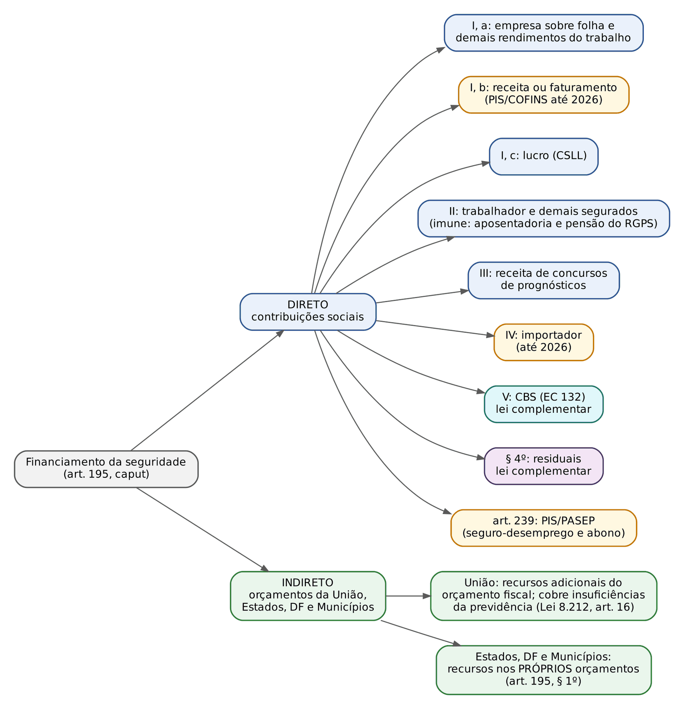
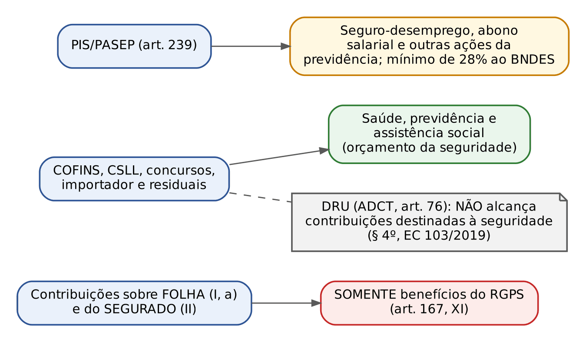
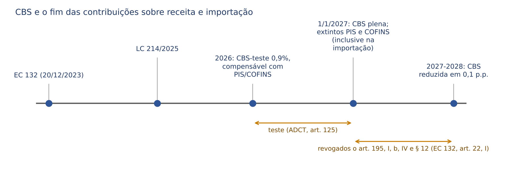
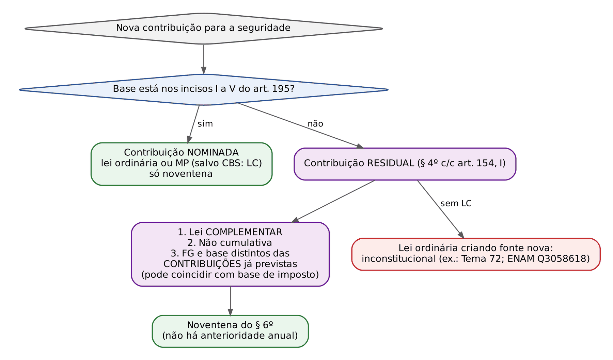
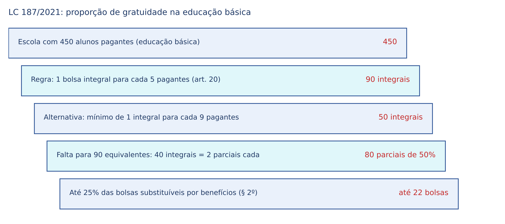
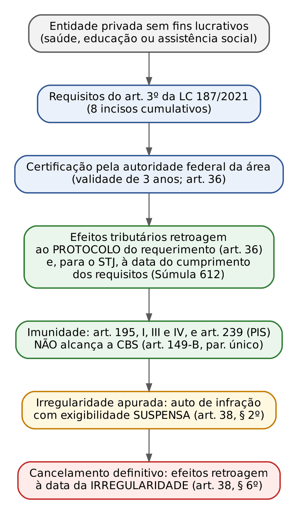
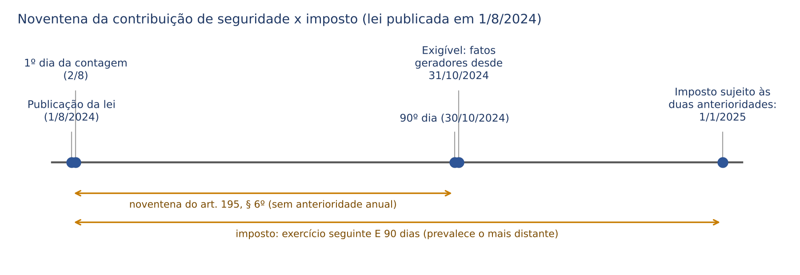

# CAPÍTULO 02 — FINANCIAMENTO DA SEGURIDADE SOCIAL I: ORÇAMENTO DA SEGURIDADE, NATUREZA JURÍDICA E ESPÉCIES DE CONTRIBUIÇÕES SOCIAIS (ART. 195 DA CF), COMPETÊNCIA RESIDUAL, ANTERIORIDADE NONAGESIMAL, IMUNIDADE DAS ENTIDADES BENEFICENTES (LC 187/2021), ISENÇÕES, DRU E A JURISPRUDÊNCIA CONSTITUCIONAL DO CUSTEIO

:::INCIDENCIA
TRF5 p. 2 (parte constitucional e estrutural do custeio). Nível A+. Lote: 20 questões (FGV 15, FCC 5).
O que mais cai: rol de fontes do art. 195 e do art. 11 da Lei 8.212/1991, responsabilidade da União pelas insuficiências, orçamento da seguridade (§§ 1º e 2º), noventena e residual por lei complementar, imunidade das beneficentes e contrapartida.
:::

| Subtema | FGV | FCC | Padrão de cobrança |
|---|---|---|---|
| Fontes do art. 195 e do art. 11 da Lei 8.212/1991 | 4 | 3 | Alternativa-isca com base inexistente ("capital", "transferências bancárias", "concursos públicos", "50% da remuneração") |
| Orçamento da seguridade, União e regime financeiro | 4 | 2 | Insuficiências cobertas pela União; repartição simples; receitas estaduais fora do orçamento da União; proposta "integrada" |
| Regra da contrapartida (§ 5º) | 1 | 0 | Nomear a regra |
| Noventena e competência residual | 3 | 0 | Lei ordinária criando fonte nova; prazo de 90 dias; exportação imune |
| Imunidade das beneficentes | 1 | 0 | Imunidade (não isenção), alcance do PIS, efeito *ex tunc* |
| CSLL | 2 | 0 | Destinação à seguridade; Selic na repetição (Tema 962) |

O ponto 2 do edital do TRF5 é amplo (custeio, contribuintes, salário de contribuição, arrecadação, imunidade, isenção, responsabilidade, prescrição e decadência). Nesta apostila ele foi repartido: aqui fica a moldura constitucional e a jurisprudência que a interpreta; contribuições dos segurados e salário de contribuição estão no Cap. 3; contribuições das empresas, do empregador doméstico, do rural, CPRB e terceiros no Cap. 4; arrecadação, responsabilidade, CND, decadência e prescrição no Cap. 5. A teoria geral das contribuições como tributo foi desenvolvida na Apostila de Direito Tributário, Cap. 3 (e as imunidades, no Cap. 6 daquela apostila); aqui só o recorte previdenciário.

## 02.1 Arquitetura do financiamento: quem paga, por qual orçamento e quem cobre o déficit

### 02.1.1 Financiamento direto e indireto

O art. 195, caput, da CF diz que a seguridade "será financiada por toda a sociedade, de forma direta e indireta, nos termos da lei, mediante recursos provenientes dos orçamentos da União, dos Estados, do Distrito Federal e dos Municípios, e das seguintes contribuições sociais". A frase contém as duas formas de financiamento e é reproduzida no art. 10 da Lei 8.212/1991 (a lei de custeio, ou Lei Orgânica da Seguridade Social):

- forma DIRETA: as contribuições sociais dos incisos I a V do art. 195, do art. 239 (PIS/PASEP) e as residuais do § 4º. O contribuinte paga um tributo vinculado ao sistema;
- forma INDIRETA: os recursos orçamentários dos entes federados, oriundos sobretudo de impostos. A sociedade financia a seguridade quando paga tributos gerais que, depois, o orçamento destina à saúde, à previdência e à assistência.

A expressão "toda a sociedade" é a positivação da SOLIDARIEDADE no custeio: não se exige que o contribuinte seja beneficiário da prestação (a empresa sem empregados paga COFINS e CSLL; o aposentado que volta a trabalhar contribui, ver 02.3.5). A doutrina (Castro e Lazzari, Ibrahim) costuma chamar esse traço de ausência de referibilidade; o desenvolvimento tributário do conceito está na Apostila de Direito Tributário, Cap. 3, item 03.1.2.

### 02.1.2 O orçamento da seguridade social

A CF de 1988 criou um orçamento próprio para a seguridade, ao lado do orçamento fiscal e do de investimento das estatais. Três normas formam o regime, e as bancas cobram a literalidade das três:

:::LEI CF, art. 165, § 5º, III; art. 195, §§ 1º e 2º
Art. 165, § 5º: "A lei orçamentária anual compreenderá: [...] III - o orçamento da seguridade social, abrangendo todas as entidades e órgãos a ela vinculados, da administração direta ou indireta, bem como os fundos e fundações instituídos e mantidos pelo Poder Público."
Art. 195, § 1º: "As receitas dos Estados, do Distrito Federal e dos Municípios destinadas à seguridade social constarão dos respectivos orçamentos, não integrando o orçamento da União."
Art. 195, § 2º: "A proposta de orçamento da seguridade social será elaborada de forma integrada pelos órgãos responsáveis pela saúde, previdência social e assistência social, tendo em vista as metas e prioridades estabelecidas na lei de diretrizes orçamentárias, assegurada a cada área a gestão de seus recursos."
:::

Mecânica, para quem não lida com orçamento federal: o orçamento da seguridade não é uma lei separada; é uma das três peças da MESMA lei orçamentária anual da União (art. 165, § 5º). Dentro dele aparecem o INSS, o Fundo Nacional de Saúde, o Fundo Nacional de Assistência Social e os demais órgãos e fundos da área. A receita estadual e municipal aplicada em saúde e assistência fica nos orçamentos locais (§ 1º): o federalismo fiscal impede que a União "absorva" receitas dos outros entes. E a proposta é INTEGRADA (§ 2º), elaborada em conjunto pelas três áreas, mas cada uma GERE seus recursos.

No plano orçamentário, o inciso VI do parágrafo único do art. 194 (redação da EC 103/2019) manda identificar, em rubricas contábeis específicas para cada área, as receitas e as despesas de saúde, previdência e assistência, para tornar visível o resultado de cada área, sobretudo o da previdência, em vez de diluí-lo no resultado global da seguridade (o princípio está no Cap. 1, 01.3.6).

:::QUESTAO FGV 2025 — TCE-RR — Auditor de Controle Externo, Ciências Atuariais (Q3187890)
Cobrou-se, em afirmativas soltas, a literalidade do art. 195. Gabarito oficial: C — "são isentas" de contribuição as entidades beneficentes que atendam às exigências da lei (é a letra do § 7º; o STF lê como imunidade, ver 02.6). Armadilhas: receitas estaduais "integrando o orçamento da União" (inverte o § 1º); proposta elaborada "isoladamente" pelos órgãos (o § 2º diz "de forma integrada"); pessoa jurídica em débito que "poderá contratar" com o Poder Público (o § 3º veda as duas coisas: contratar E receber benefícios ou incentivos); serviços "estendidos sem a correspondente fonte de custeio" (viola o § 5º). Observe ainda que o próprio enunciado atribui o texto do art. 195 ao "artigo 201": erro material da banca, sem efeito no gabarito.
:::

No mesmo sentido, quanto ao § 1º: Q3641486 (FGV 2025, CNU), alternativa E falsa (receitas dos Estados e Municípios "devem integrar o orçamento da União").

A FCC cobrou a letra exata desse inciso VI (rubricas ESPECÍFICAS, receitas E despesas, caráter contributivo preservado) na Q2564683 (gabarito C; v. Cap. 1, 01.3.8).

### 02.1.3 O orçamento federal da seguridade na Lei 8.212/1991

A Lei 8.212/1991 detalha a composição do orçamento federal da seguridade e é a fonte das questões de "lei seca" do tema.

:::LEI Lei 8.212/1991, arts. 11 e 16
"Art. 11. No âmbito federal, o orçamento da Seguridade Social é composto das seguintes receitas: I - receitas da União; II - receitas das contribuições sociais; III - receitas de outras fontes.
Parágrafo único. Constituem contribuições sociais: a) as das empresas, incidentes sobre a remuneração paga ou creditada aos segurados a seu serviço; b) as dos empregadores domésticos; c) as dos trabalhadores, incidentes sobre o seu salário-de-contribuição; d) as das empresas, incidentes sobre faturamento e lucro; e) as incidentes sobre a receita de concursos de prognósticos."
"Art. 16. A contribuição da União é constituída de recursos adicionais do Orçamento Fiscal, fixados obrigatoriamente na lei orçamentária anual.
Parágrafo único. A União é responsável pela cobertura de eventuais insuficiências financeiras da Seguridade Social, quando decorrentes do pagamento de benefícios de prestação continuada da Previdência Social, na forma da Lei Orçamentária Anual."
:::

Três detalhes que decidem questões:

- O rol do parágrafo único do art. 11 é anterior às EC 20/1998, 42/2003 e 132/2023 e por isso NÃO menciona o importador (art. 195, IV), a CBS (art. 195, V) nem o PIS (art. 239). Pergunta "nos termos da Lei 8.212" responde-se pelo art. 11; pergunta "nos termos da CF" responde-se pelo art. 195. A contribuição do EMPREGADOR DOMÉSTICO aparece como alínea própria (b), porque o empregador doméstico não é empresa (art. 15, II, da Lei 8.212/1991; ver Cap. 4).
- A União entra com "recursos ADICIONAIS do Orçamento Fiscal", fixados OBRIGATORIAMENTE na lei orçamentária, e responde pelas insuficiências financeiras decorrentes do pagamento de "benefícios de prestação continuada da Previdência Social". Não são os Estados, nem o INSS, nem os segurados; e não há rateio.
- "Benefícios de prestação continuada da Previdência Social", no art. 16, significa benefícios previdenciários de trato sucessivo (aposentadorias, pensões, auxílios). Não confundir com o benefício de prestação continuada da LOAS (assistencial, Cap. 18), que é custeado pelo orçamento da assistência.

:::QUESTAO FGV 2025 — TRT-24 — Analista Judiciário, Oficial de Justiça (Q3349700)
Pergunta direta: a quem compete cobrir eventuais insuficiências financeiras da seguridade decorrentes do pagamento de benefícios de prestação continuada da previdência. Gabarito oficial: A — à União (art. 16, parágrafo único, da Lei 8.212/1991). Armadilhas: INSS (é autarquia gestora dos benefícios, não garantidora), Estados, Estados e Municípios em partes, segurados.
:::

:::QUESTAO FGV 2025 — Prefeitura de Niterói — Advogado (Q3656920)
O enunciado descreve o pacto entre gerações ("os ativos contribuem para inativos") e pede o modelo brasileiro e o responsável pelas insuficiências. Gabarito oficial: B — repartição simples, com responsabilidade da União. Armadilhas: "capitalização" (é o modelo da previdência complementar, Cap. 27), "repartição composta", "sistema híbrido" e rateio entre entes. No mesmo sentido: Q2449768 (FGV 2024, AL-PR, do Cap. 1), que acrescenta o órgão fiscalizador: a Receita Federal (Lei 11.457/2007), e não o INSS nem a PGFN.
:::

:::QUESTAO FGV 2025 — CNU — Bloco 1 (Q3641492)
Pedia-se o correto sobre as fontes disciplinadas na Lei 8.212/1991. Gabarito oficial: A — o orçamento federal da seguridade compõe-se de receitas da União, das contribuições sociais e de outras fontes (art. 11). Por que as demais falham: B fala em 100% do resultado dos leilões de bens apreendidos pela Receita (o art. 27, VII, fixa 40%); C diz que a integralidade da receita dos concursos de prognósticos vai à seguridade "desde que aprovados por decreto legislativo" (a contribuição é o percentual vinculado à seguridade em cada modalidade lotérica, conforme lei, art. 26, § 6º, e não há condição de decreto legislativo); D nega a responsabilidade da União pelas insuficiências (contraria o art. 16, parágrafo único); E fala em repasse de até 100% do prêmio do seguro obrigatório de trânsito ao SUS (o parágrafo único do art. 27 diz "até 40%", percentual a ser fixado em decreto).
:::

No mesmo sentido, quanto ao art. 11: Q3592183 (FGV 2025, TCE-PE, Procurador; gabarito E — "dos empregadores domésticos"; as iscas eram contribuições "sobre 50%" da remuneração ou do salário de contribuição, sobre "transferências bancárias" e sobre a receita de "concursos públicos"), Q3660418 (FGV 2025, AgSUS; gabarito B — as dos trabalhadores, sobre o salário de contribuição; as demais negavam a natureza de contribuição social a fontes do próprio art. 11 ou chamavam de contribuição as "receitas da União") e Q4156334 (FCC 2026, AL-RR; gabarito E — as das empresas sobre faturamento e lucro; iscas: impostos sobre compras no exterior, receita de "concursos públicos", contribuição "sobre valor capital").

:::PEGADINHA Concursos de PROGNÓSTICOS, não concursos PÚBLICOS
O art. 195, III, e o art. 26 da Lei 8.212/1991 tratam da receita de concursos de prognósticos (loterias, sorteios, apostas). A FGV e a FCC trocam por "concursos públicos" (seleção de servidores), que nada têm a ver com a seguridade. Variante da Q3592183: "incidentes sobre a receita de concursos públicos, exceto concurso de prognósticos" (errada duas vezes).
:::

### 02.1.4 Outras receitas e a contribuição sobre concursos de prognósticos

O art. 27 da Lei 8.212/1991 lista as "outras receitas" (o inciso III do art. 11). São receitas de natureza não contributiva e, por isso, raramente discutidas em juízo, mas a literalidade é cobrada.

| Inciso do art. 27 | Receita | Detalhe cobrável |
|---|---|---|
| I | multas, atualização monetária e juros moratórios | acessórios das contribuições |
| II | remuneração por serviços de arrecadação, fiscalização e cobrança prestados a terceiros | a arrecadação de contribuições de terceiros (Sistema S, salário-educação) é remunerada |
| III e IV | prestação de outros serviços, fornecimento ou arrendamento de bens; demais receitas patrimoniais, industriais e financeiras | |
| V | doações, legados, subvenções e outras receitas eventuais | |
| VI | 50% dos valores obtidos e aplicados na forma do parágrafo único do art. 243 da CF | bens confiscados ligados ao tráfico e ao trabalho escravo |
| VII | 40% do resultado dos leilões dos bens apreendidos pela Receita Federal | isca: "100%" |
| VIII | outras receitas previstas em legislação específica | |
| Parágrafo único | o agente operador do seguro obrigatório de vítimas de trânsito PODERÁ repassar à seguridade percentual fixado em decreto, de ATÉ 40% do prêmio, destinado ao SUS | a redação vigente (LC 207/2024) fala em SPVAT, seguro que sucedeu o DPVAT; a LC 211/2024 revogou a LC 207/2024 (art. 4º), e o SPVAT deixou de existir, mas o texto do parágrafo, já incorporado à Lei 8.212/1991, permanece no compilado do Planalto, hoje sem objeto prático |

A contribuição sobre concursos de prognósticos (art. 195, III) é tributo autônomo: base de cálculo é a receita auferida nos concursos de prognósticos, sorteios e loterias (art. 26, § 5º); alíquota é o percentual vinculado à seguridade em cada modalidade lotérica, conforme a lei (art. 26, § 6º; a repartição da arrecadação das loterias federais está em lei própria); o produto é destinado ao financiamento da seguridade (§ 4º).

### 02.1.5 Regime financeiro: repartição simples, capitalização e o papel do Tesouro

O RGPS funciona em REPARTIÇÃO SIMPLES: as contribuições de quem está em atividade pagam, no mesmo exercício, os benefícios de quem está em gozo; não há fundo individual acumulado. É o chamado pacto intergeracional. A sensibilidade demográfica (envelhecimento, queda da natalidade) é exatamente o problema descrito na Q3656920.

| Regime financeiro | Como funciona | Onde aparece no Brasil |
|---|---|---|
| Repartição simples | receita do ano paga a despesa do ano; solidariedade entre gerações | RGPS; em regra, RPPS em massa antiga ou em "fundo financeiro" de segregação de massas |
| Capitalização | contribuições acumuladas em reservas que rendem e pagam o próprio benefício | previdência complementar (Cap. 27); fundos previdenciários de RPPS (Cap. 24) |
| Repartição de capitais de cobertura | o capital necessário para pagar o benefício é constituído no ano em que ele é concedido | técnica atuarial usada para alguns benefícios de risco nos RPPS (Cap. 24) |

O déficit do RGPS não é ilícito nem anomalia jurídica: a CF previu que a seguridade é custeada também por recursos orçamentários (financiamento indireto) e a Lei 8.212/1991 faz da União a garantidora (art. 16, parágrafo único). Para o RPPS, a lógica é outra: a CF exige equilíbrio financeiro e atuarial do regime de cada ente (art. 40, caput), e cada ente responde pelo seu regime (Cap. 24).

:::QUESTAO FCC 2025 — UNICAMP — Procurador de Universidade Assistente (Q3891356)
Afirmativas sobre organização e custeio. Gabarito oficial: A — o financiamento do RGPS é contributivo e solidário, e o superávit, embora desejável, não é exigência constitucional absoluta, cabendo à União cobrir eventuais déficits (a alternativa atribui a regra ao art. 195, § 2º; o fundamento preciso da cobertura pela União é o art. 16, parágrafo único, da Lei 8.212/1991, e a banca não se importou com a imprecisão). Armadilhas: B diz que a União "não pode, sob nenhuma hipótese" socorrer RPPS de outros entes (a CF não fixa essa vedação absoluta; o tema é do Cap. 24); C afirma que o RPPS transfere o equilíbrio à União e proíbe capitalização (falso: cada ente responde, e a capitalização é admitida); D diz que a equidade impõe alíquota uniforme (falso: § 9º e progressividade do inciso II, ver 02.4); E dispensa a carência em todos os benefícios (falso; carência é do Cap. 8).
:::

### 02.1.6 Para onde vai cada contribuição: vinculações constitucionais

A contribuição de seguridade é tributo FINALÍSTICO, mas a finalidade varia de amplitude conforme a espécie. Há três graus de vinculação, e a FGV adora o mais estreito:

:::LEI CF, art. 167, XI
"São vedados: [...] XI - a utilização dos recursos provenientes das contribuições sociais de que trata o art. 195, I, a, e II, para a realização de despesas distintas do pagamento de benefícios do regime geral de previdência social de que trata o art. 201."
:::

| Contribuição | Pode custear | Fundamento |
|---|---|---|
| Da empresa sobre a folha (I, a) e do segurado (II) | SOMENTE benefícios do RGPS (nem saúde, nem assistência, nem despesa administrativa do INSS) | art. 167, XI (EC 20/1998) |
| COFINS, CSLL, concursos de prognósticos, importador, residuais | qualquer área da seguridade (saúde, previdência e assistência) | art. 195, caput; Lei 8.212/1991, art. 17 |
| PIS/PASEP | seguro-desemprego, abono salarial e outras ações da previdência; no mínimo 28% a programas de desenvolvimento econômico via BNDES (EC 103/2019) | art. 239, caput e § 1º |
| Recursos do RPPS | somente benefícios do respectivo regime e despesas de organização e funcionamento | art. 167, XII (Cap. 24) |

Dois dispositivos da Lei 8.212/1991 explicam a lógica federal: o art. 17 permite que COFINS e CSLL (alínea d do art. 11) paguem encargos previdenciários da União, "assegurada a destinação de recursos para as ações de Saúde e Assistência Social"; o art. 19 manda o Tesouro repassar mensalmente as contribuições das alíneas d e e (faturamento, lucro e concursos de prognósticos), porque elas são arrecadadas pela Receita como receita da União e só depois executadas no orçamento da seguridade.

O art. 198, § 1º, completa o quadro na saúde: o SUS é financiado, nos termos do art. 195, com recursos do orçamento da seguridade, da União, dos Estados, do DF e dos Municípios, além de outras fontes; os percentuais mínimos de aplicação em saúde (art. 198, § 2º) são de Direito Financeiro e não interessam aqui.

:::QUESTAO FCC 2025 — TRF-4 — Analista Judiciário, Oficial de Justiça (Q3562234)
Gabarito oficial: E — a SAÚDE é financiada por toda a sociedade, de forma direta e indireta, com recursos dos orçamentos dos entes e de contribuições sociais (arts. 195 e 198, § 1º). Armadilhas: A ("contribuições previdenciárias são a única fonte do RGPS": falso, há COFINS, CSLL e Tesouro); B (o caráter contributivo "impõe" alíquotas progressivas: a progressividade é FACULDADE do inciso II, "podendo ser adotadas"); C (assistência custeada "exclusivamente" por impostos: também por contribuições, art. 204); D (diversidade da base não atingiria a previdência: atinge, inclusive com a ressalva expressa do caráter contributivo no art. 194, parágrafo único, VI).
:::

:::QUESTAO FCC 2025 — UNICAMP — Procurador de Universidade Assistente (Q3891355)
Gabarito oficial: A — financiamento direto e indireto por toda a sociedade; contribuições de empregadores, trabalhadores, sobre concursos de prognósticos e do importador; imunidade das beneficentes condicionada à lei e à certificação. Armadilhas: B (o STF teria vedado contribuição patronal sobre receita bruta: falso; a CPRB e a contribuição do produtor rural sobre a comercialização foram validadas, ver 02.9 e Cap. 4); C (equidade imporia alíquota uniforme e vedaria progressividade: falso); D (fundo único que não pode pagar assistência: falso; e as contribuições da folha só pagam RGPS, não saúde); E (PIS e COFINS extintos pela EC 103/2019: falso; a extinção é da EC 132/2023, a partir de 2027, ver 02.3.7).
:::

:::DICA Uma pergunta, três respostas
"Contribuição X pode pagar benefício assistencial?" Folha e segurado: NÃO (art. 167, XI). COFINS e CSLL: SIM. PIS: só seguro-desemprego, abono e "outras ações da previdência" (art. 239). Se a alternativa diz que "todas as contribuições de seguridade podem custear qualquer área", está errada por causa do art. 167, XI.
:::

### 02.1.7 Regra da contrapartida e vedação de contratar com o Poder Público

Dois parágrafos do art. 195 não criam tributo, mas são normas de custeio cobradas em todo concurso:

:::LEI CF, art. 195, §§ 3º e 5º
"§ 3º A pessoa jurídica em débito com o sistema da seguridade social, como estabelecido em lei, não poderá contratar com o Poder Público nem dele receber benefícios ou incentivos fiscais ou creditícios."
"§ 5º Nenhum benefício ou serviço da seguridade social poderá ser criado, majorado ou estendido sem a correspondente fonte de custeio total."
:::

A regra da contrapartida (ou da preexistência do custeio, § 5º) dirige-se ao LEGISLADOR que cria, majora ou estende prestação: ele precisa apontar a fonte de custeio total. Duas consequências práticas para o juiz:

- O Judiciário não pode, por analogia ou isonomia, estender benefício a hipótese não prevista em lei, porque isso criaria despesa sem fonte. Exemplo seguro: o STF negou a extensão do acréscimo de 25% da aposentadoria por invalidez (art. 45 da Lei 8.213/1991) às demais aposentadorias, afirmando que só lei pode criar ou ampliar benefícios (Tema 1.095, RE 1.221.446, Relator Ministro Dias Toffoli, j. 21/6/2021; desenvolvimento no Cap. 15).
- A regra NÃO exige fonte NOVA: basta que haja fonte suficiente no sistema. Nem impede a revisão judicial de benefício concedido com base em interpretação da lei já existente. Em sentido inverso, não existe regra de que toda contribuição nova deva gerar benefício novo: a contribuição do aposentado que volta ao trabalho não lhe dá nova aposentadoria (02.3.5).

:::QUESTAO FGV 2024 — AL-TO — Analista Legislativo, Direito (Q2457699)
O enunciado transcreve o § 5º e pede o nome da regra. Gabarito oficial: B — regra da contrapartida. Armadilhas: seletividade e distributividade, diversidade da base, noventena, equidade no custeio (todos princípios reais, mas outros).
:::

O § 3º é a matriz constitucional da certidão negativa de débitos (art. 47 da Lei 8.212/1991, cuja disciplina, validade e hipóteses de dispensa estão no Cap. 5). A sanção é dupla e cumulativa: proibição de contratar E de receber benefícios ou incentivos fiscais ou creditícios.

:::QUESTAO FGV 2025 — CNU — Bloco 1 (Q3641486)
Gabarito oficial: B — o ônus contributivo do segurado não autoriza contribuição sobre aposentadorias e pensões do RGPS (art. 195, II, parte final; ver 02.3.5). Armadilhas: A (devedor não contrata, "embora possa receber incentivos": o § 3º veda ambos); C (a contribuição patronal não alcançaria o contratado sem vínculo: a EC 20/1998 incluiu "mesmo sem vínculo empregatício"); D (lucro, por ser base do IRPJ, não poderia ser base de contribuição: o próprio art. 195, I, c, prevê a CSLL; ver 02.5.3); E (receitas estaduais no orçamento da União: contraria o § 1º).
:::

## 02.2 Natureza jurídica e classificação das contribuições sociais

### 02.2.1 Tributo finalístico

As contribuições de seguridade são TRIBUTOS: cabem no art. 3º do CTN (prestação pecuniária compulsória, instituída em lei, que não constitui sanção de ato ilícito, cobrada mediante atividade administrativa plenamente vinculada) e estão no capítulo constitucional do Sistema Tributário (art. 149). A discussão sobre a natureza tributária, travada antes de 1988 (a EC 8/1977 chegou a retirá-las do capítulo tributário), está superada desde a jurisprudência do STF nos primeiros anos da Constituição; a classificação pentapartida (impostos, taxas, contribuições de melhoria, empréstimos compulsórios e contribuições especiais) é a do STF e da doutrina majoritária (desenvolvimento: Apostila de Direito Tributário, Caps. 2 e 3).

Consequências práticas do caráter tributário, que o juiz federal aplica todos os dias:

| Consequência | Onde está | Capítulo |
|---|---|---|
| Legalidade estrita para instituir e majorar (art. 150, I), inclusive na definição da base de cálculo | art. 149, caput | 02.4.1 |
| Anterioridade nonagesimal própria (art. 195, § 6º), sem a anual | art. 149, caput, parte final | 02.7 |
| Lançamento, decadência e prescrição pelo CTN, porque são normas gerais reservadas a lei complementar (art. 146, III, b); inconstitucionais os prazos de 10 anos dos arts. 45 e 46 da Lei 8.212/1991 | Súmula Vinculante 8 | Cap. 5 |
| Execução fiscal pela Lei 6.830/1980, cobrança pela PGFN, administração pela Receita Federal | Lei 11.457/2007 | Cap. 5 |
| Imunidades e isenções seguem a teoria tributária | art. 195, §§ 7º e 11; art. 150, § 6º | 02.6 e 02.8 |
| Competência da Justiça Federal (União como credora) e, na execução de contribuições de sentenças trabalhistas, da Justiça do Trabalho (art. 114, VIII) | | Cap. 5 |

O traço que distingue a contribuição é a FINALIDADE constitucionalmente qualificada: ela "somente" pode ser criada para custear a atuação da União na área (art. 149, caput: "como instrumento de sua atuação nas respectivas áreas"). Por isso o art. 4º do CTN (natureza definida pelo fato gerador, irrelevante a destinação legal do produto) não basta para identificar as contribuições, que muitas vezes têm fato gerador idêntico ao de impostos: lucro (IRPJ e CSLL), remuneração (IRPF e contribuição previdenciária), bens e serviços (IBS e CBS). Esse cruzamento foi cobrado pelo CESPE no TRF5 e reaparece nas provas da FGV.

:::QUESTAO FGV 2024 — DATAPREV — ATI, Contabilidade (Q3085994)
Pergunta: destinação da CSLL (art. 195, I, c). Gabarito oficial: B — financiamento da seguridade social. As demais alternativas (polícias federais, fiscalização de concessões, salários do sistema financeiro, caixa do Judiciário) são iscas de reconhecimento imediato, mas a questão confirma o que o examinador quer fixar: a CSLL é contribuição de seguridade, não imposto sobre a renda.
:::

### 02.2.2 Classificação: o que é e o que não é contribuição de seguridade

O STF, no RE 138.284 (Relator Ministro Carlos Velloso), classificou as contribuições do art. 149 em sociais, de intervenção no domínio econômico e corporativas, e as sociais em: (a) de seguridade social (art. 195, I a IV, e hoje V); (b) outras de seguridade, as residuais (art. 195, § 4º); (c) sociais gerais (salário-educação, art. 212, § 5º; Sistema S, art. 240). A contribuição dos servidores para o RPPS (art. 149, § 1º) é o terceiro grupo usual nos manuais pós-EC 41/2003.

| Grupo | Exemplos | Integra o orçamento da seguridade? | Regime |
|---|---|---|---|
| Seguridade nominadas | patronal sobre folha, do segurado, COFINS, CSLL, concursos, importador, CBS; PIS (art. 239) | SIM | lei ordinária (CBS: LC); só noventena |
| Seguridade residuais | as criadas pelo § 4º (ex.: LC 84/1996) | SIM | lei complementar; só noventena |
| Sociais gerais | salário-educação; Sesc, Senac, Sesi, Senai (art. 240); contribuições da LC 110/2001 | NÃO | anterioridade anual e noventena |
| CIDE ligadas à folha | Incra, Sebrae, Apex, ABDI (o STF as qualifica como CIDE) | NÃO | anterioridade anual e noventena |
| RPPS | servidores ativos, aposentados e pensionistas | NÃO (orçamento do respectivo regime) | todos os entes; alíquotas progressivas admitidas; anterioridade e demais regras no Cap. 24 |

Dentro das contribuições de seguridade, a CONTRIBUIÇÃO PREVIDENCIÁRIA em sentido estrito é a subespécie que financia o RGPS: a da empresa sobre a folha e a do trabalhador e demais segurados (art. 195, I, a, e II), presas aos benefícios do RGPS pelo art. 167, XI. É a ela que se referem a Súmula Vinculante 8 e a expressão "contribuições previdenciárias" da Lei 8.212/1991.

:::PEGADINHA Contribuições "de terceiros" não são de seguridade
A Receita Federal arrecada na mesma guia (DCTFWeb) a contribuição patronal previdenciária e as de terceiros (salário-educação, Incra, Sistema S, Sebrae). Isso NÃO as torna contribuições de seguridade: não integram o orçamento da seguridade, sujeitam-se à anterioridade anual e as entidades destinatárias não têm legitimidade passiva na repetição. Desenvolvimento: Cap. 4 e Apostila de Direito Tributário, Cap. 3, itens 03.2.4 e 03.2.5.
:::

### 02.2.3 Competência: só a União (com a exceção do RPPS)

O art. 149, caput, reserva à União, com exclusividade, a instituição de contribuições sociais. A única contribuição social que Estados, DF e Municípios instituem é a do RPPS de seus servidores (art. 149, § 1º, que usa o verbo "instituirão": é dever). Daí: Estado não cria contribuição para "saúde do servidor" (o STF só admite adesão facultativa a plano de assistência), não cria contribuição sobre folha para financiar assistência social estadual e não institui contribuição de seguridade do art. 195 (desenvolvimento e questões da FCC: Apostila de Direito Tributário, Cap. 3, item 03.1.4).

A capacidade tributária ativa das contribuições previdenciárias (arrecadar, fiscalizar, cobrar) passou do INSS à Secretaria da Receita Federal do Brasil com a Lei 11.457/2007; o INSS é hoje apenas gestor dos benefícios. Em juízo, quem responde na repetição é a União (Fazenda Nacional), não o INSS (Cap. 5).

## 02.3 As espécies do art. 195, inciso por inciso

O texto vigente do caput e dos incisos, conferido na redação compilada:

:::LEI CF, art. 195, I a V
"I - do empregador, da empresa e da entidade a ela equiparada na forma da lei, incidentes sobre: a) a folha de salários e demais rendimentos do trabalho pagos ou creditados, a qualquer título, à pessoa física que lhe preste serviço, mesmo sem vínculo empregatício; b) a receita ou o faturamento; c) o lucro;
II - do trabalhador e dos demais segurados da previdência social, podendo ser adotadas alíquotas progressivas de acordo com o valor do salário de contribuição, não incidindo contribuição sobre aposentadoria e pensão concedidas pelo Regime Geral de Previdência Social;
III - sobre a receita de concursos de prognósticos.
IV - do importador de bens ou serviços do exterior, ou de quem a lei a ele equiparar.
V - sobre bens e serviços, nos termos de lei complementar."
:::

| Inciso | Contribuinte | Base | Tributo atual | Introduzido ou alterado por | Onde se desenvolve |
|---|---|---|---|---|---|
| I, a | empregador, empresa e equiparado | folha e demais rendimentos do trabalho pagos a pessoa física, com ou sem vínculo | patronal de 20%, GILRAT/RAT, adicional da especial; contribuição do empregador doméstico | EC 20/1998 (ampliação) | Cap. 4 |
| I, b | idem | receita ou faturamento | COFINS e, por força do art. 239, PIS; CPRB (substitutiva da folha) | EC 20/1998 ("receita"); revogação em 2027 (EC 132) | 02.3.2; Cap. 4 |
| I, c | idem | lucro | CSLL (Lei 7.689/1988) | redação original | 02.3.3 |
| II | trabalhador e demais segurados | salário de contribuição | contribuição do empregado, doméstico, avulso, individual, facultativo | EC 103/2019 (progressividade e imunidade expressa) | 02.3.5; Cap. 3 |
| III | (sobre a receita) | receita de concursos de prognósticos | contribuição sobre loterias | redação original | 02.1.4 |
| IV | importador ou equiparado | importação de bens ou serviços | PIS e COFINS-Importação (Lei 10.865/2004) | EC 42/2003; revogação em 2027 (EC 132) | 02.3.6 |
| V | (sobre bens e serviços) | operações com bens e serviços | CBS (LC 214/2025) | EC 132/2023 | 02.3.7 |
| § 8º | produtor, parceiro, meeiro, arrendatário rurais e pescador artesanal em economia familiar | resultado da comercialização da produção | contribuição do segurado especial | redação original, ajustada pela EC 20/1998 | Caps. 3 e 4 |

### 02.3.1 Inciso I, a: a folha "e demais rendimentos do trabalho"

Na redação original de 1988, o inciso I falava em contribuição "dos empregadores, incidente sobre a folha de salários". Isso gerou um contencioso histórico que explica a redação atual e ainda é cobrado:

- A Lei 7.787/1989 e a Lei 8.212/1991 (art. 22, I, na redação original) mandaram a empresa contribuir também sobre o que pagava a autônomos, administradores e avulsos. Como esses não recebem "salário" nem compõem "folha de salários", o STF declarou inconstitucionais as expressões "autônomos e administradores" (orientação firmada no início dos anos 1990; ver nota quanto aos números dos precedentes).
- A União respondeu com a LC 84/1996, criando, pela via RESIDUAL (art. 195, § 4º), contribuição de 15% sobre a remuneração de individuais e de 15% a cargo das cooperativas de trabalho; o STF a validou justamente por ter vindo em lei complementar (02.5).
- A EC 20/1998 ampliou a alínea a: "folha de salários e demais rendimentos do trabalho pagos ou creditados, a qualquer título, à pessoa física que lhe preste serviço, MESMO SEM VÍNCULO empregatício". A partir daí a contribuição sobre o contribuinte individual passou a ser NOMINADA, e a LC 84/1996 perdeu o status de lei complementar, podendo ser revogada por lei ordinária, como foi pela Lei 9.876/1999 (ementa das ADIs 2.110 e 2.111).
- O sujeito passivo também mudou: de "empregadores" para "empregador, empresa e entidade a ela equiparada na forma da lei". Daí a validade da equiparação a empresa do contribuinte individual que contrata, da cooperativa, da associação e do dono de obra (art. 15, parágrafo único, da Lei 8.212/1991).

:::QUESTAO FGV 2025 — CNU — Bloco 1 (Q3641495)
Gabarito oficial: A — constituem contribuições sociais as das empresas e equiparadas sobre a remuneração dos segurados a seu serviço; o autônomo que contrata empregado é equiparado a empresa e recolhe a contribuição patronal (art. 15, parágrafo único, da Lei 8.212/1991). Armadilhas: B (pescador artesanal como "facultativo": é segurado especial, obrigatório, art. 195, § 8º); C (empregador doméstico equiparado a empresa e, por isso, com direito a benefícios: falso nas duas partes; o doméstico tem conceito próprio no art. 15, II, e quem tem benefícios é o segurado, não o empregador); D (pessoa física que importa para uso próprio não pagaria: a CF admite que a lei equipare a pessoa natural destinatária da importação, art. 149, § 3º, e a Lei 10.865/2004 alcança a pessoa física importadora; ver 02.3.6); E (não incidiria sobre receita estranha à venda: desde a EC 20/1998 a base é "receita ou faturamento").
:::

:::QUESTAO FCC 2024 — TRF-3 — Técnico Judiciário (Q2564686)
Completar o art. 195 com a redação exata. Gabarito oficial: D — pessoa física que "lhe preste serviço, mesmo sem vínculo"; lucro; alíquotas PROGRESSIVAS de acordo com o SALÁRIO DE CONTRIBUIÇÃO; NÃO incidência sobre aposentadoria e pensão do REGIME GERAL. Armadilhas: "não lhe preste serviço", "prejuízo", alíquotas "regressivas", progressividade pelo "salário de benefício", imunidade de benefícios do "Regime Próprio", incidência sobre aposentadoria. É a questão-modelo da FCC: troca de uma palavra por alternativa.
:::

O art. 201, § 11, complementa a alínea a: "os ganhos habituais do empregado, a qualquer título, serão incorporados ao salário para efeito de contribuição previdenciária e consequente repercussão em benefícios". Com base nele o STF fixou que a contribuição patronal incide sobre ganhos habituais, antes ou depois da EC 20/1998 (Tema 20) e que é legítima a incidência sobre o terço constitucional de férias (Tema 985). A lista de verbas (o que integra e o que não integra a base) é matéria dos Caps. 3 e 4; o painel das teses está em 02.9.

### 02.3.2 Inciso I, b: receita ou faturamento

Na redação original, "faturamento" (receita de vendas de mercadorias e serviços). A EC 20/1998 acrescentou "a receita", permitindo tributar receitas não operacionais. O contencioso relevante:

- A Lei 9.718/1998, anterior à EC 20/1998 (publicada em 27/11/1998, a emenda é de 15/12/1998), ampliara a base da COFINS e do PIS para a "totalidade das receitas". O STF declarou inconstitucional essa ampliação, porque a lei nasceu sem fundamento constitucional e não é convalidada por emenda posterior (orientação conhecida; número dos recursos não conferido nesta tarefa). Hoje a base ampla está nas Leis 10.637/2002 e 10.833/2003, posteriores à emenda.
- A COFINS foi criada pela LC 70/1991. Embora formalmente complementar, ela é MATERIALMENTE ORDINÁRIA, porque a contribuição sobre faturamento tem matriz expressa no art. 195, I, e dispensa lei complementar. Por isso lei ordinária (Lei 9.430/1996, art. 56) pôde revogar a isenção das sociedades civis de profissão regulamentada prevista na LC 70/1991 (Tema 71 do STF, RE 377.457).
- O PIS tem fundamento próprio (art. 239) e a CF admite expressamente a dupla incidência sobre faturamento (PIS e COFINS), exceção à regra de que uma contribuição de seguridade não repete a base de outra.
- O detalhamento do PIS e da COFINS (exclusão do ICMS, não cumulatividade, insumos) é da Apostila de Direito Tributário, Cap. 26.

O § 12 do art. 195 manda a lei definir os setores para os quais as contribuições sobre receita (I, b) e do importador (IV) serão não cumulativas; o § 13, que tratava da substituição gradual da contribuição sobre folha pela incidente sobre receita, foi revogado pela EC 103/2019. A substituição, que já existia (CPRB, Lei 12.546/2011), foi preservada pelo art. 30 da EC 103/2019 (ver 02.4.2).

:::JURIS STF, Tema 71 (RE 377.457, Relator Ministro Gilmar Mendes, aprovada em 17/9/2008)
Tese, em síntese fiel: é legítima a revogação da isenção do art. 6º, II, da LC 70/1991 pelo art. 56 da Lei 9.430/1996, porque a LC 70/1991 é apenas formalmente complementar, mas materialmente ordinária quanto aos dispositivos relativos à contribuição social por ela instituída.
Gancho de prova: "lei complementar que trata de matéria não reservada a lei complementar pode ser alterada por lei ordinária". Foi o item III, verdadeiro, da Q3363397 (FGV 2025, SEFAZ-PR, sem capítulo no banco; gabarito E, todas corretas).
:::

### 02.3.3 Inciso I, c: lucro (CSLL)

A CSLL foi instituída pela Lei 7.689/1988, lei ORDINÁRIA, e o STF a validou no RE 146.733 (a ressalva temporal feita naquele julgamento, quanto ao primeiro período de apuração, não foi conferida nesta tarefa). O argumento derrotado era o de que, tendo a mesma base do IRPJ, a CSLL exigiria lei complementar. A resposta do STF, fixada no voto do Ministro Ilmar Galvão e reproduzida nos manuais, separa os dois planos: o art. 154, I, veda que IMPOSTO novo repita fato gerador ou base de impostos já discriminados; o art. 195, § 4º, veda que contribuição NOVA repita fatos econômicos das contribuições do caput; nenhum dos dois impede que uma contribuição NOMINADA no art. 195 (lucro) coincida com a base de um imposto (renda). Daí a pegadinha clássica do CESPE (Procurador do INSS): "a contribuição social sobre o lucro deve ser instituída por lei complementar, por ter a mesma base do IR" é ERRADO.

Outras regras da CSLL com reflexo no custeio:

- Alíquota diferenciada por atividade: o art. 195, § 9º, autoriza, e o art. 32 da EC 103/2019 fixou em 20% a alíquota da CSLL dos bancos (pessoas jurídicas do art. 1º, § 1º, I, da LC 105/2001) até que lei disponha de outro modo, com vigência no primeiro dia do quarto mês seguinte à publicação da emenda (art. 36, I), isto é, 1/3/2020.
- Imunidade de exportação: a CSLL NÃO é alcançada pelo art. 149, § 2º, I, porque incide sobre lucro, não sobre receita (RE 564.413; desenvolvimento na Apostila de Direito Tributário, Cap. 6).
- Selic na repetição de indébito: não incidem IRPJ e CSLL sobre a taxa Selic recebida na repetição do indébito tributário (Tema 962).
- Entidades fechadas de previdência complementar: o STF admitiu a CSLL e a COFINS sobre resultados e aplicações dessas entidades; a questão (Q3425331, FGV 2025, TRF1, Juiz Federal) é desenvolvida no Cap. 27.

:::JURIS STF, Tema 962 (RE 1.063.187, j. 27/9/2021)
"É inconstitucional a incidência do IRPJ e da CSLL sobre os valores atinentes à taxa Selic recebidos em razão de repetição de indébito tributário." Fundamento: os juros de mora da repetição recompõem perdas (dano emergente), não são acréscimo patrimonial.
:::

:::QUESTAO FGV 2024 — Câmara dos Deputados — Consultor de Orçamento e Fiscalização Financeira (Q2512336)
Afirmações sobre a jurisprudência do STF quanto à CSLL. Gabarito oficial: C — é inconstitucional a CSLL sobre a Selic recebida na repetição de indébito (Tema 962). Por que as demais falham: A (a CSLL não é imune na exportação, porque o art. 149, § 2º, I, alcança receitas, não lucro); B (o STF validou a proibição de deduzir a CSLL da base do IRPJ; orientação conhecida, número não conferido); D (a diferenciação de alíquotas das instituições financeiras é constitucional, art. 195, § 9º; ver 02.4.2); E (a CSLL das entidades fechadas de previdência com contribuição dos participantes foi validada; Cap. 27).
:::

### 02.3.4 Quem é "empresa" e "entidade equiparada"

O sujeito passivo do inciso I é definido na lei (art. 15 da Lei 8.212/1991): empresa é a firma individual ou sociedade que assume o risco de atividade econômica urbana ou rural, COM FINS LUCRATIVOS OU NÃO, e também os órgãos e entidades da administração direta, indireta e fundacional; equiparam-se a empresa o contribuinte individual e a pessoa física dona de obra de construção civil em relação a quem lhes presta serviço, a cooperativa, a associação ou entidade de qualquer natureza ou finalidade, a missão diplomática e a repartição consular estrangeiras. O empregador doméstico tem conceito próprio (pessoa ou família que admite empregado doméstico sem finalidade lucrativa). Os desdobramentos (inclusive o MEI, o produtor rural e a agroindústria) estão no Cap. 4.

:::ATENCAO
"Com fins lucrativos ou não": a associação, a fundação e o ente público que contratam empregados celetistas são empresa para fins de custeio. Quem escapa da contribuição patronal não é a entidade sem fins lucrativos em geral, mas apenas a entidade BENEFICENTE certificada, e isso por IMUNIDADE (02.6), não por não ser empresa.
:::

### 02.3.5 Inciso II: o trabalhador e os demais segurados

A EC 103/2019 deu ao inciso II a redação atual, com duas novidades: (a) a autorização expressa de alíquotas PROGRESSIVAS de acordo com o valor do salário de contribuição (a escada de 7,5%, 9%, 12% e 14% para empregado, doméstico e avulso está no Cap. 3, com os cálculos); (b) a imunidade, agora textual, das aposentadorias e pensões do RGPS ("não incidindo contribuição sobre aposentadoria e pensão concedidas pelo Regime Geral"; antes, a regra estava no art. 195, II, desde a EC 20/1998, em redação semelhante).

Quatro pontos cobráveis sobre a imunidade do inciso II:

| Pergunta | Resposta | Fundamento |
|---|---|---|
| A imunidade é do benefício ou da pessoa? | Do BENEFÍCIO. O aposentado que trabalha contribui sobre a remuneração da atividade | Lei 8.212/1991, art. 12, § 4º; Tema 1.065 do STF |
| Vale para o RPPS? | NÃO. No RPPS, aposentados e pensionistas contribuem sobre o que excede o teto do RGPS (ou o salário mínimo, havendo déficit atuarial, art. 149, § 1º-A) | art. 40, § 18; Cap. 24 |
| E os demais benefícios do RGPS? | Não são tributados por opção legal (não integram o salário de contribuição, art. 28, § 9º, a, da Lei 8.212/1991), SALVO o salário-maternidade, que a lei considera salário de contribuição da segurada | art. 28, §§ 2º e 9º; Cap. 3 |
| E a contribuição patronal sobre o salário-maternidade? | Inconstitucional (Tema 72): benefício não é rendimento do trabalho, e a exigência criaria fonte nova sem lei complementar e desestimularia a contratação de mulheres | 02.5.4 |

A imunidade não alcança a remuneração da nova atividade do aposentado: o STF declarou constitucional a contribuição do aposentado do RGPS que permanece em atividade ou a ela retorna (Tema 1.065; v. Cap. 3).

:::PEGADINHA Progressividade é FACULDADE, e é do salário de contribuição
O inciso II diz "PODENDO ser adotadas alíquotas progressivas de acordo com o valor do SALÁRIO DE CONTRIBUIÇÃO". Errado: "deverão ser progressivas" (Q3562234, alternativa B), "regressivas" ou "de acordo com o salário de benefício" (Q2564686). Errado também: "a equidade impõe alíquota uniforme" (Q3891356 D e Q3891355 C).
:::

O § 14 do art. 195 (EC 103/2019) é regra de custeio com efeito em benefício: só conta como tempo de contribuição a competência cuja contribuição atinja a mínima mensal da categoria, assegurado o agrupamento; o art. 29 da EC 103/2019 disciplina complementação, utilização do excedente e agrupamento dentro do mesmo ano civil. Desenvolvimento e exemplos numéricos: Cap. 3.

### 02.3.6 Inciso IV: o importador

A EC 42/2003 incluiu a contribuição "do importador de bens ou serviços do exterior, ou de quem a lei a ele equiparar". Combinada com o art. 149, § 2º, II (as contribuições sociais "incidirão também sobre a importação de produtos estrangeiros ou serviços"), e com o § 3º (a pessoa natural destinatária da importação pode ser equiparada a pessoa jurídica), dá fundamento ao PIS/PASEP-Importação e à COFINS-Importação da Lei 10.865/2004, que alcançam também a pessoa física importadora. A base (valor aduaneiro) e a exclusão do ICMS da base foram objeto de repercussão geral (matéria da Apostila de Direito Tributário, Cap. 26). Pela EC 132/2023, o inciso IV será revogado em 2027, com a extinção do PIS e da COFINS (inclusive na importação), substituídos pela CBS, que incide também na importação.

### 02.3.7 Inciso V: a CBS e o fim das contribuições sobre receita

A EC 132/2023 criou a Contribuição sobre Bens e Serviços (CBS), "nos termos de lei complementar" (inciso V), instituída pela mesma lei complementar do IBS (ADCT, art. 124, parágrafo único), que é a LC 214/2025. É tributo de seguridade (está no art. 195), mas com regime próprio, todo ele cobrável pela FCC na prova da SEFAZ:

:::LEI CF, art. 195, §§ 15 a 17; art. 149-B
"§ 15. A contribuição prevista no inciso V do caput poderá ter sua alíquota fixada em lei ordinária."
"§ 17. A contribuição prevista no inciso V do caput não integrará sua própria base de cálculo nem a dos tributos previstos nos arts. 153, VIII, 156-A e 195, I, 'b', e IV, e da contribuição para o Programa de Integração Social de que trata o art. 239."
"Art. 149-B. Os tributos previstos nos arts. 156-A e 195, V, observarão as mesmas regras em relação a: I - fatos geradores, bases de cálculo, hipóteses de não incidência e sujeitos passivos; II - imunidades; III - regimes específicos, diferenciados ou favorecidos de tributação; IV - regras de não cumulatividade e de creditamento. Parágrafo único. Os tributos de que trata o caput observarão as imunidades previstas no art. 150, VI, não se aplicando a ambos os tributos o disposto no art. 195, § 7º."
:::

Leitura previdenciária desses dispositivos:

- A CBS é contribuição de seguridade que NÃO segue a imunidade do art. 195, § 7º (entidades beneficentes), mas segue as imunidades de IMPOSTOS do art. 150, VI. A entidade beneficente só escapa da CBS se for, por exemplo, instituição de assistência social sem fins lucrativos da alínea c (ver 02.6.5).
- O § 16 manda aplicar à CBS boa parte do regime do IBS (art. 156-A); o § 18 prevê devolução a pessoas físicas ("cashback") para reduzir desigualdades de renda, e o § 19 exclui essa devolução da receita corrente líquida para certos limites.
- A CBS segue a noventena do § 6º? É contribuição "de que trata este artigo"; a resposta textual é sim, mas o ponto só interessa na transição (ver nota).

O cronograma constitucional, conferido no ADCT:

| Ano | CBS | PIS/COFINS | Fundamento |
|---|---|---|---|
| 2026 | cobrada à alíquota de teste de 0,9%, compensável com PIS e COFINS (e, sem débitos suficientes, com outro tributo federal ou ressarcida em até 60 dias); possível dispensa do recolhimento para quem cumprir as obrigações acessórias, nos termos de lei complementar | vigentes | ADCT, art. 125 |
| 2027 | cobrada plenamente; em 2027 e 2028 a alíquota é reduzida em 0,1 ponto percentual (compensação do IBS de teste) | EXTINTAS as contribuições do art. 195, I, b, e IV, e o PIS do art. 239, "desde que instituída" a CBS | ADCT, arts. 126 e 127 |
| 2027 | revogação do art. 195, I, b, IV e § 12 | | EC 132/2023, art. 22, I |

:::QUESTAO FCC 2026 — SEFAZ-CE — Auditor Fiscal (Q4221435, sem capítulo no banco, correlata)
Afirmações sobre as regras comuns ao IBS e à CBS. Gabarito oficial: B (II e III corretas): fatos geradores, bases, não incidência e sujeitos passivos; regimes específicos, diferenciados ou favorecidos. Por que IV é falsa: o art. 149-B, parágrafo único, afasta do IBS e da CBS a regra do art. 195, § 7º (beneficentes). I e V inventam exceções ("exceto exportação", "exceto armazém geral"). No mesmo sentido: Q3955871 (FCC 2026, SEFAZ-SP; gabarito E, a lista do art. 149-B, I e IV).
:::

:::ATENCAO Efeito da revogação do art. 195, I, b, sobre o custeio previdenciário
A contribuição previdenciária sobre a receita bruta (CPRB), que substitui a contribuição patronal sobre a folha em alguns setores, e a contribuição do produtor rural e da agroindústria sobre a comercialização apoiam-se em bases de "receita". Com a revogação da alínea b em 2027, a sobrevivência dessas contribuições substitutivas e a reoneração gradual da folha (Lei 14.973/2024) dependem de leitura conjunta com o § 8º, com o art. 30 da EC 103/2019 e com a legislação da reforma. O desenvolvimento é do Cap. 4; aqui registra-se apenas que a pergunta existe (ver nota de verificação).
:::

## 02.4 Princípios constitucionais do custeio e seus limites

Os objetivos do art. 194, parágrafo único, são estudados no Cap. 1. Aqui só os que operam como LIMITES ao legislador tributário da seguridade, com a jurisprudência que os aplica.

### 02.4.1 Legalidade

A contribuição de seguridade é instituída e majorada por LEI (art. 150, I, aplicável por força do art. 149, caput). A lei ordinária basta para as contribuições nominadas (incisos I a IV) e admite medida provisória (art. 62, § 2º, com a peculiaridade da noventena contada da MP, ver 02.7.3); a CBS exige lei complementar para a instituição, mas a alíquota pode vir em lei ordinária (§ 15); a residual exige lei complementar (02.5).

O que o regulamento não pode fazer: alterar a base de cálculo definida em lei. O STF declarou inconstitucionais o Decreto 3.048/1999 e a Portaria MPAS 1.135/2001 na parte em que mudaram a base da contribuição sobre a remuneração paga a transportadores autônomos (Tema 1.223). O que o regulamento pode fazer: completar conceitos técnicos fixados em lei com parâmetros objetivos. Foi o que o STF admitiu no SAT/RAT (enquadramento do grau de risco por decreto) e no Fator Acidentário de Prevenção (Tema 554: o FAP do art. 10 da Lei 10.666/2003, regulamentado pelo Decreto 3.048/1999, atende à legalidade tributária). A técnica do FAP e do RAT é do Cap. 4.

:::JURIS STF, Tema 1.223 (RE 1.381.261, j. 5/8/2022)
"São inconstitucionais o Decreto nº 3.048/99 e a Portaria MPAS nº 1.135/01 no que alteraram a base de cálculo da contribuição previdenciária incidente sobre a remuneração paga ou creditada a transportadores autônomos, devendo o reconhecimento da inconstitucionalidade observar os princípios da congruência e da devolutividade."
:::

### 02.4.2 Equidade na forma de participação no custeio e o § 9º

A equidade (art. 194, parágrafo único, V) é a capacidade contributiva aplicada à seguridade, temperada pelo RISCO SOCIAL que cada contribuinte gera. Ela se manifesta em três eixos: empresa x segurado (a empresa paga mais); segurado x segurado (progressividade do inciso II); empresa x empresa (alíquotas diferenciadas do § 9º e alíquotas por risco de acidente).

:::LEI CF, art. 195, § 9º (redação da EC 103/2019)
"As contribuições sociais previstas no inciso I do caput deste artigo poderão ter alíquotas diferenciadas em razão da atividade econômica, da utilização intensiva de mão de obra, do porte da empresa ou da condição estrutural do mercado de trabalho, sendo também autorizada a adoção de bases de cálculo diferenciadas apenas no caso das alíneas 'b' e 'c' do inciso I do caput."
:::

Leitura em escada do § 9º:

1. Quem pode ter alíquota diferenciada: SÓ as contribuições do inciso I (empresa: folha, receita, lucro). Não as do segurado (inciso II, que tem regra própria de progressividade).
2. Critérios: quatro, taxativos: atividade econômica, uso intensivo de mão de obra, porte da empresa, condição estrutural do mercado de trabalho.
3. Base diferenciada: SÓ receita (b) e lucro (c). A FOLHA (a) não pode ter base diferenciada desde a EC 103/2019.
4. Ressalva intertemporal: a vedação de diferenciar ou substituir a base "não se aplica a contribuições que substituam a contribuição de que trata a alínea 'a' [...] instituídas antes" da EC 103/2019 (art. 30 da EC 103/2019). É a cláusula que preservou a CPRB e as contribuições substitutivas do produtor rural e da agroindústria (Cap. 4).

:::EXEMPLO Alíquota diferenciada das instituições financeiras
Banco com folha mensal de 1.000.000 (um milhão de) reais, sem considerar RAT e terceiros.
1. Contribuição patronal básica (Lei 8.212/1991, art. 22, I): 20% × 1.000.000 = 200.000.
2. Adicional das instituições financeiras e equiparadas (art. 22, § 1º): 2,5% × 1.000.000 = 25.000.
3. Total sobre a folha: 225.000, isto é, 22,5%.
4. Validade: o STF admitiu o adicional mesmo antes da EC 20/1998 (Tema 470) e a diferenciação após a EC 20/1998 (Tema 204). Fundamento material: atividade econômica e uso menos intensivo de mão de obra, o que justifica o discrímen (voto do Ministro Barroso no Tema 204, segundo material do Drive).
5. A CSLL dos bancos também é diferenciada: 20% (art. 32 da EC 103/2019; 02.3.3).
:::

:::JURIS STF, Temas 204 (RE 598.572, j. 30/3/2016) e 470 (RE 599.309, j. 6/6/2018)
Tema 204: "É constitucional a previsão legal de diferenciação de alíquotas em relação às contribuições previdenciárias incidentes sobre a folha de salário de instituições financeiras ou de entidade a elas legalmente equiparáveis, após a edição da Emenda Constitucional 20/1998."
Tema 470: "É constitucional a contribuição adicional de 2,5% (dois e meio por cento) sobre a folha de salários instituída para as instituições financeiras e assemelhadas pelo art. 3º, § 2º, da Lei nº 7.787/89, ainda que considerado o período anterior à EC 20/98."
:::

### 02.4.3 Diversidade da base de financiamento

A diversidade (art. 194, parágrafo único, VI) tem duas faces: OBJETIVA (vários fatos geradores: folha, receita, lucro, concursos, importação, bens e serviços) e SUBJETIVA (vários contribuintes: empresas, trabalhadores, apostadores, importadores, entes públicos). O fim é reduzir a dependência de uma única base, sobretudo a folha, sensível ao desemprego e à informalidade. A EC 103/2019 acrescentou ao inciso VI a exigência de rubricas contábeis por área e a ressalva do caráter contributivo da previdência (02.1.2). A diversidade é o fundamento constitucional das contribuições substitutivas da folha (sobre receita) e foi invocada pelo STF ao validar a contribuição sobre a comercialização do empregador rural (Temas 669 e 651; Cap. 4).

### 02.4.4 Moratória, parcelamento, remissão e anistia (§ 11)

:::LEI CF, art. 195, § 11 (redação da EC 103/2019) e EC 103/2019, art. 31
"§ 11. São vedados a moratória e o parcelamento em prazo superior a 60 (sessenta) meses e, na forma de lei complementar, a remissão e a anistia das contribuições sociais de que tratam a alínea 'a' do inciso I e o inciso II do caput."
EC 103/2019, art. 31: "O disposto no § 11 do art. 195 da Constituição Federal não se aplica aos parcelamentos previstos na legislação vigente até a data de entrada em vigor desta Emenda Constitucional, sendo vedadas a reabertura ou a prorrogação de prazo para adesão."
:::

Como ler o § 11, que a FCC adora transcrever pela metade:

| Instituto | Contribuições alcançadas | Vedação |
|---|---|---|
| Moratória e parcelamento | alcance discutido: pela leitura gramatical, todas as contribuições de seguridade; pela leitura sistemática, folha (I, a) e segurado (II), objeto do parágrafo (ver abaixo) | vedados em prazo SUPERIOR a 60 meses (até 60 meses, permitidos) |
| Remissão e anistia | folha (I, a) e segurado (II) | vedadas "na forma de lei complementar": a lei complementar definirá os limites (antes da EC 103/2019, a vedação era de remissão e anistia acima de montante fixado em lei complementar) |
| Parcelamentos já previstos em 13/11/2019 | todas | preservados, mas vedadas reabertura e prorrogação de prazo de adesão (art. 31 da EC 103/2019) |

A dúvida nasce da sintaxe: a redação do § 11 admite leitura gramatical em que a cláusula final ("das contribuições sociais de que tratam a alínea a do inciso I e o inciso II") qualifica apenas remissão e anistia, deixando a vedação de moratória e parcelamento acima de 60 meses para TODAS as contribuições de seguridade. Para prova objetiva, reproduza o texto; em prova discursiva, registre a dúvida (ver nota).

:::EXEMPLO Parcelamento de contribuições da folha em 2026
Lei federal publicada em 2026 cria programa de parcelamento de débitos de contribuição patronal sobre a folha em 120 prestações mensais.
1. Débito alcançado: contribuição do art. 195, I, a.
2. Regra: § 11 veda parcelamento superior a 60 meses.
3. Exceção do art. 31 da EC 103/2019: só para parcelamentos previstos em lei vigente em 13/11/2019, e sem reabertura de prazo de adesão. Lei de 2026 não se encaixa.
4. Conclusão: a lei é inconstitucional no que exceder 60 prestações para essas contribuições. O devedor pode parcelar em até 60 meses.
:::

## 02.5 Competência residual (art. 195, § 4º)

### 02.5.1 O texto e os três requisitos

:::LEI CF, art. 195, § 4º, e art. 154, I
Art. 195, § 4º: "A lei poderá instituir outras fontes destinadas a garantir a manutenção ou expansão da seguridade social, obedecido o disposto no art. 154, I."
Art. 154: "A União poderá instituir: I - mediante lei complementar, impostos não previstos no artigo anterior, desde que sejam não-cumulativos e não tenham fato gerador ou base de cálculo próprios dos discriminados nesta Constituição."
:::

A remissão ao art. 154, I, importa, com adaptação, três requisitos:

| Requisito | Conteúdo | Leitura do STF |
|---|---|---|
| Veículo | LEI COMPLEMENTAR (maioria absoluta, art. 69) | medida provisória não pode (art. 62, § 1º, III) |
| Não cumulatividade | a nova contribuição não pode incidir em cascata | aferida em relação às contribuições de seguridade, não aos impostos |
| Ineditismo | fato gerador ou base de cálculo não próprios dos já discriminados | o paradigma são as CONTRIBUIÇÕES do art. 195, não os impostos: a residual pode ter base de imposto |
| Destino | "manutenção ou expansão da seguridade social" | é contribuição de seguridade: só noventena (§ 6º) |
| Competência | só a União | art. 149, caput |

O terceiro requisito é a pegadinha. O STF não exige que a contribuição residual tenha base inédita em relação aos IMPOSTOS; exige-o em relação às CONTRIBUIÇÕES já previstas no art. 195. O trecho do voto do Ministro Ilmar Galvão no RE 146.733 (reproduzido no material do Drive) diz isso com todas as letras: o art. 154, I, veda imposto novo com base de imposto já discriminado; o art. 195, § 4º, veda contribuição nova sobre os fenômenos econômicos que já servem de base às contribuições do caput. A mesma lógica orientou a validação da contribuição residual da LC 84/1996 sobre a remuneração de autônomos, base que coincide com a do IRPF (ver nota quanto ao precedente específico).

:::PASSO Controle de validade de uma "nova" contribuição de seguridade
1. A base está nos incisos I a V do art. 195 (ou no art. 239, ou no § 8º)? Se sim, é nominada: lei ordinária basta (salvo CBS). Vá ao passo 5.
2. Se não, é residual: foi instituída por LEI COMPLEMENTAR? Se não, inconstitucionalidade formal (pare aqui; a matéria vale como fundamento autônomo).
3. É não cumulativa?
4. Repete fato gerador ou base de outra CONTRIBUIÇÃO de seguridade? Se repetir, inconstitucional (coincidir com base de imposto não importa).
5. Respeitou a noventena do § 6º? E as imunidades (art. 149, § 2º, I: exportação; art. 195, § 7º: beneficentes; art. 195, II: aposentadoria e pensão do RGPS)?
:::

### 02.5.2 Questões do lote

:::QUESTAO FGV 2024 — ENAM — Exame Nacional da Magistratura 2024.2 (Q3058618)
Caso: senador apresenta, em janeiro de 2024, projeto de LEI ORDINÁRIA criando nova contribuição "adicional" de seguridade para expansão do sistema, com efeitos 30 dias após a publicação; a lei é publicada em maio de 2024; empresa ajuíza declaratória antes dos 30 dias.
1. Qualificação: fonte nova de expansão da seguridade = residual (§ 4º).
2. Vícios: (a) formal: residual exige lei complementar; (b) temporal: a lei previu exigência em 30 dias, inferior aos 90 do § 6º.
3. O que NÃO é vício: anterioridade anual (contribuição de seguridade não se submete a ela, § 6º, parte final) e iniciativa (matéria tributária não é de iniciativa privativa do Presidente; o STF tem entendimento firme de que a iniciativa em matéria tributária é concorrente; ver Apostila de Direito Tributário).
Gabarito oficial: C — reserva de lei complementar e anterioridade nonagesimal. Armadilhas: A ("apenas" LC: esquece a noventena), B (anual), D e E (iniciativa privativa).
:::

:::QUESTAO FGV 2025 — TCE-RR — Auditor de Controle Externo, Ciências Atuariais (Q3187884)
Nova fonte de contribuição social instituída em 1/8/2024: a partir de quando é exigível? Gabarito oficial: D — após decorridos noventa dias da publicação. Armadilhas: exercício seguinte (anterioridade anual, que não se aplica), dia seguinte, 30 dias, "anualidade" (princípio que não vigora no sistema tributário brasileiro). A conta está em 02.7.2. A questão ignora o veículo (o enunciado diz só "instituição"), por isso não se discute a lei complementar.
:::

:::QUESTAO FGV 2025 — SEFAZ-PR — Auditor Fiscal (Q3363398)
Lei ordinária publicada em 30/12/2024 institui contribuição residual sobre receitas de exportação de serviços de tecnologia, com efeitos imediatos. Gabarito oficial: B — inconstitucional por exigir lei complementar (art. 195, § 4º, c/c art. 154, I) e por violar a imunidade das receitas de exportação (art. 149, § 2º, I). Armadilhas: C e E aceitam lei ordinária; A e D dispensam a noventena. Resolução detalhada na Apostila de Direito Tributário, Cap. 3, item 03.2.3; aqui interessa notar que, mesmo superados os dois vícios, a exigência só seria possível a partir de 31/3/2025 (02.7.2).
:::

### 02.5.3 Contribuição nominada com base de imposto não é residual

Três casos ilustram a mesma regra (nominada não precisa de lei complementar, ainda que a base coincida com a de imposto):

- CSLL e IRPJ: ambos sobre lucro; a CSLL tem base nominada no inciso I, c (02.3.3).
- Contribuição do segurado e IRPF: ambos sobre rendimentos do trabalho; base nominada no inciso II.
- CBS e IBS: ambos sobre bens e serviços; aqui a CF exige lei complementar por regra expressa do inciso V, não por ser residual.

Na direção oposta, lei complementar usada sem necessidade não "engessa" a matéria: o que exceder a reserva é materialmente ordinário e pode ser alterado por lei ordinária (Tema 71: COFINS e LC 70/1991; ADIs 2.110 e 2.111: LC 84/1996 depois da EC 20/1998).

### 02.5.4 Tema 72: o salário-maternidade e a fonte nova disfarçada

O caso mais cobrado da jurisprudência recente sobre fonte nova é o da contribuição patronal sobre o salário-maternidade. O art. 28, § 2º, da Lei 8.212/1991 considera o salário-maternidade salário de contribuição, e a Receita exigia a contribuição patronal sobre ele. O STF decidiu:

:::JURIS STF, Tema 72 (RE 576.967, Plenário, sessão virtual de 26/6 a 4/8/2020)
"É inconstitucional a incidência de contribuição previdenciária a cargo do empregador sobre o salário-maternidade."
Dois fundamentos, ambos cobráveis: (1) o salário-maternidade é BENEFÍCIO previdenciário pago pelo INSS (ainda que adiantado pela empresa), não remuneração por serviço prestado; durante a licença não há prestação de trabalho; logo, não está na base do art. 195, I, a, e tributá-lo seria criar fonte NOVA, o que exigiria lei complementar (§ 4º); (2) a incidência oneraria a contratação de mulheres e violaria a isonomia e a proteção à maternidade.
:::

:::PEGADINHA O que o Tema 72 NÃO decidiu
O STF afastou a contribuição A CARGO DO EMPREGADOR. A contribuição da SEGURADA sobre o salário-maternidade continua prevista em lei (art. 28, § 2º; desconto feito pela empresa ou pelo INSS) e o salário-maternidade continua contando como salário de contribuição para fins de benefício (Cap. 3 e Cap. 17). Também não se confunde com a remuneração paga à gestante afastada durante a pandemia (Lei 14.151/2021), que o STJ não admitiu compensar como se fosse salário-maternidade (radar: AgInt no REsp 2.149.080; Cap. 4).
:::

:::SENTENCA Repetição da contribuição patronal sobre salário-maternidade
Onde entra: mandado de segurança ou ação de repetição contra a União (Fazenda Nacional), na Justiça Federal. Fundamentar: (1) legitimidade passiva só da União; (2) Tema 72 (precedente obrigatório, art. 927, III, do CPC); (3) prescrição quinquenal contada do pagamento (LC 118/2005; Cap. 5); (4) correção e juros pela Selic, sem cumulação (Cap. 5 e Apostila de Direito Tributário).
Redação-modelo: "Tratando-se de benefício previdenciário, e não de contraprestação por trabalho, o salário-maternidade não integra a base do art. 195, I, a, da Constituição, sendo inconstitucional a contribuição patronal sobre ele exigida (STF, Tema 72). Declaro a inexistência da relação jurídico-tributária e condeno a União a restituir ou compensar os valores recolhidos nos cinco anos anteriores ao ajuizamento, atualizados exclusivamente pela taxa Selic."
Erro comum: estender a declaração à contribuição descontada da segurada, que não foi objeto do Tema 72.
:::

O raciocínio do Tema 72 é o mesmo que afasta a contribuição sobre verbas sem natureza remuneratória (os 15 primeiros dias de afastamento por doença, aviso prévio indenizado: Temas 738 e 478 do STJ, mantidos na revisão de 2026) e que, ao contrário, a mantém sobre verbas habituais remuneratórias (terço de férias gozadas, Tema 985; adicional de insalubridade, Tema 1.252 do STJ). A lista completa e a modulação do Tema 985 estão em 02.9 e no Cap. 4.

## 02.6 Imunidades das contribuições de seguridade

### 02.6.1 Imunidade, isenção, não incidência e alíquota zero

| Figura | Onde está | Quem pode criar ou revogar | Exemplo no custeio |
|---|---|---|---|
| Imunidade | Constituição | só emenda (e, se cláusula pétrea, nem ela) | entidades beneficentes (art. 195, § 7º); aposentadoria e pensão do RGPS (art. 195, II); receitas de exportação (art. 149, § 2º, I) |
| Isenção | lei do ente competente (lei específica, art. 150, § 6º) | lei ordinária revoga (respeitada a noventena quando a revogação equivaler a majoração; ver 02.8) | isenção da COFINS das sociedades civis (LC 70/1991, revogada pela Lei 9.430/1996) |
| Não incidência legal (exclusão da base) | lei que define a base | lei | verbas do art. 28, § 9º, da Lei 8.212/1991 (Cap. 3) |
| Não incidência pura | ausência de previsão | — | salário-maternidade na contribuição PATRONAL (fora da base constitucional, Tema 72) |
| Alíquota zero | lei | lei | técnica comum em PIS e COFINS |

O constituinte usa palavras de modo impreciso: o § 7º do art. 195 diz "são ISENTAS", mas, por estar na Constituição, é imunidade (STF, RMS 22.192, citado na Apostila de Direito Tributário, Cap. 6). A FGV cobra a literalidade ("isentas", Q3187890) e a natureza (imunidade, Q2448967) em questões diferentes; não há contradição: são dois planos.

### 02.6.2 Entidades beneficentes: a evolução até a LC 187/2021

O § 7º remete às "exigências estabelecidas em lei". Durante 30 anos a lei foi ORDINÁRIA (art. 55 da Lei 8.212/1991 e depois a Lei 12.101/2009). O STF, no Tema 32 (RE 566.622) e nas ADIs 2.028, 2.036, 2.228 e 4.480, assentou que, por se tratar de limitação constitucional ao poder de tributar, a definição do MODO BENEFICENTE de atuação (o que é ser beneficente, as contrapartidas, as gratuidades) exige LEI COMPLEMENTAR (art. 146, II); a lei ordinária pode tratar apenas de aspectos procedimentais (certificação, fiscalização, controle).

:::JURIS STF, Tema 32 (RE 566.622) e ADI 4.480 (publicação em 15/4/2020)
Tese do Tema 32 na redação final: "A lei complementar é forma exigível para a definição do modo beneficente de atuação das entidades de assistência social contempladas pelo art. 195, § 7º, da CF, especialmente no que se refere à instituição de contrapartidas a serem por elas observadas."
ADI 4.480 (ementa): regulamentação do § 7º; "Modo de atuação. Necessidade de lei complementar. Aspectos meramente procedimentais. Regramento por lei ordinária." Na ADI 4.480 foram invalidados dispositivos da Lei 12.101/2009 que criavam requisitos materiais.
:::

Resposta do legislador: a LC 187/2021 (de 16/12/2021), que regula, "com fundamento no inciso II do caput do art. 146 e no § 7º do art. 195", as condições da imunidade (art. 1º), revogou a Lei 12.101/2009 (art. 47, II) e extinguiu os créditos de contribuições lançados contra instituições sem fins lucrativos de saúde, educação e assistência com base em dispositivos de lei ordinária declarados inconstitucionais nas ADIs 2.028 e 4.480 e correlatas (art. 41).

### 02.6.3 LC 187/2021: conceito, requisitos e alcance

Conceito (art. 2º): entidade beneficente é a pessoa jurídica de DIREITO PRIVADO, SEM FINS LUCRATIVOS, que presta serviço nas áreas de ASSISTÊNCIA SOCIAL, SAÚDE e EDUCAÇÃO, assim CERTIFICADA na forma da lei. Note-se que o § 7º fala só em "assistência social", mas o STF sempre leu a assistência em sentido amplo, abrangendo saúde e educação beneficentes, e a LC 187/2021 positivou essa leitura.

:::LEI LC 187/2021, art. 3º, caput e incisos (requisitos cumulativos)
"Farão jus à imunidade de que trata o § 7º do art. 195 da Constituição Federal as entidades beneficentes que atuem nas áreas da saúde, da educação e da assistência social, certificadas nos termos desta Lei Complementar, e que atendam, cumulativamente, aos seguintes requisitos: I - não percebam seus dirigentes estatutários, conselheiros, associados, instituidores ou benfeitores remuneração, vantagens ou benefícios, direta ou indiretamente, por qualquer forma ou título, em razão das competências, das funções ou das atividades que lhes sejam atribuídas pelos respectivos atos constitutivos; II - apliquem suas rendas, seus recursos e eventual superávit integralmente no território nacional, na manutenção e no desenvolvimento de seus objetivos institucionais; III - apresentem certidão negativa ou certidão positiva com efeito de negativa de débitos relativos aos tributos administrados pela Secretaria Especial da Receita Federal do Brasil e pela Procuradoria-Geral da Fazenda Nacional, bem como comprovação de regularidade do Fundo de Garantia do Tempo de Serviço (FGTS); IV - mantenham escrituração contábil regular que registre as receitas e as despesas, bem como o registro em gratuidade, de forma segregada [...]; V - não distribuam [...] seus resultados, dividendos, bonificações, participações ou parcelas do seu patrimônio [...] e [...] não transfiram a esses terceiros os benefícios relativos à imunidade [...]; VI - conservem, pelo prazo de 10 (dez) anos, contado da data de emissão, os documentos que comprovem a origem e o registro de seus recursos [...]; VII - apresentem as demonstrações contábeis e financeiras devidamente auditadas por auditor independente [...], quando a receita bruta anual auferida for superior ao limite fixado pelo inciso II do caput do art. 3º da Lei Complementar nº 123, de 14 de dezembro de 2006; e VIII - prevejam, em seus atos constitutivos, em caso de dissolução ou extinção, a destinação do eventual patrimônio remanescente a entidades beneficentes certificadas ou a entidades públicas."
:::

A remuneração de dirigentes é o ponto fino. O inciso I proíbe remuneração "em razão" das funções estatutárias, mas o § 1º admite: (I) remunerar dirigentes NÃO estatutários; (II) remunerar dirigentes ESTATUTÁRIOS com valor bruto INFERIOR a 70% do limite de remuneração dos servidores do Poder Executivo federal, desde que nenhum dirigente remunerado seja cônjuge ou parente até o terceiro grau, inclusive afim, de instituidores, associados, dirigentes, conselheiros ou benfeitores, e que o total pago a dirigentes pelas atribuições estatutárias seja inferior a 5 vezes aquele limite individual. O § 2º acrescenta o teto de mercado regional e a fixação pelo órgão de deliberação superior, com comunicação ao Ministério Público no caso de fundações. O § 3º afasta a responsabilidade pessoal dos dirigentes pelas obrigações fiscais da entidade, salvo dolo, fraude ou simulação.

:::EXEMPLO Teto de remuneração de dirigentes estatutários (valor hipotético)
Suponha, só para o cálculo, que o limite individual de remuneração do Executivo federal seja 40.000 (quarenta mil) reais.
1. Teto individual do dirigente estatutário: deve ser INFERIOR a 70% × 40.000 = 28.000.
2. Teto global de todos os dirigentes estatutários remunerados: deve ser INFERIOR a 5 × 40.000 = 200.000.
3. Entidade que paga 27.000 a cada um de 8 diretores estatutários: individual ok (27.000 < 28.000), mas global = 216.000, acima de 200.000. Requisito descumprido.
4. Se um dos diretores for sobrinho de um instituidor (parente de 3º grau), a remuneração dele é vedada qualquer que seja o valor.
Confira no texto da prova o valor vigente do limite; o percentual (70%) e o multiplicador (5) são a parte cobrável.
:::

Alcance da imunidade (art. 4º): abrange as contribuições dos incisos I, III e IV do art. 195 e a do art. 239 (PIS), relativas à entidade, a TODAS as suas atividades e aos empregados e demais segurados, mas NÃO se estende a outra pessoa jurídica, ainda que constituída e mantida pela entidade certificada. Não alcança: a contribuição DO SEGURADO (inciso II), que a entidade continua a descontar e recolher; a CBS (art. 149-B, parágrafo único); as contribuições de terceiros que não sejam de seguridade (a isenção das beneficentes quanto a elas depende de lei própria; ver Cap. 4).

:::JURIS STF, Tema 432 (RE 636.941, aprovada em 13/2/2014)
"A imunidade tributária prevista no art. 195, § 7º, da Constituição Federal abrange a contribuição para o PIS."
O PIS tem fundamento no art. 239, e não no art. 195, mas financia ações da seguridade (seguro-desemprego, abono); o STF o tratou como contribuição de seguridade para fins da imunidade. A LC 187/2021 (art. 4º) positivou a tese.
:::

Princípio da universalidade do atendimento (art. 5º): a entidade não pode dirigir suas atividades exclusivamente a associados ou a categoria profissional. É por isso que o hospital de uma categoria (atendimento só de associados) não é beneficente.

### 02.6.4 Requisitos por área e certificação

A certificação é concedida à entidade que demonstre, no exercício fiscal anterior ao requerimento e com no mínimo 12 meses de constituição, o cumprimento dos requisitos da sua área (art. 6º). Visão de conjunto:

| Área | Forma de comprovar o caráter beneficente | Números cobráveis |
|---|---|---|
| Saúde (arts. 7º a 17) | alternativamente: prestar serviços ao SUS; prestar serviços gratuitos; atuar na promoção à saúde; ser de reconhecida excelência e executar projetos do Proadi-SUS | SUS: contrato ou convênio e prestação mínima de 60% (internações e atendimentos ambulatoriais); na renovação, média de 60% no período, com mínimo de 50% em cada ano |
| Saúde (gratuidade) | aplicar percentual da receita de serviços de saúde em gratuidade | 20% (sem interesse do gestor ou SUS abaixo de 30%); 10% (SUS de 30% a menos de 50%); 5% (SUS de 50% ou mais) |
| Educação (arts. 18 a 28) | bolsas de estudo e benefícios | bolsa integral: renda familiar per capita até 1,5 salário mínimo; parcial de 50%: até 3 salários mínimos; educação básica: 1 integral a cada 5 pagantes (ou mínimo de 1 a cada 9 + parciais na razão de 2 por 1); superior sem Prouni: 1 a cada 4; até 25% substituível por benefícios |
| Assistência social (arts. 29 a 33) | serviços, programas ou projetos socioassistenciais da LOAS, habilitação e reabilitação da pessoa com deficiência, aprendizagem, acolhimento de doentes em trânsito; comunidades terapêuticas | inscrição no conselho municipal ou distrital de assistência social; maior parte dos custos e despesas na área; comunidades terapêuticas com 20% da capacidade em atendimentos gratuitos |

:::EXEMPLO Hospital filantrópico: qual percentual de gratuidade?
Hospital cujo atendimento ao SUS corresponde a 42% das internações e atendimentos ambulatoriais quer certificar-se pela gratuidade (art. 12).
1. Percentual SUS: 42%, isto é, igual ou superior a 30% e inferior a 50%.
2. Faixa aplicável: 10% da receita efetivamente recebida pela prestação de serviços de saúde.
3. Se a receita de serviços de saúde foi de 50.000.000 (cinquenta milhões de) reais, a gratuidade mínima é 10% × 50.000.000 = 5.000.000.
4. Se o hospital chegasse a 60% de SUS, poderia certificar-se pela via da prestação ao SUS (art. 9º), sem gratuidade adicional.
:::

Processo de certificação (arts. 34 a 39): requerimento à autoridade executiva federal da área de atuação preponderante (saúde, educação ou assistência social), em ordem cronológica; validade de 3 anos contados da publicação do deferimento, com efeitos que "retroagirão à data de protocolo do requerimento para fins tributários" (art. 36); renovação tempestiva se protocolada nos 360 dias anteriores ao fim da validade, permanecendo válida a certificação até a decisão definitiva (art. 37, §§ 1º e 2º); recurso em 30 dias.

:::QUESTAO FGV 2024 — AL-PR — Procurador (Q2448967)
Caso: entidade beneficente que preenche os requisitos legais tem negado pela Receita o reconhecimento da imunidade ao PIS e, ainda no prazo do recurso administrativo, ajuíza ação declaratória. Gabarito oficial: E — procedência, com efeitos *ex tunc*, retroagindo ao momento em que preenchidos os requisitos. Passos: (1) não se exige esgotamento da via administrativa em matéria tributária (art. 5º, XXXV; erro da A); (2) o art. 195, § 7º, alcança contribuições, inclusive o PIS (Tema 432; erros da B e da C); (3) o reconhecimento da imunidade é declaratório (Súmula 612 do STJ; erro da D). Desenvolvimento paralelo na Apostila de Direito Tributário, Cap. 6, item 06.8.
:::

:::JURIS STJ, Súmula 612
"O certificado de entidade beneficente de assistência social (CEBAS), no prazo de sua validade, possui natureza declaratória para fins tributários, retroagindo seus efeitos à data em que demonstrado o cumprimento dos requisitos estabelecidos por lei complementar para a fruição da imunidade."
Compatibilização com o art. 36 da LC 187/2021 (efeitos desde o protocolo): a lei fixa o termo mínimo administrativo; a súmula permite ao juiz declarar a imunidade desde a data em que PROVADO o cumprimento dos requisitos materiais, ainda que anterior ao protocolo. Na prova objetiva, a FGV seguiu a súmula (Q2448967).
:::

### 02.6.5 Fiscalização, cancelamento e o auto de infração suspenso

O art. 38 da LC 187/2021 inverteu a lógica da lei anterior, em que a Receita lançava e a entidade discutia o certificado depois:

1. A validade da certificação depende da manutenção das condições (caput).
2. Constatada irregularidade, podem representar o gestor do SUS, do Suas, do Sisnad ou da educação, a Receita Federal, os conselhos de controle social, o TCU e o Ministério Público (§ 1º).
3. Se a Receita verificar descumprimento, lavra auto de infração, que vale como representação à autoridade certificadora e fica com a EXIGIBILIDADE SUSPENSA, assim como o processo administrativo fiscal, até a decisão definitiva no processo de cancelamento; mantida a certificação, o lançamento é cancelado de ofício (§ 2º).
4. A certificação permanece válida até a decisão administrativa definitiva sobre o cancelamento (§ 5º).
5. Cancelada, a Receita é comunicada e "os efeitos do cancelamento da imunidade tributária retroagirão à data em que houver sido praticada a irregularidade" (§ 6º).

A Lei 15.486/2026 (de 6/8/2026) dispôs, em seu art. 3º, que a interpretação do § 2º do art. 38 "aplica-se ao crédito tributário não definitivamente constituído, ainda que referente a fatos geradores anteriores a 16 de dezembro de 2021". Isto é: autos de infração lavrados antes da LC 187/2021 e ainda não definitivos também ficam com a exigibilidade suspensa até a decisão sobre o certificado.

:::SENTENCA Execução fiscal ou cobrança contra entidade certificada com auto de infração pendente de decisão sobre o certificado
Onde entra: mandado de segurança ou embargos em que a entidade alega que a Receita prosseguiu na cobrança antes da decisão definitiva da autoridade certificadora.
Fundamentar: (1) art. 38, §§ 2º e 5º, da LC 187/2021: o auto de infração por descumprimento de requisito da imunidade tem a exigibilidade suspensa e serve de representação; (2) art. 3º da Lei 15.486/2026: a regra alcança créditos não definitivamente constituídos, ainda que de fatos geradores anteriores a 16/12/2021; (3) a certificação permanece válida até a decisão definitiva; (4) só a decisão de cancelamento autoriza a exigência, com efeitos retroativos à data da irregularidade (§ 6º).
Redação-modelo: "Pendente de decisão definitiva o processo administrativo de cancelamento da certificação, o crédito constituído pelo auto de infração encontra-se com a exigibilidade suspensa por força do art. 38, § 2º, da Lei Complementar 187/2021, aplicável inclusive a fatos geradores anteriores à sua vigência (Lei 15.486/2026, art. 3º). Concedo a segurança para suspender a exigibilidade do crédito e determinar a expedição de certidão positiva com efeitos de negativa, até a decisão definitiva da autoridade certificadora."
Erro comum: decidir no mérito se a entidade cumpria os requisitos do art. 3º, quando o pedido é apenas de suspensão enquanto pende o processo administrativo de certificação.
:::

### 02.6.6 Imunidade de aposentadorias e pensões e imunidade de exportação

A imunidade do art. 195, II, foi estudada em 02.3.5 (alcança o benefício, não a pessoa; não alcança o RPPS; não alcança a remuneração do aposentado que trabalha).

A imunidade das receitas de exportação (art. 149, § 2º, I, EC 33/2001) alcança as contribuições sociais e de intervenção que incidem sobre RECEITA. Efeitos no custeio previdenciário: não incide COFINS, PIS, contribuição substitutiva sobre receita bruta (CPRB) nem a contribuição do produtor rural sobre a receita de exportação, inclusive na exportação indireta por *trading company* (tema desenvolvido na Apostila de Direito Tributário, Cap. 6, e, quanto às contribuições substitutivas da folha, no Cap. 4). Não alcança a contribuição sobre a FOLHA, nem a CSLL (lucro).

### 02.6.7 CBS: imunidades de impostos, sem o § 7º

Pelo art. 149-B, parágrafo único, IBS e CBS observam as imunidades do art. 150, VI (as de impostos: recíproca, templos e entidades religiosas e suas organizações assistenciais e beneficentes, partidos, sindicatos de trabalhadores, instituições de educação e assistência social sem fins lucrativos, livros, fonogramas), e não o art. 195, § 7º. Consequência prática: a partir de 2027, com a extinção de PIS e COFINS, a imunidade das beneficentes certificadas pela LC 187/2021 deixa de ter objeto quanto às contribuições sobre receita (que desaparecem) e permanece relevante, sobretudo, para a contribuição patronal sobre a folha (inciso I, a), a CSLL (I, c) e os concursos de prognósticos (III). Quanto à CBS, a entidade só será imune se se enquadrar no art. 150, VI (por exemplo, a alínea c, com os requisitos do art. 14 do CTN).

## 02.7 Anterioridade nonagesimal (art. 195, § 6º)

### 02.7.1 Texto e alcance

:::LEI CF, art. 195, § 6º
"As contribuições sociais de que trata este artigo só poderão ser exigidas após decorridos noventa dias da data da publicação da lei que as houver instituído ou modificado, não se lhes aplicando o disposto no art. 150, III, 'b'."
:::

Três ideias que resolvem quase toda questão:

- Contribuição de SEGURIDADE (incisos I a V, residuais, PIS do art. 239) submete-se SÓ à noventena; NÃO à anterioridade de exercício (art. 150, III, b). Contribuições sociais gerais, CIDE e corporativas submetem-se às duas (art. 149, caput).
- O gatilho é a lei que "instituir ou modificar". Na leitura do STF, "modificar" significa modificar para pior (majorar, ampliar base, reduzir dedução que aumenta o tributo). Redução de alíquota ou ampliação de benefício tem vigência imediata.
- Não é gatilho: mera PRORROGAÇÃO de alíquota já vigente (Tema 91) e alteração do prazo de recolhimento (Súmula Vinculante 50; Apostila de Direito Tributário, Cap. 5).

### 02.7.2 Contagem

A conta é em dias corridos, a partir da publicação, excluindo-se o dia da publicação: o 1º dia é o seguinte; ao fim do 90º dia, a lei pode ser aplicada aos fatos geradores ocorridos a partir do 91º dia. Conferido em Python para os casos do lote:

| Publicação | 1º dia | 90º dia | Exigível para fatos geradores a partir de | Se fosse imposto com as duas anterioridades |
|---|---|---|---|---|
| 1/8/2024 (Q3187884) | 2/8/2024 | 30/10/2024 | 31/10/2024 | 1/1/2025 |
| 30/12/2024 (Q3363398) | 31/12/2024 | 30/3/2025 | 31/3/2025 | 31/3/2025 (a noventena é o termo mais distante) |
| 15/5/2024 (caso do ENAM, data ilustrativa) | 16/5/2024 | 13/8/2024 | 14/8/2024 | 1/1/2025 |

:::PEGADINHA "Noventa dias da publicação" não é "três meses" nem "exercício seguinte"
A FGV oferece "30 dias", "no dia seguinte", "no exercício seguinte" e "um ano, pela anualidade" (Q3187884). A anualidade (exigência de autorização orçamentária anual para cobrar tributo) não existe no sistema vigente; anterioridade de exercício não se aplica à contribuição de seguridade; e a lei pode fixar prazo MAIOR que 90 dias, nunca menor.
:::

### 02.7.3 Medida provisória, prorrogação e emenda constitucional

:::JURIS STF, Tema 278 (RE 568.503, Relatora Ministra Cármen Lúcia, aprovada em 12/2/2014)
Tese, em síntese fiel: (I) a contribuição para o PIS está sujeita à anterioridade nonagesimal do art. 195, § 6º; (II) nos casos em que a majoração de alíquota tenha sido estabelecida SOMENTE na conversão da medida provisória em lei, a contribuição apenas poderá ser exigida após noventa dias da publicação da LEI DE CONVERSÃO.
Regra que se extrai: se a MP já trazia a majoração e a lei de conversão a manteve, os 90 dias contam da publicação da MP; se a majoração nasceu na conversão, contam da lei.
:::

:::JURIS STF, Tema 91 (RE 584.100, Relatora Ministra Ellen Gracie, aprovada em 25/11/2009)
A noventena "somente deve ser utilizado[a] nos casos de criação ou majoração de tributos", e não na hipótese de simples prorrogação, por lei, de alíquota já em vigor. O caso era de ICMS; o precedente invocado foi a ADI 2.673, sobre a prorrogação da CPMF (contribuição de seguridade) por emenda constitucional, o que torna a tese diretamente aplicável às contribuições do art. 195.
:::

A própria emenda constitucional respeitou a noventena quando majorou contribuições: o art. 36, I, da EC 103/2019 (publicada em 13/11/2019) fez as novas alíquotas progressivas do RGPS e do RPPS da União (arts. 11 e 28) e a CSLL dos bancos (art. 32) entrarem em vigor no "primeiro dia do quarto mês subsequente" à publicação, isto é, 1/3/2020, prazo superior a 90 dias (que venceriam em 11/2/2020). Para os RPPS de Estados, DF e Municípios, a alteração do art. 149 dependia de lei local que a referendasse (art. 36, II; Cap. 24).

:::JURIS STJ, Tema 1.184 (REsp 1.901.638, j. 14/6/2023)
"(I) A regra da irretratabilidade da opção pela Contribuição Previdenciária sobre Receita Bruta (CPRB) prevista no § 13 do art. 9º da Lei nº 12.546/2011 destina-se apenas ao beneficiário do regime, e não à Administração; e (II) a revogação da escolha de tributação da contribuição previdenciária pelo sistema da CPRB, trazida pela Lei nº 13.670/2018, não feriu direitos do contribuinte, uma vez que foi respeitada a anterioridade nonagesimal."
Gancho: a lei que retira do contribuinte um regime substitutivo mais favorável equivale a majoração e precisa respeitar a noventena; respeitada esta, não há direito adquirido à opção anual. A CPRB é do Cap. 4.
:::

:::SENTENCA Mandado de segurança contra majoração de contribuição antes dos 90 dias
Onde entra: lei (ou MP) majora alíquota de contribuição de seguridade e a Receita exige o novo valor sobre fatos geradores ocorridos antes do 91º dia.
Fundamentar: (1) art. 195, § 6º; (2) contagem a partir da publicação da MP, salvo majoração introduzida só na conversão (Tema 278); (3) inaplicabilidade da anterioridade anual; (4) prorrogação de alíquota não reabre a noventena (Tema 91).
Redação-modelo: "Publicada a lei majoradora em 1/8/2024, a nova alíquota somente pode ser exigida em relação aos fatos geradores ocorridos a partir de 31/10/2024, após o decurso dos noventa dias do art. 195, § 6º, da Constituição. Concedo em parte a segurança para assegurar à impetrante o recolhimento pela alíquota anterior quanto às competências anteriores a esse termo, rejeitando o pedido de diferimento para o exercício seguinte, por inaplicável às contribuições de seguridade a anterioridade do art. 150, III, b."
Erro comum: aplicar a anterioridade anual por analogia aos impostos, ou contar os 90 dias da vigência indicada na lei, e não da publicação.
:::

## 02.8 Isenções, remissões e a desvinculação de receitas (DRU)

### 02.8.1 Isenção de contribuições de seguridade

A isenção é dispensa legal do tributo devido e se rege pelas regras gerais (CTN, arts. 176 a 179; desenvolvimento na Apostila de Direito Tributário, Cap. 17). No custeio da seguridade, três regras específicas:

- Lei ESPECÍFICA (art. 150, § 6º): só lei federal que regule exclusivamente a matéria ou o tributo pode conceder subsídio, isenção, redução de base, crédito presumido, anistia ou remissão. Isenção de contribuição previdenciária em medida provisória sobre outro assunto é inválida.
- Revogação por lei ordinária, mesmo se a isenção estiver em lei formalmente complementar sem reserva material (Tema 71). A revogação de isenção que aumenta o tributo é tratada pela doutrina e por precedentes do STF sobre outros tributos como majoração indireta, sujeita à anterioridade aplicável (aqui, a noventena); ver nota.
- Remissão e anistia das contribuições da folha e do segurado: vedadas "na forma de lei complementar" (§ 11; 02.4.4). Isso protege o núcleo contributivo do RGPS, que está vinculado aos benefícios (art. 167, XI).

Isenção não se confunde com a não integração de parcelas ao salário de contribuição (art. 28, § 9º, da Lei 8.212/1991), que define a própria base (Cap. 3), nem com a imunidade das beneficentes (02.6), nem com a desoneração da folha (substituição de base, Cap. 4).

### 02.8.2 DRU: o que mudou com a EC 103/2019

:::LEI ADCT, art. 76, caput e §§ 2º, 4º e 5º (redação vigente)
"Art. 76. São desvinculados de órgão, fundo ou despesa, até 31 de dezembro de 2032, 30% (trinta por cento) da arrecadação da União relativa às contribuições sociais, sem prejuízo do pagamento das despesas do Regime Geral de Previdência Social, às contribuições de intervenção no domínio econômico, às taxas e às receitas patrimoniais, já instituídas ou que vierem a ser criadas até a referida data."
"§ 2º Excetua-se da desvinculação de que trata o caput a arrecadação da contribuição social do salário-educação a que se refere o § 5º do art. 212 da Constituição Federal."
"§ 4º A desvinculação de que trata o caput não se aplica às receitas das contribuições sociais destinadas ao custeio da seguridade social."
"§ 5º A desvinculação de que trata o caput deste artigo não opera efeitos sobre recursos que, por expressa disposição em norma constitucional ou legal, devam ser transferidos a Estados, ao Distrito Federal e a Municípios."
:::

Mecânica: a DRU não reduz o tributo; ela solta 30% da receita de certas espécies da vinculação a órgão, fundo ou despesa, para uso livre no orçamento fiscal. Historicamente (FSE, FEF, DRU desde 2000), o principal alvo eram as contribuições de seguridade, e daí vinha a crítica de que o "déficit" da seguridade era agravado pela desvinculação. A EC 103/2019 incluiu o § 4º: a desvinculação NÃO se aplica às receitas das contribuições sociais destinadas ao custeio da seguridade. Hoje, portanto, COFINS, CSLL, PIS, contribuições da folha e do segurado e a CBS ficam fora da DRU; ela incide sobre CIDE, taxas, receitas patrimoniais e contribuições sociais não destinadas à seguridade (excluído o salário-educação, § 2º). A EC 135/2024 prorrogou a DRU até 31/12/2032.

:::EXEMPLO DRU em números (valores hipotéticos)
Arrecadação federal de um exercício: COFINS 300 bilhões; contribuição patronal sobre a folha 250 bilhões; taxas federais 10 bilhões; receitas patrimoniais 20 bilhões; salário-educação 30 bilhões.
1. COFINS e folha: destinadas à seguridade: desvinculação zero (§ 4º).
2. Salário-educação: excluído (§ 2º): zero.
3. Taxas: 30% × 10 = 3 bilhões desvinculados.
4. Receitas patrimoniais: 30% × 20 = 6 bilhões desvinculados.
5. Total desvinculado: 9 bilhões. Antes da EC 103/2019, a mesma conta incluiria 30% das contribuições de seguridade (exceto as ressalvas então vigentes), daí a relevância da mudança.
:::

:::JURIS STF, Tema 277 (RE 566.007, j. 13/11/2014)
A eventual inconstitucionalidade da desvinculação NÃO dá ao contribuinte direito à devolução do percentual desvinculado, porque a tributação em si continua válida; e a desvinculação parcial das contribuições sociais pelo art. 76 do ADCT, nas redações examinadas, não é inconstitucional. Desenvolvimento e SENTENCA-modelo: Apostila de Direito Tributário, Cap. 3, item 03.1.3.
:::

:::PEGADINHA Três erros frequentes sobre DRU
(1) "A DRU incide sobre 30% das contribuições de seguridade": errado desde a EC 103/2019 (§ 4º). (2) "A DRU foi prorrogada pela EC 132/2023": errado; foi a EC 135/2024, até 31/12/2032. (3) "Desvinculada a receita, o contribuinte pode pedir a restituição de 30%": errado (Tema 277).
:::

## 02.9 Painel da jurisprudência constitucional do custeio

O quadro reúne as teses do STF que interpretam a moldura constitucional do custeio. As desenvolvidas neste capítulo estão marcadas com a seção; as demais estão aqui só para localização, com remissão ao capítulo que as desenvolve (não repetir a análise).

| Tema ou precedente | Tese em uma linha | Dispositivo interpretado | Onde |
|---|---|---|---|
| RE 138.284 | classificação das contribuições sociais (seguridade, outras de seguridade, gerais) | art. 149 e art. 195 | 02.2.2 |
| RE 146.733 | CSLL válida por lei ordinária; residual não pode repetir base de contribuição, mas nominada pode coincidir com base de imposto | art. 195, I, c, e § 4º | 02.3.3; 02.5.1 |
| Tema 71 (RE 377.457) | LC 70/1991 materialmente ordinária; isenção da COFINS revogável por lei ordinária | art. 195, I, b; art. 146 | 02.3.2 |
| ADIs 2.110 e 2.111 | após a EC 20/1998, a LC 84/1996 perdeu o status de complementar (revogada pela Lei 9.876/1999) | art. 195, I, a, e § 4º | 02.3.1 |
| Tema 516 (RE 597.315) | contribuição da LC 84/1996 a cargo das cooperativas de trabalho é constitucional | art. 195, § 4º | 02.3.1; Cap. 4 |
| Tema 72 (RE 576.967) | inconstitucional a contribuição patronal sobre o salário-maternidade | art. 195, I, a, e § 4º; isonomia | 02.5.4 |
| Tema 20 (RE 565.160) | contribuição patronal incide sobre ganhos habituais, antes ou depois da EC 20/1998 | art. 195, I, a; art. 201, § 11 | 02.3.1; Cap. 4 |
| Tema 985 (RE 1.072.485) e ED (Info 1141, j. 12/6/2024) | legítima a contribuição patronal sobre o terço de férias gozadas; efeitos modulados: antes de 2020, mantidos apenas os pagamentos já feitos e não questionados judicialmente | art. 195, I, a | Cap. 4 |
| Tema 1.065 (ARE 1.224.327) | constitucional a contribuição do aposentado do RGPS que permanece ou volta à atividade | art. 195, caput e II | Cap. 3 |
| Temas 204 e 470 | alíquota diferenciada e adicional de 2,5% das instituições financeiras | art. 195, § 9º | 02.4.2 |
| Tema 1.223 (RE 1.381.261) | decreto e portaria não podem alterar a base da contribuição sobre transportador autônomo | legalidade | 02.4.1 |
| Tema 554 (RE 677.725) | FAP atende à legalidade tributária | legalidade | 02.4.1; Cap. 4 |
| Temas 669 e 651; Tema 281 | contribuição do empregador rural pessoa física (Lei 10.256/2001) e pessoa jurídica sobre a comercialização, e da agroindústria (art. 22-A) | art. 195, I, b, e § 8º; diversidade | Cap. 4 |
| Tema 32 (RE 566.622); ADIs 2.028 e 4.480 | requisitos materiais da imunidade das beneficentes só por lei complementar | art. 195, § 7º; art. 146, II | 02.6.2 |
| Tema 432 (RE 636.941) | imunidade do § 7º abrange o PIS | art. 195, § 7º; art. 239 | 02.6.3 |
| Tema 278 (RE 568.503) | PIS sujeito à noventena; majoração criada na conversão da MP conta da lei de conversão | art. 195, § 6º | 02.7.3 |
| Tema 91 (RE 584.100) | prorrogação de alíquota não se submete à noventena | art. 150, III, c; art. 195, § 6º | 02.7.3 |
| Tema 962 (RE 1.063.187) | IRPJ e CSLL não incidem sobre a Selic da repetição de indébito | art. 195, I, c | 02.3.3 |
| Tema 277 (RE 566.007) | DRU não gera restituição | ADCT, art. 76 | 02.8.2 |
| Tema 1.095 (RE 1.221.446) | só lei cria ou amplia benefício (acréscimo de 25% não se estende) | art. 195, § 5º | 02.1.7; Cap. 15 |
| Súmula Vinculante 8 | prazos de decadência e prescrição das contribuições são os do CTN | art. 146, III, b | Cap. 5 |
| Súmulas 688 e 466 do STF | contribuição sobre o 13º salário; sócios e administradores como segurados obrigatórios | | Caps. 3 e 7 |
| Tema 933 e Tema 1.226 | majoração da contribuição do servidor sem estudo atuarial prévio; progressividade da EC 103/2019 no RPPS (pendente na última informação) | art. 149, § 1º | Cap. 24 |

:::DICA Como o STF raciocina no custeio, em quatro perguntas
(1) A base está no texto do art. 195 (ou no § 8º, ou no art. 239)? Se não, é residual e exige lei complementar (Tema 72, LC 84/1996). (2) A verba é contraprestação do trabalho (folha) ou benefício e indenização? Só a primeira entra na alínea a (Temas 20, 72, 985). (3) A diferenciação entre contribuintes usa um dos critérios do § 9º? Se sim, é válida (Temas 204 e 470). (4) A norma infralegal inovou na base? Se sim, viola a legalidade (Tema 1.223); se só completou conceito técnico com parâmetros legais, é válida (Tema 554).
:::

## 02.10 Resumo para revisão pré-prova

| Instituto | Regra | Exceções e detalhes | Fundamento |
|---|---|---|---|
| Financiamento | direto (contribuições) e indireto (orçamentos dos entes); por toda a sociedade | solidariedade: não exige referibilidade | CF, art. 195, caput; Lei 8.212/1991, art. 10 |
| Orçamento da seguridade | peça própria da LOA da União; proposta integrada das três áreas, cada uma gere seus recursos | receitas estaduais e municipais ficam nos orçamentos locais | CF, art. 165, § 5º, III; art. 195, §§ 1º e 2º |
| Rubricas por área | receitas e despesas identificadas por área, preservado o caráter contributivo | redação da EC 103/2019 | CF, art. 194, parágrafo único, VI |
| Composição federal | receitas da União, das contribuições sociais e de outras fontes | rol do art. 11 inclui empregador doméstico e não inclui importador nem CBS | Lei 8.212/1991, art. 11 |
| União | recursos adicionais do orçamento fiscal, fixados obrigatoriamente na LOA; cobre insuficiências da previdência | não Estados, não INSS, não segurados | Lei 8.212/1991, art. 16 |
| Regime financeiro do RGPS | repartição simples | capitalização na previdência complementar | doutrina; Cap. 27 |
| Outras receitas | multas e juros, serviços a terceiros, patrimoniais, doações | 50% do confisco do art. 243; 40% dos leilões da Receita; até 40% do seguro de trânsito para o SUS | Lei 8.212/1991, art. 27 |
| Vinculação | folha e segurado só pagam benefícios do RGPS | COFINS e CSLL: qualquer área; PIS: seguro-desemprego, abono e 28% ao BNDES | CF, art. 167, XI; art. 239 |
| Contrapartida | nenhum benefício ou serviço criado, majorado ou estendido sem fonte de custeio total | vale contra extensão judicial de benefício | CF, art. 195, § 5º; Tema 1.095 |
| Devedor da seguridade | não contrata com o Poder Público nem recebe benefícios ou incentivos | base da CND | CF, art. 195, § 3º; Cap. 5 |
| Natureza | tributo finalístico; competência exclusiva da União | Estados só instituem a do RPPS | CF, arts. 149 e 195 |
| Inciso I, a | folha e demais rendimentos do trabalho, mesmo sem vínculo | ampliação da EC 20/1998; salário-maternidade fora (Tema 72) | CF, art. 195, I, a |
| Inciso I, b | receita ou faturamento | revogado em 2027 (EC 132); LC 70/1991 materialmente ordinária | Tema 71 |
| Inciso I, c | lucro (CSLL) por lei ordinária | bancos 20% (EC 103/2019, art. 32); sem imunidade de exportação; não incide sobre Selic do indébito | RE 146.733; Tema 962 |
| Inciso II | segurado; alíquotas progressivas facultativas pelo salário de contribuição | imunes aposentadoria e pensão do RGPS; aposentado que trabalha contribui | Tema 1.065 |
| Inciso III | receita de concursos de prognósticos | não é "concurso público" | Lei 8.212/1991, art. 26 |
| Inciso IV | importador ou equiparado, inclusive pessoa física | revogado em 2027 | EC 42/2003; art. 149, §§ 2º e 3º |
| Inciso V | CBS por lei complementar; alíquota por lei ordinária | teste em 2026 (0,9%); plena em 2027; sem o § 7º | EC 132/2023; ADCT, arts. 125 a 127 |
| § 9º | alíquotas diferenciadas para o inciso I por atividade, mão de obra, porte, mercado de trabalho | bases diferenciadas só em receita e lucro; substitutivas anteriores preservadas | EC 103/2019, art. 30; Temas 204 e 470 |
| § 11 | vedados moratória e parcelamento acima de 60 meses; remissão e anistia na forma de LC | parcelamentos previstos até 13/11/2019 preservados, sem reabertura | EC 103/2019, art. 31 |
| Residual | lei complementar, não cumulativa, base distinta das contribuições | pode coincidir com base de imposto; só noventena | CF, art. 195, § 4º; art. 154, I |
| Noventena | 90 dias da publicação da lei que institui ou modifica | sem anterioridade anual; prorrogação não reabre (Tema 91); MP conta da MP salvo majoração na conversão (Tema 278) | CF, art. 195, § 6º |
| Beneficentes | imunidade (apesar de "isentas"), regulada pela LC 187/2021 | alcança I, III, IV e PIS; não o inciso II nem a CBS; não se estende a outra pessoa jurídica | Tema 32; Tema 432; LC 187/2021, arts. 3º e 4º |
| Certificação | 3 anos; efeitos desde o protocolo; renovação nos 360 dias anteriores | Súmula 612: declaratória, retroage ao cumprimento dos requisitos | LC 187/2021, arts. 36 e 37 |
| Cancelamento | auto de infração com exigibilidade suspensa até decisão definitiva; efeitos retroagem à irregularidade | Lei 15.486/2026: vale para créditos não definitivos de fatos anteriores a 16/12/2021 | LC 187/2021, art. 38 |
| Isenção | lei específica; revogável por lei ordinária | remissão e anistia da folha e do segurado na forma de LC | CF, art. 150, § 6º; art. 195, § 11 |
| DRU | 30% de contribuições sociais, CIDE, taxas e receitas patrimoniais até 31/12/2032 | NÃO alcança contribuições destinadas à seguridade nem o salário-educação; não gera restituição | ADCT, art. 76, §§ 2º e 4º; EC 135/2024; Tema 277 |

## 02.11 Artigos de lei incidentes

- Constituição Federal: arts. 149, caput, §§ 1º a 4º; 149-B; 150, I, III, b e c, e § 6º; 154, I; 165, § 5º, III; 167, XI e XII; 194, parágrafo único, V e VI; 195, caput, I a V e §§ 1º a 19; 198, § 1º; 201, § 11; 204; 239.
- ADCT: art. 76 (EC 135/2024); arts. 124 a 127 (EC 132/2023).
- EC 103/2019: arts. 29, 30, 31, 32 e 36. EC 132/2023: art. 22, I.
- Lei 8.212/1991: arts. 10, 11, 12, § 4º, 15, 16, 17, 18, 19, 22, I e § 1º (remissão), 26, 27, 28, §§ 2º e 9º (remissão), 47 (remissão).
- LC 187/2021: arts. 1º a 6º, 9º, 11, 12, 19, 20, 34 a 39, 41 e 47. Lei 15.486/2026: art. 3º.
- LC 70/1991, art. 6º, II, e Lei 9.430/1996, art. 56 (Tema 71). LC 84/1996 e Lei 9.876/1999. Lei 7.689/1988 (CSLL). Lei 10.865/2004 (importação). LC 214/2025 (CBS). Lei 11.457/2007 (Receita Federal).

## 02.12 Julgados, temas e súmulas do capítulo

- RE 138.284: classificação das contribuições sociais.
- RE 146.733: CSLL por lei ordinária; residual não repete base de contribuição, nominada pode coincidir com imposto.
- STF, Tema 71 (RE 377.457): LC 70/1991 materialmente ordinária.
- ADIs 2.110 e 2.111 (trecho da ementa): LC 84/1996 perdeu o status de complementar após a EC 20/1998.
- STF, Tema 72 (RE 576.967): sem contribuição patronal sobre o salário-maternidade.
- STF, Temas 204 e 470: alíquota diferenciada e adicional dos bancos.
- STF, Tema 1.223 (RE 1.381.261): decreto não altera base de contribuição.
- STF, Tema 962 (RE 1.063.187): sem IRPJ e CSLL sobre Selic do indébito.
- STF, Tema 32 (RE 566.622) e ADI 4.480: requisitos materiais da imunidade por lei complementar.
- STF, Tema 432 (RE 636.941): imunidade do § 7º alcança o PIS.
- STJ, Súmula 612: certificado declaratório, efeitos retroativos.
- STF, Tema 278 (RE 568.503): noventena e medida provisória.
- STF, Tema 91 (RE 584.100): prorrogação de alíquota sem noventena.
- STJ, Tema 1.184 (REsp 1.901.638): revogação da opção pela CPRB respeitou a noventena.
- STF, Tema 277 (RE 566.007): DRU sem restituição.
- STF, Tema 1.095 (RE 1.221.446): contrapartida; só lei amplia benefício.

Remissões a outros capítulos: Tema 1.065 do STF (Cap. 3); ADIs 2.110 e 2.111 quanto à revisão da vida toda (Cap. 11) e à carência do salário-maternidade (Cap. 17); Temas 20 e 985 (e modulação, Info 1141) do STF e Temas 478, 737, 738, 740 e 1.252 do STJ (Cap. 3); Temas 516, 554, 651, 669 e 281 do STF (Cap. 4); Tema 833 do STF e Súmulas 688 do STF e 310 do STJ (Cap. 3); Súmula Vinculante 8 (Cap. 5); Súmula 466 do STF e RE 626.837 (Cap. 7); Temas 933 e 1.226 do STF (Cap. 24); RE 564.413 e Tema 674 do STF (Apostila de Direito Tributário, Cap. 6); CSLL e COFINS das entidades fechadas, Q3425331 (Cap. 27).

:::NOTA Notas de verificação
- Conferidos na redação compilada do Planalto (2/11/2026): CF, arts. 149, 149-B, 165, 167, 194, 195 (§ 13 revogado), 198 e 239; ADCT, arts. 76 (até 31/12/2032; § 4º excluindo as contribuições da seguridade), 125, 126 e 127; EC 103/2019, arts. 29 a 32 e 36; Lei 8.212/1991, arts. 10, 11, 15 a 19, 26, 27 e 47 (arts. 16 e 27 reconferidos em 2/11/2026); LC 187/2021, arts. 1º a 47 (art. 3º e art. 38 na íntegra); Lei 15.486/2026 (íntegra). EC 132/2023, art. 22 (I: revogação, em 2027, do art. 195, I, b, e IV, e § 12; II: revogações de 2033, que não tocam o custeio da seguridade): conferido no Planalto em 2/11/2026. O ADCT, art. 124, parágrafo único, foi conferido no material do Drive (Trilha 3) e na Apostila de Direito Tributário, Cap. 33, não diretamente no Planalto.
- Teses conferidas: Temas 432, 71, 91 e 278 (tesesesumulas.com.br); Tema 962 (juris.damasio); Temas 20, 72, 204, 470, 516, 554, 651, 669, 281, 985 e ED, 1.065, 1.223, 933, 1.226 e STJ 1.184 (Radar); RE 138.284, RE 146.733 (excerto do voto do Ministro Ilmar Galvão), ADIs 2.110 e 2.111 (ementa), ADI 4.480 (ementa), Tema 1.095 (Drive, Trilha 3 do curso AF); Tema 32, Súmula 612 do STJ, Tema 277 e RMS 22.192 (Apostila de Direito Tributário, Caps. 3 e 6). Tema 91: o caso concreto era de ICMS; a menção à ADI 2.673 (CPMF) consta do resumo do juris.damasio.
- Não conferidos e por isso descritos sem número: precedentes do STF que invalidaram a contribuição sobre "autônomos e administradores" da Lei 7.787/1989 e da Lei 8.212/1991; o que declarou inconstitucional a ampliação da base do PIS/COFINS pela Lei 9.718/1998; o que validou a residual da LC 84/1996 com base coincidente com a do IRPF (o número RE 228.321 não foi confirmado); o que validou a vedação de dedução da CSLL da base do IRPJ (Q2512336, alternativa B); a ressalva temporal do RE 146.733 quanto ao primeiro período da CSLL; precedentes sobre revogação de isenção como majoração indireta sujeita à anterioridade.
- Pontos interpretativos: (1) alcance da vedação de moratória e parcelamento acima de 60 meses do § 11 (todas as contribuições ou só folha e segurado): texto ambíguo, sem precedente localizado; (2) incidência da noventena sobre a CBS: resposta textual afirmativa, não confirmada em fonte; (3) sobrevivência da CPRB e das contribuições substitutivas sobre receita após a revogação do art. 195, I, b, em 2027: remetida ao Cap. 4; (4) a relação entre o art. 36 da LC 187/2021 (efeitos desde o protocolo) e a Súmula 612 do STJ (efeitos desde o cumprimento dos requisitos) não foi objeto de precedente localizado posterior à LC 187/2021; (5) parágrafo único do art. 27 da Lei 8.212/1991: redação dada pela LC 207/2024 (SPVAT) conferida no Planalto em 2/11/2026; a LC 207/2024 foi revogada pela LC 211/2024, art. 4º (conferido em 2/11/2026, Planalto); a revogação da lei alteradora não restaura o texto anterior, e o compilado mantém a menção ao SPVAT.
- Gabaritos sensíveis: Q3891356 (a alternativa correta atribui ao art. 195, § 2º, a cobertura das insuficiências pela União, cujo fundamento preciso é o art. 16, parágrafo único, da Lei 8.212/1991); Q3187890 (enunciado atribui o texto do art. 195 ao "artigo 201"); Q3058618 (a alternativa correta fala em violação da noventena porque a lei previu 30 dias; a ação foi ajuizada antes do prazo, o que não altera a tese).
- Fontes do Drive: lida a Trilha 3 (Financiamento da Seguridade Social e Custeio do RGPS, curso AF). Os arquivos "Lulu — 5. Financiamento", "Curso 12 — 03 Financiamento" e "Teses .md — Contribuição previdenciária" não puderam ser lidos pela ferramenta (tipo de arquivo não suportado); as posições doutrinárias foram atribuídas apenas de forma genérica.
:::
