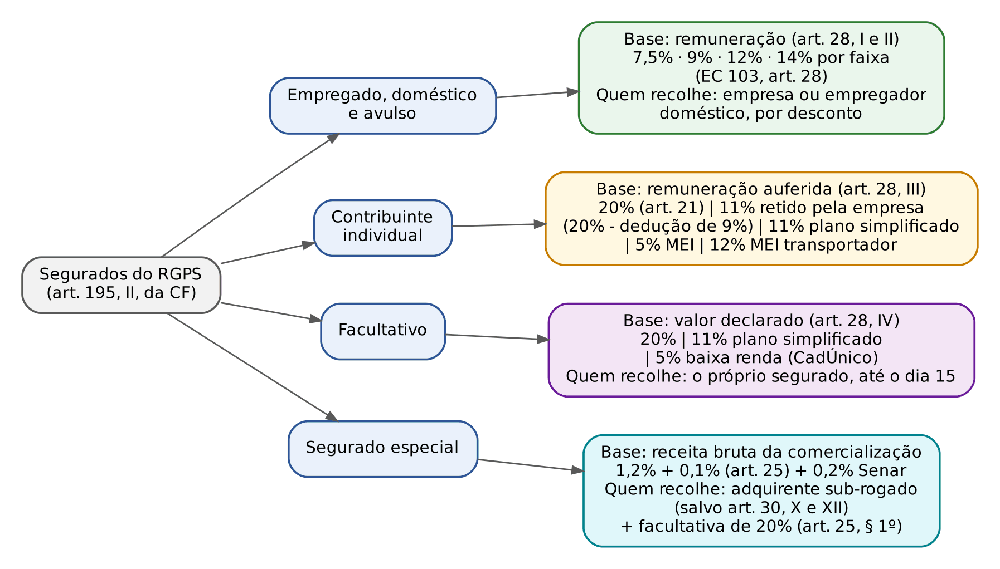
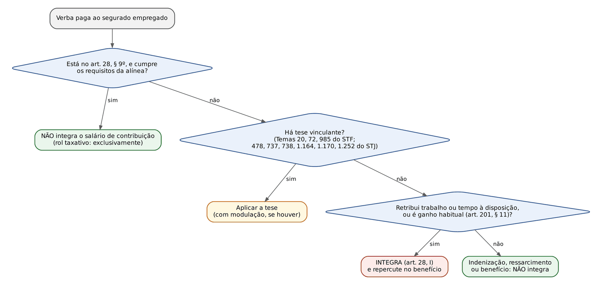
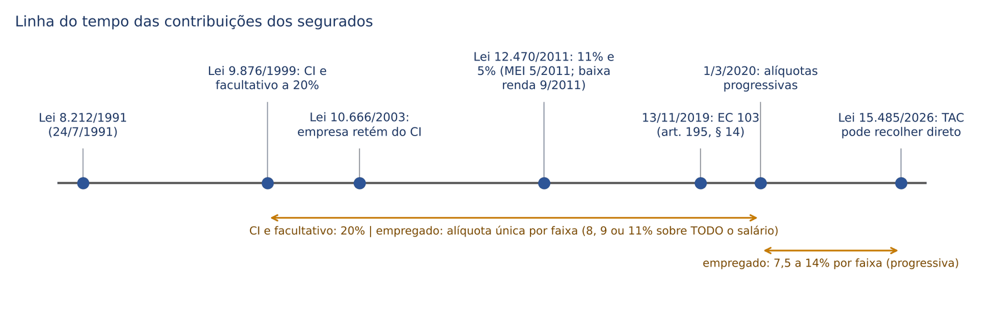
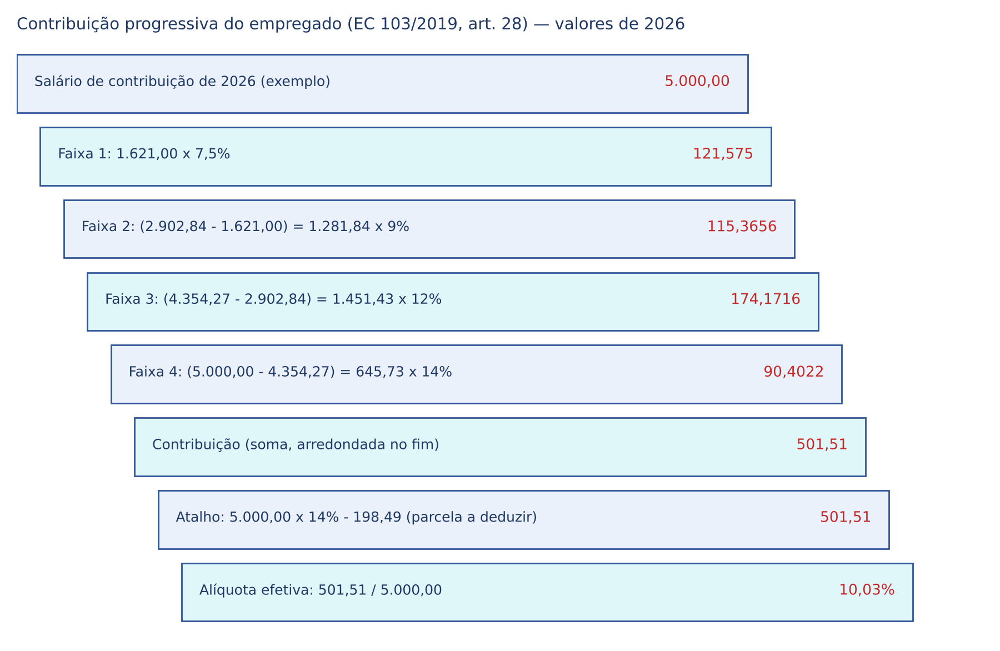
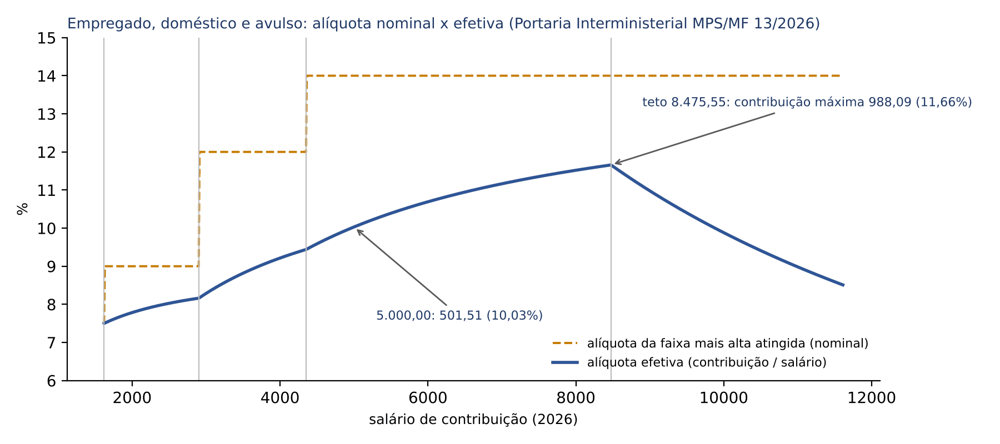
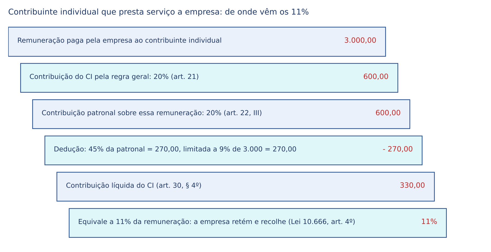
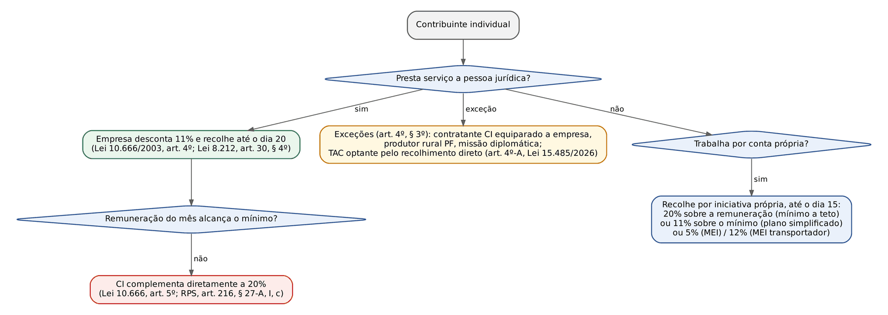
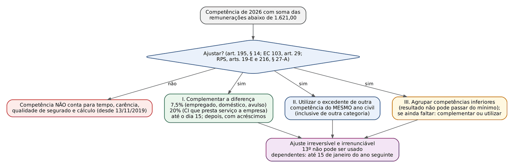

# CAPÍTULO 03 — CUSTEIO II: CONTRIBUIÇÕES DOS SEGURADOS E SALÁRIO DE CONTRIBUIÇÃO

:::INCIDENCIA
Pontos: TRF5 p. 2 (custeio: contribuintes, salário de contribuição). Nível A+.
Lote: FGV 11, FCC 0 (mais 10 correlatas de outros capítulos, 4 delas FCC).
O que mais cai: parcelas que integram ou não o salário de contribuição (art. 28, § 9º, e teses do STF e do STJ), imunidade da aposentadoria e da pensão do RGPS, alíquotas por categoria e progressividade da EC 103/2019.
:::

| Subtema | FGV | FCC | Padrão de cobrança |
|---|---|---|---|
| Parcelas do art. 28, § 9º (PLR, previdência complementar, direitos autorais, vale-cultura, diárias, 13º) | 4 | 0 | Caso de contracheque: "qual parcela integra?" ou "quais duas não integram?" |
| Teses de incidência (aviso prévio indenizado, insalubridade, terço de férias, auxílio-alimentação) | 2 | 0 | Alternativa única com a verba excluída pela jurisprudência |
| Ganhos habituais (art. 201, § 11, da CF) | 1 | 0 (1 correlata) | Comissões habituais integram a base, nos casos e na forma da lei |
| Imunidade da aposentadoria e da pensão; aposentado que trabalha; pensionista | 3 | 0 | Caso: quem contribui sobre o quê; mistura com isenção de IRPF |
| Salário-maternidade como salário de contribuição | 1 | 0 (1 correlata) | Segurada contribui; patronal não incide (Tema 72) |
| Alíquotas progressivas, teto e segurado especial | 0 (correlatas) | 0 (2 correlatas) | Literalidade do art. 195, II; "sem limite máximo" é falso |

## 03.1 Visão geral: quem contribui, sobre o quê e quem recolhe

O art. 195, II, da CF financia a seguridade com a contribuição "do trabalhador e dos demais segurados da previdência social". A Lei 8.212/1991 a desdobra por categoria de segurado (as categorias em si, com seus requisitos de filiação, são do Cap. 7): empregado, empregado doméstico e trabalhador avulso (art. 20, com as alíquotas hoje fixadas no art. 28 da EC 103/2019); contribuinte individual e facultativo (art. 21); segurado especial (art. 25, sobre a receita da comercialização da produção). A base de cálculo de todas, salvo a do segurado especial, é o SALÁRIO DE CONTRIBUIÇÃO, definido no art. 28, cujo valor também alimenta o cálculo dos benefícios (Cap. 11). Essa dupla função explica a lógica do capítulo inteiro: o que integra o salário de contribuição é tributado E, em regra, repercute no benefício (art. 201, § 11, da CF); o que não integra nem é tributado nem conta na média.

| Categoria | Base | Alíquota (2026) | Quem recolhe e prazo | Fundamento |
|---|---|---|---|---|
| Empregado e avulso | Remuneração do mês, entre o piso e o teto | 7,5%, 9%, 12% e 14%, por faixa | Empresa desconta e recolhe até o dia 20 do mês seguinte | EC 103, art. 28; Lei 8.212, arts. 28, I, e 30, I |
| Empregado doméstico | Remuneração registrada na CTPS | Mesma tabela progressiva | Empregador doméstico desconta e recolhe (Simples Doméstico; ver Cap. 4 e 5) | Art. 28, II; art. 30, V; LC 150/2015 |
| Contribuinte individual que presta serviço a empresa | Remuneração paga pela empresa | 20%, reduzidos a 11% pela dedução de 9% | Empresa desconta 11% e recolhe até o dia 20 | Art. 21; art. 30, § 4º; Lei 10.666/2003, art. 4º |
| Contribuinte individual por conta própria | Remuneração auferida no mês | 20%; ou 11% sobre o mínimo (plano simplificado); MEI 5% (transportador MEI 12%) | O próprio segurado, até o dia 15 | Art. 21, caput e § 2º; LC 123/2006, art. 18-F |
| Facultativo | Valor declarado | 20%; 11% (simplificado); 5% (baixa renda) | O próprio segurado, até o dia 15 | Art. 21; art. 28, IV |
| Segurado especial | Receita bruta da comercialização da produção | 1,2% + 0,1% (mais 0,2% ao Senar) | Adquirente sub-rogado, até o dia 20 (salvo venda direta) | Art. 25; art. 30, III, IV, X e XII |

Duas observações de método. Primeira: os prazos de recolhimento, a responsabilidade por retenção e a cobrança são do Cap. 5; aqui só se diz quem recolhe, porque isso decide a prova da contribuição (ver 03.5.2). Segunda: a contribuição do segurado é tributo (contribuição social para a seguridade, art. 195, com anterioridade nonagesimal do § 6º); a teoria geral da espécie está no Cap. 2 e na Apostila de Direito Tributário, Cap. 3. A ressalva doutrinária recorrente é a do facultativo, cuja filiação depende de vontade e por isso, para parte da doutrina, não seria prestação compulsória; o ponto não está pacificado e raramente é cobrado.

### 03.1.1 Imunidade da aposentadoria e da pensão do RGPS

:::LEI CF, art. 195, II (redação da EC 103/2019)
"II - do trabalhador e dos demais segurados da previdência social, podendo ser adotadas alíquotas progressivas de acordo com o valor do salário de contribuição, não incidindo contribuição sobre aposentadoria e pensão concedidas pelo Regime Geral de Previdência Social;"
:::

Três palavras decidem as questões: "podendo" (a progressividade é FACULDADE do legislador, não imposição), "salário de contribuição" (não "salário de benefício") e "aposentadoria e pensão" (a imunidade é literal e restrita a essas duas espécies do Regime Geral). Os demais benefícios não estão imunizados pela CF; ficam fora da base por força de lei (art. 28, § 9º, a: "os benefícios da previdência social, nos termos e limites legais, salvo o salário-maternidade"). A diferença é cobrada: imunidade (CF) para aposentadoria e pensão; não incidência legal para os demais benefícios; e INCIDÊNCIA expressa sobre o salário-maternidade (art. 28, § 2º).

Contraste com os regimes próprios: no RPPS, aposentados e pensionistas CONTRIBUEM sobre a parcela dos proventos que supera o teto do RGPS (art. 40, § 18, da CF), e, havendo déficit atuarial, sobre o que supera o salário mínimo (art. 149, § 1º-A). Essa lógica não se transporta ao RGPS (ver Cap. 24).

:::QUESTAO FGV 2024 — Prefeitura de São José dos Campos — Auditor Tributário Municipal (Q2348966)
Cobrado: aposentada do RGPS com benefício de 4.000 (quatro mil) reais continua empregada como contadora; o que se recolhe?
Gabarito oficial: E (não há contribuição sobre a aposentadoria, imune; há contribuição sobre o salário).
Armadilhas: (B) e (C) importam a lógica do RPPS (contribuição sobre o excedente de um ou dois salários mínimos); (A) "por já ser aposentada" não exime o salário; (D) não existe soma de aposentadoria e salário para aplicar o teto.
No mesmo sentido: FGV 2024 — TCE-GO — Analista de Controle Externo (Q2524481), gabarito D (não incide contribuição sobre a aposentadoria de quem voltou a trabalhar com dois salários mínimos; a alternativa que suspende a aposentadoria e isenta o salário é dupla inversão).
:::

O aposentado que permanece ou volta a trabalhar é segurado obrigatório em relação à nova atividade e contribui normalmente sobre a remuneração (art. 12, § 4º, da Lei 8.212/1991; art. 11, § 3º, da Lei 8.213/1991). Em troca, só faz jus ao salário-família e à reabilitação profissional, quando empregado (art. 18, § 2º, da Lei 8.213/1991; ver Cap. 12, inclusive sobre a desaposentação).

:::JURIS STF, Tema 1.065 (ARE 1.224.327/ES, j. 27/9/2019)
"É constitucional a contribuição previdenciária devida por aposentado pelo Regime Geral de Previdência Social (RGPS) que permaneça em atividade ou a essa retorne."
Fundamento: solidariedade do custeio (art. 195, caput); a contribuição não é contraprestação individual de benefício futuro. É o reverso do que o STF decidiu ao negar a desaposentação: o aposentado contribui sem direito a nova aposentadoria.
:::

:::QUESTAO FGV 2024 — TJ-SC — Juiz Substituto (Q2387025)
Cobrado: pensionista do RGPS desde 2015, diagnosticado com cardiopatia grave em 2022, que trabalha como comentarista remunerado no YouTube; IRPF e contribuição previdenciária sobre o trabalho e sobre a pensão.
Gabarito oficial: A (incidem IRPF e contribuição sobre o rendimento do trabalho; sobre a pensão, isenção de IRPF e imunidade da contribuição).
Passos: (1) contribuição: a pensão do RGPS é IMUNE (art. 195, II); o trabalho remunerado por conta própria o torna contribuinte individual, que recolhe 20% (art. 21). (2) IRPF: a isenção por moléstia grave (art. 6º, XIV, da Lei 7.713/1988) alcança proventos de aposentadoria, reforma e pensão, NÃO rendimentos do trabalho em atividade (a Apostila de Direito Tributário trata do tema).
Armadilhas: (C) troca "imune" por "isento" na pensão (a banca separa os dois institutos); (B) e (E) negam a isenção ao pensionista que trabalha (o trabalho não a afasta quanto à pensão); (D) estende a isenção ao salário.
:::

## 03.2 Salário de contribuição: conceito, limites e regras de apuração

### 03.2.1 Definição por categoria

:::LEI Lei 8.212/1991, art. 28, I a IV
"Art. 28. Entende-se por salário-de-contribuição:
I - para o empregado e trabalhador avulso: a remuneração auferida em uma ou mais empresas, assim entendida a totalidade dos rendimentos pagos, devidos ou creditados a qualquer título, durante o mês, destinados a retribuir o trabalho, qualquer que seja a sua forma, inclusive as gorjetas, os ganhos habituais sob a forma de utilidades e os adiantamentos decorrentes de reajuste salarial, quer pelos serviços efetivamente prestados, quer pelo tempo à disposição do empregador ou tomador de serviços nos termos da lei ou do contrato ou, ainda, de convenção ou acordo coletivo de trabalho ou sentença normativa;
II - para o empregado doméstico: a remuneração registrada na Carteira de Trabalho e Previdência Social, observadas as normas a serem estabelecidas em regulamento para comprovação do vínculo empregatício e do valor da remuneração;
III - para o contribuinte individual: a remuneração auferida em uma ou mais empresas ou pelo exercício de sua atividade por conta própria, durante o mês, observado o limite máximo a que se refere o § 5º;
IV - para o segurado facultativo: o valor por ele declarado, observado o limite máximo a que se refere o § 5º."
:::

Leitura operacional do inciso I, elemento por elemento:

- "pagos, devidos ou creditados": basta a verba ser DEVIDA no mês. O empregado cujo salário não foi pago tem salário de contribuição naquele mês; o fato gerador ocorre na data da prestação do serviço (art. 43, § 2º, da Lei 8.212/1991, incluído pela Lei 11.941/2009). Para o juiz, isso significa que verbas reconhecidas em reclamatória trabalhista integram os salários de contribuição das competências a que se referem, e não do mês do pagamento (a execução das contribuições na Justiça do Trabalho é do Cap. 5; o reflexo no benefício e a eficácia probatória da sentença trabalhista são dos Caps. 9 e 11).
- "em uma ou mais empresas": nos vínculos simultâneos, os salários de contribuição se SOMAM, respeitado o teto (03.4.3).
- "destinados a retribuir o trabalho": é o critério que exclui indenizações, ressarcimentos e benefícios (03.3).
- "inclusive as gorjetas, os ganhos habituais sob a forma de utilidades e os adiantamentos decorrentes de reajuste salarial": integram expressamente. Utilidade habitual (moradia, veículo para uso pessoal) é salário *in natura*; o que é fornecido PARA o trabalho (uniforme, equipamento) não é (art. 28, § 9º, r).
- "quer pelos serviços efetivamente prestados, quer pelo tempo à disposição": o tempo à disposição remunerado (sobreaviso, prontidão, horas *in itinere* enquanto remuneradas) integra.

Para o doméstico, a base é a remuneração REGISTRADA na CTPS (inciso II), o que transfere ao regulamento a disciplina da prova do vínculo e do valor. Para o contribuinte individual, a "remuneração auferida", inclusive por conta própria (inciso III). Para o facultativo, que não tem remuneração, o valor DECLARADO, entre o mínimo e o teto (inciso IV): ele escolhe a base, e a escolha repercute no benefício.

Hipóteses especiais do art. 28:

- § 10: o empregado ou avulso afastado para exercer mandato sindical (art. 12, § 5º) contribui sobre a remuneração efetivamente auferida na entidade sindical ou na empresa de origem.
- § 11 (Lei 13.202/2015): para o contribuinte individual condutor autônomo de veículo rodoviário, auxiliar de condutor em automóvel cedido em regime de colaboração e operador de trator, máquina de terraplenagem, colheitadeira e assemelhados, a remuneração é 20% do valor bruto do frete, carreto, transporte ou serviço, observado o teto. Antes dessa lei, o percentual era fixado por regulamento e portaria, o que o STF invalidou por ofensa à legalidade (Tema 1.223; v. Cap. 2).
- Contribuições dos ministros de confissão religiosa e membros de instituto de vida consagrada: o art. 22, § 13, diz que os valores despendidos pelas entidades religiosas em face do mister religioso ou para a subsistência do ministro "desde que fornecidos em condições que independam da natureza e da quantidade do trabalho executado" NÃO são remuneração (afasta a contribuição patronal); o ministro é contribuinte individual (art. 12, V, c) e recolhe 20% sobre o valor que declarar, com regras regulamentares próprias. FGV 2024 — CVM (Q2517520) cobrou só o enquadramento: freira é segurada obrigatória contribuinte individual (gabarito B; ver Cap. 7).

### 03.2.2 Proporcionalidade, 13º salário e salário-maternidade

- Mês incompleto: "Quando a admissão, a dispensa, o afastamento ou a falta do empregado ocorrer no curso do mês, o salário-de-contribuição será proporcional ao número de dias de trabalho efetivo" (art. 28, § 1º). A consequência pós-EC 103 é relevante: o mês proporcional pode ficar abaixo do mínimo e exigir ajuste (03.7).
- 13º salário: "integra o salário-de-contribuição, exceto para o cálculo de benefício" (art. 28, § 7º, redação da Lei 8.870/1994). Duas consequências: (a) incide contribuição sobre a gratificação natalina (Súmula 688 do STF: "É legítima a incidência da contribuição previdenciária sobre o 13º salário"); (b) o 13º NÃO entra no período básico de cálculo do salário de benefício (Cap. 11). O regulamento manda calcular a contribuição do 13º em separado, sem somá-lo à remuneração de dezembro (por isso ele tem tabela própria e não pode ser usado para ajustes de competência abaixo do mínimo: art. 216, § 27-B, do Decreto 3.048/1999).
- Salário-maternidade: "é considerado salário-de-contribuição" (art. 28, § 2º), e a alínea a do § 9º o ressalva expressamente da exclusão dos benefícios. A segurada empregada contribui sobre ele (o desconto é feito pela empresa que paga e compensa o benefício, ou pelo INSS). O Tema 72 do STF afastou SOMENTE a contribuição PATRONAL (ver 03.3.3).

:::QUESTAO FGV 2024 — EPE — Advogado (Q2759029)
Cobrado: empregada grávida, remuneração de 6.500 (seis mil e quinhentos) reais, vai receber salário-maternidade; ela contribui?
Gabarito oficial: E (recolherá, pois a imunidade só existe para aposentadorias e pensão por morte).
Fundamento: art. 195, II (imunidade restrita à aposentadoria e à pensão) + art. 28, § 2º, e § 9º, a (salário-maternidade é salário de contribuição).
Armadilhas: (B) supõe imunidade de todos os benefícios; (D) "isenção legal" vale para os demais benefícios, não para o salário-maternidade; (C) "como todos os benefícios" é falso; (A) a remuneração abaixo do teto é irrelevante.
Correlata: FCC 2024 — Procurador de Jaboatão dos Guararapes (Q3542153), gabarito B: o STF declarou inconstitucional a contribuição a cargo do EMPREGADOR sobre o salário-maternidade (Tema 72); a FCC tentou induzir que Estados poderiam instituí-la por lei.
:::

### 03.2.3 Limites mínimo e máximo

:::LEI Lei 8.212/1991, art. 28, §§ 3º, 4º e 5º
"§ 3º O limite mínimo do salário-de-contribuição corresponde ao piso salarial, legal ou normativo, da categoria ou, inexistindo este, ao salário mínimo, tomado no seu valor mensal, diário ou horário, conforme o ajustado e o tempo de trabalho efetivo durante o mês.
§ 4º O limite mínimo do salário-de-contribuição do menor aprendiz corresponde à sua remuneração mínima definida em lei.
§ 5º O limite máximo do salário-de-contribuição é de Cr$ 170.000,00 (cento e setenta mil cruzeiros), reajustado a partir da data da entrada em vigor desta Lei, na mesma época e com os mesmos índices que os do reajustamento dos benefícios de prestação continuada da Previdência Social."
:::

Mecânica dos limites:

- Mínimo: para o empregado, o piso da categoria ou o salário mínimo, mas "tomado no seu valor mensal, diário ou horário, conforme o ajustado e o tempo de trabalho efetivo" (§ 3º). Isto é, para quem trabalha meio período ou por hora, a lei já admitia salário de contribuição inferior ao salário mínimo mensal. Para o contribuinte individual e o facultativo, o mínimo é o salário mínimo mensal (art. 214, § 3º, I, do Decreto 3.048/1999, redação do Decreto 10.491/2020). A EC 103/2019 não mudou o § 3º; mudou o EFEITO de uma competência abaixo do salário mínimo mensal (art. 195, § 14; 03.7).
- Máximo (teto): fixado em 1991 em cruzeiros e reajustado como os benefícios. Os tetos foram elevados pelas EC 20/1998 (art. 14) e EC 41/2003 (art. 5º), com as revisões estudadas no Cap. 22. Em 2026, pela Portaria Interministerial MPS/MF 13, de 9/1/2026, o salário mínimo é de 1.621 (mil seiscentos e vinte e um) reais e o teto, de 8.475,55 (oito mil quatrocentos e setenta e cinco reais e cinquenta e cinco centavos).
- O teto vale para TODAS as categorias de segurado, inclusive o contribuinte individual. A tese de que o teto só limitaria o cálculo do benefício, e não a contribuição do contribuinte individual, é falsa (art. 28, III, "observado o limite máximo"); a pegadinha caiu em prova de juiz federal.

:::PEGADINHA Teto: segurado x empresa
A contribuição do SEGURADO tem teto (o salário de contribuição é limitado). A contribuição da EMPRESA sobre a folha (art. 22, I e III) incide sobre o "total das remunerações", SEM teto: quem ganha 30.000 (trinta mil) reais contribui sobre 8.475,55, mas a empresa paga 20% sobre os 30.000. Exceção: a contribuição do empregador doméstico incide sobre o salário de contribuição do empregado (art. 24), e por isso é limitada ao teto (Cap. 4).
FCC 2025 — TRT-15 — Analista Judiciário (Q3295855, correlata do Cap. 4): é FALSO que as alíquotas progressivas do empregado incidam "sobre a totalidade da remuneração recebida, sem qualquer limite máximo"; o gabarito (D) foi a literalidade de que integram o custeio as contribuições das empresas sobre receita ou faturamento e a receita de concursos de prognósticos.
:::

### 03.2.4 Ganhos habituais e a repercussão no benefício

:::LEI CF, art. 201, § 11 (incluído pela EC 20/1998)
"§ 11. Os ganhos habituais do empregado, a qualquer título, serão incorporados ao salário para efeito de contribuição previdenciária e conseqüente repercussão em benefícios, nos casos e na forma da lei."
:::

O dispositivo tem duas mãos: autoriza (e impõe) a incidência sobre o que é habitual, ainda que receba outro nome, e garante que o que foi tributado repercuta no benefício (contrapartida, art. 195, § 5º, lido ao contrário). É o fundamento constitucional do Tema 20 do STF.

:::JURIS STF, Tema 20 (RE 565.160/SC, j. 29/3/2017)
"A contribuição social a cargo do empregador incide sobre ganhos habituais do empregado, quer anteriores ou posteriores à Emenda Constitucional 20/1998."
Alcance: o STF leu a expressão "folha de salários" (art. 195, I, a) em conjunto com o art. 201, § 11 (antes, § 4º): o que é pago com habitualidade em razão do trabalho é salário para fins de custeio. O critério da habitualidade, firmado para a patronal, vale igualmente para a base do segurado (art. 28, I, e art. 22, § 2º, remetem ao mesmo rol do § 9º). A tese NÃO resolve sozinha cada verba: o próprio STF, depois, aplicou-a caso a caso (terço de férias, Tema 985; salário-maternidade, Tema 72), e muitas verbas foram decididas pelo STJ como matéria infraconstitucional.
:::

:::QUESTAO FGV 2024 — Direito Constitucional, Ordem Social (Q3043798)
Cobrado: empregada recebe, além do salário, comissões variáveis mas contínuas sobre vendas; a contribuição só incide sobre o salário. O que diz a CF?
Gabarito oficial: C (deve incidir sobre as receitas habituais que recebe, que não o salário, nos casos e na forma da lei).
Armadilhas: (D) separa incidência e repercussão no benefício, que o § 11 une ("conseqüente repercussão em benefícios"); (B) "remuneração fixa, não variável" (variabilidade não afasta a habitualidade); (E) nega a remessa à lei ("nos casos e na forma da lei" está no texto).
Correlata: FCC 2025 — PGE-TO — Procurador (Q3745613), gabarito E: a inovação da EC 103/2019 no art. 201 foi vedar a contagem de tempo de contribuição fictício (§ 14); a regra dos ganhos habituais (alternativa A) é da EC 20/1998, e não da EC 103.
:::

## 03.3 Parcelas integrantes e não integrantes

### 03.3.1 O rol do § 9º: taxativo e condicionado

:::LEI Lei 8.212/1991, art. 28, § 9º (alíneas mais cobradas)
"§ 9º Não integram o salário-de-contribuição para os fins desta Lei, exclusivamente:
a) os benefícios da previdência social, nos termos e limites legais, salvo o salário-maternidade;
[...]
d) as importâncias recebidas a título de férias indenizadas e respectivo adicional constitucional, inclusive o valor correspondente à dobra da remuneração de férias de que trata o art. 137 da Consolidação das Leis do Trabalho- CLT;
e) as importâncias: [...] 5. recebidas a título de incentivo à demissão; 6. recebidas a título de abono de férias na forma dos arts. 143 e 144 da CLT; 7. recebidas a título de ganhos eventuais e os abonos expressamente desvinculados do salário; 8. recebidas a título de licença-prêmio indenizada; [...]
f) a parcela recebida a título de vale-transporte, na forma da legislação própria;
g) a ajuda de custo, em parcela única, recebida exclusivamente em decorrência de mudança de local de trabalho do empregado, na forma do art. 470 da CLT;
h) as diárias para viagens;
[...]
j) a participação nos lucros ou resultados da empresa, quando paga ou creditada de acordo com lei específica;
[...]
n) a importância paga ao empregado a título de complementação ao valor do auxílio-doença, desde que este direito seja extensivo à totalidade dos empregados da empresa;
[...]
p) o valor das contribuições efetivamente pago pela pessoa jurídica relativo a programa de previdência complementar, aberto ou fechado, desde que disponível à totalidade de seus empregados e dirigentes, observados, no que couber, os arts. 9º e 468 da CLT;
q) o valor relativo à assistência prestada por serviço médico ou odontológico, próprio da empresa ou por ela conveniado, inclusive o reembolso de despesas com medicamentos, óculos, aparelhos ortopédicos, próteses, órteses, despesas médico-hospitalares e outras similares;
[...]
v) os valores recebidos em decorrência da cessão de direitos autorais;
[...]
y) o valor correspondente ao vale-cultura.
z) os prêmios e os abonos."
:::

Três chaves de leitura:

1. "exclusivamente": o rol é TAXATIVO. O STJ aplica a mesma premissa ao FGTS, cuja base remete ao art. 28, § 9º (Súmula 646 do STJ: "É irrelevante a natureza da verba trabalhista para fins de incidência da contribuição ao FGTS, visto que apenas as verbas elencadas em lei (art. 28, § 9º, da Lei nº 8.212/1991), em rol taxativo, estão excluídas da sua base de cálculo"). Para as contribuições previdenciárias, porém, a taxatividade convive com o filtro constitucional: verba que não retribui trabalho (indenizatória ou benefício) fica fora ainda que não listada, porque não é "folha de salários e demais rendimentos do trabalho" (art. 195, I, a) nem "salário de contribuição" (art. 28, I). É por isso que o STJ excluiu o aviso prévio indenizado e os 15 primeiros dias de afastamento, ausentes do § 9º (03.3.3). Na prova: pergunta pela LEI, responda com o § 9º; pergunta pela JURISPRUDÊNCIA, aplique também as teses.
2. Várias exclusões são CONDICIONADAS: PLR "de acordo com lei específica" (j); vale-transporte "na forma da legislação própria" (f); ajuda de custo "em parcela única" e "exclusivamente" por mudança de local (g); complementação do auxílio por incapacidade "extensivo à totalidade dos empregados" (n); previdência complementar "disponível à totalidade de seus empregados e dirigentes" (p); plano educacional dentro dos limites da alínea t; reembolso-creche até seis anos de idade e comprovado (s). Descumprida a condição, a verba INTEGRA. As bancas trocam as condições entre as alíneas (a de totalidade dos empregados não é requisito da PLR).
3. A Lei 13.467/2017 (Reforma Trabalhista) alterou três alíneas cobráveis: h (diárias para viagens, sem o antigo limite de 50% da remuneração), q (assistência médica e odontológica, sem exigir cobertura de todos os empregados) e z (prêmios e abonos, incluída). Em paralelo, o § 2º do art. 457 da CLT, na redação da mesma lei, diz que ajuda de custo, auxílio-alimentação (vedado o pagamento em dinheiro), diárias, prêmios e abonos não integram a remuneração nem constituem base de incidência de encargo trabalhista e previdenciário.

:::PEGADINHA Diárias "até 50% da remuneração"
Antes da Lei 13.467/2017, a alínea h excluía as diárias "que não excedam a cinquenta por cento da remuneração mensal" (e o § 8º, a, mandava incluir o total quando excedessem). A redação vigente é seca: "as diárias para viagens". Material desatualizado (inclusive comentários de vade-mécuns) ainda menciona o limite. Em prova, o limite de 50% está REVOGADO; eventual abuso (diária que mascara salário) se resolve pela natureza da verba (fraude, art. 9º da CLT), não pelo percentual.
:::

### 03.3.2 Quadro integra x não integra

| Verba | Integra? | Fundamento |
|---|---|---|
| Salário, horas extras e seu adicional, adicional noturno, de periculosidade e de insalubridade | SIM | Art. 28, I; insalubridade: Tema 1.252 do STJ |
| Gorjetas; utilidades habituais; adiantamentos de reajuste | SIM | Art. 28, I (literal) |
| 13º salário | SIM (mas não entra no cálculo do benefício) | Art. 28, § 7º; Súmula 688 do STF |
| 13º proporcional ao período do aviso prévio indenizado | SIM | Tema 1.170 do STJ |
| Salário-maternidade | SIM para a segurada; NÃO para a patronal | Art. 28, § 2º; Tema 72 do STF |
| Terço constitucional de férias GOZADAS | SIM (patronal, desde 15/9/2020, ressalvadas as ações anteriores) | Tema 985 do STF e modulação (RE 1.072.485 ED) |
| Férias indenizadas e seu terço; dobra do art. 137 da CLT | NÃO | Art. 28, § 9º, d |
| Abono de férias (arts. 143 e 144 da CLT) | NÃO | Art. 28, § 9º, e, 6 |
| Aviso prévio indenizado | NÃO | Tema 478 do STJ |
| 15 primeiros dias de afastamento por incapacidade (pagos pela empresa) | NÃO | Tema 738 do STJ |
| Complementação do auxílio por incapacidade estendida a todos | NÃO | Art. 28, § 9º, n |
| Salário-paternidade (licença de 5 dias paga pela empresa) | SIM (até a mudança legal de 2027) | Tema 740 do STJ; Lei 15.371/2026 (v. Cap. 17) |
| Auxílio-alimentação em PECÚNIA | SIM | Tema 1.164 do STJ |
| Alimentação *in natura* no PAT | NÃO | Art. 28, § 9º, c |
| Vale-transporte na forma da lei (mesmo pago em dinheiro, segundo o STF) | NÃO | Art. 28, § 9º, f |
| Diárias para viagem | NÃO | Art. 28, § 9º, h (sem limite desde 2017) |
| Ajuda de custo única por transferência | NÃO | Art. 28, § 9º, g |
| PLR conforme a Lei 10.101/2000 | NÃO | Art. 7º, XI, da CF; art. 28, § 9º, j |
| Prêmios e abonos (desde a Lei 13.467/2017) | NÃO | Art. 28, § 9º, z; art. 457, § 2º, da CLT |
| Abono incorporado ao salário | SIM | Súmula 241 do STF |
| Previdência complementar disponível a todos | NÃO | Art. 28, § 9º, p (ver a virada do STJ em 2026 abaixo) |
| Assistência médica, odontológica e reembolsos de saúde | NÃO | Art. 28, § 9º, q |
| Auxílio-creche (reembolso conforme a lei trabalhista) | NÃO | Súmula 310 do STJ; art. 28, § 9º, s |
| Cessão de direitos autorais; vale-cultura | NÃO | Art. 28, § 9º, v e y |
| Bolsa de estágio na forma da lei | NÃO | Art. 28, § 9º, i |
| Remuneração do aprendiz | SIM | Tema 1.342 do STJ |
| Valores DESCONTADOS do empregado (vale-transporte, alimentação, plano de saúde, IRRF, a própria contribuição) | Não reduzem a base | Tema 1.174 do STJ |
| Correção monetária de verbas remuneratórias pagas em execução | SIM | Tema 501 do STJ |
| Comissão paga a corretor de seguros (mesmo sem vínculo) | SIM | Súmula 458 do STJ |

### 03.3.3 As teses que decidem as questões

A maior parte dos repetitivos e temas de repercussão geral foi julgada em ações de EMPRESAS (contribuição patronal, RAT e terceiros). Como o art. 22, § 2º, remete ao mesmo § 9º do art. 28 e o critério material é o mesmo (retribuição do trabalho), a conclusão vale, em regra, para a base do segurado; a exceção importante é o salário-maternidade, em que o art. 28, § 2º, mantém a contribuição da segurada. O detalhamento processual (mandado de segurança das empresas, compensação, terceiros) está no Cap. 4 e na Apostila de Direito Tributário, Cap. 26.

:::JURIS STF, Tema 985 (RE 1.072.485/PR, j. 31/8/2020) e modulação (RE 1.072.485 ED/PR, Plenário, j. 12/6/2024, Info 1141)
Tese: "É legítima a incidência de contribuição social, a cargo do empregador, sobre os valores pagos ao empregado a título de terço constitucional de férias gozadas."
Modulação: como o STJ entendia o contrário (Tema 479), o STF limitou os efeitos: até a publicação da ata do julgamento de mérito (15/9/2020, segundo a fonte consultada), "devem ser mantidos apenas os pagamentos já efetuados pelas empresas e não questionados judicialmente". Quem ajuizou ação antes e não pagou não deve o período anterior; quem pagou sem litigar não recupera.
Distinção: férias INDENIZADAS e seu terço continuam fora (art. 28, § 9º, d).
:::

:::JURIS STJ, revisão dos repetitivos sobre verbas (REsp 1.230.957/RS, Primeira Seção, j. 13/5/2026)
Em juízo de adequação aos Temas 985 e 72 do STF, o STJ cancelou os Temas 479 (terço de férias) e 739 (salário-maternidade) e MANTEVE:
- Tema 478: não incide contribuição a cargo da empresa sobre o aviso prévio indenizado (verba indenizatória);
- Tema 737: férias indenizadas fora da base;
- Tema 738: não incide sobre a importância paga nos 15 dias que antecedem o auxílio-doença (hoje, auxílio por incapacidade temporária), por não ter natureza salarial;
- Tema 740: incide sobre o salário-paternidade (ônus da empresa, verba salarial).
:::

A partir de 1/1/2027, a Lei 15.371/2026 cria o salário-paternidade como benefício do RGPS, pago pela empresa ao empregado com reembolso (v. Cap. 17); para fatos posteriores, desaparece a premissa do Tema 740 (verba salarial a cargo da empresa), e a lógica do Tema 72 tende a afastar a contribuição patronal, ponto ainda não enfrentado pela jurisprudência.

O Tema 72 do STF (inconstitucionalidade da contribuição PATRONAL sobre o salário-maternidade) não alcança a segurada: a contribuição dela tem base legal expressa (art. 28, § 2º) e serve à contagem do período como tempo de contribuição (v. Cap. 2).

Outras teses recentes do STJ (repetitivos), todas sobre a base patronal e de terceiros, com o mesmo raciocínio:

- Tema 1.164 (REsp 1.995.437/CE, j. 26/4/2023): "Incide a contribuição previdenciária a cargo do empregador sobre o auxílio-alimentação pago em pecúnia". O pagamento em dinheiro desnatura a exclusão da alínea c (que exige parcela *in natura* em programa aprovado).
- Tema 1.170 (REsps 1.974.197/AM, 2.000.020/MG e 2.006.644/MG, j. 13/3/2024): incide sobre o 13º proporcional relativo ao período do aviso prévio indenizado. O aviso indenizado em si está fora (Tema 478), mas o 13º gerado por sua projeção é gratificação natalina (art. 28, § 7º).
- Tema 1.252 (REsp 2.050.498/SP e outros, j. 20/6/2024): incide sobre o adicional de insalubridade, "em razão da sua natureza remuneratória".
- Tema 1.174 (REsp 2.005.029/SC e outros, j. 14/8/2024): os valores de vale-transporte, vale-refeição ou alimentação, plano de saúde, IRRF e contribuição do empregado DESCONTADOS da folha "constituem simples técnica de arrecadação" e não reduzem a base da patronal, do SAT e de terceiros. Raciocínio: a base é a remuneração bruta; o desconto é só forma de pagamento de obrigação do empregado.
- Tema 1.342 (REsp 2.191.479/SP e REsp 2.191.694/SP, j. 13/8/2025): a remuneração do contrato de aprendizagem (art. 428 da CLT) integra a base da patronal, do GIIL-RAT e de terceiros. Antes, no mesmo sentido, AgInt no AREsp 2.520.394/RS (j. 12/2/2025, Info 844).
- Tema 501 (REsp 1.268.737/RS, j. 14/2/2017): incide contribuição sobre a correção monetária de valores pagos em execução de sentença que reconheceu reajuste a servidores (acessório segue a natureza remuneratória do principal).

:::QUESTAO FGV 2025 — TJ-CE — Juiz Substituto (Q3505831)
Cobrado: metalúrgica autuada por não recolher a patronal sobre o adicional de insalubridade.
Gabarito oficial: B (integra a remuneração, natureza remuneratória, incide a patronal).
Fundamento: Tema 1.252 do STJ; art. 22, I, e art. 28, I.
Armadilhas: (A) e (C) tratam o adicional como indenização ou "compensação por risco"; (D) inverte a lógica (o § 9º lista exclusões; não é preciso listar o que integra); (E) afirma que a natureza da verba é irrelevante para a contribuição, o que só é verdade para o FGTS (Súmula 646 do STJ), e ainda chama a insalubridade de indenizatória.
:::

:::QUESTAO FGV 2024 — Câmara de Fortaleza — Consultor Legislativo (Q2466079)
Cobrado: segundo a CF e a jurisprudência do STF e do STJ, sobre qual verba NÃO incide contribuição?
Gabarito oficial: D (aviso prévio indenizado).
Fundamento: Tema 478 do STJ (não há trabalho a retribuir; natureza indenizatória). Complemento: o aviso prévio indenizado tampouco conta como tempo de contribuição (Tema 1.238 do STJ, j. 6/2/2025, ver Cap. 9), coerente com a não incidência.
Armadilhas: terço de férias gozadas (Tema 985), auxílio-alimentação em pecúnia (Tema 1.164), horas extras e 13º (art. 28, I e § 7º; Súmula 688) sofrem incidência.
:::

### 03.3.4 PLR e previdência complementar: as duas condições que a FGV mais explora

PLR. A CF desvincula a participação nos lucros ou resultados da remuneração (art. 7º, XI: "participação nos lucros, ou resultados, desvinculada da remuneração, e, excepcionalmente, participação na gestão da empresa, conforme definido em lei"). A exclusão do salário de contribuição depende de pagamento "de acordo com lei específica" (art. 28, § 9º, j), hoje a Lei 10.101/2000 (negociação por comissão paritária ou convenção ou acordo coletivo, regras claras e objetivas, periodicidade mínima). PLR paga em desacordo com a lei (por exemplo, mensal e fixa, substituindo salário) é remuneração e integra a base. Não há exigência de que a PLR alcance TODOS os empregados como condição da alínea j; esse requisito pertence às alíneas n e p.

:::QUESTAO FGV 2025 — TRF-1 — Juiz Federal Substituto (Q3425282)
Cobrado: indústria paga PLR prevista em acordo coletivo, depois de apurada a lucratividade, em estrita observância à norma coletiva.
Gabarito oficial: B (desprovidos de natureza salarial, desde que pagos em estrita conformidade com a legislação vigente).
Armadilhas: (C) "imunidade" (é não incidência por exclusão legal, ainda que com raiz no art. 7º, XI); (E) importa o requisito de "totalidade dos empregados" da previdência complementar; (D) mistura RPPS sem razão; (A) natureza salarial (só se paga fora da lei). Consequência que a FGV já cobrou em 2023 para o TRF-1: excluída do salário de contribuição, a PLR também não entra no salário de benefício, e a exclusão vale para a contribuição patronal (art. 22, § 2º).
:::

Previdência complementar. A alínea p exclui as contribuições da pessoa jurídica a plano aberto ou fechado "desde que disponível à totalidade de seus empregados e dirigentes". A literalidade conduz à conclusão de que o plano restrito a diretores integra a base. Mas a LC 109/2001, posterior, dispõe no art. 69, § 1º, que sobre as contribuições vertidas às entidades de previdência complementar destinadas ao custeio dos planos não incidem tributação e contribuições de qualquer natureza, sem distinguir a abrangência dos participantes.

:::JURIS STJ, REsp 2.142.645/PE, Relator Ministro Afrânio Vilela, Segunda Turma, j. 17/3/2026 (DJEN 23/3/2026; Info 897)
Plano de previdência aberto destinado apenas a diretores e dirigentes: NÃO incide contribuição previdenciária sobre os aportes da empresa. O art. 69, § 1º, da LC 109/2001 revogou tácita e parcialmente a exigência de universalidade do art. 28, § 9º, p, da Lei 8.212/1991, pelo critério cronológico (art. 2º, § 1º, da LINDB). Julgamento unânime; segundo fontes secundárias, seguiu precedente da Primeira Turma (REsp 1.182.060/SC), o que indicaria convergência das duas Turmas de direito público. Não é repetitivo.
:::

:::QUESTAO FGV 2025 — TRF-5 — Juiz Substituto (Q3373854)
Cobrado: empresa com 1.500 empregados paga diversas parcelas; qual DEVE ser adicionada ao salário de contribuição?
Gabarito oficial: E (aportes à previdência complementar, quando não extensível a todos os empregados).
Fundamento do gabarito: literalidade da alínea p. As demais estão expressamente excluídas: licença-prêmio indenizada (e, 8), vale-transporte na forma da lei (f), diárias para viagem (h), PLR na forma da lei (j).
Atenção: a prova é de 2025, anterior ao REsp 2.142.645/PE (j. 17/3/2026). Para a orientação atual das duas Turmas do STJ, o requisito de universalidade está tacitamente revogado pelo art. 69, § 1º, da LC 109/2001, e a alternativa E deixaria de ser correta. Em prova objetiva, siga o comando: "de acordo com a lei" ou "a norma de regência" pede a alínea p; "segundo a jurisprudência do STJ" pede o REsp 2.142.645/PE.
:::

:::QUESTAO FGV 2025 — TCE-PI — Auditor de Controle Externo (Q3154446)
Cobrado: no contracheque do empregado, quais DOIS direitos não sofrem incidência?
Gabarito oficial: B (cessão de direitos autorais e vale-cultura: art. 28, § 9º, v e y).
Por que as outras falham: cada uma junta uma verba excluída a outra que integra. (A) diárias (h) com 13º (§ 7º, integra); (C) férias indenizadas (d) com "remuneração auferida" (base do art. 28); (D) vale-transporte (f) com gorjetas (integram, art. 28, I); (E) PLR (j) com adiantamentos de reajuste salarial (integram, art. 28, I).
No mesmo sentido, invertido: FGV 2024 — Prefeitura de Macaé — Procurador (Q3049955), gabarito E: das parcelas listadas, a que integra a base é o 13º salário (art. 28, § 7º; Súmula 688 do STF); cessão de direitos autorais, PLR, diárias e férias indenizadas com o terço estão no § 9º.
:::

:::DICA Técnica de prova para o § 9º
A FGV monta alternativas em pares ("X e Y"). Memorize as verbas que INTEGRAM e são usadas como isca: 13º, gorjetas, adiantamento de reajuste, utilidades habituais, salário-maternidade (para a segurada), terço de férias gozadas, adicionais (horas extras, noturno, insalubridade, periculosidade), auxílio-alimentação em dinheiro, abono incorporado (Súmula 241 do STF). Se um dos elementos do par está nessa lista, o par está errado.
:::

:::PASSO Como decidir se uma verba integra o salário de contribuição do segurado
1. Identifique a categoria: empregado e avulso (art. 28, I), doméstico (II), contribuinte individual (III) ou facultativo (IV, valor declarado: o problema de "verbas" só existe para quem tem remuneração).
2. A verba está no § 9º? Confira a CONDIÇÃO da alínea (lei específica, totalidade dos empregados, parcela única, *in natura*, na forma da legislação). Cumprida, não integra.
3. Há tese vinculante? Aplique (Temas 20, 72 e 985 do STF; 478, 737, 738, 740, 1.164, 1.170, 1.174, 1.252 e 1.342 do STJ), lembrando que quase todas foram firmadas para a patronal e que o salário-maternidade continua base da segurada.
4. Sem tese: a verba retribui trabalho ou tempo à disposição, ou é habitual (art. 201, § 11)? Integra. É indenização, ressarcimento de despesa feita para o trabalho ou benefício? Não integra.
5. Integrando, a verba repercute no salário de benefício (art. 29 da Lei 8.213/1991), salvo o 13º (art. 28, § 7º); não integrando, não repercute (Cap. 11).
:::

:::PROCESSO Repetição de contribuição descontada do segurado sobre verba não tributável
Legitimidade passiva: a UNIÃO (Fazenda Nacional), e não o INSS, porque a Lei 11.457/2007 transferiu à Receita Federal a arrecadação, a fiscalização e a cobrança das contribuições dos arts. 11 e 12 da Lei 8.212/1991, e a representação judicial à PGFN. Competência: Justiça Federal (art. 109, I, da CF), Juizado Especial Federal até 60 salários mínimos. Prazo: cinco anos do pagamento indevido (arts. 165 e 168, I, do CTN; LC 118/2005; Cap. 5).
Ponto de atenção: o segurado que pede a exclusão de uma verba da base para repetir o que pagou perde, coerentemente, a repercussão dessa verba no salário de benefício; e o segurado que pede a INCLUSÃO de verba trabalhista no cálculo do benefício litiga contra o INSS (revisão de RMI, Cap. 11), não contra a União.
:::

## 03.4 Empregado, empregado doméstico e trabalhador avulso: as alíquotas progressivas

### 03.4.1 Antes e depois da EC 103/2019

O art. 20 da Lei 8.212/1991 ainda traz, no texto compilado, a tabela de 1995 (8%, 9% e 11%, "de forma não cumulativa"). "Não cumulativa" significava alíquota ÚNICA conforme a faixa em que caía o salário: quem estava na última faixa pagava 11% sobre TODO o salário de contribuição. A EC 103/2019 substituiu esse modelo, em caráter transitório e com hierarquia constitucional, até que lei disponha de outro modo.

:::LEI EC 103/2019, art. 28
"Art. 28. Até que lei altere as alíquotas da contribuição de que trata a Lei nº 8.212, de 24 de julho de 1991, devidas pelo segurado empregado, inclusive o doméstico, e pelo trabalhador avulso, estas serão de:
I - até 1 (um) salário-mínimo, 7,5% (sete inteiros e cinco décimos por cento);
II - acima de 1 (um) salário-mínimo até R$ 2.000,00 (dois mil reais), 9% (nove por cento);
III - de R$ 2.000,01 (dois mil reais e um centavo) até R$ 3.000,00 (três mil reais), 12% (doze por cento); e
IV - de R$ 3.000,01 (três mil reais e um centavo) até o limite do salário de contribuição, 14% (quatorze por cento).
§ 1º As alíquotas previstas no caput serão aplicadas de forma progressiva sobre o salário de contribuição do segurado, incidindo cada alíquota sobre a faixa de valores compreendida nos respectivos limites.
§ 2º Os valores previstos no caput serão reajustados, a partir da data de entrada em vigor desta Emenda Constitucional, na mesma data e com o mesmo índice em que se der o reajuste dos benefícios do Regime Geral de Previdência Social, ressalvados aqueles vinculados ao salário-mínimo, aos quais se aplica a legislação específica."
:::

| Aspecto | Até 29/2/2020 | Desde 1/3/2020 |
|---|---|---|
| Fonte | Art. 20 da Lei 8.212/1991 (redação da Lei 9.032/1995) | Art. 28 da EC 103/2019 (norma transitória com força constitucional; RPS, art. 198, redação do Decreto 10.410/2020) |
| Alíquotas | 8%, 9%, 11% | 7,5%, 9%, 12%, 14% |
| Técnica | Alíquota única da faixa sobre todo o salário (não cumulativa) | Progressiva por faixas (cada alíquota sobre a parcela da faixa), como no IRPF |
| Faixas | Reajustadas como os benefícios | Primeira faixa = salário mínimo (segue a política do salário mínimo); demais, pelo índice dos benefícios |
| Autorização constitucional | Art. 195, II, sem menção a progressividade | Art. 195, II: "podendo ser adotadas alíquotas progressivas" |

Vigência: o art. 36, I, da EC 103/2019 diferiu o art. 28 para "o primeiro dia do quarto mês subsequente ao da data de publicação" da emenda. Publicada em 13/11/2019, a progressividade vale desde a competência março de 2020 (1/3/2020). As demais normas da emenda, inclusive o § 14 do art. 195, vigoram desde a publicação (art. 36, III).

Q2564686 (FCC, 2024, TRF-3, Técnico Judiciário): cobrou a redação exata do art. 195 da CF (alíquotas progressivas de acordo com o salário de contribuição e não incidência sobre aposentadoria e pensão do RGPS), gabarito D — comentada no Cap. 2. Para este capítulo: a FCC também testa (Q3562234 e Q3891355, correlatas do Cap. 2) que a progressividade é autorização, e não imposição, e que a equidade no custeio não proíbe faixas progressivas.

### 03.4.2 A escada de cálculo com os valores de 2026

Faixas de 2026 (Portaria Interministerial MPS/MF 13/2026): até 1.621,00 (7,5%); de 1.621,01 a 2.902,84 (9%); de 2.902,85 a 4.354,27 (12%); de 4.354,28 a 8.475,55 (14%).

:::EXEMPLO Empregada com salário de contribuição de 5.000 (cinco mil) reais em 2026
1. Faixa 1: 1.621,00 x 7,5% = 121,575.
2. Faixa 2: (2.902,84 - 1.621,00) = 1.281,84 x 9% = 115,3656.
3. Faixa 3: (4.354,27 - 2.902,84) = 1.451,43 x 12% = 174,1716.
4. Faixa 4: (5.000,00 - 4.354,27) = 645,73 x 14% = 90,4022.
5. Soma: 501,5144, arredondada a 501,51. Alíquota efetiva: 501,51 / 5.000,00 = 10,03%.
6. Conferência pelo atalho da "parcela a deduzir" (mesma técnica da tabela do IRPF): 5.000,00 x 14% - 198,49 = 501,51. As parcelas a deduzir de 2026 são 0 (faixa 1), 24,32 (faixa 2), 111,40 (faixa 3) e 198,49 (faixa 4).
7. No regime anterior a 3/2020, quem estava na última faixa pagava a alíquota cheia sobre todo o salário (11% de 5.000,00 seriam 550,00); a progressividade beneficia a base e onera o topo.
:::

| Salário de contribuição (2026) | Contribuição | Alíquota efetiva |
|---|---|---|
| 1.621,00 | 121,58 | 7,50% |
| 2.500,00 | 200,68 | 8,03% |
| 3.000,00 | 248,60 | 8,29% |
| 4.000,00 | 368,60 | 9,21% |
| 5.000,00 | 501,51 | 10,03% |
| 8.475,55 (teto) | 988,09 | 11,66% |
| 12.000,00 (limitado ao teto) | 988,09 | 8,23% da remuneração; 11,66% do salário de contribuição |

:::PEGADINHA "Quem ganha acima de 4.354,27 contribui com 14%"
Falso. 14% é a alíquota da ÚLTIMA FAIXA, aplicada apenas à parcela do salário que excede 4.354,27. A alíquota efetiva máxima, no teto, é de 11,66% em 2026. Também é falso dizer que a progressividade se aplica ao contribuinte individual ou ao facultativo: o art. 28 da EC 103 alcança SOMENTE empregado, doméstico e avulso; os arts. 21 e 25 da Lei 8.212/1991 permanecem com alíquotas fixas.
:::

Constitucionalidade. A progressividade nas contribuições do RGPS foi expressamente autorizada pela nova redação do art. 195, II. No RPPS da União, as alíquotas progressivas do art. 11 da EC 103/2019 (de 7,5% a 22%) são objeto do Tema 1.226 do STF e de ações diretas, matéria do Cap. 24 (a situação do julgamento não foi conferida nesta tarefa). Vale lembrar o precedente sobre o RPPS: a majoração da alíquota do servidor para 13,25% não afronta a razoabilidade nem o não confisco (Tema 933 do STF, ARE 875.958, j. 19/10/2021; Cap. 24).

### 03.4.3 Múltiplos vínculos, teto e trabalhador doméstico

O salário de contribuição do empregado é a remuneração "em uma ou mais empresas" (art. 28, I). Com vínculos simultâneos, as remunerações se somam para fins de teto e de faixas, e o segurado deve informar a cada empregador o que já é descontado nos demais, para que o desconto total respeite o teto; o recolhimento a maior pode ser restituído. No cálculo do benefício, os salários de contribuição concomitantes se somam, respeitado o teto (Tema 1.070 do STJ, REsp 1.870.793/RS, Primeira Seção, j. 11/5/2022; Cap. 11).

O empregado doméstico segue a mesma tabela progressiva (a EC 103 diz "inclusive o doméstico"). A cota do empregado é descontada pelo empregador doméstico e recolhida em guia única do Simples Doméstico, junto com as contribuições do empregador (8% mais 0,8% de seguro de acidente), o FGTS e a indenização compensatória (LC 150/2015; Cap. 4). O prazo do documento único segue a LC 150/2015, ainda que o art. 30, V, da Lei 8.212/1991 fale em "vigésimo dia" (Cap. 5).

O trabalhador avulso (portuário ou não, intermediado por OGMO ou sindicato) contribui pela mesma tabela; o desconto e o recolhimento cabem ao órgão gestor de mão de obra ou ao tomador, conforme o regime (art. 30, I, e regulamento; Cap. 5).

Situação especial do art. 198, parágrafo único, do Decreto 3.048/1999: o trabalhador rural contratado por pequeno prazo por produtor rural pessoa física (Lei 5.889/1973, art. 14-A) contribui com 8% sobre o salário de contribuição; o dispositivo regulamentar não foi alterado pela EC 103, e a sua compatibilidade com a tabela progressiva não foi objeto de conferência nesta tarefa.

### 03.4.4 A presunção de desconto: por que a falta de recolhimento não prejudica o empregado

:::LEI Lei 8.212/1991, art. 33, § 5º
"§ 5º O desconto de contribuição e de consignação legalmente autorizadas sempre se presume feito oportuna e regularmente pela empresa a isso obrigada, não lhe sendo lícito alegar omissão para se eximir do recolhimento, ficando diretamente responsável pela importância que deixou de receber ou arrecadou em desacordo com o disposto nesta Lei."
:::

O empregado, o doméstico e o avulso não recolhem: sofrem desconto (art. 30, I, a, e V). Por isso, comprovado o vínculo e a remuneração, as contribuições se presumem recolhidas, e o período conta para tempo, carência e qualidade de segurado, ainda que o empregador não tenha repassado nada à Receita (art. 34, I, da Lei 8.213/1991; Caps. 8 e 9). A omissão do empregador é problema de cobrança (Cap. 5) e pode configurar apropriação indébita previdenciária (art. 168-A do CP; Cap. 5). Para o doméstico, a Lei 8.213/1991 (art. 27, I, após a LC 150/2015) também conta a carência desde a filiação, sem exigir a prova dos recolhimentos (Cap. 8).

:::SENTENCA Reconhecimento de competências do empregado sem recolhimento no CNIS
Onde entra: o INSS indefere aposentadoria por não computar meses de vínculo anotado em CTPS ou reconhecido em sentença trabalhista, porque no CNIS não há contribuições.
O que fundamentar: (1) prova do vínculo e da remuneração (CTPS, sem rasuras, goza de presunção relativa; sentença trabalhista vale como início de prova material se fundada em elementos de prova, Cap. 9); (2) presunção de desconto e de recolhimento (art. 33, § 5º, da Lei 8.212/1991; art. 34, I, da Lei 8.213/1991); (3) após 13/11/2019, verificar se a remuneração mensal alcançou o mínimo ou se cabe ajuste (art. 195, § 14; 03.7).
Redação-modelo: "Demonstrado o vínculo empregatício no período de [datas] e a respectiva remuneração, as contribuições presumem-se descontadas e recolhidas pelo empregador (art. 33, § 5º, da Lei 8.212/1991), cuja omissão não pode ser oposta ao segurado. Condeno o INSS a averbar o período como tempo de contribuição e carência, com os salários de contribuição correspondentes, observado o limite mínimo mensal nas competências posteriores a 13/11/2019."
:::

## 03.5 Contribuinte individual

### 03.5.1 Regra geral: 20% e o recolhimento por iniciativa própria

:::LEI Lei 8.212/1991, art. 21, caput e § 2º
"Art. 21. A alíquota de contribuição dos segurados contribuinte individual e facultativo será de vinte por cento sobre o respectivo salário-de-contribuição.
[...]
§ 2º No caso de opção pela exclusão do direito ao benefício de aposentadoria por tempo de contribuição, a alíquota de contribuição incidente sobre o limite mínimo mensal do salário de contribuição será de:
I - 11% (onze por cento), no caso do segurado contribuinte individual, ressalvado o disposto no inciso II, que trabalhe por conta própria, sem relação de trabalho com empresa ou equiparado e do segurado facultativo, observado o disposto na alínea b do inciso II deste parágrafo;
II - 5% (cinco por cento):
a) no caso do microempreendedor individual, de que trata o art. 18-A da Lei Complementar nº 123, de 14 de dezembro de 2006; e
b) do segurado facultativo sem renda própria que se dedique exclusivamente ao trabalho doméstico no âmbito de sua residência, desde que pertencente a família de baixa renda."
:::

O contribuinte individual (empresário, sócio que recebe pró-labore, autônomo, profissional liberal, síndico remunerado, ministro de confissão religiosa etc.; enquadramento no Cap. 7) contribui com 20% sobre a remuneração do mês, entre o salário mínimo e o teto (art. 21, caput; art. 28, III). Trabalhando por conta própria, recolhe ele mesmo, "até o dia quinze do mês seguinte ao da competência" (art. 30, II), e, sem expediente bancário, "até o dia útil imediatamente POSTERIOR" (art. 30, § 2º, I). Contraste: para a empresa, o empregador doméstico e o adquirente da produção rural, o vencimento sem expediente se ANTECIPA para o dia útil anterior (art. 30, § 2º, II). Há material de estudo que unifica a antecipação para todos; a lei não o faz.

A Súmula 466 do STF ("Não é inconstitucional a inclusão de sócios e administradores de sociedades e titulares de firmas individuais como contribuintes obrigatórios da previdência social") e a Súmula 458 do STJ ("A contribuição previdenciária incide sobre a comissão paga ao corretor de seguros, independentemente da existência de contrato de trabalho") dão os dois exemplos clássicos de incidência sem vínculo empregatício. No mesmo sentido do enquadramento: FGV 2024 — TRF-1 — Analista (Q3028451), gabarito D: o empresário que exerce com exclusividade a administração da sociedade da qual é controlador é contribuinte individual; FGV 2026 — DATAPREV (Q4391159), gabarito E: a síndica que recebe um salário mínimo pelo encargo é contribuinte individual, e a que nada recebe só pode filiar-se como facultativa (Cap. 7).

### 03.5.2 Contribuinte individual que presta serviço a empresa: a dedução de 45% e a retenção de 11%

:::LEI Lei 8.212/1991, art. 30, § 4º, e Lei 10.666/2003, arts. 4º e 5º
Lei 8.212, art. 30, § 4º: "Na hipótese de o contribuinte individual prestar serviço a uma ou mais empresas, poderá deduzir, da sua contribuição mensal, quarenta e cinco por cento da contribuição da empresa, efetivamente recolhida ou declarada, incidente sobre a remuneração que esta lhe tenha pago ou creditado, limitada a dedução a nove por cento do respectivo salário-de-contribuição."
Lei 10.666, art. 4º: "Fica a empresa obrigada a arrecadar a contribuição do segurado contribuinte individual a seu serviço, descontando-a da respectiva remuneração, e a recolher o valor arrecadado juntamente com a contribuição a seu cargo até o dia 20 (vinte) do mês seguinte ao da competência, ou até o dia útil imediatamente anterior se não houver expediente bancário naquele dia."
Lei 10.666, art. 5º: "O contribuinte individual a que se refere o art. 4º é obrigado a complementar, diretamente, a contribuição até o valor mínimo mensal do salário-de-contribuição, quando as remunerações recebidas no mês, por serviços prestados a pessoas jurídicas, forem inferiores a este."
:::

Mecânica: a empresa que remunera contribuinte individual paga 20% de contribuição patronal sobre essa remuneração (art. 22, III; Cap. 4). O segurado deduz 45% dessa patronal, até 9% do seu salário de contribuição. Como 45% de 20% são exatamente 9%, a contribuição líquida do segurado é sempre 20% - 9% = 11%, e é esse percentual que a empresa DESCONTA e recolhe. O § 5º do art. 30 estende a dedução ao cooperado que presta serviço a empresa por meio de cooperativa de trabalho; a cooperativa retém e recolhe a contribuição dos associados (Lei 10.666/2003, art. 4º, § 1º).

:::EXEMPLO Contribuinte individual com dois tomadores no mesmo mês (2026)
Dados: um engenheiro autônomo recebe 6.000,00 da empresa A e 4.000,00 da empresa B; teto 8.475,55.
1. Empresa A retém 11% de 6.000,00 = 660,00.
2. Salário de contribuição ainda disponível até o teto: 8.475,55 - 6.000,00 = 2.475,55. O segurado informa à empresa B a remuneração já recebida; B retém 11% de 2.475,55 = 272,31.
3. Total retido: 932,31 = 11% de 8.475,55. Nada mais a recolher: o teto foi atingido.
4. A patronal das duas empresas (20%) incide sobre o TOTAL pago (1.200,00 e 800,00), sem teto (03.2.3).
Variação: se no mês ele tivesse recebido de pessoa jurídica só 1.000,00, a empresa reteria 110,00, e ele deveria complementar diretamente até o mínimo à alíquota de 20%: (1.621,00 - 1.000,00) x 20% = 124,20 (Lei 10.666, art. 5º; RPS, art. 216, § 27-A, I, c). Sem a complementação, a competência não conta (03.7).
:::

Exceções à retenção (Lei 10.666/2003, art. 4º, § 3º): não há desconto quando o contribuinte individual é contratado por outro contribuinte individual equiparado a empresa, por produtor rural pessoa física, por missão diplomática ou repartição consular estrangeira, nem para o brasileiro que trabalha no exterior para organismo oficial internacional do qual o Brasil é membro efetivo. Nesses casos, o segurado recolhe por conta própria, a 20%, sem a dedução.

Novidade de 2026: a Lei 15.485/2026 incluiu o art. 4º-A na Lei 10.666/2003. O Transportador Autônomo de Cargas (TAC) inscrito e regular no RNTRC pode OPTAR pelo recolhimento direto de sua contribuição como contribuinte individual, inclusive quando presta serviço a pessoa jurídica. A opção, formalizada na forma do regulamento, só produz efeitos após validação e comunicação à contratante; a partir daí, fica afastada a responsabilidade da contratante pelo desconto e recolhimento da contribuição do TAC quanto aos serviços posteriores (§ 2º), sem afastar a contribuição patronal própria nem as obrigações acessórias (§ 3º). A irregularidade previdenciária do optante impede a revalidação da opção e pode suspender a inscrição no RNTRC (§ 5º); a opção pode ser cancelada, restabelecendo-se a retenção (§ 6º). Lembre-se de que a base desse segurado é de 20% do valor do frete (art. 28, § 11).

Consequência probatória (decisiva para o juiz): como a contribuição do contribuinte individual prestador de serviço a empresa é DESCONTADA pela tomadora desde abril de 2003, aplica-se a presunção do art. 33, § 5º: comprovada a prestação do serviço e a remuneração (recibos, RPA, GFIP ou eSocial da tomadora, declaração de rendimentos), a falta de recolhimento pela empresa não pode ser oposta ao segurado. O ônus do recolhimento pessoal subsiste apenas para o que exceder a retenção até o mínimo (art. 5º) e para os períodos em que ele trabalhou por conta própria ou anteriores à Lei 10.666/2003 (nesses, a prova do recolhimento é dele; indenização de períodos pretéritos no Cap. 9). A obrigação de retenção produz efeitos desde 1/4/2003 (Lei 10.666/2003, art. 15).

### 03.5.3 Plano simplificado (11%) e microempreendedor individual (5% e 12%)

O plano simplificado de inclusão previdenciária é uma OPÇÃO: o segurado aceita contribuir sobre o salário mínimo com alíquota reduzida e, em troca, exclui o direito à aposentadoria por tempo de contribuição (hoje, às aposentadorias que dependem de tempo de contribuição acima do mínimo) e à contagem recíproca. Recebe os demais benefícios no valor do salário mínimo, inclusive a aposentadoria por idade ou programada (art. 201, §§ 12 e 13, da CF).

| Segurado | Alíquota | Base | Condição | Fundamento |
|---|---|---|---|---|
| CI por conta própria, sem relação com empresa | 11% | Salário mínimo | Opção; exclui aposentadoria por tempo e contagem recíproca | Art. 21, § 2º, I; RPS, art. 199-A |
| MEI (LC 123/2006, art. 18-A) | 5% | Salário mínimo | Desde a competência 5/2011 | Art. 21, § 2º, II, a; RPS, art. 199-A, § 1º, I |
| MEI transportador autônomo de cargas | 12% | Salário mínimo | LC 188/2021 | LC 123/2006, art. 18-F, III |
| Facultativo comum | 11% | Salário mínimo | Opção | Art. 21, § 2º, I |
| Facultativo sem renda própria, dedicado ao trabalho doméstico na própria residência, de família de baixa renda | 5% | Salário mínimo | Família inscrita no CadÚnico com renda mensal de até 2 salários mínimos; desde 9/2011 | Art. 21, § 2º, II, b, e § 4º; RPS, art. 199-A, §§ 1º, II, 5º e 6º |

Valores de 2026: 5% de 1.621,00 = 81,05; 11% = 178,31; 12% = 194,52; 20% = 324,20 (mínimo da regra geral); 20% do teto = 1.695,11.

O contribuinte individual que presta serviço a EMPRESA não pode usar o plano simplificado de 11% (o inciso I exige que "trabalhe por conta própria, sem relação de trabalho com empresa ou equiparado"); para ele, os 11% já são o resultado da dedução, e a base é a remuneração efetiva, não o mínimo.

:::LEI Lei 8.212/1991, art. 21, §§ 3º e 5º
"§ 3º O segurado que tenha contribuído na forma do § 2º deste artigo e pretenda contar o tempo de contribuição correspondente para fins de obtenção da aposentadoria por tempo de contribuição ou da contagem recíproca do tempo de contribuição a que se refere o art. 94 da Lei nº 8.213, de 24 de julho de 1991, deverá complementar a contribuição mensal mediante recolhimento, sobre o valor correspondente ao limite mínimo mensal do salário-de-contribuição em vigor na competência a ser complementada, da diferença entre o percentual pago e o de 20% (vinte por cento), acrescido dos juros moratórios de que trata o § 3º do art. 5º da Lei nº 9.430, de 27 de dezembro de 1996.
[...]
§ 5º A contribuição complementar a que se refere o § 3º deste artigo será exigida a qualquer tempo, sob pena de indeferimento do benefício."
:::

:::EXEMPLO Complementação do plano simplificado (competência de 2026)
Quem pagou 11% complementa 9% do salário mínimo da competência: 1.621,00 x 9% = 145,89, mais juros de mora pela Selic (art. 5º, § 3º, da Lei 9.430/1996). Quem pagou 5% complementa 15%: 1.621,00 x 15% = 243,15, mais juros. A base é sempre o mínimo DA COMPETÊNCIA complementada, e não o atual; a complementação eleva a base ao mínimo, não acima dele (para contribuir acima do mínimo, é preciso recolher 20% sobre o valor desejado nas competências futuras). O regulamento acrescenta a pena de cancelamento da certidão de contagem recíproca emitida sem a complementação (RPS, art. 199-A, § 4º).
:::

Não confunda essa complementação (do plano simplificado para 20%, que habilita a aposentadoria por tempo e a contagem recíproca) com a complementação ao limite mínimo do art. 195, § 14 (que faz a competência existir para qualquer fim; 03.7). A primeira altera a ALÍQUOTA sobre uma base mínima; a segunda completa a BASE que ficou abaixo do mínimo.

Q3777964 (FGV, 2025, AL-AM, Procurador): cobrou o enquadramento do marceneiro autônomo que se qualifica como MEI, gabarito A (segurado obrigatório que pode recolher "somente" 5% do salário mínimo) — comentada no Cap. 7. Para este capítulo: a complementação além dos 5% só serve à aposentadoria por tempo de contribuição e à contagem recíproca, não aos benefícios por incapacidade (alternativa D, errada).

## 03.6 Segurado facultativo

O facultativo (quem não exerce atividade que o filie obrigatoriamente e se inscreve por vontade própria, maior de 16 anos, sem regime próprio: Cap. 7) contribui com 20% sobre o valor que DECLARAR, entre o mínimo e o teto (art. 21; art. 28, IV), ou opta pelo plano simplificado de 11% ou, se dona ou dono de casa de baixa renda, pelos 5%.

Requisitos dos 5% (art. 21, § 2º, II, b, e § 4º; RPS, art. 199-A, §§ 5º e 6º), cumulativos:

1. sem renda própria (o regulamento admite apenas renda proveniente exclusivamente de auxílios assistenciais eventuais e temporários e de programas sociais de transferência de renda);
2. dedicação exclusiva ao trabalho doméstico NO ÂMBITO DA PRÓPRIA RESIDÊNCIA (quem faz faxina para terceiros, mesmo eventualmente, não é facultativo: é segurado obrigatório);
3. família de baixa renda: inscrita no CadÚnico, com renda mensal familiar de até 2 salários mínimos.

O descumprimento de qualquer requisito (renda acima do limite, CadÚnico desatualizado) leva o INSS a não validar as contribuições de 5%, que podem ser complementadas para 11% ou 20% com juros; o contencioso sobre a validação do CadÚnico é frequente nos Juizados Especiais Federais e está ligado à qualidade de segurado e à carência (Cap. 8).

Q3641527 (FGV, 2025, CNU, Bloco 1): cobrou a cobertura previdenciária da dona de casa sem atividade remunerada, gabarito B (inscrição e recolhimento como segurada facultativa) — comentada no Cap. 7. Para este capítulo: se de família de baixa renda inscrita no CadÚnico, ela pode recolher 5% do salário mínimo, com aposentadoria no valor de um salário mínimo e sem aposentadoria por tempo de contribuição.

Duas regras de prova sobre o facultativo, desenvolvidas em outros capítulos: (a) não pode filiar-se como facultativo quem participa de RPPS (art. 201, § 5º, da CF; Cap. 6; FGV 2025 — CNU, Q3641524, gabarito B: o servidor federal efetivo vincula-se obrigatoriamente ao RPPS, e a alternativa que lhe permitia contribuir como facultativo ao RGPS estava errada); (b) o facultativo não pode recolher retroativamente competências anteriores à inscrição, e o atraso após a perda da qualidade de segurado não restaura o período (Caps. 8 e 9). O prazo de recolhimento é o mesmo do contribuinte individual (dia 15, prorrogado para o dia útil seguinte).

## 03.7 Contribuição mínima, complementação, utilização e agrupamento (art. 195, § 14)

### 03.7.1 A regra constitucional e o problema que ela criou

:::LEI CF, art. 195, § 14 (EC 103/2019), e EC 103/2019, art. 29
Art. 195, § 14: "O segurado somente terá reconhecida como tempo de contribuição ao Regime Geral de Previdência Social a competência cuja contribuição seja igual ou superior à contribuição mínima mensal exigida para sua categoria, assegurado o agrupamento de contribuições."
EC 103, art. 29: "Até que entre em vigor lei que disponha sobre o § 14 do art. 195 da Constituição Federal, o segurado que, no somatório de remunerações auferidas no período de 1 (um) mês, receber remuneração inferior ao limite mínimo mensal do salário de contribuição poderá:
I - complementar a sua contribuição, de forma a alcançar o limite mínimo exigido;
II - utilizar o valor da contribuição que exceder o limite mínimo de uma competência em outra; ou
III - agrupar contribuições inferiores ao limite mínimo de diferentes competências, para aproveitamento em contribuições mínimas mensais.
Parágrafo único. Os ajustes de complementação ou agrupamento de contribuições previstos nos incisos I, II e III do caput somente poderão ser feitos ao longo do mesmo ano civil."
:::

Antes da EC 103, o empregado em tempo parcial, o intermitente (contrato de trabalho intermitente da Lei 13.467/2017) e quem tinha mês incompleto tinham salário de contribuição proporcional, inferior ao salário mínimo mensal, e o mês contava integralmente como tempo de contribuição e carência. Desde 13/11/2019, a competência cuja contribuição fique abaixo da "contribuição mínima mensal exigida para sua categoria" NÃO é reconhecida, salvo ajuste. O regulamento foi além do texto constitucional (que fala em "tempo de contribuição") e estendeu o efeito a todos os fins:

:::LEI Decreto 3.048/1999, art. 19-E, caput e §§ 2º a 4º e 7º (Decreto 10.410/2020)
"Art. 19-E. A partir de 13 de novembro de 2019, para fins de aquisição e manutenção da qualidade de segurado, de carência, de tempo de contribuição e de cálculo do salário de benefício exigidos para o reconhecimento do direito aos benefícios do RGPS e para fins de contagem recíproca, somente serão consideradas as competências cujo salário de contribuição seja igual ou superior ao limite mínimo mensal do salário de contribuição.
[...]
§ 2º Os ajustes de complementação, utilização e agrupamento previstos no § 1º poderão ser efetivados, a qualquer tempo, por iniciativa do segurado, hipótese em que se tornarão irreversíveis e irrenunciáveis após processados.
§ 3º A complementação de que trata o inciso I do § 1º poderá ser recolhida até o dia quinze do mês subsequente ao da prestação do serviço e, a partir dessa data, com os acréscimos previstos no art. 35 da Lei nº 8.212, de 1991.
§ 4º Os ajustes de que tratam os incisos II e III do § 1º serão efetuados na forma indicada ou autorizada pelo segurado, desde que utilizadas as competências do mesmo ano civil [...]
[...]
§ 7º Na hipótese de falecimento do segurado, os ajustes previstos no § 1º poderão ser solicitados por seus dependentes para fins de reconhecimento de direito para benefício a eles devidos até o dia quinze do mês de janeiro subsequente ao do ano civil correspondente [...]"
:::

Pontos de tensão que a banca de juiz pode explorar:

- Alcance: o § 14 fala em "tempo de contribuição"; o art. 19-E estende a vedação à qualidade de segurado, à carência e ao cálculo. A extensão é defendida como decorrência lógica (competência inexistente não serve a nada) e criticada como restrição regulamentar além da norma constitucional. Não localizei, nesta tarefa, tese vinculante do STF, do STJ ou da TNU sobre o ponto; a resposta segura em prova objetiva é a letra do decreto.
- "A qualquer tempo" (decreto, § 2º) x "mesmo ano civil" (EC, art. 29, parágrafo único): não há contradição. O PEDIDO de ajuste pode ser feito a qualquer tempo, mas os ajustes só combinam competências do MESMO ano civil; a complementação feita depois do dia 15 do mês seguinte sofre os acréscimos legais.
- Agrupamento está "assegurado" na própria CF (§ 14, parte final), com hierarquia constitucional; complementação e utilização estão na norma transitória (art. 29) e no regulamento.
- Intertemporal: competências anteriores a 13/11/2019 não são atingidas (o regulamento usa essa data, a da publicação da emenda), coerente com o *tempus regit actum* (Cap. 22).

### 03.7.2 Mecânica dos três ajustes

| Ajuste | Como funciona | Regras do regulamento (RPS, art. 216, §§ 27-A a 27-D) |
|---|---|---|
| I. Complementação | O segurado recolhe a contribuição sobre a diferença entre a remuneração do mês e o mínimo | Recolhimento pelo próprio segurado até o dia 15 do mês seguinte; depois, com acréscimos. Alíquota de 7,5% para empregado, doméstico e avulso (inclusive no mês com contribuição concomitante como CI); 20% para o CI que presta serviço a empresa e contribui exclusivamente nessa condição |
| II. Utilização do excedente | O valor que excede o mínimo em uma competência é transferido para completar outra | Salários de contribuição apurados por categoria e consolidados na competência de origem; pode completar competência de categoria distinta; excedentes de várias competências podem compor uma só; se ainda faltar, complementa-se |
| III. Agrupamento | Competências abaixo do mínimo são somadas para formar uma (ou mais) competência mínima | O resultado não pode ultrapassar o mínimo; se ficar abaixo, complementa-se ou usa-se excedente; as competências zeradas pelo agrupamento podem ser objeto de recolhimento pelo segurado, respeitado o mínimo |
| Regras comuns | Mesmo ano civil; na forma indicada pelo segurado ou autorizada para ajuste automático | O 13º salário não pode ser usado (§ 27-B); utilização e agrupamento são irreversíveis (§ 27-C); eventos posteriores que gerem inconsistência deixam a competência pendente de regularização (§ 27-D) |

:::EXEMPLO Empregado intermitente em 2026 (salário mínimo de 1.621,00)
Dados: janeiro 900,00; fevereiro 400,00; março 2.500,00 (um único empregador). Contribuições descontadas pela tabela progressiva: janeiro 67,50; fevereiro 30,00; março 200,68.
Sem ajuste: só março conta (janeiro e fevereiro estão abaixo do mínimo).
Estratégia 1 (utilizar e complementar, três competências):
1. Excedente de março: 2.500,00 - 1.621,00 = 879,00.
2. Janeiro precisa de 1.621,00 - 900,00 = 721,00: usa-se parte do excedente; janeiro passa a 1.621,00.
3. Sobram 879,00 - 721,00 = 158,00 para fevereiro: 400,00 + 158,00 = 558,00.
4. Fevereiro ainda faltam 1.621,00 - 558,00 = 1.063,00; complementação a 7,5%: 1.063,00 x 7,5% = 79,73 (com acréscimos, se paga após 15/3/2026).
5. Resultado: janeiro, fevereiro e março contam, ao custo adicional de 79,73.
Estratégia 2 (agrupar e complementar, sem usar março):
1. Agrupar janeiro e fevereiro: 900,00 + 400,00 = 1.300,00 (uma competência; a outra fica zerada).
2. Complementar 1.621,00 - 1.300,00 = 321,00 x 7,5% = 24,08.
3. Resultado: duas competências contam (a agrupada e março), ao custo de 24,08; a competência zerada pode ainda ser recolhida pelo segurado, respeitado o mínimo.
A escolha é do segurado (ou automática, se ele autorizar) e, uma vez processada, irreversível. Ajustes com competências de 2025 ou de 2027 não são possíveis.
:::

:::ATENCAO Quem é atingido na prática
O § 14 não atinge o segurado especial (que contribui sobre a comercialização e tem tempo e carência pela atividade, Cap. 9), mas atinge em cheio: o intermitente e o trabalhador em tempo parcial; o empregado com admissão, dispensa ou faltas no mês (salário proporcional, art. 28, § 1º); o contribuinte individual com pouca remuneração de pessoas jurídicas (Lei 10.666/2003, art. 5º); e quem tem vários vínculos pequenos (a soma das remunerações do mês é que se compara ao mínimo). Na sentença sobre tempo de contribuição posterior a 13/11/2019, verifique competência por competência se o mínimo foi alcançado ou ajustado; o CNIS sinaliza essas competências com indicadores próprios (Cap. 9).
:::

## 03.8 Segurado especial

### 03.8.1 Contribuição obrigatória sobre a comercialização

:::LEI Lei 8.212/1991, art. 25, caput, I e II, e § 1º
"Art. 25. A contribuição do empregador rural pessoa física, em substituição à contribuição de que tratam os incisos I e II do art. 22, e a do segurado especial, referidos, respectivamente, na alínea a do inciso V e no inciso VII do art. 12 desta Lei, destinada à Seguridade Social, é de:
I - 1,2% (um inteiro e dois décimos por cento) da receita bruta proveniente da comercialização da sua produção;
II - 0,1% da receita bruta proveniente da comercialização da sua produção para financiamento das prestações por acidente do trabalho.
§ 1º O segurado especial de que trata este artigo, além da contribuição obrigatória referida no caput, poderá contribuir, facultativamente, na forma do art. 21 desta Lei."
:::

A CF manda que o segurado especial (produtor, parceiro, meeiro e arrendatário rurais e o pescador artesanal, em regime de economia familiar, sem empregados permanentes; definição e prova no Cap. 7 e no Cap. 9) contribua "mediante a aplicação de uma alíquota sobre o resultado da comercialização da produção" e faça jus aos benefícios nos termos da lei (art. 195, § 8º). A alíquota de 1,2% vale desde 2018 (Lei 13.606/2018, que reduziu os antigos 2%); somam-se 0,1% para o financiamento das prestações por acidente e 0,2% destinados ao Senar (contribuição de terceiros, Cap. 4), totalizando 1,5% da receita bruta.

:::EXEMPLO Venda de 50.000 (cinquenta mil) reais de produção a uma cooperativa
1. Previdência: 50.000,00 x 1,2% = 600,00.
2. Acidente (art. 25, II): 50.000,00 x 0,1% = 50,00.
3. Senar: 50.000,00 x 0,2% = 100,00.
4. Total: 750,00 (1,5%), descontado do preço e recolhido pela COOPERATIVA adquirente, sub-rogada, até o dia 20 do mês seguinte (art. 30, III e IV).
:::

O que integra a base (art. 25, §§ 3º, 10 e 12): produtos de origem animal ou vegetal em estado natural ou submetidos a beneficiamento ou industrialização rudimentar (lavagem, limpeza, descascamento, pasteurização, resfriamento, secagem, moagem, torrefação etc.), subprodutos e resíduos; a receita de parceria ou meação de parte do imóvel; a de artesanato com matéria-prima do grupo familiar; a de turismo rural no próprio imóvel (hospedagem, alimentação, visitação); o valor de mercado da produção dada em pagamento ou trocada; a de atividade artística. Fica FORA a produção destinada a plantio, reflorestamento, reprodução ou criação pecuária ou granjeira e a uso como cobaia em pesquisa, quando vendida a quem a utilize diretamente com essas finalidades (§ 12).

Quem recolhe:

- Regra: a empresa adquirente, consumidora ou consignatária, ou a cooperativa, sub-rogada nas obrigações do segurado especial (art. 30, III e IV), que deve entregar a ele cópia do documento fiscal de entrada (art. 30, § 7º).
- O próprio segurado especial recolhe quando vende no exterior, diretamente no varejo a consumidor pessoa física, a produtor rural pessoa física ou a outro segurado especial (art. 30, X), e sobre artesanato, atividade artística e turismo rural (art. 30, XII).
- O grupo familiar comunica à Previdência o ano sem comercialização (art. 30, § 8º) e o ano em que vendeu exclusivamente a adquirentes (art. 30, § 9º).

A constitucionalidade foi afirmada pelo STF: "É constitucional, formal e materialmente, a contribuição social do segurado especial prevista no art. 25 da Lei 8.212/1991" (Tema 723, j. 15/4/2020, segundo a fonte consultada). Não confundir com as teses sobre o EMPREGADOR rural pessoa física (Tema 669) e pessoa jurídica (Temas 651 e 281), que são do Cap. 4, assim como a discussão sobre a sub-rogação do adquirente (art. 30, IV).

:::ATENCAO LC 224/2025 e as alíquotas rurais a partir de 4/2026
A LC 224, de 26/12/2025, reduziu em 10% os benefícios tributários federais, inclusive os relativos à "contribuição previdenciária do empregador, da empresa e da entidade a ela equiparada" (art. 4º, § 1º, VI); nos "regimes especiais ou favorecidos opcionais em que os tributos são cobrados como porcentagem da receita bruta", a redução se faz pela "elevação em 10% (dez por cento) da porcentagem da receita bruta" (art. 4º, § 4º, VI), com efeitos, para as contribuições sujeitas à noventena, desde o primeiro dia do quarto mês após a publicação (art. 14, I, a), isto é, 1/4/2026. A Receita Federal aplicou a regra ao EMPREGADOR rural (IN RFB 2.321/2026): pessoa física, de 1,2% para 1,32% e de 0,1% para 0,11%; pessoa jurídica, de 1,7% para 1,87% (Cap. 4). O SEGURADO ESPECIAL não é empregador nem optou por regime favorecido; por isso, segundo o Senar e a leitura literal do art. 4º, § 1º, VI, sua contribuição segue em 1,2% + 0,1% + 0,2%. Um dos anexos da IN traz indicação ambígua sobre o segurado especial (ver nota de verificação).
:::

### 03.8.2 Contribuição facultativa adicional e seus efeitos

A contribuição sobre a comercialização garante ao segurado especial os benefícios de valor mínimo (aposentadoria por idade, por incapacidade, auxílio por incapacidade temporária, auxílio-acidente, pensão, auxílio-reclusão e salário-maternidade, no valor de um salário mínimo: art. 39, I, da Lei 8.213/1991; Caps. 13, 15 e 17), com prova da atividade e não das contribuições. Para ter benefício acima do mínimo ou aposentadoria por tempo de contribuição, ele pode contribuir facultativamente na forma do art. 21 (20%), sem perder a qualidade de segurado especial (art. 25, § 1º).

:::JURIS STJ, Súmula 272
"O trabalhador rural, na condição de segurado especial, sujeito à contribuição obrigatória sobre a produção rural comercializada, somente faz jus à aposentadoria por tempo de serviço, se recolher contribuições facultativas."
Situação atual: a aposentadoria por tempo de contribuição só existe, após a EC 103/2019, nas regras de transição e no direito adquirido (Cap. 13); a lógica da súmula subsiste: tempo de segurado especial sem contribuição facultativa não serve a benefício que exija tempo de contribuição, nem à contagem recíproca (Cap. 26).
:::

Q3373848 (FGV, 2025, TRF-5, Juiz Federal Substituto): cobrou o enquadramento da trabalhadora rural em regime de economia familiar que pede aposentadoria por idade, gabarito E (segurada especial, em área de até quatro módulos fiscais) — comentada no Cap. 7. Para este capítulo, a alternativa C é falsa: o INSS não pode exigir da segurada especial a prova dos recolhimentos sobre a comercialização, porque o responsável, em regra, é o adquirente sub-rogado (art. 30, IV) e o benefício de valor mínimo depende da prova da atividade rural (art. 39, I, da Lei 8.213/1991); no mesmo sentido, FCC 2025, TRT-15 (Q3295855), alternativa E, errada: o segurado especial não paga contribuição fixa mensal sobre o salário mínimo, mas sobre a receita da comercialização, só se e quando houver venda.

## 03.9 Resumo para revisão pré-prova

| Instituto | Regra | Exceções e detalhes | Fundamento |
|---|---|---|---|
| Contribuição do segurado | Tributo do art. 195, II, sobre o salário de contribuição (segurado especial: sobre a comercialização) | Progressividade é faculdade ("podendo"); anterioridade nonagesimal | CF, art. 195, II, § 6º e § 8º |
| Imunidade | Não incide contribuição sobre aposentadoria e pensão do RGPS | Demais benefícios: não incidência legal; salário-maternidade INTEGRA | CF, art. 195, II; Lei 8.212, art. 28, § 2º e § 9º, a |
| Aposentado que trabalha | Contribui sobre a nova remuneração | Só salário-família e reabilitação (empregado) | Lei 8.212, art. 12, § 4º; Tema 1.065 do STF |
| Salário de contribuição | Empregado e avulso: remuneração que retribui o trabalho, inclusive gorjetas, utilidades habituais e adiantamentos; doméstico: remuneração da CTPS; CI: remuneração auferida; facultativo: valor declarado | Mês incompleto: proporcional; dirigente sindical: remuneração na entidade ou empresa; condutor autônomo: 20% do frete | Lei 8.212, art. 28, I a IV, §§ 1º, 10 e 11 |
| Ganhos habituais | Integram e repercutem no benefício | "nos casos e na forma da lei"; norma da EC 20, não da EC 103 | CF, art. 201, § 11; Tema 20 do STF |
| 13º salário | Integra (incide contribuição) | NÃO entra no cálculo do benefício; não serve a ajustes de competência | Art. 28, § 7º; Súmula 688 do STF; RPS, art. 216, § 27-B |
| Limites | Mínimo: piso ou salário mínimo (empregado: mensal, diário ou horário); máximo: teto | 2026: 1.621,00 e 8.475,55; teto vale para TODOS os segurados, não para a patronal | Art. 28, §§ 3º a 5º; Portaria Interministerial MPS/MF 13/2026 |
| § 9º | Rol taxativo ("exclusivamente") e condicionado | PLR conforme lei; previdência complementar e complementação de auxílio "à totalidade"; diárias sem limite desde 2017; prêmios e abonos fora | Art. 28, § 9º; Lei 13.467/2017; Súmula 646 do STJ (FGTS) |
| Teses de verbas | Incide: terço de férias gozadas, insalubridade, auxílio-alimentação em pecúnia, 13º do aviso, aprendiz, salário-paternidade (até 2027) | Não incide: aviso prévio indenizado, 15 dias de afastamento, férias indenizadas, salário-maternidade (patronal) | Temas 985 e 72 do STF; Temas 478, 737, 738, 740, 1.164, 1.170, 1.252, 1.342 do STJ |
| Previdência complementar restrita a dirigentes | Lei: integra (alínea p) | STJ 2026: não incide; art. 69, § 1º, da LC 109/2001 revogou tacitamente a universalidade | REsp 2.142.645/PE |
| Empregado, doméstico, avulso | 7,5%, 9%, 12%, 14%, progressivas por faixa, desde 1/3/2020 | Antes: 8, 9 ou 11% sobre todo o salário; contribuição máxima de 2026: 988,09 (11,66%) | EC 103, arts. 28 e 36, I; RPS, art. 198 |
| Presunção de desconto | Contribuição do empregado presume-se descontada e recolhida | Vale também para o CI prestador a empresa desde a Lei 10.666/2003 | Lei 8.212, art. 33, § 5º; Lei 8.213, art. 34, I |
| Contribuinte individual | 20% sobre a remuneração, até o dia 15 (dia útil POSTERIOR) | Prestador a empresa: 11% retidos (dedução de 45% da patronal, até 9%); exceções do art. 4º, § 3º; TAC pode optar pelo recolhimento direto | Lei 8.212, arts. 21 e 30, II, § 2º, I, e § 4º; Lei 10.666, arts. 4º, 4º-A e 5º |
| Plano simplificado | 11% do salário mínimo (CI por conta própria e facultativo); 5% (MEI e dona de casa de baixa renda); 12% (MEI transportador) | Exclui aposentadoria por tempo e contagem recíproca; complementação da diferença para 20% com juros, a qualquer tempo | Lei 8.212, art. 21, §§ 2º a 5º; LC 123, art. 18-F |
| Facultativo de baixa renda | 5% | Sem renda própria, trabalho doméstico na própria residência, CadÚnico com renda de até 2 salários mínimos | Art. 21, § 2º, II, b, e § 4º; RPS, art. 199-A |
| Competência abaixo do mínimo | Desde 13/11/2019, não conta (tempo, carência, qualidade de segurado, cálculo) | Complementar (7,5% ou 20%), utilizar excedente ou agrupar, no mesmo ano civil; irreversível; dependentes até 15 de janeiro | CF, art. 195, § 14; EC 103, art. 29; RPS, arts. 19-E e 216, §§ 27-A a 27-D |
| Segurado especial | 1,2% + 0,1% da receita bruta da comercialização (mais 0,2% Senar) | Adquirente sub-rogado recolhe; venda direta ao consumidor, ao exterior ou a outro produtor: o próprio segurado; facultativa de 20% para benefício maior ou aposentadoria por tempo | Lei 8.212, arts. 25 e 30, III, IV, X e XII; Tema 723 do STF; Súmula 272 do STJ |
| Repetição pelo segurado | Contra a União, na Justiça Federal | Inclusão de verba no benefício: contra o INSS | Lei 11.457/2007; CF, art. 109, I |

## 03.10 Artigos de lei incidentes

- Constituição Federal: art. 7º, XI; art. 40, § 18; art. 149, § 1º-A; art. 195, II, §§ 5º, 6º, 8º e 14; art. 201, §§ 2º, 5º, 7º, II, 11, 12 e 13.
- EC 103/2019: arts. 28, 29 e 36, I e III.
- Lei 8.212/1991: arts. 12, § 4º; 20; 21, caput e §§ 2º a 5º; 22, I, III, §§ 2º e 13; 24; 25, caput, I, II e §§ 1º, 3º, 10 e 12; 28, I a IV e §§ 1º a 5º, 7º, 9º, 10 e 11; 30, I, II, III, IV, V, X, XII, §§ 2º, 4º, 5º, 7º, 8º e 9º; 33, § 5º; 43, § 2º.
- Lei 8.213/1991: arts. 11, § 3º; 18, § 2º; 27, I; 34, I; 39, I.
- Lei 10.666/2003: arts. 4º, § 3º, 4º-A (Lei 15.485/2026) e 5º.
- LC 123/2006: arts. 18-A e 18-F, III.
- LC 109/2001: art. 69, § 1º.
- CLT: arts. 457, § 2º, e 470.
- Lei 10.101/2000 (PLR); Lei 11.457/2007 (Receita Federal do Brasil); Lei 9.430/1996, art. 5º, § 3º.
- Decreto 3.048/1999: arts. 19-E; 198; 199; 199-A; 200; 214; 216, §§ 27-A a 27-D.
- Portaria Interministerial MPS/MF 13/2026 (valores de 2026).

## 03.11 Julgados, temas e súmulas do capítulo

- STF, Tema 20: contribuição incide sobre ganhos habituais, antes ou depois da EC 20/1998.
- STF, Tema 985 e RE 1.072.485 ED (Info 1141): incide sobre o terço de férias gozadas; modulação para pagamentos não questionados.
- STF, Tema 723: constitucional a contribuição do segurado especial sobre a comercialização.
- STF, Tema 1.065: constitucional a contribuição do aposentado que volta a trabalhar.
- STF, Súmulas 241, 466 e 688: abono incorporado integra; sócios e administradores contribuem; 13º integra.
- STJ, REsp 1.230.957/RS (13/5/2026): cancela os Temas 479 e 739; mantém os Temas 478, 737, 738 e 740.
- STJ, Temas 478, 737, 738 e 740: aviso prévio indenizado, férias indenizadas e 15 dias fora; salário-paternidade dentro.
- STJ, Tema 1.164: auxílio-alimentação em pecúnia integra.
- STJ, Tema 1.170: 13º proporcional do aviso prévio indenizado integra.
- STJ, Tema 1.174: descontos em folha não reduzem a base.
- STJ, Tema 1.252: adicional de insalubridade integra.
- STJ, Tema 1.342 e AgInt no AREsp 2.520.394/RS: remuneração do aprendiz integra.
- STJ, Tema 501: correção monetária de verbas remuneratórias integra.
- STJ, REsp 2.142.645/PE (Info 897): previdência complementar só de dirigentes não sofre incidência (art. 69, § 1º, da LC 109/2001).
- STJ, Súmulas 272, 310, 458 e 646: facultativas do segurado especial; auxílio-creche fora; corretor de seguros; rol taxativo para o FGTS.

Remissões a outros capítulos: Temas 72 e 1.223 do STF (Cap. 2); Lei 15.371/2026, salário-paternidade (Cap. 17); LC 224/2025 e alíquotas do empregador rural (Cap. 4); Tema 1.070 do STJ (soma de concomitantes, Cap. 11); Tema 1.238 do STJ (aviso prévio indenizado não é tempo, Cap. 9); Tema 933 e Tema 1.226 do STF (alíquotas do RPPS, Cap. 24); Temas 281, 651 e 669 do STF (rural PF e PJ, Cap. 4); Tema 1.103 do STJ (indenização de período pretérito, Caps. 5 e 9); contribuições patronais, terceiros e mandado de segurança das empresas (Cap. 4 e Apostila de Direito Tributário, Cap. 26).

:::NOTA Notas de verificação
Conferido na fonte primária (Planalto, em 2/11/2026): CF, art. 195, II e § 14, e art. 201, §§ 2º, 11, 12 e 13; Decreto 3.048/1999, arts. 19-E, 198, 199, 199-A, 200 e 216, § 27-A; Lei 10.666/2003, arts. 4º, 4º-A (Lei 15.485/2026) e 5º; LC 123/2006, art. 18-F, III. Conferido no JusLegis (Lei 8.212 atualizada em 15/7/2026, Drive) e no PDF da EC 103/2019 (Drive): arts. 20, 21, 22, 25, 28, 30 e 33, § 5º, da Lei 8.212/1991; arts. 28, 29 e 36 da EC 103/2019. Conferido no Planalto em 2/11/2026 (limpeza): LC 224/2025, arts. 4º, § 1º, VI, e § 4º, VI, e 14, I, a; Lei 10.666/2003, art. 15 (efeitos da retenção desde 1/4/2003); Lei 9.528/1997, art. 6º (Senar de 0,2% do empregador rural pessoa física e do segurado especial).
Valores de 2026 (Portaria Interministerial MPS/MF 13, de 9/1/2026, DOU 12/1/2026: piso 1.621,00; faixas 2.902,84 e 4.354,27; teto 8.475,55): conferidos em 2/11/2026 em transcrição integral da portaria (normaslegais.com.br) e no portal da Senior; DOU não aberto. Todas as contas conferidas em Python (Decimal, arredondamento no fim); corrigida a contribuição sobre 2.500,00 (200,68, não 200,69).
Conferido em 2/11/2026 no Informativo 897 do STJ (portal oficial): REsp 2.142.645/PE, Relator Ministro Afrânio Vilela, Segunda Turma, unânime, j. 17/3/2026, DJEN 23/3/2026. Fontes secundárias, a confirmar antes de publicar: (1) o precedente da Primeira Turma (REsp 1.182.060/SC), referido só por sites jurídicos (TAGD Law, Chambers); (2) data da ata do Tema 985 (15/9/2020), da Apostila de Direito Tributário; (3) data de julgamento do Tema 723 (15/4/2020), do JusLegis; (4) alíquotas do empregador rural desde 1/4/2026 lidas na IN RFB 2.321/2026 em transcrição do LegisWeb (DOU 14/4/2026), cujo Anexo I contém indicação ambígua para o segurado especial; a manutenção de 1,2% + 0,1% para o segurado especial decorre do Senar e da letra do art. 4º, § 1º, VI, da LC 224/2025. Lei 15.371/2026: texto conferido pelo Cap. 17 (titular); aqui só remissão.
Não afirmado ou sem número: orientação do STF de que o vale-transporte pago em dinheiro não integra a base (julgado não visto; descrito sem número); Tema 344 do STF (PLR) listado no Radar sem tese, não utilizado; compatibilidade dos 8% do trabalhador rural por pequeno prazo (RPS, art. 198, parágrafo único) com a tabela progressiva; situação atual do Tema 1.226 do STF; inexistência de tese vinculante sobre a extensão do art. 19-E do RPS (não localizada nesta tarefa).
Gabarito superado: FGV 2025 — TRF-5 (Q3373854), gabarito oficial E (mantido), fundado na literalidade da alínea p; o REsp 2.142.645/PE (2026) o contraria. Todos os boxes QUESTAO conferidos com o banco local (gabaritos idênticos; nenhuma questão com figura). Divergência de material: o Santo Graal TRF6 afirma que o vencimento do CI e do facultativo se antecipa sem expediente bancário; o art. 30, § 2º, I, da Lei 8.212/1991 manda prorrogar para o dia útil posterior (seguido no texto). O comentário do JusLegis ao § 9º ainda menciona diárias "até 50%", limite revogado pela Lei 13.467/2017.
:::
