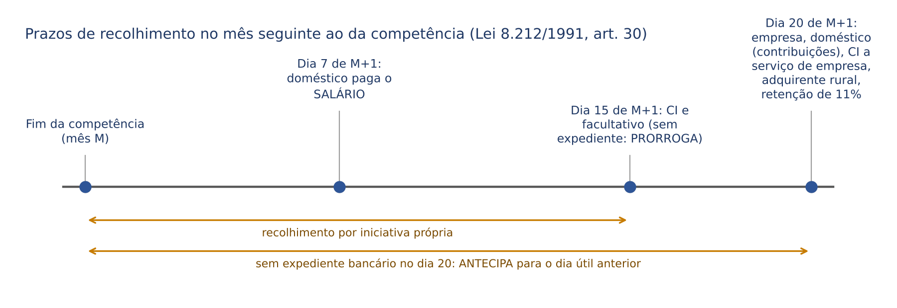
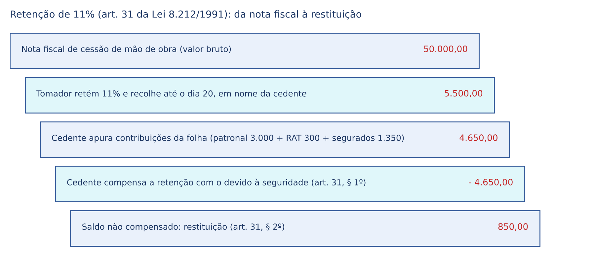
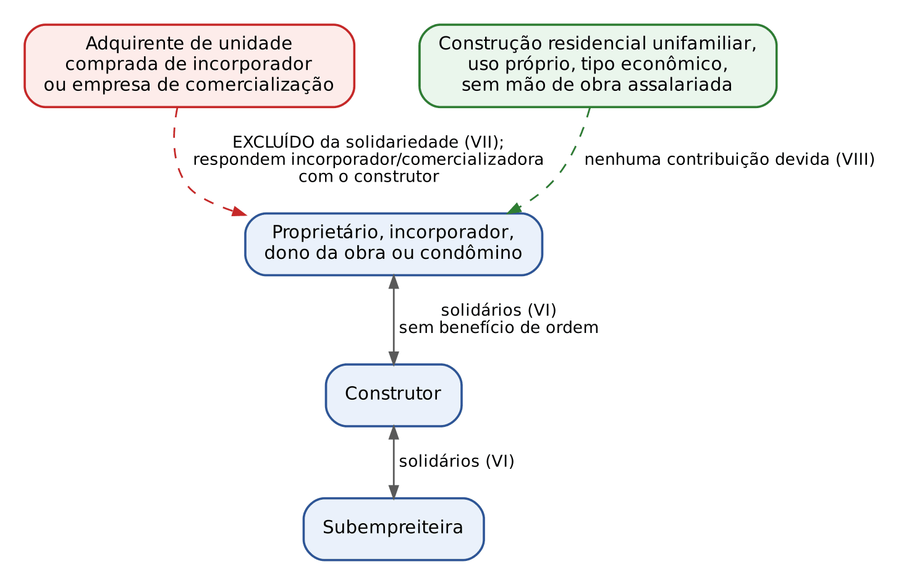
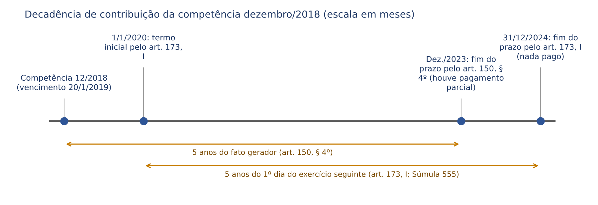
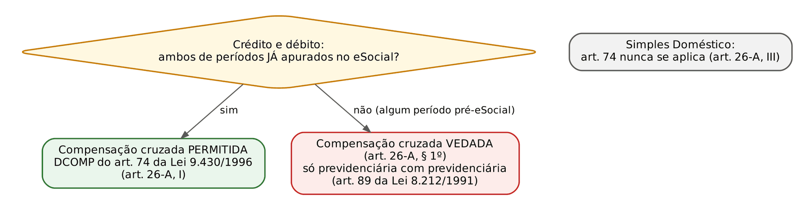
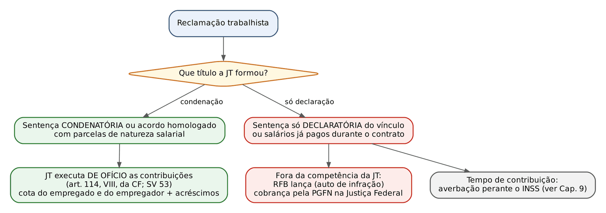

# CAPÍTULO 05 — ARRECADAÇÃO, RESPONSABILIDADE E CONTENCIOSO DO CUSTEIO: PRAZOS E OBRIGAÇÕES ACESSÓRIAS (ESOCIAL, DCTFWEB), RETENÇÃO NA CESSÃO DE MÃO DE OBRA E NA CONSTRUÇÃO CIVIL, RESPONSABILIDADE SOLIDÁRIA E DE TERCEIROS, CND, DECADÊNCIA E PRESCRIÇÃO DAS CONTRIBUIÇÕES (SV 8), RESTITUIÇÃO, COMPENSAÇÃO, CRIMES CONTRA A PREVIDÊNCIA EM NOÇÃO; COMPETÊNCIA DA JUSTIÇA DO TRABALHO PARA A EXECUÇÃO DE CONTRIBUIÇÕES

:::INCIDENCIA
TRF5 p. 2 (arrecadação, responsáveis, prescrição e decadência). Nível A; lote de 11 questões (FGV 9, FCC 2).
O que mais cai: prazos de recolhimento (dia 15 x dia 20), retenção de 11% na cessão de mão de obra, SV 8 e a distinção entre apropriação indébita (art. 168-A) e sonegação (art. 337-A) previdenciárias.
:::

| Subtema | FGV | FCC | Padrão de cobrança |
|---|---|---|---|
| Órgão que arrecada, fiscaliza e cobra | 1 | 0 | caso com empresa inadimplente: Receita Federal, não INSS |
| Prazos de recolhimento | 1 | 0 | CI x empregador doméstico; datas do art. 30 |
| Obrigações acessórias (DCTFWeb) | 0 | 1 | o que entra e o que não entra na declaração (RPPS fica fora) |
| Retenção de 11% (art. 31) | 1 | 1 | órgão público tomador; Simples Nacional (Súmula 425 do STJ) |
| Responsabilidade do empregador e direito do segurado | 1 | 0 | desconto presumido; benefício não depende do repasse |
| Decadência e prescrição (SV 8) | 2 | 0 | arts. 45 e 46 da Lei 8.212/1991 inconstitucionais; reserva de lei complementar |
| Crimes (arts. 168-A e 337-A do CP) | 3 | 0 | desconto sem repasse = 168-A; extinção da punibilidade no 337-A sem pagamento |

Este capítulo trata do custeio "em movimento": quem recolhe, quando, com que documento, quem responde se não recolher, como o crédito se constitui e se extingue e como é cobrado. A natureza tributária das contribuições, as espécies e as bases de cálculo estão nos Caps. 2 a 4. A teoria geral do CTN (lançamento, responsabilidade, decadência, prescrição, repetição, compensação, certidões, execução fiscal) já está desenvolvida na Apostila de Direito Tributário; aqui fica só o que é próprio das contribuições previdenciárias, com remissão ao capítulo correspondente daquela apostila.

## 05.1 Quem arrecada, fiscaliza e cobra

### 05.1.1 A Receita Federal como sujeito ativo de fato e a União como credora

Desde a Lei 11.457/2007 (a chamada "Super-Receita"), a Secretaria da Receita Federal do Brasil (RFB) planeja, executa, acompanha e avalia "as atividades relativas a tributação, fiscalização, arrecadação, cobrança e recolhimento" das contribuições das alíneas a, b e c do parágrafo único do art. 11 da Lei 8.212/1991 (empresas sobre a folha, empregadores domésticos e trabalhadores) e das contribuições substitutivas (CPRB, produtor rural, agroindústria). A mesma lei extinguiu a Secretaria da Receita Previdenciária, que era órgão do Ministério da Previdência. O art. 33 da Lei 8.212/1991, na redação da Lei 11.941/2009, repete a atribuição e a estende às contribuições "devidas a outras entidades e fundos" (terceiros: Sistema S, Incra, salário-educação; ver Cap. 4).

Consequências práticas que o juiz estadual precisa ter em mente:

- O INSS não é mais credor nem cobrador de contribuições. Ele concede e mantém benefícios. O débito previdenciário de uma empresa constitui dívida ativa da UNIÃO (art. 16 da Lei 11.457/2007 e art. 39 da Lei 8.212/1991), inscrita e cobrada pela Procuradoria-Geral da Fazenda Nacional (PGFN), em execução fiscal na Justiça Federal.
- A ação do contribuinte contra a exigência (anulatória, declaratória, repetição, mandado de segurança) é proposta contra a União (ou contra o Delegado da Receita, no MS), na Justiça Federal. O INSS é parte ilegítima nessas ações, salvo nos processos antigos, anteriores à transferência.
- O produto da arrecadação das contribuições do art. 2º da Lei 11.457/2007 é destinado, "em caráter exclusivo", ao pagamento de benefícios do RGPS e creditado diretamente ao Fundo do Regime Geral de Previdência Social (art. 2º, § 1º). É a afetação do art. 167, XI, da CF (ver Cap. 2).
- Na Justiça do Trabalho, a União é representada pela Procuradoria-Geral Federal, por delegação da PGFN, nos processos relativos à cobrança de contribuições previdenciárias (art. 16, § 3º, II, da Lei 11.457/2007; ver 05.8.2).
- As contribuições para REGIMES PRÓPRIOS (servidores) não passam pela Receita Federal: são arrecadadas pela unidade gestora do ente (no Estado de Santa Catarina, o Iprev; ver Caps. 24 e 25).

:::QUESTAO FGV 2025 — CPRM — Analista em Geociências, Direito (Q3757923)
Caso: sociedade empresária deixa de recolher contribuições sobre a folha. Pergunta: a quem compete, por lei, fiscalizar, arrecadar e cobrar. Gabarito: A, Secretaria da Receita Federal do Brasil (art. 2º da Lei 11.457/2007; art. 33 da Lei 8.212/1991). Armadilha: B (INSS), resposta correta até 2007 e ainda presente em material desatualizado. AGU, MPF e DPU não arrecadam tributo; a cobrança JUDICIAL da dívida inscrita cabe à PGFN, órgão da AGU, mas a pergunta era sobre fiscalizar e arrecadar.
:::

### 05.1.2 Mapa das competências

| Função | Órgão | Fundamento |
|---|---|---|
| Fiscalizar, lançar, arrecadar, cobrar administrativamente | RFB (Auditores-Fiscais) | Lei 11.457/2007, art. 2º; Lei 8.212/1991, art. 33 |
| Julgar a impugnação ao lançamento | Delegacias de Julgamento da RFB e CARF (rito do Decreto 70.235/1972) | Lei 8.212/1991, art. 89, § 11 (para restituição); ver Apostila Trib., Cap. 20 |
| Inscrever em dívida ativa e executar | PGFN, na Justiça Federal | Lei 11.457/2007, art. 16; Lei 8.212/1991, art. 39 |
| Executar de ofício as contribuições decorrentes de sentença trabalhista | Justiça do Trabalho (União representada pela PGF) | CF, art. 114, VIII; SV 53; Lei 11.457/2007, art. 16, § 3º, II |
| Conceder benefícios, averbar tempo, emitir certidão de tempo de contribuição | INSS | Lei 8.213/1991; ver Caps. 9 e 19 |
| Contribuições ao RPPS | unidade gestora do ente | Lei 9.717/1998; ver Cap. 24 |

## 05.2 Arrecadação e recolhimento

### 05.2.1 A técnica: a empresa arrecada, desconta e recolhe

O RGPS só funciona porque o legislador transformou o tomador do trabalho em agente arrecadador. O art. 30, I, da Lei 8.212/1991 obriga a empresa a (a) "arrecadar as contribuições dos segurados empregados e trabalhadores avulsos a seu serviço, descontando-as da respectiva remuneração" e (b) recolher esses valores junto com as contribuições a seu cargo. O mesmo raciocínio vale para o contribuinte individual que presta serviço a empresa (art. 4º da Lei 10.666/2003) e para a cooperativa de trabalho em relação aos cooperados (§ 1º do mesmo artigo).

Duas normas fecham o sistema e caem com frequência:

:::LEI Lei 8.212/1991, art. 33, § 5º
O desconto de contribuição e de consignação legalmente autorizadas sempre se presume feito oportuna e regularmente pela empresa a isso obrigada, não lhe sendo lícito alegar omissão para se eximir do recolhimento, ficando diretamente responsável pela importância que deixou de receber ou arrecadou em desacordo com o disposto nesta Lei.
:::

A presunção é ABSOLUTA em favor do segurado e do Fisco: a empresa que pagou salário cheio, sem descontar, responde pelo valor da contribuição do empregado como se a tivesse descontado. E o empregado não responde por nada: não é ele o sujeito passivo da obrigação de recolher. No plano dos benefícios, a Lei 8.213/1991 (art. 34, I) manda computar, para o empregado e o avulso, os salários de contribuição dos meses em que as contribuições eram devidas, "ainda que não recolhidas", sem prejuízo da cobrança contra a empresa (o tema da prova do tempo e do CNIS é do Cap. 9; o da qualidade de segurado, do Cap. 8). Daí a regra de ouro: para o segurado empregado, o inadimplemento do empregador é problema do Fisco, não do trabalhador. Para o contribuinte individual que trabalha por conta própria e para o facultativo, a lógica se inverte: eles recolhem por iniciativa própria (art. 30, II), e a falta de recolhimento os prejudica (ver Cap. 9, recolhimentos em atraso e indenização).

:::QUESTAO FGV 2025 — AL-AM — Assessor Jurídico (Q3777497)
Caso: Maria, contratada temporariamente pela administração estadual sob vínculo celetista, recebeu benefício durante afastamento por acidente e descobriu que parte das contribuições dos últimos seis meses não foi recolhida. Gabarito: A, o empregador é o responsável pelo recolhimento, inclusive da parte da segurada, devendo reter e repassar, sem prejuízo dos benefícios devidos a ela (art. 30, I, a e b, e art. 33, § 5º, da Lei 8.212/1991). Armadilhas: C (a falta de recolhimento não anula o vínculo nem apaga o tempo), D (o temporário celetista e o ocupante de cargo temporário são segurados obrigatórios do RGPS, art. 40, § 13, da CF; ver Cap. 6) e B e E (acidente do trabalho é risco coberto pelo RGPS; ver Cap. 15). Nota: "único responsável" é expressão imprecisa, porque a lei prevê responsáveis solidários (05.3), mas, em relação à segurada, a afirmação está correta.
:::

### 05.2.2 Prazos de recolhimento

A pergunta "até que dia?" tem resposta na letra do art. 30 da Lei 8.212/1991 e de duas leis extravagantes. Conferido no Planalto em 2/11/2026:

| Quem recolhe | O quê | Prazo | Fundamento |
|---|---|---|---|
| Empresa | contribuições descontadas de empregados e avulsos + contribuições a seu cargo sobre remunerações de empregados, avulsos e contribuintes individuais + contribuição de cooperativa (art. 22, IV) | até o DIA 20 do mês subsequente ao da competência | art. 30, I, b (Lei 11.933/2009) |
| Empresa que contrata contribuinte individual | contribuição do CI, descontada da remuneração | dia 20, junto com a contribuição da empresa | Lei 10.666/2003, art. 4º |
| Cooperativa de trabalho | contribuição dos cooperados | dia 20 | Lei 10.666/2003, art. 4º, § 1º |
| Contribuinte individual (por conta própria) e facultativo | a própria contribuição | até o DIA 15 do mês seguinte ao da competência | art. 30, II (Lei 9.876/1999) |
| Empregador doméstico | contribuição do empregado e a parcela a seu cargo | até o VIGÉSIMO dia do mês seguinte ao da competência | art. 30, V (Lei 14.438/2022); Lei 14.438/2022, art. 10, II |
| Empregador doméstico | o SALÁRIO do empregado | até o sétimo dia do mês seguinte | Lei 14.438/2022, art. 10, I |
| Adquirente, consumidor, consignatário ou cooperativa (produção rural) | contribuição do produtor rural pessoa física e do segurado especial, por sub-rogação | dia 20 do mês subsequente ao da operação | art. 30, III e IV |
| Produtor rural PF e segurado especial que vendem no exterior, no varejo a consumidor PF, a outro produtor PF ou a segurado especial | a própria contribuição sobre a receita | dia 20 | art. 30, X |
| Segurado especial que contrata trabalhadores | contribuição dos trabalhadores | dia 20 | art. 30, XIII |
| Tomador de serviços por cessão de mão de obra | retenção de 11% sobre a nota fiscal | dia 20 do mês subsequente ao da EMISSÃO da nota | art. 31, caput |

Se não houver expediente bancário na data, a regra é assimétrica (art. 30, § 2º, redação da Lei 13.202/2015): para o contribuinte individual e o facultativo (dia 15), o recolhimento se faz "até o dia útil imediatamente POSTERIOR"; para todos os demais (dia 20), "até o dia útil imediatamente ANTERIOR". O critério é de política: quem recolhe por conta própria ganha prazo; quem recolhe como agente arrecadador o perde.

:::PEGADINHA Empregador doméstico: dia 7 ou dia 20?
O art. 35 da LC 150/2015 continua a dizer, no texto disponível no Planalto, que o empregador doméstico deve pagar a remuneração e recolher as contribuições, o FGTS e o imposto do Simples Doméstico "até o dia 7 do mês seguinte ao da competência". Mas a Lei 14.438/2022 (art. 10) separou as duas obrigações: o SALÁRIO continua até o dia 7; as contribuições, os depósitos e o imposto passaram para "até o vigésimo dia do mês seguinte", e o art. 30, V, da Lei 8.212/1991 foi alterado no mesmo sentido. A produção de efeitos ficou condicionada ao início da arrecadação pelo serviço digital de guias do FGTS (FGTS Digital): o documento de arrecadação do eSocial do doméstico passou a vencer no dia 20 a partir da competência março de 2024. Para a prova: CONTRIBUIÇÃO do doméstico, dia 20; SALÁRIO do doméstico, dia 7.
:::

:::QUESTAO FGV 2026 — DATAPREV — Analista de TI, Gestão Econômico-Financeira (Q4391161)
Caso: Gerson, profissional liberal (contribuinte individual), e sua mulher Regina, empregadora de uma babá. Pergunta: até quando cada um deve recolher. Gabarito: D, Gerson até o dia 15 do mês seguinte ao da competência (art. 30, II) e Regina até o vigésimo dia do mês seguinte (art. 30, V, na redação da Lei 14.438/2022). Armadilha: C, que inverte a lógica e usa "dia 7", o prazo antigo do doméstico, hoje restrito ao pagamento do salário; A e B usam prazos de outras obrigações (dia 2 e quinto dia útil, este último o prazo celetista do salário do empregado comum).
:::

A legalidade do prazo também é cobrada. O prazo de vencimento não integra a regra-matriz (não é fato gerador, base, alíquota nem sujeito passivo), e o STF admite que seja fixado por regulamento quando a lei não o fixa; a afirmação foi dada como CORRETA em FGV 2024 (TCE-PA, Auditor, Q2564264, item I, gabarito C). Aqui, porém, a própria Lei 8.212/1991 fixa os prazos, e o regulamento não pode alterá-los.

### 05.2.3 Acréscimos legais: multa de mora, juros e multa de ofício

Desde a Lei 11.941/2009, as contribuições previdenciárias seguem os acréscimos dos tributos federais em geral:

- Recolhimento espontâneo em atraso: multa de mora e juros "nos termos do art. 61 da Lei nº 9.430" (art. 35 da Lei 8.212/1991). Pelo art. 61, a multa é de 0,33% por dia de atraso, contada do primeiro dia subsequente ao vencimento até o dia do pagamento (§ 1º) e limitada a 20% (§ 2º), e os juros equivalem à taxa Selic acumulada do primeiro dia do mês subsequente ao vencimento até o mês anterior ao do pagamento, mais 1% no mês do pagamento (§ 3º).
- Lançamento de ofício: multa do art. 44 da Lei 9.430/1996 (art. 35-A da Lei 8.212/1991): 75% sobre a totalidade ou a diferença do tributo (inciso I). Nos casos de sonegação, fraude ou conluio (arts. 71 a 73 da Lei 4.502/1964), a multa QUALIFICADA passou, com a Lei 14.689/2023, a 100% (§ 1º, VI) e a 150% na REINCIDÊNCIA, verificada quando, em 2 anos contados do lançamento que imputou a conduta dolosa, o sujeito passivo volta a praticá-la (§ 1º, VII, e § 1º-A); antes, o percentual era simplesmente duplicado (150%). A qualificação não se aplica se a conduta dolosa não estiver configurada, individualizada e comprovada, ou se houver sentença penal absolutória de mérito (§ 1º-C). Os percentuais do inciso I e do § 1º são AUMENTADOS DE METADE quando o sujeito passivo não atende, no prazo, intimação para prestar esclarecimentos ou apresentar arquivos e documentação (§ 2º).
- Até 2008, a Lei 8.212/1991 tinha tabela própria de multas, crescentes conforme a fase da cobrança. A substituição pelo regime da Lei 9.430/1996 levou à aplicação da retroatividade benigna do art. 106, II, c, do CTN a fatos anteriores, quando a nova multa for menor (o tema geral está na Apostila Trib., Cap. 11).

:::EXEMPLO Multa de mora e juros em recolhimento espontâneo
Contribuição de 10.000 (dez mil) reais, vencida em 20 de março, recolhida espontaneamente em 14 de abril (25 dias de atraso) ou em 29 de maio (70 dias).
| Passo | 25 dias de atraso | 70 dias de atraso |
|---|---|---|
| Multa: 0,33% x dias | 0,33% x 25 = 8,25% | 0,33% x 70 = 23,10% |
| Limite de 20% | não atingido | aplica-se o teto: 20% |
| Valor da multa | 825,00 | 2.000,00 |
| Juros (Selic hipotética de 1% em abril + 1% no mês do pagamento) | 1% no mês do pagamento (abril): 100,00 | Selic de abril (1%) + 1% em maio: 200,00 |
| Total | 10.925,00 | 12.200,00 |
Os percentuais da Selic são hipotéticos; o ponto cobrado é o teto de 20% da multa e o termo inicial dos juros. Recolhimento espontâneo com multa de mora é o que afasta a multa de ofício de 75%; mas, para tributo declarado e pago a destempo, a denúncia espontânea do art. 138 do CTN não exclui a multa moratória (Súmula 360 do STJ; Apostila Trib., Cap. 10).
:::

### 05.2.4 Obrigações acessórias: da GFIP ao eSocial e à DCTFWeb

O art. 32 da Lei 8.212/1991 lista as obrigações acessórias da empresa. As que caem:

- preparar folhas de pagamento das remunerações de todos os segurados (I);
- lançar mensalmente, em títulos próprios da contabilidade, os fatos geradores, os descontos, as contribuições e os totais recolhidos (II);
- prestar à RFB as informações cadastrais, financeiras e contábeis de seu interesse (III);
- DECLARAR à RFB e ao Conselho Curador do FGTS os dados dos fatos geradores, da base de cálculo e dos valores devidos (IV);
- comunicar mensalmente aos empregados os valores recolhidos sobre sua remuneração (VI).

Por quase duas décadas, a declaração do inciso IV foi a GFIP (Guia de Recolhimento do FGTS e de Informações à Previdência Social), que alimentava, ao mesmo tempo, a cobrança e o CNIS. Ela foi substituída, em implantação escalonada por grupos de empresas, pelo conjunto eSocial + EFD-Reinf + DCTFWeb (quanto ao FGTS, pelo FGTS Digital, a partir de março de 2024):

| Sistema | O que recebe | Função |
|---|---|---|
| eSocial | eventos trabalhistas e de folha (admissão, remuneração, afastamentos, desligamentos) | base de cálculo das contribuições sobre a folha e informações para o CNIS |
| EFD-Reinf | retenções e contribuições que não decorrem da folha (retenção de 11%, CPRB, produção rural, entre outras) | complementa o eSocial |
| DCTFWeb | apuração consolidada dos débitos a partir dos dois sistemas acima | declaração que confessa o débito e gera o DARF |

:::LEI Lei 8.212/1991, art. 32, §§ 2º e 10
§ 2º A declaração de que trata o inciso IV do caput deste artigo constitui instrumento hábil e suficiente para a exigência do crédito tributário, e suas informações comporão a base de dados para fins de cálculo e concessão dos benefícios previdenciários.
§ 10. O descumprimento do disposto no inciso IV do caput deste artigo impede a expedição da certidão de prova de regularidade fiscal perante a Fazenda Nacional.
:::

Três efeitos do § 2º, cada um com repercussão processual: (1) o débito declarado e não pago dispensa lançamento e pode ser inscrito diretamente em dívida ativa (art. 39, § 3º, da Lei 8.212/1991; Súmula 436 do STJ; ver 05.5.1); (2) a recusa de certidão é legítima quando há débito declarado e não pago (Súmula 446 do STJ; ver 05.4); (3) as informações declaradas formam o CNIS, de modo que declaração falsa ou omissa afeta também o direito do segurado (Cap. 9). A declaração é devida "ainda que não ocorram fatos geradores" (§ 9º).

A falta de entrega ou a entrega com erro sujeitam o contribuinte às multas do art. 32-A, conferidas no Planalto:

| Infração | Multa | Reduções e mínimos |
|---|---|---|
| Informações incorretas ou omitidas | 20 (vinte) reais para cada grupo de 10 informações (I) | reduções do § 2º; mínimo do § 3º |
| Falta de entrega ou entrega após o prazo | 2% ao mês-calendário ou fração sobre o montante das contribuições informadas, "ainda que integralmente pagas", limitada a 20% (II) | à METADE se entregue após o prazo, mas antes de qualquer procedimento de ofício; a 75% se entregue no prazo fixado em intimação (§ 2º) |
| Mínimos | 200 (duzentos) reais se omitida declaração sem fatos geradores; 500 (quinhentos) reais nos demais casos (§ 3º) | — |

O termo inicial é o dia seguinte ao fim do prazo de entrega; o termo final, a entrega efetiva ou, se não houver entrega, a lavratura do auto de infração ou da notificação de lançamento (§ 1º).

:::EXEMPLO Multa por atraso na declaração (art. 32-A, II)
Contribuições informadas: 40.000 (quarenta mil) reais, todas pagas em dia; declaração entregue espontaneamente com 3 meses e 10 dias de atraso.
| Passo | Cálculo |
|---|---|
| Meses-calendário ou fração | 3 meses + fração = 4 |
| Percentual | 2% x 4 = 8% (abaixo do teto de 20%) |
| Multa cheia | 40.000 x 8% = 3.200,00 |
| Redução: entrega antes de procedimento de ofício (metade) | 1.600,00 |
| Confronto com o mínimo de 500 | 1.600,00 > 500,00: prevalece 1.600,00 |
Se a entrega só ocorresse após 12 meses, o percentual seria 24%, limitado a 20% (8.000,00); entregue no prazo de intimação, a multa seria reduzida a 75% (6.000,00). A multa incide mesmo com as contribuições pagas: pune o descumprimento do dever instrumental, não a falta de pagamento.
:::

:::QUESTAO FCC 2026 — TJ-CE — Analista Judiciário, Ciências Contábeis (Q4245622)
Caso: tribunal de justiça estadual descontou 128.000 (cento e vinte e oito mil) reais de contribuição dos servidores para o RPPS do Estado. Pergunta: o valor deve ser informado na DCTFWeb? Gabarito: A, não, porque se trata de contribuição descontada de servidores filiados a regime próprio. A DCTFWeb declara os tributos administrados pela Receita Federal (contribuições ao RGPS e a terceiros, entre outros); a contribuição ao RPPS é receita do ente, recolhida à unidade gestora (ver 05.1.1 e Cap. 24). Armadilhas: C (órgãos do Judiciário estadual não estão dispensados da DCTFWeb: declaram, por exemplo, as contribuições patronais sobre servidores vinculados ao RGPS, como comissionados sem vínculo efetivo); D e E (não existe "parcela excedente" nem opção de centralização que transforme contribuição ao RPPS em débito federal).
:::

## 05.3 Responsabilidade pelo recolhimento

### 05.3.1 Visão de conjunto

A Lei 8.212/1991 usa três técnicas para pôr um terceiro no polo passivo. Distingui-las resolve a maioria das questões:

| Técnica | Quem | Natureza | Consequência | Fundamento |
|---|---|---|---|---|
| Arrecadação por desconto | empresa (empregados, avulsos, CI); empregador doméstico; cooperativa | responsável por substituição: desconta do pagamento e recolhe | presunção absoluta de desconto; responde se não descontou | art. 30, I e V; art. 33, § 5º; Lei 10.666/2003, art. 4º |
| Sub-rogação | adquirente, consumidor, consignatário ou cooperativa que compra produção rural de pessoa física | responsável por substituição | recolhe a contribuição do produtor sobre a receita (ver Cap. 4) | art. 30, III e IV |
| Retenção antecipatória | tomador de serviço por cessão de mão de obra ou empreitada | substituto que antecipa parte do devido pela prestadora | retém 11% da nota e recolhe em nome da cedente | art. 31 |
| Solidariedade legal | construção civil; grupo econômico; administradores de entes da administração indireta em mora; contratantes e oficial que praticam ato sem CND | responsáveis solidários (art. 124, II, do CTN), sem benefício de ordem | o Fisco escolhe a quem cobrar | arts. 30, VI e IX; 42; 48 |
| Responsabilidade pessoal de sócios e administradores | quem age com excesso de poderes ou infração de lei | CTN, art. 135 | o mero inadimplemento não basta | art. 135 do CTN; Súmula 430 do STJ; Tema 13 do STF |

### 05.3.2 Retenção de 11% na cessão de mão de obra (art. 31)

:::LEI Lei 8.212/1991, art. 31, caput e §§ 1º a 4º (redação vigente, conferida no Planalto)
Art. 31. A empresa contratante de serviços executados mediante cessão de mão de obra, inclusive em regime de trabalho temporário, deverá reter 11% (onze por cento) do valor bruto da nota fiscal ou fatura de prestação de serviços e recolher, em nome da empresa cedente da mão de obra, a importância retida até o dia 20 (vinte) do mês subsequente ao da emissão da respectiva nota fiscal ou fatura, ou até o dia útil imediatamente anterior se não houver expediente bancário naquele dia, observado o disposto no § 5º do art. 33 desta Lei.
§ 1º O valor retido de que trata o caput deste artigo, que deverá ser destacado na nota fiscal ou fatura de prestação de serviços, poderá ser compensado por qualquer estabelecimento da empresa cedente da mão de obra, por ocasião do recolhimento das contribuições destinadas à Seguridade Social devidas sobre a folha de pagamento dos seus segurados.
§ 2º Na impossibilidade de haver compensação integral na forma do parágrafo anterior, o saldo remanescente será objeto de restituição.
§ 3º Para os fins desta Lei, entende-se como cessão de mão-de-obra a colocação à disposição do contratante, em suas dependências ou nas de terceiros, de segurados que realizem serviços contínuos, relacionados ou não com a atividade-fim da empresa, quaisquer que sejam a natureza e a forma de contratação.
§ 4º Enquadram-se na situação prevista no parágrafo anterior, além de outros estabelecidos em regulamento, os seguintes serviços: I - limpeza, conservação e zeladoria; II - vigilância e segurança; III - empreitada de mão-de-obra; IV - contratação de trabalho temporário na forma da Lei nº 6.019, de 3 de janeiro de 1974.
:::

Mecânica, em ordem:

1. Enquadramento. Há cessão de mão de obra quando a prestadora coloca segurados À DISPOSIÇÃO do contratante, em dependências do contratante ou de terceiros, para serviços CONTÍNUOS, ligados ou não à atividade-fim, qualquer que seja a forma de contratação (§ 3º). Serviço prestado nas dependências da própria prestadora não é cessão. O regulamento (art. 219 do Decreto 3.048/1999) fala em cessão "ou empreitada" de mão de obra e enumera, no § 2º, 25 serviços sujeitos à retenção quando prestados mediante cessão (entre eles limpeza, vigilância, construção civil, serviços rurais, digitação, cobrança, copa e hotelaria, manutenção, portaria e recepção, promoção de vendas, secretaria, SAÚDE e telefonia); pelo § 3º, só os serviços dos incisos I a V (limpeza, conservação e zeladoria; vigilância e segurança; construção civil; serviços rurais; digitação e preparação de dados) sofrem retenção também quando contratados por EMPREITADA. A Receita trata a lista como exaustiva.
2. Base. Valor BRUTO da nota fiscal, fatura ou recibo. O regulamento exclui da retenção o valor de material ou equipamentos discriminado na nota, desde que contratualmente previsto e comprovado (art. 219, § 7º). O percentual de 11% é ACRESCIDO de 4, 3 ou 2 pontos percentuais (15%, 14% ou 13%) quando os segurados cedidos exercem atividade que permite aposentadoria especial aos 15, 20 ou 25 anos (art. 219, § 12; ver Cap. 4, adicional do art. 57, § 6º, da Lei 8.213/1991).
3. Retenção e recolhimento. O tomador retém 11% e recolhe até o dia 20 do mês seguinte ao da EMISSÃO da nota, EM NOME DA CEDENTE (não em nome próprio). A cedente deve destacar a retenção na nota (§ 1º) e elaborar folhas de pagamento distintas para cada contratante (§ 5º).
4. Compensação. A cedente abate o valor retido das contribuições "destinadas à Seguridade Social" que deve sobre sua folha, em qualquer estabelecimento (§ 1º). Contribuições de terceiros (Sistema S, salário-educação) não entram nessa compensação.
5. Restituição. O saldo não compensado é restituído (§ 2º; ver 05.6).

Natureza jurídica: a retenção não criou tributo novo; alterou a técnica de arrecadação da contribuição já devida pela prestadora sobre sua folha, antecipando-a por estimativa. É o que o STJ firmou no Tema 80 dos repetitivos (Primeira Seção, Relator Ministro Luiz Fux, j. 11/3/2009: a retenção do art. 31, na redação da Lei 9.711/1998, não instituiu nova contribuição, apenas alterou sua forma de recolhimento). O STF também reconheceu a validade constitucional da sistemática. Antes da Lei 9.711/1998, o art. 31 estabelecia SOLIDARIEDADE entre contratante e executor; desde então, o tomador é substituto tributário, e quem não retém responde pela importância que deveria ter retido (remissão expressa do caput ao art. 33, § 5º).

:::QUESTAO FCC 2025 — TRF4 — Analista Judiciário, Contabilidade (Q3538543)
Caso: órgão da administração federal contrata, por cessão de mão de obra, serviços contínuos de limpeza e conservação; nota fiscal bruta de 50.000 (cinquenta mil) reais. Gabarito: E, reter 11% sobre o valor bruto (5.500) e recolher a importância retida EM NOME DA EMPRESA CEDENTE. Armadilhas: A (não se repassa aos trabalhadores), B (limpeza e conservação estão expressamente no § 4º, I), C (o percentual é 11%, e o recolhimento é em nome da cedente, não do tomador) e D (a responsabilidade não é exclusiva da prestadora: o tomador, inclusive órgão público, é obrigado a reter).
:::

#### Simples Nacional: Súmula 425 do STJ

:::JURIS STJ, Súmula 425 e Tema 171 dos repetitivos
"A retenção da contribuição para a seguridade social pelo tomador do serviço não se aplica às empresas optantes pelo Simples." (Tema 171: Primeira Seção, Relator Ministro Teori Albino Zavascki, j. 12/8/2009; súmula publicada em 13/5/2010.) A razão: a empresa do Simples recolhe a contribuição patronal de forma unificada, sobre a receita bruta, no documento único; não há contribuição sobre a folha a antecipar, e a retenção geraria crédito permanente a restituir.
:::

Duas observações para não errar:

- A súmula fala da PRESTADORA optante pelo Simples (a cedente da mão de obra): é ela que "não sofre" retenção. Ser o TOMADOR optante pelo Simples é irrelevante para o art. 31.
- O fundamento da súmula (inexistência de contribuição patronal sobre a folha) não se aplica às atividades do Simples Nacional em que a contribuição patronal previdenciária (CPP) é recolhida FORA do documento único, sobre a folha, como as do Anexo IV da LC 123/2006 (construção civil, vigilância, limpeza e conservação; ver Apostila Trib., Cap. 31). Para essas, a Receita mantém a retenção; a súmula, editada à luz do antigo Simples federal, deve ser lida com essa ressalva.

:::QUESTAO FGV 2025 — TJ-ES — Outorga de Delegações, Remoção (Q3520323)
Caso: empresa de pequeno porte optante pelo Simples, que conserta computadores, contrata um fisioterapeuta para sessões de massagem com os funcionários e não retém 11% sobre a nota. Gabarito oficial: A, por ser optante pelo Simples, não estaria obrigada a reter 11%, "à luz da jurisprudência vinculante do STJ". Gabarito DISCUTÍVEL: (1) a Súmula 425 do STJ e o Tema 171 isentam da retenção a PRESTADORA optante pelo Simples, não a tomadora; (2) sessões avulsas de um profissional pessoa física não configuram cessão de mão de obra (art. 31, § 3º); o caso é de contratação de contribuinte individual, regida pelo art. 4º da Lei 10.666/2003, que obriga a EMPRESA (sem exceção expressa para optantes) a descontar e recolher a contribuição do CI. O fato de "saúde" constar da lista do art. 219, § 2º, XXIV, do Decreto 3.048/1999 não muda a conclusão, porque a lista pressupõe empresa CEDENTE que coloca segurados à disposição, e não profissional pessoa física que atende pessoalmente. O raciocínio que leva à letra A só se sustenta se o examinador quis afirmar que nenhuma retenção de 11% do art. 31 era devida no caso, o que é verdade, mas por fundamento diverso; tecnicamente, a alternativa mais próxima da lei seria C (a tomadora não é contribuinte, mas responde pelo desconto e recolhimento da contribuição do CI). Armadilhas: B (a tomadora não é contribuinte da contribuição do prestador), D e E (não há solidariedade nem subsidiariedade criadas pela situação). Na prova, marque A, ciente de que a banca associou o Simples à dispensa de retenção.
:::

:::ATENCAO Retenção de 11% x contratação de contribuinte individual
| Ponto | Cessão de mão de obra por empresa (art. 31) | Serviço prestado por contribuinte individual a empresa (Lei 10.666/2003, art. 4º) |
|---|---|---|
| Prestador | pessoa jurídica cedente | pessoa física (autônomo, sócio, diretor) |
| Quem recolhe | tomador, em nome da cedente | empresa tomadora, descontando da remuneração do CI |
| Percentual | 11% do valor bruto da nota | contribuição do CI (20% do salário de contribuição, com a dedução de 45% da contribuição da empresa, limitada a 9%, quando a empresa contribui sobre a remuneração: art. 30, § 4º; na prática, 11%; ver Cap. 3) |
| Natureza | antecipação da contribuição patronal da cedente | arrecadação da contribuição do próprio segurado |
| Contribuição patronal | devida pela cedente sobre sua folha (compensa a retenção) | devida pela tomadora: 20% sobre a remuneração do CI (ver Cap. 4) |
:::

#### Terceirização ilícita

Quando a terceirização é fictícia (as "prestadoras" são fachadas dos próprios dirigentes da tomadora, sem autonomia real), a fiscalização pode desconsiderar a forma e cobrar da tomadora as contribuições, como empregadora direta. O STJ assim decidiu, distinguindo o caso da licitude geral da terceirização (ADPF 324 e RE 958.252, no STF): havendo confusão patrimonial e presentes subordinação, onerosidade, pessoalidade e habitualidade, a tomadora responde pelas contribuições dos empregados "fictamente contratados" (STJ, REsp n. 1.652.347, Relator Ministro Francisco Falcão, Segunda Turma, j. 13/8/2024). O fundamento legal da requalificação é o art. 33, § 3º, da Lei 8.212/1991 (lançamento de ofício quando há sonegação de informação) combinado com a norma antielisiva (Apostila Trib., Cap. 9).

### 05.3.3 Construção civil

A obra de construção civil é tratada como uma unidade fiscal autônoma: tem matrícula própria (hoje no Cadastro Nacional de Obras), requerida pelo responsável pela execução em 30 dias do início das atividades (art. 49, § 1º), sob pena de multa (art. 49, § 3º). O Município informa à fiscalização os alvarás e "habite-se" concedidos (art. 50), e a averbação da obra no registro de imóveis exige CND (art. 47, II; ver 05.4).

:::LEI Lei 8.212/1991, art. 30, VI, VII e VIII
VI - o proprietário, o incorporador definido na Lei nº 4.591, de 16 de dezembro de 1964, o dono da obra ou condômino da unidade imobiliária, qualquer que seja a forma de contratação da construção, reforma ou acréscimo, são solidários com o construtor, e estes com a subempreiteira, pelo cumprimento das obrigações para com a Seguridade Social, ressalvado o seu direito regressivo contra o executor ou contratante da obra e admitida a retenção de importância a este devida para garantia do cumprimento dessas obrigações, não se aplicando, em qualquer hipótese, o benefício de ordem;
VII - exclui-se da responsabilidade solidária perante a Seguridade Social o adquirente de prédio ou unidade imobiliária que realizar a operação com empresa de comercialização ou incorporador de imóveis, ficando estes solidariamente responsáveis com o construtor;
VIII - nenhuma contribuição à Seguridade Social é devida se a construção residencial unifamiliar, destinada ao uso próprio, de tipo econômico, for executada sem mão-de-obra assalariada, observadas as exigências do regulamento;
:::

Pontos de prova:

- A solidariedade alcança construção, REFORMA ou ACRÉSCIMO, "qualquer que seja a forma de contratação".
- "Não se aplicando, em qualquer hipótese, o benefício de ordem" é a pegadinha literal: o Fisco pode cobrar diretamente do dono da obra, sem antes executar o construtor.
- O dono da obra tem direito REGRESSIVO contra o executor e pode RETER parte do preço como garantia.
- Exclusão (VII): quem compra a unidade de incorporador ou empresa de comercialização não é solidário; respondem estes, com o construtor.
- Isenção da obra unifamiliar econômica (VIII): todos os requisitos são cumulativos (residencial, unifamiliar, uso próprio, tipo econômico, SEM mão de obra assalariada).
- Aferição indireta: sem prova regular, o montante dos salários da obra pode ser obtido "mediante cálculo da mão de obra empregada, proporcional à área construída", cabendo ao proprietário, dono da obra, condômino ou empresa corresponsável o ônus da prova em contrário (art. 33, § 4º). É presunção relativa: a contabilidade regular e as notas de serviços afastam o arbitramento.

### 05.3.4 Grupo econômico (art. 30, IX)

"As empresas que integram grupo econômico de qualquer natureza respondem entre si, solidariamente, pelas obrigações decorrentes desta Lei." A regra é lida como hipótese de solidariedade designada em lei (art. 124, II, do CTN). O ponto controvertido é o que a Fazenda precisa provar.

- Na esfera administrativa, o CARF editou a Súmula 210: as empresas do grupo econômico respondem solidariamente pelas obrigações previdenciárias, "nos termos do art. 30, inciso IX, da Lei nº 8.212/1991, c/c o art. 124, inciso II, do CTN, sem necessidade de o fisco demonstrar o interesse comum a que alude o art. 124, inciso I".
- No Judiciário, a orientação do STJ é mais restritiva: a solidariedade não decorre exclusivamente da demonstração da formação de grupo econômico (STJ, REsp n. 1.511.682, referido sem data na fonte consultada), exigindo-se vínculo com o fato gerador, atuação conjunta, confusão patrimonial ou abuso. Lei ordinária não pode criar responsabilidade sem relação com o fato gerador, à luz do art. 128 do CTN e da reserva de lei complementar (Tema 13 do STF; Apostila Trib., Cap. 10, 10.1.2 e 10.5).
- Inclusão de empresa do grupo na execução fiscal: se é preciso instaurar o incidente de desconsideração (arts. 133 a 137 do CPC) é a questão do Tema 1.209 do STJ, pendente na última consulta registrada na Apostila de Direito Tributário (Cap. 10, 10.5.3).

### 05.3.5 Outros responsáveis

- Administradores públicos (art. 42): os administradores de autarquias, fundações públicas, empresas públicas e sociedades de economia mista que se encontrarem em mora, POR MAIS DE 30 DIAS, no recolhimento das contribuições, "tornam-se solidariamente responsáveis pelo respectivo pagamento". Note: autarquias, fundações e estatais; a administração direta não aparece.
- Oficial de registro e contratantes (art. 48): a prática de ato sem a CND exigida, ou o seu registro, acarreta a responsabilidade solidária dos contratantes e do oficial que lavrar ou registrar o instrumento, e o ato é nulo (05.4).
- Entidade sindical e empresa de origem, quanto ao dirigente sindical (art. 30, § 3º).
- Sócios e administradores: o art. 13 da Lei 8.620/1993, que fazia os sócios de sociedades limitadas responderem solidariamente pelos débitos previdenciários, foi declarado inconstitucional pelo STF (Tema 13) e depois revogado. Hoje vale o CTN: responsabilidade pessoal por atos com excesso de poderes ou infração de lei (art. 135), que não decorre do mero inadimplemento (Súmula 430 do STJ). O tema, inclusive o redirecionamento por dissolução irregular, está na Apostila Trib., Caps. 10 e 22. Ponto próprio do custeio: deixar de repassar contribuição DESCONTADA do empregado é, ao mesmo tempo, crime (art. 168-A do CP; 05.9) e infração de lei apta a fundamentar o art. 135, pois o administrador reteve dinheiro alheio.

## 05.4 Prova de inexistência de débito: CND, CPEN e restrições

### 05.4.1 Fundamento constitucional e legal

:::LEI CF, art. 195, § 3º
A pessoa jurídica em débito com o sistema da seguridade social, como estabelecido em lei, não poderá contratar com o Poder Público nem dele receber benefícios ou incentivos fiscais ou creditícios.
:::

É a única restrição a devedores tributários escrita diretamente na Constituição, e por isso é exceção à vedação de sanções políticas (Apostila Trib., Cap. 5). A EC 106/2020 afastou temporariamente a exigência durante a calamidade da pandemia (o Planalto remete à emenda ao lado do dispositivo).

:::LEI Lei 8.212/1991, art. 47, caput, I e II (conferido no Planalto)
Art. 47. É exigida Certidão Negativa de Débito-CND, fornecida pelo órgão competente, nos seguintes casos:
I - da empresa: a) na contratação com o Poder Público e no recebimento de benefícios ou incentivo fiscal ou creditício concedido por ele; b) na alienação ou oneração, a qualquer título, de bem imóvel ou direito a ele relativo; c) na alienação ou oneração, a qualquer título, de bem móvel de valor superior a Cr$ 2.500.000,00 (dois milhões e quinhentos mil cruzeiros) incorporado ao ativo permanente da empresa; d) no registro ou arquivamento, no órgão próprio, de ato relativo a baixa ou redução de capital de firma individual, redução de capital social, cisão total ou parcial, transformação ou extinção de entidade ou sociedade comercial ou civil e transferência de controle de cotas de sociedades de responsabilidade limitada;
II - do proprietário, pessoa física ou jurídica, de obra de construção civil, quando de sua averbação no registro de imóveis, salvo no caso do inciso VIII do art. 30.
:::

| Ponto | Regra | Dispositivo |
|---|---|---|
| Abrangência | prova exigida em relação a TODAS as dependências, estabelecimentos e obras, onde quer que estejam | art. 47, § 1º |
| Validade | certidão conjunta RFB/PGFN dos tributos federais e da dívida ativa: até 180 dias, prorrogável excepcionalmente por ato conjunto | art. 47, § 5º (Lei 14.148/2021) |
| Dispensas | retificação ou ratificação de ato para o qual já se fez a prova; garantia de crédito rural (produtor que não é responsável direto pelo recolhimento); averbação de construção concluída antes de 22/11/1966; transferências a Municípios para assistência social, educação, saúde e calamidade; averbação em regularização fundiária de interesse social | art. 47, § 6º |
| Falta da certidão | ato NULO; responsabilidade SOLIDÁRIA dos contratantes e do oficial; multa ao servidor, serventuário ou titular de serventia | art. 48, caput e § 3º |
| Intervenção do Fisco | autoriza a lavratura se o débito for pago no ato ou confessado com garantias reais suficientes | art. 48, § 1º |
| Falta da declaração (DCTFWeb) | impede a certidão | art. 32, § 10 |
| Débito não garantido | restrições do art. 32 da Lei 4.357/1964 (distribuição de bonificações e lucros) | art. 52 (o Planalto remete à ADI 5.161) |

A certidão positiva com efeitos de negativa (CPEN, art. 206 do CTN) tem os mesmos efeitos da CND quando o débito está com exigibilidade suspensa (parcelamento, depósito, impugnação, liminar) ou garantido por penhora em execução. O regime das certidões e a jurisprudência repetitiva (débito declarado e não pago: recusa legítima, Súmula 446 do STJ; débito em discussão administrativa: direito à CPEN) estão na Apostila Trib., Cap. 19.

:::DICA O juiz estadual e o art. 47
É no cartório que o tema chega à Justiça estadual: a dúvida registral sobre a exigência de CND para alienar imóvel de empresa ou averbar construção. Duas lembranças: (1) o art. 47, II, ressalva a obra unifamiliar econômica sem mão de obra assalariada; (2) o STF já declarou inconstitucionais exigências de quitação tributária como condição para atos registrais quando funcionam como meio coercitivo indireto de cobrança (sanção política), e há normas de serviço das corregedorias que dispensam a CND em alienações; verifique o provimento local vigente antes de decidir. Para a prova, a literalidade do art. 47 continua a ser cobrada.
:::

## 05.5 Constituição do crédito, decadência e prescrição

### 05.5.1 Como o crédito previdenciário se constitui

:::LEI Lei 8.212/1991, art. 33, § 7º
O crédito da seguridade social é constituído por meio de notificação de lançamento, de auto de infração e de confissão de valores devidos e não recolhidos pelo contribuinte.
:::

| Forma | Quando | Consequência |
|---|---|---|
| Confissão (declaração no eSocial/DCTFWeb, antes GFIP) | o contribuinte declara e não paga | crédito constituído pela própria declaração; inscrição direta em dívida ativa (art. 39, § 3º; Súmula 436 do STJ); não há decadência a discutir, só prescrição |
| Auto de infração | constatado não recolhimento de contribuição NÃO declarada, falta de pagamento de benefício reembolsado ou descumprimento de obrigação acessória | lançamento de ofício com multa do art. 44 da Lei 9.430/1996 (art. 35-A) |
| Notificação de lançamento | lançamento de ofício sem infração autônoma | idem |
| Aferição indireta e arbitramento | recusa ou sonegação de documentos, apresentação deficiente, contabilidade que não registra o movimento real | lançamento de ofício "da importância devida", com ônus da prova invertido (art. 33, §§ 3º e 6º) |

Antigas siglas que ainda aparecem em julgados: NFLD (notificação fiscal de lançamento de débito), LDC (lançamento de débito confessado) e CDA do INSS. Tudo isso hoje é feito pela RFB e pela PGFN.

### 05.5.2 Súmula Vinculante 8: prazos do CTN, não da Lei 8.212

Os arts. 45 e 46 da Lei 8.212/1991 davam à seguridade DEZ anos para lançar e dez para cobrar. O STF declarou-os inconstitucionais, por vício formal: contribuições sociais são tributos, e prescrição e decadência tributárias são matéria de lei complementar (art. 146, III, b, da CF).

:::JURIS STF, Súmula Vinculante 8
"São inconstitucionais o parágrafo único do artigo 5º do Decreto-lei nº 1.569/1977 e os artigos 45 e 46 da Lei nº 8.212/1991, que tratam de prescrição e decadência de crédito tributário."
Os efeitos foram modulados (quem recolheu sem impugnar antes do julgamento não pode repetir), e a LC 128/2008 revogou expressamente os dois artigos. Desenvolvimento: Apostila Trib., Cap. 15, 15.1.3.
:::

:::QUESTAO FGV 2024 — prova não identificada no banco (Q3157902)
Advogado de empresa autuada por contribuições previdenciárias invoca os prazos dos arts. 45 e 46 da Lei 8.212/1991. Gabarito: C, esses artigos foram declarados inconstitucionais pelo STF, por tratarem de prescrição e decadência, temas reservados à lei complementar. Armadilhas: B (lei ordinária não pode disciplinar esses prazos, "ainda que" sem contrariar a legislação), D e E (contribuições previdenciárias TÊM natureza tributária). A mesma questão está comentada na Apostila Trib., Cap. 15.
:::

:::QUESTAO FGV 2024 — Prefeitura de Macaé — Procurador (Q3049935)
Itens sobre inconstitucionalidade por invasão de matéria de lei complementar. Gabarito: A, só o item I (lei ordinária sobre prescrição e decadência das contribuições previdenciárias: SV 8). Item II, errado: o STF admitiu que lei ordinária processual discipline a prescrição INTERCORRENTE da execução fiscal (art. 40 da LEF; Tema 390 do STF; Apostila Trib., Cap. 22). Item III, errado: isenção concedida por lei formalmente complementar em matéria que não exige lei complementar (a Cofins da LC 70/1991, materialmente ordinária) pode ser revogada por lei ordinária.
:::

### 05.5.3 Decadência: qual dos dois artigos do CTN?

As contribuições sujeitam-se a lançamento por homologação. A regra de decisão, firmada pelo STJ em recurso repetitivo e sumulada (Súmula 555 do STJ; Apostila Trib., Caps. 12 e 15), é:

| Situação | Prazo para lançar | Termo inicial |
|---|---|---|
| Houve pagamento, ainda que parcial, sem dolo, fraude ou simulação | 5 anos | data do fato gerador (art. 150, § 4º, do CTN) |
| Nada foi pago e nada foi declarado | 5 anos | primeiro dia do exercício seguinte àquele em que o lançamento poderia ter sido efetuado (art. 173, I; Súmula 555) |
| Dolo, fraude ou simulação | 5 anos | art. 173, I |
| Declarado e não pago | não há decadência: o crédito já está constituído | prescrição de 5 anos (art. 174) |
| Lançamento anulado por vício formal | 5 anos | data da decisão definitiva que anulou (art. 173, II) |

O fato gerador da contribuição sobre a folha é mensal: ocorre na competência em que a remuneração é paga, devida ou creditada. A competência DEZEMBRO tem uma particularidade que cai em prova prática: o vencimento é em 20 de janeiro do ano seguinte, de modo que o lançamento de ofício só "poderia ter sido efetuado" no ano seguinte, e o prazo do art. 173, I, só começa no 1º de janeiro do ano subsequente a ele.

:::EXEMPLO Escada da decadência: competências novembro e dezembro de 2018
| Passo | Competência 11/2018 | Competência 12/2018 |
|---|---|---|
| Vencimento | 20/12/2018 | 20/1/2019 |
| Ano em que o lançamento poderia ser feito | 2018 | 2019 |
| Termo inicial (art. 173, I) | 1/1/2019 | 1/1/2020 |
| Último dia para lançar, se NADA foi pago | 31/12/2023 | 31/12/2024 |
| Se houve pagamento parcial (art. 150, § 4º) | 5 anos do fato gerador: novembro/2023 | 5 anos do fato gerador: dezembro/2023 |
Uma diferença de um mês na competência gera diferença de um ano no prazo do art. 173, I. Ponto de atenção: há leituras que contam o art. 173, I, a partir do exercício do fato gerador; a orientação dominante, que vincula o termo ao momento em que o Fisco PODIA lançar (após o vencimento), é a adotada na escada.
:::

### 05.5.4 Prescrição

Constituído o crédito (notificação do lançamento definitivo ou declaração do contribuinte), a Fazenda tem cinco anos para cobrá-lo (art. 174 do CTN), com as causas de interrupção do parágrafo único (o despacho que ordena a citação, desde a LC 118/2005; protesto; ato que constitua o devedor em mora; reconhecimento do débito, inclusive o pedido de parcelamento) e de suspensão (art. 151). Para o débito declarado e não pago, o termo inicial é o vencimento ou a entrega da declaração, o que ocorrer por último. A prescrição intercorrente segue o art. 40 da LEF. Tudo isso está na Apostila Trib., Caps. 15 e 22.

### 05.5.5 Não confunda os prazos do custeio com os dos benefícios

:::ESQUEMA Prazos de cinco anos (e de dez) no Direito Previdenciário
| Prazo | Para quê | Fundamento | Onde |
|---|---|---|---|
| Decadência de 5 anos (art. 150, § 4º, ou 173, I) | Fisco LANÇAR contribuição | CTN; SV 8 | este capítulo |
| Prescrição de 5 anos (art. 174) | Fisco COBRAR crédito constituído | CTN | este capítulo |
| 5 anos (art. 168 do CTN; LC 118/2005) | contribuinte pedir RESTITUIÇÃO | CTN | 05.6 |
| Decadência de 10 anos | segurado pedir REVISÃO do ato de concessão | Lei 8.213/1991, art. 103 | Cap. 21 |
| Prescrição de 5 anos das prestações | segurado cobrar parcelas vencidas | Lei 8.213/1991, art. 103, parágrafo único | Cap. 21 |
| Decadência de 10 anos | INSS anular ato de concessão favorável ao segurado | Lei 8.213/1991, art. 103-A | Cap. 19 |
| Período alcançado pela decadência do custeio | CI que quer contar o tempo deve INDENIZAR (20% da média, juros de 0,5% ao mês limitados a 50% e multa de 10%) | Lei 8.212/1991, art. 45-A (LC 128/2008) | Cap. 9 |
:::

O art. 45-A mostra a relação entre os dois planos: a decadência impede a Fazenda de COBRAR, mas não dá ao segurado o tempo de contribuição de graça; se ele quiser computar o período, paga a indenização. Para os períodos ainda não decaídos, aplicam-se as regras comuns de recolhimento em atraso (§ 3º). A Lei 15.363/2026 incluiu o § 4º: a multa de 10% não se aplica ao tempo rural de empregado e de segurado especial anterior à obrigatoriedade de filiação.

:::SENTENCA Embargos à execução fiscal: decadência parcial
"A contribuição exigida refere-se às competências de janeiro a dezembro de 2018, não declaradas e não pagas, e o auto de infração foi notificado ao embargante em 15/12/2023. Afastados os arts. 45 e 46 da Lei 8.212/1991 (Súmula Vinculante 8), o prazo decadencial é o do art. 173, I, do CTN (Súmula 555 do STJ): para as competências de janeiro a novembro de 2018, cujo lançamento poderia ser feito em 2018, o prazo findou em 31/12/2023, e o lançamento notificado em 15/12/2023 é TEMPESTIVO; para a competência de dezembro de 2018, vencida em 20/1/2019, o prazo só findaria em 31/12/2024. Rejeito a alegação de decadência."
(Mude a data da notificação para 10/1/2024 e o resultado se inverte para janeiro a novembro: decadência reconhecida, extinção parcial do crédito, com a substituição da CDA ou o prosseguimento pelo saldo.)
:::

## 05.6 Restituição e compensação

### 05.6.1 Regra própria das contribuições

:::LEI Lei 8.212/1991, art. 89, caput e § 4º
Art. 89. As contribuições sociais previstas nas alíneas a, b e c do parágrafo único do art. 11 desta Lei, as contribuições instituídas a título de substituição e as contribuições devidas a terceiros somente poderão ser restituídas ou compensadas nas hipóteses de pagamento ou recolhimento indevido ou maior que o devido, nos termos e condições estabelecidos pela Secretaria da Receita Federal do Brasil.
§ 4º O valor a ser restituído ou compensado será acrescido de juros obtidos pela aplicação da taxa referencial do Sistema Especial de Liquidação e de Custódia – SELIC para títulos federais, acumulada mensalmente, a partir do mês subsequente ao do pagamento indevido ou a maior que o devido até o mês anterior ao da compensação ou restituição e de 1% (um por cento) relativamente ao mês em que estiver sendo efetuada.
:::

Demais parágrafos que caem:

- Compensação de ofício: verificado débito do sujeito passivo, o valor da restituição será usado para extingui-lo (§ 8º). Não alcança débito com exigibilidade suspensa (Apostila Trib., Cap. 14).
- Compensação indevida: valores exigidos com os acréscimos moratórios do art. 35 (§ 9º); havendo FALSIDADE da declaração, multa isolada de 150% (o percentual do art. 44, I, da Lei 9.430/1996, 75%, "aplicado em dobro") sobre o débito indevidamente compensado (§ 10), regra que não se aplica à compensação feita nos termos do art. 74 da Lei 9.430/1996 (§ 12).
- Rito: os processos de restituição e de reembolso de salário-família e salário-maternidade seguem o Decreto 70.235/1972 (§ 11).
- Prazo: cinco anos contados do pagamento indevido (art. 168, I, do CTN, com o art. 3º da LC 118/2005, para ações ajuizadas a partir de 9/6/2005; Tema 4 do STF). Compensação de crédito discutido em juízo só após o trânsito em julgado (art. 170-A do CTN); mandado de segurança declara o direito à compensação (Súmula 213 do STJ), mas não convalida compensação já feita (Súmula 460 do STJ). Desenvolvimento: Apostila Trib., Caps. 14 e 16.

### 05.6.2 Compensação "cruzada" e o eSocial (art. 26-A da Lei 11.457/2007)

Até 2018, as contribuições previdenciárias só podiam ser compensadas com contribuições previdenciárias (art. 89 e IN da Receita), enquanto os demais tributos federais se compensavam entre si pela DCOMP do art. 74 da Lei 9.430/1996. A Lei 13.670/2018 incluiu o art. 26-A na Lei 11.457/2007 e abriu a compensação cruzada, com uma condição temporal: o sujeito passivo precisa apurar as contribuições pelo eSocial, e nem o crédito nem o débito podem referir-se a período anterior à utilização do eSocial.

| Hipótese | Compensação pelo art. 74 da Lei 9.430/1996? | Fundamento |
|---|---|---|
| Sujeito passivo que usa o eSocial, crédito e débito de períodos posteriores ao eSocial | SIM, inclusive entre contribuições previdenciárias e demais tributos | art. 26-A, I |
| Débito previdenciário de período ANTERIOR ao eSocial | NÃO | § 1º, I, a |
| Débito previdenciário posterior com crédito de outros tributos de período anterior | NÃO | § 1º, I, b |
| Débito de outros tributos de período anterior com crédito previdenciário | NÃO | § 1º, II, a |
| Débito de outros tributos com crédito previdenciário de período anterior | NÃO | § 1º, II, b |
| Sujeitos passivos que não usam o eSocial | NÃO | art. 26-A, II |
| Simples Doméstico | NÃO | art. 26-A, III |

O STJ validou a restrição e definiu que "período de apuração" é o do tributo, e não a data do trânsito em julgado da decisão que reconheceu o indébito (STJ, REsp n. 2.109.311, Primeira Turma, j. 11/3/2025, citado na Apostila Trib., Cap. 14). Exemplo: crédito de contribuição patronal recolhida indevidamente em 2016, reconhecido por sentença transitada em 2024, não pode quitar IRPJ de 2025; pode ser compensado com contribuições previdenciárias (art. 89) ou restituído.

### 05.6.3 Situações próprias do custeio

- Saldo da retenção de 11%: a cedente que não consegue compensar tudo pede restituição (art. 31, § 2º). Legitimada é a CEDENTE (contribuinte em nome de quem se recolheu), não o tomador.
- Reembolso de benefícios pagos pela empresa: o salário-maternidade da empregada e o salário-família são pagos pela empresa e deduzidos das contribuições (ver Cap. 17). O STJ negou que o empregador compense com contribuições a remuneração paga à gestante afastada por força da Lei 14.151/2021 (pandemia), como se fosse salário-maternidade (STJ, AgInt no REsp n. 2.149.080, j. 21/10/2024, Info 836).
- Segurado com vários vínculos que contribuiu acima do teto: tem direito à restituição do excesso; a regra preventiva é informar os demais vínculos para que cada empregador limite o desconto (ver Cap. 3).
- Contribuição sobre verba declarada não incidente (por exemplo, nos temas de verbas indenizatórias do Cap. 4): repetição ou compensação nos limites do art. 89 e do art. 26-A; nos casos de virada jurisprudencial, observar a modulação (por exemplo, terço de férias: Tema 985 do STF, com modulação nos embargos; ver Cap. 4).

## 05.7 Parcelamento e regularização

:::LEI CF, art. 195, § 11 (redação da EC 103/2019)
São vedados a moratória e o parcelamento em prazo superior a 60 (sessenta) meses e, na forma de lei complementar, a remissão e a anistia das contribuições sociais de que tratam a alínea "a" do inciso I e o inciso II do caput.
:::

Leitura correta (cai muito na FCC):

- A vedação de prazo superior a 60 meses alcança moratória e parcelamento das contribuições do art. 195, I, a (empregador sobre a folha) e II (trabalhador), que são justamente as previdenciárias do RGPS.
- Quanto à remissão e à anistia dessas contribuições, a vedação é remetida à LEI COMPLEMENTAR ("na forma de lei complementar"): lei ordinária não pode concedê-las nem disciplinar a vedação. Antes da EC 103/2019, o § 11 vedava remissão e anistia "para débitos em montante superior ao fixado em lei complementar" e não tratava de parcelamento; o teto de 60 meses é novidade da EC 103/2019.
- O parcelamento ordinário federal é de até 60 parcelas mensais (art. 10 da Lei 10.522/2002), coerente com o teto.
- É VEDADO parcelar débitos de "tributos passíveis de retenção na fonte, de desconto de terceiros ou de sub-rogação" e "valores recebidos pelos agentes arrecadadores não recolhidos" (art. 14, I e III, da Lei 10.522/2002): as contribuições descontadas dos empregados e as retidas pelos tomadores, como regra, só por programas especiais com autorização legal expressa.

:::ATENCAO ADCT, art. 116 (EC 136/2025): o parcelamento excepcional de 300 meses dos Municípios
A própria Constituição abriu exceção ao teto de 60 meses: "Fica excepcionalmente autorizado o parcelamento dos débitos decorrentes de contribuições previdenciárias dos Municípios, incluídas suas autarquias e fundações, com o Regime Geral de Previdência Social, com vencimento até 31 de agosto de 2025, ainda que em fase de execução fiscal ajuizada (...), no prazo máximo de 300 (trezentas) prestações mensais." Regras cobráveis: parcela = o MENOR entre o saldo dividido em até 300 parcelas e 1% da média mensal da receita corrente líquida do ano anterior (§ 10); exclusão por inadimplência de 3 meses consecutivos ou 6 alternados; Município excluído fica impedido de receber transferências voluntárias da União, inclusive de emendas parlamentares (§ 7º); resíduo ao fim do prazo pago à vista ou em até 60 parcelas (§ 11). Municípios com RPPS devem atender, até 1º/3/2027, às condições do art. 115 do ADCT (§ 1º; ver Cap. 24). A Receita regulamentou a adesão pela IN RFB 2.283/2025, com prazo até 31/8/2026.
:::

:::EXEMPLO Escada da parcela do art. 116 do ADCT
Município com saldo de 30.000.000 (trinta milhões de) reais e média mensal da receita corrente líquida do ano anterior de 1.500.000 (um milhão e quinhentos mil) reais.
| Passo | Cálculo | Valor |
|---|---|---|
| Saldo dividido em 300 parcelas | 30.000.000 / 300 | 100.000,00 |
| 1% da média mensal da RCL | 1.500.000 x 1% | 15.000,00 |
| Parcela devida (o menor) | min(100.000; 15.000) | 15.000,00 |
| Total pago em 300 meses (sem atualização) | 15.000 x 300 | 4.500.000,00 |
| Resíduo nominal ao fim (sem atualização) | 30.000.000 - 4.500.000 | 25.500.000,00, quitado à vista ou em até 60 parcelas (§ 11) |
O limitador pela receita protege o caixa municipal, mas, como mostra a conta, pode deixar resíduo maior que o valor amortizado.
:::

Efeitos do parcelamento, em síntese: suspende a exigibilidade (art. 151, VI, do CTN), autoriza a CPEN, interrompe a prescrição pelo reconhecimento do débito e, no plano penal, suspende a pretensão punitiva dos crimes de 05.9 quando pedido antes do recebimento da denúncia (Apostila Trib., Caps. 11 e 13). A transação tributária na cobrança da dívida ativa da União está na Apostila Trib., Cap. 14.

## 05.8 Cobrança judicial: execução fiscal e Justiça do Trabalho

### 05.8.1 Execução fiscal

O débito previdenciário inscrito é dívida ativa da União (art. 39 da Lei 8.212/1991; art. 16 da Lei 11.457/2007) e se cobra pela Lei 6.830/1980, por iniciativa da PGFN, na Justiça Federal. A competência delegada à Justiça estadual para execuções fiscais federais foi extinta para as ações novas, mantidas as já ajuizadas (Apostila Trib., Cap. 21, sobre o IAC 15 do STJ e a regra de transição). O crédito previdenciário, com atualização e juros, equipara-se aos créditos da União na falência, na recuperação e no concurso de credores (art. 51), e o parágrafo único do art. 51 autoriza a reivindicação dos valores DESCONTADOS dos empregados e não recolhidos: como não pertencem à massa, não entram no concurso (Apostila Trib., Cap. 18).

:::QUESTAO FGV 2026 — TJ-PA — Juiz Substituto (Q3951785), correlata
Execução trabalhista com produto de alienação disputado por honorários advocatícios (sucumbenciais e contratuais), contribuição previdenciária inscrita em dívida ativa e crédito trabalhista. Gabarito: E, os honorários, inclusive os contratuais, preferem ao crédito tributário, por sua natureza alimentar e por se equipararem aos créditos decorrentes da legislação do trabalho (art. 85, § 14, do CPC; art. 186 do CTN). Armadilha: A (crédito tributário só cede ao trabalhista) ignora a equiparação; B e C fazem distinção entre as espécies de honorários que a orientação adotada pela banca não faz. Preferências e concurso: Apostila Trib., Cap. 18.
:::

### 05.8.2 Execução de contribuições pela Justiça do Trabalho

:::LEI CF, art. 114, VIII (EC 45/2004)
Compete à Justiça do Trabalho processar e julgar: (...) VIII a execução, de ofício, das contribuições sociais previstas no art. 195, I, a, e II, e seus acréscimos legais, decorrentes das sentenças que proferir;
:::

:::JURIS STF, Súmula Vinculante 53 (aprovada em 17/6/2015)
"A competência da Justiça do Trabalho prevista no art. 114, VIII, da Constituição Federal alcança a execução de ofício das contribuições previdenciárias relativas ao objeto da condenação constante das sentenças que proferir e acordos por ela homologados."
:::

A competência é ESTRITA. Leia a súmula com os três filtros:

| Filtro | Dentro da competência da JT | Fora |
|---|---|---|
| Espécie de contribuição | art. 195, I, a (empregador sobre a folha, incluído o RAT) e II (trabalhador), com acréscimos | contribuições de terceiros (Sistema S, salário-educação): não estão no art. 195, I, a, nem no II |
| Origem | "objeto da condenação" ou do acordo homologado | salários pagos durante o contrato reconhecido apenas por sentença DECLARATÓRIA de vínculo |
| Iniciativa | de ofício, pelo juiz do trabalho, sem necessidade de inscrição em dívida ativa | cobrança de débito já lançado pela RFB (execução fiscal na Justiça Federal) |

Por que a sentença declaratória não basta: a SV 53 exige que a contribuição se relacione a valores que a sentença CONDENOU a pagar ou que o acordo previu. Quando a JT apenas reconhece o vínculo, os salários do período já foram pagos (ou não são objeto do título), e não há título executivo quanto às contribuições: cabe à RFB lançar e à PGFN executar. Para o segurado, o reconhecimento do vínculo serve de prova do tempo de contribuição perante o INSS, com o valor probatório discutido no Cap. 9 (início de prova material e sentença trabalhista).

Regras da Lei 8.212/1991 para as contribuições na reclamação trabalhista (art. 43, conferido no Planalto):

- O juiz, "sob pena de responsabilidade", determina o imediato recolhimento (caput).
- Sentença ou acordo sem discriminação das parcelas legais: a contribuição incide sobre o VALOR TOTAL apurado em liquidação ou do acordo (§ 1º). Discriminadas as parcelas, só incide sobre as salariais; a discriminação deve guardar coerência com os pedidos, sob pena de ser desconsiderada como fraude.
- Fato gerador: "considera-se ocorrido (...) na data da prestação do serviço" (§ 2º, incluído pela Lei 11.941/2009, oriunda da MP 449/2008). Consequência: as contribuições são apuradas mês a mês, pelo regime de competência, com as alíquotas, os limites do salário de contribuição e os acréscimos moratórios de cada competência (§ 3º). Para períodos anteriores à mudança, a jurisprudência trabalhista adotou solução de transição (fato gerador no pagamento), cujo marco deve ser conferido antes de aplicação prática.
- Recolhimento no mesmo prazo do crédito trabalhista; no acordo, em tantas parcelas quantas as do acordo, nas mesmas datas (§ 3º).
- Reconhecida judicialmente atividade especial, são devidos os acréscimos do art. 57, § 6º, da Lei 8.213/1991 (§ 4º; ver Caps. 4 e 14).
- Acordo celebrado APÓS decisão de mérito: a contribuição é calculada sobre o valor do acordo (§ 5º). Aplica-se também às comissões de conciliação prévia (§ 6º).

:::EXEMPLO Acordo trabalhista de 30.000 (trinta mil) reais
| Situação | Base | Contribuição patronal (20%) + RAT (2%, hipotético) |
|---|---|---|
| Acordo sem discriminação | 30.000 (art. 43, § 1º) | 30.000 x 22% = 6.600,00 |
| Acordo discriminando 18.000 de verbas indenizatórias e 12.000 de salariais, compatível com os pedidos | 12.000 | 12.000 x 22% = 2.640,00 |
A contribuição do empregado, descontada do crédito dele, é apurada mês a mês, nas alíquotas progressivas de cada competência e até o teto (art. 43, § 3º; tabela no Cap. 3). Como a JT executa só o art. 195, I, a, e II, as contribuições de terceiros não entram na execução de ofício.
:::

:::PROCESSO Quem faz o quê nas contribuições decorrentes da reclamação trabalhista
| Ato | Quem |
|---|---|
| Discriminar parcelas na sentença ou no acordo | juiz do trabalho (e as partes, no acordo) |
| Executar de ofício as contribuições do objeto da condenação | Justiça do Trabalho |
| Representar a União nesses processos | Procuradoria-Geral Federal, por delegação da PGFN (Lei 11.457/2007, art. 16, § 3º, II) |
| Lançar contribuições sobre salários do vínculo apenas declarado | Receita Federal |
| Executar crédito lançado e inscrito | PGFN, na Justiça Federal |
| Averbar o tempo reconhecido | INSS (Cap. 9) |
| Julgar ação acidentária do segurado contra o INSS | Justiça estadual (Cap. 20) |
:::

## 05.9 Crimes contra a previdência (noção)

Os tipos estão desenvolvidos na Apostila de Direito Penal (art. 168-A no Cap. 30, 30.3; art. 337-A no Cap. 36, 36.8; estelionato previdenciário no Cap. 22, 22.6.1). Aqui, só o que liga o crime ao custeio.

:::LEI Código Penal, art. 168-A, caput e § 1º, I (Lei 9.983/2000)
Art. 168-A. Deixar de repassar à previdência social as contribuições recolhidas dos contribuintes, no prazo e forma legal ou convencional: Pena – reclusão, de 2 (dois) a 5 (cinco) anos, e multa.
§ 1º Nas mesmas penas incorre quem deixar de: I – recolher, no prazo legal, contribuição ou outra importância destinada à previdência social que tenha sido descontada de pagamento efetuado a segurados, a terceiros ou arrecadada do público;
:::

:::LEI Código Penal, art. 337-A, caput e § 1º (Lei 9.983/2000)
Art. 337-A. Suprimir ou reduzir contribuição social previdenciária e qualquer acessório, mediante as seguintes condutas: I – omitir de folha de pagamento da empresa ou de documento de informações previsto pela legislação previdenciária segurados empregado, empresário, trabalhador avulso ou trabalhador autônomo ou a este equiparado que lhe prestem serviços; II – deixar de lançar mensalmente nos títulos próprios da contabilidade da empresa as quantias descontadas dos segurados ou as devidas pelo empregador ou pelo tomador de serviços; III – omitir, total ou parcialmente, receitas ou lucros auferidos, remunerações pagas ou creditadas e demais fatos geradores de contribuições sociais previdenciárias: Pena – reclusão, de 2 (dois) a 5 (cinco) anos, e multa.
§ 1º É extinta a punibilidade se o agente, espontaneamente, declara e confessa as contribuições, importâncias ou valores e presta as informações devidas à previdência social, na forma definida em lei ou regulamento, antes do início da ação fiscal.
:::

| Ponto | Apropriação indébita previdenciária (168-A) | Sonegação de contribuição previdenciária (337-A) |
|---|---|---|
| Conduta-núcleo | DESCONTA (ou arrecada) e NÃO REPASSA | FRAUDA a apuração (omite segurado, remuneração, receita, fato gerador) |
| Contrapartida no custeio | violação do art. 30, I, a e b, e da presunção do art. 33, § 5º | violação das obrigações acessórias do art. 32 (folha, contabilidade, declaração) |
| Extinção da punibilidade antes da ação fiscal | declara, confessa E PAGA (§ 2º) | declara e confessa, SEM exigência de pagamento (§ 1º) |
| Perdão judicial ou só multa | primário e de bons antecedentes, com pagamento após a ação fiscal e antes da denúncia, ou valor até o piso de ajuizamento (§ 3º) | primário e de bons antecedentes, valor até o piso de ajuizamento (§ 2º, II; o inciso I foi vetado) |
| Devedor contumaz (LC 225/2026) | não tem a extinção do § 2º (§§ 5º e 6º) | não tem a extinção do § 1º (§§ 5º e 6º) |
| Natureza | material: exige a constituição definitiva do crédito | material: idem |
| Competência | Justiça Federal (art. 109, IV, da CF) | Justiça Federal |

Liga-se ao custeio, ainda, o regime do pagamento e do parcelamento: o pagamento integral extingue a punibilidade e o parcelamento a suspende, conforme as leis tributárias especiais, mais benéficas que o CP (Apostila Trib., Cap. 11, 11.7.2; Apostila de Direito Penal, Cap. 30).

:::QUESTAO FGV 2026 — DATAPREV — Analista (Q4391160)
Empresa desconta a contribuição de Pedro em todos os contracheques, mas não a repassa. Gabarito: D, apropriação indébita previdenciária (art. 168-A, § 1º, I). Armadilha: E (sonegação), que exige fraude na apuração (omissão de segurado ou de remuneração), não o simples não repasse do valor descontado. No mesmo sentido: Q2524478 (FGV 2024, TCE-GO, Analista de Controle Externo; gabarito E, mesmo caso com o empregador de um tosador de pet shop, descoberto pelo CNIS no aplicativo Meu INSS).
:::

:::QUESTAO FGV 2024 — Prefeitura de Nova Iguaçu — Auditor Fiscal do Tesouro Municipal (Q3039641)
Afirmações sobre descaminho, 168-A e 337-A. Gabarito: E, no 337-A extingue-se a punibilidade se o agente, espontaneamente, declara e confessa as contribuições e presta as informações antes do início da ação fiscal (§ 1º). Armadilhas: B (deixar de repassar contribuições recolhidas é o 168-A, não sonegação), C (no 168-A, o perdão ou a multa isolada exigem PAGAMENTO após a ação fiscal e antes da denúncia, ou valor até o piso de ajuizamento; sem pagamento, só a hipótese do valor), A e D (descaminho é mercadoria lícita com tributo iludido; mercadoria proibida é contrabando; a pena em dobro é do transporte AÉREO, marítimo ou fluvial). Comentada também na Apostila de Direito Penal, Cap. 36.
:::

## 05.10 Resumo para revisão pré-prova

| Instituto | Regra | Exceções e detalhes | Fundamento |
|---|---|---|---|
| Quem arrecada e cobra | RFB fiscaliza, lança e arrecada; dívida ativa da União; PGFN executa na JF | RPPS: unidade gestora; JT executa de ofício o objeto de suas condenações | Lei 11.457/2007, arts. 2º e 16; Lei 8.212, art. 33 |
| Desconto presumido | empresa que devia descontar responde como se tivesse descontado | segurado empregado não é prejudicado pelo não recolhimento | Lei 8.212, art. 33, § 5º |
| Prazos | empresa, doméstico (contribuições), CI a serviço de empresa, adquirente rural, retenção: dia 20; CI e facultativo: dia 15 | sem expediente: dia 15 prorroga, dia 20 antecipa; salário do doméstico: dia 7 | Lei 8.212, art. 30, I, b, II, V, § 2º; Lei 14.438/2022, art. 10; Lei 10.666/2003, art. 4º |
| Acréscimos | multa de mora de 0,33% ao dia até 20% + Selic; de ofício, 75% | multa qualificada maior; retroatividade benigna | Lei 8.212, arts. 35 e 35-A; Lei 9.430, arts. 44 e 61 |
| Obrigação acessória | declaração (GFIP, hoje eSocial + EFD-Reinf + DCTFWeb) confessa o débito e alimenta o CNIS | devida mesmo sem fato gerador; falta impede certidão; RPPS fora da DCTFWeb | Lei 8.212, art. 32, IV, §§ 2º, 9º e 10 |
| Multa por atraso na declaração | 2% ao mês ou fração, até 20%, mesmo com tributo pago | metade se espontânea; 75% se no prazo da intimação; mínimos de 200 e 500 | Lei 8.212, art. 32-A |
| Retenção | 11% do bruto da nota; recolhe em nome da cedente até o dia 20 do mês seguinte à emissão | cedente compensa em qualquer estabelecimento; saldo restitui; Simples prestador não sofre retenção (ressalva do Anexo IV) | Lei 8.212, art. 31; Tema 80 e Súmula 425 do STJ |
| Construção civil | proprietário, incorporador, dono da obra, condômino, construtor e subempreiteira solidários, sem benefício de ordem | adquirente de incorporador excluído; unifamiliar econômica sem assalariado não paga; aferição por área | Lei 8.212, arts. 30, VI a VIII, 33, § 4º, 49, § 1º |
| Grupo econômico | solidariedade legal | STJ exige mais que a só existência do grupo; CARF dispensa interesse comum (Súmula 210) | Lei 8.212, art. 30, IX; CTN, art. 124 |
| Outros solidários | administradores da indireta em mora por mais de 30 dias; contratantes e oficial em ato sem CND | sócios: só art. 135 do CTN (Tema 13 do STF; Súmula 430 do STJ) | Lei 8.212, arts. 42 e 48 |
| CND | contratação com o Poder Público, alienação ou oneração de imóvel, móvel do ativo acima do valor legal, atos societários, averbação de obra | validade de 180 dias; dispensas do § 6º; ato sem CND é nulo | CF, art. 195, § 3º; Lei 8.212, arts. 47 e 48 |
| Decadência | 5 anos (CTN), não 10 | pagamento parcial: art. 150, § 4º; nada pago: art. 173, I; competência dezembro começa um ano depois | SV 8; Súmula 555 do STJ |
| Prescrição | 5 anos da constituição definitiva | declarado e não pago: da entrega ou do vencimento, o que for posterior | CTN, art. 174; Súmula 436 do STJ |
| Restituição e compensação | só de pagamento indevido ou a maior; Selic | compensação cruzada só entre períodos pós-eSocial; falsidade: multa isolada em dobro | Lei 8.212, art. 89; Lei 11.457, art. 26-A |
| Parcelamento | até 60 meses; remissão e anistia só na forma de LC | retidos e descontados: vedado o parcelamento ordinário; Municípios: 300 meses (ADCT, art. 116) | CF, art. 195, § 11; Lei 10.522, arts. 10 e 14 |
| Justiça do Trabalho | executa de ofício contribuições do art. 195, I, a, e II, do objeto da condenação ou do acordo | não executa as do vínculo só declarado nem as de terceiros; sem discriminação, incide sobre o total | CF, art. 114, VIII; SV 53; Lei 8.212, art. 43 |
| Crimes | não repassar o descontado: 168-A; fraudar a apuração: 337-A | extinção no 337-A dispensa pagamento; devedor contumaz excluído (LC 225/2026); crimes materiais | CP, arts. 168-A e 337-A |

## 05.11 Artigos de lei incidentes

- CF: arts. 114, VIII; 146, III, b; 195, § 3º e § 11. ADCT: art. 116 (EC 136/2025).
- Lei 8.212/1991: arts. 30 (I, II, III, IV, V, VI, VII, VIII, IX, X, XIII, §§ 2º, 3º e 4º); 31; 32 (I a IV e VI, §§ 2º, 9º, 10 e 11); 32-A; 33 (§§ 1º a 8º); 35; 35-A; 37; 39; 42; 43; 45 e 46 (revogados; SV 8); 45-A; 47; 48; 49, § 1º; 50; 51; 52; 89.
- Lei 11.457/2007: arts. 2º, 16 e 26-A.
- Lei 10.666/2003: art. 4º.
- Lei 14.438/2022: arts. 10, 11 e 19. LC 150/2015: arts. 34 e 35.
- Lei 9.430/1996: arts. 44, 61 e 74.
- Lei 10.522/2002: arts. 10 e 14.
- CTN: arts. 124, 128, 135, 150, § 4º, 168, 170-A, 173, 174, 186, 205 e 206.
- Código Penal: arts. 168-A e 337-A.
- Decreto 3.048/1999: art. 219 (retenção).

## 05.12 Julgados, temas e súmulas do capítulo

- Súmula Vinculante 8: arts. 45 e 46 da Lei 8.212/1991 inconstitucionais; prazos do CTN.
- Súmula Vinculante 53: JT executa de ofício contribuições do objeto da condenação e dos acordos.
- STJ, Tema 80: a retenção de 11% não criou tributo, só mudou a forma de recolhimento.
- STJ, Tema 171 e Súmula 425: prestadora optante pelo Simples não sofre retenção.
- STJ, REsp 1.652.347-SC: terceirização ilícita; tomadora responde pelas contribuições.
- STJ, REsp 1.511.682: grupo econômico, por si só, não basta para a solidariedade.
- Súmula 210 do CARF: art. 30, IX, sem prova de interesse comum (esfera administrativa).
- STJ, REsp 2.109.311: compensação cruzada; período de apuração do tributo, não do trânsito.
- STJ, AgInt no REsp 2.149.080-RS: afastamento da Lei 14.151/2021 não se compensa como salário-maternidade.

Remissões a outros capítulos: Súmulas 436, 446, 555, 360, 430, 213 e 460 do STJ, Temas 4, 13 e 390 do STF, Tema 1.209 do STJ e a modulação da SV 8 (Apostila Trib., Caps. 10, 12, 13, 14, 15, 16, 19 e 22); Tema 985 do STF (Cap. 4); tipos penais, natureza material e devedor contumaz (Apostila de Direito Penal, Caps. 30 e 36).

:::NOTA Notas de verificação
- Conferido no Planalto em 2/11/2026: Lei 8.212/1991, arts. 30, 31, 32, 32-A, 33, 35, 35-A, 37, 39, 42, 43, 45-A, 47, 48, 49, 50, 51, 52 e 89; LC 150/2015, arts. 34 e 35; Lei 14.438/2022, arts. 10, 11 e 19; CF, arts. 114, VIII, e 195, §§ 3º e 11; ADCT, arts. 115 e 116 (EC 136/2025); CP, arts. 168-A e 337-A (com os §§ 5º e 6º da LC 225/2026); Lei 11.457/2007, arts. 2º, 16 e 26-A; Lei 10.522/2002, arts. 10 e 14; Lei 10.666/2003, art. 4º.
- Conferidos no Planalto em 2/11/2026: art. 61 da Lei 9.430/1996 (0,33% ao dia, teto de 20%, Selic do mês subsequente ao vencimento e 1% no mês do pagamento) e art. 44 (75%; multa qualificada de 100% e de 150% na reincidência, §§ 1º, 1º-A e 1º-C, na redação da Lei 14.689/2023; aumento de metade do § 2º); art. 219 do Decreto 3.048/1999 (lista de 25 serviços, empreitada só para os incisos I a V, exclusão de material, adicional de 4, 3 ou 2 pontos do § 12). Lei 8.213/1991, art. 34, I (salários de contribuição do empregado, do doméstico e do avulso computados ainda que não recolhidos), conferido no Planalto em 2/11/2026.
- Prazo do DAE do doméstico no dia 20 a partir da competência março de 2024: fonte secundária (blog trabalhista citando o portal do eSocial), coerente com o art. 19 da Lei 14.438/2022.
- Súmula 425 e Tema 171 do STJ conferidos em sites de jurisprudência (Damásio, Trilhante); Tema 80 (Trilhante) sem número do REsp; SV 53 (Dizer o Direito); Súmula CARF 210 e REsp 1.511.682 (Conjur; data do REsp não informada); REsp 1.652.347-SC (banco de teses do Drive, prv-0158); IN RFB 2.283/2025 e prazo de 31/8/2026 (Jornal Contábil).
- Não citados por número, por não vistos nesta tarefa: precedente do STF que validou a retenção do art. 31; ADIs sobre exigência de CND em atos registrais; precedente que originou a SV 53; solução de transição do TST sobre o fato gerador das contribuições na JT (marco a conferir); precedentes sobre honorários e preferência (Q3951785).
- Gabarito discutível: Q3520323 (a Súmula 425 refere-se à PRESTADORA optante pelo Simples; o caso era de contribuinte individual, regido pelo art. 4º da Lei 10.666/2003); crítica revista em 2/11/2026 à luz do art. 219 do Decreto 3.048/1999 e mantida. Ressalva do Anexo IV do Simples Nacional sobre a Súmula 425: posição administrativa, não conferida em ato normativo.
- Q3777497: "único responsável" é impreciso diante das hipóteses de solidariedade; mantido o gabarito oficial.
:::
