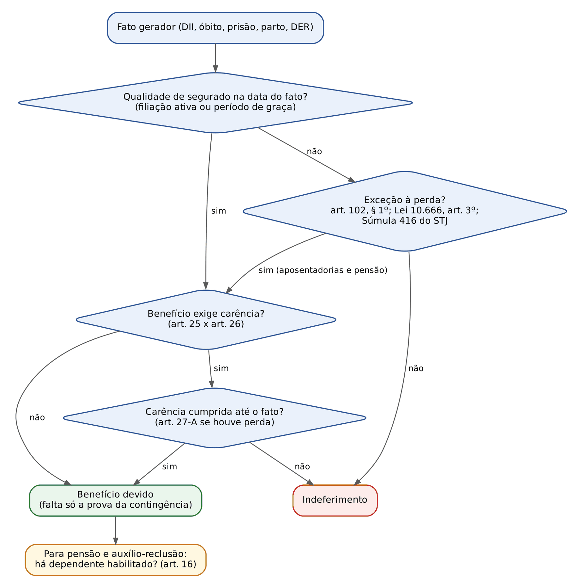
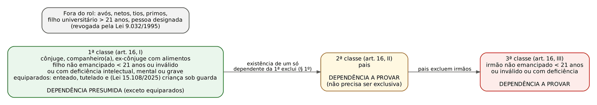
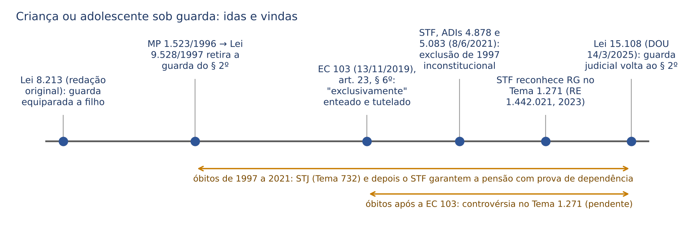
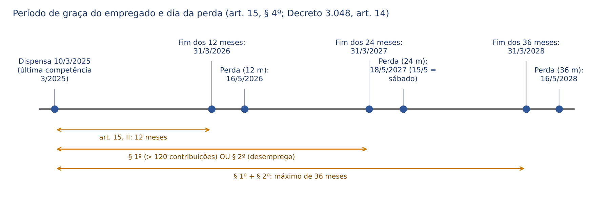
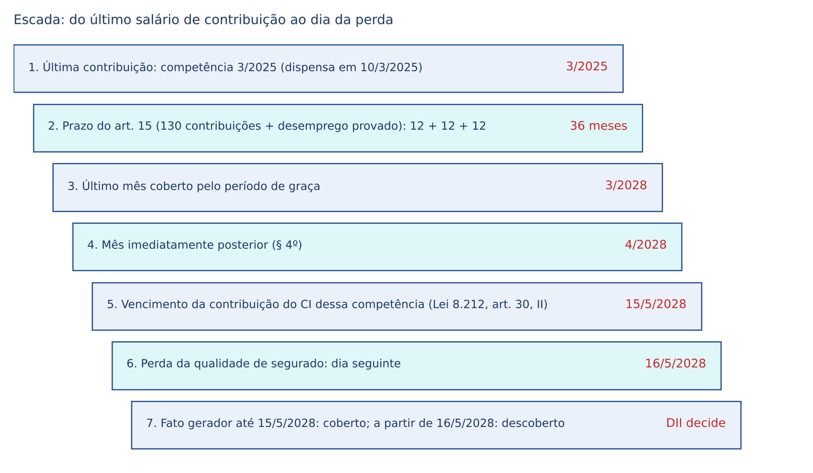
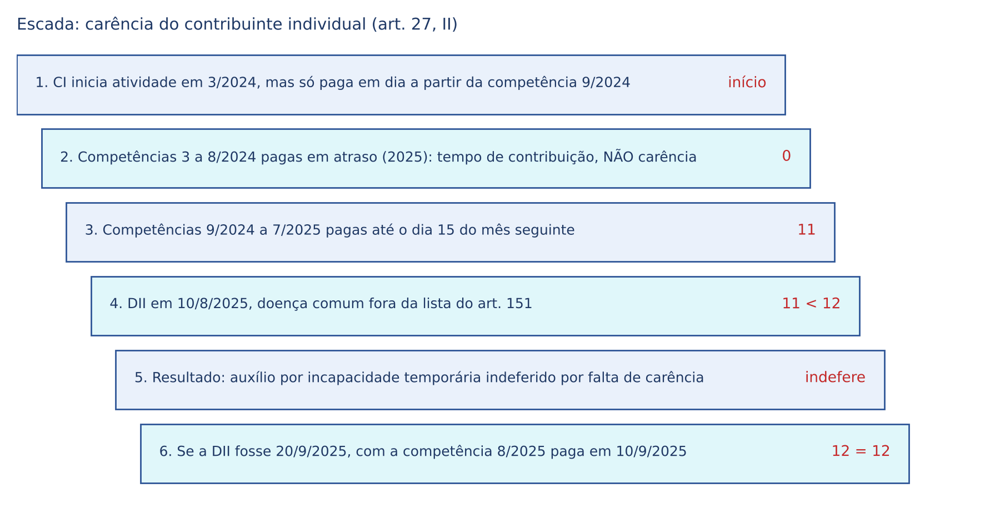
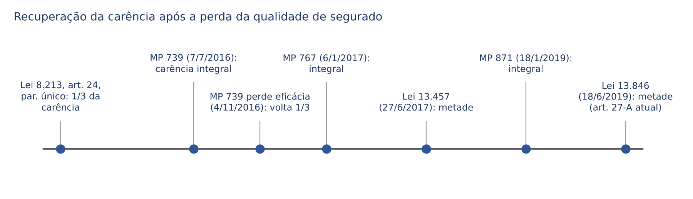

# CAPÍTULO 08 — RGPS — RELAÇÃO JURÍDICA II: DEPENDENTES, QUALIDADE DE SEGURADO, PERÍODO DE GRAÇA E CARÊNCIA

:::INCIDENCIA
TRF5 p. 4. Nível A+. Lote: 18 questões (FGV 13, FCC 5), mais correlatas de outros capítulos.
O que mais cai: período de graça em casos concretos (12, 24, 36 e 6 meses), rol e classes de dependentes (irmão, enteado, guarda, universitário), carência e suas dispensas (art. 26), metade da carência após a perda (art. 27-A).
:::

| Subtema | FGV | FCC | Padrão de cobrança |
|---|---|---|---|
| Classes e rol de dependentes | 2 | 3 | literalidade do art. 16 (não emancipado, 21 anos, deficiência intelectual ou mental ou grave); exclusão entre classes; universitário |
| Prova da união estável | 1 | 0 | início de prova material contemporânea (24 meses antes do óbito) |
| Qualidade de segurado e período de graça | 6 | 1 | caso concreto com tempo de casa, forma de desligamento e categoria (empregado x facultativo) |
| Carência: prazos, dispensas e perda | 4 | 1 | 12, 180, 24 contribuições; art. 26; metade do art. 27-A; conceito literal do art. 24 |

## 08.1 Visão de conjunto: os filtros de acesso às prestações

Toda prestação pecuniária do RGPS passa por filtros sucessivos, aferidos na data do fato gerador (DII para incapacidade, óbito, prisão, parto, DER para aposentadorias): (a) a pessoa deve ser segurada naquela data, isto é, deve manter vínculo jurídico com o regime, seja porque está em atividade e contribuindo, seja porque está no período de graça; (b) se o benefício exigir carência, o número mínimo de contribuições deve estar cumprido até aquela data; (c) a contingência (incapacidade, idade, morte, prisão etc.) deve estar provada; (d) nos benefícios devidos a dependentes (pensão por morte e auxílio-reclusão), o requerente deve ostentar a condição de dependente na data do fato gerador. O capítulo trata dos filtros (a), (b) e (d); as contingências estão nos capítulos de cada benefício (Caps. 13 a 17).

A primeira distinção que a banca explora é a que separa três conceitos que o leigo confunde: qualidade de segurado é o VÍNCULO (existe ou não existe numa data); carência é uma CONTAGEM de contribuições mensais com regras próprias de cômputo (art. 24 a 27-A); tempo de contribuição é outra CONTAGEM, em anos, meses e dias, para aposentadorias e cálculo (Cap. 9). Uma competência pode valer como tempo de contribuição e não valer como carência (contribuição do contribuinte individual paga em atraso; tempo rural anterior a novembro de 1991); e alguém pode ter 30 anos de carência e não ter qualidade de segurado (perdeu o vínculo), o que só não importa nas aposentadorias (ver 8.3.6).

| Instituto | O que é | Unidade | Onde se afere | Fundamento |
|---|---|---|---|---|
| Qualidade de segurado | vínculo com o RGPS, mantido pela atividade ou pelo período de graça | sim ou não, numa data | na data do fato gerador | arts. 11, 13 e 15 da Lei 8.213/1991 |
| Carência | número mínimo de contribuições mensais | contribuições (competências) | até a data do fato gerador | arts. 24 a 27-A |
| Tempo de contribuição | tempo computável para aposentadoria e cálculo | anos, meses e dias | até a DER ou data do direito | art. 55; EC 103/2019, art. 25 |
| Condição de dependente | vínculo do dependente com o segurado | sim ou não, numa data | na data do óbito ou da prisão | art. 16; Súmula 340 do STJ |

:::DICA
Regra de bolso do juiz federal: o fato gerador fixa a lei aplicável e o momento de aferição de todos os requisitos (*tempus regit actum*). A Súmula 340 do STJ enuncia isso para a pensão (v. Cap. 16); a mesma lógica governa a DII nos benefícios por incapacidade. O dia exato da DII, fixado pela perícia, frequentemente decide a causa: um dia antes, o segurado estava no período de graça; um dia depois, não estava.
:::

## 08.2 Dependentes

### 08.2.1 Classes, concorrência e exclusão

Dependente é a pessoa que, em razão do vínculo familiar com o segurado e da dependência econômica (presumida ou provada), é beneficiária indireta do RGPS. Os dependentes só fazem jus a duas prestações pecuniárias, a pensão por morte e o auxílio-reclusão (além dos serviços: serviço social e reabilitação profissional), e nunca por direito próprio de contribuinte: o direito deriva da qualidade de segurado do instituidor.

:::LEI Lei 8.213/1991, art. 16 (redação vigente)
Art. 16. São beneficiários do Regime Geral de Previdência Social, na condição de dependentes do segurado:
I - o cônjuge, a companheira, o companheiro e o filho não emancipado, de qualquer condição, menor de 21 (vinte e um) anos ou inválido ou que tenha deficiência intelectual ou mental ou deficiência grave;
II - os pais;
III - o irmão não emancipado, de qualquer condição, menor de 21 (vinte e um) anos ou inválido ou que tenha deficiência intelectual ou mental ou deficiência grave;
IV - (Revogada pela Lei nº 9.032, de 1995)
§ 1º A existência de dependente de qualquer das classes deste artigo exclui do direito às prestações os das classes seguintes.
§ 2º O enteado, o menor sob tutela e o menor sob guarda judicial equiparam-se a filho, mediante declaração do segurado e desde que não possuam condições suficientes para o próprio sustento e educação. (Redação dada pela Lei nº 15.108, de 2025)
§ 3º Considera-se companheira ou companheiro a pessoa que, sem ser casada, mantém união estável com o segurado ou com a segurada, de acordo com o § 3º do art. 226 da Constituição Federal.
§ 4º A dependência econômica das pessoas indicadas no inciso I é presumida e a das demais deve ser comprovada.
:::

A estrutura tem dois princípios. Dentro da mesma classe, os dependentes concorrem em igualdade de condições (Decreto 3.048/1999, art. 16, § 1º), com rateio da pensão (Cap. 16). Entre classes, vale a preferência absoluta: a simples EXISTÊNCIA de um dependente de classe anterior exclui os das classes seguintes (art. 16, § 1º), ainda que esse dependente não requeira o benefício ou que a pensão dele venha a cessar depois. A doutrina majoritária e a prática administrativa entendem que, extinta a cota do último dependente da classe preferencial, não há "reversão" para a classe seguinte: a classe posterior foi excluída na data do óbito, que é o momento de aferição.

| Classe | Quem | Dependência econômica | Limite etário | Observações |
|---|---|---|---|---|
| 1ª (art. 16, I) | cônjuge; companheiro(a), inclusive homoafetivo; filho; equiparados a filho; ex-cônjuge ou ex-companheiro com alimentos (concorre com a 1ª classe, art. 76, § 2º) | presumida (§ 4º), salvo para equiparados e ex-cônjuge, que provam | filho: 21 anos, salvo invalidez ou deficiência | separado de fato sem alimentos perde a condição (Decreto, art. 17, I) |
| 2ª (art. 16, II) | pais | deve ser comprovada | nenhum | não precisa ser exclusiva (orientação jurisprudencial pacífica) |
| 3ª (art. 16, III) | irmão não emancipado | deve ser comprovada | 21 anos, salvo invalidez ou deficiência | mesmas hipóteses de emancipação do filho |
| Fora do rol | avós, netos, tios, sobrinhos, primos, pessoa designada (inciso IV revogado pela Lei 9.032/1995), filho universitário com mais de 21 anos | — | — | Súmula 4 da TNU: não há direito adquirido à condição de designado se o óbito é posterior à Lei 9.032/1995 |

:::PEGADINHA
O rol é TAXATIVO. Neto que vive às expensas do avô não é dependente; só poderá sê-lo como criança sob guarda judicial ou tutela (equiparação do § 2º), nunca como neto. Avós dependentes do neto segurado também não estão no rol (só os pais). Primo, tio e sobrinho jamais.
:::

:::QUESTAO FGV 2026 — TRF-2 — Juiz Federal Substituto (Q3996826)
Pedia-se quem pode ser dependente de 3ª classe, provada a dependência econômica. Gabarito D: o irmão de 20 anos (não emancipado, menor de 21). Armadilhas: companheiro homoafetivo e enteado são 1ª classe (o enteado por equiparação); a mãe é 2ª classe; primo não é dependente em classe alguma. Fundamento: art. 16, I a III e § 2º.
No mesmo sentido (indicar quem pode ser dependente): FGV 2024 — Prefeitura de Macaé — Procurador (Q3049957), gabarito A, o companheiro homoafetivo; erradas: irmão EMANCIPADO, avós, netos e "enteado menor de 21 anos em qualquer condição" (o enteado só se equipara mediante declaração do segurado e se não tiver condições de se sustentar, § 2º).
:::

:::QUESTAO FCC 2024 — TRF-3 — Técnico Judiciário (Q2564689)
Cobrou a literalidade do art. 16. Gabarito C: filho NÃO emancipado, de qualquer condição, menor de 21 anos ou inválido ou com deficiência intelectual ou mental ou deficiência grave; os pais; o irmão nas mesmas condições do filho. As erradas trocavam "não emancipado" por "emancipado", 21 por 18 ou 24 anos e "intelectual ou mental" por "apenas" uma das espécies. A FCC troca palavra por palavra: decore a sequência "não emancipado, de qualquer condição, menor de 21".
:::

### 08.2.2 Presunção de dependência econômica: natureza e prova para as demais classes

O § 4º do art. 16 presume a dependência econômica da 1ª classe e exige prova das demais. Duas questões interessam ao juiz federal. A primeira é a natureza da presunção. A posição administrativa e a corrente majoritária a tratam como absoluta para cônjuge, companheiro e filho: o INSS não pode negar a pensão à viúva porque ela tem renda própria superior à do falecido; a renda do dependente é irrelevante. Há, contudo, julgados e doutrina que a admitem como relativa (*iuris tantum*) em situações-limite, sobretudo em relação ao filho maior inválido que tem renda própria (por exemplo, aposentado por incapacidade com renda elevada), e a matéria é tratada caso a caso; em prova objetiva, a resposta segura é "presumida", e o candidato só deve adotar a relativização se o enunciado a descrever expressamente como orientação jurisprudencial.

A segunda é a prova da dependência nas classes 2 e 3 (e para equiparados a filho). A dependência NÃO precisa ser exclusiva: basta que a contribuição do segurado fosse relevante e habitual para a subsistência do dependente, ainda que os pais tivessem renda própria (aposentadoria mínima, por exemplo). Prova-se por documentos (Decreto 3.048, art. 22, § 3º: no mínimo dois documentos, como declaração de imposto de renda que indique o interessado como dependente, conta conjunta, mesmo domicílio, plano de saúde, apólice de seguro) e, em juízo, também por testemunhas, observado o § 5º do art. 16 (início de prova material contemporânea, ver 8.2.4). Ajuda eventual, presentes, ou o simples fato de o filho solteiro morar com os pais não demonstram dependência econômica.

:::QUESTAO FCC 2025 — TRF-4 — Técnico Judiciário (Q3538968)
Segurado falecido em 10/6/2024 deixa companheira, ex-cônjuge a quem pagava alimentos, irmão inválido, filho universitário de 28 anos e dois filhos menores de 21, todos economicamente dependentes. Gabarito D: só a companheira, a ex-cônjuge e os dois filhos menores. Passos: (1) a 1ª classe existe (companheira, filhos menores), logo o irmão (3ª classe) está excluído pelo § 1º, ainda que inválido e dependente; (2) a ex-cônjuge com alimentos concorre em igualdade com os da 1ª classe (art. 76, § 2º); (3) o filho de 28 anos não é dependente, porque a condição de estudante universitário não prorroga o limite de 21 anos (Tema 643 do STJ, ver 8.2.5).
No mesmo sentido: FCC 2025 — TRF-4 — Analista (Q3562235, Cap. 16), gabarito A: segurada casada falece após três meses de emprego; viúvo aposentado e filho de 20 anos recebem a pensão, os filhos de 30 e 27 não; a aposentadoria do viúvo não afasta a presunção de dependência.
:::

### 08.2.3 Cônjuge, separado e ex-cônjuge

O cônjuge é dependente de 1ª classe com presunção de dependência, sem exigência de coabitação. Perde a condição, nos termos do Decreto 3.048, art. 17, I, "pelo divórcio ou pela separação judicial ou de fato, enquanto não lhe for assegurada a prestação de alimentos", pela anulação do casamento, pelo óbito ou por sentença transitada em julgado. Daí três regras práticas: (a) o separado de fato que recebe alimentos (inclusive informais, desde que provados) continua dependente; (b) o divorciado ou separado judicialmente que recebe alimentos concorre "em igualdade de condições" com os dependentes do art. 16, I (art. 76, § 2º, da Lei 8.213/1991), e a pensão não fica limitada ao valor dos alimentos; (c) quem renunciou aos alimentos pode voltar a ser dependente se provar necessidade econômica superveniente, anterior ao óbito (Súmula 336 do STJ, v. Cap. 16).

Q3302516 (FCC, 2025, TRT-15, Analista Judiciário, Oficial de Justiça): cobrou cinco assertivas sobre segurados e dependentes, gabarito C (I, II e V) — comentada no Cap. 7. Para este capítulo: a banca considerou ERRADA a assertiva de que a criança sob guarda pode ser equiparada a filho mediante prova de dependência, seguindo o texto do § 2º do art. 16 anterior à Lei 15.108/2025; gabarito discutível já à época (ADIs 4.878 e 5.083, para óbitos anteriores à EC 103/2019) e hoje desatualizado, pois desde 14/3/2025 a assertiva reflete a redação vigente (8.2.6).

### 08.2.4 Companheiro: união estável, união homoafetiva e a prova após a Lei 13.846/2019

Companheiro é a pessoa que, "sem ser casada", mantém união estável com o segurado (art. 16, § 3º). O Decreto 3.048 (art. 16, § 6º, na redação do Decreto 10.410/2020) define a união estável como a "convivência pública, contínua e duradoura entre pessoas, estabelecida com intenção de constituição de família", ressalvando o art. 1.723, § 1º, do Código Civil: a pessoa casada mas separada de fato pode constituir união estável. Note a expressão neutra "entre pessoas": a união homoafetiva gera dependência de 1ª classe com presunção de dependência econômica, orientação que o INSS já adotava administrativamente antes mesmo da decisão do STF e que se consolidou com o reconhecimento da união homoafetiva como entidade familiar pelo STF (ADI 4.277). A coabitação não é requisito, mas é elemento de prova relevante.

Uniões concomitantes e concubinato (relações com pessoa casada não separada de fato) não geram direito previdenciário, segundo a orientação do STF em repercussão geral (Temas 526 e 529); o desenvolvimento está no Cap. 16.

A grande mudança na prova veio com a MP 871, de 18/1/2019, convertida na Lei 13.846/2019, que inseriu os §§ 5º e 6º no art. 16. Antes, a jurisprudência dispensava o início de prova material para a união estável (Súmula 63 da TNU: "A comprovação de união estável para efeito de concessão de pensão por morte prescinde de início de prova material"). Para óbitos e prisões posteriores à nova regra, a Súmula 63 da TNU perdeu aplicação.

:::LEI Lei 8.213/1991, art. 16, §§ 5º a 7º (incluídos pela Lei 13.846/2019)
§ 5º As provas de união estável e de dependência econômica exigem início de prova material contemporânea dos fatos, produzido em período não superior a 24 (vinte e quatro) meses anterior à data do óbito ou do recolhimento à prisão do segurado, não admitida a prova exclusivamente testemunhal, exceto na ocorrência de motivo de força maior ou caso fortuito, conforme disposto no regulamento.
§ 6º Na hipótese da alínea c do inciso V do § 2º do art. 77 desta Lei, a par da exigência do § 5º deste artigo, deverá ser apresentado, ainda, início de prova material que comprove união estável por pelo menos 2 (dois) anos antes do óbito do segurado.
§ 7º Será excluído definitivamente da condição de dependente quem tiver sido condenado criminalmente por sentença com trânsito em julgado, como autor, coautor ou partícipe de homicídio doloso, ou de tentativa desse crime, cometido contra a pessoa do segurado, ressalvados os absolutamente incapazes e os inimputáveis.
:::

A mecânica do § 5º, em quatro pontos: (a) vale para a UNIÃO ESTÁVEL e para a DEPENDÊNCIA ECONÔMICA (pais, irmãos, equiparados); (b) exige início de prova material, isto é, documento, não bastando testemunhas, salvo força maior ou caso fortuito; (c) o documento deve ser CONTEMPORÂNEO e produzido nos 24 meses anteriores ao óbito ou à prisão: documento antigo prova que a união existiu, não que existia na data do óbito; (d) o § 6º acrescenta, para a pensão de duração escalonada pela idade (art. 77, § 2º, V, c), início de prova material de que a união durava pelo menos 2 anos antes do óbito, já que a união com menos de 2 anos dá ao companheiro apenas 4 meses de pensão (ver Cap. 16). O Decreto 3.048, art. 22, § 3º, pede no mínimo dois documentos e lista exemplos (certidão de nascimento de filho havido em comum, certidão de casamento religioso, declaração de imposto de renda, disposições testamentárias, declaração perante tabelião, prova de mesmo domicílio, procuração ou fiança recíproca, conta bancária conjunta, apólice de seguro, ficha de tratamento em instituição de saúde, escritura de imóvel etc.); se só houver um documento produzido nos 24 meses, a prova pode ser complementada por justificação administrativa (art. 22, § 14).

:::QUESTAO FGV 2025 — TRF-1 — Juiz Federal Substituto (Q3425280)
Pensão requerida por pretensa companheira de segurado falecido em janeiro de 2025; o INSS negara por falta de prova da vida em comum. Pedia-se um meio de prova admitido. Gabarito E: conta bancária conjunta com uso até a data do óbito. Por que as demais caem: (A) correspondências de 2001 não são contemporâneas (fora dos 24 meses do § 5º); (B) testemunhas "dispensando outras provas" contrariam a vedação de prova exclusivamente testemunhal; (C) declaração unilateral da própria interessada não é prova do vínculo; (D) batismo de filho hoje com 18 anos é documento de cerca de 18 anos atrás, também não contemporâneo. Fundamento: art. 16, § 5º; Decreto 3.048, art. 22, § 3º, X.
:::

:::PROCESSO Prova da união estável e da dependência em juízo
- Lei aplicável: a do óbito (Súmula 340 do STJ). Óbito anterior a 18/1/2019: vale a orientação anterior (testemunhas bastavam; Súmula 63 da TNU). Óbito a partir de então: § 5º do art. 16.
- O § 5º não exige um documento para cada mês; exige início de prova material contemporânea, produzido nos 24 meses anteriores ao fato, a ser corroborado por prova testemunhal idônea.
- Sentença de reconhecimento de união estável da Justiça Estadual: se proferida em ação com contraditório e instrução, é forte elemento de prova; se homologatória ou por revelia, sem documentos, não vincula o INSS, que não foi parte, e é valorada como mero início de prova.
- Força maior ou caso fortuito (incêndio, enchente, perda de documentos comprovada) autoriza prova exclusivamente testemunhal; o ônus de demonstrar a excepcionalidade é do autor.
:::

### 08.2.5 Filho: limite etário, emancipação, invalidez e deficiência

O filho é dependente até completar 21 anos, desde que não emancipado, de qualquer condição (biológico, adotivo, havido fora do casamento, socioafetivo reconhecido), presumida a dependência. A expressão "de qualquer condição" afasta discriminação pela origem da filiação (CF, art. 227, § 6º). Perde a condição antes dos 21 anos nas hipóteses do Decreto 3.048, art. 17, III: casamento; início de exercício de emprego público efetivo; estabelecimento civil ou comercial ou relação de emprego que dê ao jovem de 16 anos completos economia própria; emancipação por instrumento público ou sentença. Note que o Decreto reproduz as hipóteses de cessação da incapacidade do Código Civil (art. 5º, parágrafo único), EXCETO a colação de grau em curso de ensino superior, que não consta da lista previdenciária.

O filho maior de 21 anos, ainda que cursando ensino superior, não é dependente, ressalvadas a invalidez ou a deficiência do art. 16, I: não há "prorrogação até 24 anos" no RGPS (Tema 643 do STJ e Súmula 37 da TNU, v. Cap. 16).

:::QUESTAO FCC 2025 — UNICAMP — Procurador (Q3891361)
Pedia quem NÃO é dependente. Gabarito D: quem ainda não concluiu curso superior até os 24 anos. Armadilha: a alternativa C ("enteados, tutelados e menores sob guarda") foi tratada como dependentes, compatível com a redação do § 2º dada pela Lei 15.108/2025. As alternativas A e E reproduziam corretamente o art. 16, I e III.
:::

O filho inválido ou com deficiência intelectual, mental ou grave é dependente sem limite de idade. Histórico relevante: a deficiência intelectual ou mental entrou pela Lei 12.470/2011 e a "deficiência grave" pela Lei 13.146/2015 (Estatuto da Pessoa com Deficiência), na redação atual do inciso I. Invalidez é incapacidade total e permanente para o trabalho, aferida por perícia médica; deficiência é impedimento de longo prazo avaliado por equipe multiprofissional e interdisciplinar (Decreto 3.048, art. 22, § 9º). A EC 103/2019, art. 23, § 5º, permite reconhecer a condição de inválido ou de pessoa com deficiência antes do óbito, por avaliação biopsicossocial, com revisão periódica.

A controvérsia relevante é o MOMENTO da invalidez. O Decreto 3.048 (art. 17, § 1º, na redação do Decreto 10.410/2020) exige que a invalidez ou deficiência tenha ocorrido ANTES de uma das hipóteses de perda do inciso III (antes dos 21 anos, do casamento etc.). O STJ, no entanto, firmou orientação diversa: basta que a invalidez preceda o ÓBITO do segurado, sendo irrelevante se ocorreu antes ou depois dos 21 anos.

:::JURIS STJ, Jurisprudência em Teses, ed. 207 (Benefícios Previdenciários II), tese 3
"No regime geral de previdência, a concessão de pensão por morte a filho dependente maior inválido requer que a comprovação da invalidez preceda o óbito do segurado, logo é irrelevante o fato de a incapacidade ter ocorrido antes ou depois da maioridade do postulante." No RPPS federal, a mesma exigência de invalidez anterior ao óbito consta da tese 5 da mesma edição (art. 217, IV, da Lei 8.112/1990). Consequência prática: o juiz federal afasta o art. 17, § 1º, do Decreto quando colide com essa orientação, mas mantém a exigência de que a invalidez seja anterior ao óbito; invalidez surgida depois do óbito não gera pensão.
:::

:::PEGADINHA
"Filho inválido" e "filho maior inválido com renda própria": no primeiro caso a dependência é presumida (1ª classe). No segundo, há julgados que afastam a presunção quando o filho tem renda própria suficiente (aposentadoria, emprego), e a banca pode explorar a presunção relativa como orientação jurisprudencial. Já para o IRMÃO inválido, a dependência sempre deve ser provada (3ª classe) e ele só recebe se não houver dependentes das classes 1 e 2.
:::

### 08.2.6 Equiparados a filho: enteado, tutelado e criança ou adolescente sob guarda

O § 2º do art. 16 equipara a filho o enteado, a pessoa sob tutela e, desde a Lei 15.108/2025, a pessoa sob guarda judicial, com dois requisitos cumulativos: (a) DECLARAÇÃO do segurado (o Decreto 3.048, art. 22, § 13, exige documento escrito do segurado falecido manifestando a intenção de equiparar); (b) que o equiparado "não possua condições suficientes para o próprio sustento e educação", isto é, prova de dependência econômica, que NÃO é presumida, embora estejam na 1ª classe. O tutelado prova a tutela por termo judicial (Decreto, art. 16, § 4º); o enteado, pela certidão de casamento (ou prova da união estável) do segurado com o genitor e pela certidão de nascimento.

A criança e o adolescente sob guarda viveram uma sucessão de regimes, e a banca cobra justamente a data:

| Período (data do óbito ou da prisão) | Regime | Fundamento |
|---|---|---|
| Até a MP 1.523/1996 (convertida na Lei 9.528/1997) | criança sob guarda equiparada a filho | redação original do art. 16, § 2º |
| Da Lei 9.528/1997 até a EC 103/2019 | excluída do texto legal, mas o STJ garantia a pensão com base no ECA (art. 33, § 3º), comprovada a dependência; o STF declarou inconstitucional a exclusão de 1997 (ADIs 4.878 e 5.083, concluídas em 8/6/2021) | STJ, Tema 732; STF, ADIs 4.878 e 5.083 |
| Da EC 103 (13/11/2019) até 13/3/2025 | EC 103, art. 23, § 6º: para a pensão, equiparam-se a filho "exclusivamente" o enteado e o tutelado; constitucionalidade em discussão no Tema 1.271 do STF (RE 1.442.021), pendente de julgamento em 3/11/2026 | EC 103/2019, art. 23, § 6º |
| A partir de 14/3/2025 (publicação da Lei 15.108/2025) | guarda judicial volta ao § 2º do art. 16, com declaração do segurado e prova de que não tem condições de se sustentar | Lei 8.213/1991, art. 16, § 2º |

:::JURIS STJ, Tema 732 (REsp 1.411.258)
"O menor sob guarda tem direito à concessão do benefício de pensão por morte do seu mantenedor, comprovada sua dependência econômica, nos termos do art. 33, § 3º do Estatuto da Criança e do Adolescente, ainda que o óbito do instituidor da pensão seja posterior à vigência da Medida Provisória 1.523/96, reeditada e convertida na Lei 9.528/97." Fundamento: o ECA é lei especial em face da legislação previdenciária.
:::

:::JURIS STF, ADIs 4.878 e 5.083 (Plenário, julgamento concluído em 8/6/2021)
Por maioria de 6 a 5, prevaleceu o voto do Ministro Edson Fachin (o relator, Ministro Gilmar Mendes, ficou vencido): a exclusão da criança e do adolescente sob guarda do rol de dependentes, promovida pela Lei 9.528/1997, viola a proteção integral (CF, art. 227), devendo a pessoa sob guarda ser equiparada a filho, comprovada a dependência econômica. O STF NÃO examinou o art. 23, § 6º, da EC 103/2019, que não fora impugnado nas ações (adstrição ao pedido). Por isso surgiu o Tema 1.271 (repercussão geral reconhecida em 2023), no qual se discute se a exclusão feita pela própria emenda constitucional é compatível com a igualdade, a vedação do retrocesso e a proteção integral.
:::

Como conciliar a Lei 15.108/2025 com o art. 23, § 6º, da EC 103? O próprio art. 23, § 7º, da emenda dispõe que as regras sobre pensão previstas no artigo e na legislação vigente "poderão ser alteradas na forma da lei para o Regime Geral de Previdência Social". O § 6º, portanto, tem estatura de regra transitória desconstitucionalizada para o RGPS: lei ordinária posterior pode ampliar o rol, como fez a Lei 15.108/2025. Para óbitos ocorridos a partir de 14/3/2025, a equiparação está na lei e é aplicada pelo INSS; para óbitos entre 13/11/2019 e 13/3/2025, a solução depende do Tema 1.271 (houve determinação de suspensão de processos sobre a questão; no andamento do RE 1.442.021 consultado em 3/11/2026 não havia julgamento de mérito: parecer da PGR juntado em 15/4/2026 e autos conclusos ao relator desde 16/4/2026), e a lei nova não retroage, pela Súmula 340 do STJ. Observe ainda que o Decreto 3.048 (art. 16, § 3º) continua com a redação "exclusivamente o enteado e o menor tutelado", hoje superada pela lei no ponto.

:::PEGADINHA
Equiparado a filho está na 1ª CLASSE, mas sua dependência econômica NÃO é presumida. A FGV costuma oferecer "enteado menor de 21 anos, em qualquer condição" ou "enteado, presumida a dependência": ambas erradas. E a guarda que gera equiparação é a JUDICIAL; guarda de fato não basta.
:::

### 08.2.7 Pais e irmãos

Os pais formam a 2ª classe e não têm limite etário; precisam provar a dependência econômica, que pode ser parcial, mas deve ser relevante e habitual, e só recebem se não houver nenhum dependente de 1ª classe. Os irmãos formam a 3ª classe, com os mesmos requisitos do filho (não emancipado, menor de 21, ou inválido ou com deficiência) mais a prova da dependência, e só recebem na falta de dependentes das classes 1 e 2. Com a pensão em cotas da EC 103/2019 (cota familiar de 50% mais 10% por dependente), a classe concorre entre si, mas nunca com outra classe (Cap. 16).

### 08.2.8 Perda da qualidade de dependente e exclusão

| Dependente | Perde a qualidade quando | Fundamento |
|---|---|---|
| Cônjuge | divórcio, separação judicial ou de fato sem alimentos; anulação do casamento; óbito; sentença transitada em julgado | Decreto 3.048, art. 17, I |
| Companheiro | cessação da união estável sem alimentos | Decreto 3.048, art. 17, II |
| Filho, irmão, enteado, tutelado (e pessoa sob guarda) | 21 anos; antes disso, casamento, emprego público efetivo, economia própria a partir dos 16 anos por estabelecimento ou emprego, emancipação | Decreto 3.048, art. 17, III |
| Inválido ou com deficiência | cessação da invalidez ou da deficiência | Decreto 3.048, art. 17, IV, a |
| Qualquer dependente | óbito | Decreto 3.048, art. 17, IV, b |
| Qualquer dependente | condenação transitada em julgado como autor, coautor ou partícipe de homicídio DOLOSO, consumado ou tentado, contra o segurado, ressalvados absolutamente incapazes e inimputáveis | Lei 8.213, art. 16, § 7º |

Q3179508 (FGV, 2025, TRF-3, Juiz Federal Substituto): cobrou o segurado empregado do art. 11, I, e, da Lei 8.213/1991 (brasileiro civil que trabalha para a União no exterior), gabarito A — comentada no Cap. 7. Para este capítulo, eram erradas a exclusão do dependente condenado por homicídio "doloso ou culposo" (a lei só fala em DOLOSO, consumado ou tentado, ressalvados o incapaz e o inimputável, com trânsito em julgado) e a mistura das idades do filho dependente.

As hipóteses de perda da pensão já concedida (fraude ou simulação no casamento ou na união estável, apurada em processo judicial, art. 74, § 2º; cessação das cotas; casamento do pensionista, que NÃO extingue a pensão no RGPS) estão no Cap. 16.

### 08.2.9 Inscrição do dependente e lei aplicável

Inscrição é o ato formal de cadastro (Cap. 7 para o segurado). Para o dependente, "incumbe ao dependente promover a sua inscrição quando do requerimento do benefício a que estiver habilitado" (art. 17, § 1º, da Lei 8.213/1991, na redação da Lei 10.403/2002): não há inscrição prévia pelo segurado, ao contrário do regime anterior. Os documentos estão no Decreto 3.048, art. 22 (certidões de casamento e nascimento; para o companheiro, documento de identidade e, se for o caso, certidão de casamento com averbação do divórcio; para equiparados, termo de tutela ou certidões e a declaração escrita do segurado; para pais, certidão de nascimento do segurado; para o irmão, certidão de nascimento). Fato superveniente que inclua ou exclua dependente deve ser comunicado ao INSS (art. 22, § 4º).

Regra conexa e cobrada: "Não será admitida a inscrição post mortem de segurado contribuinte individual e de segurado facultativo" (art. 17, § 7º, incluído pela Lei 13.846/2019). Na mesma linha, a Súmula 52 da TNU veda a regularização, após o óbito, de contribuições de contribuinte individual para gerar pensão, salvo quando as contribuições deviam ser arrecadadas pela empresa tomadora de serviços (v. Cap. 16; a partir de 4/2003, a empresa desconta e recolhe a contribuição do contribuinte individual que lhe presta serviço, e o recolhimento é presumido: ver 8.4.4). Para o empregado, ao contrário, a qualidade de segurado decorre do vínculo, e a falta de recolhimento pelo empregador não prejudica os dependentes.

:::DICA
Lei aplicável à condição de dependente: a da data do óbito (Súmula 340 do STJ, v. Cap. 16). Por isso a pessoa designada (inciso IV revogado pela Lei 9.032/1995) só gera pensão se o óbito for anterior a 29/4/1995, e a criança sob guarda depende da data do óbito (quadro de 8.2.6).
:::

| Ficha | Dependentes do RGPS |
|---|---|
| Quem | 1ª classe: cônjuge, companheiro (inclusive homoafetivo), filho não emancipado menor de 21 ou inválido ou com deficiência; equiparados (enteado, tutelado, pessoa sob guarda judicial desde 14/3/2025); ex-cônjuge com alimentos concorre. 2ª classe: pais. 3ª classe: irmão nas condições do filho |
| Dependência econômica | presumida na 1ª classe (exceto equiparados e ex-cônjuge sem alimentos); provada nas demais, não exclusiva |
| Prova (óbito ou prisão após 18/1/2019) | início de prova material contemporânea, nos 24 meses anteriores ao fato; nunca só testemunhas, salvo força maior ou caso fortuito; no mínimo 2 documentos na via administrativa |
| Exclusão entre classes | existência de dependente de classe anterior exclui as seguintes (§ 1º) |
| Perda | Decreto 3.048, art. 17; homicídio doloso contra o segurado (§ 7º) |
| Inscrição | pelo dependente, ao requerer o benefício (art. 17, § 1º) |
| Benefícios | pensão por morte e auxílio-reclusão; serviço social e reabilitação |
| Lei aplicável | a do óbito ou da prisão (Súmula 340 do STJ) |

## 08.3 Qualidade de segurado: aquisição, manutenção e perda

### 08.3.1 Aquisição e manutenção pela atividade

Adquire-se a qualidade de segurado com a filiação, que para o segurado obrigatório decorre automaticamente do exercício de atividade remunerada e para o facultativo decorre da inscrição seguida do primeiro recolhimento (Cap. 7). Enquanto a atividade dura, a qualidade se mantém, mas com uma diferença decisiva entre as categorias:

- Empregado, empregado doméstico e trabalhador avulso: o vínculo basta. A contribuição é descontada pelo empregador ou tomador e o recolhimento é presumido (Decreto 3.048, art. 26, § 4º e § 4º-A); a omissão do empregador não prejudica o segurado. O juiz estadual que julga a acidentária deve lembrar: o empregado sem CTPS assinada, cujo vínculo é provado (inclusive por sentença trabalhista com início de prova material, Cap. 9), é segurado.
- Contribuinte individual que presta serviço a empresa: desde a competência abril de 2003, a empresa desconta e recolhe (Lei 10.666/2003, art. 4º), e a contribuição descontada é presumida recolhida.
- Contribuinte individual que trabalha por conta própria e facultativo: só mantêm a qualidade se recolherem; o exercício da atividade sem recolhimento gera filiação (e dívida), mas não permite inscrição *post mortem* (art. 17, § 7º) nem recolhimento retroativo para efeito de carência (art. 27, II).

Desde a EC 103/2019, que incluiu o § 14 no art. 195 da CF, a competência só vale como tempo de contribuição se a contribuição atingir o mínimo mensal exigido para a categoria, assegurado o agrupamento. O Decreto 3.048, art. 13, § 8º, estende a consequência à qualidade de segurado: quem recebe remuneração inferior ao salário mínimo (intermitente, jornada parcial) "somente manterá a qualidade de segurado se efetuar os ajustes de complementação, utilização e agrupamento" (a mecânica dos ajustes está no Cap. 3). E para o contribuinte individual, o período de manutenção "inicia-se no primeiro dia do mês subsequente ao da última contribuição com valor igual ou superior ao salário-mínimo" (art. 13, § 7º).

### 08.3.2 Período de graça: conceito e hipóteses

Período de graça é o lapso em que o segurado, embora sem contribuir, mantém a qualidade de segurado e "conserva todos os seus direitos perante a Previdência Social" (art. 15, § 3º). É a técnica de proteção para o desemprego, a doença, a prisão e o serviço militar: o risco que se materializa dentro do período de graça é coberto, inclusive com benefício que não exige carência, ou com carência cumprida antes.

:::LEI Lei 8.213/1991, art. 15
Art. 15. Mantém a qualidade de segurado, independentemente de contribuições:
I - sem limite de prazo, quem está em gozo de benefício, exceto do auxílio-acidente; (Redação dada pela Lei nº 13.846, de 2019)
II - até 12 (doze) meses após a cessação das contribuições, o segurado que deixar de exercer atividade remunerada abrangida pela Previdência Social ou estiver suspenso ou licenciado sem remuneração;
III - até 12 (doze) meses após cessar a segregação, o segurado acometido de doença de segregação compulsória;
IV - até 12 (doze) meses após o livramento, o segurado retido ou recluso;
V - até 3 (três) meses após o licenciamento, o segurado incorporado às Forças Armadas para prestar serviço militar;
VI - até 6 (seis) meses após a cessação das contribuições, o segurado facultativo.
§ 1º O prazo do inciso II será prorrogado para até 24 (vinte e quatro) meses se o segurado já tiver pago mais de 120 (cento e vinte) contribuições mensais sem interrupção que acarrete a perda da qualidade de segurado.
§ 2º Os prazos do inciso II ou do § 1º serão acrescidos de 12 (doze) meses para o segurado desempregado, desde que comprovada essa situação pelo registro no órgão próprio do Ministério do Trabalho e da Previdência Social.
§ 3º Durante os prazos deste artigo, o segurado conserva todos os seus direitos perante a Previdência Social.
§ 4º A perda da qualidade de segurado ocorrerá no dia seguinte ao do término do prazo fixado no Plano de Custeio da Seguridade Social para recolhimento da contribuição referente ao mês imediatamente posterior ao do final dos prazos fixados neste artigo e seus parágrafos.
:::

| Hipótese | Prazo | Termo inicial | Prorrogável? | Fundamento |
|---|---|---|---|---|
| Em gozo de benefício (salvo auxílio-acidente) | sem limite | — | — | art. 15, I |
| Cessação das contribuições do obrigatório (desligamento, suspensão, licença sem remuneração) e cessação de benefício por incapacidade | 12 meses | mês seguinte à última contribuição ou à cessação do benefício | sim: 24 (§ 1º), +12 (§ 2º), até 36 | art. 15, II; Decreto 3.048, art. 13, II |
| Doença de segregação compulsória | 12 meses | fim da segregação | não | art. 15, III |
| Retido ou recluso | 12 meses | livramento | não | art. 15, IV |
| Incorporado às Forças Armadas para serviço militar | 3 meses | licenciamento | não | art. 15, V |
| Facultativo | 6 meses | mês seguinte à última contribuição | NÃO (os §§ 1º e 2º só se referem ao inciso II) | art. 15, VI |
| Quem se desvincula de RPPS (exonerado, demitido) | 12 meses, prorrogável pelo § 1º | desvinculação | sim (§ 1º) | Decreto 3.048, art. 13, § 4º |

Observações sobre cada inciso, todas cobráveis:

- Inciso I: a exceção do auxílio-acidente foi inserida pela Lei 13.846/2019. Como o auxílio-acidente é indenizatório e permite o trabalho, seu recebimento isolado não mantém a qualidade de segurado: quem recebe só o auxílio-acidente e não trabalha nem contribui perde o vínculo após o período de graça comum. O benefício por incapacidade, a aposentadoria e o salário-maternidade, ao contrário, mantêm a qualidade enquanto pagos.
- Inciso II: a hipótese abrange quem deixa a atividade (dispensa, pedido de demissão, encerramento da empresa), quem está "suspenso ou licenciado sem remuneração" (contrato suspenso, licença não remunerada) e, segundo o Decreto 3.048 (art. 13, II, na redação do Decreto 10.491/2020), quem tem benefício por incapacidade cessado. A forma de desligamento é irrelevante para os 12 meses básicos; só importa para o acréscimo do § 2º, que pressupõe desemprego involuntário (8.3.3).
- Inciso IV: o recluso mantém a qualidade durante toda a prisão (o próprio recolhimento suspende o curso do prazo) e por mais 12 meses após o livramento. Se o segurado estava desempregado ao ser preso, o STJ considera-o de baixa renda para o auxílio-reclusão, independentemente do último salário de contribuição (Tema 896; Cap. 16).
- Inciso V: o prazo é de apenas 3 meses após o licenciamento do incorporado às Forças Armadas para prestar serviço militar; é o menor prazo do artigo e o preferido das bancas para trocas com o de 6 meses (facultativo) e o de 12 meses (recluso e segregado).
- Inciso VI: o facultativo tem só 6 meses e não se beneficia das prorrogações, por mais contribuições que tenha.

:::QUESTAO FGV 2024 — Câmara Municipal de São Paulo — Procurador Legislativo (Q2351303)
Dona de casa, segurada facultativa por 11 anos ininterruptos (132 contribuições), cessa os recolhimentos. Gabarito B: mantém a qualidade, independentemente de contribuições, por até 6 meses. Armadilha: a alternativa E oferecia 24 meses por ter mais de 120 contribuições, mas o § 1º prorroga apenas o prazo do inciso II (segurado obrigatório); o facultativo fica no inciso VI. Também errada a D (12 meses, prazo do obrigatório).
:::

### 08.3.3 As duas prorrogações do inciso II: mais de 120 contribuições e desemprego

Prorrogação do § 1º: o prazo de 12 meses passa a "até 24 meses" se o segurado já tiver pago MAIS de 120 contribuições mensais (121 ou mais) "sem interrupção que acarrete a perda da qualidade de segurado". O requisito não é de contribuições consecutivas: interrupções curtas que não levaram à perda (por exemplo, intervalos de alguns meses entre empregos, dentro do período de graça) não quebram a sequência. O que a quebra é a PERDA da qualidade.

A controvérsia que a FCC ignorou e o juiz federal precisa conhecer: o segurado que já atingiu as 120 contribuições sem perda e, depois, perdeu a qualidade e refiliou-se, tem direito aos 24 meses na nova filiação? Uma leitura restritiva, adotada pela FCC (Q3884627, abaixo), responde que não: a perda "zeraria" a contagem. A lei, porém, não diz isso; exige apenas que as mais de 120 contribuições tenham sido pagas sem interrupção que acarrete a perda. A TNU, no Tema 255 (PEDILEF 0509717-14.2018.4.05.8102/CE, julgado em 16/10/2020), fixou que o pagamento de mais de 120 contribuições sem interrupção que acarrete a perda "garante o direito à prorrogação do período de graça" do § 1º "mesmo nas filiações posteriores àquela na qual a exigência foi preenchida", independentemente do número de vezes em que foi exercido. O direito à prorrogação incorpora-se ao patrimônio jurídico do segurado. Na prova objetiva, a leitura restritiva tem prevalecido nos gabaritos (FCC); se o enunciado pedir o entendimento da TNU, aplique o Tema 255.

Prorrogação do § 2º: os prazos do inciso II ou do § 1º são acrescidos de 12 meses "para o segurado desempregado, desde que comprovada essa situação pelo registro no órgão próprio do Ministério do Trabalho". Três pontos:

- O registro no órgão do Ministério do Trabalho (SINE, habilitação ao seguro-desemprego) é o meio previsto, mas não o único. Desde cedo a TNU (Súmula 27: "A ausência de registro em órgão do Ministério do Trabalho não impede a comprovação do desemprego por outros meios admitidos em Direito") e o STJ (Pet 7.115, Terceira Seção, j. 10/3/2010) admitem outros meios. A recepção do seguro-desemprego é prova suficiente.
- A mera ausência de anotação na CTPS ou no CNIS NÃO prova o desemprego, porque não exclui o trabalho informal. Essa orientação foi consolidada em recurso repetitivo em 2026 (quadro abaixo).
- O desemprego que prorroga é o INVOLUNTÁRIO: quem pede demissão, ou é dispensado por justa causa, não está em situação de desemprego involuntário no momento da ruptura e, em regra, não obtém o acréscimo (o seguro-desemprego, aliás, também não lhe é devido). Os 12 meses básicos, porém, ficam intactos qualquer que seja a causa da ruptura.

:::JURIS STJ, Tema 1.360 (REsp 2.169.736 e REsp 2.188.714, Relator Ministro Afrânio Vilela, Primeira Seção, j. 11/3/2026)
"Para fins de prorrogação do período de graça (art. 15, § 2º, da Lei 8.213/1991), o registro perante o Ministério do Trabalho e da Previdência Social pode ser suprido por outros meios de prova admitidos em Direito, tanto na via administrativa quanto na judicial, desde que demonstrada a situação de desemprego involuntário, não sendo suficiente para esse fim a mera ausência de anotações laborais na CTPS ou no CNIS." O exemplo do Informativo 881: segurado dispensado em março de 2020, acidente incapacitante em maio de 2021, sem registro nem outra prova; a sentença que estendeu o período de graça apenas com base na ausência de anotações no CNIS deve ser reformada. Provas idôneas: testemunhas que atestem a busca de emprego e a falta de renda, cadastro no SINE, recebimento do seguro-desemprego.
:::

As duas prorrogações são CUMULATIVAS: 12 (básico) + 12 (§ 1º, mais de 120 contribuições) + 12 (§ 2º, desemprego) = até 36 meses. A combinação dá quatro resultados possíveis para o segurado obrigatório:

| Mais de 120 contribuições sem perda? | Desemprego involuntário provado? | Período de graça |
|---|---|---|
| não | não | 12 meses |
| não | sim | 24 meses |
| sim | não | 24 meses |
| sim | sim | 36 meses |

:::QUESTAO FGV 2025 — TRF-6 — Juiz Federal Substituto (Q3742357)
Gerente com 12 anos ininterruptos de empresa (144 contribuições) e subordinado com 3 anos (36 contribuições) são dispensados sem justa causa. Gabarito E: Caio, 24 meses; Fabiano, 12 meses. Passos: (1) ambos são obrigatórios, inciso II, base de 12; (2) Caio tem mais de 120 contribuições sem perda: § 1º, 24 meses; (3) o enunciado não menciona registro ou prova do desemprego, logo não há o acréscimo do § 2º. A alternativa B (24 e 36) somaria o desemprego sem que o enunciado o comprovasse.
No mesmo sentido: FGV 2024 — EBSERH — Advogado (Q3248771), gabarito A: empregado com 7 anos (84 contribuições) dispensado por justa causa e colega com 1 ano que pediu demissão têm ambos 12 meses. A justa causa e o pedido de demissão não suprimem o período de graça básico (alternativas B e D erradas); 84 contribuições não alcançam o § 1º (alternativa E errada).
:::

:::QUESTAO FCC 2024 — PIAUÍPREV — Analista Previdenciário (Q3884627)
Empregado por 15 anos ininterruptos (180 contribuições) pede demissão, fica 5 anos sem contribuir (perde a qualidade), volta a trabalhar por 2 anos e é desligado. Gabarito oficial B: até 24 meses, desde que comprove o desemprego pelo registro no órgão do Ministério do Trabalho. Raciocínio da banca: a nova filiação tem só 24 contribuições, e as 180 anteriores foram "interrompidas" por perda da qualidade, logo não há § 1º; restam 12 + 12 (§ 2º). Gabarito discutível, e a crítica procede: a perda ocorreu DEPOIS das 180 contribuições, que foram pagas sem interrupção que acarretasse perda, e a lei não exige que a sequência pertença à filiação atual; pelo Tema 255 da TNU o direito se incorpora ao patrimônio do segurado e vale nas filiações posteriores, o que daria 24 meses automaticamente e 36 com o desemprego (alternativa D). Na FCC, marque a leitura restritiva adotada pela banca; em prova discursiva da magistratura federal, exponha as duas posições.
:::

### 08.3.4 Contagem: o termo inicial, o termo final e o dia da perda

O § 4º do art. 15 é o dispositivo mais mal compreendido do capítulo. Ele não manda a perda ocorrer no último dia do período de graça, mas no "dia seguinte ao do término do prazo fixado no Plano de Custeio para recolhimento da contribuição referente ao mês imediatamente posterior ao do final dos prazos". O Decreto 3.048, art. 14, concretiza: a perda ocorre "no dia seguinte ao do vencimento da contribuição do contribuinte individual relativa ao mês imediatamente posterior ao término daqueles prazos". O vencimento da contribuição do contribuinte individual e do facultativo é o dia 15 do mês seguinte ao da competência (Lei 8.212/1991, art. 30, II), prorrogado para o dia útil imediatamente posterior quando não houver expediente bancário (art. 30, § 2º, I).

A razão de ser: a lei dá ao segurado a chance de "salvar" o vínculo recolhendo, como contribuinte individual ou facultativo, a contribuição do mês seguinte ao fim do período de graça, no prazo normal. Se não o faz, a perda opera no dia seguinte a esse vencimento. Na prática, a qualidade de segurado se estende por cerca de um mês e meio além do período de graça nominal: com 12 meses de graça, a perda se dá no dia 16 do 14º mês após a última contribuição.

:::PASSO Como calcular o dia da perda da qualidade de segurado
- 1. Identifique a última competência contribuída (para o empregado, o mês do desligamento; para o CI, o último mês pago com valor igual ou superior ao mínimo, Decreto, art. 13, § 7º).
- 2. Defina o prazo aplicável (3, 6, 12, 24 ou 36 meses) conforme a categoria e as prorrogações.
- 3. Conte o prazo a partir do mês seguinte ao da última competência: o último mês coberto é a última competência somada ao prazo.
- 4. Tome o mês imediatamente posterior ao último mês coberto (art. 15, § 4º).
- 5. O vencimento da contribuição dessa competência é o dia 15 do mês seguinte (dia útil seguinte, se não houver expediente bancário).
- 6. A perda ocorre no dia seguinte ao vencimento. Fato gerador até o dia do vencimento, inclusive: coberto.
:::

:::EXEMPLO Empregado com 130 contribuições, dispensado sem justa causa em 10/3/2025, com desemprego provado
Última competência: 3/2025. Prazo: 12 + 12 (§ 1º) + 12 (§ 2º) = 36 meses. Cálculo, com as variantes de 12 e 24 meses para comparação:

| Prazo | Último mês coberto | Competência do § 4º | Vencimento (art. 30, II) | Perda da qualidade |
|---|---|---|---|---|
| 12 meses | 3/2026 | 4/2026 | 15/5/2026 (sexta-feira) | 16/5/2026 |
| 24 meses | 3/2027 | 4/2027 | 15/5/2027 é sábado: 17/5/2027 (segunda-feira) | 18/5/2027 |
| 36 meses | 3/2028 | 4/2028 | 15/5/2028 (segunda-feira) | 16/5/2028 |

Se a DII for 15/5/2028, o segurado ainda estava coberto; se for 16/5/2028, não. Note na linha de 24 meses o efeito do vencimento em dia sem expediente bancário (desconsiderados aqui eventuais feriados locais).
:::

:::EXEMPLO Facultativo
Última contribuição: competência 5/2025. Período de graça: 6 meses, de 6/2025 a 11/2025. Competência do § 4º: 12/2025, com vencimento em 15/1/2026 (quinta-feira). Perda: 16/1/2026. Se a segurada voltar a contribuir na competência 12/2025 até 15/1/2026, mantém o vínculo sem solução de continuidade.
:::

:::QUESTAO FGV 2024 — Prefeitura de Macaé — Procurador (Q3049958)
Empregada com 3 anos de contrato pede demissão; quinze meses depois, ainda desempregada, contrai Covid-19 e fica 30 dias incapaz. Gabarito C: não há direito, porque o período de graça terminou. Passos: (1) 36 contribuições, sem § 1º; (2) pedido de demissão afasta o desemprego involuntário, sem § 2º; (3) graça de 12 meses; (4) com a perda no dia 16 do 14º mês após a última competência, o fato ocorrido no 15º mês está descoberto. Erradas: A (afirma estar no período de graça), B (o pedido de demissão não suprime a graça básica, só o acréscimo), D (não existe benefício pela metade por ser contagiosa a doença), E (a cessação de contribuições não extingue de imediato a proteção).
:::

:::QUESTAO FGV 2025 — Prefeitura de Abreu e Lima — Procurador (Q3841706)
Primeiro emprego formal por 8 meses, dispensa sem justa causa em março de 2022; em dezembro de 2023, Covid-19 com isolamento domiciliar de 40 dias. Gabarito E: não há direito ao auxílio por incapacidade temporária. Há DOIS obstáculos independentes: (1) carência: só 8 contribuições, menos que as 12 do art. 25, I, e a Covid-19 não está na lista do art. 151 nem decorre de acidente; (2) qualidade de segurado: sem prova do desemprego, a graça de 12 meses levaria a perda a maio de 2023; mesmo com o acréscimo do § 2º (24 meses), a qualidade iria até maio de 2024 e cobriria dezembro de 2023, mas a falta de carência persistiria. Por isso a alternativa A (direito por estar no período de graça) está errada: período de graça mantém a qualidade, não dispensa carência.
:::

### 08.3.5 Situações especiais de manutenção

- Incapacidade surgida durante o período de graça e não reconhecida pelo INSS: se a prova (em regra, a perícia judicial) demonstra que a incapacidade começou quando o segurado ainda tinha a qualidade, ele não a perde pelo fato de ter deixado de contribuir depois, porque deixou de trabalhar justamente em razão da incapacidade. É a orientação consolidada na jurisprudência do STJ e da TNU, e o motivo pelo qual a fixação da DII é o ponto central da perícia nas ações de incapacidade (Cap. 15 e Cap. 20).
- Benefício indeferido indevidamente: reconhecido judicialmente o direito, o período correspondente é tratado como de gozo de benefício (inciso I), e a graça de 12 meses só começa após a cessação que a sentença fixar.
- Benefício por incapacidade cessado: o Decreto 3.048 (art. 13, II) prevê 12 meses de graça após a cessação, com as prorrogações do inciso II.
- Segurado obrigatório que passa a contribuir como facultativo: as contribuições como facultativo mantêm a qualidade; cessadas, a prática administrativa aplica o período de graça do facultativo (6 meses), contado da última contribuição, o que pode ser pior do que os 12 meses do obrigatório; a questão costuma ser resolvida pela regra mais favorável quando os 12 meses do vínculo obrigatório ainda não se esgotaram.
- Contribuições abaixo do mínimo (Decreto, art. 13, § 8º) não mantêm a qualidade sem os ajustes do Cap. 3.

:::SENTENCA Fixação da qualidade de segurado em ação de incapacidade
"A perícia judicial fixou a DII em 2/4/2026. O último vínculo do autor cessou em 10/3/2025 (CNIS, evento 12). O autor comprovou, por testemunhas e pelo recebimento de seguro-desemprego, a situação de desemprego involuntário (art. 15, § 2º, da Lei 8.213/1991; STJ, Tema 1.360), de modo que o período de graça se estendeu por 24 meses, com perda da qualidade de segurado apenas em 18/5/2027 (art. 15, § 4º; Decreto 3.048/1999, art. 14). Na DII, portanto, o autor mantinha a qualidade de segurado. A carência de 12 contribuições (art. 25, I) está cumprida, conforme o CNIS."
:::

### 08.3.6 Perda da qualidade de segurado e seus efeitos

"A perda da qualidade de segurado importa em caducidade dos direitos inerentes a essa qualidade" (art. 102, *caput*). Mas os efeitos são limitados por quatro regras de proteção do direito adquirido e da contributividade:

:::LEI Lei 8.213/1991, art. 102, §§ 1º e 2º, e Lei 10.666/2003, art. 3º
Art. 102, § 1º A perda da qualidade de segurado não prejudica o direito à aposentadoria para cuja concessão tenham sido preenchidos todos os requisitos, segundo a legislação em vigor à época em que estes requisitos foram atendidos.
§ 2º Não será concedida pensão por morte aos dependentes do segurado que falecer após a perda desta qualidade, nos termos do art. 15 desta Lei, salvo se preenchidos os requisitos para obtenção da aposentadoria na forma do parágrafo anterior.
Lei 10.666/2003, Art. 3º A perda da qualidade de segurado não será considerada para a concessão das aposentadorias por tempo de contribuição e especial.
§ 1º Na hipótese de aposentadoria por idade, a perda da qualidade de segurado não será considerada para a concessão desse benefício, desde que o segurado conte com, no mínimo, o tempo de contribuição correspondente ao exigido para efeito de carência na data do requerimento do benefício.
:::

A Súmula 416 do STJ consagra o art. 102, § 2º: a pensão é devida se o falecido, embora sem qualidade de segurado, já preenchera até o óbito todos os requisitos de alguma aposentadoria, inclusive a idade (desenvolvimento no Cap. 16).

| Benefício | A perda da qualidade importa? | Fundamento |
|---|---|---|
| Aposentadoria por tempo de contribuição (direito adquirido até 13/11/2019 ou regras de transição), especial e programada | NÃO | Lei 10.666, art. 3º; art. 102, § 1º; Decreto 3.048, art. 13, §§ 5º e 6º |
| Aposentadoria por idade | NÃO, se houver a carência na DER (idade e carência não precisam ser simultâneas) | Lei 10.666, art. 3º, § 1º; Estatuto da Pessoa Idosa, art. 30 |
| Benefícios por incapacidade | SIM: a incapacidade deve surgir com qualidade; após nova filiação, a carência se recupera pela metade | art. 15; art. 27-A |
| Pensão por morte | SIM, salvo direito adquirido a aposentadoria até o óbito | art. 102, § 2º; Súmula 416 do STJ |
| Auxílio-reclusão | SIM, e com carência de 24 contribuições | arts. 25, IV, e 80 |
| Salário-maternidade | SIM; a segurada em período de graça tem direito (Cap. 17) | art. 15, § 3º |

:::QUESTAO FGV 2024 — TJ-MS — Técnico de Nível Superior (Q2494903)
Mulher de 65 anos com tempo de contribuição suficiente, mas sem qualidade de segurada, procura o CRAS. Gabarito B: a perda da qualidade não é considerada para a aposentadoria por idade, desde que a pessoa conte com o tempo de contribuição exigido para efeito de carência na data do requerimento. É a literalidade do art. 30 do Estatuto da Pessoa Idosa (Lei 10.741/2003), que repete o art. 3º, § 1º, da Lei 10.666/2003. Erradas: A (a idade não dispensa contribuição), C e D (confundem aposentadoria com o BPC, Cap. 18), E (cálculo inventado sobre o último ano).
:::

:::PEGADINHA
A dissociação entre qualidade de segurado e aposentadoria vale para APOSENTADORIAS (e, por ricochete, para a pensão da Súmula 416). Não vale para os benefícios de risco: incapacidade, auxílio-reclusão, salário-maternidade e pensão sem direito adquirido à aposentadoria exigem qualidade de segurado na data do fato. Enunciado que estenda a regra da Lei 10.666/2003 ao auxílio por incapacidade está errado.
:::

## 08.4 Carência

### 08.4.1 Conceito e unidade de contagem

:::LEI Lei 8.213/1991, art. 24
Art. 24. Período de carência é o número mínimo de contribuições mensais indispensáveis para que o beneficiário faça jus ao benefício, consideradas a partir do transcurso do primeiro dia dos meses de suas competências.
Parágrafo único. (Revogado pela lei nº 13.457, de 2017)
:::

Três elementos do conceito são cobrados: (a) carência se mede em CONTRIBUIÇÕES MENSAIS, não em dias ou anos: o empregado admitido em 31/1 tem a competência janeiro computada por inteiro como uma contribuição; (b) a competência conta "a partir do transcurso do primeiro dia" do mês: basta que o segurado esteja filiado (empregado) ou recolha a competência (contribuinte individual e facultativo, observado o art. 27) para que o mês todo valha; (c) é número MÍNIMO e prévio ao fato gerador. O Decreto 3.048, art. 26, *caput* (redação do Decreto 10.410/2020), acrescentou o requisito pós-EC 103: só contam as competências "cujo salário de contribuição seja igual ou superior ao seu limite mínimo mensal", e as contribuições anteriores à EC 103 seguem a legislação da época (art. 26, § 6º).

Ao lado da carência há o tempo de contribuição: uma competência paga em atraso pelo contribuinte individual, comprovado o exercício da atividade, pode valer como tempo de contribuição (indenização, Cap. 9) e não valer como carência; o tempo de atividade rural anterior a novembro de 1991 vale como tempo de serviço independentemente de contribuição, mas não como carência (Decreto 3.048, art. 26, § 3º), salvo na aposentadoria híbrida, por força do art. 48, § 3º, da Lei 8.213/1991 (STJ, Tema 1.007; Cap. 13).

:::QUESTAO FGV 2025 — TRF-3 — Juiz Federal Substituto (Q3179509)
Questão de alternativas literais. Gabarito C: o conceito de carência do art. 24 ("número mínimo de contribuições mensais... consideradas a partir do transcurso do primeiro dia dos meses de suas competências"). Erradas: A (afirma "um terço" para a recuperação da carência após a perda; a regra vigente do art. 27-A é METADE); B ("nunca": a doença preexistente gera direito quando a incapacidade sobrevém por progressão ou agravamento, arts. 42, § 2º, e 59, § 1º, Cap. 15); D e E (reproduzem com números trocados os prazos das antigas aposentadorias por tempo de serviço e especial, esta de 15, 20 ou 25 anos). A troca de "metade" por "um terço" na alternativa A remete à regra do antigo parágrafo único do art. 24, revogado pela Lei 13.457/2017; no restante, a alternativa estava correta (lista de benefícios e incisos I, III e IV do art. 25): a troca de uma só palavra é a técnica da banca.
:::

### 08.4.2 Prazos de carência (art. 25)

:::LEI Lei 8.213/1991, art. 25
Art. 25. A concessão das prestações pecuniárias do Regime Geral de Previdência Social depende dos seguintes períodos de carência, ressalvado o disposto no art. 26:
I - auxílio-doença e aposentadoria por invalidez: 12 (doze) contribuições mensais;
II - aposentadoria por idade, aposentadoria por tempo de serviço e aposentadoria especial: 180 contribuições mensais.
III - salário-maternidade para as seguradas de que tratam os incisos V e VII do caput do art. 11 e o art. 13 desta Lei: 10 (dez) contribuições mensais, respeitado o disposto no parágrafo único do art. 39 desta Lei; e (Vide ADI 2110) (Vide ADI 2111)
IV - auxílio-reclusão: 24 (vinte e quatro) contribuições mensais. (Incluído pela Lei nº 13.846, de 2019)
Parágrafo único. Em caso de parto antecipado, o período de carência a que se refere o inciso III será reduzido em número de contribuições equivalente ao número de meses em que o parto foi antecipado.
:::

| Benefício | Carência | Observações | Fundamento |
|---|---|---|---|
| Auxílio por incapacidade temporária e aposentadoria por incapacidade permanente | 12 contribuições | dispensada em acidente de qualquer natureza, doença profissional ou do trabalho e doenças da lista (art. 26, II; art. 151) | art. 25, I |
| Aposentadorias programada, por idade (urbana e rural), por tempo de contribuição e especial | 180 contribuições | tabela progressiva do art. 142 para filiados até 24/7/1991 (Cap. 13); segurado especial cumpre com atividade rural (art. 39, I) | art. 25, II; Decreto 3.048, art. 29, II |
| Salário-maternidade da contribuinte individual, segurada especial e facultativa | 10 contribuições no texto; INEXIGÍVEL desde as ADIs 2.110 e 2.111 | o STF declarou inconstitucional a exigência (j. 21/3/2024) | art. 25, III; Cap. 17 |
| Auxílio-reclusão | 24 contribuições | exigência criada pela MP 871/2019 e mantida pela Lei 13.846/2019; antes não havia carência | art. 25, IV |
| Pensão por morte, salário-família, auxílio-acidente | nenhuma | a pensão de cônjuge ou companheiro dura 4 meses se o segurado tinha menos de 18 contribuições (art. 77, § 2º, V, b): não é carência, é regra de duração (Cap. 16) | art. 26, I |
| Salário-maternidade da empregada, avulsa e doméstica | nenhuma | — | art. 26, VI |
| Serviço social e reabilitação profissional | nenhuma | — | art. 26, IV e V |

:::JURIS STF, ADIs 2.110 e 2.111 (Relator Ministro Nunes Marques, Plenário, j. 21/3/2024)
É inconstitucional a carência para o salário-maternidade exigida de algumas categorias de seguradas (arts. 25, III, e 26, VI, da Lei 8.213/1991), por violação da isonomia, da razoabilidade e da proteção constitucional à maternidade. Consequência: nenhuma segurada precisa cumprir carência para o salário-maternidade; basta a qualidade de segurada na data do parto, da adoção ou do aborto não criminoso. O desenvolvimento, inclusive a Súmula 657 do STJ (indígena com menos de 16 anos, segurada especial), está no Cap. 17.
:::

:::QUESTAO FGV 2024 — Prefeitura de Macaé — Procurador (Q3049954)
Carência do auxílio por incapacidade temporária comum (previdenciário) de empregado. Gabarito D: 12 contribuições mensais (art. 25, I). A alternativa E (10) é a carência, hoje inexigível, do salário-maternidade; a A (24), a do auxílio-reclusão.
:::

:::QUESTAO FGV 2025 — TCE-PI — Auditor de Controle Externo (Q3154449)
Empregada contratada há dois meses, recebendo um salário mínimo. Qual benefício, por exigir carência, ela não receberia de imediato? Gabarito C: o auxílio-reclusão (24 contribuições). Salário-família e auxílio-acidente independem de carência (art. 26, I); o salário-maternidade da empregada também (art. 26, VI, e ADIs 2.110 e 2.111); o auxílio por incapacidade temporária acidentário independe de carência (art. 26, II).
:::

### 08.4.3 Dispensa de carência (art. 26) e a lista de doenças

:::LEI Lei 8.213/1991, art. 26 e art. 151
Art. 26. Independe de carência a concessão das seguintes prestações:
I - pensão por morte, salário-família e auxílio-acidente; (Redação dada pela Lei nº 13.846, de 2019)
II - auxílio-doença e aposentadoria por invalidez nos casos de acidente de qualquer natureza ou causa e de doença profissional ou do trabalho, bem como nos casos de segurado que, após filiar-se ao RGPS, for acometido de alguma das doenças e afecções especificadas em lista elaborada pelos Ministérios da Saúde e da Previdência Social, atualizada a cada 3 (três) anos, de acordo com os critérios de estigma, deformação, mutilação, deficiência ou outro fator que lhe confira especificidade e gravidade que mereçam tratamento particularizado;
III - os benefícios concedidos na forma do inciso I do art. 39, aos segurados especiais referidos no inciso VII do art. 11 desta Lei;
IV - serviço social;
V - reabilitação profissional.
VI – salário-maternidade para as seguradas empregada, trabalhadora avulsa e empregada doméstica.
Art. 151. Até que seja elaborada a lista de doenças mencionada no inciso II do art. 26, independe de carência a concessão de auxílio-doença e de aposentadoria por invalidez ao segurado que, após filiar-se ao RGPS, for acometido das seguintes doenças: tuberculose ativa, hanseníase, alienação mental, esclerose múltipla, hepatopatia grave, neoplasia maligna, cegueira, paralisia irreversível e incapacitante, cardiopatia grave, doença de Parkinson, espondiloartrose anquilosante, nefropatia grave, estado avançado da doença de Paget (osteíte deformante), síndrome da deficiência imunológica adquirida (aids) ou contaminação por radiação, com base em conclusão da medicina especializada.
:::

Mecânica do inciso II, ponto por ponto:

- Acidente de QUALQUER natureza ou causa: não precisa ser acidente do trabalho. Acidente de trânsito no fim de semana, queda doméstica, agressão: todos dispensam a carência. O Decreto 3.048, art. 30, § 1º, define-o como o "de origem traumática e por exposição a agentes exógenos, físicos, químicos ou biológicos, que acarrete lesão corporal ou perturbação funcional" com morte ou perda ou redução da capacidade. Doença comum não é acidente.
- Doença profissional ou do trabalho: equiparada a acidente do trabalho (art. 20), também dispensa (Cap. 15).
- Doenças da lista: a dispensa exige que o segurado seja acometido da doença APÓS filiar-se. O art. 151 é a lista legal provisória; o Decreto 3.048, art. 30, § 2º, a reproduz em 15 incisos, e a lista interministerial a atualiza. A redação do art. 151 dada pela Lei 13.135/2015 trouxe a esclerose múltipla e a hepatopatia grave, hoje cobradas em prova.
- A dispensa é de CARÊNCIA, nunca de qualidade de segurado: o acidentado precisa ser segurado na data do acidente.

:::QUESTAO FGV 2026 — NAV Brasil — Assistente Social (Q4216394)
Usuário sofre acidente de trânsito sem relação com o trabalho três meses após começar a contribuir e fica temporariamente incapaz. Gabarito D: o benefício independe de carência, ainda que o acidente não tenha relação com o trabalho. Armadilhas: B (inventa carência reduzida de 10 contribuições para acidente comum), E (auxílio-acidente supõe sequela redutora permanente, Cap. 15).
No mesmo sentido: FGV 2025 — CNU (Q3641521, Cap. 7), alternativa correta D: empregado acidentado na semana da contratação obtém benefício sem carência.
:::

:::PEGADINHA
"Isento de carência" não é "isento de qualidade de segurado". A FCC escreve "a pensão por morte independe de carência, logo é devida aos dependentes de quem já perdeu a qualidade": errado (art. 102, § 2º). E "doença preexistente à filiação" que integra a lista do art. 151 NÃO dispensa carência, porque a lei exige que o segurado seja acometido "após filiar-se".
:::

:::QUESTAO FCC 2025 — UNICAMP — Procurador (Q3891358)
Pedia a alternativa INCORRETA sobre carência. Gabarito B: "não há carência para qualquer espécie de aposentadoria" é falsa (180 contribuições, art. 25, II; e 12 para a aposentadoria por incapacidade permanente, salvo art. 26, II). Corretas: A (art. 27, I), C (exceções do art. 26, II), D e E. A alternativa D ("24 contribuições para o auxílio-reclusão, sem exceções") foi tida como correta, mas é discutível: após a perda da qualidade, o art. 27-A permite recuperar a carência do auxílio-reclusão com METADE (12) das contribuições, o que é uma exceção ao número fixo. Como a questão pedia a incorreta e a B era flagrantemente falsa, o gabarito se sustenta. A alternativa A, considerada correta, reproduz o art. 27, I: para empregados, inclusive domésticos, e avulsos, a carência conta da data de filiação; a FCC costuma trocar "empregados" por "contribuintes individuais" para torná-la falsa (para estes vale o inciso II).
:::

### 08.4.4 Termo inicial da contagem e contribuições em atraso (art. 27)

:::LEI Lei 8.213/1991, art. 27 (redação da LC 150/2015)
Art. 27. Para cômputo do período de carência, serão consideradas as contribuições:
I - referentes ao período a partir da data de filiação ao Regime Geral de Previdência Social (RGPS), no caso dos segurados empregados, inclusive os domésticos, e dos trabalhadores avulsos;
II - realizadas a contar da data de efetivo pagamento da primeira contribuição sem atraso, não sendo consideradas para este fim as contribuições recolhidas com atraso referentes a competências anteriores, no caso dos segurados contribuinte individual, especial e facultativo, referidos, respectivamente, nos incisos V e VII do art. 11 e no art. 13.
:::

| Categoria | Carência conta desde | Contribuições em atraso | Fundamento |
|---|---|---|---|
| Empregado e avulso | a filiação (início do vínculo) | irrelevante: recolhimento presumido | art. 27, I; Decreto, art. 26, § 4º |
| Empregado doméstico | a filiação, com recolhimento presumido desde a competência 6/2015 (LC 150/2015); para quem se filiou como doméstico até 31/5/2015, da primeira contribuição sem atraso | após 6/2015, irrelevante | Decreto, art. 26, §§ 4º-A a 4º-C; art. 28, I |
| Contribuinte individual que presta serviço a empresa | a competência, desde 4/2003: o desconto pela empresa é presumido | irrelevante quanto ao desconto pela empresa | Decreto, art. 26, § 4º; Lei 10.666, art. 4º |
| Contribuinte individual por conta própria e facultativo | o efetivo pagamento da primeira contribuição SEM ATRASO | não contam para carência as pagas em atraso relativas a competências anteriores à primeira paga em dia | art. 27, II; Decreto, art. 28, II |
| Segurado especial (art. 39, I) | o efetivo exercício da atividade rural, ainda que descontínuo, em número de meses igual à carência | não há contribuição exigida | Decreto, art. 26, § 1º; art. 28, § 1º |
| Segurado especial que contribui facultativamente | a primeira contribuição sem atraso | como o facultativo | Decreto, art. 28, II |

Duas consequências práticas do inciso II, que decidem processos: (a) depois da primeira contribuição em dia, contribuições posteriores pagas com atraso, mas sem perda da qualidade de segurado, continuam computáveis, porque o atraso é de competências POSTERIORES, não "anteriores"; (b) se houve perda da qualidade, "somente serão consideradas, para fins de carência, as contribuições efetivadas após novo recolhimento sem atraso" (Decreto 3.048, art. 28, § 4º): o contribuinte individual que voltou a trabalhar não pode pagar atrasados do período sem cobertura para completar a carência.

:::EXEMPLO Contribuinte individual: atrasados não salvam a carência
Profissional autônomo inicia atividade em 3/2024, mas só recolhe em dia a partir da competência 9/2024 (pagamento em outubro de 2024). Em 2025, recolhe as competências 3/2024 a 8/2024 com juros e multa. Sofre DII em 10/8/2025 por doença comum (fora do art. 151).
- Competências 3 a 8/2024: tempo de contribuição, sim (comprovada a atividade); carência, não (art. 27, II).
- Competências 9/2024 a 7/2025, pagas até o dia 15 do mês seguinte: 11 contribuições.
- Exigência do art. 25, I: 12. Resultado: indeferimento por falta de carência.
- Variante: DII em 20/9/2025, com a competência 8/2025 paga em 10/9/2025: 12 contribuições, carência cumprida.
:::

Na Q3891358 (FCC, 2025, UNICAMP, Procurador), a alternativa A, correta, reproduzia o art. 27, I (carência contada da filiação para empregados, domésticos e avulsos; para o contribuinte individual vale o inciso II) — comentada em 8.4.3.

### 08.4.5 Benefício por incapacidade intercalado e outras contagens especiais

O período em gozo de benefício por incapacidade conta como tempo de contribuição quando intercalado com períodos de atividade (art. 55, II, da Lei 8.213/1991; Cap. 9). A dúvida era se também conta para CARÊNCIA, já que não há contribuição durante o benefício. O STF resolveu em repercussão geral.

:::JURIS STF, Tema 1.125 (RE 1.298.832, Relator Ministro Luiz Fux, Plenário, j. 18/2/2021)
"É constitucional o cômputo, para fins de carência, do período no qual o segurado esteve em gozo do benefício de auxílio-doença, desde que intercalado com atividade laborativa." Intercalado significa que, depois da cessação, houve retorno à atividade ou recolhimento (inclusive como facultativo), de modo que o período fique "entre" contribuições. Benefício seguido diretamente da aposentadoria, sem retorno ao trabalho ou às contribuições, não conta para carência. A tese fala em auxílio-doença (hoje auxílio por incapacidade temporária); a extensão do raciocínio à aposentadoria por invalidez cessada e seguida de retorno é feita pela jurisprudência dos tribunais regionais e da TNU a partir do art. 55, II.
:::

Outras contagens especiais: as contribuições vertidas a RPPS contam para carência no RGPS (Decreto 3.048, art. 26, § 5º; contagem recíproca, Cap. 26); o tempo de serviço militar, o de aluno-aprendiz e os demais períodos do art. 55 têm tratamento próprio no Cap. 9.

### 08.4.6 Recuperação da carência após a perda da qualidade de segurado (art. 27-A)

Quem perdeu a qualidade de segurado e se refilia não começa do zero: as contribuições anteriores voltam a contar para a carência quando o segurado, a partir da nova filiação, completa uma FRAÇÃO da carência exigida. A fração variou muito entre 2016 e 2019, e a banca cobra o número atual (metade):

:::LEI Lei 8.213/1991, art. 27-A (redação da Lei 13.846/2019)
Art. 27-A Na hipótese de perda da qualidade de segurado, para fins da concessão dos benefícios de auxílio-doença, de aposentadoria por invalidez, de salário-maternidade e de auxílio-reclusão, o segurado deverá contar, a partir da data da nova filiação à Previdência Social, com metade dos períodos previstos nos incisos I, III e IV do caput do art. 25 desta Lei.
:::

| Período (data do fato gerador) | Fração exigida após a nova filiação | Fonte |
|---|---|---|
| Até 6/7/2016 | 1/3 da carência (4 contribuições para incapacidade) | art. 24, parágrafo único, original |
| 7/7/2016 a 4/11/2016 | carência integral | MP 739/2016 (perdeu eficácia sem conversão) |
| 5/11/2016 a 5/1/2017 | 1/3 (volta da regra anterior) | caducidade da MP 739 |
| 6/1/2017 a 26/6/2017 | integral | MP 767/2017 |
| 27/6/2017 a 17/1/2019 | metade | Lei 13.457/2017 |
| 18/1/2019 a 17/6/2019 | integral | MP 871/2019 |
| A partir de 18/6/2019 | metade (art. 27-A atual) | Lei 13.846/2019 |

A aplicação concreta, em escada:

| Benefício | Carência cheia | Após a perda (metade) |
|---|---|---|
| Auxílio por incapacidade temporária e aposentadoria por incapacidade permanente | 12 | 6 |
| Auxílio-reclusão | 24 | 12 |
| Salário-maternidade (CI, especial, facultativa) | 10 | 5 (hoje inaplicável: carência inexigível, ADIs 2.110 e 2.111) |
| Aposentadorias programadas | 180 | não se aplica: a perda da qualidade não importa (Lei 10.666/2003, art. 3º); as contribuições antigas somam-se sem fração |

:::EXEMPLO Recuperação da carência
Empregado com 40 contribuições perde a qualidade em 2023. Em 1/1/2026 é contratado de novo. A DII ocorre em 15/6/2026, por doença comum. Contribuições na nova filiação: competências 1 a 6/2026 = 6 (a de junho conta "a partir do transcurso do primeiro dia" do mês). Exigência do art. 27-A: metade de 12 = 6. Cumprida, as 40 contribuições antigas também se somam, e o benefício é devido. Se a DII fosse 20/5/2026: 5 contribuições, carência não recuperada, indeferimento. Atenção: se a doença já existia e já incapacitava antes da nova filiação, o problema é outro (doença preexistente, art. 59, § 1º, Cap. 15), não de carência.
:::

:::DICA Lei aplicável às variações do art. 27-A
Pela lógica de *tempus regit actum*, aplica-se a regra vigente na data do fato gerador (DII, prisão, parto), não a da nova filiação nem a do requerimento. Por isso, em ações sobre DII entre 2016 e 2019, o juiz precisa localizar a DII no quadro acima. Quanto à MP 739, que caducou sem conversão, o ponto de partida é o art. 62, §§ 3º e 11, da CF: a MP tem força de lei enquanto vigente e, sem o decreto legislativo, as relações jurídicas constituídas durante sua vigência conservam-se por ela regidas; há, porém, decisões que aplicam a regra mais favorável aos fatos ocorridos naquele intervalo, e o tema deve ser verificado na jurisprudência do tribunal antes de aplicado.
:::

Na Q3179509 (FGV, 2025, TRF-3, Juiz Federal Substituto), a alternativa A reproduzia o art. 27-A trocando "metade" por "um terço" e foi, por isso, considerada errada — comentada em 8.4.1.

## 08.5 Distinções e pegadinhas consolidadas

| Isto | Aquilo | Diferença decisiva |
|---|---|---|
| Qualidade de segurado | Carência | vínculo numa data x contagem mínima de contribuições; período de graça mantém a qualidade, não gera carência |
| Carência | Tempo de contribuição | contribuições mensais com regras de cômputo (art. 27) x tempo em anos, meses e dias; atrasos do CI e rural anterior a 11/1991 só valem como tempo |
| Período de graça do obrigatório | do facultativo | 12 meses prorrogáveis até 36 x 6 meses improrrogáveis |
| § 1º do art. 15 | § 2º do art. 15 | mais de 120 contribuições sem perda (+12) x desemprego involuntário provado (+12); cumuláveis |
| Fim do período de graça | Perda da qualidade | último mês coberto x dia seguinte ao vencimento (dia 15) da contribuição do mês posterior |
| Dependente da 1ª classe | Equiparado a filho | dependência presumida x dependência a provar, embora ambos na 1ª classe |
| Cônjuge separado de fato | Ex-cônjuge com alimentos | sem alimentos perde a condição x com alimentos concorre com a 1ª classe (art. 76, § 2º) |
| Filho inválido (STJ) | Filho inválido (Decreto 3.048, art. 17, § 1º) | invalidez anterior ao óbito, irrelevante a idade x invalidez anterior aos 21 anos ou à emancipação |
| Isenção de carência (art. 26) | Isenção de qualidade de segurado | não existe a segunda, salvo aposentadorias (Lei 10.666) e Súmula 416 |
| Art. 27-A (metade) | Antigo art. 24, parágrafo único (um terço) | regra vigente desde 18/6/2019 x regra até 6/7/2016 e entre 5/11/2016 e 5/1/2017 |
| Acidente de qualquer natureza | Doença comum | dispensa carência x exige 12 contribuições, salvo lista do art. 151 após a filiação |

## 08.6 Resumo para revisão pré-prova

| Instituto | Regra | Exceções e detalhes | Fundamento |
|---|---|---|---|
| Classes de dependentes | 1ª: cônjuge, companheiro, filho; 2ª: pais; 3ª: irmão | classe anterior exclui as seguintes; dentro da classe, igualdade | Lei 8.213, art. 16, § 1º |
| Filho e irmão | não emancipado, de qualquer condição, menor de 21 ou inválido ou com deficiência intelectual ou mental ou grave | universitário não prorroga (Tema 643 do STJ); invalidez deve preceder o óbito (STJ) | art. 16, I e III |
| Dependência econômica | presumida na 1ª classe; provada nas demais | equiparados e ex-cônjuge provam; dependência dos pais pode ser parcial | art. 16, § 4º |
| Equiparados a filho | enteado, tutelado e, desde 14/3/2025, pessoa sob guarda judicial | declaração do segurado e falta de condições de se sustentar; óbitos de 13/11/2019 a 13/3/2025: Tema 1.271 do STF pendente | art. 16, § 2º (Lei 15.108/2025); EC 103, art. 23, §§ 6º e 7º |
| Criança sob guarda antes da EC 103 | dependente, provada a dependência | ECA prevalece (Tema 732 do STJ); exclusão de 1997 inconstitucional (ADIs 4.878 e 5.083) | — |
| Ex-cônjuge | dependente se recebia alimentos; concorre com a 1ª classe | renunciante: necessidade superveniente (Súmula 336 do STJ) | art. 76, § 2º; Decreto, art. 17, I |
| Prova da união estável e da dependência | início de prova material contemporânea, nos 24 meses anteriores ao óbito ou à prisão | prova só testemunhal apenas em força maior ou caso fortuito; 2 anos de união para a pensão escalonada (§ 6º) | art. 16, §§ 5º e 6º; Decreto, art. 22, § 3º |
| Exclusão do dependente | homicídio doloso, consumado ou tentado, contra o segurado, com trânsito em julgado | ressalva de absolutamente incapazes e inimputáveis; culposo não exclui | art. 16, § 7º |
| Inscrição do dependente | pelo próprio dependente, ao requerer o benefício | vedada a inscrição *post mortem* de CI e facultativo | art. 17, §§ 1º e 7º |
| Lei aplicável à pensão | a vigente na data do óbito | — | Súmula 340 do STJ |
| Período de graça: em benefício | sem limite | não vale para auxílio-acidente | art. 15, I |
| Período de graça: obrigatório | 12 meses | +12 com mais de 120 contribuições sem perda; +12 com desemprego involuntário provado; máximo 36 | art. 15, II, §§ 1º e 2º |
| Outros prazos | segregação e recluso: 12 meses; militar: 3 meses; facultativo: 6 meses | facultativo não tem prorrogação | art. 15, III a VI |
| Prova do desemprego | registro no MTE ou outro meio | ausência de anotação na CTPS ou no CNIS não basta (Tema 1.360 do STJ; Súmula 27 da TNU) | art. 15, § 2º |
| 120 contribuições em filiação anterior | leitura restritiva (FCC): não prorroga após perda | TNU, Tema 255: prorrogação se incorpora ao patrimônio e vale nas filiações posteriores | art. 15, § 1º |
| Dia da perda | dia seguinte ao vencimento (dia 15, ou dia útil seguinte) da contribuição do mês posterior ao fim do prazo | com 12 meses: dia 16 do 14º mês após a última competência | art. 15, § 4º; Decreto, art. 14; Lei 8.212, art. 30, II e § 2º, I |
| Efeitos da perda | caducidade dos direitos | não afeta aposentadorias (Lei 10.666, art. 3º) nem a pensão de quem tinha direito a aposentar-se (Súmula 416 do STJ) | art. 102 |
| Conceito de carência | número mínimo de contribuições mensais, a partir do transcurso do primeiro dia dos meses das competências | só competências com salário de contribuição igual ou superior ao mínimo (Decreto) | art. 24; Decreto, art. 26 |
| Prazos de carência | 12 (incapacidade); 180 (aposentadorias); 24 (auxílio-reclusão); 10 (salário-maternidade de CI, especial e facultativa) | salário-maternidade: carência inconstitucional (ADIs 2.110 e 2.111) | art. 25 |
| Dispensa de carência | pensão, salário-família, auxílio-acidente; incapacidade por acidente de qualquer natureza, doença profissional ou do trabalho e doenças da lista após a filiação; segurado especial; serviço social; reabilitação; salário-maternidade de empregada, avulsa e doméstica | não dispensa qualidade de segurado | art. 26; art. 151 |
| Início da contagem | empregado, doméstico e avulso: filiação; CI e facultativo: primeiro pagamento sem atraso | atrasados de competências anteriores não contam; após perda, só a partir de novo recolhimento sem atraso | art. 27; Decreto, art. 28, § 4º |
| Benefício por incapacidade intercalado | conta para carência | precisa ser intercalado com atividade ou contribuição | STF, Tema 1.125 |
| Recuperação após a perda | metade da carência: 6 (incapacidade), 12 (reclusão) | aposentadorias não precisam (Lei 10.666); regra aplicável é a da data do fato gerador | art. 27-A |

## 08.7 Artigos de lei incidentes

- Constituição Federal: art. 195, § 14 (contribuição mínima e agrupamento); art. 201; art. 226, § 3º; art. 227, § 6º.
- EC 103/2019: art. 23, §§ 5º, 6º e 7º.
- Lei 8.213/1991: arts. 11 e 13 (remissão); art. 15; art. 16; art. 17, §§ 1º e 7º; art. 24; art. 25; art. 26; art. 27; art. 27-A; art. 39, I; art. 55, II; art. 76, § 2º; art. 77, § 2º, V, b e c; art. 102; art. 151.
- Lei 8.212/1991: art. 30, II, e § 2º, I.
- Lei 10.666/2003: art. 3º e art. 4º.
- Lei 10.741/2003 (Estatuto da Pessoa Idosa): art. 30.
- Lei 13.846/2019 (inclusão dos §§ 5º a 7º do art. 16, do § 7º do art. 17, do inciso IV do art. 25 e da redação do art. 27-A).
- Lei 15.108/2025 (nova redação do art. 16, § 2º).
- Lei 8.069/1990 (ECA): art. 33, § 3º.
- Decreto 3.048/1999: art. 13 (inclusive §§ 4º a 8º); art. 14; art. 16; art. 17; art. 22 (§§ 3º, 9º, 10, 13 e 14); art. 26 (§§ 1º, 3º, 4º a 4º-C, 5º e 6º); art. 28; art. 29; art. 30, §§ 1º e 2º.

## 08.8 Julgados, temas e súmulas do capítulo

- STJ, Tema 1.360: desemprego para prorrogar a graça pode ser provado por qualquer meio; ausência de anotação no CNIS ou na CTPS não basta.
- TNU, Súmula 27: falta de registro no Ministério do Trabalho não impede prova do desemprego por outros meios.
- TNU, Tema 255: prorrogação por mais de 120 contribuições vale nas filiações posteriores.
- STF, Tema 1.125: auxílio-doença intercalado com atividade conta para carência.
- STF, ADIs 2.110 e 2.111: inconstitucional a carência do salário-maternidade.
- STJ, Jurisprudência em Teses, ed. 207, teses 3 e 5: invalidez do filho deve preceder o óbito, irrelevante a idade.
- STJ, Tema 732: criança sob guarda tem direito à pensão com base no ECA, provada a dependência.
- STF, ADIs 4.878 e 5.083: inconstitucional a exclusão da guarda pela Lei 9.528/1997.
- STF, Tema 1.271 (RE 1.442.021, pendente em 3/11/2026): exclusão da guarda pelo art. 23, § 6º, da EC 103.
- STF, ADI 4.277: união homoafetiva como entidade familiar (base da dependência do companheiro homoafetivo).
- TNU, Súmula 63: prova da união estável sem início de prova material, superada para óbitos sob o art. 16, § 5º.
- TNU, Súmula 4: não há direito adquirido à condição de pessoa designada após a Lei 9.032/1995.

Remissões a outros capítulos: STJ, Súmulas 336, 340 e 416, STJ, Tema 643, e TNU, Súmulas 37 e 52 (pensão por morte, Cap. 16); STJ, Tema 896 (baixa renda do preso desempregado, Cap. 16); STF, Temas 526 e 529 (uniões concomitantes, Cap. 16); STJ, Tema 1.007 (híbrida, Cap. 13); Súmula 657 do STJ (salário-maternidade da indígena, Cap. 17); ADI 5.389 (Lei 13.135/2015 e pensão, Cap. 16).

:::NOTA Notas de verificação
- Conferidos no Planalto em 2/11/2026 (texto compilado): Lei 8.213/1991, arts. 15, 16, 17, 24, 25, 26, 27, 27-A, 102 e 151; Lei 15.108/2025 (íntegra; vigência na publicação, DOU de 14/3/2025); EC 103/2019, art. 23, §§ 5º a 7º; Decreto 3.048/1999, arts. 13, 14, 16, 17, 22, 26, 28, 29 e 30; Lei 10.666/2003, art. 3º; Lei 8.212/1991, art. 30, II e § 2º, I.
- Achado relevante: a Lei 15.108/2025 reincluiu a pessoa sob guarda judicial no art. 16, § 2º; o Decreto 3.048 (art. 16, § 3º) ainda diz "exclusivamente o enteado e o menor tutelado". A compatibilização com o art. 23, § 6º, da EC 103 pelo § 7º do mesmo artigo é leitura desta apostila; não localizei decisão do STF sobre a Lei 15.108. Tema 1.271 do STF (RE 1.442.021): sem julgamento de mérito, conferido em 3/11/2026 (andamento processual no portal do STF: parecer da PGR em 15/4/2026; conclusos ao relator em 16/4/2026).
- Julgados vistos em fonte nesta tarefa: Tema 1.360 do STJ, Tema 1.125 do STF, ADIs 2.110 e 2.111 e Tema 643 do STJ (banco de teses do Drive e Caderno Dizer o Direito); JT 207, teses 3 e 5 (banco de teses); Tema 732 do STJ (portal de teses); ADIs 4.878 e 5.083 (nota técnica do IEPREV, com data e placar); Tema 1.271 (notícia do STF e portal de temas); Súmulas 336 e 416 do STJ (texto conferido); Súmula 340 do STJ (texto confirmado por busca); Súmulas 4, 37, 52 e 63 da TNU (material didático com transcrição); Súmula 27 da TNU e Pet 7.115 (Dizer o Direito); Tema 255 da TNU (tese e PEDILEF 0509717-14.2018.4.05.8102/CE, j. 16/10/2020, conferidos em 3/11/2026 em tesesesumulas.com.br).
- Não citados por número por falta de fonte vista: julgados do STJ sobre dependência econômica não exclusiva dos pais, sobre presunção relativa para o filho maior inválido com renda e sobre manutenção da qualidade quando a incapacidade surge no período de graça (descritos como orientação). A Súmula 73 da TNU (benefício intercalado como tempo de contribuição) não foi confirmada e foi omitida.
- Datas das MPs 739/2016, 767/2017 e 871/2019 e da Lei 13.457/2017 conferidas em fonte secundária (artigo doutrinário), salvo a data de publicação da MP 871 (18/1/2019), de memória com alta segurança. Também de memória: art. 76, § 2º, e art. 77, § 2º, V, da Lei 8.213/1991 e art. 195, § 14, da CF (não transcritos).
- A aplicação da prorrogação ao dia útil seguinte (Lei 8.212, art. 30, § 2º, I) ao cômputo do dia da perda é dedução a partir do art. 14 do Decreto 3.048 ("dia seguinte ao do vencimento"); feriados não foram considerados nos exemplos.
- Gabaritos discutíveis: Q3884627 (FCC, 24 meses pela leitura restritiva da banca; 36 meses pelo Tema 255 da TNU, crítica mantida após revisão); Q3891358, alternativa D (24 contribuições "sem exceções" ignora o art. 27-A), sem afetar o gabarito; Q3302516 (guarda tida como não equiparável: discutível já à época pelas ADIs 4.878 e 5.083 e desatualizado desde a Lei 15.108/2025).
:::
