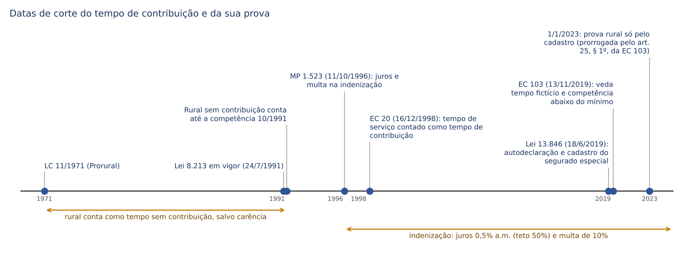
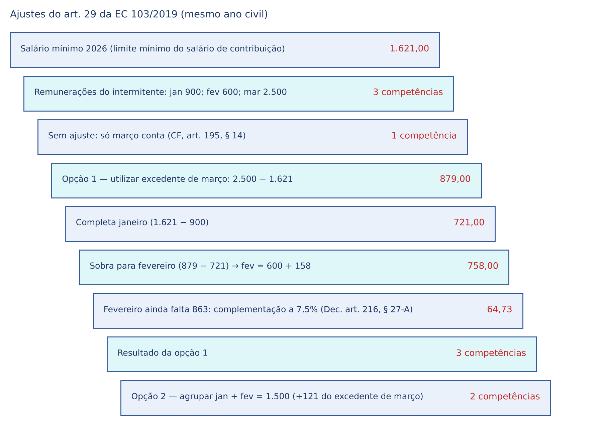
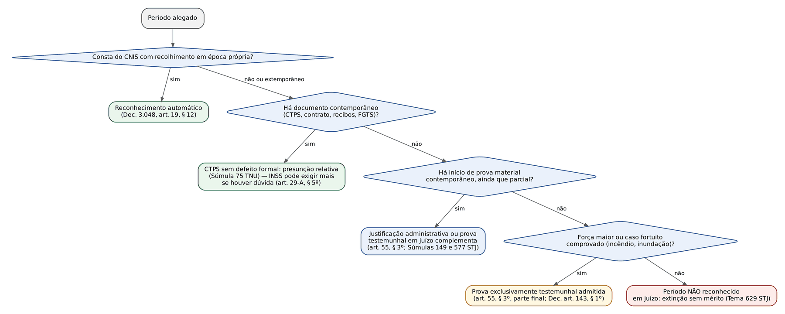
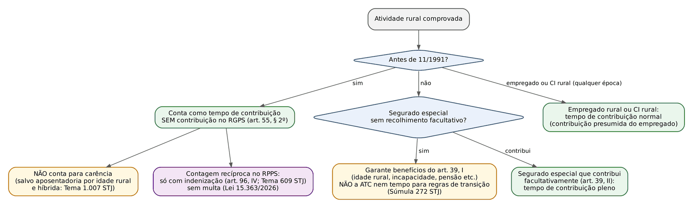
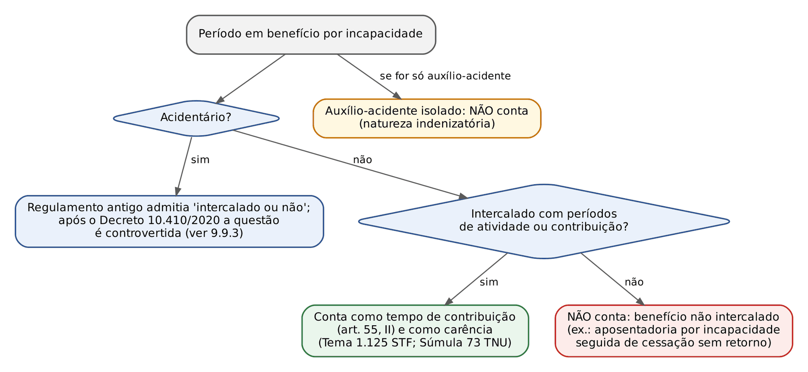
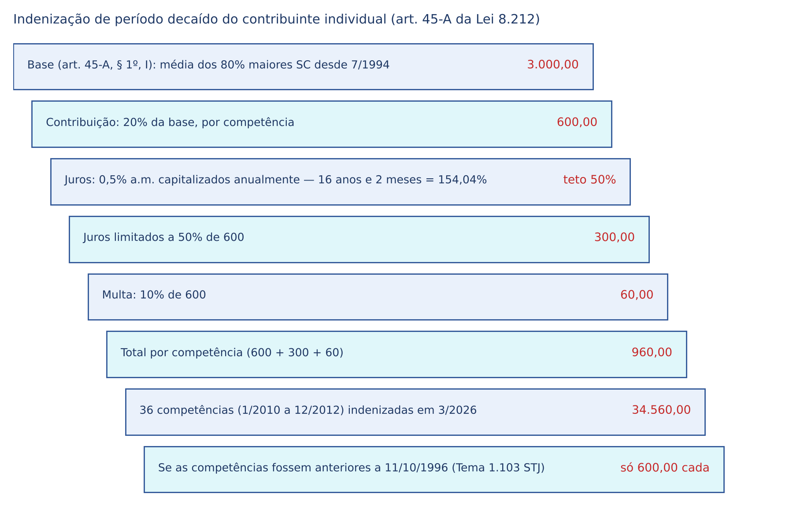
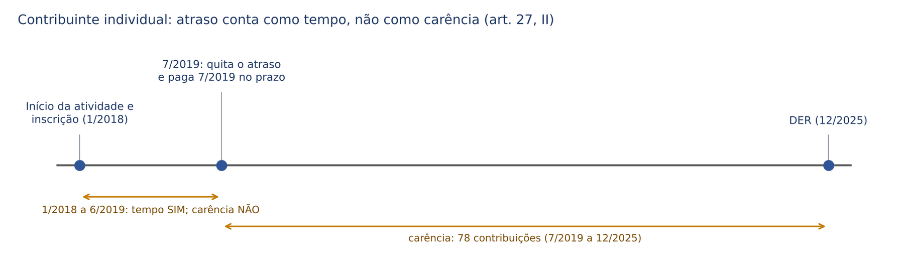

# CAPÍTULO 09 — TEMPO DE CONTRIBUIÇÃO E SUA PROVA

:::INCIDENCIA
TRF5 p. 6 (tempo de contribuição e sua prova, CNIS, atividade rural, segurado especial; especial e conversão no Cap. 10; contagem recíproca no Cap. 26). Nível A+.
Lote: FGV 0, FCC 2 (ambas sobre a vedação do tempo fictício do art. 201, § 14, da CF); correlatas em outros capítulos (segurado especial, CNIS).
O que mais cai: início de prova material e Súmula 149 do STJ, eficácia retrospectiva do documento (Súmula 577 do STJ), tempo rural anterior a 11/1991 sem contribuição salvo carência, benefício por incapacidade intercalado, indenização de período pretérito (Tema 1.103 do STJ) e a vedação do tempo fictício após a EC 103/2019.
:::

## 09.1 Conceito: de tempo de serviço a tempo de contribuição

### 09.1.1 A virada da EC 20/1998

Até 15/12/1998 a CF e a Lei 8.213/1991 falavam em "tempo de serviço": bastava o exercício de atividade vinculante ao RGPS, e o recolhimento era problema do responsável tributário. A EC 20/1998 trocou o paradigma para "tempo de contribuição" (aposentadoria por tempo de contribuição, art. 201, § 7º, I, na redação de então), mas não apagou o passado: o tempo de serviço já cumprido foi convertido, por ficção constitucional, em tempo de contribuição.

:::LEI EC 20/1998, art. 4º
Observado o disposto no art. 40, § 10, da Constituição Federal, o tempo de serviço considerado pela legislação vigente para efeito de aposentadoria, cumprido até que a lei discipline a matéria, será contado como tempo de contribuição.
:::

Consequências práticas que o juiz precisa ter em mente:

- A Lei 8.213/1991 ainda usa "tempo de serviço" em vários dispositivos (art. 55, art. 96, IV). Lidos depois da EC 20/1998, esses dispositivos disciplinam tempo de contribuição, e as hipóteses de tempo "sem contribuição" que eles admitem (rural anterior a 1991, serviço militar, benefício por incapacidade intercalado) continuam valendo como tempo de contribuição por força do art. 4º da EC 20/1998 e, depois, do art. 25 da EC 103/2019 (ver 9.11).
- Para o EMPREGADO, o DOMÉSTICO e o AVULSO, o tempo é de contribuição ainda que o empregador não tenha recolhido: a contribuição é presumida (o segurado não é o responsável pelo recolhimento). Para o CONTRIBUINTE INDIVIDUAL que trabalha por conta própria, o FACULTATIVO e o SEGURADO ESPECIAL que quer tempo para aposentadoria por tempo de contribuição, só há tempo se houver recolhimento (próprio, em dia ou em atraso, ou indenização). Esse é o eixo de quase todas as questões de "conta ou não conta".
- A partir de 1/4/2003 (art. 4º da Lei 10.666/2003), a empresa tomadora passou a reter e recolher a contribuição do contribuinte individual que lhe presta serviço; daí em diante esse CI também tem contribuição presumida em relação à remuneração paga por empresa (o art. 96, V, da Lei 8.213 reproduz o marco de 1º de abril de 2003 para a CTC).

### 09.1.2 Tempo de contribuição, carência e qualidade de segurado

Os três conceitos são cobrados juntos e confundidos de propósito pela banca. A carência e a qualidade de segurado são desenvolvidas no Cap. 8; aqui interessa a distinção.

| Conceito | O que mede | Unidade | Exemplo de período que conta para um e não para o outro |
|---|---|---|---|
| Tempo de contribuição | Duração da vida contributiva, apurada de data a data | Dias, convertidos em anos, meses e dias | Rural anterior a 11/1991: conta como tempo, não como carência (art. 55, § 2º) |
| Carência | Número mínimo de contribuições mensais | Competências (meses) | Contribuições do CI em atraso anteriores à primeira em dia: contam como tempo (provada a atividade), não como carência (art. 27, II) |
| Qualidade de segurado | Vínculo jurídico com o RGPS em dada data | Situação (tem ou não tem) | Período de graça: mantém a qualidade, mas NÃO é tempo nem carência |

:::PEGADINHA
O período de graça (art. 15 da Lei 8.213, ver Cap. 8) conserva a qualidade de segurado e todos os direitos perante a Previdência, mas não gera tempo de contribuição nem carência: não houve atividade nem contribuição. A banca costuma dizer que "o segurado em período de graça continua acumulando tempo". Errado.
:::

### 09.1.3 Como se conta: de data a data e por competência

Para o tempo até 13/11/2019, o Regulamento manda contar de data a data, "desde o início da atividade até a data do desligamento" (art. 188-G do Decreto 3.048/1999, incluído pelo Decreto 10.410/2020). Depois da EC 103/2019, a unidade passa a ser a COMPETÊNCIA: a competência com salário de contribuição igual ou superior ao mínimo conta inteira, "independentemente da quantidade de dias trabalhados" (art. 19-C, § 2º, do Decreto 3.048); a competência abaixo do mínimo não conta (CF, art. 195, § 14, ver 9.3).

Dois cuidados de cálculo:

- Períodos CONCOMITANTES contam uma só vez para fins de tempo (o segurado que é empregado e, ao mesmo tempo, contribuinte individual não "dobra" o tempo). A concomitância só repercute no salário de contribuição (Cap. 11).
- O tempo é contado em dias e expresso em anos, meses e dias; para regras de pontos, idade e tempo "serão apurados em dias" (art. 188-I, § 2º, do Decreto 3.048).

:::EXEMPLO Contagem com período concomitante
Segurado com quatro registros: Empresa A de 3/2/1988 a 15/6/1995; Empresa B de 1/8/1995 a 30/11/2003; contribuições como CI de 1/1/2002 a 31/12/2004 (concomitantes com a Empresa B até 30/11/2003); Empresa C de 1/3/2005 a 13/11/2019.
1. Une-se o que é concomitante: B (1/8/1995 a 30/11/2003) e CI (1/1/2002 a 31/12/2004) formam um único bloco de 1/8/1995 a 31/12/2004.
2. Contam-se os blocos de data a data (incluindo o dia inicial e o final):
| Bloco | Período | Anos, meses e dias | Dias |
|---|---|---|---|
| 1 | 3/2/1988 a 15/6/1995 | 7a 4m 13d | 2.690 |
| 2 | 1/8/1995 a 31/12/2004 | 9a 5m 0d | 3.441 |
| 3 | 1/3/2005 a 13/11/2019 | 14a 8m 13d | 5.371 |
| Total | | 30a 17m 26d = 31a 5m 26d | 11.502 |
3. A soma bruta dos quatro registros daria 12.201 dias; a diferença (699 dias) é exatamente a parte concomitante, que não se conta duas vezes.
4. Em 13/11/2019, portanto, o segurado tinha 31 anos, 5 meses e 26 dias: insuficiente para a aposentadoria por tempo de contribuição pela regra antiga (35 anos, homem), mas relevante para as regras de transição (Cap. 13).
:::

## 09.2 O que conta e o que não conta como tempo de contribuição

O art. 55 da Lei 8.213/1991 é o dispositivo central. Note a expressão final do caput: o tempo das atividades de segurado obrigatório conta "mesmo que anterior à perda da qualidade de segurado".

:::LEI Lei 8.213/1991, art. 55, caput e incisos
Art. 55. O tempo de serviço será comprovado na forma estabelecida no Regulamento, compreendendo, além do correspondente às atividades de qualquer das categorias de segurados de que trata o art. 11 desta Lei, mesmo que anterior à perda da qualidade de segurado:
I - o tempo de serviço militar, inclusive o voluntário, e o previsto no § 1º do art. 143 da Constituição Federal, ainda que anterior à filiação ao Regime Geral de Previdência Social, desde que não tenha sido contado para inatividade remunerada nas Forças Armadas ou aposentadoria no serviço público;
II - o tempo intercalado em que esteve em gozo de auxílio-doença ou aposentadoria por invalidez;
III - o tempo de contribuição efetuada como segurado facultativo;
IV - o tempo de serviço referente ao exercício de mandato eletivo federal, estadual ou municipal, desde que não tenha sido contado para efeito de aposentadoria por outro regime de previdência social;
V - o tempo de contribuição efetuado por segurado depois de ter deixado de exercer atividade remunerada que o enquadrava no art. 11 desta Lei;
VI - o tempo de contribuição efetuado com base nos artigos 8º e 9º da Lei nº 8.162, de 8 de janeiro de 1991, pelo segurado definido no artigo 11, inciso I, alínea "g", desta Lei, sendo tais contribuições computadas para efeito de carência.
:::

O Decreto 3.048/1999, após o Decreto 10.410/2020, dividiu o tema em dois dispositivos: o art. 19-C (conceito geral de tempo de contribuição, aplicável também depois da EC 103/2019) e o art. 188-G (rol de períodos que contam ATÉ 13/11/2019, inclusive os "sem contribuição" herdados do regime anterior). O antigo art. 60, que reunia tudo, foi revogado.

| Período | Conta como tempo? | Conta como carência? | Fundamento e observação |
|---|---|---|---|
| Atividade de segurado obrigatório (empregado, doméstico, avulso) | Sim, ainda que o empregador não tenha recolhido | Sim, desde a filiação (art. 27, I) | Contribuição presumida; prova do vínculo (9.4) |
| CI por conta própria e facultativo | Só com recolhimento (em dia, em atraso ou indenizado) | Só a partir da primeira contribuição sem atraso (art. 27, II) | 9.10 |
| Salário-maternidade | Sim | Sim | Dec. 3.048, art. 19-C, II |
| Benefício por incapacidade intercalado | Sim (art. 55, II) | Sim pelo STF (Tema 1.125); o Decreto diz "exceto para efeito de carência" | 9.9.3 |
| Auxílio-acidente isolado | Não | Não | Natureza indenizatória (STJ, JT ed. 199, tese 4) |
| Período de graça | Não | Não | Só mantém a qualidade de segurado |
| Serviço militar (obrigatório, voluntário ou alternativo) | Sim, se não usado para inatividade ou aposentadoria no serviço público | Não (não há contribuição ao RGPS) | Art. 55, I; Dec. art. 188-G, I |
| Rural anterior a 11/1991 sem contribuição | Sim | Não (salvo idade rural e híbrida) | Art. 55, § 2º; 9.7 |
| Mandato eletivo | Sim, com contribuição e se não usado em outro regime | Sim, se contribuído | Art. 55, IV; Dec. art. 19-C, VII |
| Aluno-aprendiz em escola técnica (até 13/11/2019) | Sim, com os requisitos da Súmula 18 da TNU | Não | Dec. art. 188-G, IX; 9.8 |
| Licença ou disponibilidade remunerada | Sim, se houve desconto de contribuição | Sim | Dec. art. 19-C, III e IV |
| Aviso prévio indenizado | Não | Não | Tema 1.238 do STJ |
| Aposentadoria recebida por tutela depois revogada | Não | Não | STJ, REsp 1.457.398 (Info 855) |
| Contribuição pelo plano simplificado (11% ou 5%) | Não para aposentadoria por tempo de contribuição nem contagem recíproca, salvo complementação | Sim | Art. 55, § 4º; Lei 8.212, art. 21, §§ 2º e 3º |
| Competência abaixo do mínimo após 13/11/2019 | Não, salvo ajuste | Não | CF, art. 195, § 14; 9.3 |
| Parcelamento de débito | Só após a quitação | Só após a quitação | Dec. art. 19-C, § 3º |

:::JURIS STJ, Tema 1.238 (REsp 2.068.311, REsp 2.070.015 e REsp 2.069.623, j. 6/2/2025)
Tese: não é possível o cômputo do período de aviso prévio indenizado como tempo de serviço para fins previdenciários. Raciocínio: a parcela é indenizatória, não integra o salário de contribuição (ver Cap. 3), e sem fato gerador nem trabalho não há tempo. A projeção do aviso para fins trabalhistas (art. 487, § 1º, da CLT) não se transporta para o RGPS.
:::

:::JURIS STJ, REsp 1.457.398 (Info 855), j. 13/5/2025
O período em que o segurado recebeu aposentadoria por tempo de contribuição por força de tutela provisória depois revogada não pode ser somado ao tempo de contribuição para obter a aposentadoria. O benefício precário não é "intercalado" com atividade no sentido do art. 55, II, e não há contribuição. Sobre a devolução dos valores recebidos por tutela revogada, ver Cap. 12 e Cap. 20.
:::

:::JURIS STJ, Jurisprudência em Teses, ed. 199, tese 4
Por possuir natureza indenizatória, o período em que o segurado esteve em gozo EXCLUSIVO de auxílio-acidente não pode ser considerado tempo de contribuição. Atenção ao advérbio: se o segurado recebe auxílio-acidente e trabalha, o tempo conta pela atividade, não pelo benefício.
:::

:::DICA
Para o plano simplificado: quem contribui com 11% (CI por conta própria ou facultativo) ou 5% (MEI e facultativo de baixa renda) sobre o mínimo renuncia à aposentadoria por tempo de contribuição. Para usar esse tempo na aposentadoria por tempo (regras de transição) ou na contagem recíproca, deve complementar a diferença até 20%, com juros moratórios, "a qualquer tempo, sob pena de indeferimento do benefício" (Lei 8.212, art. 21, §§ 3º e 5º). Para a aposentadoria por idade e a programada, essas contribuições valem normalmente.
:::

## 09.3 Competência com contribuição abaixo do mínimo após a EC 103/2019

### 09.3.1 A regra constitucional

:::LEI CF, art. 195, § 14 (incluído pela EC 103/2019)
§ 14. O segurado somente terá reconhecida como tempo de contribuição ao Regime Geral de Previdência Social a competência cuja contribuição seja igual ou superior à contribuição mínima mensal exigida para sua categoria, assegurado o agrupamento de contribuições.
:::

A regra nasceu da reforma trabalhista (trabalho intermitente, jornada parcial): o segurado que, somadas todas as remunerações do mês, recebe menos que o salário mínimo contribui, mas a competência "não fecha". O Regulamento estendeu o corte para TODOS os efeitos: "aquisição e manutenção da qualidade de segurado, de carência, de tempo de contribuição e de cálculo do salário de benefício" e contagem recíproca (art. 19-E do Decreto 3.048).

:::LEI EC 103/2019, art. 29
Art. 29. Até que entre em vigor lei que disponha sobre o § 14 do art. 195 da Constituição Federal, o segurado que, no somatório de remunerações auferidas no período de 1 (um) mês, receber remuneração inferior ao limite mínimo mensal do salário de contribuição poderá:
I - complementar a sua contribuição, de forma a alcançar o limite mínimo exigido;
II - utilizar o valor da contribuição que exceder o limite mínimo de contribuição de uma competência em outra; ou
III - agrupar contribuições inferiores ao limite mínimo de diferentes competências, para aproveitamento em contribuições mínimas mensais.
Parágrafo único. Os ajustes de complementação ou agrupamento de contribuições previstos nos incisos I, II e III do caput somente poderão ser feitos ao longo do mesmo ano civil.
:::

### 09.3.2 A mecânica dos ajustes

- Complementação (inciso I): o próprio segurado recolhe a diferença até o dia 15 do mês seguinte; depois, com acréscimos legais (Dec. 3.048, art. 19-E, § 3º). Para empregado, doméstico e avulso, a alíquota da complementação é de 7,5%; para o CI que presta serviço a empresa e contribui só nessa condição, 20% (Dec. 3.048, art. 216, § 27-A, I).
- Utilização do excedente (inciso II): o salário de contribuição que passa do mínimo numa competência completa outra, mesmo de categoria distinta.
- Agrupamento (inciso III): somam-se competências deficitárias até formar uma mínima; as competências "zeradas" pelo agrupamento podem ainda ser objeto de recolhimento próprio.
- Limites: só dentro do MESMO ANO CIVIL; os ajustes são "irreversíveis e irrenunciáveis após processados" (Dec. art. 19-E, § 2º; art. 216, § 27-C); a contribuição do 13º salário não pode ser usada (art. 216, § 27-B); os dependentes podem pedir os ajustes após o óbito até 15 de janeiro do ano seguinte (art. 19-E, § 7º).

:::EXEMPLO Intermitente em 2026 (salário mínimo de 1.621 (mil seiscentos e vinte e um) reais)
Remunerações: janeiro 900; fevereiro 600; março 2.500.
1. Sem ajuste, só março conta: 1 competência.
2. Opção 1 (utilizar e complementar): excedente de março = 2.500 − 1.621 = 879. Janeiro precisa de 1.621 − 900 = 721 e fica completo. Sobram 879 − 721 = 158 para fevereiro, que passa a 758. Faltam 1.621 − 758 = 863, complementados a 7,5%: 863 × 0,075 = 64,73. Resultado: 3 competências por 64,73.
3. Opção 2 (agrupar): janeiro + fevereiro = 1.500; com 121 do excedente de março, forma-se uma competência; resultado: 2 competências, sem desembolso.
4. A escolha cabe ao segurado e é irreversível; a opção 1 rende mais tempo e mais carência.
:::

:::PEGADINHA
O § 14 do art. 195 fala em contribuição "igual ou superior à contribuição mínima mensal exigida para sua categoria". O Regulamento opera com o limite mínimo do salário de contribuição (o salário mínimo). E a regra só vale para competências a partir de 13/11/2019 (Dec. art. 19-E, caput): o passado não é atingido.
:::

## 09.4 CNIS: presunção, retificação e extemporaneidade

### 09.4.1 O que é e o que prova

O Cadastro Nacional de Informações Sociais é a base de dados mantida pela Dataprev que reúne vínculos, remunerações e contribuições (alimentada pela GFIP e, hoje, pelo eSocial, DCTFWeb e GPS). É a prova ordinária do tempo de contribuição.

:::LEI Lei 8.213/1991, art. 29-A, caput e §§ 2º a 5º
Art. 29-A. O INSS utilizará as informações constantes no Cadastro Nacional de Informações Sociais – CNIS sobre os vínculos e as remunerações dos segurados, para fins de cálculo do salário-de-benefício, comprovação de filiação ao Regime Geral de Previdência Social, tempo de contribuição e relação de emprego.
§ 2º O segurado poderá solicitar, a qualquer momento, a inclusão, exclusão ou retificação de informações constantes do CNIS, com a apresentação de documentos comprobatórios dos dados divergentes, conforme critérios definidos pelo INSS.
§ 3º A aceitação de informações relativas a vínculos e remunerações inseridas extemporaneamente no CNIS, inclusive retificações de informações anteriormente inseridas, fica condicionada à comprovação dos dados ou das divergências apontadas, conforme critérios definidos em regulamento.
§ 4º Considera-se extemporânea a inserção de dados decorrentes de documento inicial ou de retificação de dados anteriormente informados, quando o documento ou a retificação, ou a informação retificadora, forem apresentados após os prazos estabelecidos em regulamento.
§ 5º Havendo dúvida sobre a regularidade do vínculo incluído no CNIS e inexistência de informações sobre remunerações e contribuições, o INSS exigirá a apresentação dos documentos que serviram de base à anotação, sob pena de exclusão do período.
:::

O Regulamento completa: os dados do CNIS "valem como prova de filiação à previdência social, tempo de contribuição e salários-de-contribuição" (Dec. 3.048, art. 19, caput), e "os recolhimentos efetuados na época apropriada constantes do CNIS serão reconhecidos automaticamente, observados a contribuição mínima mensal e o disposto no art. 19-E, dispensada a comprovação do exercício da atividade" (art. 19, § 12).

### 09.4.2 Extemporaneidade

É extemporânea a informação inserida (Dec. 3.048, art. 19, § 3º):

- de início de vínculo empregatício, após o último dia do QUINTO mês subsequente ao da admissão;
- de remuneração de avulso ou de CI que presta serviço a empresa, após o último dia do quinto mês subsequente ao da prestação;
- de contribuição, sempre que o recolhimento tiver sido feito sem observância da lei.

Efeitos: a informação extemporânea "somente será aceita se corroborada por documentos que comprovem a sua regularidade" (art. 19, § 2º), e o INSS pode desconsiderar a extemporaneidade depois de um ano da inserção, conforme critérios próprios (art. 19, § 4º). No extrato, esses dados aparecem com indicadores de pendência (PEXT, por exemplo), e é por eles que o processo administrativo começa.

### 09.4.3 Retificação: quem pede, como e onde

- A retificação pode ser pedida "a qualquer tempo", independentemente de requerimento de benefício (Dec. art. 19, § 1º), com documentos contemporâneos (art. 19-B).
- Rol de documentos do art. 19-B, § 1º, do Decreto (exemplificativo): CTPS, contrato de trabalho, contrato rural por pequeno prazo, carteira de férias, carteira sanitária, caderneta de matrícula, cadernetas dos antigos IAPs, declaração da Receita, certidão de conselho profissional com prova do exercício, contrato social e distrato, certificado de sindicato ou OGMO, extrato do FGTS e recibos de pagamento.
- Na falta de documento contemporâneo, aceitam-se declaração do empregador, atestado de empresa existente ou certidão de entidade oficial, desde que extraídos de registros existentes e confirmados pelo INSS por pesquisa externa (art. 19-B, §§ 4º e 5º).
- Acertos de recolhimento (inclusão de GPS, alteração de valor ou data, transferência de contribuição feita com CNPJ, contribuição de parcelamento) são feitos EXCLUSIVAMENTE pela Receita Federal (art. 19-B, § 7º). Para o juiz: o pedido de retificação de GPS é matéria de custeio, não de benefício.

:::PROCESSO Ação declaratória de tempo e averbação
- Cabe ação declaratória para reconhecimento de tempo de serviço para fins previdenciários (Súmula 242 do STJ). O interesse de agir dispensa pedido de benefício, mas exige prévio requerimento administrativo de averbação ou de retificação do CNIS (orientação do RE 631.240, ver Cap. 19).
- Competência: Justiça Federal (INSS no polo passivo), inclusive para reconhecer vínculo empregatício como questão prejudicial, sem efeito trabalhista. A Justiça do Trabalho não declara tempo previdenciário contra o INSS, que não é parte na reclamação (ver Cap. 20; execução de contribuições pela Justiça do Trabalho no Cap. 5).
- Reconhecido o tempo rural, o INSS não pode se recusar a expedir a certidão de tempo de serviço (STJ, JT ed. 94, tese 12; v. Cap. 26); a contagem desse tempo no RPPS, contudo, depende de indenização (9.7.3).
:::

### 09.4.4 CTPS: presunção relativa

:::JURIS TNU, Súmula 75
A Carteira de Trabalho e Previdência Social (CTPS) em relação à qual não se aponta defeito formal que lhe comprometa a fidedignidade goza de presunção relativa de veracidade, formando prova suficiente de tempo de serviço para fins previdenciários, ainda que a anotação de vínculo de emprego não conste no Cadastro Nacional de Informações Sociais (CNIS).
:::

A Súmula 12 do TST vai na mesma linha no plano trabalhista: as anotações do empregador na carteira geram presunção apenas *juris tantum*, não *juris et de jure*. Para o INSS, a presunção cede diante de defeito formal (rasura, ordem cronológica quebrada, anotação extemporânea, vínculo com parente sem outro indício) ou de dúvida fundada, caso em que o art. 29-A, § 5º, autoriza exigir os documentos-base.

:::DICA
Na sentença, a CTPS íntegra e cronológica, sem prova em contrário produzida pelo INSS, basta; a ausência do vínculo no CNIS e a falta de recolhimento NÃO são motivos para negar o tempo do empregado (contribuição presumida, cujo recolhimento compete ao empregador). O ônus de infirmar a anotação é do INSS.
:::

### 09.4.5 Sentença trabalhista como prova

A orientação antiga do STJ admitia a sentença trabalhista como início de prova material (JT ed. 67, tese 19). O Tema 1.188 refinou e restringiu essa orientação para as sentenças HOMOLOGATÓRIAS DE ACORDO e para as anotações dela decorrentes.

:::JURIS STJ, Tema 1.188 (REsp 1.938.265 e REsp 2.056.866, j. 11/9/2024)
A sentença trabalhista homologatória de acordo, assim como a anotação na CTPS e demais documentos dela decorrentes, somente será considerada início de prova material válida, conforme o disposto no art. 55, § 3º, da Lei nº 8.213/91, quando houver nos autos elementos probatórios contemporâneos aos fatos alegados e que sejam aptos a demonstrar o tempo de serviço no período que se pretende reconhecer na ação previdenciária, exceto na hipótese de caso fortuito ou força maior.
:::

Leitura do Tema 1.188:

- O problema é o acordo trabalhista sem instrução (frequentemente na véspera da aposentadoria): a anotação na CTPS feita por ordem dessa sentença não tem a contemporaneidade exigida pelo art. 55, § 3º.
- Sentença trabalhista de MÉRITO, proferida após instrução com prova documental contemporânea, segue podendo servir como início de prova material; o que a torna útil é a prova documental produzida naquele processo, e não a coisa julgada, que não vincula o INSS, estranho à lide trabalhista.
- O Regulamento endureceu na mesma direção: a inclusão ou retificação de vínculos e remunerações, "ainda que reconhecidos em ação trabalhista transitada em julgado", depende de início de prova material contemporânea dos fatos (Dec. 3.048, art. 144, parágrafo único).

:::PEGADINHA
Não confundir o reconhecimento do VÍNCULO com o recolhimento: a execução das contribuições decorrentes das sentenças trabalhistas é da Justiça do Trabalho (CF, art. 114, VIII; ver Cap. 5), mas o pagamento dessas contribuições não supre, por si, a exigência do Tema 1.188 para fins de prova do tempo.
:::

## 09.5 Início de prova material e prova testemunhal

### 09.5.1 A regra legal e sua redação de 2019

:::LEI Lei 8.213/1991, art. 55, § 3º (redação da Lei 13.846/2019)
§ 3º A comprovação do tempo de serviço para os fins desta Lei, inclusive mediante justificativa administrativa ou judicial, observado o disposto no art. 108 desta Lei, só produzirá efeito quando for baseada em início de prova material contemporânea dos fatos, não admitida a prova exclusivamente testemunhal, exceto na ocorrência de motivo de força maior ou caso fortuito, na forma prevista no regulamento.
:::

A Lei 13.846/2019 positivou a exigência de CONTEMPORANEIDADE, que antes era construção jurisprudencial (Súmula 34 da TNU). O sistema é de prova tarifada mitigada: o juiz não pode reconhecer tempo com base só em testemunhas, mas, havendo um começo de prova documental, a extensão do período pode ser formada pela prova oral.

:::JURIS STJ, Súmula 149
A prova exclusivamente testemunhal não basta à comprovação da atividade rurícola, para efeito da obtenção de benefício previdenciário.
:::

A súmula fala em atividade rurícola, mas a regra legal vale para QUALQUER tempo de serviço (urbano, doméstico, rural), para a dependência econômica, a identidade e o parentesco na justificação (Dec. 3.048, art. 143).

:::DOUTRINA Constitucionalidade e crítica
A vedação da prova exclusivamente testemunhal é antiga (vinha da legislação anterior a 1991) e foi tida por compatível com a CF pela jurisprudência dos tribunais superiores, sob o argumento de que o legislador pode estabelecer requisitos de prova para a concessão de prestações custeadas pela coletividade. A doutrina previdenciarista de viés protetivo (Savaris, por exemplo, na linha da prova *pro misero*) critica a regra como tarifação incompatível com o livre convencimento e com a informalidade do trabalho rural; a resposta jurisprudencial foi flexibilizar o conceito de "início" de prova, não afastar a exigência.
:::

### 09.5.2 O que é "início" de prova material: os seis atributos

| Atributo | Regra | Fonte |
|---|---|---|
| Documental e material | Documento escrito que indique o fato; declaração escrita de terceiro (ex-empregador, sindicato, vizinho), produzida depois dos fatos, equivale a prova testemunhal reduzida a termo e não serve como início | Orientação consolidada do STJ e da TNU; Dec. art. 19-B, § 4º (declaração só se extraída de registros existentes) |
| Contemporâneo | Produzido à época dos fatos | Art. 55, § 3º; Súmula 34 da TNU |
| Não precisa abranger todo o período | Basta cobrir parte; a prova oral estende | Súmula 14 da TNU; Tema 554 do STJ |
| Eficácia retrospectiva e prospectiva | Vale para antes e para depois da sua data, se corroborado | Súmula 577 do STJ; Tema 638; JT ed. 94, tese 3 |
| Rol legal exemplificativo | O art. 106 não é taxativo | JT ed. 94, tese 2 |
| Pode estar em nome de terceiro do grupo familiar | Certidão de casamento com o cônjuge lavrador etc., salvo se o titular passou a atividade urbana | Súmula 6 da TNU; Tema 533 do STJ |

:::JURIS TNU, Súmula 34
Para fins de comprovação do tempo de labor rural, o início de prova material deve ser contemporâneo à época dos fatos a provar.
:::

:::JURIS TNU, Súmula 14
Para a concessão de aposentadoria rural por idade, não se exige que o início de prova material corresponda a todo o período equivalente à carência do benefício.
:::

### 09.5.3 Eficácia retrospectiva e prospectiva

:::JURIS STJ, Súmula 577 e Tema 638 (j. 28/8/2013)
Súmula 577: "É possível reconhecer o tempo de serviço rural anterior ao documento mais antigo apresentado, desde que amparado em convincente prova testemunhal colhida sob o contraditório." O Tema 638 (relator Ministro Arnaldo Esteves Lima, Primeira Seção) fixou a mesma tese em recurso repetitivo. A Jurisprudência em Teses (ed. 94, tese 3) generaliza: a prova material "possui eficácia probatória tanto para o período anterior quanto para o posterior à data do documento, desde que corroborada por prova testemunhal".
:::

:::EXEMPLO Extensão do documento mais antigo
Autor nascido em 1960 alega trabalho rural em regime de economia familiar desde os 12 anos (10/5/1972) até 31/10/1991. Documentos: certidão de casamento de 1982 qualificando-o como lavrador; notas fiscais de produtor de 1986 e 1989. Testemunhas idôneas, colhidas em audiência, confirmam o trabalho desde a infância.
1. Há início de prova material (1982, 1986 e 1989), contemporâneo e em nome próprio.
2. A prova oral convincente estende a eficácia para trás (Súmula 577) até 10/5/1972 e para frente até 31/10/1991.
3. Período reconhecível: 10/5/1972 a 31/10/1991 = 19 anos, 5 meses e 22 dias (7.114 dias).
4. Efeito: tempo de contribuição sem recolhimento (art. 55, § 2º), não carência (9.7.2). Se o juiz entendesse que o trabalho só é reconhecível a partir dos 14 anos, o período cairia para 17 anos, 5 meses e 22 dias (a partir de 10/5/1974); a jurisprudência admite o cômputo a partir dos 12 anos (9.7.4).
:::

### 09.5.4 Boia-fria: a mitigação do Tema 554

:::JURIS STJ, Tema 554 (REsp 1.321.493, Relator Ministro Herman Benjamin, Primeira Seção, j. 10/10/2012)
Aplica-se a Súmula 149/STJ aos trabalhadores rurais denominados "boias-frias", sendo imprescindível a apresentação de início de prova material. Por outro lado, considerando a inerente dificuldade probatória da condição de trabalhador campesino, a apresentação de prova material somente sobre parte do lapso temporal pretendido não implica violação da Súmula 149/STJ, cuja aplicação é mitigada se a reduzida prova material for complementada por idônea e robusta prova testemunhal.
:::

A tese tem duas metades, e a banca cobra cada uma isoladamente: (i) o boia-fria NÃO está dispensado do início de prova material (quem afirma o contrário erra); (ii) para ele, a exigência é mitigada quanto à extensão: um único documento pode bastar se a prova oral for robusta.

### 09.5.5 Documentos em nome de terceiros

- Certidão de casamento, de nascimento dos filhos, título de eleitor ou outro documento que qualifique o CÔNJUGE ou o genitor como lavrador é início de prova material para o outro integrante do grupo familiar (Súmula 6 da TNU; no mesmo sentido o STJ desde o REsp 131.765, Info 18).
- Limite: a extensão não é possível quando o titular do documento passa a exercer atividade incompatível com o labor rural, como trabalho urbano (STJ, JT ed. 94, tese 6, julgada no rito repetitivo, Tema 533). A partir daí, o outro precisa de documento próprio.
- A atividade urbana de um integrante não descaracteriza, por si só, os demais como segurados especiais (Tema 533 do STJ; Súmula 41 da TNU): examina-se se o trabalho rural continuava indispensável à subsistência.

:::JURIS TNU, Súmula 6
A certidão de casamento ou outro documento idôneo que evidencie a condição de trabalhador rural do cônjuge constitui início razoável de prova material da atividade rurícola.
:::

:::PEGADINHA Regulamento x jurisprudência
O Decreto 3.048, art. 142, § 4º (Decreto 10.410/2020), diz que "a prova material somente terá validade para a pessoa referida no documento, vedada a sua utilização por outras pessoas". A regra vincula o INSS na via administrativa, mas a jurisprudência (Súmula 6 da TNU; STJ) continua admitindo o documento do cônjuge ou do genitor como início de prova para o regime de economia familiar. Em prova de juiz federal, a resposta jurisprudencial prevalece; em prova que pergunte "segundo o Regulamento", a resposta é a literal.
:::

### 09.5.6 Força maior e caso fortuito

A parte final do art. 55, § 3º, admite a prova exclusivamente testemunhal na "ocorrência de motivo de força maior ou caso fortuito". O Regulamento exige "ocorrência notória, tais como incêndio, inundação ou desmoronamento, que tenha atingido a empresa", comprovada por registro policial da época ou documentos contemporâneos, e correlação entre a atividade da empresa e a profissão do segurado; se a empresa não existe mais, prova oficial da sua existência no período (Dec. 3.048, art. 143, §§ 1º a 3º). A simples perda da CTPS NÃO é força maior.

### 09.5.7 Consequência processual da ausência de início de prova

:::JURIS STJ, Tema 629 (REsp 1.352.721, Relator Ministro Napoleão Nunes Maia Filho, Corte Especial, j. 16/12/2015, Info 581)
A ausência de conteúdo probatório eficaz a instruir a inicial implica a carência de pressuposto de constituição e desenvolvimento válido do processo, impondo sua extinção sem o julgamento do mérito e a consequente possibilidade de o autor intentar novamente a ação, caso reúna os elementos necessários. No CPC/2015: arts. 485, IV, e 486, § 1º.
:::

:::SENTENCA Improcedência x extinção sem mérito no tempo rural
Sem início de prova material: extinção sem resolução do mérito (Tema 629), não improcedência. Modelo: "Ausente início de prova material contemporâneo do labor rural alegado (art. 55, § 3º, da Lei 8.213/1991; Súmula 149 do STJ), JULGO EXTINTO o processo, sem resolução do mérito, nos termos do art. 485, IV, do CPC, na forma do Tema 629 do STJ, ressalvada a renovação do pedido com novos elementos (art. 486, § 1º, do CPC)." Com início de prova, mas prova oral fraca ou contraditória: julgamento de mérito (improcedência), que faz coisa julgada; a tese de coisa julgada *secundum eventum probationis* fica no Cap. 20.
:::

## 09.6 Justificação administrativa e justificação judicial

### 09.6.1 Natureza e cabimento

:::LEI Lei 8.213/1991, art. 108
Art. 108. Mediante justificação processada perante a Previdência Social, observado o disposto no § 3º do art. 55 e na forma estabelecida no Regulamento, poderá ser suprida a falta de documento ou provado ato do interesse de beneficiário ou empresa, salvo no que se refere a registro público.
:::

A justificação administrativa (JA) é o meio de produzir prova oral perante o INSS para "suprir a falta ou a insuficiência de documento ou para produzir prova de fato ou circunstância de interesse dos beneficiários" (Dec. 3.048, art. 142). Seu traço essencial, depois de 2020, é o caráter INCIDENTAL e COMPLEMENTAR:

- É parte do processo de atualização do CNIS ou de reconhecimento de direitos, "vedada a sua tramitação na condição de processo autônomo" (art. 142, § 2º).
- "Somente será admitido o processamento de justificação administrativa quando necessário para corroborar o início de prova material apto a demonstrar a plausibilidade do que se pretende comprovar" (art. 151).
- Não cabe para fato que exija registro público de casamento, de idade ou de óbito, ou ato para o qual a lei prescreva forma especial (art. 142, § 1º).

### 09.6.2 Procedimento

O rito (requerimento minucioso, 2 a 6 testemunhas, impedimentos de pessoas com menos de 16 anos e de parentes até o terceiro grau, avaliação global e irrecorribilidade da decisão sobre a eficácia, arts. 145 a 148 do Decreto) está no Cap. 19 (19.4.2). Para o tema deste capítulo importa o efeito: a JA eficaz vale perante o INSS "para os fins especificamente visados" (art. 148) e, para CI e doméstico, o processo homologado segue à arrecadação para cobrança do crédito (art. 143, § 4º).

:::PEGADINHA
"Não cabe recurso da decisão sobre a eficácia da justificação" não significa que o segurado fique sem impugnação: ele recorre ao CRPS da decisão de indeferimento do benefício ou da averbação, em que a JA é apenas uma etapa. E as testemunhas impedidas da JA (parentes) também são as que a prática judicial costuma ouvir como informantes.
:::

### 09.6.3 Justificação judicial

A justificação judicial (hoje, produção antecipada de prova sem caráter contencioso, arts. 381, § 5º, e 382 do CPC) homologa a prova oral colhida em juízo. Para o INSS, "a homologação da justificação judicial processada com base em prova exclusivamente testemunhal dispensa a justificação administrativa, desde que complementada com início de prova material contemporânea dos fatos" (Dec. 3.048, art. 144). Isto é: a JJ não supre a ausência de prova material; ela apenas substitui a etapa oral da JA.

| Ponto | Justificação administrativa | Justificação judicial | Prova testemunhal na ação previdenciária |
|---|---|---|---|
| Onde | INSS | Juízo (produção antecipada de prova) | Juízo, em ação contra o INSS |
| Autonomia | Não (incidental ao requerimento) | Procedimento próprio, sem lide | Instrução da ação |
| Exige início de prova material | Sim (art. 151) | Sim, para produzir efeito (art. 144) | Sim (art. 55, § 3º) |
| Recurso | Não da decisão de eficácia (art. 147) | Sentença apenas homologatória | Recursos ordinários |
| Efeito | Vale perante o INSS para o fim visado | Dispensa a JA | Coisa julgada contra o INSS |

## 09.7 Atividade rural e segurado especial

O conceito de segurado especial, os limites de área (quatro módulos fiscais), a mão de obra de terceiros, as atividades e rendas que não o descaracterizam e a contribuição sobre a comercialização são do Cap. 7 e do Cap. 4. Aqui: o TEMPO rural e a sua PROVA.

### 09.7.1 Antes de 1991: o regime do Prorural

Antes da Lei 8.213/1991, o trabalhador rural estava no Prorural/Funrural (LC 11/1971), regime assistencial e não contributivo para o trabalhador, que garantia aposentadoria de meio salário mínimo ao chefe da unidade familiar. A Lei 8.213 unificou o regime (CF, art. 194, parágrafo único, II) e fez a ponte com o passado no art. 55, § 2º.

:::LEI Lei 8.213/1991, art. 55, §§ 1º e 2º
§ 1º A averbação de tempo de serviço durante o qual o exercício da atividade não determinava filiação obrigatória ao anterior Regime de Previdência Social Urbana só será admitida mediante o recolhimento das contribuições correspondentes, conforme dispuser o Regulamento, observado o disposto no § 2º.
§ 2º O tempo de serviço do segurado trabalhador rural, anterior à data de início de vigência desta Lei, será computado independentemente do recolhimento das contribuições a ele correspondentes, exceto para efeito de carência, conforme dispuser o Regulamento.
:::

- Marco temporal: o Regulamento fixa o corte na COMPETÊNCIA NOVEMBRO DE 1991 ("o tempo de serviço do segurado trabalhador rural anterior à competência novembro de 1991", Dec. 3.048, art. 188-G, IV), embora a Lei 8.213 esteja em vigor desde a sua publicação, em 25/7/1991; o corte em 31/10/1991 é o adotado pelo INSS e pela jurisprudência dominante. Na prova, a referência legal é a "data de início de vigência desta Lei"; a referência regulamentar e jurisprudencial é 31/10/1991.
- Alcance: o § 2º beneficia todo trabalhador rural anterior a 1991, inclusive o empregado rural e o segurado especial; não apenas o "chefe de família" do Prorural.

:::JURIS TNU, Súmula 24
O tempo de serviço do segurado trabalhador rural anterior ao advento da Lei nº 8.213/91, sem o recolhimento de contribuições previdenciárias, pode ser considerado para a concessão de benefício previdenciário do Regime Geral de Previdência Social (RGPS), exceto para efeito de carência, conforme a regra do art. 55, §2º, da Lei nº 8.213/91.
:::

### 09.7.2 A exceção da carência e as suas exceções

O tempo rural sem contribuição não conta como carência para as aposentadorias urbanas (por idade urbana, por tempo de contribuição, programada). Duas válvulas, desenvolvidas no Cap. 13:

- Aposentadoria por idade RURAL (art. 48, §§ 1º e 2º, e art. 39, I): não exige contribuições, mas "efetivo exercício de atividade rural" em número de meses igual à carência; aí o tempo rural, inclusive anterior a 1991, funciona como período equivalente à carência.
- Aposentadoria HÍBRIDA (art. 48, § 3º): o tempo rural, "ainda que remoto e descontínuo", anterior a 1991, conta para a carência, "ainda que não tenha sido efetivado o recolhimento das contribuições" (Tema 1.007 do STJ).

A ressalva "exceto para efeito de carência" do art. 55, § 2º, não alcança o EMPREGADO RURAL com vínculo anotado em CTPS. No Tema 644 (STJ, REsp n. 1.352.791/SP, Relator Ministro Arnaldo Esteves Lima, Primeira Seção, j. 27/11/2013, DJe 5/12/2013), a Primeira Seção admitiu a averbação do trabalho rural com registro em carteira profissional, anterior à Lei 8.213/1991, PARA EFEITO DE CARÊNCIA da aposentadoria por tempo de serviço de trabalhador que depois se tornou urbano: o autor fora contratado por empregador rural, e o recolhimento era obrigação do empregador, razão pela qual "não há como responsabilizá-lo pela comprovação do recolhimento das contribuições". É a mesma lógica da contribuição presumida do empregado urbano (9.1.1). A distinção que a banca explora: o segurado especial e o rural sem registro anteriores a 11/1991 têm tempo, mas não carência (salvo idade rural e híbrida); o empregado rural com CTPS anterior a 1991 tem tempo E carência.

:::JURIS TNU, Súmula 76
A averbação de tempo de serviço rural não contributivo não permite majorar o coeficiente de cálculo da renda mensal inicial de aposentadoria por idade previsto no art. 50 da Lei nº 8.213/91.
:::

:::PEGADINHA
O Decreto 3.048, art. 188-G, parágrafo único, diz que o tempo dos incisos do art. 188-G (inclusive o rural anterior a 11/1991) "será considerado para fins de cálculo do valor da renda mensal de qualquer benefício". A Súmula 76 da TNU, anterior ao Decreto 10.410/2020, nega a majoração do coeficiente da aposentadoria por idade com tempo rural não contributivo. Ponto controvertido; em prova, identifique a fonte que o enunciado pede.
:::

### 09.7.3 Contagem recíproca do tempo rural: só com indenização

O tempo rural anterior a 1991 é gratuito no RGPS, mas não se transporta gratuitamente para o RPPS: a contagem recíproca pressupõe compensação financeira entre os regimes (CF, art. 201, § 9º), e o RGPS nada teria a compensar.

:::JURIS STJ, Tema 609 (REsp 1.682.678, Relator Ministro Og Fernandes, Primeira Seção, j. 25/4/2018, Info 624)
O segurado que tenha provado o desempenho de serviço rurícola em período anterior à vigência da Lei nº 8.213/91, embora faça jus à expedição de certidão nesse sentido para mera averbação nos seus assentamentos, somente tem direito ao cômputo do aludido tempo rural, no respectivo órgão público empregador, para contagem recíproca no regime estatutário se, com a certidão de tempo de serviço rural, acostar o comprovante de pagamento das respectivas contribuições previdenciárias, na forma da indenização calculada conforme o dispositivo do art. 96, IV, da Lei nº 8.213/91.
:::

No mesmo sentido: Súmula 10 da TNU e STJ, JT ed. 94, tese 7. A EC 103/2019 elevou a regra a sanção constitucional: é NULA a aposentadoria concedida por RPPS com contagem recíproca do RGPS "mediante o cômputo de tempo de serviço sem o recolhimento da respectiva contribuição ou da correspondente indenização pelo segurado obrigatório responsável, à época do exercício da atividade, pelo recolhimento de suas próprias contribuições" (art. 25, § 3º). A disciplina da CTC e da compensação está no Cap. 26; o cálculo da indenização, em 9.10.

:::ATENCAO Lei 15.363/2026
A Lei 15.363, de 26/3/2026 (DOU de 27/3/2026, vigência na publicação; ementa: dispensar da multa, na contagem recíproca, o segurado que exerceu atividade dispensada do registro previdenciário obrigatório), incluiu o § 4º no art. 45-A da Lei 8.212 e o § 2º no art. 96 da Lei 8.213: a MULTA de 10% não se aplica ao tempo de atividade rural do empregado rural e do segurado especial (art. 11, I, "a", e VII) em período anterior à obrigatoriedade de filiação (art. 45-A, § 4º), nem, em termos gerais, "ao tempo de serviço anterior à obrigatoriedade de filiação à Previdência Social" (art. 96, § 2º). Os juros não foram afastados pelo texto da lei; para períodos anteriores a 11/10/1996, porém, já não incidem juros nem multa por força do Tema 1.103 do STJ (9.10.3). Questão nova, ainda sem jurisprudência: cuidado com afirmações categóricas.
:::

### 09.7.4 Idade mínima para o tempo rural

- STJ: o tempo de atividade rural exercido por pessoa com menos de 14 anos em regime de economia familiar, "ainda que não vinculado ao Regime de Previdência Social, pode ser averbado e utilizado para o fim de obtenção de benefício previdenciário" (JT ed. 94, tese 1). A proibição constitucional do trabalho infantil existe para proteger a criança, não para lhe retirar direitos.
- TNU, Súmula 5 (transcrição literal): "A prestação de serviço rural por menor de 12 a 14 anos, até o advento da Lei 8.213, de 24 de julho de 1991, devidamente comprovada, pode ser reconhecida para fins previdenciários."
- Prova: documentos em nome dos pais (9.5.5) e testemunhas; a idade de 12 anos é o patamar usual na jurisprudência; o reconhecimento de trabalho abaixo disso depende de prova robusta da efetiva participação no trabalho do grupo, e não de mera presença no ambiente rural.

### 09.7.5 Segurado especial depois de 1991: tempo para quê?

O segurado especial contribui sobre a receita da comercialização da produção (CF, art. 195, § 8º; Lei 8.212, art. 25). Essa contribuição não é proporcional a um salário de contribuição mensal; por isso, a lei lhe garante um rol de benefícios de valor mínimo (art. 39, I: aposentadoria por idade ou por incapacidade, auxílio por incapacidade temporária, auxílio-reclusão, pensão por morte e auxílio-acidente; salário-maternidade pelo art. 39, parágrafo único), mas NÃO a aposentadoria por tempo de contribuição, salvo se contribuir facultativamente (art. 39, II).

:::JURIS STJ, Súmula 272
O trabalhador rural, na condição de segurado especial, sujeito à contribuição obrigatória sobre a produção rural comercializada, somente faz jus à aposentadoria por tempo de serviço, se recolher contribuições facultativas.
:::

Depois da EC 103/2019, a aposentadoria por tempo de contribuição só subsiste nas regras de transição e no direito adquirido (Cap. 13); a lógica da Súmula 272 permanece: o período de segurado especial posterior a 10/1991 sem contribuição facultativa não conta como tempo para as regras que exigem tempo de contribuição (pontos, pedágios); conta para os benefícios do art. 39, I, e para a híbrida.

:::DICA Segurado especial: contagem por tipo de benefício
| Benefício pretendido | Tempo rural anterior a 11/1991 sem contribuição | Tempo de segurado especial posterior a 10/1991 sem contribuição facultativa |
|---|---|---|
| Aposentadoria por idade rural | Conta (atividade rural no período de carência) | Conta |
| Aposentadoria híbrida | Conta, inclusive para a carência (Tema 1.007) | Conta |
| Transições de tempo de contribuição (EC 103) | Conta como tempo, não como carência | NÃO conta (Súmula 272) |
| Contagem recíproca no RPPS | Só com indenização (Tema 609) | Só com indenização |
:::

### 09.7.6 A prova do segurado especial: autodeclaração e cadastro

A Lei 13.846/2019 (conversão da MP 871/2019) reformulou a prova rural, com três camadas:

- Cadastro do segurado especial no CNIS, com atualização anual "até 30 de junho do ano subsequente" (art. 38-A, § 4º); vedada a atualização após 5 anos dessa data (§ 5º); decorrido esse prazo, o segurado especial "só poderá computar o período de trabalho rural se efetuados em época própria a comercialização da produção e o recolhimento da contribuição" (§ 6º).
- Para o período ANTERIOR a 1/1/2023: autodeclaração ratificada por entidades públicas credenciadas (Pronater, art. 13 da Lei 12.188/2010) e por outros órgãos públicos (art. 38-B, § 2º); na prática, a ratificação é feita pelo cruzamento com bases governamentais, e, se insuficiente, complementada por prova documental contemporânea (Dec. 3.048, art. 19-D, § 10).
- A partir de 1/1/2023: comprovação EXCLUSIVAMENTE pelo cadastro (art. 38-B, § 1º). Esse prazo foi prorrogado pela EC 103/2019, art. 25, § 1º, para a atividade rural exercida até 13/11/2019, "até a data em que o Cadastro Nacional de Informações Sociais (CNIS) atingir a cobertura mínima de 50% (cinquenta por cento)" dos segurados especiais, apurada pela Pnad Contínua; o Regulamento repete a regra (Dec. art. 19-D, §§ 18 e 19, com o fim da prorrogação a ser declarado por ato ministerial).

:::LEI Lei 8.213/1991, art. 38-B, §§ 1º, 2º e 4º
§ 1º A partir de 1º de janeiro de 2023, a comprovação da condição e do exercício da atividade rural do segurado especial ocorrerá, exclusivamente, pelas informações constantes do cadastro a que se refere o art. 38-A desta Lei.
§ 2º Para o período anterior a 1º de janeiro de 2023, o segurado especial comprovará o tempo de exercício da atividade rural por meio de autodeclaração ratificada por entidades públicas credenciadas, nos termos do art. 13 da Lei nº 12.188, de 11 de janeiro de 2010, e por outros órgãos públicos, na forma prevista no regulamento.
§ 4º Na hipótese de divergência de informações entre o cadastro e outras bases de dados, para fins de reconhecimento do direito ao benefício, o INSS poderá exigir a apresentação dos documentos referidos no art. 106 desta Lei.
:::

Mudança relevante para o juiz: a Lei 13.846/2019 REVOGOU a declaração do sindicato de trabalhadores rurais como meio de prova (art. 106, III, revogado). Hoje, a declaração sindical vale, no máximo, como prova testemunhal escrita, não como início de prova material.

:::LEI Lei 8.213/1991, art. 106 (rol, redação atual)
Art. 106. A comprovação do exercício de atividade rural será feita, complementarmente à autodeclaração de que trata o § 2º e ao cadastro de que trata o § 1º, ambos do art. 38-B desta Lei, por meio de, entre outros:
I – contrato individual de trabalho ou Carteira de Trabalho e Previdência Social;
II – contrato de arrendamento, parceria ou comodato rural;
III - (revogado);
IV - Declaração de Aptidão ao Programa Nacional de Fortalecimento da Agricultura Familiar, de que trata o inciso II do caput do art. 2º da Lei nº 12.188, de 11 de janeiro de 2010, ou por documento que a substitua;
V – bloco de notas do produtor rural;
VI – notas fiscais de entrada de mercadorias, de que trata o § 7º do art. 30 da Lei nº 8.212, de 24 de julho de 1991, emitidas pela empresa adquirente da produção, com indicação do nome do segurado como vendedor;
VII – documentos fiscais relativos a entrega de produção rural à cooperativa agrícola, entreposto de pescado ou outros, com indicação do segurado como vendedor ou consignante;
VIII – comprovantes de recolhimento de contribuição à Previdência Social decorrentes da comercialização da produção;
IX – cópia da declaração de imposto de renda, com indicação de renda proveniente da comercialização de produção rural; ou
X – licença de ocupação ou permissão outorgada pelo Incra.
:::

Notas de prova que a prática consolidou e a banca explora:

- O rol é exemplificativo ("entre outros"; JT ed. 94, tese 2): certidões do registro civil, ficha de sindicato com mensalidades contemporâneas, matrícula escolar rural, ficha de atendimento em posto de saúde rural, certificado de reservista com profissão de lavrador, ITR e CCIR em nome do grupo (estes últimos provam a propriedade, não necessariamente o trabalho).
- O tamanho da propriedade não descaracteriza, por si só, o regime de economia familiar (Tema 1.115 do STJ; Súmula 30 da TNU); o limite de quatro módulos fiscais incide sobre a qualificação do segurado especial (Cap. 7).
- O exercício de atividade urbana intercalada não impede o benefício rural, que deve ser examinado no caso concreto (Súmula 46 da TNU).
- Para a pessoa indígena, a prova é feita por certidão da Funai com os requisitos do art. 19-D, § 13, do Decreto.

:::PRATIQUE Exercícios elaborados para esta apostila (não são questões de banca)
1. Agricultora apresenta apenas declaração do sindicato rural, emitida em 2024, atestando trabalho de 1980 a 2010, e três testemunhas. Há início de prova material? Resolução: não. A declaração sindical deixou de ser meio de prova (art. 106, III, revogado pela Lei 13.846/2019) e, produzida em 2024, não é contemporânea (art. 55, § 3º; Súmula 34 da TNU); equivale a testemunho escrito. Sem outro documento, a ação deve ser extinta sem mérito (Tema 629).
2. Lavrador apresenta certidão de casamento de 1978 qualificando-o como agricultor e quer o tempo de 1970 a 1991. Resolução: possível, se a prova oral, colhida sob contraditório, for convincente quanto ao período anterior (Súmula 577 e Tema 638) e ao posterior (JT ed. 94, tese 3). Conta como tempo, não como carência.
3. A esposa juntou documentos em nome do marido, qualificado como lavrador até 1995 e motorista de ônibus a partir de 1996. Resolução: os documentos do marido servem para ela até 1995; a partir da mudança para atividade urbana, a extensão não é possível (Tema 533; JT ed. 94, tese 6), e ela precisa de documento próprio.
:::

## 09.8 Aluno-aprendiz

### 09.8.1 O problema

Alunos de escolas técnicas federais (e de escolas profissionais públicas ou equiparadas) que, durante o curso, recebiam alimentação, fardamento, material escolar, alojamento ou parcela da renda das encomendas executadas para terceiros pediram o cômputo desse período como tempo de serviço. A base histórica é o Decreto-Lei 4.073/1942 (Lei Orgânica do Ensino Industrial), e a orientação administrativa veio do TCU, cuja Súmula 96 admite a contagem, para aposentadoria do servidor, do tempo de aluno-aprendiz em escola pública profissional desde que comprovada a retribuição pecuniária à conta do orçamento, admitida como tal a remuneração indireta (alimentação, fardamento, material e parcela da renda das encomendas).

### 09.8.2 Os quatro requisitos cumulativos da TNU

:::JURIS TNU, Súmula 18
Para fins previdenciários, o cômputo do tempo de serviço prestado como aluno-aprendiz exige a comprovação de que, durante o período de aprendizado, houve simultaneamente: (i) retribuição consubstanciada em prestação pecuniária ou em auxílios materiais; (ii) à conta do Orçamento; (iii) a título de contraprestação por labor; (iv) na execução de bens e serviços destinados a terceiros.
:::

A redação atual da Súmula 18 (revista) é mais rigorosa que a leitura antiga ("remuneração, mesmo que indireta, à conta do orçamento da União"): não basta a bolsa ou a alimentação dada a todo estudante; é preciso que a retribuição seja CONTRAPRESTAÇÃO por trabalho efetivo na produção de bens ou serviços para terceiros (encomendas). A certidão escolar deve discriminar esses elementos.

O Regulamento, desde 2020, positivou o cômputo apenas para o tempo anterior à reforma: conta "o tempo exercido na condição de aluno-aprendiz referente ao período de aprendizado profissional realizado em escola técnica, desde que comprovados a remuneração pelo erário, mesmo que indireta, e o vínculo empregatício" (Dec. 3.048, art. 188-G, IX, aplicável ao tempo até 13/11/2019).

:::PEGADINHA
- O aprendiz contratado por empresa (art. 428 da CLT) é EMPREGADO: o tempo conta normalmente, como qualquer vínculo. A discussão da Súmula 18 da TNU é a do ALUNO de escola técnica, sem contrato de trabalho.
- O tempo de aluno-aprendiz é tempo sem contribuição; não serve para carência e, segundo o STJ, é incompatível com o regime de capitalização da previdência complementar, que não admite tempo ficto (JT ed. 71, tese 15; v. Cap. 26 e Cap. 27).
- Após 13/11/2019, por ser período sem contribuição, o novo tempo de aluno-aprendiz esbarra na vedação do tempo fictício (art. 201, § 14), salvo se houver vínculo e contribuição.
:::

## 09.9 Serviço militar, mandato eletivo, benefício por incapacidade e outros períodos

### 09.9.1 Serviço militar

- Conta o serviço militar obrigatório, voluntário e o alternativo do art. 143, § 1º, da CF (imperativo de consciência), "ainda que anterior à filiação" ao RGPS (art. 55, I; Dec. art. 188-G, I).
- Condição negativa: não ter sido contado para inatividade remunerada nas Forças Armadas ou auxiliares nem para aposentadoria no serviço público. O tempo não se usa duas vezes (art. 96, III).
- É tempo sem contribuição ao RGPS: não conta para carência.
- No RPPS e no sistema dos militares, a CF garante a contagem recíproca entre tempo militar e tempo de contribuição ao RGPS ou ao RPPS, com compensação financeira (art. 201, § 9º-A, incluído pela EC 103/2019; ver Cap. 26 e Cap. 28). Para o servidor estadual, a Súmula 10 do STF já assegurava o cômputo do tempo de serviço militar para disponibilidade e aposentadoria (v. Cap. 26).
- Prova: certificado de reservista ou certidão de tempo de serviço militar expedida pela Força; o certificado de reservista que registra profissão (lavrador, por exemplo) também é início de prova material da atividade civil (9.7.6).

### 09.9.2 Mandato eletivo

O exercente de mandato eletivo não vinculado a RPPS é segurado obrigatório como EMPREGADO (art. 11, I, "j", da Lei 8.213, incluído pela Lei 10.887/2004; ver Cap. 7). A primeira tentativa de filiação obrigatória (Lei 9.506/1997, que incluíra a alínea "h") foi declarada inconstitucional pelo STF, por criar nova fonte de custeio sem lei complementar antes da EC 20/1998. Daí as regras de tempo:

- Período anterior à vigência da Lei 10.887/2004: conta se houve contribuição na época e o tempo não foi usado em outro regime (art. 55, IV; Dec. art. 19-C, VII). As contribuições descontadas com base na alínea declarada inconstitucional podiam ser restituídas ou mantidas, a critério do exercente; mantidas, o período conta.
- Período posterior: tempo de empregado, com contribuição presumida (descontada pelo ente).
- Servidor efetivo eleito: permanece filiado ao RPPS do ente de origem (CF, art. 38, V, na redação da EC 103/2019); não há tempo no RGPS pelo mandato.

### 09.9.3 Tempo em benefício por incapacidade

:::LEI Decreto 3.048/1999, art. 19-C, § 1º
§ 1º Será computado o tempo intercalado de recebimento de benefício por incapacidade, na forma do disposto no inciso II do caput do art. 55 da Lei nº 8.213, de 24 de julho de 1991, exceto para efeito de carência.
:::

O art. 55, II, conta "o tempo intercalado em que esteve em gozo de auxílio-doença ou aposentadoria por invalidez". O requisito decisivo é a INTERCALAÇÃO: o benefício deve estar entre dois períodos de atividade ou contribuição. O raciocínio é atuarial: no período básico de cálculo, o salário de benefício do auxílio é tomado como salário de contribuição (art. 29, § 5º, da Lei 8.213; ver Cap. 11), e só há base para isso se houver contribuição depois do benefício.

A carência do período intercalado foi resolvida pelo STF no Tema 1.125 (desenvolvido no Cap. 8, 8.4.5): é constitucional o seu cômputo para carência, "desde que intercalado com atividade laborativa".

:::JURIS TNU, Súmula 73
O tempo de gozo de auxílio-doença ou de aposentadoria por invalidez não decorrentes de acidente de trabalho só pode ser computado como tempo de contribuição ou para fins de carência quando intercalado entre períodos nos quais houve recolhimento de contribuições para a previdência social.
:::

Pontos de atrito:

- CARÊNCIA: o Decreto diz "exceto para efeito de carência"; o STF (Tema 1.125), o STJ e a TNU (Súmula 73) admitem o período intercalado também como carência. Na via judicial, prevalece a jurisprudência vinculante do STF.
- Intercalação com contribuição FACULTATIVA: a jurisprudência aceita a intercalação por contribuição (não só por trabalho), mas o STJ já assentou que não basta UMA contribuição isolada como facultativo para "intercalar" (STJ, AgInt no REsp 2.113.564, Relator Ministro Mauro Campbell Marques, Segunda Turma, j. 15/8/2024). Para a TNU, a Súmula 73 fala em "períodos nos quais houve recolhimento", o que admite a contribuição facultativa genuína.
- ACIDENTÁRIO: a Súmula 73 da TNU restringe-se ao benefício "não decorrente de acidente de trabalho". O antigo art. 60 do Regulamento (revogado pelo Decreto 10.410/2020) admitia o benefício acidentário "intercalado ou não"; após a revogação, a questão é controvertida, e a tendência é exigir a intercalação também para ele, com a ressalva de que, no acidentário, a contagem como tempo especial tem regras próprias (Cap. 10).
- Auxílio-acidente isolado não conta (9.2).

:::EXEMPLO Intercalado ou não?
1. Empregada até 3/2015; auxílio por incapacidade temporária de 4/2015 a 9/2016; volta ao trabalho de 10/2016 a 12/2020. O benefício está intercalado: os 18 meses (4/2015 a 9/2016) contam como tempo e, segundo o STF, como carência.
2. Segurado em aposentadoria por incapacidade de 2010 a 2018, cessada na revisão, sem retorno ao trabalho; em 2025 pede aposentadoria por idade. O período de 2010 a 2018 NÃO está intercalado: não conta.
3. Mesmo segurado faz uma única contribuição como facultativo em 1/2019 e pede de novo. Para o STJ (AgInt no REsp 2.113.564), a contribuição isolada não basta para intercalar; para a TNU, a questão é casuística. Resposta de prova: em regra, não conta.
:::

### 09.9.4 Outros períodos

- Salário-maternidade: conta como tempo e carência (Dec. art. 19-C, II); é benefício substitutivo com contribuição (Cap. 17).
- Licença remunerada e disponibilidade remunerada: contam se houve desconto de contribuição (art. 19-C, III e IV).
- Licença ou afastamento sem remuneração do empregado (inclusive doméstico e intermitente): conta se o segurado contribuir na forma do § 5º do art. 11 do Regulamento, com a mesma alíquota (art. 19-C, VIII; art. 216, § 35).
- Anistiado político: o período de afastamento compulsório por motivação exclusivamente política (Lei 10.559/2002) conta (art. 188-G, II).
- Serventias extrajudiciais e escrivanias judiciais não remuneradas pelo erário, sem vinculação a RPPS na época: conta (art. 188-G, VI).
- Tempo de serviço público anterior com certidão requerida até 30/9/1975 (Lei 3.841/1960): conta (art. 188-G, III); a regra geral de aproveitamento do tempo público é a contagem recíproca (Cap. 26).

## 09.10 Indenização de períodos pretéritos e recolhimentos em atraso

### 09.10.1 Três situações que não se confundem

| Situação | Exemplo | Regra | Base de cálculo |
|---|---|---|---|
| Atraso NÃO alcançado pela decadência | CI que deixou de recolher 2023 e regulariza em 2026 | Regras gerais da empresa: Selic e multa de mora (Lei 8.212, art. 45-A, § 3º; arts. 35 e 239 do Dec.) | Salário de contribuição da época |
| Período alcançado pela DECADÊNCIA (mais de 5 anos) do CI | CI que exerceu atividade de 2010 a 2012 e nada recolheu | Indenização (art. 45-A da Lei 8.212) | Média dos 80% maiores SC desde 7/1994, ou remuneração do RPPS para contagem recíproca |
| Período em que a atividade NÃO exigia filiação obrigatória | Empresário ou autônomo antes da Lei 3.807/1960; empregador rural antes de 1975; rural anterior a 1991 para contagem recíproca | Indenização (art. 55, § 1º, e art. 96, IV, da Lei 8.213; Dec. art. 122 e art. 216, § 9º) | Mesmas bases do art. 45-A |

A distinção decisiva: o crédito tributário decaído não pode ser lançado nem cobrado pela Receita (SV 8 e art. 45 da Lei 8.212 declarado inconstitucional; ver Cap. 5), mas o segurado que QUER o tempo pode pagar voluntariamente. Esse pagamento é uma indenização, sem natureza tributária, condição para o cômputo; não é dívida exigível.

:::LEI Lei 8.212/1991, art. 45-A, caput e §§ 1º a 4º
Art. 45-A. O contribuinte individual que pretenda contar como tempo de contribuição, para fins de obtenção de benefício no Regime Geral de Previdência Social ou de contagem recíproca do tempo de contribuição, período de atividade remunerada alcançada pela decadência deverá indenizar o INSS.
§ 1º O valor da indenização a que se refere o caput deste artigo e o § 1º do art. 55 da Lei nº 8.213, de 24 de julho de 1991, corresponderá a 20% (vinte por cento):
I – da média aritmética simples dos maiores salários-de-contribuição, reajustados, correspondentes a 80% (oitenta por cento) de todo o período contributivo decorrido desde a competência julho de 1994; ou
II – da remuneração sobre a qual incidem as contribuições para o regime próprio de previdência social a que estiver filiado o interessado, no caso de indenização para fins da contagem recíproca de que tratam os arts. 94 a 99 da Lei nº 8.213, de 24 de julho de 1991, observados o limite máximo previsto no art. 28 e o disposto em regulamento.
§ 2º Sobre os valores apurados na forma do § 1º deste artigo incidirão juros moratórios de 0,5% (cinco décimos por cento) ao mês, capitalizados anualmente, limitados ao percentual máximo de 50% (cinqüenta por cento), e multa de 10% (dez por cento).
§ 3º O disposto no § 1º deste artigo não se aplica aos casos de contribuições em atraso não alcançadas pela decadência do direito de a Previdência constituir o respectivo crédito, obedecendo-se, em relação a elas, as disposições aplicadas às empresas em geral.
§ 4º A multa a que se refere o § 2º deste artigo não se aplica ao tempo de atividade rural exercido pelos segurados referidos na alínea "a" do inciso I ou no inciso VII do art. 11 da Lei nº 8.213, de 24 de julho de 1991, em período anterior à obrigatoriedade de filiação à Previdência Social. (Incluído pela Lei nº 15.363, de 2026)
:::

:::LEI Lei 8.213/1991, art. 96, IV, e § 2º
IV - o tempo de serviço anterior ou posterior à obrigatoriedade de filiação à Previdência Social só será contado mediante indenização da contribuição correspondente ao período respectivo, com acréscimo de juros moratórios de zero vírgula cinco por cento ao mês, capitalizados anualmente, e multa de dez por cento.
§ 2º A multa a que se refere o inciso IV deste artigo não se aplica ao tempo de serviço anterior à obrigatoriedade de filiação à Previdência Social. (Incluído pela Lei nº 15.363, de 2026)
:::

### 09.10.2 Requisitos para indenizar

- Prova do exercício da atividade remunerada no período (o CI não indeniza "tempo vazio"): a retroação da data de início das contribuições "será autorizada, desde que comprovado o exercício de atividade remunerada no respectivo período" (Dec. 3.048, art. 124). A prova segue o art. 55, § 3º (início de prova material: notas fiscais de serviço, inscrição municipal, contrato social, recibos).
- O reconhecimento da filiação só ocorre "após o efetivo recolhimento" (Dec. art. 216, § 12). O parcelamento é possível (art. 122, § 1º; art. 124, parágrafo único), mas o período parcelado só é computado após a quitação (art. 19-C, § 3º).
- O FACULTATIVO não pode indenizar período anterior à inscrição: a filiação facultativa é ato volitivo e produz efeitos a partir da inscrição e do primeiro recolhimento, sem retroação (regra do art. 11 do Decreto 3.048; ver Cap. 7). Quem não exercia atividade não tem o que indenizar.
- Após o óbito, os dependentes não podem recolher contribuições em atraso do CI para gerar qualidade de segurado ou carência em favor da pensão (orientação consolidada no STJ e na TNU; ver Cap. 16).

### 09.10.3 Juros e multa: o Tema 1.103 do STJ

:::JURIS STJ, Tema 1.103 (REsp 1.929.631, REsp 1.914.019 e REsp 1.924.284, Relator Ministro Og Fernandes, Primeira Seção, j. 11/5/2022)
As contribuições previdenciárias não recolhidas no momento oportuno sofrerão o acréscimo de multa e de juros apenas quando o período a ser indenizado for posterior à edição da Medida Provisória n. 1.523/1996 (convertida na Lei 9.528/1997).
:::

Fundamento: os juros e a multa da indenização foram introduzidos pela MP 1.523, de 11/10/1996, e, por se tratar de acréscimo com natureza de sanção ou encargo pela mora, não podem retroagir a competências anteriores. O Regulamento já trazia essa limitação temporal: "a incidência de juros moratórios e multa de que trata o § 8º será estabelecida para fatos geradores ocorridos a partir de 14 de outubro de 1996" (Dec. 3.048, art. 239, § 8º-A).

:::ESQUEMA Linha da indenização
| Competências indenizadas | Base | Juros | Multa |
|---|---|---|---|
| Anteriores a 11/10/1996 (Dec.: 14/10/1996) | 20% da média ou da remuneração do RPPS | Não (Tema 1.103) | Não (Tema 1.103) |
| Posteriores, atividade de filiação obrigatória, decaídas | Idem | 0,5% a.m. capitalizados anualmente, teto de 50% | 10% |
| Rural (empregado e segurado especial) anterior à obrigatoriedade de filiação | Idem | Tema 1.103 já os afasta (período anterior a 1996) | Não (Lei 15.363/2026) |
| Não decaídas | Salário de contribuição da época | Selic | Multa de mora das empresas |
:::

:::EXEMPLO Indenização de CI com período decaído
CI (advogado) exerceu atividade de 1/2010 a 12/2012 sem recolher; em 3/2026 quer computar o tempo. Média dos 80% maiores salários de contribuição desde 7/1994, corrigidos: 3.000.
1. Período decaído (mais de 5 anos): aplica-se o art. 45-A, § 1º, I.
2. Contribuição por competência: 20% × 3.000 = 600.
3. Juros: 0,5% ao mês capitalizados anualmente equivalem a 6% ao ano compostos. Para a competência 1/2010, paga em 3/2026 (16 anos e 2 meses): (1,06^16 × 1,01) − 1 = 156,58%, acima do teto; aplica-se 50% = 300. O teto é atingido com cerca de 7 anos de atraso (1,06^7 − 1 = 50,36%); com 6 anos e 11 meses, os juros ainda seriam 49,65%. Todas as competências de 2010 a 2012 batem no teto.
4. Multa: 10% × 600 = 60.
5. Por competência: 600 + 300 + 60 = 960. Total: 36 × 960 = 34.560.
6. Se as mesmas 36 competências fossem de 1/1990 a 12/1992 (antes da MP 1.523/1996), pelo Tema 1.103 o valor seria só 36 × 600 = 21.600.
Observação: a forma de capitalização anual usada aqui é ilustrativa; o cálculo oficial segue os critérios da Receita Federal.
:::

### 09.10.4 Recolhimento em atraso: tempo sim, carência depende

:::LEI Lei 8.213/1991, art. 27 (redação da LC 150/2015)
Art. 27. Para cômputo do período de carência, serão consideradas as contribuições:
I - referentes ao período a partir da data de filiação ao Regime Geral de Previdência Social (RGPS), no caso dos segurados empregados, inclusive os domésticos, e dos trabalhadores avulsos;
II - realizadas a contar da data de efetivo pagamento da primeira contribuição sem atraso, não sendo consideradas para este fim as contribuições recolhidas com atraso referentes a competências anteriores, no caso dos segurados contribuinte individual, especial e facultativo, referidos, respectivamente, nos incisos V e VII do art. 11 e no art. 13.
:::

A lógica: para quem recolhe por conta própria, a carência é a prova de que o segurado assumiu o risco antes do sinistro; recolhimentos atrasados feitos na véspera do pedido não podem fabricar carência. Mas o TEMPO de contribuição desses recolhimentos atrasados vale (provada a atividade), e a carência volta a correr normalmente depois da primeira contribuição em dia.

:::EXEMPLO CI com atraso inicial
CI inicia atividade e se inscreve em 1/2018, nada recolhe até 7/2019, quando paga de uma vez as competências 1/2018 a 6/2019 (em atraso) e recolhe a competência 7/2019 no prazo. Requer aposentadoria em 12/2025.
1. Tempo de contribuição: 1/2018 a 12/2025 = 96 competências (as atrasadas valem, provada a atividade).
2. Carência: só a partir da primeira contribuição sem atraso: 7/2019 a 12/2025 = 78 contribuições.
3. As 18 competências de 1/2018 a 6/2019 contam como tempo, não como carência.
4. Se, depois de 7/2019, houvesse nova perda da qualidade de segurado, as contribuições em atraso de período posterior à perda também não serviriam para carência (a regra de recuperação da carência está no Cap. 8).
:::

:::PEGADINHA
- Empregado, doméstico e avulso: o atraso do EMPREGADOR é irrelevante; a carência conta desde a filiação (art. 27, I). A LC 150/2015 incluiu o doméstico nessa regra; antes, o doméstico estava no inciso II.
- O CI que presta serviço a EMPRESA a partir de 4/2003 tem a contribuição retida pela tomadora (Lei 10.666/2003): a falta de recolhimento pela empresa não o prejudica, como no caso do empregado.
- "Contribuição em atraso não conta para nada": errado; conta como tempo de contribuição.
:::

## 09.11 Tempo fictício: a vedação da EC 103/2019

### 09.11.1 Regra e transição

:::LEI CF, art. 201, § 14 (incluído pela EC 103/2019)
§ 14. É vedada a contagem de tempo de contribuição fictício para efeito de concessão dos benefícios previdenciários e de contagem recíproca.
:::

:::LEI EC 103/2019, art. 25, caput e § 3º
Art. 25. Será assegurada a contagem de tempo de contribuição fictício no Regime Geral de Previdência Social decorrente de hipóteses descritas na legislação vigente até a data de entrada em vigor desta Emenda Constitucional para fins de concessão de aposentadoria, observando-se, a partir da sua entrada em vigor, o disposto no § 14 do art. 201 da Constituição Federal.
§ 3º Considera-se nula a aposentadoria que tenha sido concedida ou que venha a ser concedida por regime próprio de previdência social com contagem recíproca do Regime Geral de Previdência Social mediante o cômputo de tempo de serviço sem o recolhimento da respectiva contribuição ou da correspondente indenização pelo segurado obrigatório responsável, à época do exercício da atividade, pelo recolhimento de suas próprias contribuições previdenciárias.
:::

Sistematização:

- Tempo fictício é o tempo considerado sem correspondência em atividade e contribuição efetivas: contagem em dobro (licença-prêmio não gozada, no serviço público), acréscimos legais, tempo de aluno-aprendiz sem vínculo, o acréscimo da conversão de especial em comum (o "bônus" de 40% ou 20%).
- Até 13/11/2019, o fictício previsto na legislação então vigente fica preservado para aposentadoria no RGPS (art. 25, caput). Daí o rol do art. 188-G do Regulamento valer só para o tempo até essa data.
- Depois de 13/11/2019, nada de novo tempo fictício. A conversão de tempo especial em comum é vedada para o tempo cumprido após a EC 103 (art. 25, § 2º; Cap. 10).
- O tempo rural anterior a 1991 e o serviço militar NÃO são fictícios no sentido do § 14: houve atividade real; o que faltou foi contribuição, que a lei dispensou (rural) ou que se compensa entre regimes (militar). Para a contagem recíproca, contudo, o rural exige indenização (9.7.3).
- A vedação vale também para o RPPS (art. 40, § 10, da CF, desde a EC 20/1998), e o art. 96, I, da Lei 8.213 já proibia a contagem em dobro na contagem recíproca (Cap. 26).

:::QUESTAO FCC 2025 — TRF-4 — Analista Judiciário, Área Judiciária (Q3538780)
Cobrou-se qual foi a inovação da EC 103/2019 no art. 201 da CF, a pretexto do equilíbrio financeiro e atuarial do RGPS. Gabarito oficial: C (vedação da contagem de tempo de contribuição fictício para concessão de benefícios e para contagem recíproca), que é a literalidade do § 14 do art. 201. Armadilhas: (A) a contribuição sobre aposentadorias e pensões do RGPS não existe (a imunidade do art. 195, II, foi mantida; a contribuição de inativos é do RPPS, art. 40, § 18, e art. 149, § 1º-A); (B) o reajuste para preservar o valor real é "conforme critérios definidos em lei" (art. 201, § 4º), sem índice constitucional; (D) a vedação de requisitos diferenciados com ressalvas é do § 1º e não traz mais a "atividade de risco" no RGPS (as ressalvas são deficiência e agentes nocivos); (E) o rol do art. 201 continua incluindo incapacidade, maternidade, desemprego, salário-família e auxílio-reclusão.
:::

:::QUESTAO FCC 2025 — PGE-TO — Procurador do Estado (Q3745613)
Mesma pergunta, outras alternativas. Gabarito oficial: E (vedação do tempo de contribuição fictício, art. 201, § 14). Armadilhas: (A) a incorporação dos ganhos habituais ao salário para efeito de contribuição (art. 201, § 11) vem da redação originária e da EC 20/1998, não é inovação da EC 103; (B) a vedação de filiação como facultativo de participante de RPPS (art. 201, § 5º) também é anterior (EC 20/1998); (C) a ressalva das atividades especiais e dos "segurados portadores de deficiência" é a redação do § 1º dada pela EC 47/2005, não inovação da EC 103 (que reescreveu o parágrafo em termos de segurados com deficiência e de exposição efetiva a agentes nocivos, vedada a caracterização por categoria profissional); (D) o rol de benefícios não foi limitado a aposentadorias e pensão (essa limitação vale para o RPPS: art. 9º, § 2º, da EC 103). No mesmo sentido, a expressão "vedada a inclusão de tempo fictício" aparece na definição regulamentar da aposentadoria programada (FGV 2024, DATAPREV, Q3086138; ver Cap. 13).
:::

:::DICA
A FCC repete o enunciado com alternativas recombinadas. Memorize as quatro marcas da EC 103 no art. 201: § 1º (só deficiência e agentes nocivos como exceção; risco virou regra do RPPS, art. 40, § 4º-B), § 7º (idade mínima: 65/62 urbano; 60/55 rural), § 14 (fictício) e § 15 (lei complementar sobre acumulação). E, no art. 195, o § 14 (competência abaixo do mínimo, 9.3).
:::

## 09.12 Sentença em ação de reconhecimento de tempo

:::SENTENCA Averbação de tempo rural e urbano com concessão
Roteiro: (1) prévio requerimento e interesse de agir (Cap. 19); (2) período a período: início de prova material, contemporaneidade, prova oral (art. 55, § 3º); (3) natureza do tempo e efeitos (tempo, carência, contagem recíproca); (4) soma do tempo na DER ou, se cabível, na DER reafirmada (Tema 995 do STJ, Cap. 19); (5) regra aplicável (Cap. 13) e RMI (Cap. 11); (6) DIB, DIP, tutela e consectários (Cap. 20).
Dispositivo-modelo: "JULGO PROCEDENTE EM PARTE o pedido para: a) DECLARAR o exercício de atividade rural, em regime de economia familiar, de 10/5/1972 a 31/10/1991, computável como tempo de contribuição independentemente de recolhimento, exceto para efeito de carência (art. 55, § 2º, da Lei 8.213/1991), vedada a sua utilização em regime próprio sem a indenização do art. 96, IV, da mesma lei; b) DECLARAR o tempo de serviço urbano de 3/2/1988 a 15/6/1995, anotado em CTPS; c) CONDENAR o INSS a averbar os períodos e a conceder ao autor o benefício de [espécie], com DIB na DER (data), RMI a calcular na forma da regra de transição mais vantajosa, e a pagar as parcelas vencidas, observada a prescrição quinquenal, com correção e juros na forma do art. 3º da EC 113/2021." Se o autor não comprovou o período: extinção sem mérito quanto a ele (Tema 629), não improcedência.
:::

:::PASSO Checklist do juiz para cada período controvertido
1. Qual a categoria do segurado no período (empregado, CI, segurado especial, facultativo)? Define se a contribuição é presumida.
2. Há registro no CNIS? Em época própria ou extemporâneo?
3. Há documento contemporâneo em nome próprio ou do grupo familiar? Abrange que anos?
4. A prova oral foi colhida sob contraditório e é convincente quanto à extensão (Súmula 577; Tema 554)?
5. O período é anterior a 11/1991 (rural sem contribuição) ou posterior (segurado especial: Súmula 272)?
6. Para que se quer o tempo: aposentadoria no RGPS (tempo e carência), transição da EC 103, contagem recíproca (indenização)?
7. Há concomitância, período de graça ou benefício não intercalado sendo somados indevidamente?
8. Após 13/11/2019: alguma competência abaixo do mínimo sem ajuste (art. 195, § 14)?
:::

## 09.13 Resumo para revisão pré-prova

| Instituto | Regra | Exceções e detalhes | Fundamento |
|---|---|---|---|
| Tempo de serviço x de contribuição | Desde a EC 20/1998, exige-se tempo de contribuição; o tempo de serviço anterior vale como tal | Empregado, doméstico e avulso: contribuição presumida | EC 20/1998, art. 4º |
| Contagem | Data a data até 13/11/2019; depois, por competência com SC mínimo | Concomitância conta uma vez | Dec. arts. 188-G e 19-C, § 2º |
| Competência abaixo do mínimo | Não conta (tempo, carência, qualidade, cálculo) a partir de 13/11/2019 | Complementar, utilizar excedente ou agrupar, no mesmo ano civil, de forma irreversível | CF, art. 195, § 14; EC 103, art. 29; Dec. art. 19-E |
| Período de graça | Mantém a qualidade; não é tempo nem carência | | Lei 8.213, art. 15 |
| Aviso prévio indenizado | Não conta | | Tema 1.238 do STJ |
| Auxílio-acidente isolado | Não conta | Conta o trabalho concomitante | STJ, JT ed. 199 |
| Benefício por tutela revogada | Não conta | | STJ, REsp 1.457.398 |
| CNIS | Prova vínculos, remunerações e contribuições; recolhimento em época própria reconhecido automaticamente | Dado extemporâneo só com documento; Receita faz os acertos de GPS | Lei 8.213, art. 29-A; Dec. arts. 19 e 19-B |
| CTPS | Presunção relativa, mesmo fora do CNIS | Cede a defeito formal ou dúvida fundada | Súmula 75 da TNU; Súmula 12 do TST |
| Sentença trabalhista homologatória | Só é início de prova com elementos contemporâneos nos autos | Salvo caso fortuito ou força maior | Tema 1.188 do STJ; Dec. art. 144, parágrafo único |
| Início de prova material | Indispensável; contemporâneo; não precisa cobrir todo o período | Prova só testemunhal apenas em força maior ou caso fortuito | Lei 8.213, art. 55, § 3º; Súmulas 149 do STJ e 14 e 34 da TNU |
| Eficácia do documento | Retrospectiva e prospectiva, com prova oral convincente | | Súmula 577 e Tema 638 do STJ |
| Boia-fria | Exige início de prova, mitigado quanto à extensão | | Tema 554 do STJ |
| Documento de terceiro | Vale para o grupo familiar | Não após o titular passar a atividade urbana; o Regulamento veda | Súmula 6 da TNU; Tema 533; Dec. art. 142, § 4º |
| Ausência de prova material em juízo | Extinção sem mérito, com renovação possível | | Tema 629 do STJ |
| Justificação administrativa | Incidental; só para corroborar início de prova; 2 a 6 testemunhas | Não cabe para registro público; sem recurso da decisão de eficácia | Lei 8.213, art. 108; Dec. arts. 142 a 151 |
| Justificação judicial | Dispensa a JA se houver início de prova material | | Dec. art. 144 |
| Rural anterior a 11/1991 | Tempo sem contribuição | Não é carência (salvo idade rural e híbrida, Tema 1.007, e empregado rural com CTPS, Tema 644); contagem recíproca só com indenização (Tema 609) | Lei 8.213, art. 55, § 2º; Súmula 24 da TNU |
| Trabalho rural infantil | Conta a partir dos 12 anos (TNU) e abaixo de 14 (STJ) | Prova robusta | Súmula 5 da TNU; JT ed. 94, tese 1 |
| Segurado especial após 1991 | Garante os benefícios do art. 39, I | Tempo para aposentadoria por tempo de contribuição só com contribuição facultativa | Súmula 272 do STJ |
| Prova do segurado especial | Autodeclaração ratificada até 31/12/2022; depois, só o cadastro | Prazo prorrogado até 50% de cobertura do CNIS; declaração sindical revogada | Lei 8.213, arts. 38-A, 38-B e 106; EC 103, art. 25, § 1º |
| Aluno-aprendiz | Conta com retribuição à conta do orçamento, como contraprestação por labor em encomendas para terceiros | Só até 13/11/2019; sem carência | Súmula 18 da TNU; Dec. art. 188-G, IX |
| Serviço militar | Conta, ainda que anterior à filiação | Se não usado para inatividade ou aposentadoria no serviço público; não é carência | Lei 8.213, art. 55, I |
| Mandato eletivo | Conta com contribuição e se não usado em outro regime | Segurado empregado desde a Lei 10.887/2004 | Lei 8.213, art. 55, IV |
| Benefício por incapacidade | Conta como tempo e carência se intercalado | Decreto exclui a carência; uma contribuição facultativa isolada não intercala (STJ) | Lei 8.213, art. 55, II; Tema 1.125 do STF; Súmula 73 da TNU |
| Indenização (CI decaído; filiação não obrigatória) | 20% da média dos 80% maiores SC desde 7/1994 ou da remuneração do RPPS | Juros 0,5% a.m. capitalizados anualmente, teto 50%; multa 10% | Lei 8.212, art. 45-A; Lei 8.213, arts. 55, § 1º, e 96, IV |
| Juros e multa da indenização | Só para períodos posteriores à MP 1.523/1996 | Multa afastada para tempo anterior à obrigatoriedade de filiação (Lei 15.363/2026) | Tema 1.103 do STJ; Dec. art. 239, § 8º-A |
| Atraso não decaído | Regras gerais (Selic e multa de mora) | | Lei 8.212, art. 45-A, § 3º |
| Carência do CI, especial e facultativo | Desde a primeira contribuição sem atraso | Atrasadas anteriores contam como tempo | Lei 8.213, art. 27, II |
| Carência de empregado, doméstico e avulso | Desde a filiação | | Lei 8.213, art. 27, I |
| Plano simplificado (11% ou 5%) | Não serve para tempo de contribuição nem contagem recíproca | Salvo complementação até 20% com juros | Lei 8.213, art. 55, § 4º; Lei 8.212, art. 21, §§ 2º e 3º |
| Tempo fictício | Vedado após 13/11/2019 | Preservado o fictício previsto até a EC 103; nula a aposentadoria no RPPS com tempo do RGPS sem contribuição ou indenização | CF, art. 201, § 14; EC 103, art. 25 |

## 09.14 Artigos de lei incidentes

- Constituição Federal: art. 38, V; art. 40, § 10; art. 143, § 1º; art. 195, §§ 8º e 14; art. 201, §§ 9º, 9º-A e 14.
- EC 20/1998: art. 4º.
- EC 103/2019: art. 25 (caput e §§ 1º a 3º); art. 29.
- Lei 8.212/1991: art. 21, §§ 2º, 3º e 5º; art. 25; art. 45-A (com o § 4º da Lei 15.363/2026).
- Lei 8.213/1991: art. 11; art. 15; art. 27; art. 29-A; art. 38-A; art. 38-B; art. 39; art. 48, § 3º; art. 55 (incisos e §§ 1º a 4º); art. 96, I a IX e §§ 1º e 2º; art. 106; art. 108.
- Lei 10.666/2003: art. 4º (retenção da contribuição do CI pela empresa a partir de 1/4/2003).
- Lei 13.846/2019: alterações dos arts. 38-A, 38-B, 55, § 3º, 96 e 106 da Lei 8.213.
- Lei 15.363/2026: art. 45-A, § 4º, da Lei 8.212 e art. 96, § 2º, da Lei 8.213.
- Decreto 3.048/1999: art. 19 (§§ 1º a 4º e 12); art. 19-B; art. 19-C; art. 19-D; art. 19-E; art. 122; art. 124; art. 127, IV; arts. 142 a 151; art. 188-G; art. 216, §§ 7º, 9º a 14 e 27-A a 27-D; art. 239, §§ 8º e 8º-A.
- CPC: arts. 381, § 5º, 382, 485, IV, e 486, § 1º.

## 09.15 Julgados, temas e súmulas do capítulo

- Súmula 149 do STJ: prova exclusivamente testemunhal não basta para a atividade rural.
- Súmula 242 do STJ: cabe ação declaratória de tempo de serviço.
- Súmula 272 do STJ: segurado especial só tem aposentadoria por tempo se contribuir facultativamente.
- Súmula 577 do STJ e Tema 638: tempo rural anterior ao documento mais antigo, com prova oral convincente.
- Tema 533 do STJ: atividade urbana de um membro não descaracteriza os demais; documento do membro que virou urbano não se estende.
- Tema 554 do STJ: boia-fria precisa de início de prova, mitigado quanto à extensão.
- Tema 609 do STJ: tempo rural anterior a 1991 no RPPS só com indenização.
- Tema 644 do STJ: empregado rural com CTPS anterior a 1991 tem o tempo computado também para carência.
- Tema 629 do STJ: sem início de prova, extinção sem mérito.
- Tema 1.103 do STJ: juros e multa da indenização só após a MP 1.523/1996.
- Tema 1.115 do STJ: tamanho da propriedade não descaracteriza, por si, a economia familiar.
- Tema 1.188 do STJ: sentença trabalhista homologatória exige elementos contemporâneos.
- Tema 1.238 do STJ: aviso prévio indenizado não é tempo.
- STJ, REsp 1.457.398 (Info 855): aposentadoria por tutela revogada não é tempo.
- STJ, AgInt no REsp 2.113.564: contribuição facultativa isolada não intercala benefício.
- STJ, JT ed. 94, teses 1, 2, 3, 6 e 7; ed. 67, tese 19; ed. 199, tese 4.
- Súmulas da TNU 5, 6, 10, 14, 18, 24, 34, 41, 46, 73, 75 e 76.
- Súmula 12 do TST: anotação na CTPS gera presunção *juris tantum*.

Remissões a outros capítulos: segurado especial, MEI e mandato eletivo como categorias (Cap. 7); qualidade de segurado, período de graça (inclusive Tema 1.360 do STJ), carência e Tema 1.125 do STF (Cap. 8); atividade especial, conversão e Tema 998 (Cap. 10); aposentadoria por idade rural, híbrida e Tema 1.007 (Cap. 13); reafirmação da DER e prévio requerimento (Cap. 19); competência, prova pericial e coisa julgada *secundum eventum probationis* (Cap. 20); CTC e compensação financeira, Súmula 10 do STF (tempo militar do servidor estadual), JT ed. 94, tese 12 (certidão do tempo rural reconhecido) e JT ed. 71, tese 15 (tempo ficto e previdência complementar) (Cap. 26).

:::NOTA Notas de verificação
- Conferidos no Planalto em 2/11/2026 (texto compilado): CF, arts. 195, §§ 8º e 14, e 201, §§ 9º, 9º-A e 14; EC 20/1998, art. 4º; EC 103/2019, arts. 25 e 29; Lei 8.212, arts. 21 e 45-A; Lei 8.213, arts. 27, 29-A, 38-A, 38-B, 55, 96, 106 e 108; Lei 15.363/2026 (íntegra); Decreto 3.048, arts. 19, 19-B, 19-C, 19-D, 19-E, 122, 124, 127, 142 a 151, 188-G, 216 (§§ 7º a 14 e 27-A a 27-D) e 239 (§§ 8º e 8º-A). O antigo art. 60 do Decreto aparece integralmente revogado; a referência à sua redação ("intercalado ou não" para o benefício acidentário) é de memória, não conferida.
- Lei 15.363/2026: conferida de novo em 3/11/2026 na publicação original (Câmara dos Deputados, Legislação Informatizada; DOU de 27/3/2026, seção 1, p. 1): o art. 2º acrescenta o § 2º ao art. 96 da Lei 8.213 e RENUMERA o antigo parágrafo único como § 1º (o compilado do Planalto ainda exibe "parágrafo único" ao lado do § 1º); o art. 3º fixa a vigência na publicação. A interação entre o novo afastamento da multa e os juros (que a lei não afastou) ainda não tem jurisprudência.
- Descritos sem conferência literal: a regra do art. 11 do Decreto 3.048 sobre a não retroação da filiação facultativa; a Súmula 96 do TCU; a declaração de inconstitucionalidade da alínea "h" do art. 12, I, da Lei 8.212 (mandato eletivo, Lei 9.506/1997), citada sem número do RE; a vedação de recolhimento post mortem pelos dependentes do CI, citada sem número de julgado.
- Textos de súmulas da TNU (5, 6, 10, 14, 18, 24, 34, 41, 46, 73, 75 e 76) colhidos em compilação do IEPREV, não no portal do CJF. Súmula 12 do TST conferida em base secundária.
- Tema 638 do STJ: tese e relator conferidos em fonte secundária; número do REsp não exibido (por isso não citado).
- Tema 644 do STJ: questão, tese (trecho da ementa), REsp 1.352.791/SP, relator, órgão e datas (j. 27/11/2013; DJe 5/12/2013) conferidos em três compilações secundárias concordantes (juris.damasio.com.br, informativos.trilhante.com.br e tesesesumulas.com.br) em 3/11/2026; o portal do STJ não foi aberto. O Cap. 13 pode manter a remissão "Tema 644 do STJ (Cap. 9)".
- Súmula 10 do STF: texto e data (13/12/1963) conferidos em 3/11/2026 (juris.damasio.com.br); pertinente, mantida em uma frase com remissão ao Cap. 26, titular (que a desenvolve, assim como as JT ed. 94, tese 12, e ed. 71, tese 15, conferido por grep).
- Valores de 2026 (salário mínimo de 1.621,00) segundo a Portaria Interministerial MPS/MF 13/2026, por fontes secundárias concordantes; DOU não aberto. Exemplo do intermitente (9.3.2) e figura refeitos com o valor de 2026; corrigido o percentual de juros do exemplo da indenização (156,58%, e não 154,04%), sem efeito no resultado, que bate no teto de 50%.
- Situação da prorrogação do art. 38-B, § 1º (EC 103, art. 25, § 1º): não localizei ato declarando atingida a cobertura de 50%; confirmar se a autodeclaração ainda é aceita para períodos posteriores a 2022.
- Intercalação e carência: o Decreto 3.048 (art. 19-C, § 1º) exclui a carência, em choque com o Tema 1.125 do STF; registrar a divergência em prova conforme o que o enunciado pedir.
- Juros "capitalizados anualmente" no exemplo da indenização: modelagem didática (6% ao ano compostos e fração simples); a apuração oficial segue os sistemas da Receita.
- Gabaritos das duas questões FCC (Q3538780 e Q3745613) estão de acordo com o texto vigente.
- Fontes do Drive lidas: banco de teses prv (prv-0058, prv-0086, prv-0101, prv-0118 e listagem de prv-0055, prv-0065, prv-0105, prv-0107).
:::
