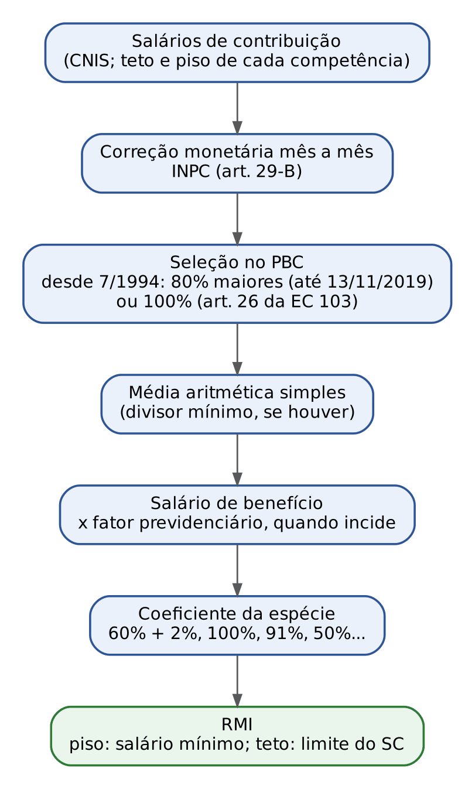
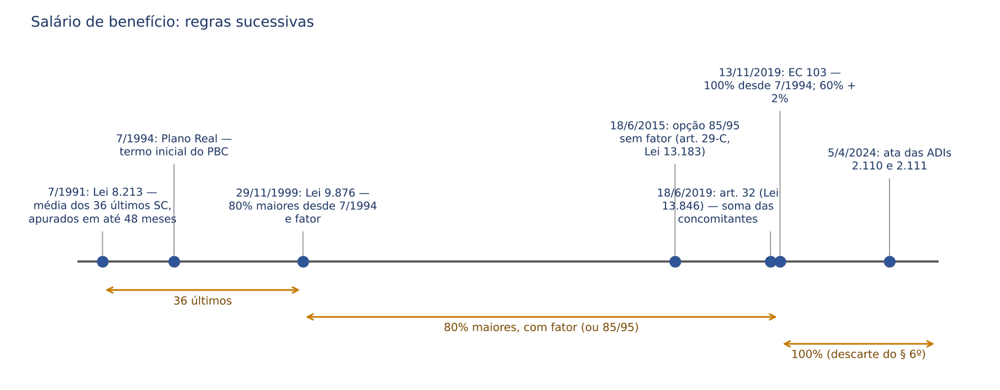
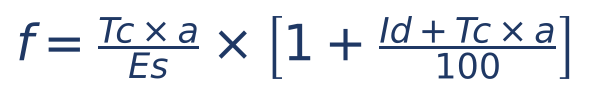
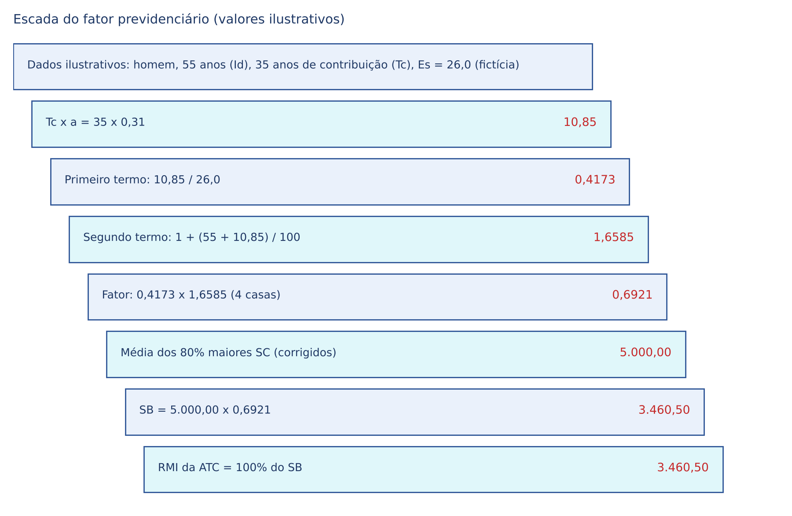
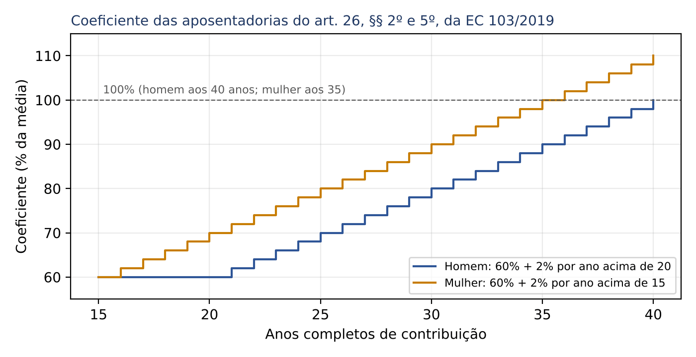
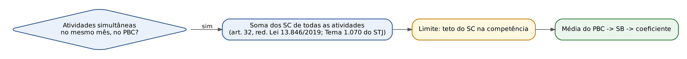
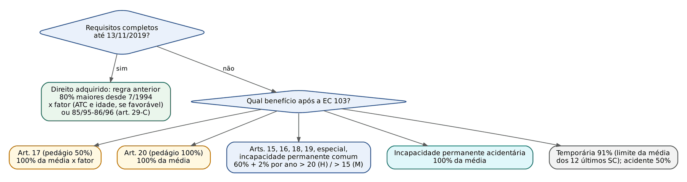
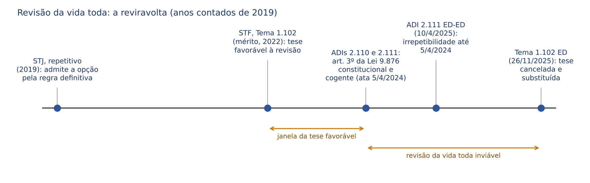

# CAPÍTULO 11 — CÁLCULO DOS BENEFÍCIOS: SALÁRIO DE BENEFÍCIO, PERÍODO BÁSICO DE CÁLCULO, RENDA MENSAL INICIAL, LIMITES, FATOR PREVIDENCIÁRIO, REAJUSTAMENTO E REVISÕES DE CÁLCULO

:::INCIDENCIA
TRF5 p. 5 (cálculo, salário de benefício, PBC, média, RMI, coeficientes, limites, fator, reajustamento, pensões, transição e direito adquirido); interface com SEFAZ/SC p. 1 (EC 103/2019, art. 26).
Nível A+. Lote: FGV 2 (atribuídas) + 4 correlatas de outros capítulos (FGV 3, FCC 1).
Mais cai: PBC de 100% desde 7/1994; coeficiente 60% + 2% x 100% acidentário; 91% com limitador; reajuste anual pelo INPC; fator e 85/95 após a EC 103; revisão da vida toda (virada de 2024/2025).
:::

## 11.1 Arquitetura do cálculo: do salário de contribuição à renda mensal inicial

O valor de praticamente todo benefício previdenciário de prestação continuada do RGPS é obtido por uma cadeia de operações sempre igual, que o juiz precisa ter na cabeça para entender qualquer pedido de revisão: o que se discute em juízo é, quase sempre, um elo dessa cadeia (um salário de contribuição que faltou, um índice de correção, a seleção dos meses, o coeficiente, o teto).

- Salário de contribuição (SC): base de cálculo da contribuição do segurado em cada competência (art. 28 da Lei 8.212/1991; ver Cap. 3). É a matéria-prima do cálculo.
- Período básico de cálculo (PBC): intervalo de competências do qual são extraídos os SC que entram na média. Hoje: desde a competência julho de 1994 (ou desde o início das contribuições, se posterior) até o mês anterior ao do requerimento ou ao fato gerador.
- Salário de benefício (SB): média aritmética simples dos SC do PBC, corrigidos monetariamente, eventualmente multiplicada pelo fator previdenciário. É a BASE de cálculo do benefício, não o benefício.
- Coeficiente: percentual da espécie aplicado sobre o SB (100%, 91%, 50%, 60% + 2% por ano etc.).
- Renda mensal inicial (RMI): resultado de SB x coeficiente, respeitados o piso (salário mínimo) e o teto (limite máximo do SC). É o valor do primeiro pagamento, que depois só muda por reajustamento (ver 11.11) ou revisão (ver 11.12).
- Renda mensal atual (RMA): a RMI reajustada até a competência considerada.

:::LEI Lei 8.213/1991, art. 28
O valor do benefício de prestação continuada, inclusive o regido por norma especial e o decorrente de acidente do trabalho, exceto o salário-família e o salário-maternidade, será calculado com base no salário-de-benefício.
:::

A exceção do art. 28 é cobrada: salário-família tem valor fixo por cota (art. 27, § 2º, da EC 103/2019, corrigido anualmente) e salário-maternidade, em regra, reproduz a remuneração (empregada) ou observa regras próprias (ver Cap. 17). Pensão por morte e auxílio-reclusão também não têm SB próprio no sentido estrito: partem do valor da aposentadoria do instituidor, recebida ou hipotética (ver 11.7.6). O segurado especial que não contribui facultativamente tem SB igual ao salário mínimo (art. 29, § 6º, da Lei 8.213/1991).

### 11.1.1 Fontes normativas vigentes do cálculo

Desde 13/11/2019, convivem três camadas normativas, e saber qual delas rege o caso é a primeira pergunta de qualquer sentença de concessão ou revisão:

| Camada | Diploma | Quando rege | Conteúdo central |
|---|---|---|---|
| Regra constitucional provisória | EC 103/2019, art. 26 | Benefícios cujos requisitos se completaram a partir de 13/11/2019 (RGPS e RPPS da União) | Média de 100% dos SC desde 7/1994; coeficientes de 60% + 2%, 100% e regra do § 4º; descarte do § 6º |
| Lei ordinária anterior | Lei 8.213/1991, art. 29 (red. Lei 9.876/1999) e Lei 9.876/1999, art. 3º | Direito adquirido até 13/11/2019; partes não incompatíveis com a EC (limites, correção, § 5º, § 10) | 80% maiores SC desde 7/1994; fator; 85/95 |
| Regulamento | Decreto 3.048/1999, art. 32 (red. Decreto 10.410/2020) e art. 188-E (direito adquirido) | Detalha ambas | Período contributivo, descarte (§§ 24 a 27), limitador do auxílio (§ 23) |

O art. 26 da EC 103/2019 tem natureza transitória ("Até que lei discipline o cálculo dos benefícios"), mas foi ele que revogou, na prática, a seleção dos 80% maiores para os fatos geradores posteriores à Emenda. O legislador ordinário não editou, até a data desta apostila, a lei referida no caput, e o art. 29, I e II, da Lei 8.213/1991 continua com a redação da Lei 9.876/1999 no texto compilado: a pegadinha é aplicar o art. 29 literal a benefício concedido em 2025.

:::LEI EC 103/2019, art. 26, caput e §§ 1º, 2º, 3º, 5º e 6º
Art. 26. Até que lei discipline o cálculo dos benefícios do regime próprio de previdência social da União e do Regime Geral de Previdência Social, será utilizada a média aritmética simples dos salários de contribuição e das remunerações adotados como base para contribuições a regime próprio de previdência social e ao Regime Geral de Previdência Social, ou como base para contribuições decorrentes das atividades militares de que tratam os arts. 42 e 142 da Constituição Federal, atualizados monetariamente, correspondentes a 100% (cem por cento) do período contributivo desde a competência julho de 1994 ou desde o início da contribuição, se posterior àquela competência.
§ 1º A média a que se refere o caput será limitada ao valor máximo do salário de contribuição do Regime Geral de Previdência Social para os segurados desse regime e para o servidor que ingressou no serviço público em cargo efetivo após a implantação do regime de previdência complementar ou que tenha exercido a opção correspondente, nos termos do disposto nos §§ 14 a 16 do art. 40 da Constituição Federal.
§ 2º O valor do benefício de aposentadoria corresponderá a 60% (sessenta por cento) da média aritmética definida na forma prevista no caput e no § 1º, com acréscimo de 2 (dois) pontos percentuais para cada ano de contribuição que exceder o tempo de 20 (vinte) anos de contribuição nos casos: [...] III - de aposentadoria por incapacidade permanente aos segurados do Regime Geral de Previdência Social, ressalvado o disposto no inciso II do § 3º deste artigo; [...]
§ 3º O valor do benefício de aposentadoria corresponderá a 100% (cem por cento) da média aritmética definida na forma prevista no caput e no § 1º: I - no caso do inciso II do § 2º do art. 20; II - no caso de aposentadoria por incapacidade permanente, quando decorrer de acidente de trabalho, de doença profissional e de doença do trabalho.
§ 5º O acréscimo a que se refere o caput do § 2º será aplicado para cada ano que exceder 15 (quinze) anos de tempo de contribuição para os segurados de que tratam a alínea "a" do inciso I do § 1º do art. 19 e o inciso I do art. 21 e para as mulheres filiadas ao Regime Geral de Previdência Social.
§ 6º Poderão ser excluídas da média as contribuições que resultem em redução do valor do benefício, desde que mantido o tempo mínimo de contribuição exigido, vedada a utilização do tempo excluído para qualquer finalidade, inclusive para o acréscimo a que se referem os §§ 2º e 5º, para a averbação em outro regime previdenciário ou para a obtenção dos proventos de inatividade das atividades de que tratam os arts. 42 e 142 da Constituição Federal.
:::

:::DICA Leitura do art. 26 para a SEFAZ/SC
O art. 26 vale para o RGPS e para o RPPS da UNIÃO. Para os RPPS de Estados e Municípios, o cálculo depende de lei do ente (art. 40, § 3º, da CF, na redação da EC 103/2019; ver Cap. 23 e, para Santa Catarina, Cap. 25). A FCC gosta de afirmar que o art. 26 se aplica "a todos os regimes próprios": falso. Note ainda o § 1º: a média é limitada ao teto do RGPS também para o servidor que ingressou após a instituição da previdência complementar ou que fez a opção (art. 40, §§ 14 a 16, da CF).
:::

## 11.2 O salário de contribuição como matéria-prima do cálculo

O conceito de SC, suas parcelas integrantes e excluídas e a complementação ao mínimo são do Cap. 3. Aqui interessa o que a Lei 8.213/1991 diz sobre o uso do SC NO CÁLCULO do benefício, que nem sempre coincide com a incidência da contribuição.

### 11.2.1 Ganhos habituais e décimo terceiro salário

Pelo art. 201, § 11, da CF, os ganhos habituais do empregado, a qualquer título, são incorporados ao salário para efeito de contribuição e "consequente repercussão em benefícios". O art. 29, § 3º, da Lei 8.213/1991 (red. Lei 8.870/1994) manda considerar no SB os ganhos habituais sobre os quais incidiu contribuição, "exceto o décimo-terceiro salário (gratificação natalina)". Há, portanto, uma assimetria deliberada: o 13º integra o SC para fins de CONTRIBUIÇÃO (art. 28, § 7º, da Lei 8.212/1991), mas não para fins de CÁLCULO do benefício.

:::JURIS STJ, Tema 904 (REsp 1.546.680/RS, Primeira Seção, j. 10/5/2017)
O 13º somente integra o cálculo do SB quando os requisitos do benefício foram preenchidos antes da publicação da Lei 8.870/1994, "independentemente de o PBC estar, parcialmente, dentro do período de vigência da legislação revogada". É aplicação pura de *tempus regit actum*: importa a data do implemento dos requisitos, não a época das competências. A TNU tem enunciado no mesmo sentido (Súmula 83 da TNU, citada no material da Academia JusFederal consultado).
:::

### 11.2.2 Aumentos às vésperas do benefício (art. 29, § 4º)

Não se considera no SB o aumento dos SC que exceder o limite legal, "inclusive o voluntariamente concedido nos 36 (trinta e seis) meses imediatamente anteriores ao início do benefício, salvo se homologado pela Justiça do Trabalho, resultante de promoção regulada por normas gerais da empresa, admitida pela legislação do trabalho, de sentença normativa ou de reajustamento salarial obtido pela categoria respectiva". A norma é antifraude: impede que o empregador infle a remuneração do empregado prestes a se aposentar para elevar artificialmente a média. Note as cinco ressalvas, que a banca pode trocar ("salvo se homologado pelo sindicato" é falso: a homologação é da Justiça do Trabalho).

### 11.2.3 Contribuições devidas e não recolhidas; falta de prova do valor

O art. 34 da Lei 8.213/1991 (red. LC 150/2015) distingue por categoria:

| Segurado | O que entra no cálculo | Fundamento |
|---|---|---|
| Empregado, inclusive doméstico, e trabalhador avulso | SC dos meses de contribuições DEVIDAS, ainda que não recolhidas pela empresa ou pelo empregador doméstico (a responsabilidade pelo recolhimento é do empregador) | Art. 34, I |
| Empregado, doméstico, avulso e segurado especial | Valor mensal do auxílio-acidente, considerado SC para qualquer aposentadoria | Art. 34, II; Decreto 3.048, art. 32, § 8º |
| Demais segurados (contribuinte individual, facultativo) | Somente os meses de contribuições EFETIVAMENTE RECOLHIDAS | Art. 34, III |

Se o empregado, o doméstico ou o avulso cumpriu todas as condições, mas não consegue comprovar o VALOR dos SC no PBC, concede-se o benefício de valor mínimo, recalculado quando apresentada a prova (art. 35). Para os meses sem prova do valor, o Decreto 3.048/1999 (art. 36, § 2º) manda considerar o salário mínimo naquele período, e não reduzir o benefício inteiro ao piso. O art. 29-A da Lei 8.213/1991 faz do CNIS a fonte primária dos vínculos e remunerações; a retificação do CNIS e a prova de vínculos extemporâneos estão no Cap. 9.

:::PEGADINHA Contribuinte individual que presta serviço a empresa
Desde a Lei 10.666/2003, a empresa tomadora retém e recolhe a contribuição do contribuinte individual que lhe presta serviço; nessa hipótese, a contribuição se presume recolhida e o segurado não pode ser prejudicado pela omissão do tomador (ver Cap. 5). A regra do art. 34, III ("efetivamente recolhidas") alcança o contribuinte individual que recolhe por conta própria. A afirmação "o contribuinte individual nunca tem computado mês não recolhido" é, por isso, imprecisa.
:::

### 11.2.4 Benefício por incapacidade dentro do PBC

Se, no PBC, o segurado recebeu benefício por incapacidade, "sua duração será contada, considerando-se como salário-de-contribuição, no período, o salário-de-benefício que serviu de base para o cálculo da renda mensal, reajustado nas mesmas épocas e bases dos benefícios em geral, não podendo ser inferior ao valor de 1 (um) salário mínimo" (art. 29, § 5º). O regulamento acrescenta o teto (art. 32, § 6º, do Decreto 3.048/1999).

A regra só funciona quando há períodos de afastamento INTERCALADOS com atividade e contribuição. Quando a aposentadoria por incapacidade permanente decorre de transformação direta de auxílio por incapacidade temporária (sem retorno ao trabalho), o cálculo seguia o art. 36, § 7º, do Decreto 3.048/1999 (dispositivo citado pela súmula e hoje revogado pelo Decreto 10.410/2020): a RMI da aposentadoria correspondia a 100% do SB que serviu de base ao auxílio, reajustado, sem nova média.

:::JURIS STJ, Súmula 557
"A renda mensal inicial (RMI) alusiva ao benefício de aposentadoria por invalidez precedido de auxílio-doença será apurada na forma do art. 36, § 7º, do Decreto n. 3.048/1999, observando-se, porém, os critérios previstos no art. 29, § 5º, da Lei nº 8.213/1991, quando intercalados períodos de afastamento e de atividade laboral."
No mesmo sentido, exigindo afastamento intercalado com atividade contributiva, STJ, AgInt no REsp 2.113.564 (v. Cap. 9).
:::

:::ATENCAO Súmula 557 depois da EC 103/2019
A súmula foi construída sob a sistemática anterior, em que a aposentadoria por invalidez era de 100% do SB. Hoje a aposentadoria por incapacidade permanente não acidentária é de 60% + 2% por ano acima de 20 (H) ou 15 (M). Na transformação direta de auxílio em aposentadoria após 13/11/2019, a média é a mesma, mas o COEFICIENTE muda (de 91% para o percentual do art. 26, § 2º, III), e a nova renda pode ser INFERIOR à do auxílio. A constitucionalidade dessa redução é discutida em doutrina; não localizei tese vinculante específica nesta pesquisa (ver nota de verificação).
:::

## 11.3 Correção monetária dos salários de contribuição

O art. 201, § 3º, da CF impõe: "Todos os salários de contribuição considerados para o cálculo de benefício serão devidamente atualizados, na forma da lei." Antes da CF/1988, apenas parte dos SC era corrigida; daí a Súmula 456 do STJ: "É incabível a correção monetária dos salários de contribuição considerados no cálculo do salário de benefício de auxílio-doença, aposentadoria por invalidez, pensão ou auxílio-reclusão concedidos antes da vigência da CF/1988."

O índice atual está no art. 29-B da Lei 8.213/1991: os SC "serão corrigidos mês a mês de acordo com a variação integral do Índice Nacional de Preços ao Consumidor - INPC, calculado pela Fundação Instituto Brasileiro de Geografia e Estatística - IBGE". Na prática, o INSS divulga mensalmente uma tabela de fatores acumulados: cada SC é multiplicado pelo fator correspondente à sua competência, de modo que todos fiquem expressos em moeda da data de início do benefício. Só depois disso se seleciona e se calcula a média.

:::EXEMPLO Como a correção entra no cálculo
SC de 2.000 em uma competência antiga, com fator acumulado (ilustrativo) de 1,85 até a DIB, entra no PBC como 2.000 x 1,85 = 3.700. A média é feita sobre os valores corrigidos. Erro comum em revisão: comparar SC nominais e concluir que o INSS "pegou o salário errado", quando apenas houve atualização. Outro: corrigir o SC e depois limitá-lo ao teto ATUAL; o teto que limita cada SC é o da sua competência (o SC já nasce limitado), e o teto da DIB limita o SB (art. 29, § 2º).
:::

Índices históricos (ORTN/OTN, IRSM de fevereiro de 1994 e a conversão em URV) geraram revisões de massa hoje praticamente esgotadas pela decadência. A revisão do IRSM e seu limite ao teto (Jurisprudência em Teses do STJ, ed. 67, tese 10: a nova RMI fica restrita ao limite máximo do SC vigente na implantação) são tratados no Cap. 22.

## 11.4 Período básico de cálculo e média contributiva

### 11.4.1 As três eras do salário de benefício

| Era | Fato gerador (implemento dos requisitos) | PBC e seleção | Multiplicador | Fundamento |
|---|---|---|---|---|
| 1ª | Até 28/11/1999 | Média dos 36 últimos SC, apurados em período não superior a 48 meses | Nenhum | Art. 29, caput, redação original da Lei 8.213/1991; Lei 9.876/1999, art. 6º |
| 2ª | 29/11/1999 a 13/11/2019 | Média dos maiores SC correspondentes a 80% de todo o período contributivo desde 7/1994 (filiados até 28/11/1999) ou de todo o período (filiados depois) | Fator previdenciário na ATC (obrigatório, salvo 85/95) e na idade (se favorável) | Lei 9.876/1999, art. 3º; Lei 8.213/1991, art. 29, I e II |
| 3ª | A partir de 13/11/2019 | Média de 100% dos SC desde 7/1994 ou do início das contribuições, se posterior; descarte facultativo | Fator só no art. 17 da EC 103/2019 e, se favorável, na aposentadoria da pessoa com deficiência | EC 103/2019, art. 26; Decreto 3.048/1999, art. 32 |

Por que julho de 1994? Porque é a primeira competência posterior à implantação do Real: fixar o início do PBC ali elimina, de uma vez, a necessidade de atualizar SC expressos em moedas e índices da hiperinflação. O preço foi desprezar contribuições anteriores, às vezes elevadas: é essa a origem da revisão da vida toda (ver 11.12.1).

### 11.4.2 A regra de transição da Lei 9.876/1999 e o divisor mínimo

:::LEI Lei 9.876/1999, art. 3º, caput e § 2º
Art. 3º Para o segurado filiado à Previdência Social até o dia anterior à data de publicação desta Lei, que vier a cumprir as condições exigidas para a concessão dos benefícios do Regime Geral de Previdência Social, no cálculo do salário-de-benefício será considerada a média aritmética simples dos maiores salários-de-contribuição, correspondentes a, no mínimo, oitenta por cento de todo o período contributivo decorrido desde a competência julho de 1994, observado o disposto nos incisos I e II do caput do art. 29 da Lei nº 8.213, de 1991, com a redação dada por esta Lei.
§ 2º No caso das aposentadorias de que tratam as alíneas b, c e d do inciso I do art. 18, o divisor considerado no cálculo da média a que se refere o caput e o § 1º não poderá ser inferior a sessenta por cento do período decorrido da competência julho de 1994 até a data de início do benefício, limitado a cem por cento de todo o período contributivo.
:::

A arquitetura de 1999 era dupla: a regra PERMANENTE (art. 29, I e II, da Lei 8.213/1991) mandava considerar 80% de TODO o período contributivo, sem marco inicial; a regra de TRANSIÇÃO (art. 3º da Lei 9.876/1999), para quem já era filiado em 26/11/1999, restringia o PBC às competências a partir de 7/1994. Quem se filiou depois de 26/11/1999 não tem contribuições anteriores a 7/1994, de modo que, para ele, as duas regras coincidem.

O § 2º criou o divisor mínimo de 60%: nas aposentadorias por idade, tempo de contribuição e especial, a soma dos SC selecionados não pode ser dividida por número de meses inferior a 60% do período entre 7/1994 e a DIB (limitado a 100% do período contributivo). Sem isso, quem contribuiu poucas vezes, com valores altos, teria média artificialmente elevada.

### 11.4.3 A regra de 100% da EC 103/2019

Para fatos geradores a partir de 13/11/2019, todos os SC desde 7/1994 entram na média, inclusive os menores. A diferença prática pode ser grande. Exemplo de 10 SC já corrigidos (2.000; 2.100; 2.200; 2.500; 3.000; 3.200; 3.500; 4.000; 4.200; 4.500): pela regra dos 80% maiores, descartam-se os dois menores e a média dos oito restantes é 27.100 / 8 = 3.387,50; pela regra de 100%, a média é 31.200 / 10 = 3.120,00 (redução de 7,9%).

O Decreto 3.048/1999 define "período contributivo" (art. 32, § 22): para o empregado, o doméstico e o avulso, o conjunto de competências em que houve ou DEVERIA ter havido contribuição; para os demais, os meses de efetiva contribuição. A EC 103/2019 não fixou divisor mínimo; ele voltou por lei em 2022.

:::LEI Lei 8.213/1991, art. 135-A (incluído pela Lei 14.331/2022)
Para o segurado filiado à Previdência Social até julho de 1994, no cálculo do salário de benefício das aposentadorias, exceto a aposentadoria por incapacidade permanente, o divisor considerado no cálculo da média dos salários de contribuição não poderá ser inferior a 108 (cento e oito) meses.
:::

:::EXEMPLO Divisor mínimo de 108 (art. 135-A)
Segurado filiado em 1990, com apenas 60 SC desde 7/1994, todos de 3.000 (corrigidos), requer aposentadoria em 2026.
- Soma dos SC: 60 x 3.000 = 180.000.
- Divisor pela regra geral: 60. Média = 3.000,00.
- Divisor mínimo do art. 135-A: 108. Média = 180.000 / 108 = 1.666,67.
- A média que vale é 1.666,67. O divisor mínimo não se aplica a quem se filiou depois de julho de 1994, nem à aposentadoria por incapacidade permanente.
:::

### 11.4.4 Descarte de contribuições (art. 26, § 6º, da EC 103/2019)

A EC 103/2019 compensou parcialmente o fim dos "80% maiores" com uma faculdade: excluir da média as contribuições que reduzam o valor do benefício, desde que mantido o tempo mínimo de contribuição exigido. O tempo excluído fica INUTILIZADO para qualquer fim: não conta para o acréscimo de 2% por ano, para pontos, para pedágio, para averbação em outro regime nem para proventos de militar.

O Decreto 3.048/1999 restringiu o descarte às aposentadorias "programadas para as quais seja exigido tempo mínimo de contribuição" (art. 32, §§ 24 e 25: programada, especial, idade do trabalhador rural e aposentadorias transitórias por idade e por tempo de contribuição) e exigiu que se mantenha também o número de contribuições equivalente à carência (§ 26). O § 27 lista as vedações de uso do tempo excluído (acréscimo do percentual, pontos, período adicional, averbação, proventos militares).

:::PASSO Quando o descarte compensa
1. Identifique o tempo mínimo da regra aplicável (ex.: 15 anos no art. 18 da EC 103/2019 para homem filiado antes da Emenda; 20 anos na regra permanente do homem; 15 anos para a mulher).
2. Calcule o coeficiente com todo o tempo. Cada ano completo excluído ACIMA do mínimo de acréscimo (20 H ou 15 M) custa 2 pontos percentuais.
3. Meses que não completam ano (frações) podem ser excluídos sem perda de coeficiente, se forem menores que a média.
4. Tempo entre o mínimo de elegibilidade e o marco do acréscimo (ex.: homem do art. 18, entre 15 e 20 anos) pode ser excluído sem custo nenhum de coeficiente.
5. Compare as RMIs; o INSS deve calcular a hipótese mais vantajosa (dever de orientação e melhor benefício, ver Cap. 19).
:::

:::EXEMPLO Três cenários de descarte (valores corrigidos, conferidos em Python)
Cenário A — homem, art. 18 da EC 103/2019 (65 anos e 15 de contribuição), 19 anos de contribuição (228 meses): 180 SC de 4.000 e 48 SC de 1.621.
- Média com tudo: (180 x 4.000 + 48 x 1.621) / 228 = 797.808 / 228 = 3.499,16; coeficiente 60% (não excede 20 anos); RMI = 2.099,49.
- Excluindo os 48 SC baixos (mantidos 15 anos): média 4.000,00; coeficiente 60%; RMI = 2.400,00. Ganho de 300,51 por mês, sem custo.

Cenário B — homem, 21 anos e 5 meses (257 meses): 252 SC de 5.000 e 5 SC de 1.621.
- Média com tudo: 1.268.105 / 257 = 4.934,26; 21 anos completos, coeficiente 62%; RMI = 3.059,24.
- Excluindo os 5 meses baixos (continua com 21 anos completos): média 5.000,00; coeficiente 62%; RMI = 3.100,00.

Cenário C — homem, 25 anos (300 meses): 240 SC de 5.000 e 60 SC de 1.621.
- Média com tudo: 4.324,20; coeficiente 70%; RMI = 3.026,94.
- Excluindo os 60 SC baixos (fica com 20 anos): média 5.000,00; coeficiente 60%; RMI = 3.000,00. O descarte PIORA o benefício: a perda de 10 pontos no coeficiente supera o ganho na média.
:::

:::QUESTAO FGV 2025 — CPRM — Analista em Geociências - Direito (Q3757922)
Caso: segurado filiado em janeiro de 1989, sempre na iniciativa privada, requer aposentadoria em agosto de 2025. Pergunta-se o período considerado no cálculo.
Gabarito: C — 100% do período contributivo desde a competência julho de 1994 (art. 26 da EC 103/2019).
Armadilhas: "todo o período desde 1989" (A) é a tese da revisão da vida toda, rejeitada pelo STF; "80% maiores" (D) é a regra anterior, só aplicável a quem completou os requisitos até 13/11/2019; "36 últimas" (B) é a redação original de 1991; "últimos 5 anos" (E) confunde PBC com prescrição. Permanecer no emprego até a concessão é irrelevante para o PBC (a aposentadoria do RGPS não exige desligamento).
:::

:::PEGADINHA 80% x 100%; início do PBC x filiação
- O marco de 7/1994 é do PBC, não da filiação: quem se filiou antes conta o TEMPO anterior para elegibilidade e coeficiente, mas os SALÁRIOS anteriores a 7/1994 não entram na média.
- "A EC 103/2019 extinguiu o divisor mínimo": o art. 3º, § 2º, da Lei 9.876/1999 perdeu aplicação para os novos fatos geradores, mas a Lei 14.331/2022 criou o divisor de 108 meses (art. 135-A).
- O descarte do § 6º não é "dos 20% menores": é livre, mas tem custo (tempo excluído não conta para nada).
:::

## 11.5 Fator previdenciário

### 11.5.1 Natureza e finalidade

Criado pela Lei 9.876/1999 depois que a EC 20/1998 desconstitucionalizou o cálculo, o fator previdenciário é um multiplicador atuarial aplicado sobre a média, que reduz o SB de quem se aposenta cedo (pouca idade, longa expectativa de sobrevida) e o eleva de quem se aposenta tarde com muito tempo de contribuição. Ele substituiu, na lógica do legislador, a idade mínima que a EC 20/1998 não conseguiu impor ao RGPS. Por isso, sempre foi obrigatório na aposentadoria por tempo de contribuição e facultativo (só se favorável) na aposentadoria por idade (art. 7º da Lei 9.876/1999).

:::LEI Lei 8.213/1991, art. 29, §§ 7º, 8º e 9º
§ 7º O fator previdenciário será calculado considerando-se a idade, a expectativa de sobrevida e o tempo de contribuição do segurado ao se aposentar, segundo a fórmula constante do Anexo desta Lei.
§ 8º Para efeito do disposto no § 7º, a expectativa de sobrevida do segurado na idade da aposentadoria será obtida a partir da tábua completa de mortalidade construída pela Fundação Instituto Brasileiro de Geografia e Estatística - IBGE, considerando-se a média nacional única para ambos os sexos.
§ 9º Para efeito da aplicação do fator previdenciário, ao tempo de contribuição do segurado serão adicionados: I - cinco anos, quando se tratar de mulher; II - cinco anos, quando se tratar de professor que comprove exclusivamente tempo de efetivo exercício das funções de magistério na educação infantil e no ensino fundamental e médio; III - dez anos, quando se tratar de professora que comprove exclusivamente tempo de efetivo exercício das funções de magistério na educação infantil e no ensino fundamental e médio.
:::

### 11.5.2 A fórmula, termo a termo

- f: fator previdenciário (normalmente expresso com quatro casas decimais).
- Tc: tempo de contribuição até a aposentadoria, em anos e frações, já com os acréscimos do § 9º (mais 5 anos para a mulher e para o professor; mais 10 anos para a professora).
- a: alíquota de contribuição, fixada em 0,31 (soma convencional de 20% da empresa com 11% do segurado).
- Es: expectativa de sobrevida na idade da aposentadoria, da tábua completa de mortalidade do IBGE, média nacional ÚNICA para ambos os sexos (por isso a mulher, que vive mais, recebe o bônus de 5 anos no Tc).
- Id: idade na data da aposentadoria.

Leitura econômica: o primeiro termo (Tc x a / Es) compara o que o segurado "acumulou" (tempo x alíquota) com o tempo em que vai receber (Es); o segundo termo [1 + (Id + Tc x a)/100] é um prêmio que cresce com a idade e o tempo. O fator é igual a 1 quando há equilíbrio; menor que 1, reduz; maior que 1, aumenta o SB. A tábua usada é a vigente na data do requerimento: os benefícios requeridos a partir da publicação de nova tábua consideram a nova expectativa (Decreto 3.048/1999, art. 188-E, § 4º).

:::EXEMPLO Fator em quatro perfis (expectativas de sobrevida FICTÍCIAS, só para ilustrar a mecânica)
| Perfil | Id | Tc (com bônus) | Es ilustrativa | Tc x a | 1º termo | 2º termo | f |
|---|---|---|---|---|---|---|---|
| Homem | 55 | 35 | 26,0 | 10,85 | 0,4173 | 1,6585 | 0,6921 |
| Mulher (30 anos reais + 5) | 52 | 35 | 28,5 | 10,85 | 0,3807 | 1,6285 | 0,6200 |
| Homem | 60 | 40 | 22,0 | 12,40 | 0,5636 | 1,7240 | 0,9717 |
| Homem | 65 | 35 | 18,5 | 10,85 | 0,5865 | 1,7585 | 1,0313 |
Conclusões: aos 55 anos com 35 de contribuição, o homem perde cerca de 31% da média; aos 65, ganha cerca de 3%. Na prova, se a banca der Es, Id e Tc, aplique a fórmula; se não der, nunca suponha valores.
:::

### 11.5.3 Onde o fator incide (e onde não incide)

| Situação | Fator | Fundamento |
|---|---|---|
| ATC com requisitos até 13/11/2019 | Obrigatório, salvo opção 85/95-86/96 | Art. 29, I, e art. 29-C da Lei 8.213/1991 |
| ATC do professor (requisitos após 28/11/1999) | Incide (com bônus de 5 ou 10 anos no Tc) | STF, Tema 960; STJ, Tema 1.011 |
| Aposentadoria por idade (até 13/11/2019) | Só se favorável | Art. 7º da Lei 9.876/1999; Decreto 3.048, art. 188-E, § 7º |
| Aposentadoria da pessoa com deficiência (LC 142/2013) | Só se favorável | Decreto 3.048, art. 188-E, § 6º; EC 103/2019, art. 22 |
| Transição do pedágio de 50% (art. 17 da EC 103/2019) | Obrigatório | Art. 17, parágrafo único, da EC 103/2019 |
| Demais regras de transição e aposentadoria programada | Não incide | Art. 26 da EC 103/2019 |
| Aposentadoria especial, por incapacidade, auxílios, pensão | Nunca incidiu | Art. 29, II, da Lei 8.213/1991 |

:::LEI EC 103/2019, art. 17, parágrafo único
O benefício concedido nos termos deste artigo terá seu valor apurado de acordo com a média aritmética simples dos salários de contribuição e das remunerações calculada na forma da lei, multiplicada pelo fator previdenciário, calculado na forma do disposto nos §§ 7º a 9º do art. 29 da Lei nº 8.213, de 24 de julho de 1991.
:::

Atenção à combinação: no art. 17, a média é a do art. 26 (100% dos SC desde 7/1994), multiplicada pelo fator e com coeficiente de 100%. O art. 17 é acessível só a quem, em 13/11/2019, tinha mais de 28 anos (mulher) ou 33 anos (homem) de contribuição, e exige pedágio de 50% do tempo que faltava para 30/35 anos (detalhes no Cap. 13).

:::JURIS STF, Tema 1.091
É constitucional o fator previdenciário previsto no art. 29, caput, incisos e parágrafos, da Lei 8.213/1991, com a redação da Lei 9.876/1999.
:::

Professor: o fator incide na aposentadoria por tempo de contribuição do professor com requisitos implementados após a Lei 9.876/1999 (STF, Tema 960; STJ, Tema 1.011; v. Cap. 13).

A Lei 9.876/1999 previu ainda uma implantação gradual (art. 5º): o fator incidiu sobre 1/60 da média por mês a partir da publicação, cumulativamente, até atingir 60/60, o que ocorreu em cinco anos. Isso só tem relevância para revisões de benefícios concedidos entre 1999 e 2004, já em regra atingidas pela decadência.

## 11.6 A regra 85/95 progressiva (art. 29-C da Lei 8.213/1991)

### 11.6.1 Texto e mecânica

:::LEI Lei 8.213/1991, art. 29-C (incluído pela Lei 13.183/2015)
Art. 29-C. O segurado que preencher o requisito para a aposentadoria por tempo de contribuição poderá optar pela não incidência do fator previdenciário no cálculo de sua aposentadoria, quando o total resultante da soma de sua idade e de seu tempo de contribuição, incluídas as frações, na data de requerimento da aposentadoria, for: I - igual ou superior a noventa e cinco pontos, se homem, observando o tempo mínimo de contribuição de trinta e cinco anos; ou II - igual ou superior a oitenta e cinco pontos, se mulher, observado o tempo mínimo de contribuição de trinta anos.
§ 1º Para os fins do disposto no caput, serão somadas as frações em meses completos de tempo de contribuição e idade.
§ 2º As somas de idade e de tempo de contribuição previstas no caput serão majoradas em um ponto em: I - 31 de dezembro de 2018; II - 31 de dezembro de 2020; III - 31 de dezembro de 2022; IV - 31 de dezembro de 2024; e V - 31 de dezembro de 2026.
§ 3º Para efeito de aplicação do disposto no caput e no § 2º, o tempo mínimo de contribuição do professor e da professora que comprovarem exclusivamente tempo de efetivo exercício de magistério na educação infantil e no ensino fundamental e médio será de, respectivamente, trinta e vinte e cinco anos, e serão acrescidos cinco pontos à soma da idade com o tempo de contribuição.
§ 4º Ao segurado que alcançar o requisito necessário ao exercício da opção de que trata o caput e deixar de requerer aposentadoria será assegurado o direito à opção com a aplicação da pontuação exigida na data do cumprimento do requisito nos termos deste artigo.
:::

O art. 29-C não cria aposentadoria nova: é uma OPÇÃO de cálculo dentro da ATC (afasta o fator; a média continua sendo a dos 80% maiores). A regra vigorou desde 18/6/2015 (o Decreto 3.048/1999, art. 188-E, § 8º, marca esse termo inicial).

| Período | Mulher | Homem | Professora / professor (§ 3º) |
|---|---|---|---|
| 18/6/2015 a 30/12/2018 | 85 | 95 | 80 / 90 (tempo mínimo 25 / 30) |
| 31/12/2018 a 13/11/2019 | 86 | 96 | 81 / 91 |
| 31/12/2020, 2022, 2024, 2026 (87/97 a 90/100) | Sem aplicação prática: a EC 103/2019 extinguiu a ATC para quem não tinha direito adquirido em 13/11/2019 | — | — |

:::PEGADINHA 85/95 depois da EC 103/2019
O texto do art. 29-C continua no compilado do Planalto, inclusive com as majorações de 2020 a 2026. Mas a ATC só existe para quem completou os requisitos até 13/11/2019 (direito adquirido) ou pelas regras de transição. Nas transições, a lógica de pontos do art. 15 da EC 103/2019 (86/96 em 2019, mais 1 ponto por ano até 100/105) é REQUISITO DE ACESSO, não opção de afastar o fator, e o cálculo é 60% + 2%. Confundir as duas "regras de pontos" é o erro mais comum (ver Cap. 13). Assim, pontuação maior que 86/96 no art. 29-C nunca chegou a ser exigida de ninguém.
:::

Distrator cobrado pela FGV (Prefeitura de Macaé 2024, Q3048283, alternativa E, errada): a EC 103/2019 NÃO manteve "as mesmas condições para o fator previdenciário e a regra 85/95"; o fator sobreviveu apenas no art. 17 (pedágio de 50%) e, se favorável, na aposentadoria da pessoa com deficiência, e a opção 85/95 ficou restrita ao direito adquirido até 13/11/2019 (gabarito oficial D, matéria de RPPS resolvida no Cap. 23).

:::EXEMPLO Fator x 85/95 (direito adquirido em 2019; Es ilustrativas)
Homem com 60 anos e 7 meses de idade e 35 anos e 5 meses de contribuição em outubro de 2019: pontos = 60,5833 + 35,4167 = 96,00. Atingiu os 96 pontos então exigidos.
- Média dos 80% maiores: 4.000,00.
- Com fator (idade 61, Tc 35, Es ilustrativa 21,5): f = 0,8672; SB = 3.468,80.
- Com opção 86/96: SB = 4.000,00 (sem fator); RMI = 4.000,00 (100%).
Se ele só requereu em 2025, mantém a opção (art. 29-C, § 4º, e direito adquirido), com média e SB calculados até 13/11/2019 e reajustados até a DIB (ver 11.10).
:::

## 11.7 Coeficientes e renda mensal inicial por espécie

### 11.7.1 Quadro antes x depois da EC 103/2019

| Benefício | Até 13/11/2019 (regra legal) | A partir de 13/11/2019 | Fundamento atual |
|---|---|---|---|
| Aposentadoria por idade | 70% do SB + 1% a cada grupo de 12 contribuições, até 100% | Transição do art. 18: 60% + 2% por ano acima de 20 (H) ou 15 (M) | EC 103, art. 26, § 2º, I, e § 5º |
| Aposentadoria por tempo de contribuição integral | 100% do SB (com fator ou 85/95) | Extinta. Transições: arts. 15 e 16 (60% + 2%); art. 17 (100% x fator); art. 20 (100%) | EC 103, arts. 15 a 17, 20 e 26 |
| Aposentadoria programada (regra permanente) | Não existia | 60% + 2% por ano acima de 20 (H) ou 15 (M) | EC 103, art. 19 e art. 26, §§ 2º, IV, e 5º |
| Aposentadoria especial | 100% do SB | 60% + 2% por ano acima de 20; na especial de 15 anos, acima de 15 | EC 103, art. 26, §§ 2º, IV, e 5º |
| Aposentadoria por incapacidade permanente comum | 100% do SB | 60% + 2% por ano acima de 20 (H) ou 15 (M) | EC 103, art. 26, § 2º, III |
| Aposentadoria por incapacidade permanente acidentária | 100% do SB | 100% da média | EC 103, art. 26, § 3º, II |
| Auxílio por incapacidade temporária | 91% do SB | 91% do SB, limitado à média dos 12 últimos SC | Lei 8.213, art. 61 e art. 29, § 10 |
| Auxílio-acidente | 50% do SB | 50% do SB (média do art. 26) | Lei 8.213, art. 86, § 1º |
| Pensão por morte | 100% da aposentadoria (recebida ou hipotética por invalidez) | Cota familiar de 50% + 10% por dependente, até 100% | EC 103, art. 23 (ver Cap. 16) |
| Aposentadoria da pessoa com deficiência | Tempo: 100%; idade: 70% + 1% por grupo de 12 contribuições, até 30% | Mantida a LC 142/2013 (art. 22 da EC 103) | LC 142/2013, art. 8º |

### 11.7.2 A regra geral de 60% + 2% por ano

Mecânica: conta-se o tempo de contribuição em anos COMPLETOS (as frações não geram 2% proporcional) e soma-se 2 pontos percentuais por ano que exceder 20 anos (homens em geral) ou 15 anos (mulheres filiadas ao RGPS e segurados das especiais de 15 anos). O homem atinge 100% com 40 anos de contribuição; a mulher, com 35. A EC 103/2019 não fixou limite de 100% para o coeficiente: com mais tempo, o percentual pode superá-lo, ficando a renda contida apenas pelo teto (ver nota de verificação).

| Anos completos | Coeficiente homem | Coeficiente mulher |
|---|---|---|
| 15 | 60% | 60% |
| 20 | 60% | 70% |
| 25 | 70% | 80% |
| 30 | 80% | 90% |
| 35 | 90% | 100% |
| 40 | 100% | 110% |

:::EXEMPLO Aposentadoria programada e por idade (transição), média de 4.200 (valores corrigidos)
Homem, 65 anos, 30 anos de contribuição: coeficiente 60% + 2 x (30 - 20) = 80%; RMI = 4.200 x 0,80 = 3.360,00.
Mulher, 62 anos, 30 anos de contribuição: coeficiente 60% + 2 x (30 - 15) = 90%; RMI = 4.200 x 0,90 = 3.780,00.
Note: mesma média, mesmo tempo, rendas diferentes, porque o marco do acréscimo é distinto.
:::

:::DICA Exceções ao "acima de 20 anos"
O § 5º do art. 26 desloca o marco para 15 anos em três situações: (a) mulheres filiadas ao RGPS (todas as aposentadorias do § 2º, inclusive incapacidade permanente); (b) aposentadoria especial de 15 anos (art. 19, § 1º, I, a); (c) transição da especial de 15 anos (art. 21, I). A regra do professor no RGPS segue a geral: homem acima de 20, mulher acima de 15 (detalhes no Cap. 13).
:::

### 11.7.3 Aposentadorias de 100% da média

São duas, no RGPS: (a) a transição do pedágio de 100% (art. 20, § 2º, II, da EC 103/2019: 57/60 anos de idade, 30/35 de contribuição e pedágio igual ao tempo que faltava em 13/11/2019); (b) a aposentadoria por incapacidade permanente decorrente de acidente de trabalho, doença profissional ou doença do trabalho. O pedágio de 50% (art. 17) também tem coeficiente de 100%, mas a média é multiplicada pelo fator.

Questões da FGV sobre o coeficiente de 100% da incapacidade acidentária (TJ-PR 2026, Q3898984, gabarito C; FGV 2024, Q3047813, gabarito B, que distingue doença ocupacional de acidente de qualquer natureza) estão resolvidas no Cap. 15 (v. Cap. 15).

:::PEGADINHA "Acidente" não é sinônimo de "acidente do trabalho"
A EC 103/2019 dá 100% só à incapacidade permanente "decorrente de acidente de trabalho, de doença profissional e de doença do trabalho". Acidente de qualquer natureza (trânsito nas férias, doméstico) gera o coeficiente comum de 60% + 2%. Já o auxílio-acidente cabe por acidente de QUALQUER natureza (art. 86). A carência, por sua vez, é dispensada nos dois casos de acidente (ver Cap. 8). Três institutos, três critérios.
:::

:::ATENCAO Redução da renda na transformação do auxílio em aposentadoria
Como a incapacidade permanente comum agora parte de 60%, o segurado com, por exemplo, 22 anos de contribuição que recebia auxílio de 91% da média passa a 64% da mesma média quando aposentado. A distorção é discutida em ações que pedem 100% (isonomia com a acidentária) ou a manutenção da renda anterior; as bancas, até aqui, cobram o texto da EC. Não confirmei, nesta pesquisa, tese vinculante do STF ou do STJ sobre a constitucionalidade desse coeficiente; na dúvida, aplique o texto da EC (ver nota).
:::

### 11.7.4 Auxílio por incapacidade temporária: 91% e o limitador do art. 29, § 10

O auxílio por incapacidade temporária (antigo auxílio-doença) corresponde a 91% do SB (art. 61 da Lei 8.213/1991), mas desde a Lei 13.135/2015 "não poderá exceder a média aritmética simples dos últimos 12 (doze) salários-de-contribuição, inclusive em caso de remuneração variável, ou, se não alcançado o número de 12 (doze), a média aritmética simples dos salários-de-contribuição existentes" (art. 29, § 10; Decreto 3.048/1999, art. 32, § 23). O limitador impede que o benefício supere a remuneração recente, desestimulando o afastamento em quem teve queda salarial.

:::EXEMPLO Escada do auxílio por incapacidade temporária
- Média de 100% dos SC desde 7/1994 (SB): 4.000,00.
- 91% do SB: 3.640,00.
- Média dos 12 últimos SC: 3.200,00.
- RMI = menor valor = 3.200,00 (não pode ser inferior ao salário mínimo de 2026: 1.621,00).
:::

O auxílio-doença acidentário segue o mesmo cálculo (91%), pois o art. 61 diz "inclusive o decorrente de acidente do trabalho". Demais temas (DCB, prorrogação, retorno ao trabalho) no Cap. 15.

### 11.7.5 Auxílio-acidente

Corresponde a 50% do SB (art. 86, § 1º) e é devido até a véspera de qualquer aposentadoria ou até o óbito. Por ter natureza indenizatória (não substitui a renda do trabalho, que continua sendo recebida), pode ser inferior ao salário mínimo. Seu valor mensal integra o SC para fins de qualquer aposentadoria (art. 31 e art. 34, II, da Lei 8.213/1991): na prática, é somado aos SC do PBC, respeitado o teto (Decreto 3.048/1999, art. 32, § 8º), já que é vedada sua acumulação com aposentadoria (detalhes de acumulação no Cap. 12).

### 11.7.6 Pensão por morte e auxílio-reclusão: a base de cálculo

O ponto do edital fala em "pensões". A pensão não tem SB próprio: parte do valor da aposentadoria recebida pelo segurado ou "daquela a que teria direito se fosse aposentado por incapacidade permanente na data do óbito" (art. 23 da EC 103/2019). Sobre essa base incide a cota familiar de 50%, acrescida de 10 pontos percentuais por dependente, até 100%; com dependente inválido ou com deficiência intelectual, mental ou grave, a pensão é de 100% até o limite do teto (regras completas, rateio, cotas e duração no Cap. 16).

:::EXEMPLO Dupla redução na pensão de segurado em atividade (óbito após 13/11/2019)
Segurado com 25 anos de contribuição e média de 3.000,00 morre em atividade (causa não acidentária), deixando só a viúva.
- Aposentadoria hipotética por incapacidade permanente: 60% + 2 x (25 - 20) = 70%; 3.000 x 0,70 = 2.100,00.
- Pensão: cota familiar 50% + 10% (1 dependente) = 60%; 2.100 x 0,60 = 1.260,00.
- Resultado: 42% da média. O STF validou o art. 23 da EC 103/2019 (ADI 7.051; v. Cap. 16).
:::

O auxílio-reclusão, até que lei discipline o tema, é calculado "na forma daquele aplicável à pensão por morte, não podendo exceder o valor de 1 (um) salário-mínimo" (art. 27, § 1º, da EC 103/2019). Baixa renda e demais requisitos no Cap. 16.

### 11.7.7 Pessoa com deficiência (LC 142/2013)

Pelo art. 22 da EC 103/2019, até lei que discipline a aposentadoria da pessoa com deficiência, aplicam-se a LC 142/2013 e o "cálculo" ali previsto: 100% do SB na aposentadoria por tempo de contribuição (25 a 33 anos, conforme o grau, para homem) e 70% mais 1% por grupo de 12 contribuições, até 30%, na por idade (60 anos o homem, 55 a mulher, com 15 anos de contribuição na condição). O fator incide só se favorável. A MÉDIA após 13/11/2019 é controvertida: o INSS aplica a de 100% dos SC (art. 70-J do Decreto 3.048/1999, que remete ao art. 32); há tese de que subsiste a dos 80% maiores, porque o art. 8º da LC 142 remete ao art. 29 da Lei 8.213/1991 e o art. 22 da EC 103/2019 manda aplicar a LC 142 "inclusive quanto aos critérios de cálculo dos benefícios" (a FCC adotou essa leitura). O coeficiente é, em qualquer caso, o da LC 142 (v. Cap. 14).

Questão da FCC sobre o tema (UNICAMP 2025, Q3891359, gabarito E: aposentadoria por idade da PcD, 70% + 1% por grupo de 12 contribuições, com média dos 80% maiores na alternativa correta) está resolvida no Cap. 14, onde também se discute a média aplicável (v. Cap. 14).

## 11.8 Limites: piso e teto

### 11.8.1 Os três momentos em que o limite atua

O limite máximo do salário de contribuição (o "teto do RGPS") e o salário mínimo atuam em três momentos distintos, e a banca costuma confundi-los:

| Momento | Regra | Fundamento |
|---|---|---|
| Cada SC do PBC | Não excede o teto da sua competência nem fica abaixo do mínimo (para contar como tempo, ver Cap. 3) | Lei 8.212/1991, art. 28, §§ 3º e 5º; CF, art. 195, § 14 |
| Salário de benefício | "não será inferior ao de um salário mínimo, nem superior ao do limite máximo do salário-de-contribuição na data de início do benefício" | Lei 8.213/1991, art. 29, § 2º; EC 103/2019, art. 26, § 1º |
| Renda mensal | Benefício que substitua o SC ou o rendimento do trabalho não terá valor inferior ao salário mínimo nem superior ao teto, ressalvado o art. 45 | CF, art. 201, § 2º; Lei 8.213/1991, art. 33 |
| Reajustamento | "Nenhum benefício reajustado poderá exceder o limite máximo do salário-de-benefício na data do reajustamento, respeitados os direitos adquiridos" | Lei 8.213/1991, art. 41-A, § 1º |

Valores de 2026 (Portaria Interministerial MPS/MF 13, de 9/1/2026, art. 2º): o SB e o SC não podem ser inferiores a 1.621,00 (mil seiscentos e vinte e um reais) nem superiores a 8.475,55 (oito mil quatrocentos e setenta e cinco reais e cinquenta e cinco centavos); os benefícios em manutenção foram reajustados em 3,90% a partir de 1/1/2026 (para quem tinha DIB até o início de 2025; os demais, pro rata).

A limitação do SB ao teto, combinada com a posterior elevação extraordinária do teto pelas EC 20/1998 e 41/2003, gerou a revisão dos tetos (benefícios cuja média superava o teto da DIB podem aproveitar o novo limite); a matéria é do Cap. 22.

### 11.8.2 Benefícios que podem ser inferiores ao mínimo

A garantia do art. 201, § 2º, da CF alcança apenas o benefício "que substitua o salário de contribuição ou o rendimento do trabalho do segurado". Ficam fora:

- Auxílio-acidente: indenizatório; o segurado continua trabalhando (art. 86).
- Salário-família: valor fixo por cota (art. 27, § 2º, da EC 103/2019, valor reajustado anualmente).
- Parcela devida pelo Brasil em benefício concedido por totalização em acordo internacional (cada país paga sua parte proporcional; Decreto 3.048/1999, art. 32, § 18, sobre a renda "teórica").
- Cota individual de pensão por morte, quando há rateio: a garantia do mínimo é do benefício, não de cada cota (ver Cap. 16).

### 11.8.3 Benefícios que podem superar o teto

- Aposentadoria por incapacidade permanente com acréscimo de 25% por necessidade de assistência permanente de outra pessoa: o acréscimo é devido "ainda que o valor da aposentadoria atinja o limite máximo legal" (art. 45, parágrafo único, a, da Lei 8.213/1991; detalhes no Cap. 15). Por isso o art. 33 ressalva o art. 45.
- Salário-maternidade da segurada empregada: corresponde à remuneração integral, sujeita apenas ao teto remuneratório do art. 37, XI, da CF; o STF afastou a aplicação do teto do RGPS a esse benefício (ADI 1.946, citada no material consultado; ver Cap. 17).
- Direito adquirido e revisões que mantêm "excedentes" (respeito aos direitos adquiridos no art. 41-A, § 1º).

:::PEGADINHA Teto do RGPS x teto remuneratório
"Nenhum benefício do RGPS pode superar o limite máximo do SC" é falso por causa do acréscimo de 25% e do salário-maternidade da empregada. "Nenhum benefício do RGPS pode ser inferior ao mínimo" é falso por causa do auxílio-acidente e do salário-família. A FGV gosta da formulação absoluta.
:::

## 11.9 Atividades concomitantes

### 11.9.1 Da regra antiga à soma dos salários

Quando o segurado exerce simultaneamente mais de uma atividade vinculada ao RGPS (dois empregos; emprego e atividade como contribuinte individual), contribui em cada uma, até o teto global (ver Cap. 3 e Cap. 6). A questão é como esses SC paralelos entram no cálculo.

Na redação original, o art. 32 da Lei 8.213/1991 só somava os SC se o segurado cumprisse os requisitos do benefício em TODAS as atividades. Caso contrário, distinguia atividade principal (aquela em que satisfazia os requisitos) e secundária, e o SB era o da principal mais um percentual da média da secundária, equivalente à relação entre os anos completos de contribuição na secundária e os anos exigidos para o benefício.

:::EXEMPLO Regra antiga (só para entender as revisões)
SB da atividade principal: 3.000,00. Média da secundária: 2.000,00, com 12 anos completos, para aposentadoria que exigia 35 anos.
SB = 3.000 + 2.000 x 12/35 = 3.000 + 685,71 = 3.685,71.
Se as duas atividades fossem integralmente somadas: 5.000,00. A diferença explica o volume de ações.
:::

A Lei 13.846/2019 (em vigor em 18/6/2019) deu nova redação ao art. 32: "O salário de benefício do segurado que contribuir em razão de atividades concomitantes será calculado com base na soma dos salários de contribuição das atividades exercidas na data do requerimento ou do óbito, ou no período básico de cálculo, observado o disposto no art. 29 desta Lei."

:::LEI Lei 8.213/1991, art. 32, §§ 1º e 2º (red. Lei 13.846/2019)
§ 1º O disposto neste artigo não se aplica ao segurado que, em obediência ao limite máximo do salário de contribuição, contribuiu apenas por uma das atividades concomitantes.
§ 2º Não se aplica o disposto neste artigo ao segurado que tenha sofrido redução do salário de contribuição das atividades concomitantes em respeito ao limite máximo desse salário.
:::

Os §§ 1º e 2º não são exceções de mérito: dizem apenas que, se o segurado já contribuiu pelo teto numa só atividade, ou teve os SC reduzidos para respeitar o teto, não há o que somar além do limite.

:::JURIS STJ, Tema 1.070 (REsp 1.870.793/RS, j. 11/5/2022)
"Após o advento da Lei nº 9.876/99, e para fins de cálculo do benefício de aposentadoria, no caso do exercício de atividades concomitantes pelo segurado, o salário-de-contribuição deverá ser composto da soma de todas as contribuições previdenciárias por ele vertidas ao sistema, respeitado o teto previdenciário."
Alcance: a soma vale também para benefícios com fato gerador ANTERIOR à Lei 13.846/2019, desde que posteriores à Lei 9.876/1999. Fundamento: com a extinção da escala de salário-base e a ampliação do PBC pela Lei 9.876/1999, a regra da atividade principal perdeu razão de ser (servia para evitar a elevação artificial da contribuição nos últimos 36 meses). Para benefícios anteriores, verificar a decadência (Cap. 21).
:::

:::EXEMPLO Soma com teto (2026)
Professor com dois vínculos, 5.000 em cada, na mesma competência: soma 10.000; SC considerado no PBC = 8.475,55 (teto de 2026). Cada empregador recolhe a contribuição patronal sobre a remuneração integral; a do segurado observa o teto global (ver Cap. 3).
:::

## 11.10 Direito adquirido e regra de cálculo aplicável

### 11.10.1 O princípio

A RMI é calculada pela lei vigente na data em que o segurado reuniu os requisitos (*tempus regit actum*; Súmula 359 do STF, aplicada aos benefícios do RGPS; teoria geral no Cap. 1 e intertemporal no Cap. 22). Três normas positivam a ideia no cálculo:

- Art. 6º da Lei 9.876/1999: "É garantido ao segurado que até o dia anterior à data de publicação desta Lei tenha cumprido os requisitos para a concessão de benefício o cálculo segundo as regras até então vigentes."
- Art. 3º da EC 103/2019: assegura a concessão, a qualquer tempo, de aposentadoria e pensão a quem cumpriu os requisitos até a entrada em vigor da Emenda, segundo os critérios da legislação então vigente.
- Art. 188-E do Decreto 3.048/1999: o SB "dos benefícios concedidos com base em direito adquirido até 13 de novembro de 2019" é a média dos 80% maiores (com fator nas aposentadorias por idade e por tempo de contribuição, e divisor mínimo de 60% nas aposentadorias por idade, tempo e especial).

Mecânica operacional: quem completou os requisitos até 13/11/2019 e só requereu depois tem o cálculo feito com PBC encerrado na data do direito adquirido; a renda apurada nessa data é atualizada pelos reajustes dos benefícios em manutenção até a DIB, sem atrasados anteriores à DER. O INSS deve comparar essa hipótese com o cálculo pelas regras novas (que podem ser melhores, por exemplo, por incluir contribuições posteriores elevadas) e conceder a mais vantajosa: é o direito ao melhor benefício (STF, Tema 334), tratado no Cap. 19.

### 11.10.2 Ficha das regras de cálculo pós-EC 103/2019

| Regra | Quem pode usar | Média | Coeficiente | Fundamento |
|---|---|---|---|---|
| Direito adquirido | Requisitos completos até 13/11/2019 | 80% maiores desde 7/1994 (divisor mínimo de 60%) | ATC: 100% x fator (ou 85/95-86/96 sem fator); idade: 70% + 1% por grupo de 12; especial e invalidez: 100% | Lei 8.213, arts. 29, 29-C, 44, 50, 57; Lei 9.876, art. 3º; Decreto, art. 188-E |
| Pontos (art. 15) | Filiado até 13/11/2019 | 100% desde 7/1994 | 60% + 2% (> 20 H; > 15 M) | EC 103, art. 15, § 4º, e art. 26 |
| Idade mínima progressiva (art. 16) | Filiado até 13/11/2019 | 100% | 60% + 2% | EC 103, art. 16, § 3º, e art. 26 |
| Pedágio de 50% (art. 17) | Faltavam até 2 anos para 30/35 em 13/11/2019 | 100% | 100% x fator | EC 103, art. 17, parágrafo único |
| Idade (art. 18) | Filiado até 13/11/2019 | 100% | 60% + 2% (> 20 H; > 15 M) | EC 103, art. 18, § 2º, e art. 26 |
| Pedágio de 100% (art. 20) | Filiado até 13/11/2019 | 100% | 100% | EC 103, art. 20, § 2º, II, e art. 26, § 3º, I |
| Programada (art. 19) | Qualquer segurado | 100% | 60% + 2% (> 20 H; > 15 M) | EC 103, art. 19 e art. 26, §§ 2º e 5º |
| Especial (arts. 19, § 1º, e 21) | Exposição efetiva a agentes nocivos | 100% | 60% + 2% (> 20; > 15 na de 15 anos) | EC 103, art. 26, §§ 2º e 5º (ver Cap. 14) |

Requisitos de acesso de cada transição no Cap. 13; aqui só o cálculo. Nas transições, o descarte do art. 26, § 6º, é admitido nas aposentadorias que exigem tempo mínimo (Decreto 3.048/1999, art. 32, § 25).

:::DICA Benefício por incapacidade: a data que importa
Para benefícios não programados, a regra de cálculo é a vigente na data do fato gerador. Na aposentadoria por incapacidade permanente, o marco é a data de início da incapacidade permanente fixada (normalmente a DII da perícia), e não a data do requerimento. Se a incapacidade permanente surgiu antes de 13/11/2019, aplica-se o coeficiente de 100% mesmo que o benefício só seja concedido depois, inclusive judicialmente. Por isso a fixação da DII na sentença é decisiva (ver Cap. 15 e Cap. 20).
:::

## 11.11 Reajustamento e preservação do valor real

### 11.11.1 Regra constitucional e legal

O art. 201, § 4º, da CF assegura "o reajustamento dos benefícios para preservar-lhes, em caráter permanente, o valor real, conforme critérios definidos em lei". O constituinte delegou ao legislador a escolha do índice; o princípio da irredutibilidade do valor dos benefícios (art. 194, parágrafo único, IV) protege o valor NOMINAL (ver Cap. 1), e o § 4º do art. 201 acrescenta a preservação do valor real, na forma da lei.

:::LEI Lei 8.213/1991, art. 41-A, caput e § 1º
Art. 41-A. O valor dos benefícios em manutenção será reajustado, anualmente, na mesma data do reajuste do salário mínimo, pro rata, de acordo com suas respectivas datas de início ou do último reajustamento, com base no Índice Nacional de Preços ao Consumidor - INPC, apurado pela Fundação Instituto Brasileiro de Geografia e Estatística - IBGE.
§ 1º Nenhum benefício reajustado poderá exceder o limite máximo do salário-de-benefício na data do reajustamento, respeitados os direitos adquiridos.
:::

Elementos cobrados: (a) periodicidade ANUAL; (b) data: a mesma do reajuste do salário mínimo (hoje, 1º de janeiro); (c) índice: INPC do IBGE; (d) pro rata: no primeiro reajuste, o benefício recebe só a fração do índice correspondente aos meses decorridos desde a DIB; (e) benefícios de valor mínimo acompanham o salário mínimo (art. 201, § 2º), e o aumento real do mínimo não se estende aos demais benefícios; (f) se um benefício foi majorado por ter ficado abaixo do novo mínimo, esse aumento é compensado no reajuste seguinte (art. 41-A, § 6º).

:::EXEMPLO Reajuste de 2026
Pensão de 3.000,00 com DIB em 2022 (recebe o índice integral): 3.000 x 1,039 = 3.117,00 a partir de 1/1/2026.
Benefício de valor mínimo: passa de 1.518,00 (salário mínimo de 2025, Decreto 12.342/2024) para 1.621,00 (acompanha o salário mínimo, que teve aumento real).
Benefício com DIB em meados de 2025: recebe só a fração do índice relativa aos meses desde a DIB (tabela pro rata da portaria).
:::

:::QUESTAO FGV 2024 — Câmara Municipal de São Paulo — Procurador Legislativo (Q2351304)
Caso: pensionista do RGPS desde 2022 pergunta se haverá reajuste, com que frequência e por qual índice.
Gabarito: A — anual, pelo INPC do IBGE (art. 41-A).
Armadilhas: "mesmo índice do salário mínimo" (B) vale só para benefícios de valor mínimo; IPCA "apurado pelo Banco Central" (C) erra o índice e o órgão (o IPCA também é do IBGE); TR e IGP-M (D e E) erram índice e instituições. A banca combina índice errado com instituição errada: confira os dois.
:::

### 11.11.2 Jurisprudência do reajuste

| Tese | Conteúdo | Fonte |
|---|---|---|
| Não há direito a reajuste pelos índices do salário mínimo | "Não encontra amparo no Texto Constitucional revisão de benefício previdenciário pelo valor nominal do salário mínimo" | STF, Tema 996 (RE 968.414, j. 15/5/2020) |
| INPC para os benefícios acima do mínimo | Não se aplicam aos demais benefícios os índices dos de valor mínimo; para estes, o índice é o INPC (art. 41-A) | STJ, Jurisprudência em Teses, ed. 67, tese 11 |
| Equivalência em salários mínimos do art. 58 do ADCT | Foi regra transitória para benefícios mantidos em 5/10/1988 (até a implantação dos planos de custeio e benefícios); "não se aplica aos benefícios previdenciários concedidos após a promulgação da Constituição de 1988" | STF, Súmula 687 |
| Escolha do índice é do legislador | Os índices legais não violam a preservação do valor real; o Judiciário não pode substituí-los por outro que considere mais adequado | Orientação do STF sobre o art. 201, § 4º (sem número de julgado conferido) |

:::PEGADINHA Irredutibilidade nominal x valor real
"A irredutibilidade garante a manutenção do poder de compra" é afirmação imprecisa: a irredutibilidade do art. 194 protege o valor nominal; o valor real é garantido pelo reajustamento "conforme critérios definidos em lei" (art. 201, § 4º). Por isso não cabe pedir reajuste por índice diverso do legal, nem vinculação ao salário mínimo (art. 7º, IV, da CF veda a vinculação).
:::

No RPPS, os benefícios calculados pelo art. 26 da EC 103/2019 (sem paridade) "serão reajustados nos termos estabelecidos para o Regime Geral de Previdência Social" (art. 26, § 7º). Paridade e integralidade dos servidores com direito adquirido ou transição estão no Cap. 23. Questão de controle interno da FGV (TJ-AP 2024, Q2442932, sem capítulo atribuído) cobrou que o reajuste para preservar o valor real dos benefícios é exceção expressa à exigência de compensação da despesa obrigatória de caráter continuado na LRF (gabarito A); o tema é de direito financeiro, sem desenvolvimento aqui.

## 11.12 Revisões de cálculo

As revisões de RMI se dividem em dois grupos: (a) revisões de FATO, que discutem os dados do cálculo (SC omitidos ou a menor, vínculos não computados, verbas reconhecidas na Justiça do Trabalho, tempo especial que altera coeficiente); (b) revisões de TESE, que discutem a regra aplicada (vida toda, art. 29, II, tetos, buraco negro, IRSM). Ambas se submetem à decadência decenal do art. 103 da Lei 8.213/1991 e à prescrição quinquenal das parcelas (Cap. 21). As revisões decorrentes de sucessão normativa (tetos das EC 20/1998 e 41/2003, buraco negro, IRSM) são do Cap. 22.

### 11.12.1 Revisão da vida toda (Tema 1.102 do STF): a reviravolta

O que se pedia: o segurado filiado antes de 26/11/1999, que completou os requisitos entre 29/11/1999 e 13/11/2019, pretendia afastar a regra de transição do art. 3º da Lei 9.876/1999 (PBC a partir de 7/1994) e ter o SB calculado pela regra permanente do art. 29, I e II, da Lei 8.213/1991 (80% maiores SC de TODO o período contributivo, inclusive anteriores a 7/1994). O argumento: regra de transição existe para beneficiar, não para prejudicar; se a permanente for mais favorável, o segurado pode optar por ela. Só interessava a quem tinha SC altos antes de 1994 e baixos depois (por exemplo, quem perdeu o emprego bem remunerado nos anos 1990 e passou a contribuir pelo mínimo).

A sequência dos julgamentos:

| Data | Órgão e ato | Resultado |
|---|---|---|
| 2019 | STJ, recurso repetitivo | Admitiu a opção pela regra definitiva, quando mais favorável |
| 2022 | STF, Tema 1.102 (RE 1.276.977), mérito | Fixou tese favorável ao segurado: direito de optar pela regra definitiva se mais vantajosa, para requisitos implementados após a Lei 9.876/1999 e antes da EC 103/2019 |
| Ata publicada em 5/4/2024 | STF, ADIs 2.110 e 2.111 | Declarou constitucional o art. 3º da Lei 9.876/1999, de observância obrigatória, sem margem para opção; no mesmo julgamento, declarou inconstitucional o art. 25, III, da Lei 8.213/1991 (carência do salário-maternidade, ver Cap. 17) |
| 10/4/2025 | STF, ADI 2.111 ED-ED (Informativo 1.173) | Segurados não precisam devolver valores recebidos do INSS até 5/4/2024 com base na tese da revisão da vida toda |
| 26/11/2025 | STF, Tema 1.102, embargos de declaração acolhidos com efeitos infringentes | Tese de 2022 substituída; modulação de efeitos |

:::JURIS STF, Tema 1.102 (RE 1.276.977 ED) — tese vigente
"1. A declaração de constitucionalidade do art. 3º da Lei n. 9.876/1999 impõe que o dispositivo legal seja observado de forma cogente pelos demais órgãos do Poder Judiciário e pela Administração Pública, em sua interpretação textual, que não permite exceção. O segurado do INSS que se enquadre no dispositivo não pode optar pela regra definitiva prevista no art. 29, I e II, da Lei n. 8.213/1991, independentemente de lhe ser mais favorável."
"2. Ficam modulados os efeitos dessa decisão para determinar: a) a irrepetibilidade dos valores percebidos pelos segurados em virtude de decisões judiciais, definitivas ou provisórias, prolatadas até 5/4/24, data da publicação da ata de julgamento do mérito das ADI nºs 2.110/DF e 2.111/DF; b) excepcionalmente, no presente caso, a impossibilidade de se cobrarem valores a título de honorários sucumbenciais, custas e perícias contábeis dos autores que buscavam, por meio de ações judiciais pendentes de conclusão até a referida data, a revisão da vida toda. Ficam mantidas as eventuais repetições realizadas quanto aos valores a que se refere o item a) e os eventuais pagamentos quanto aos valores a que se refere o item b) efetuados."
Efeito prático: com o julgamento dos embargos (26/11/2025), os processos sobrestados voltaram a tramitar; acórdão de procedência é devolvido ao órgão julgador para adequação (art. 1.040, II, do CPC) e recurso extraordinário contra improcedência tem seguimento negado (art. 1.030, I), conforme nota técnica do TRF5 de 27/11/2025.
:::

:::SENTENCA Ação de revisão da vida toda ajuizada antes ou depois de 5/4/2024
"Em observância à tese firmada pelo Supremo Tribunal Federal no Tema 1.102 da repercussão geral, na redação fixada em embargos de declaração, e à declaração de constitucionalidade do art. 3º da Lei 9.876/1999 nas ADIs 2.110 e 2.111, JULGO IMPROCEDENTE o pedido de recálculo do salário de benefício com inclusão dos salários de contribuição anteriores a julho de 1994. [Se a ação estava pendente em 5/4/2024:] Sem condenação da parte autora em honorários advocatícios, custas e honorários periciais, nos termos da modulação de efeitos fixada no mesmo precedente. [Se houve tutela:] Revogo a tutela provisória; os valores recebidos por força de decisão proferida até 5/4/2024 são irrepetíveis."
:::

:::PEGADINHA O que a banca troca na vida toda
- "O STF nunca admitiu a revisão": falso; admitiu em 2022 e voltou atrás em 2024/2025.
- "A revisão da vida toda permite incluir salários anteriores a 7/1994 em benefícios concedidos após a EC 103/2019": falso mesmo na tese de 2022, que se limitava a requisitos anteriores à Emenda; após 13/11/2019, o art. 26 da EC fixa 7/1994 em norma constitucional.
- "Quem recebeu por tutela deve devolver": falso para decisões até 5/4/2024.
- A virada se deu por controle CONCENTRADO (ADIs), que prevaleceu sobre a tese do recurso extraordinário; daí a substituição da tese do Tema 1.102 em embargos com efeitos infringentes.
:::

### 11.12.2 Revisão do art. 29, II (benefícios por incapacidade)

Entre 1999 e 2009, o regulamento (Decreto 3.048/1999, art. 32, § 20, em redação dada por decreto editado no período) mandava calcular o auxílio-doença e a aposentadoria por invalidez, quando o segurado tivesse menos de 144 contribuições no PBC, pela média de TODOS os SC, sem descartar os 20% menores, contra o texto do art. 29, II, da Lei 8.213/1991 (80% maiores). O Decreto 6.939, de 18/8/2009, revogou o § 20 do art. 32 e corrigiu o regulamento, e o INSS passou a revisar administrativamente os benefícios atingidos, inclusive por força de ação civil pública, com cronograma de pagamento. Hoje a tese tem interesse residual: os benefícios mais antigos foram alcançados pela decadência, e depois de 13/11/2019 a média de 100% tornou a discussão inútil para novos fatos geradores. Mantém valor de prova como exemplo de ilegalidade de regulamento que contraria a lei (*contra legem*) e de pensões derivadas desses benefícios, que herdam a RMI.

### 11.12.3 Inclusão de verbas trabalhistas e SC não computados

Sentença trabalhista que reconhece verbas salariais (horas extras, adicionais, diferenças) altera os SC das competências do PBC e autoriza revisão da RMI. Para o empregado, as contribuições são devidas pelo empregador e entram no cálculo ainda que não recolhidas (art. 34, I). A sentença trabalhista homologatória ou sem instrução probatória vale como início de prova material para reconhecimento de vínculo (Cap. 9); para elevar SC de vínculo incontroverso, basta a decisão que fixou as verbas, com as contribuições executadas na Justiça do Trabalho (Cap. 5).

Decadência na revisão por verbas trabalhistas: o prazo do art. 103 conta do trânsito em julgado da reclamatória (STJ, Tema 1.117; v. Cap. 21).

:::SENTENCA Revisão de RMI por inclusão de salários de contribuição
"JULGO PROCEDENTE o pedido para condenar o INSS a: (a) revisar a renda mensal inicial do benefício [espécie e número], com DIB em [data], computando no período básico de cálculo os salários de contribuição das competências [x a y] nos valores [reconhecidos na reclamatória n. ... / constantes dos documentos ...], corrigidos na forma do art. 29-B da Lei 8.213/1991, observados os limites do art. 29, § 2º, e a regra de cálculo vigente na data do fato gerador; (b) pagar as diferenças desde a DIB, respeitada a prescrição das parcelas vencidas antes do quinquênio que precede o ajuizamento (art. 103, parágrafo único, da Lei 8.213/1991), com atualização e juros pela taxa Selic, uma única vez, a partir de dezembro de 2021 (art. 3º da EC 113/2021), e pelos critérios anteriores até então; (c) honorários de 10% sobre as prestações vencidas até a sentença (Súmula 111 do STJ)."
Notas: a DIB não muda na revisão; muda a RMI e, por consequência, a renda atual. O cálculo das diferenças fica para o cumprimento de sentença (RPV ou precatório, Cap. 20).
:::

A FGV (TRF-5ª Região 2025, Juiz Substituto, Q3373892, gabarito C) usou caso de revisão de RMI de aposentadoria acidentária com salários de contribuição averbados a menor para cobrar honorários (Súmula 111 do STJ); a mecânica é a desta seção: SC averbado a menor reduz a média e a RMI, e a procedência manda recalcular e pagar diferenças desde a DIB (box no Cap. 20).

### 11.12.4 Outras teses de cálculo em síntese

| Tese | Situação atual | Onde |
|---|---|---|
| 13º salário no SB | Só para requisitos anteriores à Lei 8.870/1994 (STJ, Tema 904) | 11.2.1 |
| Benefício por incapacidade intercalado no PBC | Conta como SC; transformação direta sem intercalação segue o SB do auxílio (Súmula 557 do STJ) | 11.2.4 |
| Correção dos SC antes de 1988 | Incabível para auxílio-doença, invalidez, pensão e reclusão concedidos antes da CF (Súmula 456 do STJ) | 11.3 |
| Atividades concomitantes | Soma dos SC após a Lei 9.876/1999, limitada ao teto (STJ, Tema 1.070) | 11.9 |
| Fator do professor | Incide (STF, Tema 960; STJ, Tema 1.011) | 11.5.3 |
| Reajuste pelo salário mínimo | Incabível (STF, Tema 996; Súmula 687 do STF) | 11.11 |
| Tetos das EC 20 e 41, buraco negro, IRSM | Ver Cap. 22 | — |
| Decadência, prescrição e revisão de pensão derivada | Ver Cap. 21 | — |

## 11.13 Resumo para revisão pré-prova

| Instituto | Regra | Exceções e detalhes | Fundamento |
|---|---|---|---|
| Base do cálculo | Todo benefício continuado parte do SB | Salário-família e salário-maternidade não; pensão e reclusão partem da aposentadoria; segurado especial: SB = mínimo | Lei 8.213, arts. 28 e 29, § 6º |
| SB após 13/11/2019 | Média de 100% dos SC desde 7/1994 (ou do início, se posterior), corrigidos | Descarte facultativo mantido o tempo mínimo (e a carência); tempo descartado inutilizado | EC 103, art. 26 e § 6º; Decreto 3.048, art. 32, §§ 24 a 27 |
| SB até 13/11/2019 | 80% maiores SC desde 7/1994 | Divisor mínimo de 60% nas aposentadorias por idade, tempo e especial | Lei 9.876, art. 3º e § 2º |
| SB até 28/11/1999 | 36 últimos SC em até 48 meses | Direito adquirido | Lei 9.876, art. 6º |
| Divisor mínimo atual | 108 meses | Filiado até 7/1994; aposentadorias, exceto incapacidade permanente | Lei 8.213, art. 135-A |
| Correção dos SC | INPC mês a mês | Antes da CF/1988: Súmula 456 do STJ | CF, art. 201, § 3º; Lei 8.213, art. 29-B |
| 13º | Integra contribuição, não o SB | Requisitos antes da Lei 8.870/1994 | Lei 8.213, art. 29, § 3º; STJ, Tema 904 |
| Aumentos nos 36 meses | Desconsiderados | Salvo homologação na JT, promoção, sentença normativa, reajuste da categoria | Lei 8.213, art. 29, § 4º |
| Contribuições não recolhidas | Empregado, doméstico e avulso: computam-se as devidas | Demais: só as recolhidas | Lei 8.213, art. 34 |
| Fator previdenciário | f = (Tc x 0,31 / Es) x [1 + (Id + Tc x 0,31)/100] | Mulher e professor +5 anos; professora +10; Es do IBGE, unissex | Lei 8.213, art. 29, §§ 7º a 9º |
| Onde incide o fator | ATC até 13/11/2019 (obrigatório) e pedágio de 50% | Idade e PcD: só se favorável; professor: incide | EC 103, art. 17; Temas 1.091 e 960 do STF |
| 85/95 | Opção para afastar o fator na ATC: 85/95 até 30/12/2018; 86/96 até 13/11/2019 | Professor: 5 pontos a menos, tempo 25/30; direito à opção preservado | Lei 8.213, art. 29-C |
| Coeficiente geral | 60% + 2% por ano completo acima de 20 (H) ou 15 (M) | Especial de 15 anos: acima de 15; sem limite em 100% | EC 103, art. 26, §§ 2º e 5º |
| Coeficiente de 100% | Pedágio de 100%; incapacidade permanente acidentária | Pedágio de 50%: 100% x fator | EC 103, art. 26, § 3º, e art. 17 |
| Auxílio temporário | 91% do SB | Limitado à média dos 12 últimos SC | Lei 8.213, arts. 61 e 29, § 10 |
| Auxílio-acidente | 50% do SB | Pode ser menor que o mínimo; integra o SC da aposentadoria | Lei 8.213, arts. 86, § 1º, e 34, II |
| Pensão | Base: aposentadoria recebida ou hipotética por incapacidade permanente | Cota de 50% + 10% por dependente (Cap. 16) | EC 103, art. 23 |
| Auxílio-reclusão | Cálculo da pensão | Limitado a 1 salário mínimo | EC 103, art. 27, § 1º |
| Piso | Salário mínimo (1.621,00 em 2026) | Auxílio-acidente, salário-família, parcela de acordo internacional, cota de pensão | CF, art. 201, § 2º; Lei 8.213, art. 33 |
| Teto | Limite do SC (8.475,55 em 2026) | Acréscimo de 25%; salário-maternidade da empregada | Lei 8.213, arts. 29, § 2º, 33, 41-A, § 1º, 45 |
| Concomitantes | Soma dos SC, limitada ao teto | Vale desde a Lei 9.876/1999 (Tema 1.070 do STJ) | Lei 8.213, art. 32 |
| Direito adquirido | Cálculo pela lei da data dos requisitos | Melhor benefício (Cap. 19) | Lei 9.876, art. 6º; EC 103, art. 3º; Decreto, art. 188-E |
| Reajuste | Anual, pro rata no 1º ano, INPC, na data do reajuste do mínimo | Benefício mínimo acompanha o mínimo; não há vinculação ao mínimo | CF, art. 201, § 4º; Lei 8.213, art. 41-A; Tema 996 do STF |
| Vida toda | Inviável: art. 3º da Lei 9.876 é cogente | Irrepetibilidade até 5/4/2024; sem sucumbência em ações pendentes | ADIs 2.110 e 2.111; Tema 1.102 do STF (ED) |
| Benefício por incapacidade no PBC | SB do benefício vale como SC se intercalado | Transformação direta: SB do auxílio | Lei 8.213, art. 29, § 5º; Súmula 557 do STJ |

## 11.14 Artigos de lei incidentes

- Constituição Federal: art. 194, parágrafo único, IV; art. 195, § 14; art. 201, §§ 2º, 3º, 4º e 11.
- EC 103/2019: art. 3º; art. 15, § 4º; art. 16, § 3º; art. 17, parágrafo único; art. 18, § 2º; art. 19; art. 20, § 2º; art. 22; art. 23; art. 26, caput e §§ 1º a 7º; art. 27, §§ 1º e 2º.
- Lei 8.213/1991: art. 28; art. 29, I e II e §§ 2º a 10; art. 29-A; art. 29-B; art. 29-C; art. 31; art. 32 e §§ 1º e 2º; arts. 33 a 36; art. 41-A e §§ 1º e 6º; art. 44; art. 45, parágrafo único; art. 61; art. 86, § 1º; art. 135-A.
- Lei 9.876/1999: arts. 3º (caput e § 2º), 5º, 6º e 7º; Anexo (fórmula do fator).
- Lei 13.183/2015 (art. 29-C); Lei 13.135/2015 (art. 29, § 10); Lei 13.846/2019 (art. 32); Lei 14.331/2022 (art. 135-A); Lei 8.870/1994 (13º).
- Decreto 3.048/1999: art. 32 (caput e §§ 3º a 9º, 18, 21 a 27); art. 36; art. 188-E.
- Portaria Interministerial MPS/MF 13/2026 (reajuste, piso e teto de 2026).

## 11.15 Julgados, temas e súmulas do capítulo

- STF, Tema 1.102 (RE 1.276.977 ED): revisão da vida toda inviável; art. 3º da Lei 9.876 cogente; modulação até 5/4/2024.
- STF, ADIs 2.110 e 2.111: constitucionalidade do art. 3º da Lei 9.876/1999 (ata de 5/4/2024).
- STF, ADI 2.111 ED-ED (Info 1.173, j. 10/4/2025): irrepetibilidade dos valores recebidos até 5/4/2024.
- STF, Tema 1.091: fator previdenciário constitucional.
- STF, Tema 996: não há revisão pelo valor nominal do salário mínimo.
- STF, Súmula 687: art. 58 do ADCT não alcança benefícios concedidos após a CF/1988.
- STJ, Tema 1.070: atividades concomitantes, soma dos SC limitada ao teto, desde a Lei 9.876/1999.
- STJ, Tema 904: 13º só integra o SB se requisitos anteriores à Lei 8.870/1994.
- STJ, Súmula 557: aposentadoria por invalidez precedida de auxílio-doença; art. 29, § 5º, só com intercalação.
- STJ, Súmula 456: sem correção dos SC em benefícios anteriores à CF/1988.
- STJ, Jurisprudência em Teses, ed. 67, tese 11: INPC para os benefícios acima do mínimo.
- TNU, Súmula 83: 13º fora do SB após a Lei 8.870/1994.

Remissões a outros capítulos: questões Q3898984 e Q3047813, coeficiente da incapacidade acidentária (Cap. 15); STF, Tema 960, e STJ, Tema 1.011, fator do professor (Cap. 13); STF, ADI 7.051, cotas da pensão (Cap. 16); STJ, AgInt no REsp 2.113.564, intercalação (Cap. 9); FCC Q3891359, média da aposentadoria da pessoa com deficiência (Cap. 14); STJ, Tema 1.117 e decadência (Cap. 21); Jurisprudência em Teses, ed. 67, tese 10, IRSM, tetos e buraco negro (Cap. 22); STF, Tema 334, melhor benefício (Cap. 19); ADI 1.946, salário-maternidade (Cap. 17); Súmula 111 do STJ e EC 113/2021 (Cap. 20).

:::NOTA Notas de verificação
- Conferidos no Planalto (via navegador, 2/11/2026): Lei 8.213/1991, arts. 28, 29, 29-A, 29-B, 29-C, 32 a 36, 41-A, 44, 61, 86 e 135-A; EC 103/2019, arts. 17, 26 e 27; Lei 9.876/1999, arts. 3º, 5º, 6º e 7º; CF, art. 201; Decreto 3.048/1999, arts. 32, 36 e 188-E. O compilado da CF já registra a EC 140/2026 (art. 201, § 8º-A), sem reflexo no cálculo.
- Transcrições não conferidas literalmente nesta tarefa: Anexo da Lei 9.876/1999 (fórmula reproduzida conforme o art. 188-E, § 2º, do Decreto e o material da Academia JusFederal); art. 3º da EC 103/2019 e art. 45, parágrafo único, da Lei 8.213/1991 (descritos, não transcritos); redação original do art. 29 e do art. 32 da Lei 8.213/1991 (descrita).
- Valores de 2026 (piso 1.621,00; teto 8.475,55; reajuste de 3,90%): conferido em 2/11/2026 (texto da Portaria Interministerial MPS/MF 13, de 9/1/2026, DOU de 12/1/2026, reproduzido em normaslegais.com.br; arts. 1º e 2º). Salário mínimo de 2025 (1.518,00): conferido em 2/11/2026 (Decreto 12.342/2024, Legislação Informatizada da Câmara e notícias concordantes).
- Revisão da vida toda: tese do Tema 1.102 (ED), itens 1 e 2, conferida em 2/11/2026 na nota técnica do TRF5 de 27/11/2025 (Governança de dessobrestamento no Tema 1.102), que transcreve a tese e registra o acolhimento dos embargos com efeitos infringentes em 26/11/2025; não consultado o acórdão no portal do STF. Data do mérito de 2022 e do repetitivo do STJ de 2019 citadas sem número de julgado (não vistos nesta tarefa).
- Tema 1.091 do STF e ADI 1.946: vistos apenas no material da Academia JusFederal, sem consulta ao portal do STF.
- Revisão do art. 29, II: Decreto 6.939/2009 e revogação do art. 32, § 20 (regra das menos de 144 contribuições) conferidos em 2/11/2026 (Âmbito Jurídico; dados da norma na Legislação Informatizada da Câmara); os números dos decretos que introduziram a regra não foram confirmados e foram retirados; ação civil pública e memorando do INSS sem número, por não terem sido vistos.
- Coeficiente acima de 100% (art. 26, § 2º, sem limitador expresso): posição corrente na doutrina e na prática do INSS, não confirmada em precedente vinculante. Média da aposentadoria da pessoa com deficiência: controvertida (v. Cap. 14).
- Constitucionalidade do coeficiente de 60% na incapacidade permanente não acidentária: não localizei tema vinculante; não afirmar número.
- Q3891359 (FCC 2025): a crítica de "média desatualizada" foi retirada; a alternativa E segue a leitura literal do art. 22 da EC 103/2019 combinado com o art. 8º da LC 142/2013 (ambos conferidos no Planalto em 2/11/2026), e o INSS aplica 100% (art. 70-J do Decreto 3.048/1999, conferido na mesma data). Questão resolvida no Cap. 14 (titular).
- Expectativas de sobrevida usadas nos exemplos do fator são FICTÍCIAS, apenas para ilustrar a fórmula; todos os cálculos foram conferidos em Python.
:::
