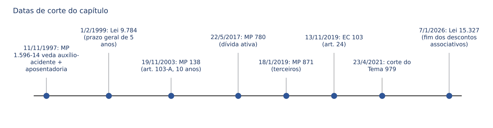
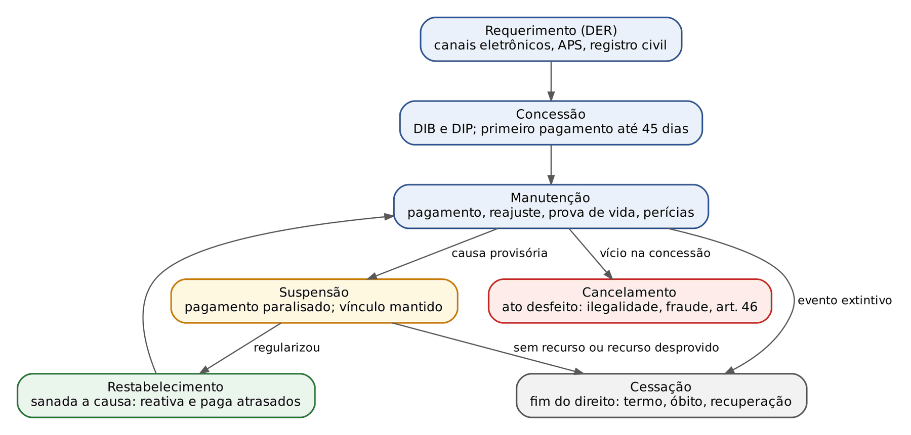
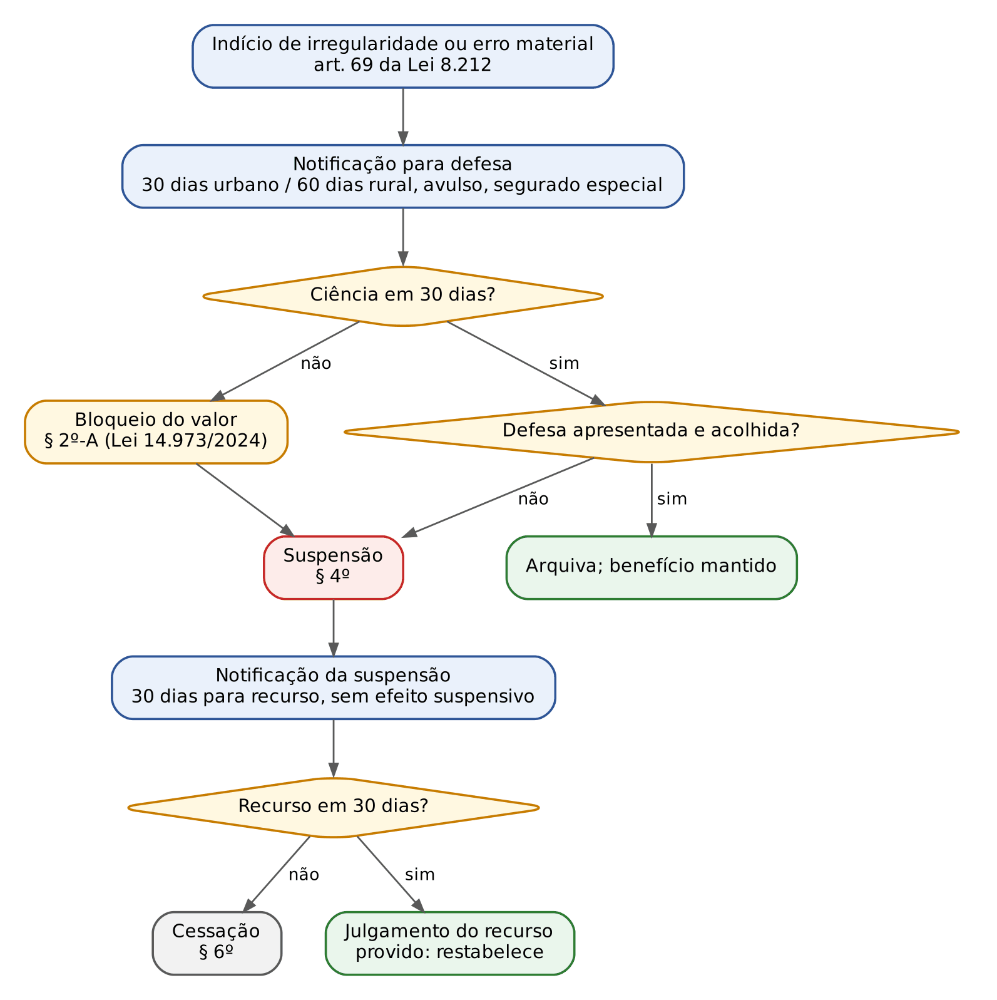
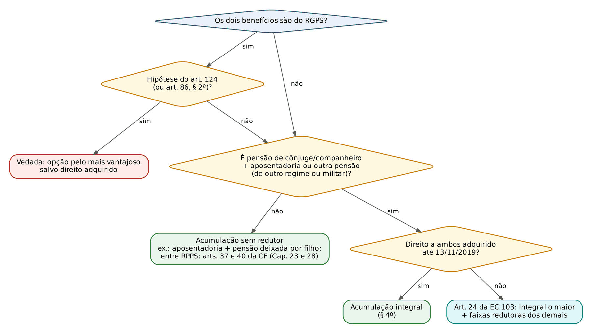
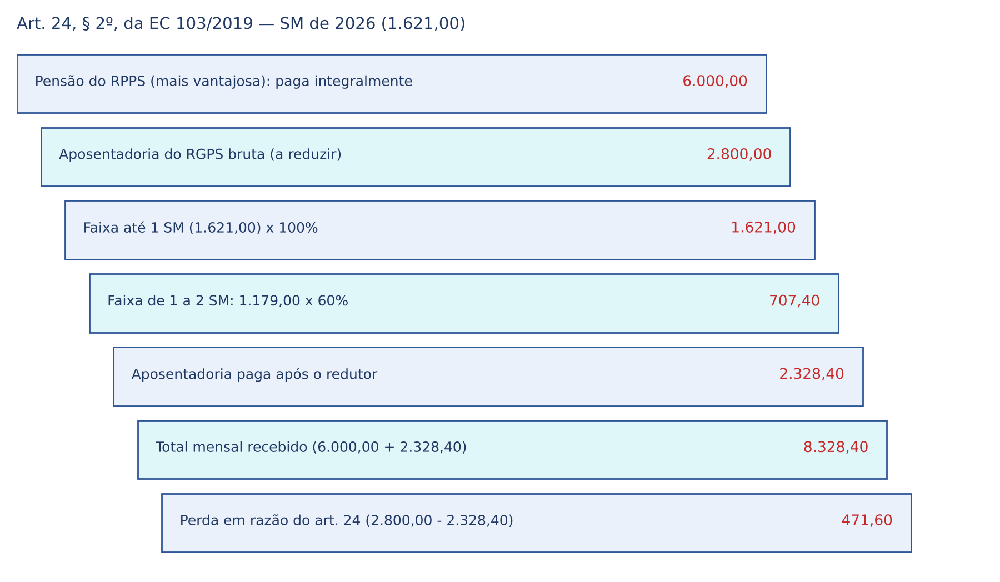
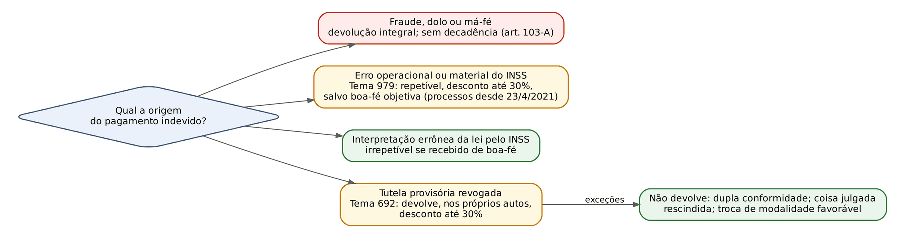

# CAPÍTULO 12 — PRESTAÇÕES EM GERAL: CONCESSÃO, MANUTENÇÃO, SUSPENSÃO E CESSAÇÃO; REVISÃO ADMINISTRATIVA; ACUMULAÇÃO; ABONO ANUAL; DESCONTOS E RESTITUIÇÃO

:::INCIDENCIA
Pontos: TRF5 p. 7 (prestações; concessão a restabelecimento; acumulação, inclusive entre regimes e com militares; abono anual; revisão, descontos e restituições).
Nível A. Lote: FGV 9, FCC 0 (mais correlatas de outros capítulos). O que mais cai: o rol do art. 124 da Lei 8.213/1991 em casos concretos (aposentado que volta a trabalhar e adoece; seguro-desemprego), o art. 24 da EC 103/2019 (pensão + aposentadoria) e o rito do art. 69 da Lei 8.212/1991 (30 e 60 dias).
:::

| Subtema | FGV | FCC | Padrão |
|---|---|---|---|
| Acumulação vedada e permitida no RGPS (art. 124) | 4 | 0 | Caso concreto: aposentado que trabalha e adoece; seguro-desemprego com qual benefício |
| Acumulação entre regimes e art. 24 da EC 103/2019 | 2 | 0 | Viúva com duas pensões; servidora com aposentadoria no RPPS e no RGPS |
| Revisão administrativa (art. 69 da Lei 8.212/1991) | 1 | 0 | Prazos de defesa: 30 dias urbano, 60 dias rural |
| Descontos e penhora do benefício | 1 | 0 | Pensão alimentícia e crédito trabalhista sobre aposentadoria |
| Rol de prestações (art. 18) | 1 | 0 | Identificar o que é prestação do RGPS |

Este capítulo trata da "parte geral" das prestações: o que acontece com o benefício do requerimento até o fim, e as regras transversais que valem para qualquer espécie (acumulação, abono anual, descontos, devolução). As regras de cada benefício estão nos Caps. 13 a 17; o processo administrativo (DER, melhor benefício, reafirmação, recursos ao CRPS) no Cap. 19; a decadência do direito de revisão do segurado (art. 103) no Cap. 21; o RPPS e os militares nos Caps. 23 e 28.

## 12.1 Prestações do RGPS: benefícios e serviços

### 12.1.1 O rol do art. 18 e a nomenclatura

Prestação é gênero; benefícios são prestações em dinheiro e serviços são prestações de fazer (serviço social e reabilitação profissional). O art. 18 da Lei 8.213/1991 distribui as prestações por destinatário. O texto do art. 18 NÃO foi atualizado pela EC 103/2019: continua falando em "aposentadoria por invalidez", "auxílio-doença" e "aposentadoria por tempo de contribuição", ao passo que a Constituição (art. 201, I) e o Decreto 3.048/1999 (redação do Decreto 10.410/2020) usam "aposentadoria por incapacidade permanente" e "auxílio por incapacidade temporária". A FGV usa as duas nomenclaturas indistintamente; não trate a nomenclatura antiga como erro da alternativa.

| Destinatário | Benefícios | Serviços |
|---|---|---|
| Segurado | aposentadorias (incapacidade permanente, idade/programada, tempo de contribuição para direito adquirido e transições, especial); auxílio por incapacidade temporária; salário-família; salário-maternidade; auxílio-acidente | serviço social e reabilitação profissional |
| Dependente | pensão por morte; auxílio-reclusão | serviço social e reabilitação profissional |

Detalhes do rol que viram pegadinha:

- O auxílio-acidente só é devido aos segurados dos incisos I, II, VI e VII do art. 11: empregado, empregado doméstico, trabalhador avulso e segurado especial (art. 18, § 1º). Contribuinte individual e facultativo NÃO têm auxílio-acidente (detalhe no Cap. 15).
- O pecúlio e o abono de permanência em serviço foram extintos, mas aparecem no art. 124 (inciso III) e no Decreto (art. 167, § 2º) por força do direito adquirido.
- Abono salarial (PIS/Pasep), seguro-desemprego, BPC e auxílio-funeral NÃO são prestações do RGPS: os dois primeiros são programas do FAT (art. 239 da CF), o BPC é assistencial (Cap. 18).
- Os benefícios podem ser requeridos também nos Ofícios de Registro Civil das Pessoas Naturais, que encaminham eletronicamente o requerimento ao INSS (art. 18, § 4º, incluído pela Lei 13.846/2019).

:::QUESTAO FGV 2026 — AMAZUL — Analista de Recursos Humanos (Q3851814)
Pedia o benefício que integra as prestações devidas ao segurado. Gabarito: C (auxílio-doença). Armadilhas: abono salarial "financiado pelo empregador", seguro-funeral, auxílio-alimentação e bolsa-educação não constam do art. 18. A alternativa correta usa a nomenclatura antiga do art. 18, I, "e", que continua vigente no texto da lei.
:::

### 12.1.2 O aposentado que continua ou volta a trabalhar (art. 18, § 2º)

O aposentado pelo RGPS que permanece em atividade sujeita ao regime, ou a ela retorna, é segurado obrigatório e contribui normalmente (Cap. 7), mas "não fará jus a prestação alguma da Previdência Social em decorrência do exercício dessa atividade, exceto ao salário-família e à reabilitação profissional, quando empregado" (art. 18, § 2º). É a regra que explica três das questões do lote: o aposentado que adoece não recebe auxílio por incapacidade temporária (cuja acumulação com aposentadoria também é vedada pelo art. 124, I), mas, se empregado de baixa renda com filho até 14 anos, recebe salário-família.

:::PEGADINHA Os 15 primeiros dias do aposentado empregado
O aposentado empregado que adoece não recebe auxílio por incapacidade temporária do INSS a partir do 16º dia; mas a regra trabalhista do art. 60, § 3º, da Lei 8.213/1991 (o empregador paga o salário integral nos primeiros 15 dias consecutivos de afastamento) continua valendo para ele, porque decorre do contrato de trabalho e não da qualidade de beneficiário. Depois do 15º dia, o contrato fica suspenso sem benefício por incapacidade (o aposentado já recebe a aposentadoria).
:::

Desaposentação e reaposentação (renúncia da aposentadoria para obter outra mais vantajosa com as contribuições posteriores) foram rejeitadas pelo STF por falta de previsão legal; o desenvolvimento está no Cap. 13. A vedação ao aposentado especial que continua exposto a agentes nocivos (art. 57, § 8º, combinado com o art. 46) está no Cap. 14.

## 12.2 Concessão

### 12.2.1 Requerimento: regra e exceções

O RGPS não concede benefício de ofício. A prestação nasce de requerimento, e a data de entrada do requerimento (DER) é o marco processual de quase tudo: termo inicial de várias DIBs, momento de aferição dos requisitos (com possibilidade de reafirmação), início do prazo de 45 dias para o primeiro pagamento e prova do interesse de agir para a ação judicial (Caps. 19 e 20).

Canais: o requerimento é formulado em canais eletrônicos (art. 124-A da Lei 8.213/1991, incluído pela Lei 13.846/2019; art. 176-A do Decreto 3.048/1999) e processado eletronicamente; o atendimento presencial nas Agências da Previdência Social é excepcional, para quem não dispõe de meios eletrônicos (art. 176-A, § 2º, do Decreto). Admitem-se ainda os cartórios de registro civil (art. 18, § 4º) e entidades conveniadas por acordo de cooperação (art. 176-B do Decreto). O requerente pode desistir por escrito até a decisão (art. 176-C).

Exceções em que o impulso não vem do próprio segurado:

- Aposentadoria por idade requerida pela empresa quando o empregado completa 70 anos (homem) ou 65 anos (mulher) e cumpriu a carência, sendo compulsória, caso em que se garante ao empregado a indenização trabalhista, considerada como data da rescisão do contrato a imediatamente anterior à do início da aposentadoria (art. 51 da Lei 8.213/1991).
- Habilitação de ofício, apenas para rateio, de dependente em ação em que o INSS é parte (art. 74, § 4º; Cap. 16).
- Transformações automáticas dentro do mesmo processo: o auxílio-acidente começa no dia seguinte ao da cessação do auxílio por incapacidade temporária (art. 86, § 2º), e o auxílio por incapacidade temporária pode ser convertido em aposentadoria por incapacidade permanente na reavaliação pericial (Cap. 15).

O INSS tem dever de conceder o benefício mais vantajoso, ou benefício diverso do requerido, quando os elementos do processo o permitirem, notificando o segurado para optar (art. 176-E do Decreto); a reafirmação da DER para a data em que os requisitos forem implementados antes da decisão está no art. 176-D. Ambos são desenvolvidos no Cap. 19 (Tema 334 do STF e Tema 995 do STJ).

### 12.2.2 DIB, DIP e primeiro pagamento

Três datas organizam a sentença e o ato de concessão:

- DIB (data de início do benefício): a partir de quando o benefício é devido. Cada espécie tem regra própria (quadro abaixo).
- DIP (data de início do pagamento): a partir de quando o INSS passa a pagar administrativamente; entre DIB e DIP ficam os atrasados, pagos em complemento positivo (via administrativa) ou por RPV/precatório (via judicial).
- DDB (data do despacho do benefício): data da decisão administrativa.

O primeiro pagamento deve ser efetuado até 45 dias após a apresentação, pelo segurado, da documentação necessária à concessão (art. 41-A, § 5º). Os benefícios até um salário mínimo são pagos entre o 5º dia útil anterior ao fim do mês de competência e o 5º dia útil do mês seguinte; os acima do mínimo, do 1º ao 5º dia útil do mês seguinte (art. 41-A, §§ 2º e 3º).

| Benefício | DIB (regra) | Fundamento | Desenvolvimento |
|---|---|---|---|
| Aposentadoria por idade, por tempo de contribuição e especial | Empregado e doméstico: desligamento, se requerida até 90 dias depois dele; senão, DER. Demais segurados: DER | arts. 49, 54 e 57, § 2º | Caps. 13 e 14 |
| Auxílio por incapacidade temporária | Empregado: 16º dia de afastamento; demais: início da incapacidade; DER se requerido após 30 dias de afastamento | art. 60, caput e § 1º | Cap. 15 |
| Auxílio-acidente | Dia seguinte ao da cessação do auxílio por incapacidade temporária | art. 86, § 2º | Cap. 15 |
| Pensão por morte | Óbito, se requerida em 180 dias (filhos com menos de 16 anos) ou 90 dias (demais); senão, DER; decisão judicial na morte presumida | art. 74 | Cap. 16 |
| Auxílio-reclusão | Nas condições da pensão por morte (recolhimento à prisão em regime fechado) | art. 80 | Cap. 16 |
| Salário-maternidade | Entre 28 dias antes do parto e a data do parto (120 dias) | art. 71 | Cap. 17 |

:::DICA Jurisprudência em Teses do STJ sobre o termo inicial
Na ausência de requerimento administrativo, o termo inicial é a citação válida (Jurisprudência em Teses do STJ, ed. 67, tese 5). Hoje a regra é residual, porque o prévio requerimento é, em regra, condição do interesse de agir (Cap. 19); ela continua relevante quando o requerimento é dispensado (por exemplo, contestação de mérito do INSS) e na revisão.
:::

### 12.2.3 A quem se paga: procurador, incapaz e valores não recebidos em vida

- Pagamento direto ao beneficiário; a procurador só em caso de ausência, moléstia contagiosa ou impossibilidade de locomoção, com mandato de até 12 meses, renovável (art. 109).
- Beneficiário civilmente incapaz: paga-se ao cônjuge, pai, mãe, tutor ou curador; na falta, por até 6 meses, a herdeiro necessário mediante termo de compromisso (art. 110). O juiz da curatela pode valer-se do laudo pericial do INSS (art. 110, § 1º). O dependente excluído por homicídio contra o segurado, ou com a cota suspensa, não pode representar outro dependente (art. 110, §§ 2º e 3º).
- Valores não recebidos em vida pelo segurado: pagos aos dependentes habilitados à pensão por morte ou, na falta deles, aos sucessores na forma da lei civil, "independentemente de inventário ou arrolamento" (art. 112).

:::PEGADINHA Art. 112: dependente antes de herdeiro
O resíduo não pago ao segurado falecido NÃO segue a ordem de vocação hereditária do Código Civil: vai primeiro aos dependentes habilitados à pensão (inclusive o companheiro, mesmo que concorram filhos maiores capazes, que não são dependentes). Só sem dependente habilitado é que se aplica a lei civil. E dispensa inventário: o juízo estadual da sucessão não precisa expedir alvará se há dependente habilitado no INSS.
:::

## 12.3 Manutenção

Manutenção é a fase em que o benefício está ativo e é pago mês a mês: reajuste anual (art. 41-A; Cap. 11), pagamento, controle de permanência dos requisitos e atualização cadastral. Para o juiz, interessa sobretudo o que pode interromper o pagamento sem que o direito tenha acabado.

### 12.3.1 Prova de vida e recenseamento

O regime atual vem do art. 69, § 8º, da Lei 8.212/1991, com a redação da Lei 14.199/2021:

- Comprovação de vida ANUAL, no mês de aniversário do titular, preferencialmente por atendimento eletrônico com biometria ou outro meio definido pelo INSS que assegure identificação inequívoca, implementado pelas instituições financeiras pagadoras.
- Pode ser feita por representante legal ou procurador cadastrado no INSS (inciso II).
- Pessoas com 80 anos ou mais ou com dificuldade de locomoção: meios alternativos, inclusive atendimento domiciliar (inciso IV), e esforço obrigatório dos bancos para evitar o deslocamento (inciso IV-A).
- Consequência do descumprimento: o INSS PODE bloquear o pagamento até a realização da prova de vida, com liberação automática pelo banco quando ela for feita (inciso V). Bloqueio não é suspensão nem cessação.
- Para isso o INSS tem acesso aos dados biométricos dos órgãos federais e, por convênio, da Justiça Eleitoral e de outros entes (art. 69, § 11).
- Residente no exterior: embaixada, consulado ou documento apostilado (art. 179, § 8º-A, do Decreto).

O INSS pode também fazer recenseamento para atualizar o cadastro (art. 69, § 7º). Do lado do óbito, o cartório de registro civil deve remeter ao INSS, em até 1 dia útil, pelo Sirc, a relação de óbitos, nascimentos, casamentos e averbações (5 dias úteis onde não houver acesso à internet), sob pena de multa e de ação regressiva (art. 68 da Lei 8.212/1991, redação da Lei 13.846/2019). É esse cruzamento que permite cessar benefícios de falecidos e cobrar valores pagos após o óbito (ver 12.10.5).

:::ATENCAO Lei x Decreto na prova de vida
O art. 179, § 8º, do Decreto 3.048/1999 (redação de 2020) ainda fala em comprovação "nas instituições financeiras" e em ato do INSS para quem tem 60 anos ou mais. Prevalece a lei: o § 8º do art. 69 da Lei 8.212/1991, na redação da Lei 14.199/2021, fixa o mês de aniversário, prefere a biometria e destaca a faixa de 80 anos. Em questão de letra de lei, use a Lei 8.212.
:::

### 12.3.2 Perícias de manutenção (art. 101)

O titular de auxílio por incapacidade temporária, auxílio-acidente ou aposentadoria por incapacidade permanente e o pensionista inválido, concedidos judicial ou administrativamente, estão obrigados, SOB PENA DE SUSPENSÃO, a submeter-se a: exame médico do INSS; reabilitação profissional prescrita e custeada pela Previdência; e tratamento gratuito, salvo o cirúrgico e a transfusão de sangue, que são facultativos (art. 101, redação da Lei 14.441/2022). Ficam isentos do exame o aposentado por incapacidade permanente e o pensionista inválido que não voltaram à atividade, após 55 anos de idade com 15 anos de benefício, ou após 60 anos (art. 101, § 1º); a isenção não alcança o exame para o acréscimo de 25%, a pedido de quem se julga apto ou para subsidiar curatela (§ 2º). O detalhe pericial (telemedicina, análise documental, DCB, prorrogação) é do Cap. 15.

:::DICA Benefício concedido judicialmente também é revisto
O art. 101 diz expressamente "concedidos judicial ou administrativamente", e o art. 60, § 10, autoriza convocar o segurado em gozo de auxílio por incapacidade temporária concedido em juízo. A coisa julgada sobre incapacidade é *rebus sic stantibus*: o INSS pode reavaliar e cessar se a incapacidade cessou, sem afronta ao título, desde que observe o procedimento (exame pericial). Cessação pela simples passagem do tempo, sem perícia, quando a sentença não fixou DCB, é questão do Cap. 15.
:::

## 12.4 Suspensão, cessação, cancelamento e restabelecimento

A lei não define os termos, mas os usa com sentidos distintos, e a distinção decide o pedido e os atrasados na sentença.

| Figura | O que é | Efeito sobre o direito | Exemplos legais |
|---|---|---|---|
| Bloqueio | Retenção do crédito no banco por pendência cadastral | Nenhum; liberado ao regularizar | Falta de prova de vida (art. 69, § 8º, V, da Lei 8.212); falta de ciência da notificação em 30 dias (§ 2º-A) |
| Suspensão | Paralisação provisória do pagamento por causa sanável ou em apuração | Direito subsiste; regularizada a causa, há restabelecimento com atrasados, se a causa não afastava o direito | Não comparecimento à perícia ou recusa de reabilitação (art. 101); defesa ausente ou rejeitada na revisão (art. 69, § 4º); indício de homicídio pelo dependente (art. 77, § 7º); falta de informação de outra aposentadoria ou pensão (art. 167-A, § 8º, do Decreto) |
| Cessação | Fim do benefício por evento extintivo ou ausência superveniente de requisito | Direito extinto daí em diante; pagamentos anteriores eram devidos | Óbito; maioridade do filho; termo da pensão do cônjuge; recuperação da capacidade; início de aposentadoria (para o auxílio-acidente); ausência de recurso após a suspensão (art. 69, § 6º) |
| Cancelamento | Desfazimento do ato de concessão por vício ou por fato que a lei sanciona | Em regra *ex tunc* para o vício (com possível devolução, ver 12.10); *ex nunc* nas hipóteses legais | Fraude, concessão ilegal (art. 103-A); aposentado por incapacidade que volta voluntariamente ao trabalho (art. 46: cancelamento automático "a partir da data do retorno"); auxílio por incapacidade temporária de quem passa a exercer atividade que lhe garanta subsistência (art. 60, § 6º) |
| Restabelecimento | Reativação do benefício suspenso ou indevidamente cessado | Pagamento dos valores do período de suspensão, corrigidos | Comparecimento à perícia; provimento do recurso; absolvição do dependente (art. 77, § 7º: todas as parcelas corrigidas desde a suspensão) |

:::PEGADINHA Art. 46 x art. 60, § 6º
O aposentado por incapacidade permanente que volta VOLUNTARIAMENTE à atividade tem a aposentadoria "automaticamente cancelada, a partir da data do retorno" (art. 46): o verbo é imperativo. Já o segurado em auxílio por incapacidade temporária que passa a exercer atividade que lhe garanta subsistência "poderá" ter o benefício cancelado a partir do retorno (art. 60, § 6º), e, se a nova atividade for diversa da que gerou o benefício, a incapacidade é verificada para cada atividade (§ 7º). A recuperação gradual da aposentadoria por incapacidade (mensalidades de recuperação) é do Cap. 15.
:::

:::SENTENCA Restabelecimento de benefício cessado indevidamente
"Julgo procedente o pedido para condenar o INSS a restabelecer o benefício NB (...) desde a data da cessação indevida (DCB em d/m/aaaa), com DIP na data desta sentença, e a pagar as parcelas vencidas entre a cessação e a DIP, descontados os valores eventualmente recebidos a título de benefício inacumulável no mesmo período, apurada a compensação competência a competência, sem saldo negativo contra o autor (Tema 1.207 do STJ)." Observe que, no restabelecimento, o termo inicial é o dia seguinte à cessação, e não a nova DER, se a causa da cessação foi afastada.
:::

## 12.5 Revisão administrativa e autotutela

### 12.5.1 Duas revisões que não se confundem

Revisão "a favor" do segurado (pedido de revisão da RMI, sujeito à decadência de 10 anos do art. 103 da Lei 8.213/1991) é tema do Cap. 21. Aqui interessa a revisão "contra" o segurado: a autotutela do INSS para corrigir ou anular concessões, que tem dois pilares:

- O dever de revisão permanente: "O INSS manterá programa permanente de revisão da concessão e da manutenção dos benefícios por ele administrados, a fim de apurar irregularidades ou erros materiais" (art. 69, caput, da Lei 8.212/1991, redação da Lei 13.846/2019; reproduzido no art. 179 do Decreto 3.048/1999).
- O limite temporal: decadência de 10 anos para anular atos favoráveis, salvo comprovada má-fé (art. 103-A da Lei 8.213/1991).

### 12.5.2 O rito do art. 69 da Lei 8.212/1991

:::LEI Lei 8.212/1991, art. 69, §§ 1º, 2º-A, 4º, 5º, 6º e 9º
§ 1º Na hipótese de haver indícios de irregularidade ou erros materiais na concessão, na manutenção ou na revisão do benefício, o INSS notificará o beneficiário, o seu representante legal ou o seu procurador para apresentar defesa, provas ou documentos dos quais dispuser, no prazo de:
I - 30 (trinta) dias, no caso de trabalhador urbano;
II - 60 (sessenta) dias, no caso de trabalhador rural individual e avulso, agricultor familiar ou segurado especial.
§ 2º-A. Na ausência de ciência, em até 30 (trinta) dias, da notificação de que trata o § 1º, o valor referente ao benefício será bloqueado, nos termos de ato do Poder Executivo.
§ 4º O benefício será suspenso nas seguintes hipóteses: I - não apresentação da defesa no prazo estabelecido no § 1º deste artigo; II - defesa considerada insuficiente ou improcedente pelo INSS. III – ausência de ciência de que trata o § 2º-A, nos termos de ato do Poder Executivo.
§ 5º O INSS deverá notificar o beneficiário quanto à suspensão do benefício de que trata o § 4º deste artigo e conceder-lhe prazo de 30 (trinta) dias para interposição de recurso.
§ 6º Decorrido o prazo de 30 (trinta) dias após a suspensão a que se refere o § 4º deste artigo, sem que o beneficiário, o seu representante legal ou o seu procurador apresente recurso administrativo aos canais de atendimento do INSS ou a outros canais autorizados, o benefício será cessado.
§ 9º O recurso de que trata o § 5º deste artigo não terá efeito suspensivo.
:::

A sequência é: indício, notificação, defesa, suspensão, recurso, cessação. Três pontos de prova:

- O contraditório é PRÉVIO à suspensão: o INSS não suspende ao detectar o indício; primeiro notifica. A suspensão só vem com a defesa ausente ou rejeitada (ou, desde a Lei 14.973/2024, com a falta de ciência em 30 dias, que gera bloqueio e depois suspensão).
- Os prazos são diferenciados: 30 dias para o urbano, 60 dias para o trabalhador rural individual e avulso, o agricultor familiar e o segurado especial.
- O recurso contra a suspensão (30 dias) NÃO tem efeito suspensivo: o benefício fica suspenso enquanto se julga o recurso.

A notificação é preferencialmente pela rede bancária ou por meio eletrônico (art. 69, § 2º, I). A Lei 14.973/2024 revogou os incisos que previam a via postal e o edital na lei, e inseriu o bloqueio por ausência de ciência; o Decreto (art. 179, § 2º) ainda lista carta simples e edital, na redação de 2020. Ao lado do rito, o § 10 manda rever os procedimentos de concessão quando se apura irregularidade recorrente.

:::QUESTAO FGV 2026 — TRF-2 — Juiz Federal Substituto (Q3996823)
Revisão permanente detectou indícios de irregularidade em dois benefícios, um de trabalhador urbano e outro de rural. Gabarito: B (notificar para defesa, provas ou documentos em 30 dias para o urbano e 60 dias para o rural). Armadilhas: suspender antes de ouvir (A e D), cancelar e depois notificar (C), ajuizar ação para suspender (E). Fundamento: art. 69, § 1º, da Lei 8.212/1991; a suspensão é consequência da defesa ausente ou rejeitada (§ 4º).
:::

### 12.5.3 Decadência do direito de anular (art. 103-A)

O INSS decai em 10 anos do direito de anular ato de que decorram efeitos favoráveis ao beneficiário, contados da data do ato ou, nos benefícios, da percepção do primeiro pagamento; qualquer medida administrativa que impugne a validade do ato (como a notificação do art. 69, § 1º, da Lei 8.212/1991) exerce o direito, e a comprovada má-fé afasta a decadência (art. 103-A da Lei 8.213/1991; para atos anteriores a 1/2/1999, Tema 214 do STJ) (v. Cap. 19).

Autotutela não dispensa devido processo: anular ou revisar benefício exige contraditório e ampla defesa prévios, o que o art. 69 positivou. Cessar sem notificar, ou suspender antes da defesa fora das hipóteses legais (art. 101, art. 77, § 7º, prova de vida), gera restabelecimento judicial com atrasados, sem prejuízo de o INSS reabrir regularmente o procedimento, se ainda no prazo do art. 103-A.

## 12.6 Acumulação de benefícios no RGPS

### 12.6.1 Lógica da vedação

A regra é a liberdade de acumular benefícios que cobrem riscos distintos; a vedação existe quando dois benefícios substituem a mesma renda (duas aposentadorias, aposentadoria e auxílio por incapacidade temporária) ou quando a lei fez escolha política (pensões de cônjuge). Desde a EC 103/2019 há base constitucional: "Lei complementar estabelecerá vedações, regras e condições para a acumulação de benefícios previdenciários" (art. 201, § 15, da CF); até essa lei complementar, valem o art. 124 da Lei 8.213/1991 e o art. 24 da EC 103/2019, que só podem ser alterados na forma do § 15 do art. 201 e do § 6º do art. 40 (art. 24, § 5º, da EC 103).

:::LEI Lei 8.213/1991, art. 124
Art. 124. Salvo no caso de direito adquirido, não é permitido o recebimento conjunto dos seguintes benefícios da Previdência Social:
I - aposentadoria e auxílio-doença;
II - mais de uma aposentadoria;
III - aposentadoria e abono de permanência em serviço;
IV - salário-maternidade e auxílio-doença;
V - mais de um auxílio-acidente;
VI - mais de uma pensão deixada por cônjuge ou companheiro, ressalvado o direito de opção pela mais vantajosa.
Parágrafo único. É vedado o recebimento conjunto do seguro-desemprego com qualquer benefício de prestação continuada da Previdência Social, exceto pensão por morte ou auxílio-acidente.
:::

O Decreto 3.048/1999 (art. 167, redação do Decreto 10.410/2020) repete o rol, desdobra o inciso VI em três (cônjuge; companheiro; cônjuge e companheiro), acrescenta "inclusive quando decorrentes de acidente do trabalho" e inclui o inciso IX: "auxílio-acidente com qualquer aposentadoria", que na lei está no art. 86, §§ 2º e 3º.

### 12.6.2 Quadro das acumulações vedadas

| Combinação vedada | Fundamento | Observações cobráveis |
|---|---|---|
| Aposentadoria + auxílio por incapacidade temporária | art. 124, I | Vale para o aposentado que volta a trabalhar e adoece (art. 18, § 2º); não há meio-termo nem opção parcial |
| Mais de uma aposentadoria no RGPS | art. 124, II | Duas atividades concomitantes geram UMA aposentadoria, com salários de contribuição somados (Cap. 11); aposentadoria do RGPS + do RPPS é outra coisa (12.8) |
| Aposentadoria + abono de permanência em serviço | art. 124, III | Abono do RGPS extinto (Lei 8.870/1994); não confundir com o abono de permanência do servidor (art. 40, § 19, da CF; Cap. 23) |
| Salário-maternidade + auxílio por incapacidade temporária | art. 124, IV | Se a incapacidade coincide com a licença, o auxílio fica suspenso e é restabelecido após o salário-maternidade, se persistir a incapacidade |
| Mais de um auxílio-acidente | art. 124, V | Nova lesão: as sequelas são consideradas em conjunto em um só benefício |
| Mais de uma pensão de cônjuge ou companheiro no RGPS | art. 124, VI; art. 24, caput, da EC 103 | Opção pela mais vantajosa; de regimes distintos, ver art. 24 da EC 103 (12.7) |
| Auxílio-acidente + qualquer aposentadoria | art. 86, §§ 1º a 3º; Decreto, art. 167, IX | Auxílio-acidente cessa na véspera do início da aposentadoria; desde a MP 1.596-14/1997 (11/11/1997), seu valor integra o salário de contribuição para o cálculo da aposentadoria (Cap. 11) |
| Seguro-desemprego + benefício de prestação continuada | art. 124, parágrafo único | EXCETO pensão por morte e auxílio-acidente (lei); o Decreto acrescenta auxílio-reclusão, auxílio-suplementar e abono de permanência (art. 167, § 2º) |
| Auxílio-reclusão + remuneração, auxílio por incapacidade temporária, pensão, salário-maternidade, aposentadoria ou abono de permanência DO PRESO | art. 80 | A vedação é condição de concessão; o trabalho do preso em regime fechado não faz perder o benefício dos dependentes (§ 7º) |

:::JURIS STJ, Súmula 507 e Tema 555
"A acumulação de auxílio-acidente com aposentadoria pressupõe que a lesão incapacitante e a aposentadoria sejam anteriores a 11/11/1997, observado o critério do art. 23 da Lei n. 8.213/1991 para definição do momento da lesão nos casos de doença profissional ou do trabalho" (Súmula 507 do STJ). Tema 555 (repetitivo): a acumulação pressupõe que a eclosão da lesão incapacitante E a concessão da aposentadoria sejam anteriores à alteração do art. 86, §§ 2º e 3º, promovida em 11/11/1997 pela MP 1.596-14/1997, convertida na Lei 9.528/1997. Os dois marcos são cumulativos: lesão de 1995 com aposentadoria de 1999 NÃO acumula.
:::

### 12.6.3 Acumulações permitidas (as que a banca apresenta como vedadas)

- Aposentadoria + pensão por morte: permitida (são riscos distintos), mas, se a pensão é de cônjuge ou companheiro e o direito a ambas não estava adquirido em 13/11/2019, incide o redutor do art. 24 da EC 103 (12.7).
- Pensão de cônjuge + pensão deixada por filho, pai ou mãe: permitida sem redutor (o art. 124, VI, e o art. 24 só alcançam pensões de cônjuge ou companheiro).
- Duas pensões por morte deixadas pelo pai e pela mãe ao mesmo filho: permitida.
- Auxílio-acidente + auxílio por incapacidade temporária por OUTRA causa, + salário-maternidade, + pensão, + salário: permitida ("o recebimento de salário ou concessão de outro benefício, exceto de aposentadoria", não prejudica o auxílio-acidente: art. 86, § 3º).
- Auxílio-acidente + seguro-desemprego; pensão por morte + seguro-desemprego: permitidas pelo parágrafo único do art. 124.
- Aposentadoria + salário-família (aposentado empregado de baixa renda): permitida pelo art. 18, § 2º.
- Pensão por morte de trabalhador rural + aposentadoria por invalidez: "Não há vedação legal" (Súmula 36 da TNU), porque os pressupostos fáticos e os fatos geradores são distintos.
- Benefícios do RGPS + pensão especial da Lei 7.070/1982 (talidomida), que não se reduz por recuperação de capacidade (Decreto, art. 167, § 3º).

:::PEGADINHA BPC não está no art. 124
O BPC não pode ser acumulado com outro benefício da seguridade social ou de outro regime, ressalvadas as exceções da própria LOAS, como a assistência médica e a pensão especial de natureza indenizatória (art. 20, § 4º, da LOAS; Cap. 18). Não procure essa vedação na Lei 8.213/1991.
:::

:::QUESTAO FGV 2025 — Prefeitura de Abreu e Lima (PE) — Procurador Jurídico Municipal (Q3841707)
Aposentado do INSS desde 2021 continua empregado e fica 30 dias afastado por dengue. Gabarito: B (não acumula aposentadoria com auxílio por incapacidade temporária). Armadilhas: "metade de cada benefício" (A), "a partir do 16º dia" (E), "salvo contribuição adicional" (D). A alternativa C (empregador paga o salário dos 30 dias) erra no número: o art. 60, § 3º, impõe à empresa só os primeiros 15 dias. Fundamento: art. 124, I, e art. 18, § 2º.
:::

:::QUESTAO FGV 2025 — TCE-RR — Auditor de Controle Externo (Q3186487)
Aposentado desde 2015 com um salário mínimo, recontratado como empregado em 2022 com um salário mínimo, adota criança em 2023 e fica 45 dias afastado em 2024. Gabarito: A (não acumula aposentadoria com auxílio por incapacidade temporária). A armadilha é o salário-família: o aposentado que volta a trabalhar como EMPREGADO tem salário-família (art. 18, § 2º), e o caso o pôs na baixa renda (Cap. 17); por isso B e D estão erradas. A alternativa E ("deverá optar") também é falsa: não há opção, a aposentadoria simplesmente afasta o auxílio.
:::

:::QUESTAO FGV 2025 — CPRM — Analista em Geociências, Direito (Q3757924)
Empregado dispensado sem justa causa, com guias do seguro-desemprego: qual benefício previdenciário pode receber junto? Gabarito: E (auxílio-acidente). Fundamento: art. 124, parágrafo único (exceções: pensão por morte e auxílio-acidente). Auxílio-reclusão (B) é exceção só no Decreto, e o caso não tem preso; auxílio por incapacidade temporária e aposentadorias estão vedados.
:::

:::QUESTAO FGV 2024 — Prefeitura de São José dos Campos (SP) — Procurador (Q3888072)
Entre cinco combinações, apontar a única acumulável. Gabarito: D (aposentadoria e pensão por morte). As demais estão no art. 124: I (A), II (B), IV (C) e V (E). Lembre que a acumulação permitida pode sofrer o redutor do art. 24 da EC 103 se a pensão for de cônjuge ou companheiro.
:::

Benefícios inacumuláveis pagos no mesmo período: a compensação na liquidação é feita mês a mês, limitada em cada competência ao valor do título judicial, sem saldo negativo contra o beneficiário (STJ, Tema 1.207; v. Cap. 20); o mesmo critério foi usado pelo STJ, por analogia, quando a tutela trocou apenas a modalidade do benefício (12.11.2).

## 12.7 Acumulação de pensão de cônjuge ou companheiro com aposentadoria ou outra pensão: art. 24 da EC 103/2019

### 12.7.1 O texto

:::LEI EC 103/2019, art. 24
Art. 24. É vedada a acumulação de mais de uma pensão por morte deixada por cônjuge ou companheiro, no âmbito do mesmo regime de previdência social, ressalvadas as pensões do mesmo instituidor decorrentes do exercício de cargos acumuláveis na forma do art. 37 da Constituição Federal.
§ 1º Será admitida, nos termos do § 2º, a acumulação de:
I - pensão por morte deixada por cônjuge ou companheiro de um regime de previdência social com pensão por morte concedida por outro regime de previdência social ou com pensões decorrentes das atividades militares de que tratam os arts. 42 e 142 da Constituição Federal;
II - pensão por morte deixada por cônjuge ou companheiro de um regime de previdência social com aposentadoria concedida no âmbito do Regime Geral de Previdência Social ou de regime próprio de previdência social ou com proventos de inatividade decorrentes das atividades militares de que tratam os arts. 42 e 142 da Constituição Federal; ou
III - pensões decorrentes das atividades militares de que tratam os arts. 42 e 142 da Constituição Federal com aposentadoria concedida no âmbito do Regime Geral de Previdência Social ou de regime próprio de previdência social.
§ 2º Nas hipóteses das acumulações previstas no § 1º, é assegurada a percepção do valor integral do benefício mais vantajoso e de uma parte de cada um dos demais benefícios, apurada cumulativamente de acordo com as seguintes faixas:
I - 60% (sessenta por cento) do valor que exceder 1 (um) salário-mínimo, até o limite de 2 (dois) salários-mínimos;
II - 40% (quarenta por cento) do valor que exceder 2 (dois) salários-mínimos, até o limite de 3 (três) salários-mínimos;
III - 20% (vinte por cento) do valor que exceder 3 (três) salários-mínimos, até o limite de 4 (quatro) salários-mínimos; e
IV - 10% (dez por cento) do valor que exceder 4 (quatro) salários-mínimos.
§ 3º A aplicação do disposto no § 2º poderá ser revista a qualquer tempo, a pedido do interessado, em razão de alteração de algum dos benefícios.
§ 4º As restrições previstas neste artigo não serão aplicadas se o direito aos benefícios houver sido adquirido antes da data de entrada em vigor desta Emenda Constitucional.
:::

### 12.7.2 Estrutura: o que é vedado e o que é reduzido

| Situação | Regime jurídico |
|---|---|
| Duas pensões de cônjuge ou companheiro no MESMO regime | VEDADA (opção pela mais vantajosa), salvo pensões do mesmo instituidor por cargos acumuláveis (art. 37, XVI, da CF) |
| Pensão de cônjuge de um regime + pensão de cônjuge de OUTRO regime (ou pensão militar) | Permitida com redutor (§ 1º, I) |
| Pensão de cônjuge (qualquer regime) + aposentadoria do RGPS ou do RPPS (ou inatividade militar) | Permitida com redutor (§ 1º, II) |
| Pensão militar + aposentadoria do RGPS ou do RPPS | Permitida com redutor (§ 1º, III) |
| Pensão de filho, pai, mãe, irmão + aposentadoria ou outra pensão | Fora do art. 24: sem redutor |
| Duas aposentadorias (RGPS + RPPS) | Fora do art. 24: sem redutor (12.8) |
| Direito a ambos os benefícios adquirido até 13/11/2019 | Sem redutor (§ 4º; Decreto, art. 167-A, § 4º) |

:::ATENCAO O que conta é o direito adquirido aos DOIS benefícios
O § 4º afasta o redutor "se o direito aos benefícios houver sido adquirido antes" da vigência da EC 103 (13/11/2019). O Decreto (art. 167-A, § 4º) diz "até 13 de novembro de 2019". Se a viúva já era aposentada antes, mas o cônjuge morreu em 2021, o direito à pensão nasceu depois: aplica-se o redutor. A data relevante da pensão é o óbito (*tempus regit actum*), não a DER.
:::

### 12.7.3 Mecânica do cálculo

Passos:

- Identificar todos os benefícios acumulados que se enquadram no § 1º.
- O beneficiário recebe integralmente o mais vantajoso (escolhe-o; o INSS deve pedir a opção expressa: art. 167-A, § 5º, II, do Decreto). Escolher o de maior valor é sempre o melhor resultado, porque o redutor só tira valor do benefício reduzido e a perda cresce com o valor.
- Cada um dos demais é decomposto em faixas de salário mínimo, apuradas cumulativamente: até 1 SM, 100% (o § 2º só reduz o que "exceder" 1 SM); de 1 a 2 SM, 60%; de 2 a 3 SM, 40%; de 3 a 4 SM, 20%; acima de 4 SM, 10%.
- Na pensão desdobrada entre vários dependentes, considera-se a cota individual mais a parcela da cota familiar do pensionista, revista quando acabar o desdobramento ou mudar o número de dependentes (art. 167-A, § 3º, do Decreto).
- Alteração de um dos benefícios (reajuste, fim de cota, cessação do mais vantajoso) permite revisão a qualquer tempo, a pedido (§ 3º); se o benefício integral cessar, o outro volta a ser pago por inteiro.

:::EXEMPLO Escada com o salário mínimo de 2026 (1.621 (mil seiscentos e vinte e um) reais)
Viúva aposentada pelo RGPS (renda de 2.800) passa a receber, por óbito de 2025, pensão do RPPS do marido servidor (6.000). Integral: pensão de 6.000 (mais vantajosa). Aposentadoria reduzida: 1.621,00 (até 1 SM, 100%) + 1.179,00 x 60% = 707,40 (faixa de 1 a 2 SM) = 2.328,40. Total mensal: 8.328,40, com perda de 471,60 (a aposentadoria é paga a 83,16% do valor). Se ela escolhesse a aposentadoria como integral, a pensão de 6.000 seria reduzida e o total cairia para 6.269,40: a opção pelo maior é a racional.
Benefício reduzido de 7.000: 1.621,00 + (1.621,00 x 60% = 972,60) + (1.621,00 x 40% = 648,40) + (1.621,00 x 20% = 324,20) + (516,00 x 10% = 51,60) = 3.617,80, ou seja, 51,68% do valor bruto.
Benefício reduzido de 1.621 (um salário mínimo): nenhuma redução.
:::

:::DICA Fórmula de bolso para o benefício reduzido
Com S = salário mínimo e B = valor bruto do benefício reduzido: até 1 S, paga B; até 2 S, paga S + 0,6 (B - S); até 3 S, paga 1,6 S + 0,4 (B - 2S); até 4 S, paga 2,0 S + 0,2 (B - 3S); acima de 4 S, paga 2,2 S + 0,1 (B - 4S). Os degraus acumulados (1,6 S; 2,0 S; 2,2 S) são a conferência rápida: com S = 1.621, 2,2 S = 3.566,20, e 3.566,20 + 51,60 = 3.617,80 no exemplo de 7.000.
:::

Controle e prova: no ato de habilitação, o INSS verifica a filiação a RGPS ou RPPS e o CNIS (art. 167-A, § 5º, do Decreto); enquanto não houver cadastro nacional integrado de segurados e servidores, a prova de que o pensionista ou aposentado não recebe benefício de outro regime é autodeclaração, sob as sanções administrativas, civis e penais (§ 7º); e cabe ao beneficiário informar ao INSS a obtenção de aposentadoria ou pensão de outro regime, sob pena de suspensão (§ 8º). Valores pagos a maior por omissão do beneficiário são repetíveis (12.11).

:::QUESTAO FGV 2024 — AL-PR — Procurador (Q2448984)
Viúva de 46 anos recebe, desde 2018, pensão de 3 salários mínimos deixada pelo primeiro marido, professor de faculdade privada; casa-se em 2020 com outro professor da mesma instituição, que morre 2 anos e 3 meses depois, com o mesmo salário. Gabarito oficial: E (recebe integralmente a pensão de maior valor e um percentual da menor). O gabarito é DISCUTÍVEL: os dois instituidores eram segurados do RGPS (empregados de instituição privada), e a acumulação de mais de uma pensão de cônjuge "no âmbito do mesmo regime" é VEDADA (art. 24, caput, da EC 103; art. 124, VI, da Lei 8.213), com direito de opção pela mais vantajosa; o redutor por faixas só vale para pensões de regimes DIFERENTES (§ 1º, I). Pela letra da lei, a resposta seria a alternativa A (inviável acumular; continua com 3 salários mínimos, valor idêntico ao da segunda pensão). A banca parece ter aplicado o § 2º sem verificar o regime. Na prova, se o enunciado deixar claro o mesmo regime, fique com a vedação; se o regime for diverso (por exemplo, um marido servidor), o § 2º se aplica.
:::

## 12.8 Acumulação entre regimes e com o sistema de proteção social dos militares

### 12.8.1 Aposentadoria do RGPS + aposentadoria do RPPS

São regimes distintos, cada qual com sua vedação interna (art. 124, II, no RGPS; art. 40, § 6º, da CF no RPPS). Não há regra que proíba receber uma aposentadoria de cada regime, desde que cada uma resulte de tempo e contribuições próprios: o tempo usado num regime não pode ser contado no outro (vedação da contagem recíproca de tempo concomitante e da dupla utilização; Cap. 26). Daí o padrão de questão: a servidora só terá também aposentadoria no RGPS se tiver exercido, paralelamente, atividade que a vinculava obrigatoriamente ao RGPS (por exemplo, professora em escola privada), porque quem participa de RPPS não pode filiar-se ao RGPS como facultativo (art. 201, § 5º, da CF; Cap. 6).

:::QUESTAO FGV 2024 — TRF-1 — Analista Judiciário, Área Judiciária (Q3028452)
Servidora federal quer aposentar-se no RPPS e, simultaneamente, no RGPS. Gabarito: D (possível, desde que tenha exercido, enquanto servidora, atividade remunerada lícita e concomitante que a vinculasse como segurada obrigatória do RGPS). Armadilhas: "impossível acumular" (A), "possível como facultativa" (B e E; vedado ao participante de RPPS), "não pode sequer averbar tempo anterior" (C; a contagem recíproca é garantida, Cap. 26).
:::

:::LEI CF, art. 40, § 6º, e art. 37, § 10
Art. 40, § 6º Ressalvadas as aposentadorias decorrentes dos cargos acumuláveis na forma desta Constituição, é vedada a percepção de mais de uma aposentadoria à conta de regime próprio de previdência social, aplicando-se outras vedações, regras e condições para a acumulação de benefícios previdenciários estabelecidas no Regime Geral de Previdência Social.
Art. 37, § 10. É vedada a percepção simultânea de proventos de aposentadoria decorrentes do art. 40 ou dos arts. 42 e 142 com a remuneração de cargo, emprego ou função pública, ressalvados os cargos acumuláveis na forma desta Constituição, os cargos eletivos e os cargos em comissão declarados em lei de livre nomeação e exoneração.
:::

Observe a parte final do art. 40, § 6º: o RPPS importa as "vedações, regras e condições" de acumulação do RGPS. O § 10 do art. 37 alcança proventos do RPPS e da inatividade militar, NÃO a aposentadoria do RGPS: o aposentado pelo INSS pode tomar posse em cargo público e acumular aposentadoria e vencimentos; já o empregado público ou servidor que se aposenta pelo RGPS com uso do tempo do próprio cargo tem o vínculo rompido, conforme a EC 103 (Cap. 23).

### 12.8.2 Pensões e aposentadorias com o sistema dos militares

O art. 24 da EC 103 integra expressamente os militares das Forças Armadas (art. 142) e os militares estaduais (art. 42) ao sistema de redutor: pensão de cônjuge de regime previdenciário + pensão militar; pensão de cônjuge + proventos de inatividade militar; pensão militar + aposentadoria do RGPS ou do RPPS. Em todos, um benefício integral e os demais pelas faixas do § 2º, salvo direito adquirido até 13/11/2019. O que NÃO entra no art. 24: inatividade militar + aposentadoria civil (são proventos de atividades distintas, sujeitos às regras de acumulação de cargos e ao teto), e as regras internas da Lei 13.954/2019 sobre pensão militar e inatividade, inclusive de militares estaduais. O desenvolvimento (acumulação de cargos, teto remuneratório na acumulação, pensão militar) está no Cap. 28; a pensão do servidor e as regras do RPPS, no Cap. 23.

:::PEGADINHA "Mesmo regime" e "mesmo instituidor"
A exceção do caput do art. 24 é estreita: pensões do MESMO instituidor decorrentes de cargos ACUMULÁVEIS (por exemplo, médico com dois cargos públicos de médico, no mesmo RPPS): a viúva recebe as duas pensões, e sem redutor, porque o § 2º só se aplica às hipóteses do § 1º. Já duas pensões de dois cônjuges sucessivos no mesmo regime são vedadas, com opção.
:::

## 12.9 Abono anual

### 12.9.1 Quem recebe

:::LEI Lei 8.213/1991, art. 40, e CF, art. 201, § 6º
Art. 40. É devido abono anual ao segurado e ao dependente da Previdência Social que, durante o ano, recebeu auxílio-doença, auxílio-acidente ou aposentadoria, pensão por morte ou auxílio-reclusão.
Parágrafo único. O abono anual será calculado, no que couber, da mesma forma que a Gratificação de Natal dos trabalhadores, tendo por base o valor da renda mensal do benefício do mês de dezembro de cada ano.
CF, art. 201, § 6º A gratificação natalina dos aposentados e pensionistas terá por base o valor dos proventos do mês de dezembro de cada ano.
:::

| Gera abono anual | Não gera abono anual |
|---|---|
| Auxílio por incapacidade temporária | Salário-família (é complemento de renda pago com o salário) |
| Auxílio-acidente | BPC e renda mensal vitalícia (assistenciais; ver nota) |
| Aposentadorias (todas) | Seguro-desemprego, abono salarial (não são do RGPS) |
| Pensão por morte e auxílio-reclusão | |
| Salário-maternidade (Decreto, art. 120: pago com a última parcela do benefício no exercício, § 2º) | |

:::PEGADINHA Salário-maternidade: lei x decreto
O art. 40 da Lei 8.213/1991 NÃO menciona o salário-maternidade; o art. 120 do Decreto 3.048/1999 (redação do Decreto 10.410/2020) o inclui. Questão que reproduz a lei ("auxílio-doença, auxílio-acidente ou aposentadoria, pensão por morte ou auxílio-reclusão") está certa; questão que reproduz o Decreto também. Para a segurada empregada, a fração do 13º salário correspondente à licença é paga pelo empregador junto com o 13º e compensada, mas isso é questão de custeio (Cap. 17).
:::

### 12.9.2 Cálculo e pagamento

- Base: renda mensal de DEZEMBRO (art. 40, parágrafo único; art. 201, § 6º, da CF). O abono reflete, portanto, o reajuste do ano e eventuais revisões até dezembro.
- Proporcionalidade "no que couber" como a gratificação natalina: 1/12 por mês de benefício no ano, contando como mês integral a fração igual ou superior a 15 dias.
- Pagamento em duas parcelas (art. 120, § 1º, do Decreto, redação do Decreto 10.410/2020): a primeira de até 50% do benefício devido em agosto, paga com a competência de agosto; a segunda, a diferença entre o total e a primeira parcela, paga com a competência de novembro.
- Antecipações: decretos sucessivos têm antecipado as parcelas para o primeiro semestre (o próprio art. 40 remete, em "vide", a decretos de 2008 a 2024). Na prova, a regra permanente é a do Decreto 3.048/1999 (agosto e novembro); antecipação é medida pontual de cada ano.

:::EXEMPLO Abono proporcional
Aposentadoria com DIB em 10/3/2026; renda de 2.400 de março a dezembro. Março: 22 dias (de 10 a 31), fração superior a 15 dias, conta como mês. Meses: março a dezembro = 10. Abono = 2.400 x 10/12 = 2.000. Primeira parcela (com agosto): até 50% do benefício de agosto = até 1.200. Segunda parcela (com novembro): 2.000 - 1.200 = 800. Se a DIB fosse 20/3/2026 (12 dias em março), seriam 9 meses: 2.400 x 9/12 = 1.800.
:::

Distrator cobrado pela FGV (CNU 2025, Bloco 1, Q3641526): "exigir de seu empregador complemento de aposentadoria junto ao RGPS, na forma de abono anual" é errado em dois pontos, porque o abono anual é pago pelo INSS (não pelo empregador) e não é complemento de aposentadoria, mas gratificação anual sobre o benefício (gabarito C, aposentadoria especial; box no Cap. 14).

## 12.10 Descontos e consignações

### 12.10.1 O rol do art. 115

:::LEI Lei 8.213/1991, art. 115 (inciso VI na redação da Lei 14.431/2022, restabelecida com o fim da vigência da MP 1.355/2026)
Art. 115. Podem ser descontados dos benefícios:
I - contribuições devidas pelo segurado à Previdência Social;
II - pagamento administrativo ou judicial de benefício previdenciário ou assistencial indevido, ou além do devido, inclusive na hipótese de cessação do benefício pela revogação de decisão judicial, em valor que não exceda 30% (trinta por cento) da sua importância, nos termos do regulamento;
III - Imposto de Renda retido na fonte;
IV - pensão de alimentos decretada em sentença judicial;
V – (revogado);
VI - pagamento de empréstimos, financiamentos e operações de arrendamento mercantil concedidos por instituições financeiras e sociedades de arrendamento mercantil, ou por entidades fechadas ou abertas de previdência complementar, públicas e privadas, quando expressamente autorizado pelo beneficiário, até o limite de 45% (quarenta e cinco por cento) do valor do benefício, sendo 35% (trinta e cinco por cento) destinados exclusivamente a empréstimos, financiamentos e arrendamentos mercantis, 5% (cinco por cento) destinados exclusivamente à amortização de despesas contraídas por meio de cartão de crédito consignado ou à utilização com a finalidade de saque por meio de cartão de crédito consignado e 5% (cinco por cento) destinados exclusivamente à amortização de despesas contraídas por meio de cartão consignado de benefício ou à utilização com a finalidade de saque por meio de cartão consignado de benefício.
§ 1º Na hipótese do inciso II, o desconto será feito em parcelas, conforme dispuser o regulamento, salvo má-fé.
§ 2º Na hipótese dos incisos II e VI, haverá prevalência do desconto do inciso II.
§ 8º É vedada a realização de descontos, nos benefícios administrados pelo INSS, referentes a mensalidades, a contribuições ou a quaisquer outros valores destinados a associações, a sindicatos, a entidades de classe ou a organizações de aposentados e pensionistas, ainda que com a autorização expressa do beneficiário.
:::

Notas de leitura:

- O inciso V (mensalidades de associações e entidades de aposentados, quando autorizadas) foi REVOGADO pela Lei 15.327, de 6/1/2026 (DOU de 7/1/2026, vigência na publicação), e o § 8º passou a vedar esses descontos "ainda que com a autorização expressa do beneficiário". O Decreto 3.048/1999 (art. 154, V e §§ 1º-A a 1º-I) ainda descreve o desconto associativo: está superado pela lei.
- O inciso VI: a MP 1.355, de 4/5/2026 (Novo Desenrola Brasil), deu-lhe redação que apenas remetia aos limites da Lei 10.820/2003, mas teve a vigência encerrada em 31/8/2026 sem conversão em lei (Ato Declaratório do Presidente da Mesa do Congresso Nacional 89/2026, DOU de 8/9/2026). Volta a valer a redação da Lei 14.431/2022 transcrita acima, com os mesmos 45% (35% + 5% + 5%) do art. 6º, § 5º, da Lei 10.820/2003. As relações constituídas durante a vigência da MP seguem por ela regidas, salvo decreto legislativo (art. 62, §§ 3º e 11, da CF). A compilação do Planalto consultada em 2/11/2026 ainda exibia o texto da MP.
- Prevalência: havendo desconto de benefício indevido (II) e consignado (VI), prevalece o do inciso II (§ 2º; Decreto, art. 154, § 7º).
- O desconto do inciso II é parcelado, salvo má-fé (§ 1º); com má-fé, a restituição é de uma só vez ou mediante parcelamento comum (Decreto, art. 154, § 2º).
- Alimentos: o inciso IV exige "sentença judicial"; descontos de alimentos fixados em decisão interlocutória ou acordo homologado são cumpridos por ordem judicial ao INSS.

### 12.10.2 Crédito consignado: limites e travas

| Titular | Limite total | Empréstimos, financiamentos e arrendamentos | Cartão de crédito consignado | Cartão consignado de benefício | Fundamento |
|---|---|---|---|---|---|
| Aposentado e pensionista do RGPS | 45% | 35% | 5% | 5% | art. 6º, § 5º, da Lei 10.820/2003 (Lei 14.601/2023) |
| Titular de BPC (e benefícios que pressupõem BPC) | 35% | 30% | 5% (cartão de crédito ou de benefício) | (incluído nos 5%) | art. 6º, §§ 5º-A e 8º, da Lei 10.820/2003 |
| Renda mensal vitalícia (Lei 6.179/1974) | 45% | 35% | 5% | 5% | art. 6º, § 7º |

:::EXEMPLO Margem consignável
Aposentadoria de 3.000: margem total de 1.350 (45%), sendo 1.050 para empréstimos, 150 para cartão de crédito consignado e 150 para cartão consignado de benefício. BPC de 1.621: margem total de 567,35 (35%), sendo 486,30 para empréstimos e 81,05 para cartão. Se o INSS também cobra benefício pago indevidamente (art. 115, II), o desconto de até 30% (900, no benefício de 3.000) tem prevalência sobre a consignação.
:::

Travas da Lei 15.327/2026 (art. 115, §§ 9º a 13, da Lei 8.213/1991):

- Todos os benefícios nascem BLOQUEADOS para consignado; o desbloqueio exige autorização prévia, pessoal e específica, autenticada exclusivamente por biometria (facial ou digital) e assinatura eletrônica qualificada ou autenticação de múltiplos fatores (§ 9º).
- O beneficiário deve ser informado da contratação antes do início dos descontos e pode contestá-la nos canais do INSS (§ 10).
- Após cada contratação, o benefício volta a ser bloqueado (§ 12).
- É vedada a contratação ou o desbloqueio por procuração ou por central telefônica (§ 13).
- Desconto indevido (associativo ou de consignado): devolução integral e atualizada pela entidade ou instituição financeira em até 30 dias da notificação ou da decisão administrativa definitiva, sem prejuízo de sanções, e comunicação da fraude ao Ministério Público (arts. 2º e 3º da Lei 15.327/2026). A mesma lei incluiu os crimes envolvendo descontos indevidos em benefícios do INSS entre as hipóteses de sequestro de bens do Decreto-Lei 3.240/1941 e mandou o INSS observar a LGPD (art. 124-G da Lei 8.213/1991).

:::ATENCAO Responsabilidade do INSS no consignado
A Lei 10.820/2003 limita a responsabilidade do INSS à retenção e ao repasse dos valores AUTORIZADOS e à manutenção do pagamento na mesma instituição enquanto houver saldo devedor, "não cabendo à autarquia responsabilidade solidária pelos débitos contratados pelo segurado" (art. 6º, § 2º). O titular não pode trocar o banco pagador enquanto houver saldo devedor em amortização (§ 3º). A discussão sobre responsabilidade do INSS por desconto FRAUDULENTO (sem autorização válida) é diferente: aí não há débito "contratado pelo segurado", e a lei nova impõe a devolução pela entidade ou instituição. Competência: ação contra o INSS (só ou com o banco) é da Justiça Federal; contra o banco apenas, da Justiça Estadual (Cap. 20).
:::

:::PEGADINHA Decreto 3.048/1999 desatualizado
O art. 154, VI e § 6º, VII, do Decreto ainda fala em 35% (30% + 5%) para o consignado do aposentado. A lei (Lei 10.820/2003, art. 6º, § 5º, redação da Lei 14.601/2023) fixa 45% (35% + 5% + 5%). Em prova, use a lei. E o desconto associativo do art. 154, V, do Decreto foi vedado pela Lei 15.327/2026.
:::

### 12.10.3 Penhora do benefício

O benefício previdenciário é, em regra, impenhorável (art. 833, IV, do CPC, que protege "proventos de aposentadoria, pensões" e quantias destinadas ao sustento), mas a impenhorabilidade não se aplica "à hipótese de penhora para pagamento de prestação alimentícia, independentemente de sua origem", nem às importâncias que excedam 50 salários mínimos mensais (art. 833, § 2º, do CPC). Para dívidas não alimentares, a jurisprudência do STJ admite, em caráter excepcional, a penhora de percentual da verba remuneratória que preserve a subsistência digna do devedor (orientação descrita sem número; ver nota).

:::QUESTAO FGV 2025 — Prefeitura de Abreu e Lima (PE) — Procurador Jurídico Municipal (Q3841709)
Aposentado com 3 salários mínimos sofre dois bloqueios na conta-benefício: 400 (pensão alimentícia em atraso) e 600 (execução trabalhista movida por ex-empregada doméstica). Gabarito: E (ambos lícitos, porque se destinam a prestação alimentícia). A banca leu o crédito trabalhista como "prestação alimentícia, independentemente de sua origem" (art. 833, § 2º, do CPC). Atenção: a Corte Especial do STJ distingue "verba de natureza alimentar" de "prestação alimentícia" em sentido estrito (obrigação de alimentos), ao negar a exceção do § 2º para honorários sucumbenciais (REsp 1.954.380 e 1.954.382, Relator Ministro Villas Bôas Cueva, Corte Especial, j. 5/6/2024); por esse raciocínio, o crédito trabalhista também ficaria fora da exceção, o que torna a resposta discutível em prova discursiva; na objetiva FGV, fique com o gabarito. Errada em qualquer leitura é a C (penhora de 60% "independentemente da origem").
:::

## 12.11 Restituição de valores recebidos indevidamente

### 12.11.1 Erro administrativo: Tema 979 do STJ

:::JURIS STJ, Tema 979 (REsp 1.381.734, Relator Ministro Benedito Gonçalves, Primeira Seção, j. 10/3/2021)
Tese: "Com relação aos pagamentos indevidos aos segurados decorrentes de erro administrativo (material ou operacional), não embasado em interpretação errônea ou equivocada da lei pela Administração, são repetíveis, sendo legítimo o desconto no percentual de até 30% (trinta por cento) de valor do benefício pago ao segurado/beneficiário, ressalvada a hipótese em que o segurado, diante do caso concreto, comprova sua boa-fé objetiva, sobretudo com demonstração de que não lhe era possível constatar o pagamento indevido." Modulação: só atinge os processos distribuídos, na primeira instância, a partir da publicação do acórdão (DJe de 23/4/2021).
:::

Decomposição da tese em três situações:

| Origem do pagamento indevido | Regra | Ônus |
|---|---|---|
| Interpretação errônea ou equivocada da LEI pelo INSS (por exemplo, aplicou índice ou regra de cálculo que entendia correta) | Irrepetível se recebido de boa-fé (fora do alcance do Tema 979) | Presume-se a boa-fé |
| Erro administrativo MATERIAL ou OPERACIONAL (benefício pago em duplicidade, cota não cessada no sistema, digitação de valor) | Repetível, desconto de até 30%, SALVO se o segurado provar boa-fé objetiva, sobretudo que não podia perceber o erro | Do segurado |
| Fraude, dolo, má-fé (documento falso, omissão dolosa de óbito, de retorno ao trabalho, de outro benefício) | Repetível integralmente, de uma vez ou em parcelamento comum; não há decadência (art. 103-A) | Do INSS provar a má-fé |

:::EXEMPLO Aplicando o Tema 979
(a) Pensionista de 70 anos recebe por dois anos a cota de filha que completou 21 anos, porque o sistema não cessou a cota; a renda subiu de 2.000 para 3.000. A variação de 50% era perceptível: repetível, com desconto de até 30% da renda (até 600 por mês sobre a renda correta de 2.000). (b) INSS aplica, por orientação interna, critério de cálculo depois declarado ilegal, gerando renda maior: interpretação errônea da lei, irrepetível. (c) Segurada analfabeta recebe valor ligeiramente maior por erro de digitação no reajuste: plausível a prova de boa-fé objetiva (não lhe era possível perceber), irrepetível. (d) Ação distribuída em 2020 discutindo desconto por erro operacional: a modulação impede aplicar o Tema 979; vale a orientação anterior (irrepetibilidade das verbas alimentares recebidas de boa-fé).
:::

:::DOUTRINA Por que a boa-fé é "objetiva"
A tese não se satisfaz com a ignorância subjetiva do segurado; exige conduta conforme o padrão de lealdade e a impossibilidade de constatar o erro. Fatores usados na prática: dimensão da diferença paga, escolaridade e condição do beneficiário, existência de comunicação do INSS, duração do pagamento. O juiz deve fundamentar a boa-fé à luz do caso, não presumi-la.
:::

### 12.11.2 Benefício pago por decisão judicial precária: Tema 692 do STJ

:::JURIS STJ, Tema 692 (Pet 12.482, Primeira Seção, j. 11/5/2022; EDcl na Pet 12.482, Relator Ministro Afrânio Vilela, j. 9/10/2024)
Tese vigente: "A reforma da decisão que antecipa os efeitos da tutela final obriga o autor da ação a devolver os valores dos benefícios previdenciários ou assistenciais recebidos, o que pode ser feito por meio de desconto em valor que não exceda 30% (trinta por cento) da importância de eventual benefício que ainda lhe estiver sendo pago, restituindo-se as partes ao estado anterior e liquidando-se eventuais prejuízos nos mesmos autos, na forma do art. 520, II, do CPC/2015 (art. 475-O, II, do CPC/73)." Histórico: tese original no REsp 1.401.560 (j. 12/2/2014, acórdão publicado em 13/10/2015); proposta de revisão afetada em 3/12/2018 (com suspensão nacional); revisão julgada em 11/5/2022, mantendo o dever de devolver e acrescentando o limite de 30%; embargos acolhidos em parte em 9/10/2024 para complementar a tese com a liquidação nos mesmos autos. Trânsito em julgado em 10/12/2024.
:::

Consequências práticas para o juiz:

- A cobrança não precisa de ação autônoma nem de inscrição em dívida ativa: liquida-se nos próprios autos (art. 520, II, do CPC) ou em autos apartados, e, havendo benefício ativo, desconta-se até 30% (o art. 115, II, desde a Lei 13.846/2019, já previa o desconto "inclusive na hipótese de cessação do benefício pela revogação de decisão judicial").
- Exceções firmadas pelo STJ: não se devolve o que foi concedido por sentença confirmada em segunda instância (dupla conformidade) e depois reformada em recurso especial (Jurisprudência em Teses, ed. 67, tese 16); não se devolve o que foi pago por decisão transitada em julgado depois rescindida (ed. 67, tese 17); e não se devolve quando a decisão final apenas trocou a modalidade do benefício e manteve o resultado favorável (STJ, REsp n. 2.254.787, Relator Ministro Afrânio Vilela, Segunda Turma, j. 9/6/2026, Info 896), caso em que a compensação entre os benefícios é mês a mês, sem saldo negativo, pelos parâmetros do Tema 1.207 aplicados por analogia.
- Na previdência complementar, a devolução da tutela revogada também é devida, com desconto em folha limitado a 10% da renda (STJ, REsp 1.555.853, Info 573; Cap. 27).

:::SENTENCA Revogação da tutela na sentença de improcedência
"Revogo a tutela de urgência concedida em d/m/aaaa. Os valores recebidos por força dela deverão ser restituídos ao INSS, na forma do Tema 692 do STJ, mediante liquidação nestes autos (art. 520, II, do CPC), admitido o desconto de até 30% de eventual benefício ativo do autor (art. 115, II, da Lei 8.213/1991)." Se a improcedência vier por mudança de jurisprudência ou se houver dupla conformidade, examine as distinções antes de determinar a devolução.
:::

### 12.11.3 Como o INSS cobra: dívida ativa, Temas 598 e 1.064

:::PROCESSO Linha do tempo da cobrança administrativa
Até a MP 780/2017 não havia lei autorizando inscrever em dívida ativa valores de benefício pago indevidamente: a cobrança devia ser feita por ação de cobrança por enriquecimento ilícito (Tema 598 do STJ, REsp 1.350.804). A MP 780 (22/5/2017), convertida na Lei 13.494/2017, e depois a MP 871 (18/1/2019), convertida na Lei 13.846/2019, passaram a prever a inscrição (hoje art. 115, §§ 3º e 4º, da Lei 8.213/1991): inscrição pela Procuradoria-Geral Federal e execução fiscal pela Lei 6.830/1980, inclusive do TERCEIRO beneficiado que sabia ou deveria saber da origem do benefício pago indevidamente por fraude, dolo ou coação, identificado em procedimento administrativo de responsabilização (§§ 4º e 5º; art. 154, §§ 11 a 13, do Decreto). Tema 1.064 do STJ: são nulas as inscrições de créditos constituídos em processos administrativos iniciados antes de 22/5/2017 (contra o beneficiário) e antes de 18/1/2019 (contra terceiros), devendo o crédito ser reconstituído com contraditório e só então inscrito, observada a prescrição.
:::

Se o devedor não tem benefício ativo e o débito decorre de erro do INSS, o Decreto prevê devolução em 60 dias (débito acima de 5 vezes o valor do benefício suspenso ou cessado) ou 30 dias (abaixo disso), contados da notificação, sob pena de inscrição em dívida ativa (art. 154, § 4º, II); o empregado observa o art. 365 do Decreto (§ 4º, I).

### 12.11.4 Benefício pago após o óbito

Com o óbito, o benefício cessa; o que o banco credita depois é indevido. O sistema de controle tem três peças: a comunicação de óbitos pelo cartório em até 1 dia útil pelo Sirc (art. 68 da Lei 8.212/1991), a prova de vida anual (art. 69, § 8º) e a responsabilização de quem sacou. Quem saca valores creditados após o óbito (parente, procurador com mandato extinto pela morte) responde pela devolução; se sabia ou devia saber da origem indevida, pode ser inscrito em dívida ativa como terceiro beneficiado (art. 115, § 4º), além da responsabilidade penal (estelionato previdenciário; noção no Cap. 5). O resíduo devido ATÉ o óbito, ao contrário, é pago aos dependentes ou sucessores pelo art. 112 (12.2.3).

## 12.12 Resumo para revisão pré-prova

| Instituto | Regra | Exceções e detalhes | Fundamento |
|---|---|---|---|
| Rol de prestações | Segurado: aposentadorias, auxílio por incapacidade temporária, salário-família, salário-maternidade, auxílio-acidente; dependente: pensão e auxílio-reclusão; ambos: serviço social e reabilitação | Auxílio-acidente só para empregado, doméstico, avulso e segurado especial; texto da lei mantém nomenclatura antiga | art. 18 da Lei 8.213 |
| Aposentado que trabalha | Contribui, mas só tem salário-família e reabilitação (se empregado) | Empregador paga os 15 primeiros dias de afastamento | art. 18, § 2º; art. 60, § 3º |
| Requerimento | Canais eletrônicos; APS excepcional; registro civil | Aposentadoria requerida pela empresa (art. 51); desistência até a decisão | art. 124-A; Decreto, arts. 176-A a 176-E |
| Primeiro pagamento | Até 45 dias da documentação completa | Datas de pagamento conforme o valor (até ou acima de 1 SM) | art. 41-A, §§ 2º, 3º e 5º |
| Valores não recebidos em vida | Dependentes habilitados à pensão; na falta, sucessores civis | Sem inventário | art. 112 |
| Prova de vida | Anual, no mês de aniversário, preferencialmente biometria; procurador pode fazer | 80 anos ou mais: meios alternativos; sanção: bloqueio do pagamento | art. 69, § 8º, da Lei 8.212 (Lei 14.199/2021) |
| Perícias de manutenção | Sob pena de suspensão: exame, reabilitação, tratamento gratuito | Cirurgia e transfusão facultativas; isenção aos 55 anos + 15 de benefício ou aos 60 | art. 101 |
| Suspensão x cessação x cancelamento | Suspensão é provisória; cessação extingue para o futuro; cancelamento desfaz o ato | Art. 46: cancelamento automático no retorno voluntário | arts. 46, 60, § 6º, 77, § 7º, 101 |
| Revisão administrativa | Notificação: 30 dias (urbano) / 60 dias (rural, avulso, agricultor familiar, segurado especial) | Sem ciência em 30 dias: bloqueio; suspensão; recurso em 30 dias sem efeito suspensivo; cessação | art. 69 da Lei 8.212 |
| Decadência do INSS | 10 anos para anular ato favorável, do primeiro pagamento | Má-fé: sem prazo; qualquer impugnação obsta; atos anteriores a 1/2/1999: conta de 1/2/1999 | art. 103-A; Tema 214 do STJ |
| Acumulações vedadas | Aposentadoria + auxílio por incapacidade temporária; 2 aposentadorias; aposentadoria + abono de permanência; salário-maternidade + auxílio por incapacidade temporária; 2 auxílios-acidente; 2 pensões de cônjuge | Direito adquirido; opção pela pensão mais vantajosa | art. 124 |
| Seguro-desemprego | Não acumula com benefício de prestação continuada | Salvo pensão por morte e auxílio-acidente (Decreto acrescenta auxílio-reclusão, auxílio-suplementar e abono de permanência) | art. 124, parágrafo único |
| Auxílio-acidente + aposentadoria | Vedado | Lesão e aposentadoria anteriores a 11/11/1997 | art. 86; Súmula 507 e Tema 555 do STJ |
| Art. 24 da EC 103 | Pensão de cônjuge + aposentadoria ou pensão de outro regime ou militar: integral o maior + faixas (100% até 1 SM; 60%; 40%; 20%; 10%) dos demais | Mesmo regime: vedado (salvo cargos acumuláveis do mesmo instituidor); direito adquirido até 13/11/2019; revisão a pedido | art. 24 da EC 103; Decreto, art. 167-A |
| RGPS + RPPS | Duas aposentadorias possíveis com tempos distintos | Participante de RPPS não pode ser facultativo; RPPS: uma aposentadoria, salvo cargos acumuláveis | arts. 40, § 6º, e 201, § 5º, da CF |
| Abono anual | Base: renda de dezembro; 1/12 por mês (fração de 15 dias = mês); parcelas com agosto e novembro | Lei: auxílio-doença, auxílio-acidente, aposentadoria, pensão e auxílio-reclusão; Decreto inclui salário-maternidade; BPC não | art. 40; art. 201, § 6º, da CF; Decreto, art. 120 |
| Descontos | Contribuições, indevido (até 30%), IR, alimentos, consignado | Prevalece o indevido sobre o consignado; descontos associativos vedados (Lei 15.327/2026) | art. 115 |
| Consignado | RGPS: 45% (35 + 5 + 5); BPC: 35% (30 + 5) | Bloqueio inicial; biometria; vedado por procuração ou telefone; INSS sem solidariedade pelos débitos contratados | Lei 10.820, art. 6º; art. 115, §§ 9º a 13 |
| Erro administrativo | Repetível com desconto até 30%, salvo boa-fé objetiva provada | Interpretação errônea da lei: irrepetível; modulação: ações distribuídas desde 23/4/2021 | Tema 979 do STJ |
| Tutela revogada | Devolve, nos próprios autos, desconto até 30% | Dupla conformidade; rescisória; troca de modalidade favorável | Tema 692 do STJ; REsp 2.254.787 |
| Cobrança | Dívida ativa (beneficiário e terceiro de má-fé) | Processos anteriores a 22/5/2017 e 18/1/2019: inscrições nulas | art. 115, §§ 3º a 5º; Temas 598 e 1.064 do STJ |
| Compensação de inacumuláveis | Mês a mês, limitada ao valor do título, sem saldo negativo | Aplicada por analogia à troca de modalidade | Tema 1.207 do STJ |

## 12.13 Artigos de lei incidentes

- Constituição Federal: art. 37, § 10; art. 40, § 6º; art. 201, §§ 5º, 6º e 15.
- EC 103/2019: art. 24.
- Lei 8.213/1991: arts. 18, 40, 41-A, 46, 49, 51, 54, 57, § 2º, 60, 71, 74, 77, § 7º, 80, 86, 101, 103-A, 109, 110, 112, 115, 124, 124-A e 124-G.
- Lei 8.212/1991: arts. 68 e 69.
- Lei 10.820/2003: art. 6º.
- Lei 15.327/2026: arts. 2º, 3º, 5º e 6º.
- Decreto 3.048/1999: arts. 120, 154, 167, 167-A, 176-A a 176-E e 179.
- CPC: arts. 520, II, e 833, IV e § 2º.

## 12.14 Julgados, temas e súmulas do capítulo

- Súmula 507 do STJ: auxílio-acidente + aposentadoria só se lesão e aposentadoria anteriores a 11/11/1997.
- Tema 555 do STJ: os dois marcos (eclosão da lesão e concessão da aposentadoria) antes da MP 1.596-14/1997.
- Tema 979 do STJ (REsp 1.381.734): erro administrativo é repetível, salvo boa-fé objetiva; modulação a partir de 23/4/2021.
- Tema 692 do STJ (REsp 1.401.560; Pet 12.482 e EDcl): tutela revogada obriga a devolver, desconto até 30%, nos próprios autos.
- Tema 598 do STJ (REsp 1.350.804): sem lei, não cabia dívida ativa; ação de enriquecimento ilícito.
- Tema 1.064 do STJ (REsp 1.860.018): nulidade das inscrições anteriores às MPs 780/2017 e 871/2019.
- STJ, REsp 2.254.787 (Info 896): troca de modalidade com resultado favorável não gera devolução.
- STJ, Jurisprudência em Teses, ed. 67, teses 5, 16 e 17: DIB na citação sem requerimento; dupla conformidade; coisa julgada rescindida.
- STJ, REsp 1.555.853 (Info 573): previdência complementar, devolução com desconto até 10%.
- Súmula 36 da TNU: pensão de trabalhador rural acumula com aposentadoria por invalidez.

Remissões a outros capítulos: Tema 214 do STJ, decadência do INSS para atos anteriores a 1999 (Cap. 19); Tema 1.207 do STJ, compensação de inacumuláveis (Cap. 20); desaposentação e aposentadorias (Cap. 13); Tema 709 do STF e aposentadoria especial (Cap. 14); benefícios por incapacidade, DCB e auxílio-acidente (Cap. 15); pensão e cotas (Cap. 16); BPC (Cap. 18); DER, Temas 334 do STF e 995 do STJ (Cap. 19); competência e tutela (Cap. 20); decadência do art. 103 e prescrição (Cap. 21); RPPS (Cap. 23); contagem recíproca (Cap. 26); previdência complementar (Cap. 27); militares e teto na acumulação (Cap. 28).

:::NOTA Notas de verificação
Conferidos no Planalto (2/11/2026): Lei 8.213/1991, arts. 18, 40, 41-A, 46, 49, 54, 57, 60, 71, 74, 77, 80, 86, 101, 103-A, 109, 110, 112, 115, 124 e 124-A; Lei 8.212/1991, arts. 68 e 69; EC 103/2019, art. 24; CF, arts. 37, § 10, 40, § 6º, 201, §§ 6º e 15; Lei 10.820/2003, arts. 1º e 6º; Decreto 3.048/1999, arts. 120, 154, 167, 167-A, 176-A a 176-E e 179. Lei 15.327/2026 lida no Drive (texto ProLeges) e confirmada na compilação da Lei 8.213. Temas 214, 555, 692 e 979 conferidos no portal de precedentes do STJ; Tema 1.207 em site de compilação de teses; Súmula 507, Tema 692 (EDcl), REsp 2.254.787, Temas 598, 1.064 e REsp 1.555.853 no banco de teses do Drive e no Radar. Salário mínimo de 2026 (1.621,00): conferido em 2/11/2026 no texto da Portaria Interministerial MPS/MF 13/2026, art. 2º (reproduzido em normaslegais.com.br); contas do art. 24, do abono e das margens conferidas em Python.
Conferidos em 2/11/2026 no Planalto (antes pendentes): art. 51 da Lei 8.213/1991; art. 201, § 5º, da CF; art. 833, IV e § 2º, do CPC; art. 20, § 4º, da LOAS (redação da Lei 14.601/2023). Súmula 36 da TNU: enunciado visto apenas em fonte secundária (o site do CJF bloqueou a leitura).
MP 1.355/2026: conferido em 2/11/2026 (Planalto: página da MP com a anotação "Vigência encerrada" e Ato Declaratório CN 89/2026, prazo encerrado em 31/8/2026); art. 115, VI, transcrito da Lei 14.431/2022 (Planalto, mesma data). Pendências: (1) Não confirmei se o STF julgou, em ADI, a constitucionalidade do art. 24 da EC 103/2019; o texto foi tratado como vigente. (2) Não há número conferido para a orientação do STJ sobre penhora excepcional de verbas remuneratórias por dívida não alimentar (descrita sem número). A distinção entre "verba de natureza alimentar" e "prestação alimentícia" foi conferida em 2/11/2026 em notícia (Migalhas) sobre os REsp 1.954.380 e 1.954.382 (Corte Especial, Relator Ministro Villas Bôas Cueva, j. 5/6/2024), que retomam o REsp 1.815.055. (3) Antecipações do abono anual em 2025 e 2026 não conferidas. (4) Afirmação de que o BPC não gera abono anual: sem conferência do regulamento do BPC nesta tarefa. (5) Tema 799 do STF (devolução de tutela revogada): sem repercussão geral, por se tratar de matéria infraconstitucional (conferido em fonte secundária; ver Cap. 20), o que deixa o Tema 692 do STJ como precedente de referência.
Gabarito discutível: Q2448984 (FGV 2024, AL-PR): gabarito oficial E aplica o redutor do art. 24, § 2º, a duas pensões de cônjuge do MESMO regime (RGPS), hipótese que o caput do art. 24 e o art. 124, VI, vedam; pela letra da lei, a resposta seria A. Texto do art. 24 conferido no Planalto em 2/11/2026; a crítica procede e fica mantida. Este capítulo é o titular do comentário (o Cap. 16 remete para cá). Q3841709 (FGV 2025): gabarito E equipara crédito trabalhista a "prestação alimentícia" para fins do art. 833, § 2º, do CPC, ponto controvertido no STJ (REsp 1.954.380 e 1.954.382, Corte Especial, j. 5/6/2024, sobre honorários); crítica mantida.
:::
