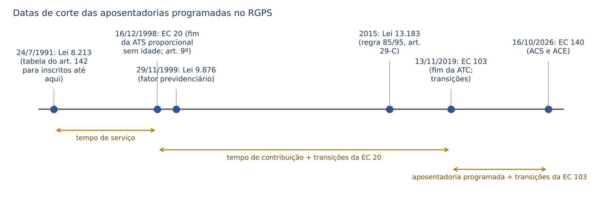
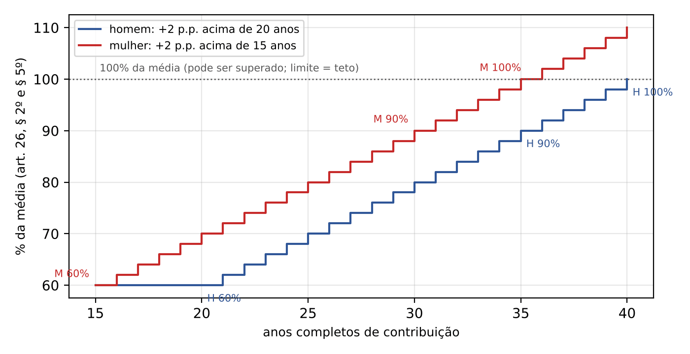
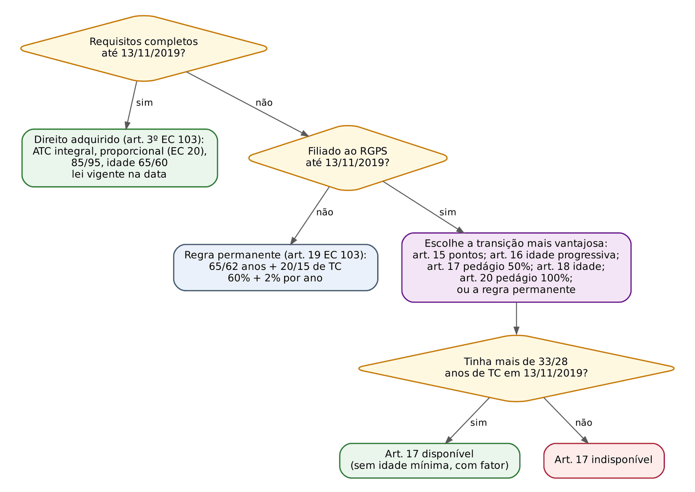
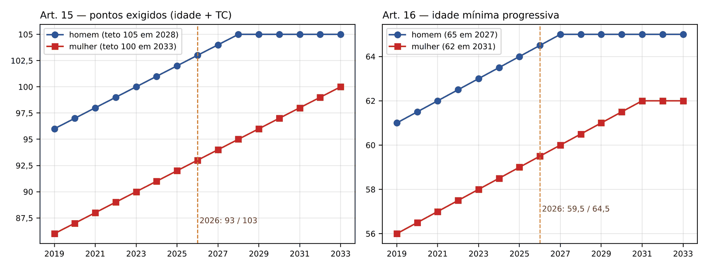
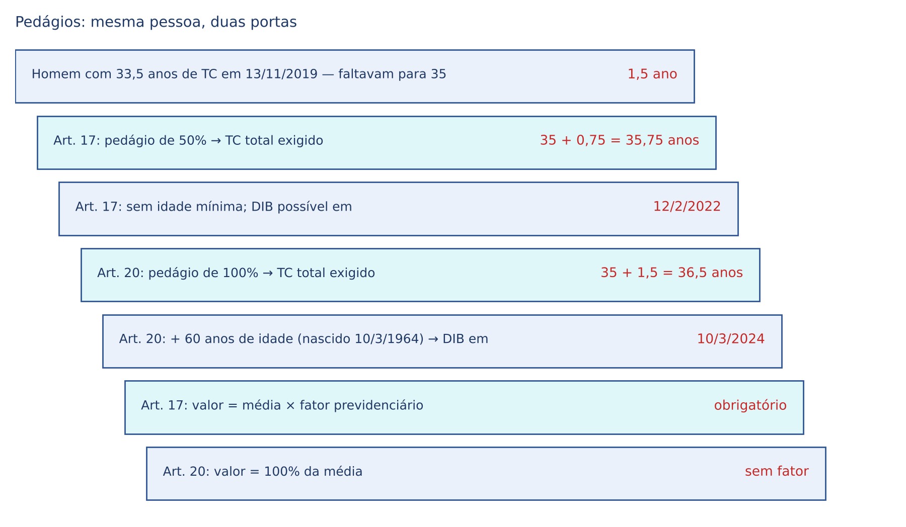
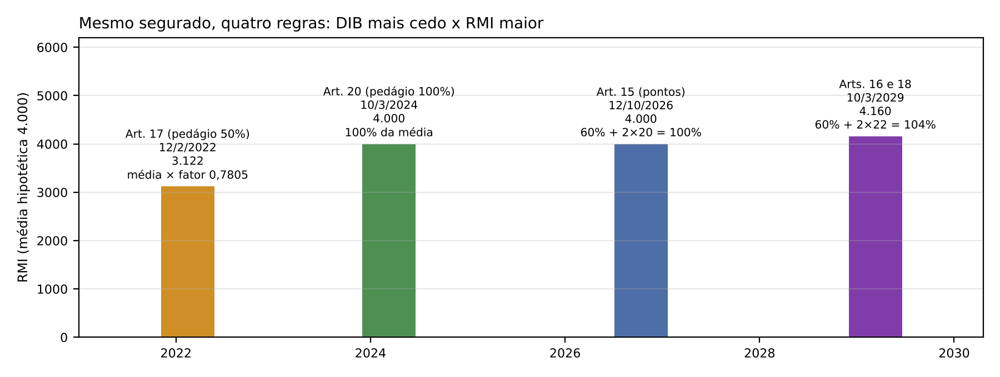
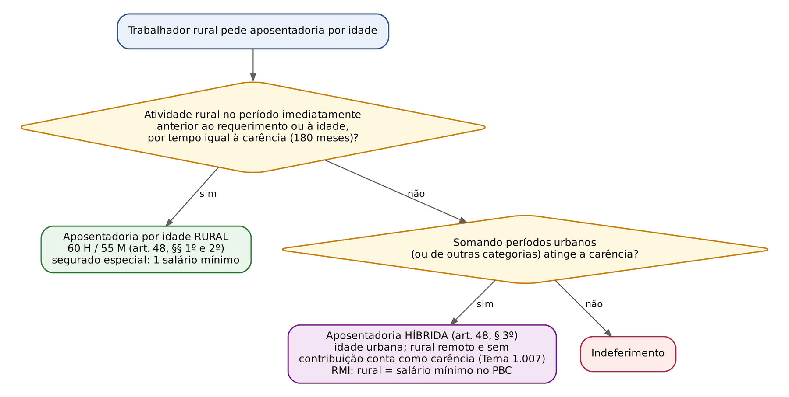

# CAPÍTULO 13 — APOSENTADORIAS PROGRAMADAS NO RGPS: IDADE E TEMPO DE CONTRIBUIÇÃO ANTES DA EC 103/2019, APOSENTADORIA PROGRAMADA, REGRAS DE TRANSIÇÃO, RURAL, HÍBRIDA, PROFESSOR E DIREITO ADQUIRIDO

:::INCIDENCIA
Pontos atendidos: TRF5 p. 8 e 12. Nível A+. Lote: FGV 2, FCC 1 (mais 5 correlatas FGV localizadas por palavra-chave, inclusive 2 da prova de Juiz do TRF5 de 2025).
O que mais cai: requisitos da aposentadoria programada (65/62 anos e 20/15 anos de contribuição), escolha da regra de transição para um segurado concreto, idade rural (60/55), funções de magistério (ADI 3.772 e Tema 965 do STF), desaposentação (Tema 503 do STF) e perda da qualidade de segurado irrelevante na aposentadoria por idade.
:::

## 13.1 Mapa do capítulo e datas de corte

A aposentadoria "programada" é a que decorre de evento previsível (idade, tempo de contribuição ou ambos), em oposição às aposentadorias não programadas (incapacidade permanente, Cap. 15) e às aposentadorias com requisitos diferenciados (especial e da pessoa com deficiência, Cap. 14; registre que a idade mínima da especial, do art. 19, § 1º, I, da EC 103, foi declarada inconstitucional na ADI 6.309, v. Cap. 14). Até a EC 103/2019 o RGPS tinha duas portas autônomas: a aposentadoria por idade (idade + carência, sem tempo mínimo de contribuição além da carência) e a aposentadoria por tempo de contribuição (tempo, sem idade mínima). A EC 103 fundiu as duas numa só, que o Decreto 3.048/1999, com a redação do Decreto 10.410/2020, chama de aposentadoria programada: idade mínima E tempo mínimo de contribuição, cumulativamente. Para quem já estava filiado em 13/11/2019 a emenda criou cinco regras de transição (arts. 15, 16, 17, 18 e 20), e para quem já tinha completado os requisitos até aquela data assegurou o direito adquirido (art. 3º).

O leitor deve fixar a lógica de três camadas, que estrutura qualquer questão ou sentença: (i) o segurado completou os requisitos de alguma aposentadoria até 13/11/2019? Se sim, direito adquirido à regra antiga, com o cálculo da época (13.3); (ii) não completou, mas era filiado em 13/11/2019? Pode escolher entre as transições e a regra permanente, a que for mais vantajosa (13.5 e 13.6); (iii) filiou-se depois de 13/11/2019? Só a regra permanente do art. 19 da EC 103 (13.4).

| Data | Marco | O que muda para este capítulo |
|---|---|---|
| 24/7/1991 | Lei 8.213/1991 | Carência de 180 contribuições (art. 25, II); tabela progressiva do art. 142 para o segurado inscrito na previdência urbana até 24/7/1991 e para o trabalhador e o empregador rural |
| 16/12/1998 | EC 20/1998 | Tempo de serviço vira tempo de contribuição; fim da aposentadoria proporcional sem idade; regra de transição do art. 9º (proporcional com 53/48 anos e pedágio de 40%) |
| 29/11/1999 | Lei 9.876/1999 | Fator previdenciário obrigatório na aposentadoria por tempo de contribuição e opcional na por idade; média dos 80% maiores salários de contribuição (Cap. 11) |
| 2015 | Lei 13.183/2015 | Art. 29-C da Lei 8.213: opção pela não incidência do fator com 85/95 pontos, progressivos |
| 31/12/2018 | Art. 29-C, § 2º, I | Pontuação sobe para 86/96 (última elevação antes da EC 103) |
| 13/11/2019 | EC 103/2019 | Fim da aposentadoria por tempo de contribuição para os novos; aposentadoria programada; transições; revogação do art. 9º da EC 20 |
| 1/1/2020 | Arts. 15, § 1º; 16, § 1º; 18, § 1º | Começam as escaladas anuais (pontos +1; idade +6 meses) |
| 16/10/2026 | EC 140/2026 | Idade reduzida e transições para agentes comunitários de saúde e de combate às endemias (13.9) |

:::ATENCAO
A EC 103/2019 entrou em vigor na data de sua publicação, 13/11/2019 (art. 36, III, da emenda, para as regras do RGPS). Em toda a legislação regulamentar a data de referência para "filiado até" e "direito adquirido até" é 13/11/2019 (Decreto 3.048, arts. 188-H a 188-M). Algumas fontes falam em 12/11/2019 como último dia sob a regra antiga, o que é a mesma coisa vista do outro lado; nas questões, use 13/11/2019.
:::

## 13.2 Carência e tempo de contribuição: as duas contagens que o juiz precisa separar

Antes de entrar nas espécies, uma distinção que derruba muitas sentenças. Carência é o número mínimo de contribuições mensais pagas tempestivamente (conceito e regras de recuperação no Cap. 8); tempo de contribuição é o tempo de filiação com contribuição ou equiparado (Cap. 9), contado de data a data. Os dois números podem divergir: o tempo rural anterior a novembro de 1991 do segurado especial conta como tempo de contribuição, mas não como carência (art. 55, § 2º, da Lei 8.213), salvo na aposentadoria híbrida (Tema 1.007 do STJ, 13.8); o período de benefício por incapacidade intercalado conta como tempo (art. 55, II) e, segundo o STF, também para carência quando intercalado (Cap. 8); contribuições pagas em atraso pelo contribuinte individual contam como tempo, mas não como carência quando anteriores à primeira contribuição sem atraso.

Para as aposentadorias programadas a carência é de 180 contribuições mensais, para ambos os sexos e em todas as espécies (art. 25, II, da Lei 8.213, na redação da Lei 8.870/1994). O tempo de contribuição mínimo é que varia: 15 anos (mulher, e homem filiado antes da EC 103 na transição por idade), 20 anos (homem na regra permanente), 25 anos (professor e ACS/ACE), 30 ou 35 anos (transições que substituem a antiga aposentadoria por tempo de contribuição).

:::LEI Lei 8.213/1991, art. 142 (tabela progressiva de carência)
"Para o segurado inscrito na Previdência Social Urbana até 24 de julho de 1991, bem como para o trabalhador e o empregador rural cobertos pela Previdência Social Rural, a carência das aposentadorias por idade, por tempo de serviço e especial obedecerá à seguinte tabela, levando-se em conta o ano em que o segurado implementou todas as condições necessárias à obtenção do benefício".
| Ano de implementação | Meses exigidos |
|---|---|
| 1991 e 1992 | 60 |
| 1993 | 66 |
| 1994 | 72 |
| 1995 | 78 |
| 1996 | 90 |
| 1997 | 96 |
| 1998 | 102 |
| 1999 | 108 |
| 2000 | 114 |
| 2001 | 120 |
| 2002 a 2010 | de 126 a 174, mais 6 por ano |
| 2011 | 180 |
:::

A tabela do art. 142 hoje só importa em pedidos de direito adquirido e em revisões, pois desde 2011 a carência é 180 meses para todos. A controvérsia clássica era saber qual ano de referência usar quando o segurado completava a idade num ano e a carência só depois. A TNU resolveu pela fixação no ano da idade: "Para efeito de aposentadoria urbana por idade, a tabela progressiva de carência prevista no art. 142 da Lei nº 8.213/91 deve ser aplicada em função do ano em que o segurado completa a idade mínima para concessão do benefício, ainda que o período de carência só seja preenchido posteriormente" (Súmula 44 da TNU). Fundamento: os requisitos não precisam ser simultâneos (ver 13.3.4), e a "carência congelada" no ano da idade evita que cada ano de espera aumente a exigência.

:::EXEMPLO Tabela do art. 142 e Súmula 44 da TNU
Mulher inscrita em 1985, completou 60 anos em 2004 com 120 contribuições; continuou contribuindo e atingiu 138 contribuições em 2007. Pela literalidade do art. 142 ("ano em que implementou todas as condições"), o INSS exigiria a carência de 2007 (156 meses) e ela não teria direito. Pela Súmula 44 da TNU, a carência é a de 2004 (138 meses), atingida em 2007: direito ao benefício desde o requerimento em 2007.
:::

## 13.3 O regime anterior à EC 103/2019 (hoje: direito adquirido e revisões)

O estudo do regime anterior não é arqueologia: (a) quem completou os requisitos até 13/11/2019 pode se aposentar a qualquer tempo pela regra antiga (art. 3º da EC 103); (b) as revisões de benefícios concedidos até 2019 continuam a abarrotar as varas federais; (c) a FGV cobra a comparação "antes x depois".

### 13.3.1 Aposentadoria por tempo de serviço (até 16/12/1998)

Na redação original da Lei 8.213 (arts. 52 e 53), a aposentadoria por tempo de serviço era devida, cumprida a carência, ao segurado com 25 anos de serviço (mulher) ou 30 (homem), com renda de 70% do salário de benefício, mais 6% por ano completo adicional, até 100% aos 30 (mulher) ou 35 anos (homem). Não havia idade mínima. Quem completou 30/25 anos de serviço até 16/12/1998 tem direito adquirido a essa proporcional sem idade, calculada pela legislação de então (art. 3º da EC 20, transcrito abaixo). O salário de benefício, na redação original do art. 29, era a média dos últimos 36 salários de contribuição apurados em período não superior a 48 meses (Cap. 11).

:::LEI EC 20/1998, art. 3º, caput
"É assegurada a concessão de aposentadoria e pensão, a qualquer tempo, aos servidores públicos e aos segurados do regime geral de previdência social, bem como aos seus dependentes, que, até a data da publicação desta Emenda, tenham cumprido os requisitos para a obtenção destes benefícios, com base nos critérios da legislação então vigente."
:::

:::PEGADINHA Os arts. 52 a 56 da Lei 8.213 continuam com a redação original
Os arts. 52 a 56 da Lei 8.213 (tempo de serviço, 25/30 anos, 70% + 6% por ano; professor com 30/25 anos e 100%) nunca foram formalmente reescritos pelo legislador; foram superados pelo art. 201, § 7º, da CF (redação da EC 20 e, depois, da EC 103). A FCC pode transcrever o art. 52 e perguntar se está "em vigor": a resposta segura é que o texto não foi revogado expressamente, mas é inaplicável a quem não tinha direito adquirido em 16/12/1998, e para os demais vale o regime constitucional superveniente.
:::

### 13.3.2 Aposentadoria por tempo de contribuição integral (EC 20 até a EC 103)

Entre 16/12/1998 e 13/11/2019 o art. 201, § 7º, I, da CF assegurava aposentadoria com 35 anos de contribuição (homem) ou 30 (mulher), SEM idade mínima. O valor era 100% do salário de benefício; a partir de 29/11/1999, salário de benefício = média dos 80% maiores salários de contribuição desde julho de 1994 multiplicada pelo fator previdenciário (art. 29, I, da Lei 8.213). Carência de 180 contribuições.

O fator previdenciário (fórmula e cálculo no Cap. 11) combina idade, expectativa de sobrevida e tempo de contribuição: quem se aposenta jovem tem fator menor que 1 e perde renda. Para efeito do fator, somam-se ao tempo de contribuição 5 anos para a mulher, 5 anos para o professor e 10 anos para a professora (art. 29, § 9º).

:::JURIS STF, Tema 616 (RE 639.856/RS, Relator Ministro Gilmar Mendes, Plenário, j. 19/8/2025)
Tese: é constitucional a aplicação do fator previdenciário, instituído pela Lei 9.876/1999, aos benefícios concedidos a segurados filiados ao RGPS antes de 16/12/1998, abrangidos pela regra de transição do art. 9º da EC 20/1998. Afasta a tese de que a transição da EC 20 teria "blindado" esses segurados contra o fator. Na mesma linha, o STF fixou a constitucionalidade geral do fator (Tema 1.091) e sua incidência na aposentadoria do professor (Tema 960; ver 13.10).
:::

#### A opção pela não incidência do fator: regra 85/95 (art. 29-C)

A Lei 13.183/2015 incluiu o art. 29-C: quem preenchia o requisito da aposentadoria por tempo de contribuição podia optar pela não incidência do fator quando a soma idade + tempo de contribuição, "incluídas as frações", atingisse 95 pontos (homem, com mínimo de 35 anos de contribuição) ou 85 (mulher, com mínimo de 30). Os pontos seriam majorados em 1 em 31/12/2018, 31/12/2020, 31/12/2022, 31/12/2024 e 31/12/2026 (§ 2º), até 100/90. Para o professor e a professora com tempo exclusivo de magistério na educação básica, o tempo mínimo é de 30 e 25 anos, e acrescem-se 5 pontos à soma (§ 3º). E o § 4º assegura a pontuação da data em que o requisito foi cumprido, mesmo que o requerimento venha depois.

Na data da EC 103 a pontuação vigente era 96/86 (majorada em 31/12/2018). As majorações de 2020 em diante nunca chegaram a operar como regra de acesso, pois a aposentadoria por tempo de contribuição foi extinta; só importam para quem tinha direito adquirido ao benefício em 13/11/2019 e somava, naquela data, 96/86 pontos (direito adquirido à aposentadoria sem fator).

:::PEGADINHA Pontos do art. 29-C x pontos do art. 15 da EC 103
São institutos diferentes com números parecidos. No art. 29-C (2015), os pontos eram um bônus de cálculo (afastar o fator) para quem JÁ tinha direito à aposentadoria por tempo de contribuição; a pontuação subia de 2 em 2 anos. No art. 15 da EC 103, os pontos são REQUISITO DE ACESSO; sobem 1 por ano desde 1/1/2020, até 105/100; e o valor é 60% + 2% por ano (não 100% sem fator). Para o art. 29-C, frações "em meses completos" (§ 1º); para o art. 15, idade e tempo "apurados em dias" (§ 2º).
:::

### 13.3.3 Aposentadoria proporcional da EC 20/1998 (art. 9º, § 1º)

Para o segurado filiado até 16/12/1998, o art. 9º da EC 20 manteve a aposentadoria proporcional, mas com idade mínima e pedágio. O caput do art. 9º também previa uma transição para a integral (53/48 anos + 35/30 de contribuição + pedágio de 20%), inútil no RGPS porque a regra permanente não exigia idade. O art. 9º inteiro foi revogado pela EC 103 (art. 35, III); hoje vale só como direito adquirido para quem preencheu seus requisitos até 13/11/2019.

:::LEI EC 20/1998, art. 9º, § 1º (revogado pela EC 103/2019)
"O segurado de que trata este artigo, desde que atendido o disposto no inciso I do caput [53 anos de idade, se homem, e 48, se mulher], e observado o disposto no art. 4º desta Emenda, pode aposentar-se com valores proporcionais ao tempo de contribuição, quando atendidas as seguintes condições: I - contar tempo de contribuição igual, no mínimo, à soma de: a) trinta anos, se homem, e vinte e cinco anos, se mulher; e b) um período adicional de contribuição equivalente a quarenta por cento do tempo que, na data da publicação desta Emenda, faltaria para atingir o limite de tempo constante da alínea anterior; II - o valor da aposentadoria proporcional será equivalente a setenta por cento do valor da aposentadoria a que se refere o caput, acrescido de cinco por cento por ano de contribuição que supere a soma a que se refere o inciso anterior, até o limite de cem por cento."
:::

:::EXEMPLO Proporcional da EC 20, em escada
Homem filiado em 1973; em 16/12/1998 tinha 25 anos de contribuição.
- Faltavam para 30 anos: 5 anos.
- Pedágio de 40%: 0,4 × 5 = 2 anos. Tempo exigido: 30 + 2 = 32 anos.
- Idade mínima: 53 anos.
- Suponha que em 2017 ele tinha 55 anos e 34 anos de contribuição.
- Coeficiente: 70% + 5% × (34 − 32) = 80% do valor da aposentadoria integral (salário de benefício com fator, Tema 616 do STF).
- Comparação: com 35 anos ele teria a integral (100% × fator), sem idade mínima. A proporcional só era útil para quem queria se aposentar antes de completar 35/30 anos.
:::

O § 2º do art. 9º dava ao professor que optasse pela integral do caput um acréscimo de 17% (homem) ou 20% (mulher) sobre o tempo de magistério exercido até 16/12/1998, desde que se aposentasse com tempo exclusivo de magistério. Regra também revogada e residual.

### 13.3.4 Aposentadoria por idade urbana (até 13/11/2019)

Requisitos (art. 48, caput, da Lei 8.213, na redação da Lei 9.032/1995): 65 anos (homem) ou 60 (mulher) e carência de 180 contribuições (ou a da tabela do art. 142). Não havia tempo mínimo de contribuição além da carência. Valor (art. 50): 70% do salário de benefício, mais 1% por grupo de 12 contribuições, até 100%; o fator previdenciário era aplicado só se favorável (art. 7º da Lei 9.876/1999; Cap. 11).

:::EXEMPLO RMI da aposentadoria por idade pré-EC 103 (art. 50)
- 180 contribuições: 180 ÷ 12 = 15 grupos; coeficiente 70% + 15% = 85% do salário de benefício.
- 300 contribuições: 25 grupos; 70% + 25% = 95%.
- 360 ou mais contribuições: 70% + 30% = 100% (teto do coeficiente).
- Com salário de benefício de 3.000 e 300 contribuições: RMI = 0,95 × 3.000 = 2.850, respeitado o piso de um salário mínimo.
O tempo rural de segurado especial sem contribuição não serve para elevar esse coeficiente (Súmula 76 da TNU).
:::

Dois pontos de direito material são decisivos e continuam valendo para as transições por idade:

- Desnecessidade de simultaneidade e irrelevância da perda da qualidade de segurado. A Lei 10.666/2003 (art. 3º, § 1º) dispõe que, na aposentadoria por idade, a perda da qualidade de segurado não será considerada, desde que o segurado conte, no mínimo, com o tempo de contribuição correspondente à carência exigida na data do requerimento. A mesma regra está no Estatuto da Pessoa Idosa. Os detalhes e a extensão à aposentadoria por tempo de contribuição e especial (art. 3º, caput, da Lei 10.666) estão no Cap. 8.
- Data de início (art. 49): para o empregado, inclusive o doméstico, a partir do desligamento do emprego, quando requerida até essa data ou até 90 dias depois; ou da data do requerimento, quando não houver desligamento ou quando requerida após 90 dias; para os demais segurados, da data da entrada do requerimento (DER). O art. 54 manda aplicar o mesmo à aposentadoria por tempo de serviço/contribuição, e o Decreto 3.048 reproduz a regra para a aposentadoria programada (art. 52). Não há exigência de desligamento: o aposentado pode continuar trabalhando (diversamente do aposentado especial, Cap. 14).

Q2494903 (FGV, 2024, TJ-MS, Técnico de Nível Superior): cobrou se a perda da qualidade de segurado impede a aposentadoria por idade de quem já tem a carência, gabarito B (não impede, art. 3º, § 1º, da Lei 10.666/2003) — comentada no Cap. 8. A regra continua aplicável à aposentadoria programada e às transições.

### 13.3.5 Aposentadoria compulsória (art. 51)

A aposentadoria por idade "pode ser requerida pela empresa, desde que o segurado empregado tenha cumprido o período de carência e completado 70 (setenta) anos de idade, se do sexo masculino, ou 65 (sessenta e cinco) anos, se do sexo feminino, sendo compulsória, caso em que será garantida ao empregado a indenização prevista na legislação trabalhista, considerada como data da rescisão do contrato de trabalho a imediatamente anterior à do início da aposentadoria" (art. 51). Três notas: (i) é faculdade da empresa, não automatismo; (ii) só alcança o empregado; (iii) não se confunde com a compulsória do servidor (75 anos, art. 40, § 1º, II, da CF; Cap. 23). O dispositivo continua no texto da Lei 8.213, mas o Decreto 3.048, reescrito em 2020, não o disciplina na subseção da aposentadoria programada. Não localizamos precedente sobre sua convivência com as novas idades (65/62); a posição desta apostila é que o art. 51 subsiste, porque não foi revogado nem é incompatível com a EC 103 (a idade de 70/65 é superior à exigida para a aposentadoria programada). Questão de prova: diga apenas o que está no art. 51.

### 13.3.6 Desaposentação e reaposentação

Desaposentação é a renúncia à aposentadoria para obter outra mais vantajosa, somando o tempo anterior e o posterior à primeira; reaposentação é a renúncia para obter nova aposentadoria apenas com o tempo posterior. O STJ chegou a admitir a desaposentação sem devolução de valores (Tema 563 dos repetitivos; Jurisprudência em Teses, ed. 67, tese 13), mas a orientação foi superada pelo STF.

:::JURIS STF, Tema 503 (RE 661.256/SC, Relator Ministro Roberto Barroso, Relator p/ acórdão Ministro Dias Toffoli, Tribunal Pleno, j. 27/10/2016); embargos de declaração (RE 381.367 ED/RS e RE 827.833 ED/SC, Plenário, j. 6/2/2020)
Tese, na redação dada nos embargos: "No âmbito do Regime Geral de Previdência Social - RGPS, somente lei pode criar benefícios e vantagens previdenciárias, não havendo, por ora, previsão legal do direito à desaposentação ou à reaposentação, sendo constitucional a regra do art. 18, § 2º, da Lei nº 8.213/1991". Modulação nos embargos: são irrepetíveis os valores alimentares recebidos de boa-fé por força de decisão judicial até a proclamação do resultado dos embargos (6/2/2020), e ficam preservados os benefícios obtidos por decisão transitada em julgado até essa data.
:::

:::LEI Lei 8.213/1991, art. 18, § 2º
"O aposentado pelo Regime Geral de Previdência Social–RGPS que permanecer em atividade sujeita a este Regime, ou a ele retornar, não fará jus a prestação alguma da Previdência Social em decorrência do exercício dessa atividade, exceto ao salário-família e à reabilitação profissional, quando empregado."
:::

:::QUESTAO FGV 2025 — Prefeitura de Canaã dos Carajás — Procurador Municipal (Q3265491)
Caso: segurada aposentada por tempo de contribuição em 2018 volta a trabalhar com carteira assinada e, após 5 anos, quer "desaposentar-se" para obter benefício maior. Gabarito oficial: B — não é possível a desaposentação, por falta de previsão legal. Armadilhas: (C) "devolução das contribuições" posteriores (não há direito à restituição: a contribuição do aposentado que trabalha decorre da solidariedade do sistema, e o art. 18, § 2º, só lhe garante salário-família e reabilitação); (D) inventa um prazo de 10 anos; (E) sugere que o novo emprego cancelaria a aposentadoria (o aposentado por tempo de contribuição ou por idade pode trabalhar; o óbice existe só na aposentadoria especial, Tema 709 do STF, Cap. 14). Fundamento: Tema 503 do STF.
:::

:::DICA Desaposentação depois da EC 103
A EC 103 não criou a desaposentação. O que existe é diferente: (i) o direito ao melhor benefício entre as regras cujos requisitos o segurado preencheu ANTES de se aposentar (Tema 334 do STF, Cap. 19); (ii) a reafirmação da DER para data posterior ao requerimento, mas anterior à concessão (Tema 995 do STJ, Cap. 19). Nenhum dos dois permite trocar uma aposentadoria já concedida por outra calculada com contribuições posteriores.
:::

## 13.4 A aposentadoria programada (regra permanente após a EC 103/2019)

### 13.4.1 Base constitucional e regra provisória do art. 19

A CF passou a remeter à lei o tempo mínimo de contribuição, fixando apenas as idades.

:::LEI CF, art. 201, §§ 7º e 8º (redação da EC 103/2019)
"§ 7º É assegurada aposentadoria no regime geral de previdência social, nos termos da lei, obedecidas as seguintes condições: I - 65 (sessenta e cinco) anos de idade, se homem, e 62 (sessenta e dois) anos de idade, se mulher, observado tempo mínimo de contribuição; II - 60 (sessenta) anos de idade, se homem, e 55 (cinquenta e cinco) anos de idade, se mulher, para os trabalhadores rurais e para os que exerçam suas atividades em regime de economia familiar, nestes incluídos o produtor rural, o garimpeiro e o pescador artesanal.
§ 8º O requisito de idade a que se refere o inciso I do § 7º será reduzido em 5 (cinco) anos, para o professor que comprove tempo de efetivo exercício das funções de magistério na educação infantil e no ensino fundamental e médio fixado em lei complementar."
:::

Como a lei do tempo mínimo não veio, vale a regra provisória do art. 19 da EC 103, que só se aplica a quem se filiou ao RGPS DEPOIS de 13/11/2019:

:::LEI EC 103/2019, art. 19, caput
"Até que lei disponha sobre o tempo de contribuição a que se refere o inciso I do § 7º do art. 201 da Constituição Federal, o segurado filiado ao Regime Geral de Previdência Social após a data de entrada em vigor desta Emenda Constitucional será aposentado aos 62 (sessenta e dois) anos de idade, se mulher, 65 (sessenta e cinco) anos de idade, se homem, com 15 (quinze) anos de tempo de contribuição, se mulher, e 20 (vinte) anos de tempo de contribuição, se homem."
:::

O Decreto 3.048 (art. 51, redação do Decreto 10.410/2020) reproduz a regra sem a ressalva temporal de filiação, acrescenta a carência e veda o tempo fictício: a aposentadoria programada, "uma vez cumprido o período de carência exigido", é devida ao segurado com 62/65 anos e 15/20 anos de tempo de contribuição; "é vedada a inclusão de tempo fictício" (§ 1º); o período de contribuição pelo plano simplificado (art. 199-A do Decreto; alíquota reduzida do contribuinte individual e do facultativo) conta como tempo de contribuição, com a restrição do § 2º daquele artigo (§ 2º do art. 51). A vedação de tempo fictício também está na CF (art. 201, § 14; Cap. 9).

:::QUESTAO FGV 2024 — DATAPREV — Médico do Trabalho (Q3086138)
Perguntou-se qual aposentadoria o Decreto 3.048, com a redação do Decreto 10.410/2020, concede ao homem que, cumprida a carência, tem 65 anos de idade e 20 de tempo de contribuição, vedada a inclusão de tempo fictício. Gabarito oficial: B — aposentadoria programada. Armadilhas: "especial" (exige exposição a agente nocivo, Cap. 14), "compulsória" (70/65 a requerimento da empresa, art. 51 da Lei 8.213), "por invalidez permanente" (incapacidade, Cap. 15) e "por idade do trabalhador rural" (60/55). Fundamento: art. 51 do Decreto 3.048 e art. 19 da EC 103.
:::

### 13.4.2 Ficha da aposentadoria programada

| Item | Regra |
|---|---|
| Segurados | Todos os segurados do RGPS filiados após 13/11/2019 (para os filiados antes, é uma das opções, ao lado das transições); excluídos os que contribuem pelo plano simplificado sem complementar, quanto a esse período (art. 18, § 3º, e art. 55, § 4º, da Lei 8.213) |
| Carência | 180 contribuições mensais (art. 25, II, da Lei 8.213; caput do art. 51 do Decreto) |
| Idade | 65 anos (homem) e 62 anos (mulher) (art. 201, § 7º, I, da CF) |
| Tempo de contribuição | 20 anos (homem) e 15 anos (mulher) (art. 19 da EC 103) |
| Salário de benefício | Média aritmética simples de 100% dos salários de contribuição desde julho de 1994 (art. 26, caput, da EC 103), limitada ao teto; possibilidade de descarte de contribuições que reduzam a média, mantido o tempo mínimo (art. 26, § 6º) — Cap. 11 |
| RMI | 60% da média + 2 pontos percentuais por ano de contribuição que exceder 20 anos (homem) ou 15 anos (mulher) (art. 26, §§ 2º, IV, e 5º; Decreto, art. 53); piso de um salário mínimo; não há teto de 100% do coeficiente, mas a RMI se limita ao teto do RGPS |
| DIB | Art. 49 da Lei 8.213 e art. 52 do Decreto (empregado: desligamento, se requerida até 90 dias; demais: DER) |
| Cessação | Morte; irrenunciável para fins de desaposentação (Tema 503 do STF) |
| Acumulação | Vedada com outra aposentadoria do RGPS e com auxílio por incapacidade temporária; admitida com pensão por morte, com redução escalonada (art. 24 da EC 103; Cap. 12) |
| Fundamento | CF, art. 201, § 7º, I; EC 103, arts. 19 e 26; Lei 8.213, arts. 25, 48 a 50; Decreto 3.048, arts. 51 a 53 |

### 13.4.3 O coeficiente de 60% + 2%: como contar

Conta-se o ano COMPLETO de contribuição que excede o marco (20 ou 15 anos). Frações não geram acréscimo proporcional. Fórmula prática: coeficiente = 60% + 2% × (anos completos − 20) para o homem; 60% + 2% × (anos completos − 15) para a mulher, com mínimo de 60%.

| Tempo de contribuição (anos completos) | Homem | Mulher |
|---|---|---|
| 15 | 60% (só nas transições do art. 18; na regra permanente o homem precisa de 20) | 60% |
| 20 | 60% | 70% |
| 25 | 70% | 80% |
| 30 | 80% | 90% |
| 35 | 90% | 100% |
| 40 | 100% | 110% |

:::PEGADINHA O coeficiente pode passar de 100%
Ao contrário do art. 50 da Lei 8.213 (limite de 100% do salário de benefício), o art. 26, § 2º, da EC 103 não limita o coeficiente: homem com 42 anos completos recebe 60% + 2% × 22 = 104% da média; mulher com 40 anos recebe 110%. O limite é o teto do salário de benefício e da renda (art. 26, § 1º; art. 29, § 2º, da Lei 8.213). Em prova, a afirmação "o valor da aposentadoria programada nunca supera a média" é FALSA.
:::

:::EXEMPLO RMI da aposentadoria programada em escada
Mulher filiada em 2020 (portanto, regra permanente), 62 anos de idade, 23 anos e 7 meses de contribuição, média de 100% dos salários de contribuição = 2.800.
- Anos completos: 23. Excedente sobre 15: 8 anos.
- Coeficiente: 60% + 2% × 8 = 76%.
- RMI: 0,76 × 2.800 = 2.128 (acima do salário mínimo; abaixo do teto).
- Os 7 meses não geram acréscimo; se ela trabalhar mais 5 meses, chega a 24 anos e 78% (2.184).
:::

### 13.4.4 Homem filiado antes da EC 103 com 15 a 19 anos de contribuição

O art. 19 exige 20 anos só do homem filiado DEPOIS de 13/11/2019. O homem filiado antes pode usar a transição por idade do art. 18 com apenas 15 anos de contribuição (13.5.4). O coeficiente, porém, só cresce a partir de 20 anos (art. 26, § 2º, I, que se refere ao "§ 2º do art. 18", combinado com o § 5º, que restringe o marco de 15 anos às mulheres): com 15 a 20 anos, recebe 60% da média. O Decreto 3.048 consolidou exatamente isso no art. 188-H, § 3º.

## 13.5 As regras de transição do RGPS (arts. 15 a 18 e 20 da EC 103) em fichas

Requisito comum a todas: filiação ao RGPS até 13/11/2019 (inclusive com perda posterior da qualidade de segurado — a regra fala em "filiado", não em "segurado na data"). Todas exigem a carência de 180 contribuições (expressa no Decreto 3.048, arts. 188-H a 188-L). O segurado pode escolher a mais vantajosa, inclusive a regra permanente; o INSS deve orientá-lo (Cap. 19).

### 13.5.1 Art. 15: sistema de pontos (idade + tempo de contribuição)

:::LEI EC 103/2019, art. 15
"Ao segurado filiado ao Regime Geral de Previdência Social até a data de entrada em vigor desta Emenda Constitucional, fica assegurado o direito à aposentadoria quando forem preenchidos, cumulativamente, os seguintes requisitos: I - 30 (trinta) anos de contribuição, se mulher, e 35 (trinta e cinco) anos de contribuição, se homem; e II - somatório da idade e do tempo de contribuição, incluídas as frações, equivalente a 86 (oitenta e seis) pontos, se mulher, e 96 (noventa e seis) pontos, se homem, observado o disposto nos §§ 1º e 2º.
§ 1º A partir de 1º de janeiro de 2020, a pontuação a que se refere o inciso II do caput será acrescida a cada ano de 1 (um) ponto, até atingir o limite de 100 (cem) pontos, se mulher, e de 105 (cento e cinco) pontos, se homem.
§ 2º A idade e o tempo de contribuição serão apurados em dias para o cálculo do somatório de pontos a que se referem o inciso II do caput e o § 1º.
§ 3º Para o professor que comprovar exclusivamente 25 (vinte e cinco) anos de contribuição, se mulher, e 30 (trinta) anos de contribuição, se homem, em efetivo exercício das funções de magistério na educação infantil e no ensino fundamental e médio, o somatório da idade e do tempo de contribuição, incluídas as frações, será equivalente a 81 (oitenta e um) pontos, se mulher, e 91 (noventa e um) pontos, se homem, aos quais serão acrescidos, a partir de 1º de janeiro de 2020, 1 (um) ponto a cada ano para o homem e para a mulher, até atingir o limite de 92 (noventa e dois) pontos, se mulher, e 100 (cem) pontos, se homem.
§ 4º O valor da aposentadoria concedida nos termos do disposto neste artigo será apurado na forma da lei."
:::

| Ficha — art. 15 | |
|---|---|
| Quem pode usar | Filiado ao RGPS até 13/11/2019 |
| Requisitos | 35/30 anos de contribuição (professor: 30/25 exclusivos de magistério na educação básica) + pontos (idade + TC, em dias) da tabela do ano em que se completam |
| Idade mínima | Nenhuma autônoma (a idade está embutida nos pontos) |
| Cálculo | 60% + 2% por ano acima de 20 (homem) ou 15 (mulher) — art. 26, § 2º, I, e § 5º |
| Fundamento | EC 103, art. 15; Decreto 3.048, arts. 188-I e 188-M (professor) |

### 13.5.2 Art. 16: tempo de contribuição + idade mínima progressiva

:::LEI EC 103/2019, art. 16
"Ao segurado filiado ao Regime Geral de Previdência Social até a data de entrada em vigor desta Emenda Constitucional fica assegurado o direito à aposentadoria quando preencher, cumulativamente, os seguintes requisitos: I - 30 (trinta) anos de contribuição, se mulher, e 35 (trinta e cinco) anos de contribuição, se homem; e II - idade de 56 (cinquenta e seis) anos, se mulher, e 61 (sessenta e um) anos, se homem.
§ 1º A partir de 1º de janeiro de 2020, a idade a que se refere o inciso II do caput será acrescida de 6 (seis) meses a cada ano, até atingir 62 (sessenta e dois) anos de idade, se mulher, e 65 (sessenta e cinco) anos de idade, se homem.
§ 2º Para o professor que comprovar exclusivamente tempo de efetivo exercício das funções de magistério na educação infantil e no ensino fundamental e médio, o tempo de contribuição e a idade de que tratam os incisos I e II do caput deste artigo serão reduzidos em 5 (cinco) anos, sendo, a partir de 1º de janeiro de 2020, acrescidos 6 (seis) meses, a cada ano, às idades previstas no inciso II do caput, até atingirem 57 (cinquenta e sete) anos, se mulher, e 60 (sessenta) anos, se homem.
§ 3º O valor da aposentadoria concedida nos termos do disposto neste artigo será apurado na forma da lei."
:::

| Ficha — art. 16 | |
|---|---|
| Quem pode usar | Filiado ao RGPS até 13/11/2019 |
| Requisitos | 35/30 anos de contribuição + idade mínima do ano (61/56 em 2019, + 6 meses por ano); professor: 30/25 anos de magistério + 56/51 em 2019, + 6 meses por ano até 60/57 |
| Cálculo | 60% + 2% por ano acima de 20 (homem) ou 15 (mulher) |
| Fundamento | EC 103, art. 16; Decreto 3.048, art. 188-J (e art. 188-N para o professor: 51/56 anos em 2019, + 6 meses por ano até 57/60, com 25/30 anos de magistério) |

### 13.5.3 Tabela ano a ano dos arts. 15 e 16 (conferida em Python)

| Ano | Pontos mulher (art. 15) | Pontos homem (art. 15) | Pontos professora (§ 3º) | Pontos professor (§ 3º) | Idade mulher (art. 16) | Idade homem (art. 16) | Idade professora (§ 2º) | Idade professor (§ 2º) |
|---|---|---|---|---|---|---|---|---|
| 2019 | 86 | 96 | 81 | 91 | 56 | 61 | 51 | 56 |
| 2020 | 87 | 97 | 82 | 92 | 56,5 | 61,5 | 51,5 | 56,5 |
| 2021 | 88 | 98 | 83 | 93 | 57 | 62 | 52 | 57 |
| 2022 | 89 | 99 | 84 | 94 | 57,5 | 62,5 | 52,5 | 57,5 |
| 2023 | 90 | 100 | 85 | 95 | 58 | 63 | 53 | 58 |
| 2024 | 91 | 101 | 86 | 96 | 58,5 | 63,5 | 53,5 | 58,5 |
| 2025 | 92 | 102 | 87 | 97 | 59 | 64 | 54 | 59 |
| 2026 | 93 | 103 | 88 | 98 | 59,5 | 64,5 | 54,5 | 59,5 |
| 2027 | 94 | 104 | 89 | 99 | 60 | 65 (fim) | 55 | 60 (fim) |
| 2028 | 95 | 105 (fim) | 90 | 100 (fim) | 60,5 | 65 | 55,5 | 60 |
| 2029 | 96 | 105 | 91 | 100 | 61 | 65 | 56 | 60 |
| 2030 | 97 | 105 | 92 (fim) | 100 | 61,5 | 65 | 56,5 | 60 |
| 2031 | 98 | 105 | 92 | 100 | 62 (fim) | 65 | 57 (fim) | 60 |
| 2032 | 99 | 105 | 92 | 100 | 62 | 65 | 57 | 60 |
| 2033 | 100 (fim) | 105 | 92 | 100 | 62 | 65 | 57 | 60 |

:::DICA Regra mnemônica para 2026 (ano da prova)
Pontos: 93/103 (somar 7 aos números de 2019). Idade progressiva: 59,5/64,5 (somar 3,5 anos). Professor: 88/98 pontos e 54,5/59,5 anos. As escaladas terminam: idade do homem em 2027 (65); pontos do homem em 2028 (105); pontos do professor em 2028 (100) e da professora em 2030 (92); idade da mulher em 2031 (62) e da professora em 2031 (57); pontos da mulher em 2033 (100).
:::

:::PEGADINHA "Em dias" e "a partir de 1º de janeiro"
(i) O acréscimo é anual e ocorre em 1º de janeiro, não no aniversário da EC (13 de novembro). (ii) Pontos e idade apuram-se em dias: quem tem 62 anos e 4 meses e 34 anos e 9 meses soma 97,08 pontos, não 96. (iii) Os pontos exigidos são os do ano em que o segurado completa os requisitos, não os do ano do requerimento: quem atingiu 96 pontos em dezembro de 2019 e requereu em 2021 tem direito à regra (posição desta apostila, sem precedente localizado: direito adquirido à transição, por analogia ao art. 3º e à lógica do art. 29-C, § 4º). (iv) Atingir os pontos sem os 35/30 anos de contribuição não basta: requisitos cumulativos.
:::

### 13.5.4 Art. 18: transição da aposentadoria por idade

:::LEI EC 103/2019, art. 18
"O segurado de que trata o inciso I do § 7º do art. 201 da Constituição Federal filiado ao Regime Geral de Previdência Social até a data de entrada em vigor desta Emenda Constitucional poderá aposentar-se quando preencher, cumulativamente, os seguintes requisitos: I - 60 (sessenta) anos de idade, se mulher, e 65 (sessenta e cinco) anos de idade, se homem; e II - 15 (quinze) anos de contribuição, para ambos os sexos.
§ 1º A partir de 1º de janeiro de 2020, a idade de 60 (sessenta) anos da mulher, prevista no inciso I do caput, será acrescida em 6 (seis) meses a cada ano, até atingir 62 (sessenta e dois) anos de idade.
§ 2º O valor da aposentadoria de que trata este artigo será apurado na forma da lei."
:::

| Ano | Idade da mulher (art. 18) | Homem |
|---|---|---|
| 2019 | 60 | 65 |
| 2020 | 60,5 | 65 |
| 2021 | 61 | 65 |
| 2022 | 61,5 | 65 |
| 2023 em diante | 62 | 65 |

| Ficha — art. 18 | |
|---|---|
| Quem pode usar | Segurado urbano (o do art. 201, § 7º, I) filiado até 13/11/2019 |
| Requisitos | Idade (mulher 60 + 6 meses/ano até 62 em 2023; homem 65) + 15 anos de contribuição para ambos + carência de 180 |
| Cálculo | 60% + 2% por ano acima de 20 (homem) ou 15 (mulher) — Decreto, art. 188-H, § 3º |
| Utilidade prática hoje | Para a mulher, desde 2023 coincide com a regra permanente; continua útil para o HOMEM com 15 a 19 anos de contribuição (regra permanente exige 20) |
| Fundamento | EC 103, art. 18; Decreto 3.048, art. 188-H |

Q3373848 (FGV, 2025, TRF-5, Juiz Federal Substituto): cobrou o enquadramento da trabalhadora rural em regime de economia familiar que pede aposentadoria por idade, gabarito E (segurada especial, apta a aposentar-se nessa condição) — comentada no Cap. 7. Para este capítulo, a armadilha é a alternativa B, que exigia 62 anos e 15 anos de recolhimento: confunde a regra urbana (art. 201, § 7º, I) com a rural (55 anos para a mulher, inciso II) e ignora que a segurada especial comprova atividade, não recolhimentos (13.7).

### 13.5.5 Art. 17: pedágio de 50% (sem idade mínima, com fator previdenciário)

:::LEI EC 103/2019, art. 17
"Ao segurado filiado ao Regime Geral de Previdência Social até a data de entrada em vigor desta Emenda Constitucional e que na referida data contar com mais de 28 (vinte e oito) anos de contribuição, se mulher, e 33 (trinta e três) anos de contribuição, se homem, fica assegurado o direito à aposentadoria quando preencher, cumulativamente, os seguintes requisitos: I - 30 (trinta) anos de contribuição, se mulher, e 35 (trinta e cinco) anos de contribuição, se homem; e II - cumprimento de período adicional correspondente a 50% (cinquenta por cento) do tempo que, na data de entrada em vigor desta Emenda Constitucional, faltaria para atingir 30 (trinta) anos de contribuição, se mulher, e 35 (trinta e cinco) anos de contribuição, se homem.
Parágrafo único. O benefício concedido nos termos deste artigo terá seu valor apurado de acordo com a média aritmética simples dos salários de contribuição e das remunerações calculada na forma da lei, multiplicada pelo fator previdenciário, calculado na forma do disposto nos §§ 7º a 9º do art. 29 da Lei nº 8.213, de 24 de julho de 1991."
:::

| Ficha — art. 17 | |
|---|---|
| Quem pode usar | Filiado até 13/11/2019 com MAIS de 33 anos (homem) ou MAIS de 28 anos (mulher) de contribuição naquela data — ou seja, a quem faltavam menos de 2 anos |
| Requisitos | 35/30 anos + pedágio de 50% do que faltava em 13/11/2019; sem idade mínima; carência de 180 |
| Cálculo | 100% da média × fator previdenciário (obrigatório; não se aplica o art. 29-C — Decreto, art. 188-K, § 3º); a média é a do art. 26 (100% dos salários desde 7/1994) |
| Professor | NÃO há redução de tempo nesta regra; mas o bônus de 5/10 anos no fator (art. 29, § 9º, II e III) se aplica, porque o parágrafo único remete aos §§ 7º a 9º |
| Fundamento | EC 103, art. 17; Decreto 3.048, art. 188-K |

### 13.5.6 Art. 20: pedágio de 100% + idade mínima (100% da média)

:::LEI EC 103/2019, art. 20, caput e §§ 1º e 2º
"O segurado ou o servidor público federal que se tenha filiado ao Regime Geral de Previdência Social ou ingressado no serviço público em cargo efetivo até a data de entrada em vigor desta Emenda Constitucional poderá aposentar-se voluntariamente quando preencher, cumulativamente, os seguintes requisitos: I - 57 (cinquenta e sete) anos de idade, se mulher, e 60 (sessenta) anos de idade, se homem; II - 30 (trinta) anos de contribuição, se mulher, e 35 (trinta e cinco) anos de contribuição, se homem; III - para os servidores públicos, 20 (vinte) anos de efetivo exercício no serviço público e 5 (cinco) anos no cargo efetivo em que se der a aposentadoria; IV - período adicional de contribuição correspondente ao tempo que, na data de entrada em vigor desta Emenda Constitucional, faltaria para atingir o tempo mínimo de contribuição referido no inciso II.
§ 1º Para o professor que comprovar exclusivamente tempo de efetivo exercício das funções de magistério na educação infantil e no ensino fundamental e médio serão reduzidos, para ambos os sexos, os requisitos de idade e de tempo de contribuição em 5 (cinco) anos.
§ 2º O valor das aposentadorias concedidas nos termos do disposto neste artigo corresponderá: [...] II - em relação aos demais servidores públicos e aos segurados do Regime Geral de Previdência Social, ao valor apurado na forma da lei."
:::

O art. 26, § 3º, I, da EC 103 fixa que, "no caso do inciso II do § 2º do art. 20", o valor é 100% da média. Daí a atratividade da regra: coeficiente integral, sem fator, desde que o segurado tenha 60/57 anos.

| Ficha — art. 20 (RGPS) | |
|---|---|
| Quem pode usar | Qualquer filiado ao RGPS até 13/11/2019 (não há tempo mínimo na data da EC, ao contrário do art. 17) |
| Requisitos | 60/57 anos + 35/30 anos de contribuição + pedágio de 100% do que faltava em 13/11/2019 + carência |
| Professor | 55/52 anos + 30/25 anos de magistério exclusivo na educação básica + pedágio de 100% do que faltava, em 13/11/2019, para 30/25 anos (§ 1º; Decreto, art. 188-O, III, que adota expressamente o tempo reduzido) |
| Cálculo | 100% da média do art. 26 (art. 26, § 3º, I); sem fator |
| Fundamento | EC 103, art. 20; art. 26, § 3º, I; Decreto 3.048, arts. 188-L e 188-O (professor) |
| Interface | O mesmo art. 20 é transição dos servidores federais (incisos III e § 2º, I: integralidade para ingressos até 31/12/2003) — Cap. 23 |

:::PEGADINHA Pedágio 50% x pedágio 100%
| | Art. 17 (50%) | Art. 20 (100%) |
|---|---|---|
| Recorte na data da EC | Só quem tinha mais de 33/28 anos de TC | Qualquer filiado |
| Idade mínima | Não há | 60/57 (professor 55/52) |
| Base do pedágio | O que faltava para 35/30 em 13/11/2019 | O que faltava para 35/30 (professor, 30/25) em 13/11/2019 |
| Valor | Média × fator previdenciário | 100% da média, sem fator |
| Professor | Sem redução (só bônus no fator) | Redução de 5 anos em idade e tempo |
| Servidor público | Não se aplica (só RGPS) | Aplica-se também ao servidor federal (Cap. 23) |
:::

## 13.6 Escolhendo a regra: roteiro, comparação e sentença

### 13.6.1 Roteiro de análise

:::PASSO Qual aposentadoria programada para o segurado filiado até 13/11/2019?
1. Levante no CNIS (e prove o que falta, Cap. 9): data de nascimento, tempo de contribuição em 13/11/2019 (em dias), carência, períodos de magistério na educação básica, períodos rurais e especiais (a conversão de especial em comum só vale até 13/11/2019, Cap. 10).
2. Verifique direito adquirido em 13/11/2019: ATC integral (35/30), proporcional da EC 20 (53/48 + pedágio de 40%), opção 96/86 pontos sem fator, idade (65/60 + carência). Se houver, calcule pela lei da época (art. 3º, § 2º, da EC 103).
3. Calcule, para a DER (ou para datas posteriores, se cabível a reafirmação), o cumprimento de cada transição: art. 15 (pontos do ano), art. 16 (idade do ano), art. 17 (só se tinha mais de 33/28 anos em 13/11/2019), art. 18 (65/62 + 15 anos), art. 20 (60/57 + pedágio de 100%), e a regra permanente.
4. Para cada regra cumprida, apure a RMI: arts. 15, 16 e 18: 60% + 2% (marco 20 ou 15); art. 17: média × fator; art. 20: 100% da média; direito adquirido: regra antiga.
5. Conceda a mais vantajosa (Tema 334 do STF; dever de orientação do INSS, Cap. 19), observando a data a partir da qual cada uma é devida (o atrasado também conta: uma RMI menor com DIB anterior pode ser preferida pelo segurado; a escolha é dele).
:::

### 13.6.2 Um mesmo segurado em todas as regras

:::EXEMPLO Comparação das transições para um segurado (números conferidos em Python)
Dados: homem nascido em 10/3/1964; em 13/11/2019, 33 anos e 6 meses de contribuição (33,5 anos); continua contribuindo sem interrupção; média dos salários de contribuição (art. 26) = 4.000, hipotética e constante; não é professor nem tem tempo especial.
Direito adquirido em 13/11/2019? Não: tinha 55 anos e 33,5 de TC (faltavam 1,5 ano para 35).
Art. 17 (pedágio de 50%): ele tinha MAIS de 33 anos em 13/11/2019, logo pode usar.
- Faltavam 1,5 ano; pedágio = 0,75 ano; TC exigido = 35,75 anos.
- Atinge 35,75 anos 2,25 anos depois de 13/11/2019: 12/2/2022, com 57 anos e 11 meses.
- Valor = 4.000 × fator. Com expectativa de sobrevida hipotética de 24 anos (o valor real vem da tábua do IBGE do ano da DIB), fator = (35,75 × 0,31 ÷ 24) × [1 + (57,93 + 35,75 × 0,31) ÷ 100] = 0,7805. RMI = 3.122.
Art. 20 (pedágio de 100%):
- TC exigido = 35 + 1,5 = 36,5 anos, atingidos em 13/11/2022.
- Idade de 60 anos: 10/3/2024. Requisitos cumpridos em 10/3/2024 (quando terá 37,8 anos de TC).
- Valor = 100% × 4.000 = 4.000.
Art. 15 (pontos): ele ganha 2 pontos por ano (1 de idade, 1 de tempo), enquanto a exigência sobe 1 por ano.
- Em 13/11/2019 somava 55,68 + 33,5 = 89,2 pontos; precisava de 96.
- Alcança a pontuação do ano em 12/10/2026: 62,59 anos + 40,41 anos = 103,0 pontos (exigência de 2026: 103).
- Valor: 40 anos completos → 60% + 2% × 20 = 100% → 4.000.
Art. 16 (idade progressiva): idade exigida corre 6 meses por ano à frente dele até o teto de 65; só se cumpre em 10/3/2029 (65 anos), com 42,8 anos de TC.
Art. 18 e regra de idade: também 10/3/2029 (65 anos).
- Valor: 42 anos completos → 60% + 2% × 22 = 104% → 4.160.
Conclusão: a escolha é entre antecipar (art. 17, DIB em 2022, RMI de 3.122) e esperar 2 anos (art. 20, 4.000 em 2024). A diferença mensal de 878 só compensa os 25 meses de renda "perdida" (25 × 3.122 = 78.050) após cerca de 89 meses (78.050 ÷ 878), sem contar abono anual e reajustes. Os arts. 15, 16 e 18 são dominados pelo art. 20 neste caso.
:::

:::PRATIQUE Exercício elaborado para esta apostila (não é questão de banca)
Professora da educação básica, nascida em 5/6/1971, com 24 anos de magistério exclusivo em 13/11/2019, contribuição contínua. Em que ano cumpre (a) o art. 15, § 3º, e (b) o art. 20, § 1º?
Resolução: (a) Precisa de 25 anos de magistério (atinge em 13/11/2020) e dos pontos do ano. Em 13/11/2019 somava 48,44 + 24 = 72,4 pontos; ganha 2 pontos por ano contra 1 de aumento da exigência, que vai de 81 (2019) a 92 (2030). Fechando a conta em dias: alcança 90 pontos (exigência de 2028) em 24/8/2028, com 57,22 anos de idade e 32,78 de contribuição. (b) Faltava 1 ano para 25; pedágio de 1 ano; TC exigido 26 anos (13/11/2021); idade de 52 anos em 5/6/2023. Cumpre o art. 20 em 5/6/2023, com 100% da média, mais de cinco anos antes do art. 15. Moral: para professoras próximas do tempo em 2019, o pedágio de 100% costuma vencer.
:::

### 13.6.3 A sentença de concessão

:::SENTENCA Aposentadoria programada ou de transição concedida em juízo
"Ante o exposto, JULGO PROCEDENTE o pedido para condenar o INSS a: (a) averbar os períodos de [ ] a [ ] como tempo de contribuição [e de magistério na educação básica]; (b) conceder ao autor aposentadoria com fundamento no art. [20] da EC 103/2019, desde a DER (dd/mm/aaaa) [ou: desde dd/mm/aaaa, data em que implementados os requisitos, por reafirmação da DER — Tema 995 do STJ], com RMI de [100%] da média do art. 26 da EC 103/2019, assegurado o cálculo pela regra mais vantajosa entre as que o autor preenche na DIB (Tema 334 do STF); (c) pagar as parcelas vencidas desde a DIB, observada a prescrição quinquenal, com correção monetária e juros na forma do Cap. 20 (Selic a partir de 9/12/2021, EC 113/2021). DIP: [primeiro dia do mês da implantação]. Honorários de [ ]% sobre as parcelas vencidas até a sentença (Súmula 111 do STJ). Tutela de urgência deferida para implantação em [ ] dias."
Notas: a DIB segue o art. 49 (empregado desligado: data do desligamento se requerida em até 90 dias). Na reafirmação da DER para data posterior ao ajuizamento, a jurisprudência do STJ afasta juros de mora até o 45º dia da intimação para implantar e honorários se o INSS não se opôs (detalhes no Cap. 19).
:::

## 13.7 Aposentadoria por idade do trabalhador rural

### 13.7.1 Requisitos e quem é "trabalhador rural" para este fim

A EC 103 preservou a idade reduzida (art. 201, § 7º, II): 60 anos (homem) e 55 (mulher) "para os trabalhadores rurais e para os que exerçam suas atividades em regime de economia familiar, nestes incluídos o produtor rural, o garimpeiro e o pescador artesanal". Não há tempo mínimo de contribuição além da carência, e não houve regra de transição para o rural, porque nada mudou.

:::LEI Lei 8.213/1991, art. 48, §§ 1º e 2º
"§ 1º Os limites fixados no caput são reduzidos para sessenta e cinqüenta e cinco anos no caso de trabalhadores rurais, respectivamente homens e mulheres, referidos na alínea a do inciso I, na alínea g do inciso V e nos incisos VI e VII do art. 11.
§ 2º Para os efeitos do disposto no § 1º deste artigo, o trabalhador rural deve comprovar o efetivo exercício de atividade rural, ainda que de forma descontínua, no período imediatamente anterior ao requerimento do benefício, por tempo igual ao número de meses de contribuição correspondente à carência do benefício pretendido, computado o período a que se referem os incisos III a VIII do § 9º do art. 11 desta Lei."
:::

Beneficiários da idade reduzida: empregado rural (art. 11, I, a), contribuinte individual rural (art. 11, V, g), avulso rural (VI) e segurado especial (VII); o Decreto 3.048 (art. 56) inclui expressamente o garimpeiro em regime de economia familiar. O conceito de segurado especial (área de até 4 módulos fiscais, regime de economia familiar, vedação de mão de obra permanente, atividades e rendas que não descaracterizam) está no Cap. 7.

:::QUESTAO FGV 2025 — CNU — Bloco Temático 6 (Q3644119)
Afirmações sobre o RGPS na CF. Gabarito oficial: C — nenhum benefício que substitua o salário de contribuição ou o rendimento do trabalho terá valor inferior ao salário mínimo (art. 201, § 2º). Armadilhas deste capítulo: (E) idades rurais de 55/50 (o correto é 60 homem e 55 mulher); (D) "professores não podem mais se aposentar com tempo menor" (falso: art. 201, § 8º, mantém a redução de 5 anos na idade). As demais erram a cobertura do desemprego involuntário e a filiação "facultativa" (é obrigatória).
:::

### 13.7.2 A "carência" do segurado especial e a contemporaneidade

O segurado especial não comprova contribuições, mas atividade rural pelo número de meses da carência (180), "no período imediatamente anterior ao requerimento" (art. 48, § 2º; art. 39, I). A jurisprudência flexibilizou a literalidade em duas direções:

- Marco alternativo: "Para a concessão de aposentadoria por idade de trabalhador rural, o tempo de exercício de atividade equivalente à carência deve ser aferido no período imediatamente anterior ao requerimento administrativo ou à data do implemento da idade mínima" (Súmula 54 da TNU). O Decreto 3.048 incorporou a alternativa ("ou, conforme o caso, ao mês em que tiver cumprido o requisito etário", art. 56, § 1º).
- Descontinuidade e atividade urbana intercalada: "O exercício de atividade urbana intercalada não impede a concessão de benefício previdenciário de trabalhador rural, condição que deve ser analisada no caso concreto" (Súmula 46 da TNU); o trabalho urbano de um integrante do grupo familiar não descaracteriza, por si só, os demais (Súmula 41 da TNU). A prova (início de prova material, Súmula 149 do STJ, Súmula 577 do STJ e Súmula 14 da TNU, que dispensa prova material de todo o período) está no Cap. 9.

:::JURIS STJ, Tema 642 (REsp 1.354.908/SP, Relator Ministro Mauro Campbell Marques, Primeira Seção, j. 9/9/2015)
O segurado especial tem que estar laborando no campo quando completar a idade mínima para se aposentar por idade rural, momento em que poderá requerer seu benefício. Ressalva-se o direito adquirido do segurado especial que, embora não tenha requerido a aposentadoria, preencheu de forma concomitante, no passado, ambos os requisitos (carência e idade). Consequência prática: quem deixou o campo antes da idade não tem a aposentadoria rural; pode ter a híbrida (13.8).
:::

:::JURIS STJ, Tema 1.115 (REsp 1.947.404/RS, j. 23/11/2022)
O tamanho da propriedade não descaracteriza, por si só, o regime de economia familiar, caso estejam comprovados os demais requisitos legais para a concessão da aposentadoria por idade rural. No mesmo sentido, para imóvel acima do módulo rural, a Súmula 30 da TNU. O limite de 4 módulos fiscais do art. 11, VII, a, 1, da Lei 8.213 é o parâmetro legal (Cap. 7), mas a extensão isolada não decide.
:::

### 13.7.3 Valor e data de início

| Segurado rural | RMI | Fundamento |
|---|---|---|
| Segurado especial sem contribuição facultativa | Um salário mínimo | Lei 8.213, art. 39, I; Decreto, art. 56, § 3º |
| Segurado especial que contribui facultativamente | 70% do salário de benefício + 1 ponto percentual por ano de contribuição; o tempo rural não contributivo não conta como carência para esse cálculo | Lei 8.213, art. 39, II; Decreto, art. 56, §§ 2º e 4º |
| Empregado rural, contribuinte individual rural, avulso rural, garimpeiro | 70% do salário de benefício + 1 ponto percentual por ano de contribuição | Decreto, art. 56, § 2º (redação do Decreto 10.410/2020) |

:::ATENCAO Fórmula de cálculo do rural com contribuições
O Decreto 3.048 (art. 56, § 2º) manteve para os rurais contribuintes a lógica antiga do art. 50 da Lei 8.213 (70% + 1%), e não o 60% + 2% do art. 26 da EC 103. Como o art. 26, § 2º, da EC não menciona a aposentadoria rural entre os casos de 60% + 2%, esta apostila adota a fórmula regulamentar (posição própria: não localizamos precedente que enfrente a compatibilidade do art. 56, § 2º, do Decreto com o art. 26 da EC 103). Para provas objetivas, memorize: segurado especial sem contribuição = 1 salário mínimo; demais rurais = 70% + 1% por ano.
:::

DIB: a mesma do art. 49 (Decreto, art. 56, § 5º). Sem requerimento administrativo, o STJ fixava o termo inicial na citação (Jurisprudência em Teses, ed. 94, tese 11); hoje o prévio requerimento é condição da ação, com as exceções do RE 631.240 (Cap. 19), e a tese fica restrita às ações antigas abrangidas pela regra de transição daquele precedente.

:::PEGADINHA A norma transitória do art. 143
O art. 143 da Lei 8.213 permitia ao trabalhador rural (empregado, avulso e segurado especial) requerer aposentadoria por idade de um salário mínimo "durante quinze anos" contados da vigência da lei, comprovando apenas a atividade pelo número de meses da carência. Prazo prorrogado para o empregado rural pela Lei 11.718/2008. Para o segurado especial, a regra permanente do art. 39, I, produz o mesmo efeito, por isso o art. 143 é residual; o Tema 642 do STJ foi firmado sobre ele.
:::

## 13.8 Aposentadoria híbrida (mista) por idade

### 13.8.1 Requisitos

:::LEI Lei 8.213/1991, art. 48, §§ 3º e 4º
"§ 3º Os trabalhadores rurais de que trata o § 1º deste artigo que não atendam ao disposto no § 2º deste artigo, mas que satisfaçam essa condição, se forem considerados períodos de contribuição sob outras categorias do segurado, farão jus ao benefício ao completarem 65 (sessenta e cinco) anos de idade, se homem, e 60 (sessenta) anos, se mulher.
§ 4º Para efeito do § 3º deste artigo, o cálculo da renda mensal do benefício será apurado de acordo com o disposto no inciso II do caput do art. 29 desta Lei, considerando-se como salário-de-contribuição mensal do período como segurado especial o limite mínimo de salário-de-contribuição da Previdência Social."
:::

A híbrida soma o tempo rural (inclusive o de segurado especial, sem contribuição) com períodos urbanos para completar a carência, mas cobra a idade URBANA (sem a redução de 5 anos). Serve a quem migrou do campo para a cidade (ou o inverso) e não fecha 180 meses em nenhuma das duas atividades isoladamente.

:::JURIS STJ, Tema 1.007 (REsp 1.788.404/PR, Relator Ministro Napoleão Nunes Maia Filho, Primeira Seção, j. 14/8/2019)
"O tempo de serviço rural, ainda que remoto e descontínuo, anterior ao advento da Lei nº 8.213/91, pode ser computado para fins da carência necessária à obtenção da aposentadoria híbrida por idade, ainda que não tenha sido efetivado o recolhimento das contribuições, nos termos do art. 48, § 3º, da Lei nº 8.213/91, seja qual for a predominância do labor misto exercido no período de carência ou o tipo de trabalho exercido no momento do implemento do requisito etário ou do requerimento administrativo."
Desdobramentos: (i) o tempo rural pode ser remoto (décadas antes), descontínuo e não predominante; (ii) a última atividade pode ser urbana (o STJ já afirmara que é irrelevante a preponderância e invocara a uniformidade e equivalência entre populações urbanas e rurais, art. 194, parágrafo único, II, da CF — STJ, REsp n. 1.823.533/SP, Relator Ministro Herman Benjamin, Segunda Turma, j. 17/9/2019); (iii) é exceção ao art. 55, § 2º (tempo rural anterior a 1991 não vale como carência), restrita à híbrida.
:::

:::JURIS STF, Tema 1.104 (ausência de repercussão geral)
O STF reconheceu que a controvérsia sobre os requisitos legais da aposentadoria híbrida por idade (art. 48, § 3º, da Lei 8.213) é infraconstitucional, aplicando-se os efeitos da ausência de repercussão geral (publicação em 25/9/2020). Resultado: a palavra final é do STJ (Tema 1.007).
:::

| Isto | Aquilo |
|---|---|
| Rural pura (art. 48, §§ 1º e 2º): 60/55 anos | Híbrida (art. 48, § 3º): 65/60 anos na lei; 65/62 com 20/15 anos de TC no Decreto (art. 57) |
| Atividade rural pelo número de meses da carência, no período imediatamente anterior ao requerimento ou à idade (Tema 642) | Rural remoto e descontínuo serve (Tema 1.007); última atividade pode ser urbana |
| Segurado especial: 1 salário mínimo | RMI pela média, com o período de segurado especial valendo salário mínimo como salário de contribuição (art. 48, § 4º) |
| Tempo rural pré-1991 sem contribuição não é carência (art. 55, § 2º; Súmula 24 da TNU) | Na híbrida, é carência (Tema 1.007) |

### 13.8.2 A híbrida depois da EC 103: qual idade e qual tempo?

A Lei 8.213 continua dizendo 65/60 anos, sem tempo mínimo além da carência. O Decreto 3.048, art. 57 (redação do Decreto 10.410/2020), manda conceder a híbrida a quem atender "os requisitos definidos nos incisos I e II do caput do art. 51" (62/65 anos e 15/20 anos de tempo de contribuição), com RMI pelo art. 53 (60% + 2%) e salário mínimo como salário de contribuição do período de segurado especial, ainda que o segurado não seja trabalhador rural na data do requerimento (§ 2º). Como a EC 103 alterou a idade urbana (art. 201, § 7º, I) e a mulher passou a 62 anos, a posição desta apostila (sem precedente qualificado localizado nesta pesquisa) é aplicar à híbrida, para o filiado até 13/11/2019, a transição do art. 18 (mulher 60 + 6 meses por ano até 62 em 2023; homem 65; 15 anos de contribuição, aí incluído o rural, pelo Tema 1.007), e, para os filiados posteriormente, a regra permanente; o Decreto (art. 57) remete só ao art. 51. Registre a controvérsia em discursiva.

:::EXEMPLO Híbrida em escada
Mulher nascida em 3/4/1962; trabalhou como segurada especial de 1976 a 1986 (10 anos, sem contribuição) e como empregada urbana de 2014 a 2023 (9 anos, 108 contribuições).
- Rural pura: não, porque no período imediatamente anterior à idade de 55 anos (2017) ou ao requerimento ela era urbana (Tema 642).
- Urbana pura: 108 contribuições < 180: não.
- Híbrida: 120 meses rurais (remotos, sem contribuição, aceitos como carência pelo Tema 1.007) + 108 urbanos = 228 ≥ 180; tempo de contribuição de 19 anos ≥ 15.
- Idade: nascida em 1962, completou 61 anos em 3/4/2023; pela transição do art. 18 (aplicada à híbrida, segundo a posição desta apostila exposta acima), a exigência em 2023 era 62 anos: cumpre em 3/4/2024.
- RMI (Decreto, art. 57, § 1º): o período rural é anterior a julho de 1994 e fica fora do período básico de cálculo (se estivesse dentro, entraria com o salário mínimo como salário de contribuição); a média é a dos salários urbanos de 2014 a 2023; coeficiente de 60% + 2% × (19 − 15) = 68%, com piso de um salário mínimo.
:::

## 13.9 Agentes comunitários de saúde e de combate às endemias (EC 140/2026)

Novidade de 16/10/2026, ainda sem questões, mas com altíssimo potencial de cobrança literal. A EC 140/2026 incluiu o § 8º-A no art. 201 (e o § 5º-A no art. 40, para o RPPS):

:::LEI CF, art. 201, § 8º-A (incluído pela EC 140/2026)
"O requisito de idade a que se refere o inciso I do § 7º deste artigo será de 57 (cinquenta e sete) anos de idade, se mulher, e 60 (sessenta) anos de idade, se homem, para o agente comunitário de saúde e o agente de combate às endemias que comprovem o mínimo de 25 (vinte e cinco) anos de tempo de contribuição e de efetivo exercício na respectiva atividade profissional."
:::

Para os ACS e ACE filiados ao RGPS que ingressaram na atividade até 16/10/2026, a emenda criou duas transições:

| Ficha | Art. 6º da EC 140 (idade escalonada) | Art. 7º da EC 140 (pontos) |
|---|---|---|
| Quem | ACS e ACE do RGPS que ingressaram na atividade até a vigência da EC 140 | Idem |
| Idade | Mulher/homem: 50/52 até 31/12/2030; 52/54 até 31/12/2035; 54/56 até 31/12/2040; 57/60 a partir de 1/1/2041; redução de 1 ano por ano de contribuição e exercício que exceder 25, até 5 anos (§ 1º) | 60 (mulher) e 63 (homem) |
| Tempo | 25 anos de contribuição e de efetivo exercício na atividade | 15 anos de contribuição e 10 de efetivo exercício na atividade |
| Pontos | — | 83 (mulher) e 86 (homem), idade e tempo apurados em dias |
| Tempo equiparado | Afastamento para mandato classista e tempo de readaptação decorrente de acidente do trabalho ou doença profissional ou do trabalho (art. 6º, § 2º; art. 7º, § 2º) | Idem |
| Benefício extraordinário | A União paga a diferença entre o provento do RGPS e a remuneração do cargo efetivo (integralidade e paridade) aos aposentados pelos arts. 6º e 7º e por incapacidade permanente acidentária (art. 8º) | Idem |

Notas: a EC 140 também impõe a admissão desses agentes no regime dos servidores efetivos até 31/12/2028 (art. 12) e estende as regras aos agentes indígenas de saneamento e de saúde (art. 13). O RPPS dos ACS/ACE (arts. 3º a 5º da EC 140, com integralidade e paridade) é matéria do Cap. 23. A natureza desta aposentadoria (programada com idade reduzida, à semelhança do professor) e sua relação com a aposentadoria especial (Cap. 14) ainda não foram enfrentadas pela jurisprudência.

## 13.10 Professor

### 13.10.1 A regra e sua evolução

| Período | Regra do professor no RGPS | Cálculo |
|---|---|---|
| Até 16/12/1998 | Aposentadoria por tempo de serviço com 30 (professor) e 25 (professora) anos de efetivo exercício em funções de magistério, em qualquer nível (art. 56 da Lei 8.213, redação original) | 100% do salário de benefício |
| 16/12/1998 a 13/11/2019 | Aposentadoria por tempo de contribuição com 30/25 anos de efetivo exercício nas funções de magistério na educação infantil e no ensino fundamental e médio (art. 201, § 8º, redação da EC 20); professor universitário excluído | 100% da média × fator, com bônus de 5 (professor) e 10 (professora) anos no tempo do fator (art. 29, § 9º); opção 85/95 com 5 pontos a menos (art. 29-C, § 3º) |
| Após 13/11/2019 (filiado depois) | 60 anos (homem) e 57 (mulher) + 25 anos de contribuição exclusivamente em funções de magistério na educação básica (art. 201, § 8º; art. 19, § 1º, II, da EC 103; Decreto, art. 54) | 60% + 2% por ano acima de 20 (homem) ou 15 (mulher) (Decreto, art. 54, § 1º) |
| Após 13/11/2019 (filiado até) | Transições do art. 15, § 3º (81/91 pontos + 1 por ano até 92/100; 25/30 anos), art. 16, § 2º (51/56 + 6 meses por ano até 57/60; 25/30 anos) e art. 20, § 1º (52/55 anos + 25/30 + pedágio de 100%); art. 17 sem redução | Arts. 15 e 16: 60% + 2%; art. 20: 100%; art. 17: média × fator com bônus |

:::PEGADINHA Professor: a redução na regra permanente é só de idade
O art. 201, § 8º, da CF reduz em 5 anos "o requisito de idade". O art. 19, § 1º, II, da EC 103 exige 25 anos de contribuição para AMBOS os sexos (não 25/20 nem 30/25). Já nas transições dos arts. 15, 16 e 20 o tempo é diferenciado por sexo (25 mulher, 30 homem). Questão de prova: "o professor filiado após a reforma aposenta-se aos 60 anos, se homem, e 57, se mulher, com 25 anos de contribuição em efetivo exercício de magistério na educação infantil e nos ensinos fundamental e médio" — CERTO.
:::

:::LEI EC 103/2019, art. 19, § 1º, II
"[...] será concedida aposentadoria: [...] II - ao professor que comprove 25 (vinte e cinco) anos de contribuição exclusivamente em efetivo exercício das funções de magistério na educação infantil e no ensino fundamental e médio e tenha 57 (cinquenta e sete) anos de idade, se mulher, e 60 (sessenta) anos de idade, se homem."
:::

### 13.10.2 O que são "funções de magistério"

O conceito vem da Lei 11.301/2006, que acrescentou o § 2º ao art. 67 da LDB (Lei 9.394/1996): são funções de magistério as exercidas por professores e especialistas em educação no desempenho de atividades educativas, em estabelecimento de educação básica, incluídas, além do exercício da docência, as de direção de unidade escolar e as de coordenação e assessoramento pedagógico. Na ADI 3.772 (j. 29/10/2008), o STF julgou o pedido parcialmente procedente e deu interpretação conforme ao art. 1º da Lei 11.301/2006: as funções de direção, coordenação e assessoramento pedagógico contam desde que EXERCIDAS POR PROFESSORES (excluídos, portanto, os especialistas em educação que não sejam professores); a decisão abriu ressalva à Súmula 726 do STF, que limitava o tempo à sala de aula (Jurisprudência em Teses do STJ, ed. 34, tese 5). O Decreto 3.048 (art. 54, § 2º) reproduz a definição: "considera-se função de magistério aquela exercida por professor em estabelecimento de ensino de educação básica em seus diversos níveis e modalidades, incluídas, além do exercício da docência, as funções de direção de unidade escolar e de coordenação e assessoramento pedagógicos".

:::JURIS STF, Tema 965 (RE 1.039.644, Relator Ministro Alexandre de Moraes, tese aprovada em 13/10/2017)
Para a concessão da aposentadoria especial de que trata o art. 40, § 5º, da CF, conta-se o tempo de efetivo exercício, pelo professor, da docência e das atividades de direção de unidade escolar e de coordenação e assessoramento pedagógico, desde que em estabelecimentos de educação infantil ou de ensino fundamental e médio. Firmada para o RPPS, a tese orienta igualmente o RGPS, que usa a mesma expressão constitucional (art. 201, § 8º).
:::

:::QUESTAO FCC 2024 — PGE-GO — Procurador do Estado Substituto (Q2654927)
Dois professores (educação infantil; ensino fundamental e médio) exercem docência e funções administrativas. Perguntou-se que atividades, além da docência, entram na contagem da aposentadoria do art. 40, § 5º. Gabarito oficial: C — direção de unidade escolar e coordenação e assessoramento pedagógico, desde que em estabelecimentos de educação infantil ou de ensino fundamental e médio. Armadilhas: restringir a apenas um nível de ensino (A, B, E) ou incluir a educação superior (D). Fundamento: Tema 965 do STF e ADI 3.772. Note que funções "administrativas" genéricas (secretaria, por exemplo) NÃO contam; só as três do art. 67, § 2º, da LDB.
No mesmo sentido (competência e núcleo do conceito): FCC 2024 — PIAUIPREV — Analista Previdenciário (Q3884609), gabarito C — é inconstitucional lei estadual que estende a redução de idade a atividades administrativas e técnico-pedagógicas exercidas por não professores, por ofender o núcleo da norma constitucional e invadir a competência da União para definir funções de magistério (desenvolvimento no Cap. 23).
:::

:::JURIS STF, Tema 960, e STJ, Tema 1.011 (REsp 1.808.156/SP, Relator Ministro Mauro Campbell Marques, Primeira Seção, j. 10/2/2021)
STF, Tema 960: é constitucional a incidência do fator previdenciário à aposentadoria por tempo de contribuição de professor quando reunidos os requisitos após a edição da Lei 9.876/1999. STJ, Tema 1.011: incide o fator no cálculo da RMI da aposentadoria por tempo de contribuição de professor vinculado ao RGPS, independentemente da data de concessão, quando os requisitos se implementarem após 29/11/1999. Razão: desde a EC 18/1981 a aposentadoria do professor deixou de ser "especial" (atividade penosa) e passou a ser modalidade de aposentadoria por tempo com redução, sujeita às regras gerais de cálculo.
:::

:::DICA Professor: conversão e exclusividade
(i) É vedada a conversão de tempo de magistério em tempo comum, "exercido em qualquer época" (Decreto 3.048, art. 54, § 4º); o tempo de magistério conta como tempo comum, mas sem acréscimo. (ii) A redução exige que TODO o tempo exigido seja de magistério na educação básica ("exclusivamente"); o professor que tem 22 anos de magistério e 8 de outra atividade não tem a regra reduzida, mas usa as regras gerais com todo o tempo. (iii) Prova: diploma ou habilitação e CTPS, completada por declaração do estabelecimento (Decreto, art. 54, § 3º). (iv) Professor universitário: regras gerais desde a EC 20.
:::

## 13.11 Direito adquirido às regras anteriores

### 13.11.1 O art. 3º da EC 103 e a lei aplicável ao cálculo

:::LEI EC 103/2019, art. 3º, caput e § 2º
"A concessão de aposentadoria ao servidor público federal vinculado a regime próprio de previdência social e ao segurado do Regime Geral de Previdência Social e de pensão por morte aos respectivos dependentes será assegurada, a qualquer tempo, desde que tenham sido cumpridos os requisitos para obtenção desses benefícios até a data de entrada em vigor desta Emenda Constitucional, observados os critérios da legislação vigente na data em que foram atendidos os requisitos para a concessão da aposentadoria ou da pensão por morte. [...]
§ 2º Os proventos de aposentadoria devidos ao segurado a que se refere o caput e as pensões por morte devidas aos seus dependentes serão apurados de acordo com a legislação em vigor à época em que foram atendidos os requisitos nela estabelecidos para a concessão desses benefícios."
:::

O dispositivo positiva a orientação da Súmula 359 do STF (a aposentadoria rege-se pela lei vigente ao tempo em que reunidos os requisitos) e o *tempus regit actum*, cujo desenvolvimento teórico (expectativa de direito, inexistência de direito adquirido a regime jurídico, proteção da confiança) está no Cap. 22. Para este capítulo, interessam as consequências práticas:

- Quem completou 35/30 anos até 13/11/2019 aposenta-se "a qualquer tempo" pela ATC: 100% da média dos 80% maiores salários (art. 29 da Lei 8.213 e art. 3º da Lei 9.876; a média de 100% do art. 26 da EC não se aplica) × fator, ou sem fator se tinha 96/86 pontos em 13/11/2019.
- A data de cálculo é a do implemento dos requisitos (até 13/11/2019), com os salários de contribuição até então, atualizados; a renda é reajustada até a DIB pelos índices dos benefícios (regra da legislação de regência; Cap. 11).
- O segurado que completou os requisitos antes e continuou trabalhando pode preferir uma transição com DIB posterior, se mais vantajosa: o direito adquirido é opção, não imposição.

:::JURIS STF, Tema 334 (RE 630.501/RS, Relatora originária Ministra Ellen Gracie, Redator p/ acórdão Ministro Marco Aurélio, Plenário, j. 21/2/2013)
O segurado do RGPS tem direito adquirido a benefício calculado de modo mais vantajoso, sob a vigência da mesma lei, consideradas todas as datas em que o direito poderia ter sido exercido, desde quando preenchidos os requisitos para a aposentadoria. Aplicação no capítulo: entre 13/11/2019 e a DER, o segurado pode pedir o cálculo em qualquer data em que já tinha direito (inclusive na data da EC), observada a decadência para revisões (Cap. 21). Desenvolvimento processual no Cap. 19.
:::

:::PEGADINHA Direito adquirido x regra de transição x expectativa
| Situação em 13/11/2019 | Natureza | Consequência |
|---|---|---|
| Requisitos completos | Direito adquirido (art. 3º EC 103; Súmula 359 do STF) | Regra antiga, a qualquer tempo, cálculo da época |
| Filiado, requisitos incompletos | Mera expectativa; a EC deu transições por opção política, não por imposição constitucional | Arts. 15 a 18 e 20; não há direito a "regra antiga proporcional" |
| Não filiado | Nada | Regra permanente (art. 19) |
| Filiado com mais de 33/28 anos | Expectativa qualificada | Art. 17 disponível |
Não há direito adquirido a regime jurídico nem à manutenção das regras de transição da EC 20 (revogadas pelo art. 35 da EC 103). E as transições não são cumulativas: não se mistura o requisito de uma com o cálculo de outra (por exemplo, pedir o art. 17 sem fator ou o art. 15 com 100%).
:::

### 13.11.2 Revisões ligadas a este capítulo (remissões)

- Revisão da vida toda (inclusão dos salários anteriores a julho de 1994): o STF, ao julgar as ADIs 2.110 e 2.111 e os embargos no Tema 1.102 (RE 1.276.977 ED/DF, j. 26/11/2025), assentou a obrigatoriedade da regra de transição do art. 3º da Lei 9.876/1999, sem opção pela regra definitiva, com modulação (irrepetibilidade dos valores recebidos por decisões até 5/4/2024). Desenvolvimento no Cap. 11 e no Cap. 22.
- Fator previdenciário na proporcional da EC 20 (Tema 616 do STF, 13.3.2) e no professor (Temas 960 do STF e 1.011 do STJ, 13.10).
- Reafirmação da DER para alcançar uma transição ou mesmo a regra permanente (Tema 995 do STJ): Cap. 19.
- Decadência para revisar a RMI (art. 103 da Lei 8.213; Tema 313 do STF): Cap. 21.

## 13.12 Resumo para revisão pré-prova

| Instituto | Regra | Exceções e detalhes | Fundamento |
|---|---|---|---|
| Carência das aposentadorias programadas | 180 contribuições | Tabela do art. 142 para inscritos até 24/7/1991 (ano da idade: Súmula 44 da TNU); segurado especial comprova atividade | Lei 8.213, arts. 25, II, e 142 |
| ATC integral (até 13/11/2019) | 35/30 anos, sem idade; 100% da média × fator | Opção sem fator com 96/86 pontos em 13/11/2019 (art. 29-C); bônus de 5 anos para mulher e professor e 10 para professora no fator | CF, art. 201, § 7º, I (redação EC 20); Lei 8.213, arts. 29 e 29-C |
| Proporcional da EC 20 | 53/48 anos + 30/25 + pedágio de 40%; 70% + 5% por ano | Revogada pela EC 103; só direito adquirido; fator incide (Tema 616) | EC 20, art. 9º, § 1º |
| Idade urbana (até 13/11/2019) | 65/60 + carência; 70% + 1% por grupo de 12 contribuições | Perda da qualidade de segurado irrelevante; fator só se favorável | Lei 8.213, arts. 48 e 50; Lei 10.666, art. 3º, § 1º |
| Compulsória | 70/65 anos, a requerimento da empresa, empregado com carência | Indenização trabalhista; rescisão na véspera da DIB | Lei 8.213, art. 51 |
| Desaposentação/reaposentação | Inexistente por falta de lei | Irrepetíveis os valores de boa-fé até 6/2/2020; preservada a coisa julgada até essa data | Tema 503 do STF; Lei 8.213, art. 18, § 2º |
| Aposentadoria programada | 65/62 anos + 20/15 de TC + 180 de carência | Só para filiados após 13/11/2019 (para os anteriores, opção); sem tempo fictício | CF, art. 201, § 7º, I; EC 103, art. 19; Decreto, art. 51 |
| Cálculo após a EC 103 | Média de 100% desde 7/1994; 60% + 2% por ano acima de 20 (H) ou 15 (M) | Coeficiente pode passar de 100%; descarte de contribuições (art. 26, § 6º); art. 20 = 100%; art. 17 = média × fator | EC 103, art. 26 |
| Transição por pontos | 35/30 de TC + pontos 96/86 em 2019, +1/ano, até 105 (2028)/100 (2033); 2026: 103/93 | Professor: 30/25 + 91/81, até 100/92; apuração em dias | EC 103, art. 15 |
| Transição por idade progressiva | 35/30 de TC + 61/56 em 2019, +6 meses/ano, até 65 (2027)/62 (2031); 2026: 64,5/59,5 | Professor: 30/25 + 56/51, até 60/57 | EC 103, art. 16 |
| Pedágio de 50% | Mais de 33/28 anos em 13/11/2019; 35/30 + 50% do que faltava; sem idade | Média × fator obrigatório; sem redução para professor | EC 103, art. 17 |
| Transição da idade | 65 (H) / 60 + 6 meses/ano até 62 em 2023 (M) + 15 anos de TC | Homem com 15 a 19 anos: 60% | EC 103, art. 18; Decreto, art. 188-H |
| Pedágio de 100% | 60/57 anos + 35/30 + 100% do que faltava em 13/11/2019 | Professor: 55/52 + 30/25; 100% da média; vale também para servidor federal | EC 103, arts. 20 e 26, § 3º, I |
| Escolha da regra | Mais vantajosa entre as cumpridas | Melhor benefício (Tema 334 do STF); reafirmação da DER (Tema 995 do STJ) | Cap. 19 |
| Idade rural | 60/55 anos + atividade rural por 180 meses no período imediatamente anterior ao requerimento ou à idade | Deve estar no campo ao completar a idade (Tema 642), salvo direito adquirido; tamanho da propriedade não descaracteriza por si só (Tema 1.115); segurado especial: 1 salário mínimo | CF, art. 201, § 7º, II; Lei 8.213, arts. 39 e 48, §§ 1º e 2º; Súmula 54 da TNU |
| Híbrida | Rural + urbano para a carência; idade urbana | Rural remoto, descontínuo e sem contribuição vale como carência (Tema 1.007); sem repercussão geral (Tema 1.104 do STF); após a EC 103, Decreto exige 65/62 e 20/15 (art. 57) | Lei 8.213, art. 48, §§ 3º e 4º |
| Professor | 60/57 anos + 25 anos de magistério na educação básica (regra permanente) | Funções de magistério: docência, direção, coordenação e assessoramento pedagógico (ADI 3.772; Tema 965); fator incide (Temas 960 do STF e 1.011 do STJ); vedada conversão | CF, art. 201, § 8º; EC 103, arts. 15, § 3º, 16, § 2º, 19, § 1º, II, e 20, § 1º; Decreto, art. 54 |
| ACS e ACE | 60/57 anos + 25 de TC e exercício (regra permanente) | Transições: idades escalonadas de 52/50 (até 2030) a 60/57 (2041) com 25 anos; ou 63/60 + 15 de TC + 10 de exercício + 86/83 pontos; benefício extraordinário da União | CF, art. 201, § 8º-A; EC 140/2026, arts. 6º a 8º |
| Direito adquirido | Requisitos até 13/11/2019 = regra e cálculo da época, a qualquer tempo | Não há direito a regime jurídico; transições não se combinam | EC 103, art. 3º; Súmula 359 do STF (Cap. 22) |
| DIB | Empregado: desligamento, se requerida em até 90 dias; demais: DER | Reafirmação da DER (Cap. 19) | Lei 8.213, arts. 49 e 54; Decreto, art. 52 |

## 13.13 Artigos de lei incidentes

- Constituição Federal: art. 201, §§ 7º, 8º, 8º-A e 14.
- EC 20/1998: arts. 3º e 9º (revogado pela EC 103).
- EC 103/2019: arts. 3º, 15, 16, 17, 18, 19, 20, 26 e 35.
- EC 140/2026: arts. 2º, 6º, 7º e 8º.
- Lei 8.213/1991: arts. 18, § 2º e § 3º; 25, II; 29, I, II e §§ 7º a 9º; 29-C; 39; 48 a 56; 55, § 2º e § 4º; 142; 143.
- Lei 9.876/1999: art. 3º (média dos 80%) e art. 7º (fator opcional na aposentadoria por idade).
- Lei 10.666/2003: art. 3º, § 1º.
- Lei 9.394/1996 (LDB): art. 67, § 2º (Lei 11.301/2006).
- Decreto 3.048/1999: arts. 51 a 54, 56, 57, 188-H a 188-O.

## 13.14 Julgados, temas e súmulas do capítulo

- STF, Tema 503 (RE 661.256) e embargos (RE 381.367 ED e RE 827.833 ED, 6/2/2020): não há desaposentação nem reaposentação; art. 18, § 2º, constitucional.
- STF, Tema 616 (RE 639.856, 19/8/2025): fator previdenciário incide na proporcional do art. 9º da EC 20.
- STF, Tema 960: fator incide na aposentadoria do professor com requisitos após a Lei 9.876.
- STF, Tema 965 (RE 1.039.644): docência, direção, coordenação e assessoramento pedagógico na educação básica contam como magistério.
- STF, ADI 3.772 (29/10/2008): direção, coordenação e assessoramento pedagógico exercidos por professores contam; ressalva à Súmula 726.
- STF, Tema 1.104: requisitos da híbrida são infraconstitucionais.
- STJ, Tema 642 (REsp 1.354.908): segurado especial deve estar no campo ao completar a idade, ressalvado o direito adquirido.
- STJ, Tema 1.007 (REsp 1.788.404): rural remoto e sem contribuição conta como carência da híbrida.
- STJ, Tema 1.011 (REsp 1.808.156): fator na aposentadoria do professor após 29/11/1999.
- STJ, Tema 1.115 (REsp 1.947.404): tamanho da propriedade não descaracteriza, por si só, a economia familiar.
- STJ, Tema 563 e Jurisprudência em Teses, ed. 67, tese 13: desaposentação admitida — superado pelo Tema 503 do STF.
- STJ, Jurisprudência em Teses, ed. 94, tese 11: DIB na citação sem prévio requerimento (rural, ações antigas).
- TNU, Súmula 44: tabela do art. 142 pelo ano da idade.
- TNU, Súmula 54: carência rural no período anterior ao requerimento ou à idade.
- TNU, Súmulas 30, 41 e 46: tamanho do imóvel, trabalho urbano de familiar e atividade urbana intercalada não descaracterizam por si sós.
- TNU, Súmula 76: tempo rural não contributivo não eleva o coeficiente do art. 50.

Remissões a outros capítulos: Súmula 359 do STF e direito intertemporal (Cap. 22); Tema 334 do STF e Tema 995 do STJ (Cap. 19); Tema 1.102 do STF e ADIs 2.110 e 2.111 (Caps. 11 e 22); Tema 1.091 do STF (Cap. 11); Tema 709 do STF e ADI 6.309 (Cap. 14); Súmulas 149 e 577 do STJ, Súmulas 14 e 24 da TNU e Tema 644 do STJ (Cap. 9); Tema 1.125 do STF e Lei 10.666/2003 (Cap. 8); RE 631.240 (Cap. 19); Tema 313 do STF (Cap. 21).

:::NOTA Notas de verificação
- Conferidos no Planalto (2/11/2026): CF, art. 201, §§ 7º a 9º-A (inclusive o § 8º-A da EC 140/2026); EC 103, arts. 3º, 15 a 20 e 26; EC 20, arts. 3º e 9º (este revogado pela EC 103); EC 140/2026 integral; Lei 8.213, arts. 18, 25, 29, 29-C, 48 a 56, 142 e 143; Decreto 3.048, arts. 51 a 57 e 188-G a 188-M. Conferidos em 3/11/2026 (Planalto): EC 103, art. 36, III (vigência na publicação) e art. 20; Lei 10.666/2003, art. 3º, caput e § 1º (paráfrase fiel); LDB, art. 67, § 2º (Lei 11.301/2006); Decreto 3.048, arts. 188-L a 188-O (o art. 188-O, III, calcula o pedágio do professor sobre 25/30 anos).
- Todas as tabelas, pontos, idades, pedágios, coeficientes, fator e datas dos exemplos foram calculados em Python. O fator do exemplo usa expectativa de sobrevida HIPOTÉTICA (24 anos); a real depende da tábua do IBGE do ano.
- Julgados vistos em fonte: Temas 503, 616, 960, 965, 1.104 e 334 do STF; Temas 642, 1.007, 1.011, 1.115 e 563 do STJ; JT 34/5, 67/13, 94/8, 94/9, 94/10 e 94/11; Súmulas 14, 24, 30, 41, 44, 46, 54 e 76 da TNU (Drive: banco de teses prv, caderno de Súmulas TNU, enunciados do Prof. Felipe Freitas; web: tesesesumulas.com.br para o Tema 965 e trilhante para o Tema 1.104). ADI 3.772: data (29/10/2008), resultado (procedência parcial, interpretação conforme, funções exercidas por professores) e ressalva à Súmula 726 conferidos em 3/11/2026 (notícia oficial do STF).
- Não conferidos: redação original do art. 29 da Lei 8.213 (36 salários em 48 meses); a afirmação de que a aposentadoria do professor deixou de ser especial desde a EC 18/1981; a orientação do STJ sobre juros e honorários na reafirmação da DER (remetida ao Cap. 19).
- Posições próprias desta apostila (sem fonte doutrinária ou precedente localizado; assim identificadas no texto): híbrida após a EC 103 com a transição do art. 18 para filiados até 13/11/2019 (o Decreto, art. 57, remete ao art. 51); pontos/idade exigidos do ano do implemento, e não do requerimento; compatibilidade da fórmula 70% + 1% para rurais contribuintes (Decreto, art. 56, § 2º) com o art. 26 da EC 103; subsistência da compulsória do art. 51 após a EC 103. O pedágio do professor no art. 20, § 1º, deixou de ser interpretação própria: o Decreto 3.048, art. 188-O, III, o calcula sobre 25/30 anos.
- ADI 6.309 (idade mínima da especial): só remissão ao Cap. 14, titular. Remissão ao Tema 644 do STJ mantida: desenvolvido no Cap. 9 (9.7.2), conferido pela limpeza daquele capítulo.
- Figura ch13_pontos_idade regerada em 3/11/2026 com vírgula decimal nos eixos.
- Lazzari 2026 e Castro & Lazzari: a extração de texto do Drive cobriu só as páginas iniciais; não serviram de fonte. Nenhuma posição doutrinária foi atribuída a autor.
- Gabaritos: nenhum gabarito oficial discutível no lote.
:::
