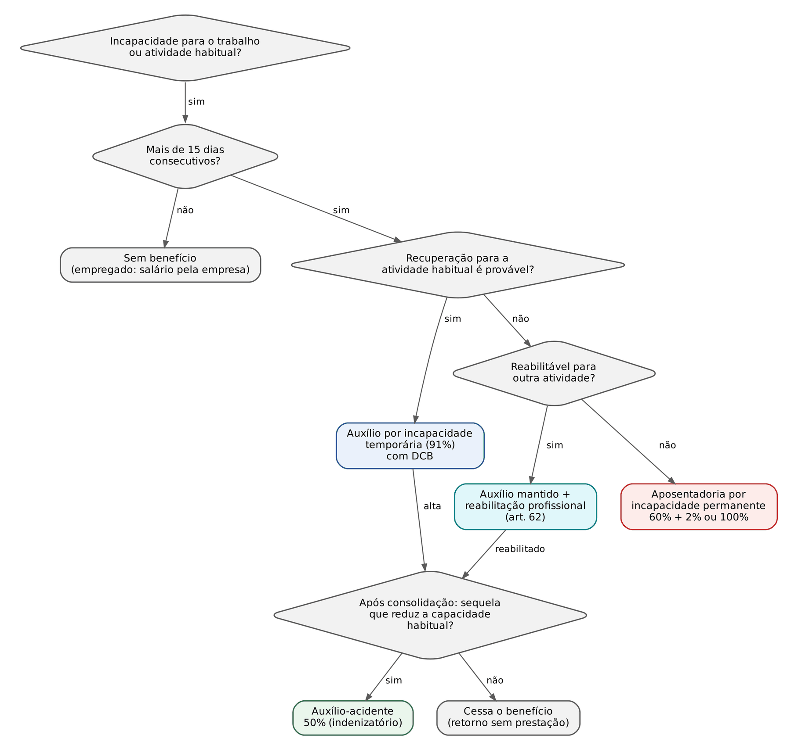
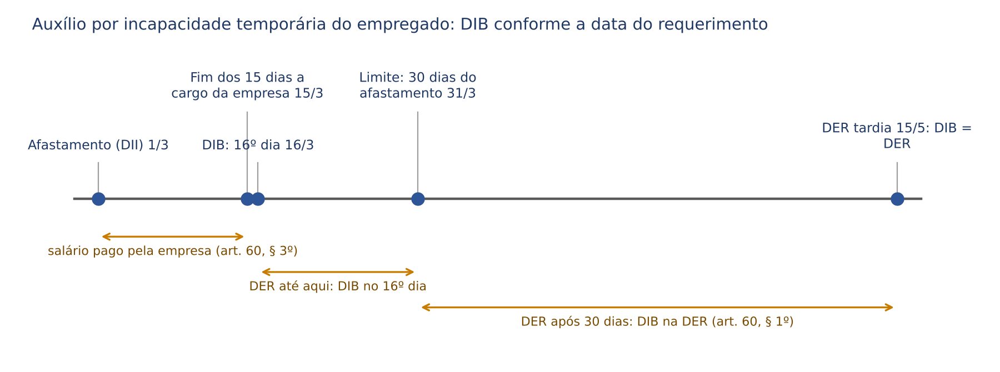
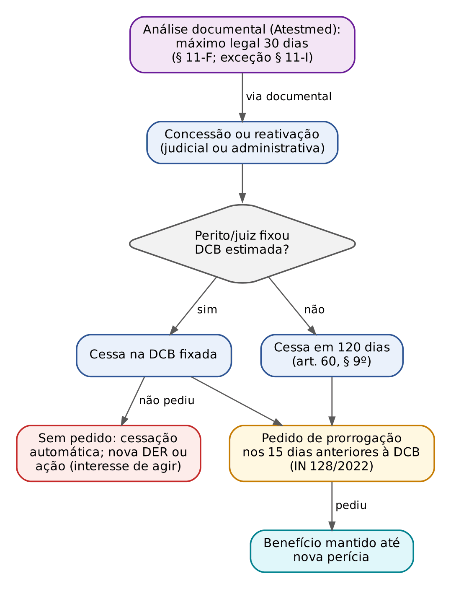
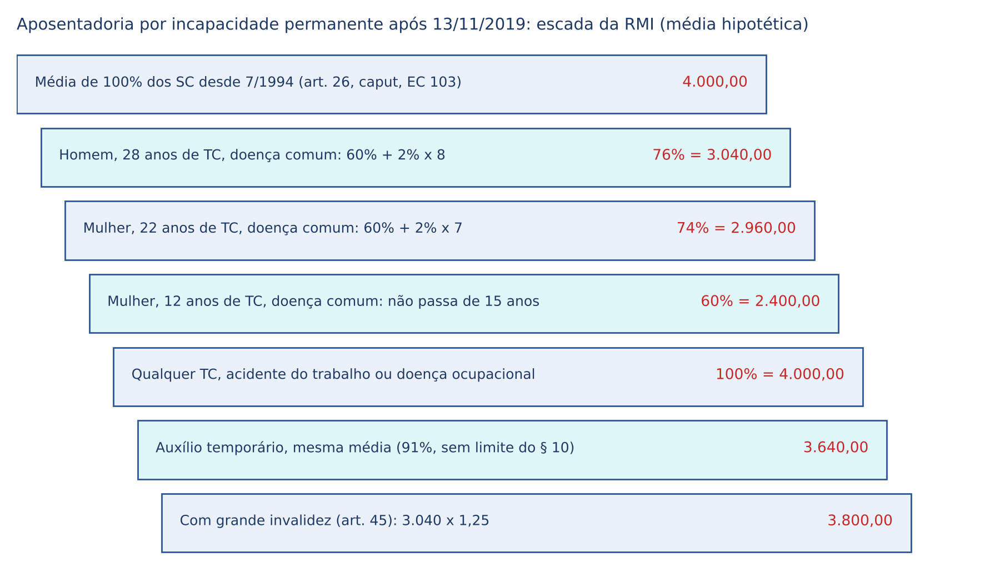
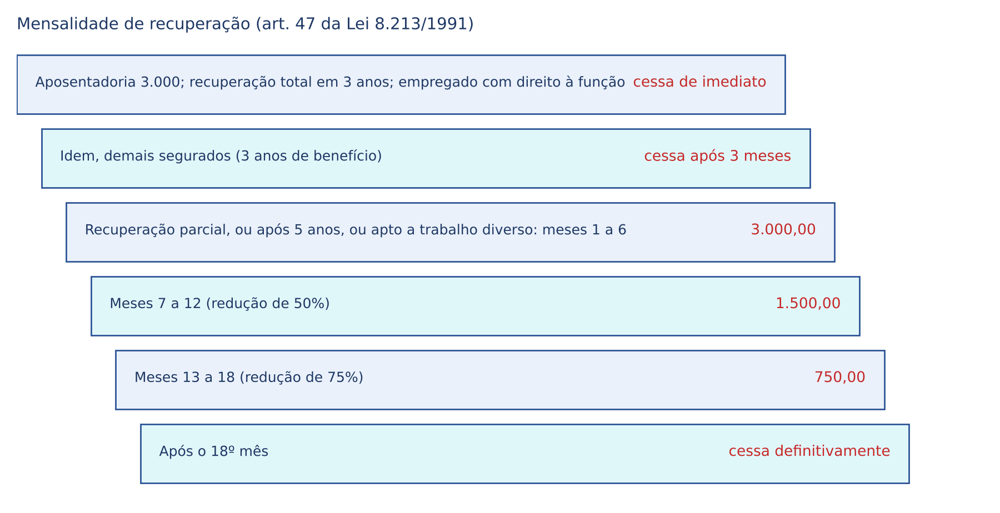
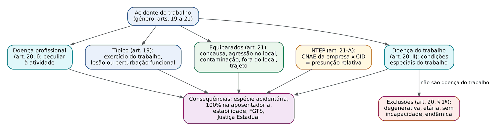
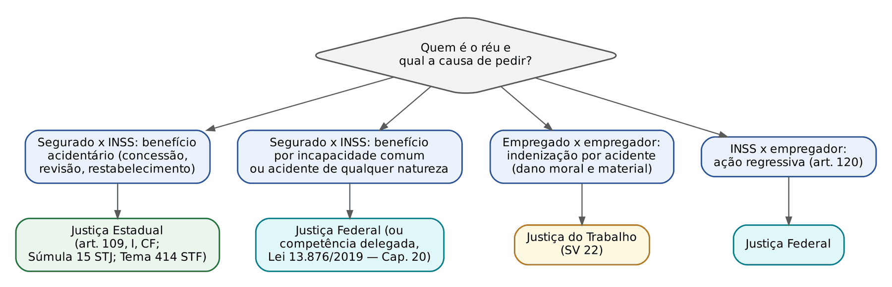

# CAPÍTULO 15 — BENEFÍCIOS POR INCAPACIDADE, ACIDENTE DO TRABALHO E REABILITAÇÃO PROFISSIONAL

:::INCIDENCIA
TRF5 p. 8 e 9. Nível A+. Lote: 38 questões (FGV 35, FCC 3), além de correlatas de outros capítulos.
Cai mais: coeficiente da aposentadoria por incapacidade permanente (60% + 2% x 100% acidentária), acréscimo de 25% e Tema 1.095 do STF, auxílio-acidente (natureza indenizatória, sequela, valor inferior ao mínimo), conceito e equiparações de acidente do trabalho, CAT, NTEP e reabilitação obrigatória.
:::

| Subtema | FGV | FCC | Padrão de cobrança |
|---|---|---|---|
| Acidente do trabalho: conceito, equiparações, doenças ocupacionais | 9 | 0 | caso concreto (agressão, trajeto, viagem, serviço espontâneo) e letra dos arts. 19 a 21 |
| CAT, NTEP e caracterização técnica | 6 | 0 | prazo (1º dia útil), legitimados supletivos, CNAE x CID |
| Aposentadoria por incapacidade permanente: RMI após a EC 103/2019 | 3 | 1 | caso com tempo de contribuição e origem (comum x acidentária) |
| Acréscimo de 25% (grande invalidez) | 4 | 1 | extensão a outras aposentadorias (Tema 1.095), Anexo I |
| Auxílio-acidente | 6 | 0 | natureza indenizatória, sequela após alta, valor inferior ao mínimo, acidente de qualquer natureza |
| Auxílio por incapacidade temporária (Decreto 3.048) | 1 | 0 | letra do art. 71 a 75 do Regulamento |
| Reabilitação profissional e cotas | 4 | 0 | obrigatoriedade, art. 93 (2% a 5%), dispensa condicionada |
| Estabilidade acidentária e efeitos trabalhistas | 1 | 1 | art. 118 e entendimento sumulado do TST |
| Conceitos de incapacidade | 1 | 0 | omniprofissional, multiprofissional, uniprofissional |

## 15.1 Incapacidade laboral: conceitos que decidem o benefício

A CF, após a EC 103/2019, trocou "doença" e "invalidez" por "incapacidade temporária ou permanente" (art. 201, I). O risco social coberto não é a doença, mas a INCAPACIDADE que dela resulta: doente capaz não tem benefício; incapaz por doença preexistente à filiação também não, salvo agravamento (art. 42, § 2º, e art. 59, § 1º, da Lei 8.213/1991). A nomenclatura legal antiga (auxílio-doença, aposentadoria por invalidez) continua no texto da Lei 8.213/1991, que não foi reescrita; o Decreto 10.410/2020 adotou no Regulamento (Decreto 3.048/1999) os nomes novos. As bancas usam os dois indistintamente.

### 15.1.1 As três variáveis da incapacidade

O laudo pericial responde a três perguntas, e cada resposta conduz a um benefício (ver figura 15.1):

| Variável | Opções | Efeito |
|---|---|---|
| Grau | total x parcial | total: impede a atividade; parcial: reduz a capacidade, permitindo trabalho com restrições ou maior esforço |
| Duração | temporária x permanente | temporária: prognóstico de recuperação; permanente: sem prognóstico razoável de retorno |
| Abrangência | uniprofissional, multiprofissional, omniprofissional | uni: só a atividade habitual; multi: um grupo de atividades; omni: qualquer atividade |

- Auxílio por incapacidade temporária: incapacidade total (para a atividade habitual) e temporária, por mais de 15 dias consecutivos. Basta a incapacidade uniprofissional (art. 59: "para o seu trabalho ou para a sua atividade habitual").
- Aposentadoria por incapacidade permanente: incapacidade total, permanente e, em regra, omniprofissional, com insuscetibilidade de reabilitação "para o exercício de atividade que lhe garanta a subsistência" (art. 42).
- Auxílio-acidente: não há incapacidade atual; há SEQUELA consolidada que REDUZ a capacidade para o trabalho habitual (incapacidade parcial e permanente, residual).
- Incapacidade total e permanente apenas para a atividade habitual, com possibilidade de reabilitação para outra: auxílio por incapacidade temporária mantido + reabilitação profissional (art. 62).

:::QUESTAO FGV 2026 — TJ-SC — Médico (Q4150923)
Cobrou o conceito de incapacidade omniprofissional. Gabarito A: incapacidade total e permanente para qualquer profissão. Armadilhas: definir a omniprofissional como parcial (B e C), afirmar que toda incapacidade parcial e permanente gera auxílio-acidente (D: exige sequela de acidente de qualquer natureza que reduza a capacidade habitual) e restringir a incapacidade temporária total às doenças (E: o acidente também a gera). Fundamento: arts. 42, 59 e 86 da Lei 8.213/1991.
:::

### 15.1.2 Doença preexistente, DII e incapacidade preexistente

O marco temporal decisivo é a DII (data do início da incapacidade), fixada pelo perito; não confundir com a DID (data do início da doença). Regra: se a DII é anterior à filiação (ou ao reingresso, após perda da qualidade de segurado), não há benefício; se a doença é anterior, mas a incapacidade sobreveio por progressão ou agravamento após a filiação, há direito (arts. 42, § 2º, e 59, § 1º, da Lei 8.213/1991; art. 71, § 1º, e art. 43, § 2º, do Decreto 3.048/1999). A TNU sumulou que não há direito ao benefício quando a incapacidade é preexistente ao REINGRESSO no RGPS (Súmula 53 da TNU). A fixação da DII na data da própria perícia é excepcional e exige fundamentação que afaste a presunção de início anterior (Tema 343 da TNU).

:::PEGADINHA Preexistência
"Doença preexistente nunca dá direito ao benefício": ERRADO. A lei veda a doença ou lesão preexistente como causa, "exceto quando a incapacidade sobrevier por motivo de progressão ou agravamento". A FGV inverte a ressalva (Q3660347, alternativa A, que suprimiu a exceção; e Q3179509, ch. 8, alternativa B, com "nunca").
:::

A qualidade de segurado e a carência são aferidas na DII (ver Cap. 8). Para este capítulo, basta fixar a dispensa de carência, que é o ponto em que os benefícios por incapacidade divergem:

| Situação | Carência do auxílio temporário e da aposentadoria por incapacidade | Fundamento |
|---|---|---|
| Regra | 12 contribuições mensais | art. 25, I |
| Acidente de qualquer natureza ou causa | dispensada | art. 26, II |
| Doença profissional ou do trabalho | dispensada | art. 26, II |
| Doença da lista (após a filiação) | dispensada | art. 26, II, e art. 151 |
| Auxílio-acidente | sempre dispensada | art. 26, I |
| Reabilitação profissional | sempre dispensada | art. 26, V |

O art. 151 lista, até a edição da lista ministerial: tuberculose ativa, hanseníase, alienação mental, esclerose múltipla, hepatopatia grave, neoplasia maligna, cegueira, paralisia irreversível e incapacitante, cardiopatia grave, doença de Parkinson, espondiloartrose anquilosante, nefropatia grave, estado avançado da doença de Paget, aids e contaminação por radiação. A TNU entende que o rol do art. 26, II, é exaustivo, mas a lista de doenças admite interpretação extensiva, desde que demonstradas especificidade e gravidade, e reconheceu a gravidez de alto risco com afastamento superior a 15 dias como hipótese de dispensa (Tema 220 da TNU).

:::DICA Acidente de qualquer natureza dispensa carência também para o facultativo
O art. 71, § 2º, do Decreto 3.048/1999 diz que o auxílio é devido sem carência "aos segurados obrigatório e facultativo" quando sofrerem acidente de qualquer natureza. A FGV trocou para "excluindo os facultativos" (Q3660347, alternativa B). No mesmo sentido, a dispensa vale ainda que o acidente nada tenha com o trabalho: Q4216394 (FGV 2026, NAV Brasil, gabarito D, acidente de trânsito três meses após a filiação) e Q3154449 (FGV 2025, TCE-PI: o auxílio acidentário e o auxílio-acidente são imediatos; o auxílio-reclusão exige 24 contribuições — ver Cap. 16).
:::

## 15.2 Auxílio por incapacidade temporária (antigo auxílio-doença)

:::LEI Lei 8.213/1991, art. 59, caput e §§ 1º a 3º, 8º
Art. 59. O auxílio-doença será devido ao segurado que, havendo cumprido, quando for o caso, o período de carência exigido nesta Lei, ficar incapacitado para o seu trabalho ou para a sua atividade habitual por mais de 15 (quinze) dias consecutivos.
§ 1º Não será devido o auxílio-doença ao segurado que se filiar ao Regime Geral de Previdência Social já portador da doença ou da lesão invocada como causa para o benefício, exceto quando a incapacidade sobrevier por motivo de progressão ou agravamento da doença ou da lesão.
§ 2º Não será devido o auxílio-doença para o segurado recluso em regime fechado.
§ 3º O segurado em gozo de auxílio-doença na data do recolhimento à prisão terá o benefício suspenso.
(...)
§ 8º O segurado recluso em cumprimento de pena em regime aberto ou semiaberto terá direito ao auxílio-doença.
:::

### 15.2.1 Requisitos

1. Qualidade de segurado na DII (todos os segurados, inclusive o facultativo).
2. Carência de 12 contribuições, salvo as dispensas do quadro de 15.1.2.
3. Incapacidade para o trabalho ou para a atividade habitual por MAIS DE 15 DIAS CONSECUTIVOS. Afastamento de exatamente 15 dias não gera benefício.
4. Incapacidade não preexistente à filiação (ressalvado o agravamento).
5. Não estar recluso em regime fechado.

### 15.2.2 Os 15 primeiros dias, a DIB e a DER

O ponto mais cobrado de concurso de nível médio e de juiz é a DIB, porque decide o valor dos atrasados. A lei distingue o empregado (os 15 primeiros dias são salário, pagos pela empresa) dos demais segurados.

| Segurado | Primeiros 15 dias | DIB se a DER ocorre em até 30 dias do afastamento | DIB se a DER ocorre depois de 30 dias |
|---|---|---|---|
| Empregado (exceto doméstico) | salário integral pago pela empresa (art. 60, § 3º) | 16º dia do afastamento (art. 60, caput) | DER (art. 60, § 1º) |
| Doméstico, avulso, contribuinte individual, especial, facultativo | sem pagamento (risco do próprio segurado) | DII, desde que o afastamento supere 15 dias (art. 72, II, do Decreto) | DER |

O Regulamento detalha três regras de contagem que a FGV cobra literalmente:

- Acidentado que não se afasta no dia do acidente: os 15 dias de responsabilidade da empresa contam-se "a partir da data do afastamento" (art. 72, § 1º, do Decreto 3.048/1999).
- Novo benefício pelo mesmo motivo em até 60 dias da cessação do anterior: a empresa fica desobrigada dos 15 dias, e o benefício anterior é prorrogado, descontados os dias trabalhados (art. 75, § 3º).
- Afastamento de 15 dias, retorno no 16º dia e novo afastamento pelo mesmo motivo em até 60 dias do retorno: benefício a partir do novo afastamento (art. 75, § 4º); se o retorno ocorreu antes de completar os 15 dias, o benefício é devido a partir do dia seguinte ao que completar aquele período (art. 75, § 5º).

:::EXEMPLO DIB em três cenários
Empregado afastado em 1/3/2026.
- DER em 20/3/2026 (19 dias após o afastamento, portanto antes de 30 dias): empresa paga de 1/3 a 15/3; DIB em 16/3/2026.
- DER em 15/5/2026 (75 dias após o afastamento): DIB na DER, 15/5/2026; o período de 16/3 a 14/5 fica descoberto (nem salário, nem benefício), salvo licença remunerada garantida pela empresa.
- Contribuinte individual com DII em 1/3/2026 e DER em 25/3/2026: DIB na própria DII, 1/3/2026, porque o afastamento superou 15 dias e a DER veio em menos de 30 dias.
:::

:::QUESTAO FGV 2025 — AgSUS — Analista de Gestão, Medicina do Trabalho (Q3660347)
Cinco afirmações sobre o Decreto 3.048/1999. Gabarito E: quando o acidentado não se afasta no dia do acidente, os 15 dias de responsabilidade da empresa contam a partir do afastamento (art. 72, § 1º). Armadilhas: A suprime a ressalva do agravamento; B exclui o facultativo da dispensa de carência; C mantém o benefício do preso até a recuperação (na verdade é suspenso por até 60 dias e depois cessado); D inverte o art. 75, § 6º (o empregado pode voltar ao trabalho no dia seguinte ao indicado pelo médico assistente, "mantida" a necessidade de comparecer à perícia agendada, e não "suspendendo-a").
:::

:::QUESTAO FGV 2024 — DATAPREV — Médico do Trabalho (Q3086140)
Administrador que volta de curso custeado pela empresa em outra cidade, dirigindo o próprio veículo, sofre acidente. Gabarito E: é acidente do trabalho (art. 21, IV, c: viagem a serviço, "inclusive para estudo quando financiada por esta", qualquer meio de locomoção, "inclusive veículo de propriedade do segurado"); a empresa emite a CAT, paga os 15 primeiros dias e encaminha ao INSS para o benefício acidentário a partir do 16º dia. Armadilha: D omite a CAT, que é a obrigação central do art. 22.
:::

### 15.2.3 Licença, complementação e contrato de trabalho

O empregado em gozo do benefício é considerado LICENCIADO (art. 63); o contrato fica suspenso, mas a empresa que garantir licença remunerada paga a diferença entre o benefício e o valor garantido (art. 63, parágrafo único). No auxílio de natureza acidentária, a legislação do FGTS obriga o depósito durante o afastamento (Lei 8.036/1990, art. 15, § 5º: o depósito é obrigatório na "licença por acidente do trabalho") e o retorno gera a estabilidade do art. 118 (ver 15.6.6). O benefício é devido também durante reclamação trabalhista sobre a rescisão, ou após ela, se implementadas as condições (art. 72, § 3º, do Decreto).

### 15.2.4 Renda mensal: 91% e o teto da média dos 12 últimos salários de contribuição

A RMI é 91% do salário de benefício, "inclusive o decorrente de acidente do trabalho" (art. 61): NÃO há diferença de coeficiente entre o auxílio comum e o acidentário. Após a EC 103/2019, o salário de benefício é a média de 100% dos salários de contribuição desde julho de 1994 (art. 26, caput, da EC 103/2019; cálculo detalhado no Cap. 11). Há, porém, um limitador próprio:

:::LEI Lei 8.213/1991, art. 29, § 10
§ 10. O auxílio-doença não poderá exceder a média aritmética simples dos últimos 12 (doze) salários-de-contribuição, inclusive em caso de remuneração variável, ou, se não alcançado o número de 12 (doze), a média aritmética simples dos salários-de-contribuição existentes.
:::

:::PASSO RMI do auxílio por incapacidade temporária
1. Apure a média de todos os salários de contribuição desde 7/1994 (salário de benefício).
2. Aplique 91%.
3. Apure a média dos 12 últimos salários de contribuição (ou dos existentes, se menos de 12).
4. RMI = o MENOR entre o passo 2 e o passo 3.
5. Respeite o piso do salário mínimo (art. 201, § 2º, da CF), ressalvada a hipótese de atividades concomitantes do art. 73, § 4º, do Decreto (valor inferior ao mínimo se, somado às demais remunerações, superar o mínimo).
:::

:::EXEMPLO Limitador do art. 29, § 10
Segurado com média histórica de 3.000 e média dos 12 últimos salários de contribuição de 2.500.
- 91% x 3.000 = 2.730.
- Limite do § 10 = 2.500.
- RMI = 2.500 (dois mil e quinhentos reais).
Se a média histórica fosse 2.000 e a dos 12 últimos fosse 2.400: 91% x 2.000 = 1.820, abaixo do limite; RMI = 1.820.
:::

### 15.2.5 Atividades concomitantes

O segurado com mais de uma atividade tem benefício ainda que incapaz para uma só delas; deve informar todas à perícia; a carência e o cálculo consideram apenas a atividade para a qual está incapaz; se nas várias atividades exerce a MESMA profissão, exige-se o afastamento de todas (art. 73 do Decreto). Se, em gozo do benefício, passa a exercer atividade que lhe garanta subsistência, o benefício pode ser cancelado a partir do retorno; se a atividade é diversa da que gerou o benefício, verifica-se a incapacidade para cada uma (art. 60, §§ 6º e 7º, da Lei). A TNU admitiu a cumulação do auxílio com o exercício de mandato de vereador, observado o § 7º (Tema 259 da TNU).

### 15.2.6 Prisão do segurado

| Situação | Consequência | Fundamento |
|---|---|---|
| Recluso em regime fechado | não tem direito ao benefício | art. 59, § 2º |
| Em gozo na data da prisão | benefício SUSPENSO por até 60 dias; depois, CESSADO | art. 59, §§ 3º e 4º |
| Solto antes dos 60 dias | restabelecido a partir da data da soltura | art. 59, § 5º |
| Prisão declarada ilegal | recebe todo o período devido (com encontro de contas se houve auxílio-reclusão) | art. 59, § 6º; art. 71, § 7º, do Decreto |
| Regime aberto ou semiaberto | tem direito | art. 59, § 8º |
| Prisão anterior a 18/6/2019 | regras dos §§ 2º a 6º não se aplicam | art. 59, § 7º (publicação da Lei 13.846/2019) |

:::EXEMPLO Contagem da suspensão
Preso em regime fechado em 5/2/2026, em gozo do benefício: suspensão até 6/4/2026 (60 dias); se ainda preso, cessação. Se solto em 1/3/2026, o pagamento é restabelecido a partir de 1/3/2026, sem pagamento do período de 5/2 a 28/2 (salvo prisão declarada ilegal).
:::

### 15.2.7 Duração: DCB, alta programada e pedido de prorrogação

A Lei 13.457/2017 (conversão da MP 767/2017) positivou a chamada alta programada.

:::LEI Lei 8.213/1991, art. 60, §§ 8º a 10
§ 8º Sempre que possível, o ato de concessão ou de reativação de auxílio-doença, judicial ou administrativo, deverá fixar o prazo estimado para a duração do benefício.
§ 9º Na ausência de fixação do prazo de que trata o § 8º deste artigo, o benefício cessará após o prazo de cento e vinte dias, contado da data de concessão ou de reativação do auxílio-doença, exceto se o segurado requerer a sua prorrogação perante o INSS, na forma do regulamento, observado o disposto no art. 62 desta Lei.
§ 10. O segurado em gozo de auxílio-doença, concedido judicial ou administrativamente, poderá ser convocado a qualquer momento para avaliação das condições que ensejaram sua concessão ou manutenção, observado o disposto no art. 101 desta Lei.
:::

Mecânica:

- O ato de concessão (inclusive a SENTENÇA) deve fixar, sempre que possível, a DCB estimada. O comando dirige-se também ao juiz.
- Sem DCB, o benefício cessa em 120 dias contados da concessão ou reativação. Exemplo: concessão em 10/1/2026 sem DCB: cessação em 10/5/2026.
- O segurado que se considera ainda incapaz requer a PRORROGAÇÃO; segundo a orientação administrativa (IN PRES/INSS 128/2022, art. 339, § 3º, conforme fonte secundária consultada), o pedido é feito nos 15 dias que antecedem a DCB, e o benefício é mantido até a nova perícia.
- O segurado que se julga capaz antes da DCB só retorna ao trabalho após nova avaliação (art. 78, § 5º, do Decreto); pode desistir do pedido de prorrogação antes da perícia (art. 78, § 6º).
- Contra o resultado da reavaliação cabe recurso ao CRPS em 30 dias, com análise por perito diverso (art. 60, § 11; art. 78, § 7º, do Decreto).
- A cessação também ocorre pela recuperação, pela aposentadoria por incapacidade permanente ou, se o mesmo evento gerou sequela redutora, pela concessão do auxílio-acidente (art. 78, caput, do Decreto).

:::JURIS STF, Tema 1.196 (RE n. 1.347.526, Relator Ministro Cristiano Zanin, Plenário, j. 15/9/2025)
Tese: "Não viola os artigos 62, caput e § 1º, e 246 da Constituição Federal a estipulação de prazo estimado para a duração de benefício de auxílio-doença", conforme os §§ 8º e 9º do art. 60, com redação das MPs 739/2016 e 767/2017, convertida esta na Lei 13.457/2017. O debate era formal (urgência da MP e regulamentação de artigo alterado por emenda); materialmente, a DCB é válida desde que ressalvado o pedido de prorrogação.
:::

:::ATENCAO Pedido de prorrogação e interesse de agir
Corrente prevalente na TNU e nas turmas recursais: cessado o benefício na DCB sem pedido de prorrogação, falta interesse de agir para a ação de restabelecimento, porque o INSS não teve oportunidade de reavaliar a incapacidade (aplicação da lógica do RE 631.240 — ver Cap. 19). A jurisprudência anterior do STJ, que dispensava o pedido, formou-se antes da previsão legal da DCB. Não localizei nesta tarefa o número do tema da TNU: confira antes de citar (ver nota).
:::

:::SENTENCA DCB na sentença de restabelecimento
"Condeno o INSS a restabelecer o auxílio por incapacidade temporária NB (...) desde o dia seguinte à cessação indevida (DIB em ...), com DIP na data desta sentença. Fixo a DCB em (...), prazo estimado pelo perito para a recuperação (art. 60, § 8º, da Lei 8.213/1991), assegurado ao autor o direito de requerer a prorrogação nos 15 dias anteriores, hipótese em que o benefício será mantido até a reavaliação administrativa. Antecipo os efeitos da tutela para implantação em 30 dias."
:::

### 15.2.8 Perícia: presencial, telemedicina e análise documental (Atestmed)

A sequência legislativa recente é armadilha de prova, porque as normas se sucederam rapidamente:

| Norma | Conteúdo |
|---|---|
| Lei 14.441/2022 | § 14 do art. 60: ato ministerial pode dispensar o parecer conclusivo da perícia médica federal; concessão por análise documental (atestados e laudos) feita pelo INSS; nova redação do art. 101 |
| Lei 14.724/2023 | perícia por telemedicina ou análise documental também na aposentadoria por incapacidade (art. 42, § 1º-A) e nas revisões (art. 101, § 6º); antecipação por telemedicina de vagas canceladas (art. 101, §§ 8º e 9º) |
| Lei 15.157/2025 (1/7/2025) | dispensa de reavaliação para aids, Alzheimer, Parkinson e ELA (art. 60, § 15; art. 43, § 5º); infectologista na perícia de segurado com aids (art. 60, § 16); dispensa de reavaliação da incapacidade permanente, irreversível ou irrecuperável (art. 43, § 6º) |
| Lei 15.265/2025 (21/11/2025) | art. 60, § 11-A (telemedicina ou análise documental) e §§ 11-F a 11-I: o benefício concedido por análise documental NÃO pode exceder 30 dias; acima disso, perícia presencial ou por telemedicina; o prazo pode ser diferenciado por categoria de segurado e excepcionado por ato do Executivo, justificadamente e por prazo determinado |

:::LEI Lei 8.213/1991, art. 60, §§ 11-F e 11-G (Lei 15.265/2025)
§ 11-F. A duração do benefício de auxílio por incapacidade temporária concedido por análise documental não poderá exceder ao prazo de 30 (trinta) dias.
§ 11-G. Os benefícios com duração superior ao prazo de que trata o § 11-F estarão sujeitos à realização de perícia presencial ou com o uso de telemedicina.
:::

:::ATENCAO Exceção administrativa ao limite de 30 dias
Com base no § 11-I, portarias conjuntas MPS/INSS de 2026 teriam ampliado temporariamente o limite da análise documental para 90 dias, somados todos os benefícios concedidos por essa via, e prorrogado a ampliação em setembro de 2026 (informação de fonte secundária, não conferida no DOU). Em prova objetiva, marque a letra da lei: 30 dias, com possibilidade de exceção por ato do Executivo.
:::

### 15.2.9 Obrigações do beneficiário e revisão

O titular de auxílio temporário, auxílio-acidente ou aposentadoria por incapacidade, e o pensionista inválido, ainda que o benefício tenha sido concedido JUDICIALMENTE, deve submeter-se, sob pena de SUSPENSÃO, a exame médico, à reabilitação profissional e a tratamento gratuito, "exceto o cirúrgico e a transfusão de sangue, que são facultativos" (art. 101, I a III). As isenções do exame por idade valem só para o aposentado por incapacidade e o pensionista inválido (ver 15.3.6), não para o auxílio temporário (art. 77 do Decreto: "independentemente de sua idade").

:::JURIS STJ, Tema 1.157 (REsp n. 1.985.189 e REsp n. 1.985.190)
É lícito ao INSS cancelar administrativamente benefício por incapacidade concedido por decisão judicial transitada em julgado, desde que observado o devido processo legal administrativo, com perícia médica; o procedimento é autônomo e independe de ação revisional. Fundamento: a sentença de benefício por incapacidade traz cláusula *rebus sic stantibus*; a mudança do estado de saúde é fato novo.
:::

### 15.2.10 Trabalho durante a espera do benefício

:::JURIS STJ, Tema 1.013 (REsp n. 1.788.700, Primeira Seção, j. 24/6/2020)
No período entre o indeferimento administrativo e a implantação judicial do auxílio-doença ou da aposentadoria por invalidez, o segurado tem direito ao recebimento conjunto das rendas do trabalho exercido, ainda que incompatível com a incapacidade, e do benefício pago retroativamente. No mesmo sentido, a Súmula 72 da TNU admite o benefício no período em que houve atividade remunerada, comprovada a incapacidade na época.
:::

O raciocínio: o segurado trabalhou por necessidade, porque o INSS negou o benefício; descontar os meses trabalhados premiaria o erro da autarquia. Não se confunde com o retorno VOLUNTÁRIO do aposentado por incapacidade, que gera cancelamento automático (art. 46; ver 15.3.7).

:::NOTA Acumulações (remissão)
O auxílio por incapacidade temporária não se acumula com aposentadoria (art. 124, I), nem com salário-maternidade (art. 124, IV), nem com seguro-desemprego (art. 124, parágrafo único); o aposentado que volta a trabalhar não tem auxílio por incapacidade (art. 18, § 2º). Questões: Q3841707 e Q3186487 (FGV 2025, gabaritos B e A: o aposentado empregado afastado por 30 ou 45 dias não acumula). O regime geral das acumulações está no Cap. 12.
:::

### 15.2.11 Carência e tempo de contribuição do período em benefício

O período em gozo de benefício por incapacidade conta como tempo de contribuição e como carência quando INTERCALADO com atividade (Tema 1.125 do STF; art. 55, II, da Lei 8.213/1991). Desenvolvimento no Cap. 9. Lembre: o auxílio-acidente recebido isoladamente NÃO conta como tempo de contribuição (ver 15.5.6).

#### Ficha — auxílio por incapacidade temporária

| Item | Regra |
|---|---|
| Segurados | todos, inclusive facultativo |
| Carência | 12 contribuições; dispensada em acidente de qualquer natureza, doença ocupacional e doenças da lista (art. 26, II; art. 151) |
| Requisitos | incapacidade para o trabalho ou atividade habitual por mais de 15 dias consecutivos; não preexistente (salvo agravamento); não recluso em regime fechado |
| DIB | empregado: 16º dia; demais: DII; todos: DER se requerido após 30 dias do afastamento |
| RMI | 91% do SB, limitado à média dos 12 últimos SC (art. 29, § 10); mesmo coeficiente se acidentário |
| Duração | DCB estimada; sem ela, 120 dias; prorrogação a pedido; análise documental até 30 dias |
| Cessação | recuperação; aposentadoria por incapacidade; auxílio-acidente (mesmo evento); retorno a atividade que garanta subsistência; prisão em regime fechado após 60 dias de suspensão |
| Acumulação | vedada com aposentadoria, salário-maternidade e seguro-desemprego; permitida com auxílio-acidente de OUTRO fato gerador |
| Fundamento | arts. 59 a 63 da Lei 8.213/1991; arts. 71 a 80 do Decreto 3.048/1999 |
## 15.3 Aposentadoria por incapacidade permanente (antiga aposentadoria por invalidez)

:::LEI Lei 8.213/1991, art. 42, caput e § 2º
Art. 42. A aposentadoria por invalidez, uma vez cumprida, quando for o caso, a carência exigida, será devida ao segurado que, estando ou não em gozo de auxílio-doença, for considerado incapaz e insusceptível de reabilitação para o exercício de atividade que lhe garanta a subsistência, e ser-lhe-á paga enquanto permanecer nesta condição.
§ 2º A doença ou lesão de que o segurado já era portador ao filiar-se ao Regime Geral de Previdência Social não lhe conferirá direito à aposentadoria por invalidez, salvo quando a incapacidade sobrevier por motivo de progressão ou agravamento dessa doença ou lesão.
:::

### 15.3.1 Requisitos e natureza

Requisitos: qualidade de segurado; carência de 12 contribuições (com as mesmas dispensas do auxílio temporário); incapacidade total e permanente; INSUSCETIBILIDADE DE REABILITAÇÃO para atividade que garanta a subsistência. Não exige prévio auxílio temporário ("estando ou não em gozo de auxílio-doença"). É benefício não programado e precário: paga-se "enquanto permanecer nesta condição", o que permite revisão a qualquer tempo (art. 43, § 4º), salvo as isenções do art. 101, § 1º, e do art. 43, §§ 5º e 6º.

A concessão exige o afastamento de TODAS as atividades, inclusive quando precedida de auxílio concedido em razão de uma só delas (art. 44, § 3º, do Decreto). O segurado pode ser acompanhado na perícia por médico de sua confiança, às suas expensas (art. 42, § 1º).

:::QUESTAO FCC 2026 — AL-RR — Analista Legislativo, Assistente Social (Q4156335)
Pediu a hipótese da aposentadoria não programada. Gabarito A: incapacidade inalterável para qualquer atividade, sem possibilidade de reabilitação em outra profissão. Armadilhas: B descreve o auxílio-acidente (sequela que reduz a capacidade); C, a aposentadoria especial; D, o auxílio temporário; E descreve corretamente os requisitos da aposentadoria PROGRAMADA (62 e 65 anos; 15 e 20 anos de contribuição — ver Cap. 13), que não é a não programada pedida no enunciado.
:::

### 15.3.2 Condições pessoais e sociais: a incapacidade parcial que vira total

Na via judicial, a incapacidade é aferida em concreto. A TNU consolidou:

| Enunciado | Orientação |
|---|---|
| Súmula 47 da TNU | reconhecida a incapacidade PARCIAL, o juiz deve analisar as condições pessoais e sociais do segurado para a concessão da aposentadoria por invalidez |
| Súmula 77 da TNU | o julgador não é obrigado a analisar as condições pessoais e sociais quando não reconhecer a incapacidade para a atividade habitual |
| Súmula 78 da TNU | portador de HIV: verificar as condições pessoais, sociais, econômicas e culturais (incapacidade em sentido amplo), pela estigmatização |
| Tema 274 da TNU | a mesma análise ampla vale para outras doenças estigmatizantes que impactem a funcionalidade social |
| Súmula 177 da TNU | incapacidade parcial e permanente, fora da hipótese da Súmula 47: o juiz pode determinar o encaminhamento à análise administrativa de elegibilidade à reabilitação, sendo inviável condenar previamente à aposentadoria condicionada ao insucesso da reabilitação |

Na prática: segurado de 58 anos, analfabeto, trabalhador braçal, com incapacidade parcial e permanente para esforço físico, tende a obter a aposentadoria (Súmula 47); segurado de 35 anos, com ensino médio, nas mesmas condições, tende a obter auxílio temporário com reabilitação (art. 62 e Súmula 177).

:::JURIS STJ, Tema 1.246 (REsp n. 2.082.395 e REsp n. 2.098.629)
É inadmissível recurso especial para rediscutir, em caso concreto de benefício por incapacidade, as conclusões do acórdão quanto à existência, à extensão (total ou parcial) ou à duração (temporária ou permanente) da incapacidade. A matéria é fática (Súmula 7 do STJ): a última palavra é das instâncias ordinárias.
:::

### 15.3.3 DIB

| Situação | DIB | Fundamento |
|---|---|---|
| Precedida de auxílio temporário | dia imediato ao da cessação do auxílio | art. 43, caput |
| Perícia inicial já conclui pela incapacidade total e definitiva: empregado | 16º dia do afastamento, ou DER se entre afastamento e DER decorrerem mais de 30 dias | art. 43, § 1º, a |
| Idem: doméstico, avulso, contribuinte individual, especial, facultativo | DII, ou DER se decorridos mais de 30 dias | art. 43, § 1º, b |
| Concessão judicial sem requerimento administrativo | citação válida | Súmula 576 do STJ (origem: Tema 626 do STJ) |

Os primeiros 15 dias de afastamento do empregado também cabem à empresa (art. 43, § 2º).

### 15.3.4 Renda mensal após a EC 103/2019

Antes de 13/11/2019, a RMI era 100% do salário de benefício, comum ou acidentária (art. 44 da Lei 8.213/1991, ainda vigente no texto, mas sem eficácia para benefícios posteriores à reforma). Com a EC 103/2019, o art. 26 passou a reger o cálculo "até que lei discipline":

:::LEI EC 103/2019, art. 26, § 2º, III, § 3º, II, e § 5º
§ 2º O valor do benefício de aposentadoria corresponderá a 60% (sessenta por cento) da média aritmética definida na forma prevista no caput e no § 1º, com acréscimo de 2 (dois) pontos percentuais para cada ano de contribuição que exceder o tempo de 20 (vinte) anos de contribuição nos casos:
(...) III - de aposentadoria por incapacidade permanente aos segurados do Regime Geral de Previdência Social, ressalvado o disposto no inciso II do § 3º deste artigo;
§ 3º O valor do benefício de aposentadoria corresponderá a 100% (cem por cento) da média aritmética definida na forma prevista no caput e no § 1º:
(...) II - no caso de aposentadoria por incapacidade permanente, quando decorrer de acidente de trabalho, de doença profissional e de doença do trabalho.
§ 5º O acréscimo a que se refere o caput do § 2º será aplicado para cada ano que exceder 15 (quinze) anos de tempo de contribuição para os segurados de que tratam a alínea "a" do inciso I do § 1º do art. 19 e o inciso I do art. 21 e para as mulheres filiadas ao Regime Geral de Previdência Social.
:::

O Regulamento (art. 44, I e II, do Decreto 3.048/1999, redação do Decreto 10.410/2020) explicita: 60% + 2 pontos por ano que exceder 20 anos (homens) ou 15 anos (mulheres); 100% quando decorrer de acidente de trabalho, doença profissional ou doença do trabalho. Atenção: o 100% é só para a origem ACIDENTÁRIA (acidente do trabalho e doenças ocupacionais). Acidente de qualquer natureza (trânsito nas férias, queda em casa) dispensa carência, mas entra nos 60% + 2%.

:::PASSO RMI da aposentadoria por incapacidade permanente (DII após 13/11/2019)
1. Apure a média de 100% dos salários de contribuição desde 7/1994, limitada ao teto (art. 26, caput e § 1º).
2. Origem acidentária (acidente do trabalho, doença profissional ou do trabalho)? Coeficiente 100%. Fim.
3. Origem comum: conte os anos completos de tempo de contribuição.
4. Homem: 60% + 2 x (anos acima de 20). Mulher: 60% + 2 x (anos acima de 15).
5. RMI = média x coeficiente, com piso no salário mínimo e acréscimo de 25% se houver necessidade de assistência permanente (15.4).
6. Precedida de auxílio temporário sem retorno ao trabalho: o salário de benefício é o mesmo que serviu de base ao auxílio, reajustado (art. 36, § 7º, do Decreto — Súmula 557 do STJ); intercalados períodos de afastamento e de atividade, aplica-se o art. 29, § 5º, da Lei (o benefício por incapacidade entra no período básico como salário de contribuição).
:::

:::EXEMPLO Média de 4.000 (valores hipotéticos)
- Homem, 28 anos de contribuição, doença comum: 60 + 2 x 8 = 76%; RMI = 3.040 (três mil e quarenta reais).
- Mulher, 22 anos, doença comum: 60 + 2 x 7 = 74%; RMI = 2.960 (dois mil novecentos e sessenta reais).
- Mulher, 12 anos, doença comum: 12 não excede 15; 60%; RMI = 2.400 (dois mil e quatrocentos reais).
- Homem, 35 anos, doença comum: 60 + 2 x 15 = 90%; RMI = 3.600 (três mil e seiscentos reais).
- Qualquer tempo, acidente do trabalho: 100%; RMI = 4.000 (quatro mil reais).
Paradoxo: o mesmo homem de 28 anos, enquanto em auxílio temporário, recebia 91% da média (3.640, se não limitado pelo art. 29, § 10). A conversão em aposentadoria REDUZ a renda.
:::

:::JURIS STF, Tema 1.300 (RE n. 1.469.150, Relator Ministro Luís Roberto Barroso, Plenário, j. 18/12/2025)
Tese: "É constitucional o pagamento do benefício de aposentadoria por incapacidade permanente nos termos fixados pelo art. 26, § 2º, III, da Emenda Constitucional nº 103/2019 para os casos em que a incapacidade para o trabalho seja constatada posteriormente à Reforma da Previdência." Maioria de 6 a 5, vencidos os Ministros Flávio Dino (voto-vista), Edson Fachin, Alexandre de Moraes, Dias Toffoli e a Ministra Cármen Lúcia, que reputavam inconstitucional a redução para a incapacidade de origem não acidentária (o caso envolvia doença grave e incurável). Rejeitou-se o argumento de violação à isonomia e à proporcionalidade pelo paradoxo do auxílio temporário com 91%. Julgamento iniciado no plenário virtual e concluído em sessão presencial; acórdão publicado em 10/4/2026.
:::

:::PEGADINHA Data relevante: DII, não DER
O cálculo segue a lei vigente na data do fato gerador (*tempus regit actum*): incapacidade permanente com DII até 12/11/2019 e requisitos então preenchidos dá direito a 100% da média dos 80% maiores salários de contribuição, ainda que o requerimento seja posterior (ver Cap. 22).
:::

:::QUESTAO FGV 2026 — TJ-PR — Juiz Substituto (Q3898984)
Empregado com 22 anos de casa sofre acidente do trabalho típico em 10/2025 e é aposentado por incapacidade permanente. Gabarito C: 100% da média. Armadilhas: B e E aplicam a regra comum (60% + 2% acima de 20 ou de 15 anos); D usa os 91% do auxílio temporário; A (80%) confunde com o descarte dos 20% menores salários da regra anterior. Fundamento: art. 26, § 3º, II, da EC 103/2019.
No mesmo sentido: Q3888073 (FGV 2024, Procurador de São José dos Campos): duas empregadas com 12 anos de contribuição, aposentadas em 2021, uma por doença comum e outra por acidente de trabalho. Gabarito A: 100% para a acidentária e 60% para a outra (12 anos não excedem os 15 da mulher). Armadilha D (inverte).
:::

:::QUESTAO FGV 2024 — Prova não identificada no banco (Q3047813)
Irmãos digitadores contratados em 2020; em 2024, João tem LER reconhecida como doença ocupacional; Pedro sofre acidente automobilístico grave nas férias; ambos aposentados por incapacidade permanente. Gabarito B: somente João recebe 100% da média. Passos: (1) LER ocupacional = doença do trabalho (art. 20, II) = 100%; (2) acidente nas férias = acidente de qualquer natureza, não do trabalho = 60% + 2% por ano acima de 20; com cerca de 4 anos de contribuição, 60%. Armadilha A: "porque vítimas de acidentes" — o acidente de qualquer natureza só dispensa a carência; não eleva o coeficiente.
:::

### 15.3.5 O § 2º do art. 44 e o acidentado em gozo de auxílio

Regra histórica ainda no texto legal: quando o acidentado do trabalho estava em auxílio-doença, a aposentadoria seria igual ao auxílio se este, por reajustamento, fosse superior (art. 44, § 2º). Para benefícios acidentários pós-reforma, o próprio coeficiente de 100% torna a regra irrelevante.

### 15.3.6 Revisão periódica e isenções de perícia

:::LEI Lei 8.213/1991, art. 101, § 1º, e art. 43, §§ 5º e 6º
Art. 101, § 1º Observado o disposto nos §§ 4º, 5º e 6º do art. 43 desta Lei, o aposentado por incapacidade permanente e o pensionista inválido que não tenham retornado à atividade são isentos do exame de que trata o inciso I do caput deste artigo: I - após completarem cinquenta e cinco anos ou mais de idade e quando decorridos quinze anos da data da concessão da aposentadoria por invalidez ou do auxílio-doença que a precedeu; ou II - após completarem sessenta anos de idade.
Art. 43, § 5º Os segurados com síndrome da imunodeficiência adquirida, doença de Alzheimer, doença de Parkinson e esclerose lateral amiotrófica são dispensados da avaliação referida no § 4º deste artigo.
§ 6º Se a perícia médica constatar que a incapacidade é permanente, irreversível ou irrecuperável, o segurado aposentado por incapacidade permanente é dispensado da reavaliação das condições que ensejaram o afastamento ou a aposentadoria, concedidos judicial ou administrativamente, salvo quando houver fundamentada suspeita de fraude ou erro.
:::

| Hipótese de isenção do exame revisional | Requisitos |
|---|---|
| Idade + tempo | 55 anos ou mais E 15 anos desde a concessão (contados da aposentadoria ou do auxílio que a precedeu) |
| Idade | 60 anos |
| Doença | aids, Alzheimer, Parkinson, ELA (Lei 15.157/2025; antes, só aids) |
| Irreversibilidade | perícia que atesta incapacidade permanente, irreversível ou irrecuperável, salvo fundada suspeita de fraude ou erro (Lei 15.157/2025) |
| Requisito comum às de idade | não ter retornado à atividade |

As isenções por idade NÃO se aplicam quando o exame se destina a (art. 101, § 2º): verificar a necessidade de assistência permanente para o acréscimo de 25%; verificar a recuperação a pedido do próprio aposentado que se julgar apto; subsidiar o juiz na curatela. O Regulamento acrescenta a apuração de fraude (art. 46, § 4º, do Decreto). O INSS tem acesso a prontuários do SUS com anuência do periciado (art. 101, § 4º) e deve fazer perícia domiciliar ou hospitalar para quem tem dificuldade de locomoção (art. 101, § 5º).

:::EXEMPLO Isenção por idade e tempo
Aposentado em 1/3/2011, no dia em que completou 41 anos, após auxílio temporário iniciado em 1/9/2010. Completa 55 anos em 1/3/2025; 15 anos da concessão do auxílio que precedeu a aposentadoria em 1/9/2025. Isento a partir de 1/9/2025 (a data posterior entre os dois requisitos). Se não fosse o auxílio anterior, contaria 15 anos da aposentadoria (1/3/2026).
:::

### 15.3.7 Retorno ao trabalho e mensalidade de recuperação

- Retorno VOLUNTÁRIO à atividade: cancelamento automático da aposentadoria a partir da data do retorno (art. 46; art. 48 do Decreto), com devolução do recebido no período de trabalho (orientação administrativa; ver Cap. 12 sobre restituição).
- Recuperação constatada pela perícia: aplica-se a escala do art. 47.

:::LEI Lei 8.213/1991, art. 47
Art. 47. Verificada a recuperação da capacidade de trabalho do aposentado por invalidez, será observado o seguinte procedimento:
I - quando a recuperação ocorrer dentro de 5 (cinco) anos, contados da data do início da aposentadoria por invalidez ou do auxílio-doença que a antecedeu sem interrupção, o benefício cessará: a) de imediato, para o segurado empregado que tiver direito a retornar à função que desempenhava na empresa quando se aposentou, na forma da legislação trabalhista, valendo como documento, para tal fim, o certificado de capacidade fornecido pela Previdência Social; ou b) após tantos meses quantos forem os anos de duração do auxílio-doença ou da aposentadoria por invalidez, para os demais segurados;
II - quando a recuperação for parcial, ou ocorrer após o período do inciso I, ou ainda quando o segurado for declarado apto para o exercício de trabalho diverso do qual habitualmente exercia, a aposentadoria será mantida, sem prejuízo da volta à atividade: a) no seu valor integral, durante 6 (seis) meses contados da data em que for verificada a recuperação da capacidade; b) com redução de 50% (cinqüenta por cento), no período seguinte de 6 (seis) meses; c) com redução de 75% (setenta e cinco por cento), também por igual período de 6 (seis) meses, ao término do qual cessará definitivamente.
:::

:::PEGADINHA "Redução de 75%" não é "75% do valor"
No terceiro semestre, o aposentado recebe 25% do benefício (redução DE 75%). Aposentadoria de 3.000: 3.000 nos meses 1 a 6; 1.500 nos meses 7 a 12; 750 nos meses 13 a 18. A FCC e a FGV gostam de trocar "redução de 75%" por "75% do valor". Durante a mensalidade, o segurado pode trabalhar ("sem prejuízo da volta à atividade").
:::

#### Ficha — aposentadoria por incapacidade permanente

| Item | Regra |
|---|---|
| Segurados | todos |
| Carência | 12 contribuições, com as dispensas do art. 26, II |
| Requisitos | incapacidade total e permanente + insuscetibilidade de reabilitação; afastamento de todas as atividades |
| DIB | dia seguinte à cessação do auxílio; ou 16º dia/DII; DER se após 30 dias; citação se não houve requerimento (Súmula 576 do STJ) |
| RMI | 60% + 2% por ano acima de 20 (H) ou 15 (M); 100% se acidente do trabalho ou doença ocupacional (art. 26, §§ 2º, III, 3º, II, e 5º, EC 103) |
| Acréscimo | 25% se necessitar de assistência permanente (art. 45) |
| Revisão | a qualquer tempo, salvo isenções (art. 101, § 1º; art. 43, §§ 5º e 6º) |
| Cessação | recuperação (art. 47), retorno voluntário (art. 46), óbito |
| Fundamento | arts. 42 a 47 e 101 da Lei 8.213/1991; arts. 43 a 50 do Decreto 3.048/1999; art. 26 da EC 103/2019 |

## 15.4 Acréscimo de 25% (grande invalidez ou auxílio-acompanhante)

:::LEI Lei 8.213/1991, art. 45
Art. 45. O valor da aposentadoria por invalidez do segurado que necessitar da assistência permanente de outra pessoa será acrescido de 25% (vinte e cinco por cento).
Parágrafo único. O acréscimo de que trata este artigo: a) será devido ainda que o valor da aposentadoria atinja o limite máximo legal; b) será recalculado quando o benefício que lhe deu origem for reajustado; c) cessará com a morte do aposentado, não sendo incorporável ao valor da pensão.
:::

Três características literais: (a) pode ULTRAPASSAR o teto; (b) acompanha os reajustes; (c) é personalíssimo e não passa à pensão. O Regulamento remete ao rol do Anexo I, exemplificativo na jurisprudência, mas literal em prova:

| Anexo I do Decreto 3.048/1999: situações que dão direito ao acréscimo |
|---|
| 1. Cegueira total |
| 2. Perda de NOVE dedos das mãos ou superior a esta |
| 3. Paralisia dos dois membros superiores ou inferiores |
| 4. Perda dos membros inferiores, acima dos pés, quando a prótese for impossível |
| 5. Perda de uma das mãos e de dois pés, ainda que a prótese seja possível |
| 6. Perda de um membro superior e outro inferior, quando a prótese for impossível |
| 7. Alteração das faculdades mentais com grave perturbação da vida orgânica e social |
| 8. Doença que exija permanência contínua no leito |
| 9. Incapacidade permanente para as atividades da vida diária |

:::EXEMPLO Acréscimo acima do teto
Aposentadoria por incapacidade permanente de 8.475,55 (oito mil, quatrocentos e setenta e cinco reais e cinquenta e cinco centavos), igual ao teto do RGPS de 2026 (Portaria Interministerial MPS/MF 13/2026). Com o acréscimo: 8.475,55 x 1,25 = 10.594,44 (dez mil, quinhentos e noventa e quatro reais e quarenta e quatro centavos), acima do teto, por força do art. 45, parágrafo único, a. Na morte do aposentado, a pensão é calculada sobre a aposentadoria sem os 25%.
:::

O acréscimo pode surgir depois da concessão (necessidade superveniente). A TNU fixou o termo inicial do adicional concedido judicialmente em escala sucessiva: DIB da aposentadoria, se a necessidade já existia; data da primeira revisão administrativa que deixou de reconhecê-lo; data do requerimento específico; citação; e, sem elementos, a data da perícia judicial (Tema 275 da TNU).

:::JURIS STF, Tema 1.095 (RE n. 1.221.446, Relator Ministro Dias Toffoli, Plenário, sessão virtual encerrada em 18/6/2021)
Tese: "No âmbito do Regime Geral de Previdência Social (RGPS), somente lei pode criar ou ampliar benefícios e vantagens previdenciárias, não havendo, por ora, previsão de extensão do auxílio da grande invalidez a todas as espécies de aposentadoria." O STF superou a tese do STJ no Tema 982 (2018), que estendia o acréscimo a todas as aposentadorias por isonomia e dignidade, invocando a regra da contrapartida (art. 195, § 5º, da CF) e a reserva legal. Modulação: preservados os direitos dos segurados reconhecidos por decisão transitada em julgado até a data do julgamento, e declarada a irrepetibilidade dos valores alimentares recebidos de boa-fé, por força de decisão judicial ou administrativa, até a proclamação do resultado (vencido, só quanto à modulação, o Ministro Marco Aurélio).
:::

O STJ também negou a extensão ao servidor aposentado por invalidez no RPPS federal, por ausência de previsão legal (Jurisprudência em Teses do STJ, ed. 207, tese 1).

:::QUESTAO FCC 2024 — PIAUÍPREV — Analista Previdenciário (Q3884623)
Pediu a posição do STF sobre o acréscimo de 25%. Gabarito A: é devido, nos termos da lei, ao aposentado por incapacidade permanente que comprove a necessidade de assistência permanente. Armadilhas: B e C (inconstitucionalidade inexistente; nada foi declarado inconstitucional no art. 45), D (extensão automática pela universalidade) e E (extensão judicial a quaisquer aposentadorias, que foi exatamente o que o Tema 1.095 rejeitou).
No mesmo sentido: Q2351305 (FGV 2024, Câmara de São Paulo, gabarito D: dos três aposentados de 80 anos — por incapacidade, especial e programada —, só o aposentado por incapacidade tem os 25%); Q3841704 (FGV 2025, Abreu e Lima, gabarito A: só Helena, aposentada por incapacidade, e não Brenda, aposentada por tempo de contribuição; o percentual é 25%, não 50%); Q3656924 (FGV 2025, Niterói, gabarito C: acréscimo de 25% após constatação pela perícia do INSS; armadilhas com 50%, 100% e 10% ao ano).
:::

:::QUESTAO FGV 2025 — AgSUS — Analista de Gestão, Medicina do Trabalho (Q3660335)
Pediu a situação do Anexo I. Gabarito D: cegueira total. Armadilhas: AVC e neoplasia maligna (dispensam carência pelo art. 151, mas não estão no Anexo I), "perda de um membro inferior quando a prótese for impossível" (o Anexo exige os membros inferiores, ou um superior e outro inferior) e "perda de 5 dedos" (o Anexo exige nove).
:::

:::PEGADINHA Acréscimo x outros adicionais
O acréscimo de 25% é exclusivo da aposentadoria por incapacidade permanente do RGPS. Não existe na aposentadoria especial, na programada, na da pessoa com deficiência, no BPC, nem no RPPS (salvo lei local). As isenções de perícia por idade não impedem o exame para concedê-lo (art. 101, § 2º, I).
:::
## 15.5 Auxílio-acidente

:::LEI Lei 8.213/1991, art. 86
Art. 86. O auxílio-acidente será concedido, como indenização, ao segurado quando, após consolidação das lesões decorrentes de acidente de qualquer natureza, resultarem seqüelas que impliquem redução da capacidade para o trabalho que habitualmente exercia.
§ 1º O auxílio-acidente mensal corresponderá a cinqüenta por cento do salário-de-benefício e será devido, observado o disposto no § 5º, até a véspera do início de qualquer aposentadoria ou até a data do óbito do segurado.
§ 2º O auxílio-acidente será devido a partir do dia seguinte ao da cessação do auxílio-doença, independentemente de qualquer remuneração ou rendimento auferido pelo acidentado, vedada sua acumulação com qualquer aposentadoria.
§ 3º O recebimento de salário ou concessão de outro benefício, exceto de aposentadoria, observado o disposto no § 5º, não prejudicará a continuidade do recebimento do auxílio-acidente.
§ 4º A perda da audição, em qualquer grau, somente proporcionará a concessão do auxílio-acidente, quando, além do reconhecimento de causalidade entre o trabalho e a doença, resultar, comprovadamente, na redução ou perda da capacidade para o trabalho que habitualmente exercia.
:::

### 15.5.1 Natureza e requisitos

É o único benefício previdenciário de natureza INDENIZATÓRIA: não substitui a renda do trabalho, compensa a redução permanente da capacidade. Daí decorrem quase todas as suas peculiaridades (valor inferior ao mínimo, acumulação com salário, não contagem como tempo de contribuição, exclusão da base da pensão alimentícia).

Requisitos cumulativos:

1. Qualidade de segurado de uma das categorias do art. 18, § 1º: empregado, empregado doméstico (desde a LC 150/2015), trabalhador avulso e segurado especial. NÃO têm direito o contribuinte individual (inclusive o MEI) e o facultativo.
2. Acidente de QUALQUER NATUREZA (não só o do trabalho). A TNU define o acidente de qualquer natureza como evento súbito e de origem traumática, por exposição a agentes exógenos físicos, químicos ou biológicos, ressalvados os acidentes do trabalho típicos ou por equiparação (Tema 269 da TNU). Doença comum, sem trauma e sem nexo laboral, não gera auxílio-acidente.
3. Consolidação das lesões.
4. Sequela definitiva que REDUZA a capacidade para o trabalho HABITUALMENTE exercido (a atividade da data do acidente: art. 104, § 8º, do Decreto).
5. Carência: dispensada (art. 26, I).

:::JURIS STJ, Tema 416 (REsp n. 1.109.591, Relator Desembargador convocado Celso Limongi, Terceira Seção, DJe 8/9/2010)
Exige-se lesão que implique redução da capacidade para o labor habitualmente exercido; "o nível do dano e, em consequência, o grau do maior esforço, não interferem na concessão do benefício, o qual será devido ainda que mínima a lesão". A TNU seguiu: a limitação, ainda que leve, enseja o benefício (Súmula 88 da TNU); não há direito se a sequela não reduz a capacidade habitual nem demanda maior esforço (Súmula 89 da TNU).
:::

Desdobramentos jurisprudenciais (STJ, Jurisprudência em Teses, eds. 198 e 199):

- Disacusia: a definição regulamentar de grau mínimo não exclui, por si só, o benefício (Súmula 44 do STJ); comprovados nexo e redução, subsiste o direito mesmo abaixo da Tabela Fowler; mas a perda auditiva exige nexo com o trabalho e redução efetiva e permanente da capacidade habitual (art. 86, § 4º).
- Reversibilidade da doença é irrelevante, se demonstrados nexo e redução permanente (tese firmada em repetitivo, ed. 198, tese 6).
- Não cabe auxílio-acidente quando há dano funcional sem repercussão na capacidade laborativa, nem na mudança de função por readaptação preventiva promovida pela empresa (art. 104, § 4º, do Decreto).

:::JURIS STJ, Tema 627 (REsp n. 1.361.410, Relator Ministro Benedito Gonçalves, Primeira Seção, j. 8/11/2017)
O segurado especial cujo acidente é anterior à Lei 12.873/2013 não precisa comprovar recolhimento como facultativo para ter direito ao auxílio-acidente. A doutrina de jurisprudência (Dizer o Direito) observa que, também após a Lei 12.873/2013, o art. 39, I, garante o auxílio-acidente ao segurado especial sem contribuição facultativa.
:::

### 15.5.2 Valor: 50% do salário de benefício, possivelmente abaixo do mínimo

O valor é 50% do salário de benefício (art. 86, § 1º); o Regulamento especifica o salário de benefício "que deu origem ao auxílio-doença", corrigido até o mês anterior ao início do auxílio-acidente (art. 104, § 1º, do Decreto). Após a EC 103/2019, o salário de benefício é a média de 100% dos salários de contribuição (art. 26, caput).

O art. 201, § 2º, da CF garante o salário mínimo apenas ao benefício que SUBSTITUA o salário de contribuição ou o rendimento do trabalho. Como o auxílio-acidente não substitui renda (o segurado continua trabalhando), pode ser inferior ao mínimo.

:::EXEMPLO Auxílio-acidente
- Salário de benefício de 3.000: auxílio-acidente de 1.500 (mil e quinhentos reais), recebido junto com o salário integral do emprego.
- Salário de benefício de 1.800: auxílio-acidente de 900 (novecentos reais), abaixo do salário mínimo de 2026 (1.621,00), validamente.
:::

:::QUESTAO FGV 2026 — TRF-2 — Juiz Federal Substituto (Q3996824)
Pediu o benefício do RGPS que, por não substituir a renda do trabalho, pode ser inferior ao salário mínimo. Gabarito A: auxílio-acidente. Armadilhas: auxílio-reclusão e pensão por morte (substituem a renda que o segurado proveria aos dependentes), aposentadoria especial e auxílio temporário (substitutivos). Fundamento: art. 201, § 2º, da CF.
:::

Percentuais históricos: até a Lei 9.032/1995 (28/4/1995), havia percentuais de 30%, 40% e 60% conforme a gravidade; a lei unificou em 50%. O STJ não admite aplicação retroativa da majoração aos benefícios anteriores, mas dispensa a devolução do recebido de boa-fé por esse motivo (Jurisprudência em Teses, ed. 198, teses 4 e 5) — pura incidência de *tempus regit actum* (ed. 199, tese 1).

### 15.5.3 DIB

| Situação | DIB | Fundamento |
|---|---|---|
| Precedido de auxílio temporário | dia seguinte à cessação do auxílio que lhe deu origem | art. 86, § 2º; Tema 862 do STJ |
| Sem auxílio prévio, com requerimento | DER | Jurisprudência em Teses, ed. 199, tese 8 |
| Sem auxílio prévio e sem requerimento | citação | ed. 199, tese 9 |
| Data do laudo pericial | NÃO é parâmetro (o laudo não atesta o momento da moléstia) | ed. 199, tese 10 |

:::JURIS STJ, Tema 862 (REsp n. 1.729.555, Relatora Ministra Assusete Magalhães, Primeira Seção, j. 9/6/2021)
O termo inicial do auxílio-acidente deve recair no dia seguinte ao da cessação do auxílio-doença que lhe deu origem (art. 86, § 2º), observada, se for o caso, a prescrição quinquenal. A TNU acrescenta: independentemente de pedido de prorrogação do auxílio ou de pedido específico de auxílio-acidente (Tema 315 da TNU).
:::

Consequência prática para o juiz: a sentença que reconhece a sequela de acidente ocorrido há muitos anos fixa a DIB no dia seguinte à cessação do antigo auxílio temporário, e a prescrição quinquenal corta as parcelas anteriores aos cinco anos do ajuizamento (art. 103, parágrafo único — ver Cap. 21).

### 15.5.4 Acumulações

| Com | Acumula? | Fundamento |
|---|---|---|
| Salário ou remuneração | sim | art. 86, §§ 2º e 3º |
| Auxílio temporário de OUTRO fato gerador | sim | art. 86, § 3º |
| Auxílio temporário do MESMO fato gerador | não (reaberto o auxílio, o auxílio-acidente fica suspenso e é reativado depois) | art. 104, § 6º, do Decreto; Jurisprudência em Teses, ed. 199, tese 6 |
| Outro auxílio-acidente | não; novo infortúnio: um único benefício recalculado, somando-se ao salário de contribuição do dia do novo acidente | art. 124, V; Súmula 146 do STJ; ed. 198, tese 3 |
| Seguro-desemprego | sim (exceção expressa) | art. 124, parágrafo único |
| Pensão por morte | sim | art. 86, § 3º |
| Qualquer aposentadoria | NÃO (desde 11/11/1997); cessa na véspera da aposentadoria | art. 86, §§ 1º e 2º; Súmula 507 do STJ |

Pela Súmula 507 do STJ, o auxílio-acidente só se acumula com aposentadoria se a lesão incapacitante E a aposentadoria forem ambas anteriores a 11/11/1997 (MP 1.596-14/1997), com o momento da lesão fixado pelo art. 23 da Lei 8.213/1991 (v. Cap. 12).

:::JURIS STF, Tema 599 (RE n. 687.813)
O antigo auxílio-suplementar (art. 9º da Lei 6.367/1976) é cumulável com aposentadoria por invalidez somente se as condições desta foram implementadas na vigência da Lei 8.213/1991 e antes de 11/11/1997. Mesmo raciocínio da Súmula 507.
:::

:::NOTA Auxílio-acidente e cálculo da aposentadoria
Como o auxílio-acidente cessa na véspera da aposentadoria, a lei compensa a perda integrando o seu valor mensal ao salário de contribuição para o cálculo do salário de benefício da aposentadoria (art. 31 da Lei 8.213/1991: o valor mensal do auxílio-acidente "integra o salário-de-contribuição, para fins de cálculo do salário-de-benefício de qualquer aposentadoria"). Detalhes de cálculo no Cap. 11.
:::

Q3757924 (FGV, 2025, CPRM, Analista em Geociências, Direito): cobrou o benefício que pode ser recebido com o seguro-desemprego, gabarito E (auxílio-acidente, art. 124, parágrafo único) — comentada no Cap. 12.

### 15.5.5 Qualidade de segurado e tempo de contribuição

Desde a Lei 13.846/2019, o gozo de auxílio-acidente NÃO mantém, por si, a qualidade de segurado (art. 15, I: "sem limite de prazo, quem está em gozo de benefício, exceto do auxílio-acidente"). A TNU fixou regra de transição: o segurado em gozo de auxílio-acidente, ou com consolidação das lesões até 17/6/2019, mantém a qualidade de segurado por 12 meses a partir da vigência da Lei 13.846/2019, com as prorrogações dos §§ 1º e 2º do art. 15 (Tema 350 da TNU). Detalhes do período de graça no Cap. 8.

O período em gozo exclusivo de auxílio-acidente NÃO é tempo de contribuição, dada a natureza indenizatória (Jurisprudência em Teses, ed. 199, tese 4). Pela mesma razão, não integra a base de cálculo do desconto de pensão alimentícia (ed. 198, tese 10).

### 15.5.6 Auxílio-acidente em questões

:::QUESTAO FGV 2025 — CNU — Bloco 1 (Q3641529)
Empregado acidentado no trabalho recebe benefício por meses; considerado apto, alega sequela definitiva que reduz a capacidade. Gabarito A: auxílio-acidente. Armadilhas: auxílio-doença acidentário e benefício temporário (pressupõem incapacidade atual, e ele está apto) e aposentadoria (exige incapacidade total e permanente).
No mesmo sentido: Q2457700 (FGV 2024, AL-TO, gabarito D: reabilitado, já exercendo outra atividade no mesmo empregador, pode requerer auxílio-acidente — a reabilitação não exclui a redução da capacidade para a atividade habitual anterior); Q3086121 (FGV 2024, DATAPREV, gabarito C: caráter indenizatório); Q3086127 (FGV 2024, DATAPREV, gabarito E: acidente de qualquer natureza, não só do trabalho, nem só doença profissional).
:::

:::QUESTAO FGV 2024 — Prova não identificada no banco (Q3047816)
Segurada em gozo de auxílio-acidente e encaminhada à reabilitação. Gabarito C: recebe um benefício (auxílio-acidente, prestação em dinheiro) e um serviço (reabilitação profissional). Armadilhas: assistência social e saúde (são prestações previdenciárias). Base: art. 18, I, h, e III, c, da Lei 8.213/1991 (classificação das prestações — Cap. 12).
:::

:::QUESTAO FGV 2025 — AL-AM — Procurador (Q3777965)
Empregada sofre acidente no trajeto para o trabalho e ficará afastada por pelo menos um ano. Gabarito B: após a alta e a cessação do benefício, se demonstrar sequela que reduza a capacidade, poderá receber nova prestação (auxílio-acidente) ainda que capaz. Armadilhas: A (o empregador paga só os 15 primeiros dias, não todo o afastamento com reembolso); C (o benefício não depende de o empregador comprovar o recolhimento: a contribuição do empregado é presumida, e o acidente dispensa carência); D (não há conversão automática em aposentadoria após dois anos, nem presunção absoluta); E (o acidente de trajeto é equiparado a acidente do trabalho: art. 21, IV, d).
:::

#### Ficha — auxílio-acidente

| Item | Regra |
|---|---|
| Segurados | empregado, doméstico, avulso e segurado especial (art. 18, § 1º); não o contribuinte individual nem o facultativo |
| Carência | dispensada (art. 26, I) |
| Requisitos | acidente de qualquer natureza; consolidação; sequela que reduza a capacidade habitual, ainda que mínima (Tema 416 do STJ) |
| DIB | dia seguinte à cessação do auxílio temporário (Tema 862 do STJ); sem ele, DER; sem DER, citação |
| RMI | 50% do salário de benefício; pode ser inferior ao mínimo |
| Duração | até a véspera de qualquer aposentadoria ou o óbito |
| Acumulação | sim com salário, outros benefícios (exceto aposentadoria e outro auxílio-acidente), seguro-desemprego |
| Efeitos | não mantém a qualidade de segurado; não é tempo de contribuição; integra o SC para cálculo da aposentadoria |
| Fundamento | art. 86 da Lei 8.213/1991; art. 104 do Decreto 3.048/1999 |

:::PEGADINHA Auxílio por incapacidade temporária x auxílio-acidente
| Aspecto | Auxílio por incapacidade temporária | Auxílio-acidente |
|---|---|---|
| Natureza | substitutiva da renda | indenizatória |
| Fato | incapacidade atual por mais de 15 dias | sequela consolidada redutora da capacidade |
| Causa | doença ou acidente | só acidente de qualquer natureza (ou doença ocupacional equiparada) |
| Segurados | todos | empregado, doméstico, avulso, especial |
| Carência | 12, salvo dispensa | nunca |
| Valor | 91% do SB, limitado (art. 29, § 10), piso no mínimo | 50% do SB, sem piso |
| Trabalho | incompatível (pode gerar cancelamento) | compatível |
| Qualidade de segurado | mantida sem limite | não mantida |
| Tempo de contribuição | conta se intercalado | não conta |
:::

## 15.6 Acidente do trabalho e doenças ocupacionais

### 15.6.1 Conceito e figuras

O "acidente do trabalho" é gênero que reúne o acidente típico (art. 19), as doenças ocupacionais (art. 20) e as hipóteses equiparadas (art. 21). A qualificação é previdenciária e técnica: decide o coeficiente da aposentadoria (100%), a competência (Justiça Estadual), a estabilidade (art. 118), o FGTS durante o afastamento, a ação regressiva (art. 120) e o FAP da empresa (Cap. 4).

:::LEI Lei 8.213/1991, art. 19, caput, e art. 20
Art. 19. Acidente do trabalho é o que ocorre pelo exercício do trabalho a serviço de empresa ou de empregador doméstico ou pelo exercício do trabalho dos segurados referidos no inciso VII do art. 11 desta Lei, provocando lesão corporal ou perturbação funcional que cause a morte ou a perda ou redução, permanente ou temporária, da capacidade para o trabalho.
Art. 20. Consideram-se acidente do trabalho, nos termos do artigo anterior, as seguintes entidades mórbidas:
I - doença profissional, assim entendida a produzida ou desencadeada pelo exercício do trabalho peculiar a determinada atividade e constante da respectiva relação elaborada pelo Ministério do Trabalho e da Previdência Social;
II - doença do trabalho, assim entendida a adquirida ou desencadeada em função de condições especiais em que o trabalho é realizado e com ele se relacione diretamente, constante da relação mencionada no inciso I.
§ 1º Não são consideradas como doença do trabalho: a) a doença degenerativa; b) a inerente a grupo etário; c) a que não produza incapacidade laborativa; d) a doença endêmica adquirida por segurado habitante de região em que ela se desenvolva, salvo comprovação de que é resultante de exposição ou contato direto determinado pela natureza do trabalho.
§ 2º Em caso excepcional, constatando-se que a doença não incluída na relação prevista nos incisos I e II deste artigo resultou das condições especiais em que o trabalho é executado e com ele se relaciona diretamente, a Previdência Social deve considerá-la acidente do trabalho.
:::

Quem está protegido pelo conceito: o empregado, o doméstico (LC 150/2015), o avulso e o segurado especial (art. 19 menciona o inciso VII do art. 11). O contribuinte individual não sofre "acidente do trabalho" no sentido previdenciário: o seu infortúnio é acidente de qualquer natureza (o que dispensa carência, mas não gera os efeitos acidentários).

| Doença profissional (art. 20, I) | Doença do trabalho (art. 20, II) |
|---|---|
| "produzida ou desencadeada" | "adquirida ou desencadeada" |
| pelo exercício do trabalho PECULIAR a determinada atividade | em função de condições ESPECIAIS em que o trabalho é realizado |
| nexo presumido pela própria atividade (ex.: silicose do minerador, saturnismo) | depende da prova da relação direta com as condições (ex.: LER/DORT em digitador, perda auditiva por ruído no ambiente) |
| tecnopatia | mesopatia |

:::QUESTAO FGV 2025 — MPU — Perito em Medicina do Trabalho (Q3338331)
Pediu a definição literal de doença profissional. Gabarito E: "a produzida ou desencadeada pelo exercício do trabalho peculiar a determinada atividade". Armadilha C: definição de doença do trabalho ("adquirida, desencadeada ou agravada em função das condições").
No mesmo sentido, com as definições trocadas: Q2570689 (FGV 2024, TCE-PA, gabarito C: não é doença do trabalho a que não produza incapacidade laborativa; A e B trocam as definições; D omite a ressalva da doença endêmica; E diz que "apenas" acidentado, sindicato ou médico podem emitir a CAT, omitindo dependentes e qualquer autoridade pública).
:::

### 15.6.2 Equiparações (art. 21)

:::LEI Lei 8.213/1991, art. 21
Art. 21. Equiparam-se também ao acidente do trabalho, para efeitos desta Lei:
I - o acidente ligado ao trabalho que, embora não tenha sido a causa única, haja contribuído diretamente para a morte do segurado, para redução ou perda da sua capacidade para o trabalho, ou produzido lesão que exija atenção médica para a sua recuperação;
II - o acidente sofrido pelo segurado no local e no horário do trabalho, em conseqüência de: a) ato de agressão, sabotagem ou terrorismo praticado por terceiro ou companheiro de trabalho; b) ofensa física intencional, inclusive de terceiro, por motivo de disputa relacionada ao trabalho; c) ato de imprudência, de negligência ou de imperícia de terceiro ou de companheiro de trabalho; d) ato de pessoa privada do uso da razão; e) desabamento, inundação, incêndio e outros casos fortuitos ou decorrentes de força maior;
III - a doença proveniente de contaminação acidental do empregado no exercício de sua atividade;
IV - o acidente sofrido pelo segurado ainda que fora do local e horário de trabalho: a) na execução de ordem ou na realização de serviço sob a autoridade da empresa; b) na prestação espontânea de qualquer serviço à empresa para lhe evitar prejuízo ou proporcionar proveito; c) em viagem a serviço da empresa, inclusive para estudo quando financiada por esta dentro de seus planos para melhor capacitação da mão-de-obra, independentemente do meio de locomoção utilizado, inclusive veículo de propriedade do segurado; d) no percurso da residência para o local de trabalho ou deste para aquela, qualquer que seja o meio de locomoção, inclusive veículo de propriedade do segurado.
§ 1º Nos períodos destinados a refeição ou descanso, ou por ocasião da satisfação de outras necessidades fisiológicas, no local do trabalho ou durante este, o empregado é considerado no exercício do trabalho.
§ 2º Não é considerada agravação ou complicação de acidente do trabalho a lesão que, resultante de acidente de outra origem, se associe ou se superponha às conseqüências do anterior.
:::

Chaves de leitura:

- Concausa (inciso I): basta que o trabalho tenha "contribuído diretamente"; não precisa ser causa única. Pré-condição de saúde (cardiopatia, hérnia) não exclui o nexo.
- Inciso II exige LOCAL E HORÁRIO do trabalho; a ofensa física da alínea b deve ser INTENCIONAL e por disputa RELACIONADA AO TRABALHO. A culpa da vítima, do terceiro ou do empregador é irrelevante (responsabilidade previdenciária objetiva).
- Inciso IV dispensa local e horário, mas exige vínculo funcional: ordem ou serviço sob autoridade da empresa, serviço espontâneo em benefício da empresa, viagem a serviço (inclusive estudo financiado), trajeto residência-trabalho (qualquer meio).
- O desvio relevante do trajeto por interesse pessoal descaracteriza o acidente de percurso (orientação administrativa e jurisprudencial; ver nota).
- § 2º: lesão de acidente de outra origem que se superponha à anterior não é agravamento do acidente do trabalho.

:::QUESTAO FGV 2025 — Prefeitura de Niterói — Advogado (Q3656921)
Pediu a hipótese considerada acidente do trabalho. Gabarito E: acidente fora do local e horário, na prestação espontânea de serviço à empresa para lhe evitar prejuízo (art. 21, IV, b). Armadilhas: A ("ofensa física NÃO intencional": a lei exige intencional); C (doença degenerativa, excluída pelo art. 20, § 1º, a); D (agressão por terceiro FORA do local e horário: o inciso II exige local e horário). A alternativa B reproduz a ressalva do art. 20, § 1º, d (doença endêmica por contato direto determinado pela natureza do trabalho), que caracteriza doença do trabalho: também seria defensável (ver nota).
No mesmo sentido: Q3641539 (FGV 2025, CNU, gabarito A: empregado agredido na fila do banco, ao fazer depósito A SERVIÇO da empresa, após a jornada — art. 21, IV, a; é acidente do trabalho e a CAT deve ser emitida); Q3265490 (FGV 2025, Canaã dos Carajás, gabarito E: chefe de RH agredido por empregado inconformado com a recusa de dispensa — equiparação do art. 21, II, a e b; não é acidente típico, e a culpa é irrelevante).
:::

:::QUESTAO FGV 2025 — CNU — Bloco 1 (Q3641535)
Empregada de joalheria, cardiopata, sofre infarto durante assalto à mão armada no local de trabalho; afasta-se 60 dias e retorna às mesmas funções. Gabarito B: benefício por incapacidade temporária ACIDENTÁRIO. Passos: (1) assalto no local e horário = agressão de terceiro (art. 21, II, a); (2) a cardiopatia prévia não afasta o nexo, porque o evento contribuiu diretamente (concausa, art. 21, I); (3) retorno às mesmas funções sem sequela = não há auxílio-acidente nem aposentadoria.
:::

:::QUESTAO FGV 2025 — CNU — Bloco 1 (Q3641532)
Empregado em ambiente insalubre adoece e se afasta. Gabarito B: poderá ser acidente do trabalho, desde que a exposição ao agente nocivo seja causa determinante da incapacidade (doença do trabalho, art. 20, II). Armadilhas: A (auxílio-acidente "durante o período de incapacidade": o auxílio-acidente pressupõe consolidação, depois da incapacidade); C (o empregador paga só 15 dias); D (o NTEP é UMA via de caracterização, não a única: o nexo individual também pode ser reconhecido); E (não há limite de 36 meses nem conversão automática).
:::

### 15.6.3 Dia do acidente nas doenças ocupacionais

Como a doença não tem um "dia", a lei fixa como data do acidente a do início da incapacidade para a atividade habitual, a da segregação compulsória ou a do diagnóstico, VALENDO O QUE OCORRER PRIMEIRO (art. 23). A regra decide a lei aplicável (por exemplo, para a Súmula 507: a lesão anterior a 11/11/1997) e o início dos prazos.

### 15.6.4 Caracterização: perícia, nexo individual e NTEP

O acidente do trabalho é caracterizado tecnicamente pela Perícia Médica Federal, pela identificação do nexo entre o trabalho e o agravo (art. 337 do Decreto). Há três caminhos de nexo: o nexo técnico profissional ou do trabalho (listas de agentes e doenças), o nexo individual (análise do caso) e o nexo técnico epidemiológico previdenciário (NTEP), criado pela Lei 11.430/2006.

:::LEI Lei 8.213/1991, art. 21-A
Art. 21-A. A perícia médica do Instituto Nacional do Seguro Social (INSS) considerará caracterizada a natureza acidentária da incapacidade quando constatar ocorrência de nexo técnico epidemiológico entre o trabalho e o agravo, decorrente da relação entre a atividade da empresa ou do empregado doméstico e a entidade mórbida motivadora da incapacidade elencada na Classificação Internacional de Doenças (CID), em conformidade com o que dispuser o regulamento.
§ 1º A perícia médica do INSS deixará de aplicar o disposto neste artigo quando demonstrada a inexistência do nexo de que trata o caput deste artigo.
§ 2º A empresa ou o empregador doméstico poderão requerer a não aplicação do nexo técnico epidemiológico, de cuja decisão caberá recurso, com efeito suspensivo, da empresa, do empregador doméstico ou do segurado ao Conselho de Recursos da Previdência Social.
:::

Mecânica: o cruzamento é entre a ATIVIDADE ECONÔMICA DA EMPRESA (CNAE) e a DOENÇA (CID), segundo a Lista C do Anexo II do Decreto (art. 337, § 3º). Não entra a ocupação do trabalhador (CBO). Havendo correspondência estatística, a natureza acidentária é PRESUMIDA (presunção relativa), invertendo o ônus da prova: a empresa pode requerer a não aplicação em 15 dias (art. 337, §§ 7º a 9º, do Decreto), com provas; o segurado é informado e pode impugnar (§ 12); da decisão cabe recurso com efeito suspensivo ao CRPS (art. 21-A, § 2º). Aplicado o NTEP, não incide a multa por falta de CAT (art. 22, § 5º).

:::QUESTAO FGV 2026 — AMAZUL — Analista de Recursos Humanos (Q3851815)
Pediu a situação que leva ao reconhecimento "automático" da natureza acidentária pela perícia. Gabarito E: constatação de nexo técnico epidemiológico entre o trabalho e o agravo (art. 21-A). "Automático" deve ser lido como presunção legal, afastável (§§ 1º e 2º).
No mesmo sentido: Q3068417 (FGV 2024, Caraguatatuba, gabarito E: relação entre a atividade da empresa ou do empregador doméstico e a entidade mórbida da CID; armadilhas que usam a CBO ou o número de CATs).
:::

### 15.6.5 Comunicação de Acidente do Trabalho (CAT)

:::LEI Lei 8.213/1991, art. 22, caput e § 2º
Art. 22. A empresa ou o empregador doméstico deverão comunicar o acidente do trabalho à Previdência Social até o primeiro dia útil seguinte ao da ocorrência e, em caso de morte, de imediato, à autoridade competente, sob pena de multa variável entre o limite mínimo e o limite máximo do salário de contribuição, sucessivamente aumentada nas reincidências, aplicada e cobrada pela Previdência Social.
§ 2º Na falta de comunicação por parte da empresa, podem formalizá-la o próprio acidentado, seus dependentes, a entidade sindical competente, o médico que o assistiu ou qualquer autoridade pública, não prevalecendo nestes casos o prazo previsto neste artigo.
:::

| Ponto | Regra |
|---|---|
| Quem emite | empresa ou empregador doméstico |
| Prazo | até o 1º dia útil seguinte; morte: de imediato à autoridade competente |
| Afastamento | irrelevante: comunica-se qualquer acidente, mesmo sem afastamento (no eSocial, evento S-2210) |
| Cópias | acidentado ou dependentes e sindicato (§ 1º) |
| Legitimados supletivos | acidentado, dependentes, sindicato, médico assistente, qualquer autoridade pública; sem prazo (§ 2º) |
| Responsabilidade | a comunicação supletiva não exime a empresa (§ 3º) |
| Multa | entre o limite mínimo e o máximo do salário de contribuição; não se aplica quando caracterizado o NTEP (§ 5º) |
| Prova na ação | a petição inicial da ação acidentária é instruída com prova da notificação do evento por CAT (art. 129, II) |

:::QUESTAO FGV 2025 — CNU — Bloco 1 (Q3641543)
Trabalhador lesiona a coluna e se afasta dois dias; o gestor não emitiu a CAT pelo afastamento curto. Gabarito C: a empresa deve emitir a CAT até o primeiro dia útil seguinte. Armadilha A: CAT só se o afastamento superar 15 dias (confunde com o marco do benefício).
No mesmo sentido: Q2759035 (FGV 2024, EPE, gabarito C: engenheira atacada por cães em trabalho de campo autorizado no fim de semana — acidente do trabalho, com CAT até o 1º dia útil, ainda que o afastamento seja de 13 dias; armadilhas: "24 horas", "imediatamente" e a irracionalidade dos animais); Q3852519 (FGV 2026, AMAZUL, gabarito B: o evento S-2210 do eSocial comunica o acidente mesmo sem afastamento).
:::

:::QUESTAO FGV 2025 — CNU — Bloco 1 (Q3641537)
Trabalhadora de frigorífico com síndrome do túnel do carpo é demitida após pedir a CAT; a empresa nega o nexo. Gabarito C: o médico assistente, o sindicato ou a própria trabalhadora emitem a CAT, e o INSS confirma o nexo. Armadilhas: o INSS não "emite" a CAT (A e B); não é "exclusivamente" o médico ou a autoridade (D).
:::

### 15.6.6 Efeitos trabalhistas: estabilidade e FGTS (noção)

:::LEI Lei 8.213/1991, art. 118
Art. 118. O segurado que sofreu acidente do trabalho tem garantida, pelo prazo mínimo de doze meses, a manutenção do seu contrato de trabalho na empresa, após a cessação do auxílio-doença acidentário, independentemente de percepção de auxílio-acidente.
:::

O entendimento sumulado do TST (conforme reproduzido na questão abaixo) exige, como pressupostos, o afastamento superior a 15 dias e a percepção do auxílio acidentário, SALVO se constatada, após a despedida, doença profissional com nexo de causalidade com a execução do contrato; e estende a garantia ao contrato por prazo determinado. O afastamento acidentário também gera o depósito do FGTS durante o período e a dispensa de carência.

:::QUESTAO FCC 2025 — TRT-2 — Analista Judiciário, Área Administrativa (Q3848815)
Contrato por prazo determinado extinto no termo; após, o empregado descobre doença incapacitante relacionada ao trabalho. Gabarito D: há estabilidade, porque, embora os pressupostos sejam o afastamento superior a 15 dias e o auxílio acidentário, ela é devida se constatada, após a despedida, doença profissional com nexo com o contrato; e o prazo determinado não afasta a garantia. Armadilhas: C e E (excluem o contrato a prazo); A (nega pela ausência de afastamento, ignorando a exceção).
:::

:::QUESTAO FGV 2025 — MPU — Perito em Medicina do Trabalho (Q3338321)
Pediu os efeitos do auxílio temporário acidentário. Gabarito B: estabilidade de um ano, FGTS pelo empregador durante o afastamento e dispensa de carência. Armadilhas C, D e E: "seguro acidente independentemente de sequelas" (o auxílio-acidente exige sequela redutora).
:::

### 15.6.7 Ação regressiva

A Previdência Social ajuizará ação regressiva contra os responsáveis nos casos de negligência quanto às normas padrão de segurança e higiene do trabalho e de violência doméstica e familiar contra a mulher (art. 120, redação da Lei 13.846/2019). Competência da Justiça Federal (autarquia federal autora). Detalhes processuais no Cap. 20.

## 15.7 Competência e processo nas ações por incapacidade

### 15.7.1 Quem julga o quê

:::PROCESSO Competência
- Ação do segurado (ou dependente) contra o INSS sobre benefício ACIDENTÁRIO (concessão, restabelecimento, revisão): Justiça Estadual, por exceção expressa do art. 109, I, da CF. Súmula 15 do STJ: "Compete à Justiça Estadual processar e julgar os litígios decorrentes de acidente do trabalho." Tema 414 do STF (RE n. 638.483): compete à Justiça Comum Estadual julgar as ações acidentárias que, propostas pelo segurado contra o INSS, visem a benefícios relativos a acidente do trabalho.
- Benefício por incapacidade COMUM ou decorrente de acidente de qualquer natureza: Justiça Federal (ou Justiça Estadual em competência delegada, nas hipóteses da Lei 13.876/2019 — Cap. 20). Auxílio-acidente de acidente não laboral é causa FEDERAL.
- Indenização do empregado contra o empregador por acidente do trabalho (danos morais e materiais): Justiça do Trabalho (SV 22).
- Ação regressiva do INSS contra o empregador: Justiça Federal.
- Recurso da sentença acidentária: Tribunal de Justiça, e não TRF.
:::

:::DICA O juiz estadual de SC e as acidentárias
É aqui que o magistrado estadual encontra o Direito Previdenciário no dia a dia: vara cível ou de acidentes do trabalho, com o INSS no polo passivo. O critério é a causa de pedir (nexo laboral), não o benefício: um auxílio-acidente pode ser estadual (acidente do trabalho) ou federal (acidente de trânsito fora do trabalho). Questão sobre acidentária com honorários (Q3373892, TRF5, Cap. 20, gabarito C: Súmula 111 do STJ).
:::

### 15.7.2 Regras próprias da ação acidentária

| Ponto | Regra | Fundamento |
|---|---|---|
| Rito | sumaríssimo, inclusive nas férias forenses; prioridade na via administrativa | art. 129, I e II |
| Documento indispensável | prova da notificação do evento por CAT | art. 129, II |
| Custas e sucumbência | procedimento isento para o segurado | art. 129, parágrafo único |
| Isenção de honorários | restrita ao segurado | Súmula 110 do STJ |
| INSS na Justiça Estadual | não goza de isenção de custas e emolumentos | Súmula 178 do STJ |
| Honorários periciais adiantados pelo INSS, autor vencido | pagos pelo Estado-membro onde tramitou o processo, sem ação autônoma | Tema 1.044 do STJ; REsp n. 2.126.628 (Informativo 809) |
| Remuneração variável | benefício acidentário calculado pela média dos 12 últimos meses de contribuição (enunciado anterior à EC 103) | Súmula 159 do STJ |

### 15.7.3 Lei 14.331/2022: a petição inicial e o laudo nas ações por incapacidade

O art. 129-A (Lei 14.331/2022) vale para todas as ações sobre benefícios por incapacidade, inclusive acidentárias:

:::LEI Lei 8.213/1991, art. 129-A, I e II, e §§ 1º e 2º
I – quando o fundamento da ação for a discussão de ato praticado pela perícia médica federal, a petição inicial deverá conter, em complemento aos requisitos previstos no art. 319 (...) do CPC: a) descrição clara da doença e das limitações que ela impõe; b) indicação da atividade para a qual o autor alega estar incapacitado; c) possíveis inconsistências da avaliação médico-pericial discutida; e d) declaração quanto à existência de ação judicial anterior com o objeto de que trata este artigo, esclarecendo os motivos pelos quais se entende não haver litispendência ou coisa julgada, quando for o caso;
II – (...) a petição inicial, qualquer que seja o rito ou procedimento adotado, deverá ser instruída pelo autor com os seguintes documentos: a) comprovante de indeferimento do benefício ou de sua não prorrogação, quando for o caso, pela administração pública; b) comprovante da ocorrência do acidente de qualquer natureza ou do acidente do trabalho, sempre que houver um acidente apontado como causa da incapacidade; c) documentação médica de que dispuser relativa à doença alegada como a causa da incapacidade discutida na via administrativa.
§ 1º Determinada pelo juízo a realização de exame médico-pericial por perito do juízo, este deverá, no caso de divergência com as conclusões do laudo administrativo, indicar em seu laudo de forma fundamentada as razões técnicas e científicas que amparam o dissenso, especialmente no que se refere à comprovação da incapacidade, sua data de início e a sua correlação com a atividade laboral do periciando.
§ 2º Quando a conclusão do exame médico pericial realizado por perito designado pelo juízo mantiver o resultado da decisão proferida pela perícia realizada na via administrativa, poderá o juízo, após a oitiva da parte autora, julgar improcedente o pedido.
:::

:::PASSO Roteiro da ação por incapacidade (Lei 14.331/2022)
1. Inicial: doença e limitações, atividade habitual, inconsistências da perícia administrativa, declaração sobre ação anterior (art. 129-A, I).
2. Documentos: indeferimento ou não prorrogação (prova do interesse de agir), comprovante do acidente quando houver, documentação médica (art. 129-A, II).
3. Perícia judicial ANTES da citação, em regra: o § 3º manda citar o réu e prosseguir se a controvérsia envolver outros pontos além do médico.
4. Laudo judicial que diverge do administrativo: fundamentação técnica do dissenso quanto à incapacidade, à DII e ao nexo laboral (§ 1º).
5. Laudo judicial que confirma o administrativo: improcedência possível após ouvir o autor (§ 2º), sem necessidade de citar o INSS.
6. Sentença: DIB, DCB (art. 60, § 8º), DIP, tutela, consectários (art. 3º da EC 113/2021, na redação da EC 136/2025, em vigor desde 10/9/2025: nos requisitórios federais, IPCA mais 2% ao ano, limitado à Selic, desde a expedição; os índices do período anterior à expedição dependem do Tema 1.484 do STF, pendente) e honorários até a sentença (Súmula 111 do STJ) — Cap. 20.
:::

:::SENTENCA Concessão de aposentadoria por incapacidade permanente acidentária
"Julgo procedente o pedido para condenar o INSS a conceder ao autor aposentadoria por incapacidade permanente de natureza acidentária (art. 42 da Lei 8.213/1991), com RMI de 100% do salário de benefício (art. 26, § 3º, II, da EC 103/2019), DIB no dia seguinte à cessação do auxílio NB (...), em (...), e DIP no primeiro dia do mês desta sentença. Parcelas vencidas corrigidas e com juros segundo os critérios vigentes em cada período (Cap. 20), observado o art. 3º da EC 113/2021, na redação da EC 136/2025, a partir da expedição do requisitório. Sem custas e sem honorários a cargo do autor (art. 129, parágrafo único). Honorários pelo INSS sobre as parcelas vencidas até esta sentença (Súmula 111 do STJ). Tutela de urgência deferida para implantação em 30 dias."
:::
## 15.8 Habilitação e reabilitação profissional

### 15.8.1 Natureza, destinatários e conteúdo

A reabilitação é SERVIÇO previdenciário (não benefício em dinheiro), sem carência (art. 26, V). A habilitação dirige-se a quem nunca teve capacidade laboral plena (pessoa com deficiência); a reabilitação, a quem a perdeu.

:::LEI Lei 8.213/1991, arts. 89 e 90
Art. 89. A habilitação e a reabilitação profissional e social deverão proporcionar ao beneficiário incapacitado parcial ou totalmente para o trabalho, e às pessoas portadoras de deficiência, os meios para a (re)educação e de (re)adaptação profissional e social indicados para participar do mercado de trabalho e do contexto em que vive.
Parágrafo único. A reabilitação profissional compreende: a) o fornecimento de aparelho de prótese, órtese e instrumentos de auxílio para locomoção quando a perda ou redução da capacidade funcional puder ser atenuada por seu uso e dos equipamentos necessários à habilitação e reabilitação social e profissional; b) a reparação ou a substituição dos aparelhos mencionados no inciso anterior, desgastados pelo uso normal ou por ocorrência estranha à vontade do beneficiário; c) o transporte do acidentado do trabalho, quando necessário.
Art. 90. A prestação de que trata o artigo anterior é devida em caráter obrigatório aos segurados, inclusive aposentados e, na medida das possibilidades do órgão da Previdência Social, aos seus dependentes.
:::

| Ponto | Regra | Fundamento |
|---|---|---|
| Destinatários obrigatórios | todos os segurados, inclusive aposentados e contribuintes individuais | art. 90 |
| Dependentes | na medida das possibilidades do INSS | art. 90 |
| Pessoas com deficiência | habilitação | art. 89 |
| Auxílio para tratamento fora do domicílio | devido na habilitação e reabilitação | art. 91 |
| Conclusão | certificado individual das atividades que pode exercer, sem impedir outra para a qual se capacitar | art. 92 |
| Benefício durante o programa | auxílio temporário mantido até a reabilitação ou, se irrecuperável, aposentadoria | art. 62, § 1º |
| Mudança de atribuições compatível com a limitação | não é desvio de função | art. 62, § 2º |

### 15.8.2 Obrigatoriedade para o segurado

O segurado em gozo de auxílio temporário, insuscetível de recuperação para a atividade habitual, "deverá submeter-se" à reabilitação (art. 62). O titular de qualquer benefício por incapacidade é obrigado, sob pena de SUSPENSÃO, a participar da reabilitação prescrita e custeada pela Previdência (art. 101, II). Facultativos são apenas o tratamento CIRÚRGICO e a TRANSFUSÃO DE SANGUE (art. 101, III).

:::QUESTAO FGV 2025 — CNU — Bloco 1 (Q3641530)
Contribuinte individual acidentada fora do trabalho, em auxílio temporário, é convocada à reabilitação por ser insuscetível de recuperação para a atividade habitual. Gabarito D: conduta correta, porque a reabilitação é obrigatória para viabilizar o retorno ao mercado, ainda que em atividade diversa. Armadilhas: A (não é limitada a empregados, avulsos e especiais: alcança todos os segurados, art. 90); B (não há aposentadoria automática em dois anos); C (a recusa é facultada só para cirurgia e transfusão, não para a reabilitação); E (sem incapacidade para toda atividade, não há aposentadoria).
No mesmo sentido: Q3179510 (FGV 2025, TRF-3, Juiz Federal, gabarito E: letra do art. 62; armadilhas: o recluso em regime aberto ou semiaberto TEM direito ao auxílio; salário-maternidade da adoção é de 120 dias, não 130; a perda da pensão por simulação ou fraude no casamento pode ser comprovada a qualquer tempo, e não "em cinco anos" — Cap. 16; a cópia do PPP é fornecida quando da rescisão — Cap. 10).
:::

Q3641534 (FGV, 2025, CNU, Bloco 1): cobrou os processos aplicáveis ao motorista de universidade federal que fica cego em acidente de trabalho, gabarito C (reabilitação física e readaptação) — comentada no Cap. 23. Distinção útil: no RGPS, reabilitação profissional; no RPPS, readaptação no cargo compatível.

### 15.8.3 Cotas de reabilitados e pessoas com deficiência

:::LEI Lei 8.213/1991, art. 93
Art. 93. A empresa com 100 (cem) ou mais empregados está obrigada a preencher de 2% (dois por cento) a 5% (cinco por cento) dos seus cargos com beneficiários reabilitados ou pessoas portadoras de deficiência, habilitadas, na seguinte proporção: I - até 200 empregados: 2%; II - de 201 a 500: 3%; III - de 501 a 1.000: 4%; IV - de 1.001 em diante: 5%.
§ 1º A dispensa de pessoa com deficiência ou de beneficiário reabilitado da Previdência Social ao final de contrato por prazo determinado de mais de 90 (noventa) dias e a dispensa imotivada em contrato por prazo indeterminado somente poderão ocorrer após a contratação de outro trabalhador com deficiência ou beneficiário reabilitado da Previdência Social.
§ 3º Para a reserva de cargos será considerada somente a contratação direta de pessoa com deficiência, excluído o aprendiz com deficiência de que trata a Consolidação das Leis do Trabalho (CLT) (...).
:::

:::EXEMPLO Cálculo da cota
| Empregados | Percentual | Cota mínima |
|---|---|---|
| 99 | não se aplica | 0 |
| 110 | 2% | 2,2, arredondado para 3 (a fração é arredondada para cima na prática fiscalizatória; ver nota) |
| 350 | 3% | 10,5, arredondado para 11 |
| 800 | 4% | 32 |
| 1.500 | 5% | 75 |
:::

O § 1º não cria estabilidade individual: cria condição para a dispensa (a contratação prévia de substituto). Nada impede a dispensa por justa causa, nem a dispensa imotivada depois da substituição.

:::QUESTAO FGV 2024 — Prefeitura de Macaé — Procurador (Q3049959)
Empresa com 110 empregados, dois reabilitados; um é dispensado sem justa causa. Gabarito B: a dispensa somente poderia ocorrer após a contratação de outro trabalhador com deficiência ou reabilitado (art. 93, § 1º). Armadilhas: A (direito potestativo pleno), C (estabilidade de 5 anos inexistente), D (homologação sindical), E (dano moral automático).
:::

:::QUESTAO FGV 2025 — TRF-3 — Juiz Federal Substituto (Q3179596)
Sistema de cotas. Gabarito E: letra do art. 93, caput (100 ou mais empregados, 2% a 5%, progressivo). Armadilhas: B troca o prazo (não há "prazo de 60 dias"; a lei condiciona a dispensa à contratação PRÉVIA); C inclui o aprendiz (o § 3º o exclui); D exclui os reabilitados (a cota é para reabilitados OU pessoas com deficiência); A inventa inconstitucionalidade.
:::

## 15.9 Resumo para revisão pré-prova

| Instituto | Regra | Exceções e detalhes | Fundamento |
|---|---|---|---|
| Incapacidade x doença | o risco é a incapacidade; preexistente à filiação não gera benefício | salvo progressão ou agravamento; DII fixada pela perícia | arts. 42, § 2º, 59, § 1º; Súmula 53 TNU |
| Carência | 12 contribuições | dispensada: acidente de qualquer natureza, doença ocupacional, art. 151; auxílio-acidente e reabilitação sempre | arts. 25, 26, 151 |
| Auxílio temporário: evento | incapacidade por mais de 15 dias consecutivos | empregado: 15 dias pagos pela empresa | arts. 59, 60, § 3º |
| Auxílio temporário: DIB | 16º dia (empregado) ou DII (demais) | DER se requerido após 30 dias | art. 60, § 1º; art. 72 do Decreto |
| Auxílio temporário: RMI | 91% do SB | limitado à média dos 12 últimos SC; igual se acidentário | arts. 29, § 10, 61 |
| Prisão | fechado: sem benefício; em gozo: suspensão até 60 dias e cessação | aberto/semiaberto: devido; prisão ilegal: tudo | art. 59, §§ 2º a 8º |
| DCB | fixada sempre que possível; sem ela, 120 dias | prorrogação a pedido; constitucional (Tema 1.196 STF) | art. 60, §§ 8º e 9º |
| Análise documental | até 30 dias | exceção por ato do Executivo; acima, perícia presencial ou telemedicina | art. 60, §§ 11-F a 11-I (Lei 15.265/2025) |
| Revisão judicial x administrativa | INSS pode rever benefício judicial com perícia | sem ação revisional (Tema 1.157 STJ) | arts. 60, § 10, 101 |
| Trabalho durante a espera | acumula rendas e atrasados | Tema 1.013 STJ; Súmula 72 TNU | — |
| Aposentadoria por incapacidade: requisito | incapacidade total e permanente, sem reabilitação | condições pessoais (Súmula 47 TNU) | art. 42 |
| Aposentadoria: RMI | 60% + 2% por ano acima de 20 (H) ou 15 (M) | 100% se acidente do trabalho ou doença ocupacional; constitucional (Tema 1.300 STF) | art. 26, §§ 2º, III, 3º, II, 5º, EC 103 |
| Aposentadoria: DIB judicial sem DER | citação | — | Súmula 576 STJ |
| Isenção de revisão | 55 anos + 15 de benefício; 60 anos; aids, Alzheimer, Parkinson, ELA; irreversível | não vale para os 25%, recuperação a pedido, curatela, fraude | arts. 43, §§ 5º e 6º, 101, §§ 1º e 2º |
| Retorno voluntário | cancelamento automático | — | art. 46 |
| Mensalidade de recuperação | até 5 anos: cessa de imediato (empregado com função) ou após tantos meses quantos os anos | parcial, após 5 anos ou trabalho diverso: 6 meses integral, 6 com redução de 50%, 6 com redução de 75% | art. 47 |
| Acréscimo de 25% | só aposentadoria por incapacidade com assistência permanente | ultrapassa o teto; reajusta; não passa à pensão; não se estende (Tema 1.095 STF) | art. 45; Anexo I do Decreto |
| Auxílio-acidente | 50% do SB; sequela redutora após consolidação | pode ser inferior ao mínimo; lesão mínima basta (Tema 416 STJ) | art. 86; art. 201, § 2º, CF |
| Auxílio-acidente: segurados | empregado, doméstico, avulso, especial | não CI e facultativo | art. 18, § 1º |
| Auxílio-acidente: DIB | dia seguinte à cessação do auxílio temporário | DER; citação | Tema 862 STJ |
| Auxílio-acidente: acumulação | com salário, outros benefícios e seguro-desemprego | não com aposentadoria (corte 11/11/1997) nem com outro auxílio-acidente | art. 86, § 2º; art. 124, V; Súmulas 507 e 146 STJ |
| Auxílio-acidente: efeitos | não mantém qualidade de segurado; não é tempo de contribuição | transição do Tema 350 TNU | art. 15, I |
| Acidente do trabalho | típico, doença profissional, doença do trabalho, equiparados | exclusões do art. 20, § 1º | arts. 19 a 21 |
| Equiparados | concausa; agressão no local e horário; contaminação; fora do local a serviço; trajeto | ofensa física intencional por disputa do trabalho | art. 21 |
| Doença ocupacional: data | início da incapacidade, segregação ou diagnóstico, o que ocorrer primeiro | — | art. 23 |
| NTEP | CNAE da empresa x CID; presunção relativa | contestação pela empresa; recurso com efeito suspensivo ao CRPS | art. 21-A; art. 337 do Decreto |
| CAT | até o 1º dia útil; morte, imediato | supletiva: acidentado, dependentes, sindicato, médico, autoridade, sem prazo | art. 22 |
| Estabilidade | 12 meses após cessar o auxílio acidentário | doença profissional constatada após a dispensa; contrato a prazo também | art. 118; entendimento sumulado do TST |
| Competência | acidentária x INSS: Justiça Estadual | comum e acidente de qualquer natureza: Federal; indenização x empregador: Trabalho | art. 109, I, CF; Súmula 15 STJ; Tema 414 STF; SV 22 |
| Ação acidentária | isenta de custas e sucumbência para o segurado | honorários periciais: Estado, se INSS vencedor (Tema 1.044 STJ); INSS paga custas estaduais (Súmula 178 STJ) | art. 129 |
| Lei 14.331/2022 | requisitos da inicial e documentos; laudo divergente fundamentado | improcedência após ouvir o autor se o laudo judicial confirma o administrativo | art. 129-A |
| Reabilitação | serviço obrigatório, sem carência, para todos os segurados | recusa só de cirurgia e transfusão | arts. 62, 89 a 92, 101 |
| Cotas | 100+ empregados: 2% a 5% | dispensa só após contratar substituto; aprendiz não conta | art. 93 |

## 15.10 Artigos de lei incidentes

- CF: art. 109, I; art. 201, I e § 2º.
- EC 103/2019: art. 26, caput, §§ 1º, 2º, III, 3º, II, e 5º.
- Lei 8.213/1991: arts. 15, I; 18, § 1º e § 2º; 19 a 23; 25, I; 26, I, II e V; 29, § 10; 39, I; 42 a 47; 59 a 63; 86; 89 a 93; 101; 118; 120; 124, I, IV, V e parágrafo único; 129; 129-A; 151.
- Decreto 3.048/1999: arts. 43 a 49; 71 a 80; 104; 336; 337; Anexo I.
- Leis de alteração: Lei 9.032/1995; Lei 9.528/1997 (MP 1.596-14/1997); Lei 11.430/2006; Lei 13.135/2015; LC 150/2015; Lei 13.146/2015; Lei 13.457/2017; Lei 13.846/2019; Lei 14.331/2022; Lei 14.441/2022; Lei 14.724/2023; Lei 15.157/2025; Lei 15.265/2025.

## 15.11 Julgados, temas e súmulas do capítulo

- STF, Tema 1.095: acréscimo de 25% não se estende a outras aposentadorias sem lei.
- STF, Tema 1.196: DCB (alta programada) constitucional.
- STF, Tema 1.300: coeficiente de 60% + 2% da aposentadoria por incapacidade comum é constitucional.
- STF, Tema 599: auxílio-suplementar e aposentadoria por invalidez, cumulação só antes de 11/11/1997.
- STF, Tema 414: ação acidentária contra o INSS na Justiça Estadual.
- STF, Súmula Vinculante 22: indenização por acidente contra o empregador na Justiça do Trabalho.
- STJ, Súmula 15: litígios de acidente do trabalho na Justiça Estadual.
- STJ, Súmula 44: grau mínimo regulamentar de disacusia não exclui o benefício.
- STJ, Súmula 110: isenção de honorários na acidentária só para o segurado.
- STJ, Súmula 146: novo infortúnio, um único benefício recalculado.
- STJ, Súmula 159: remuneração variável, média dos 12 últimos meses.
- STJ, Súmula 178: INSS paga custas na Justiça Estadual.
- STJ, Súmula 557: RMI da aposentadoria precedida de auxílio (art. 36, § 7º, do Decreto).
- STJ, Súmula 576: DIB judicial sem requerimento, na citação.
- STJ, Tema 416: auxílio-acidente devido ainda que mínima a lesão.
- STJ, Tema 627: segurado especial dispensado de contribuir como facultativo.
- STJ, Tema 862: DIB do auxílio-acidente no dia seguinte à cessação do auxílio-doença.
- STJ, Tema 1.013: renda do trabalho e atrasados do benefício, recebimento conjunto.
- STJ, Tema 1.044 e REsp n. 2.126.628 (Info 809): honorários periciais da acidentária pelo Estado.
- STJ, Tema 1.157: cancelamento administrativo de benefício judicial com perícia.
- STJ, Tema 1.246: incapacidade é matéria fática, sem recurso especial.
- STJ, Jurisprudência em Teses, eds. 198, 199 e 207: auxílio-acidente (acumulação, tempo, alimentos, DIB) e acréscimo de 25% no RPPS.
- TNU, Súmulas 47, 53, 72, 77, 78, 88, 89 e 177; Temas 220, 259, 269, 274, 275, 315, 343 e 350.

Remissões a outros capítulos: Súmula 507 do STJ, auxílio-acidente e aposentadoria (Cap. 12); Tema 1.125 do STF (carência do período em benefício, Cap. 9); RE 631.240 e prévio requerimento (Cap. 19); Súmula 111 do STJ, EC 113/2021 e EC 136/2025, Tema 1.484 do STF e competência delegada (Cap. 20); prescrição quinquenal (Cap. 21); Tema 554 do STF e FAP (Cap. 4); Tema 979 do STJ e restituição (Cap. 12).

:::NOTA Notas de verificação
- Conferidos no Planalto (2/11/2026): Lei 8.213/1991, arts. 15, 18, § 1º, 19 a 23, 26, 29, § 10, 39, 42 a 47, 59 a 63, 86, 89 a 93, 101, 118, 120, 124, 129, 129-A e 151 (inclusive redações das Leis 15.157/2025 e 15.265/2025); EC 103/2019, art. 26; Decreto 3.048/1999, arts. 43 a 49, 71 a 80, 104, 336, 337 e Anexo I.
- Conferidos em 3/11/2026 (Planalto, pelo Chrome): Lei 8.036/1990, art. 15, § 5º; Lei 8.213/1991, arts. 18 (I, h; III, c) e 31; íntegra da Lei 15.157, de 1/7/2025 (DOU de 2/7/2025; vigência na publicação; arts. 43, §§ 5º e 6º, 60, §§ 15 e 16, e 101, § 1º), e da Lei 15.265, de 21/11/2025 (DOU, edição extra, de 21/11/2025; art. 31 deu ao art. 60 os §§ 11-A e 11-F a 11-I; vigência na publicação quanto a esse ponto). Art. 109, I, da CF: citado sem transcrição.
- Tema 1.300 do STF: data (18/12/2025), relator, placar, vencidos e publicação do acórdão (10/4/2026) conferidos em 3/11/2026 em fontes secundárias concordantes (Agência Gov, Migalhas, portal de precedentes do TJMG); tese montada a partir de trechos coincidentes dessas fontes e da Trilhante, não lida no portal do STF. O IEPREV noticiou 6 a 4; prevaleceu o 6 a 5 das demais fontes.
- Tema 1.095 do STF: relator, data (sessão virtual encerrada em 18/6/2021) e modulação conferidos em 3/11/2026 (Migalhas e Agência Brasil), não no acórdão.
- Portarias Conjuntas MPS/INSS de 2026 que ampliariam a análise documental para 90 dias: informação secundária, não conferida no DOU. Prazo de 15 dias para o pedido de prorrogação (IN 128/2022, art. 339, § 3º): fonte secundária.
- Não localizado o número do tema da TNU sobre falta de interesse de agir sem pedido de prorrogação, nem confirmado o "Tema 1.083" mencionado no briefing: não citados.
- Súmula 378 do TST: o número não foi visto nesta tarefa; o texto refere "entendimento sumulado do TST" conforme a Q3848815.
- Arredondamento da cota do art. 93 para cima: prática fiscalizatória, sem conferência normativa nesta tarefa.
- Desvio de trajeto: orientação doutrinária e jurisprudencial descrita sem julgado específico.
- Gabarito discutível: Q3656921 (FGV 2025, Niterói), crítica revista em 3/11/2026 e mantida. A alternativa B reproduz a RESSALVA do art. 20, § 1º, d (doença endêmica resultante de "contato direto determinado pela natureza do trabalho"), que, pela lei, não é excluída do conceito de doença do trabalho; a única diferença é a omissão da palavra "comprovação", que não muda o sentido. A banca deu só a E; em recurso, a B também seria defensável.
- Q3047813 e Q3047816: prova não identificada no banco (campo vazio).
:::
