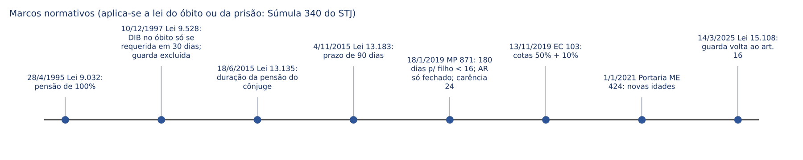
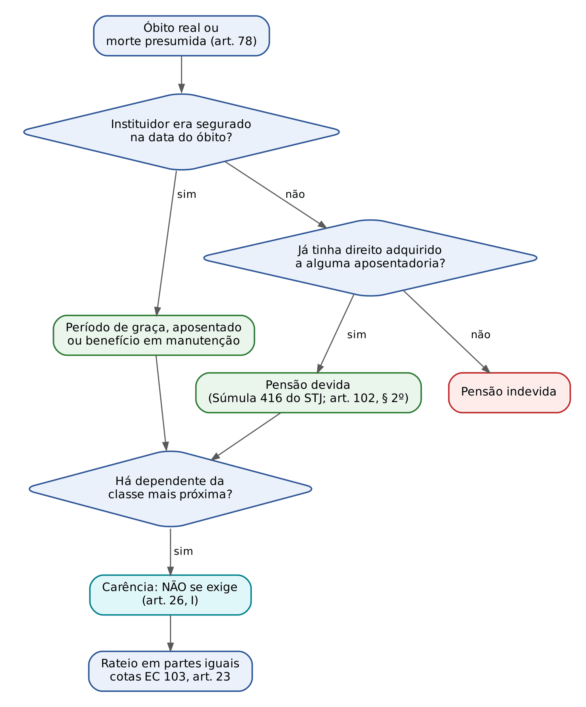
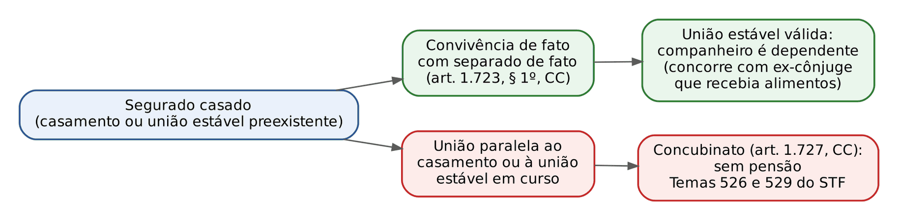
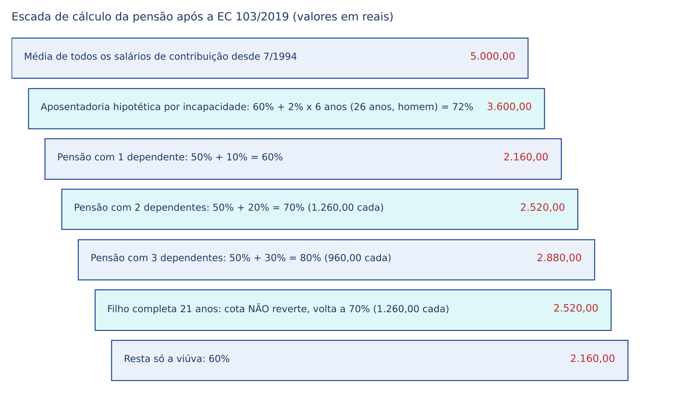
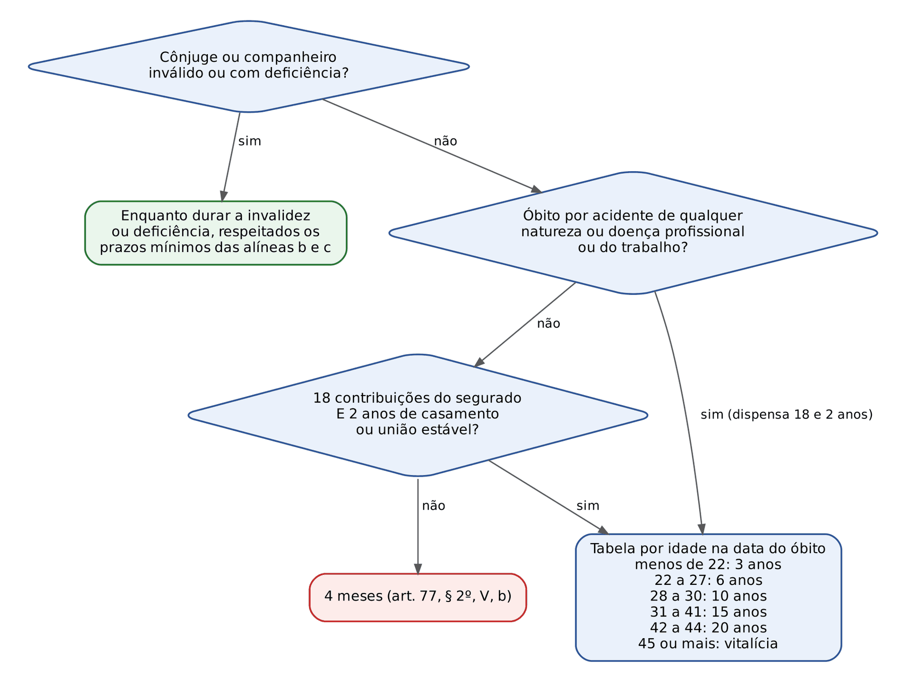
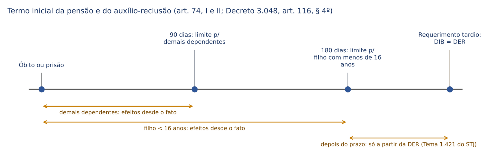
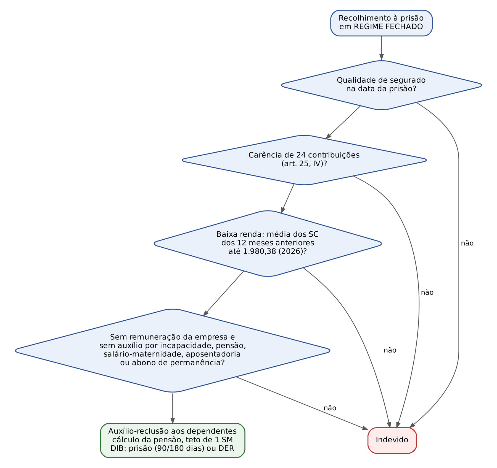

# CAPÍTULO 16 — PENSÃO POR MORTE E AUXÍLIO-RECLUSÃO

:::INCIDENCIA
TRF5 p. 8. Nível A+. Lote: 13 questões (FGV 10, FCC 3), mais 9 correlatas localizadas no banco.
O que mais cai: quem recebe (classes e concorrência no caso concreto), ausência de carência da pensão x carência de 24 meses do auxílio-reclusão, cotas da EC 103/2019, duração da pensão do cônjuge, DIB (90 e 180 dias), concubinato (Temas 526 e 529 do STF) e baixa renda do preso.
:::

| Subtema | FGV | FCC | Padrão de cobrança |
|---|---|---|---|
| Quem recebe a pensão (classes, concorrência, filho maior, irmão, pais) | 5 | 1 | caso narrado com família numerosa; exclusão das classes seguintes; filho de 20 anos x de 27 anos |
| Carência (pensão sem carência; auxílio-reclusão com 24 meses) | 1 | 0 | segurado morto no primeiro mês de trabalho; facultativo preso com menos de 24 contribuições |
| Valor (cotas da EC 103/2019; dependente com deficiência) | 1 | 0 | percentual final em família com filho com deficiência intelectual |
| DIB, perda do direito, rateio (letra do art. 74 e do art. 77) | 1 | 0 | alternativa literal com 180 e 90 dias; "processo administrativo ou judicial" e "partes proporcionais" como armadilhas |
| Ex-cônjuge que renunciou aos alimentos (Súmula 336 do STJ) | 1 | 0 | necessidade econômica superveniente |
| Concubinato e uniões simultâneas | 1 | 1 | transcrição quase literal da tese do Tema 526 |
| Auxílio-reclusão (renda do preso, prestação do dependente) | 1 | 1 | Tema 89 do STF; benefício devido ao dependente |

## 16.1 Visão de conjunto e direito intertemporal

### 16.1.1 Natureza, fato gerador e lei aplicável

A pensão por morte e o auxílio-reclusão são as duas únicas prestações do RGPS devidas EXCLUSIVAMENTE ao dependente (art. 18, II, da Lei 8.213/1991; os serviços social e de reabilitação profissional são comuns a segurado e dependente, art. 18, III). O titular do direito é o dependente, em nome próprio; o segurado é apenas o instituidor. Daí três consequências práticas: (a) a legitimidade ativa para pedir o benefício é do dependente; (b) os requisitos de dependência são aferidos na data do fato gerador (óbito ou recolhimento à prisão); (c) o benefício é "derivado" quando o instituidor já era aposentado, porque o valor da pensão parte da aposentadoria que ele recebia.

O fato gerador da pensão é o óbito (real ou presumido); o do auxílio-reclusão, o recolhimento à prisão em regime fechado. Vale a lei vigente na data do fato gerador (*tempus regit actum*), regra sumulada pelo STJ para a pensão e aplicada por igual ao auxílio-reclusão. O ponto é decisivo porque a disciplina mudou cinco vezes em 30 anos; o juiz que recebe um processo em 2026 pode julgar pensões de óbitos de 1996, de 2014 ou de 2020, cada uma com regime próprio (direito intertemporal geral: Cap. 22).

:::JURIS STJ, Súmula 340
"A lei aplicável à concessão de pensão previdenciária por morte é aquela vigente na data do óbito do segurado." Não importa a data do requerimento nem a da sentença. O STF chegou à mesma conclusão ao recusar a aplicação retroativa da majoração do coeficiente da pensão para 100% (Lei 9.032/1995) às pensões concedidas antes dela (orientação do Plenário em 2007; número não conferido nesta tarefa: ver nota).
:::

:::JURIS STF, Súmula 613
"Os dependentes de trabalhador rural não têm direito a pensão previdenciária, se o óbito ocorreu anteriormente à vigência da Lei Complementar nº 11/71." Hoje tem valor quase só histórico, mas ilustra a regra da Súmula 340 do STJ.
:::

### 16.1.2 Quadro de regimes por data do óbito

| Óbito | Termo inicial | Valor | Duração para cônjuge ou companheiro | Observação |
|---|---|---|---|---|
| Até 28/4/1995 | óbito | parcela familiar mais parcelas por dependente (redação original do art. 75) | vitalícia | Lei 9.032/1995 não retroage |
| 29/4/1995 a 10/12/1997 | óbito, sem prazo | 100% da aposentadoria recebida ou da que teria direito por invalidez | vitalícia | |
| 11/12/1997 a 4/11/2015 | óbito, se requerida em 30 dias; depois, a DER | 100% | vitalícia, salvo óbitos alcançados pela MP 664/2014 e pela Lei 13.135/2015 (ver 16.5) | guarda excluída do rol a partir das MPs de 1996, convertidas na Lei 9.528/1997 |
| 5/11/2015 a 17/1/2019 | óbito, se requerida em 90 dias | 100% | tabela por idade (Lei 13.135/2015) | |
| 18/1/2019 a 12/11/2019 | óbito, se requerida em 180 dias (filho com menos de 16 anos) ou 90 dias (demais) | 100% | tabela por idade | MP 871/2019 e Lei 13.846/2019: prova material contemporânea, perda por homicídio, habilitação provisória |
| A partir de 13/11/2019 | idem | cotas: 50% + 10% por dependente (EC 103/2019, art. 23) | tabela por idade (novas idades para óbitos a partir de 1/1/2021) | cotas não reversíveis |

:::ATENCAO Datas de corte da duração da pensão
A limitação temporal da pensão do cônjuge nasceu na MP 664/2014 (publicada em 30/12/2014), com vigência diferida, e foi remodelada pela Lei 13.135/2015 (17/6/2015). Para óbitos no intervalo de vigência da MP, aplica-se o texto da MP com as ressalvas da lei de conversão (o art. 5º da Lei 13.135/2015 convalidou os atos praticados). Em prova objetiva, a regra cobrada é a da Lei 13.135/2015, com as idades da Portaria ME 424/2020 para óbitos a partir de 1/1/2021. Datas de vigência da MP 664/2014 não foram conferidas nesta tarefa (ver nota).
:::

## 16.2 Requisitos da pensão por morte

A pensão exige três elementos, e nenhum deles é a carência: (1) óbito do instituidor; (2) qualidade de segurado do instituidor na data do óbito, ou direito adquirido a alguma aposentadoria; (3) existência de dependente habilitado. O primeiro é fato; o segundo é matéria de custeio e de filiação (período de graça: Cap. 8); o terceiro é matéria do rol do art. 16 (desenvolvido no Cap. 8), cujos reflexos próprios da pensão estão em 16.3.

### 16.2.1 Ausência de carência e a "carência disfarçada" das 18 contribuições

A pensão por morte independe de carência (art. 26, I, da Lei 8.213/1991, na redação da Lei 13.846/2019). Basta que o instituidor seja segurado no dia do óbito; um único dia de vínculo empregatício, por exemplo, gera pensão. O que a Lei 13.135/2015 criou NÃO foi carência, e sim um critério de DURAÇÃO da cota do cônjuge ou companheiro: sem 18 contribuições mensais do segurado (ou sem 2 anos de casamento ou união estável), a cota do cônjuge dura só 4 meses (art. 77, § 2º, V, "b"; ver 16.5). Os filhos e demais dependentes não são afetados por esse critério.

:::QUESTAO FGV 2025 — TRF-1 — Juiz Federal (Q3425278)
Caso: segurado empregado morre em acidente do trabalho antes de completar um mês de serviço; pergunta-se sobre o direito da viúva. Gabarito: E (há direito, porque o segurado já era filiado e a pensão não tem carência). Armadilhas: "carência não cumprida" (A); "18 meses de contribuição" (C), que confunde duração com carência; exigir prova de dependência econômica da esposa (B), que é presumida (art. 16, § 4º). Note ainda que, sendo o óbito acidentário, nem a regra dos 4 meses se aplica: a viúva entra direto na tabela por idade (art. 77, § 2º-A).
:::

:::QUESTAO FCC 2025 — TRF-4 — Oficial de Justiça (Q3562235)
Caso: segurada empregada há três meses morre em acidente de trânsito; viúvo casado há 35 anos e aposentado pelo INSS; filhos de 30, 27 e 20 anos. Gabarito: A (pensão ao viúvo e ao filho de 20 anos). Passos: (1) sem carência, a pensão é devida; (2) filhos de 30 e 27 anos não são dependentes (art. 16, I, limite de 21 anos); (3) o viúvo aposentado é dependente presumido e pode acumular aposentadoria e pensão (Cap. 12); (4) como a segurada tinha só 3 contribuições e o acidente de trânsito é "acidente de qualquer natureza", aplica-se o § 2º-A do art. 77: o viúvo não fica limitado a 4 meses e recebe pela tabela de idade (provavelmente vitalícia, pela idade presumível). Armadilha: alternativa C (carência).
:::

### 16.2.2 Qualidade de segurado do instituidor

A regra é a manutenção da qualidade de segurado na data do óbito, inclusive durante o período de graça (art. 15 da Lei 8.213/1991; prazos no Cap. 8). Três situações exigem atenção:

- Segurado em gozo de benefício: mantém a qualidade sem limite de prazo (art. 15, I), salvo o auxílio-acidente, que não impede a perda.
- Segurado que perdeu a qualidade, mas já havia implementado os requisitos de alguma aposentadoria: a pensão é devida (art. 102, § 2º, da Lei 8.213/1991 e Súmula 416 do STJ). O raciocínio é de direito adquirido: o falecido poderia ter se aposentado a qualquer tempo, e a pensão seria derivada da aposentadoria.
- Segurado que perdeu a qualidade porque estava incapaz: se a incapacidade surgiu enquanto ele ainda era segurado, ele tinha direito a benefício por incapacidade, e a qualidade se considera mantida (orientação pacífica nos tribunais, com prova pericial indireta, feita sobre prontuários).

:::JURIS STJ, Súmula 416
"É devida pensão por morte aos dependentes do segurado que, apesar de ter perdido essa qualidade, preencheu os requisitos legais para a obtenção de sua aposentadoria até a data do seu óbito." Atenção: não basta ter muitas contribuições; é preciso que TODOS os requisitos de uma aposentadoria (idade, tempo, carência) estivessem reunidos na data do óbito.
:::

:::PEGADINHA Contribuinte individual e recolhimento depois da morte
O contribuinte individual recolhe as próprias contribuições. Se morreu em débito, os herdeiros NÃO podem recolher as competências atrasadas para gerar qualidade de segurado. A TNU sumulou: é incabível a regularização *post mortem* das contribuições do contribuinte individual para fins de pensão, "exceto quando as contribuições devam ser arrecadadas por empresa tomadora de serviços" (Súmula 52 da TNU). No mesmo sentido o STJ (AgInt no REsp 1.568.139/SP, Primeira Turma, DJe 23/5/2018). A exceção decorre da obrigação de retenção do tomador: se o falecido prestava serviço a pessoa jurídica, a falta de recolhimento é do tomador, e a qualidade de segurado se prova pelo exercício da atividade (remuneração de recolhimento presumido; responsabilidade do tomador no Cap. 5).
:::

:::EXEMPLO Segurado desempregado que morre no 15º mês sem contribuir
Empregado com 96 contribuições (8 anos) é demitido em janeiro de 2025 e não volta a contribuir; morre em abril de 2026, no 15º mês sem contribuição. Passo 1: graça básica de 12 meses (art. 15, II). Passo 2: não há o acréscimo de 12 meses do § 1º, porque ele não tem mais de 120 contribuições. Passo 3: se provar a situação de desemprego (registro no órgão do Ministério do Trabalho ou, segundo a jurisprudência, outros meios), a graça sobe para 24 meses (§ 2º), e o óbito no 15º mês está coberto: há pensão. Passo 4: sem essa prova, a graça é de 12 meses, a qualidade se perde antes de abril de 2026 (§ 4º: no dia seguinte ao fim do prazo de recolhimento da competência seguinte ao término da graça) e a pensão só é devida se houver direito adquirido a alguma aposentadoria (Súmula 416). Contagem exata dos prazos de graça: Cap. 8.
:::

### 16.2.3 Morte presumida e desaparecimento

| Hipótese | Requisito | Pensão | Termo inicial | Fundamento |
|---|---|---|---|---|
| Ausência declarada pelo juiz | 6 meses de ausência e declaração judicial | provisória | data da decisão judicial | art. 78, *caput*, e art. 74, III |
| Desaparecimento em acidente, desastre ou catástrofe | prova do desaparecimento | provisória, sem declaração judicial e sem o prazo de 6 meses | data da ocorrência (por coerência com o § 1º do art. 78; o INSS a fixa na data do evento) | art. 78, § 1º |
| Reaparecimento | volta do segurado | cessa imediatamente | | art. 78, § 2º: sem reposição, salvo má-fé |

A declaração do art. 78 é previdenciária, para fins exclusivos de pensão, e não se confunde com a declaração de ausência e a sucessão provisória do Código Civil; a competência para a ação contra o INSS é da Justiça Federal (Cap. 20). A Primeira Turma do STJ decidiu em 2026 que, na morte presumida, a pensão começa na data da decisão que declara a ausência, ainda que o beneficiário seja criança absolutamente incapaz: a incapacidade impede a prescrição das parcelas, mas não desloca o termo inicial para a data presumida da morte (notícia de 11/9/2026, Relator Ministro Gurgel de Faria; número do processo não visto: ver nota).

## 16.3 Beneficiários: o rol do art. 16 aplicado à pensão

O rol, as classes, a presunção de dependência e a prova estão no Cap. 8. Aqui interessam os pontos que DECIDEM quem recebe a pensão no caso concreto, que é o formato preferido da FGV.

### 16.3.1 Classes e concorrência

| Classe | Quem | Dependência | Efeito |
|---|---|---|---|
| I | cônjuge, companheiro ou companheira (inclusive homoafetivos), filho não emancipado menor de 21 anos ou inválido ou com deficiência intelectual, mental ou grave; equiparados a filho (enteado, tutelado e, desde a Lei 15.108/2025, o sob guarda judicial, ver 16.3.4); ex-cônjuge ou ex-companheiro que recebia alimentos (art. 76, § 2º) | presumida para os do inciso I; comprovada para equiparados e para o ex-cônjuge (que prova o recebimento de alimentos) | concorrem entre si em partes iguais |
| II | pais | comprovada | só recebem se não houver ninguém da classe I |
| III | irmão não emancipado menor de 21 anos ou inválido ou com deficiência intelectual, mental ou grave | comprovada | só recebe se não houver ninguém das classes I e II |

A regra de ouro é o § 1º do art. 16: a existência de dependente de qualquer classe EXCLUI os das classes seguintes. Não há rateio entre classes, e a exclusão é definitiva: se o único dependente da classe I perde a qualidade (filho que completa 21 anos), a pensão se extingue; ela não "desce" para os pais (art. 77, § 3º, e a lógica da habilitação na data do óbito). Sobrinho, neto (salvo se sob guarda ou tutela), avós, primo, tio e genro não são dependentes no RGPS, por mais que dependessem do segurado.

:::QUESTAO FGV 2026 — TJ-PR — Juiz Substituto (Q3898985)
Caso: casal de contribuintes individuais morre no mesmo acidente; deixa filhos naturais de 19 e 16 anos, filho adotivo de 12 anos, pais idosos dependentes, irmã de 27 anos dependente e sobrinho com deficiência grave dependente. Gabarito: E (só os três filhos). Passos: (1) os três filhos são classe I (o adotado é filho, sem distinção: CF, art. 227, § 6º); (2) a classe I exclui os pais (classe II) e a irmã; (3) a irmã também não seria dependente pela idade (27 anos, sem invalidez); (4) sobrinho não integra o rol, mesmo com deficiência. Detalhe que a questão não explora: são DUAS pensões, uma por instituidor; os filhos podem receber ambas, porque a acumulação de pensões vedada é a de cônjuge ou companheiro (art. 124, VI, e Cap. 12).
:::

:::QUESTAO FGV 2025 — Procurador de Abreu e Lima (Q3841705)
Caso: segurada solteira morre em acidente do trabalho; deixa filho adotivo de 19 anos, pais e irmã de 28 anos, todos dependentes economicamente. Gabarito: C (só o filho). A classe I exclui as demais; a irmã de 28 anos nem seria dependente. Armadilhas: rateio entre classes (A e E); irmã como "classe 1" (D).
:::

:::QUESTAO FGV 2025 — Procurador de Canaã dos Carajás (Q3265488)
Caso: segurada morre em 2024; viúvo e dois filhos solteiros capazes de 27 e 20 anos. Gabarito: C (viúvo e filho de 20 anos). No mesmo sentido, com a mesma estrutura: Q3562235 (16.2.1). Ponto de atenção: o filho de 20 anos receberá só até completar 21 anos, e sua cota NÃO reverte ao viúvo depois da EC 103/2019 (16.4).
:::

Q3538968 (FCC, 2025, TRF-4, Técnico Judiciário): cobrou quem recebe a pensão entre companheira, ex-cônjuge com alimentos, irmão inválido, filho universitário de 28 anos e dois filhos com menos de 21 anos, gabarito D (companheira, ex-cônjuge e os dois filhos com menos de 21 anos) — comentada no Cap. 8.

:::PEGADINHA Mãe do segurado casado
Na FGV 2025 (CNU, Q3641521), afirmou-se que o segurado "viabilizará a concessão de pensão por morte para sua mãe", mesmo sendo casado e com filhos menores de 21 anos, desde que comprovada a dependência econômica. Errado: havendo cônjuge e filhos (classe I), os pais (classe II) estão excluídos, por mais que provem dependência.
:::

### 16.3.2 Filho maior: universitário, inválido e com deficiência

- Filho universitário: a pensão cessa aos 21 anos, sem prorrogação para concluir curso superior. Não se aplica a lógica dos alimentos civis (que podem ir até 24 anos ou até a formação). Tema 643 do STJ.
- Filho inválido: é dependente da classe I a qualquer idade, desde que a invalidez seja ANTERIOR ao óbito do segurado. É irrelevante se a invalidez surgiu antes ou depois dos 21 anos (Jurisprudência em Teses do STJ, ed. 207, tese 3). O art. 108 do Decreto 3.048/1999, na redação do Decreto 10.410/2020, também passou a exigir apenas que a invalidez ou a deficiência tenha ocorrido antes do óbito (a redação anterior exigia invalidez antes dos 21 anos ou da emancipação, exigência rejeitada pela jurisprudência). A mesma lógica vale para o irmão inválido, que prova dependência (tese 4 da mesma edição).
- Filho com deficiência intelectual, mental ou grave: também é dependente sem limite de idade (Lei 13.146/2015, na redação do art. 16, I). O exercício de atividade remunerada, inclusive como MEI, NÃO impede a concessão nem a manutenção da cota (art. 77, § 6º). Para o inválido, ao contrário, trabalho remunerado é indício de recuperação da capacidade.
- Dependência do filho maior inválido: a presunção do § 4º do art. 16 abrange literalmente "as pessoas indicadas no inciso I", e o filho inválido está no inciso I; há, porém, julgados do STJ que tratam essa presunção como relativa e admitem que o INSS demonstre a independência econômica (por exemplo, filho inválido que já recebe aposentadoria própria). Em prova objetiva, prevalece a letra: dependência presumida.
- Invalidez ou deficiência reconhecida previamente: a condição do dependente pode ser reconhecida antes do óbito, por avaliação biopsicossocial, com revisão periódica (EC 103/2019, art. 23, § 5º; Decreto 3.048/1999, art. 108, § 2º).

:::JURIS STJ, Tema 643 (REsp 1.369.832/SP, j. 12/6/2013)
"O filho maior de 21 anos, ainda que esteja cursando o ensino superior, não tem direito à pensão por morte, ressalvadas as hipóteses de invalidez ou deficiência mental ou intelectual previstas no art. 16, I, da Lei 8.213/1991." Questões de FCC e FGV insistem no "universitário de 22 ou 24 anos": não recebe.
:::

Pela Jurisprudência em Teses do STJ, ed. 207, tese 3, basta que a invalidez do filho preceda o óbito, sendo irrelevante se surgiu antes ou depois da maioridade (v. Cap. 8; para o servidor federal, teses 5 e 6, v. Cap. 23).

### 16.3.3 Cônjuge, companheiro, ex-cônjuge e cônjuge ausente

- Cônjuge e companheiro: dependência presumida (art. 16, § 4º). A união estável segue o conceito do art. 226, § 3º, da CF e do Código Civil (art. 16, § 3º), incluída a homoafetiva.
- Prova da união estável e da dependência econômica: desde a MP 871/2019 (Lei 13.846/2019), exige-se início de prova material contemporânea, produzida nos 24 meses anteriores ao óbito ou à prisão, sem prova exclusivamente testemunhal, salvo força maior ou caso fortuito (art. 16, § 5º). Para afastar a regra dos 4 meses, exige-se ainda início de prova material de que a união existia havia pelo menos 2 anos antes do óbito (art. 16, § 6º). Rol de documentos e valoração da prova: Cap. 8 (e Q3425280, FGV 2025, TRF-1, que pediu documento admitido como prova de vida em comum: conta bancária conjunta usada até o óbito).
- Cônjuge separado de fato ou divorciado: só é dependente se recebia pensão de alimentos (art. 76, § 2º), e então concorre em igualdade com a classe I. Se os alimentos eram TEMPORÁRIOS por determinação judicial, a pensão dura apenas o prazo remanescente na data do óbito (art. 76, § 3º, incluído pela Lei 13.846/2019), salvo outra hipótese de cancelamento anterior.
- Cônjuge que renunciou aos alimentos: tem direito à pensão se provar necessidade econômica superveniente (Súmula 336 do STJ). A renúncia não é obstáculo absoluto: o que se protege é a necessidade atual do ex-cônjuge na data do óbito, a ser provada por quem pede.
- Cônjuge ausente: não exclui o companheiro; só recebe a partir da habilitação e com prova de dependência econômica (art. 76, § 1º).

:::JURIS STJ, Súmula 336
"A mulher que renunciou aos alimentos na separação judicial tem direito à pensão previdenciária por morte do ex-marido, comprovada a necessidade econômica superveniente." O enunciado fala em "mulher" e "ex-marido" por ser de 2007, mas aplica-se a qualquer ex-cônjuge.
:::

:::QUESTAO FGV 2025 — MPU — Analista (Q3339798)
Caso: separação em 2002 com renúncia a alimentos; em 2023 a ex-esposa sofre acidente que a torna incapaz e curatelada; em seguida morre o ex-marido, servidor de autarquia federal. Gabarito: C (direito à pensão pelo fato superveniente que gerou incapacidade e impossibilidade de autossustento). Fundamento: Súmula 336 do STJ, aplicada também ao regime da Lei 8.112/1990. Armadilhas: remeter a autora aos alimentos da filha (A e E) ou condicionar o direito ao enquadramento como pessoa com deficiência (B).
:::

:::DICA Ex-cônjuge com alimentos e a cota da EC 103/2019
O ex-cônjuge alimentando conta como dependente para o acréscimo de 10 pontos percentuais e recebe cota igual à dos demais, ainda que os alimentos fossem de valor menor. A pensão previdenciária não é limitada ao valor dos alimentos: o art. 76, § 2º, manda concorrer "em igualdade de condições".
:::

### 16.3.4 Criança e adolescente sob guarda

A sucessão de regimes (redação original do art. 16, § 2º; exclusão pela Lei 9.528/1997; Tema 732 do STJ e ADIs 4.878 e 5.083 do STF; art. 23, § 6º, da EC 103/2019 e Tema 1.271 do STF, pendente; reinclusão pela Lei 15.108/2025) está desenvolvida no Cap. 8 (8.2.6). Para a pensão, o que decide é a DATA DO ÓBITO (Súmula 340 do STJ):

| Óbito | Criança ou adolescente sob guarda | Remissão |
|---|---|---|
| Até 12/11/2019 | tem direito à pensão, provada a dependência econômica | Cap. 8 (Tema 732 do STJ; ADIs 4.878 e 5.083) |
| De 13/11/2019 a 13/3/2025 | excluída pelo art. 23, § 6º, da EC 103/2019 ("exclusivamente o enteado e o menor tutelado"), salvo decisão do STF em sentido contrário | Cap. 8 (Tema 1.271 do STF) |
| A partir de 14/3/2025 | equiparada a filho, com declaração do segurado e insuficiência de condições de sustento e educação | art. 16, § 2º (Lei 15.108/2025); Cap. 8 |

Reflexos próprios da pensão: o equiparado habilitado conta para o acréscimo de 10 pontos percentuais do art. 23 da EC 103/2019; sua cota cessa aos 21 anos, salvo invalidez ou deficiência (art. 77, § 2º, II); e a Lei 15.108/2025 não alcança óbitos anteriores à sua publicação.

:::JURIS STJ, Jurisprudência em Teses, ed. 207, tese 2 (EREsp 1.104.494/RS, Corte Especial, DJe 2/3/2021)
É possível estender a pensão para além da condição de sob guarda ao neto maior absolutamente incapaz que vivia sob dependência e guarda do avô, em razão do Estatuto da Pessoa com Deficiência. Caso-limite: a guarda cessa com a maioridade, mas a incapacidade e a dependência justificaram a manutenção.
:::

:::PEGADINHA Enteado e tutelado
Enteado e tutelado NUNCA saíram do rol; sempre exigiram prova de dependência (antes, "comprovada a dependência econômica"; hoje, declaração do segurado e insuficiência de condições de sustento). Na EC 103/2019, art. 23, § 6º, a expressão é "exclusivamente o enteado e o menor tutelado, desde que comprovada a dependência econômica": a FCC adora o "exclusivamente". Neto que vive com o avô SEM guarda judicial não é dependente.
:::

### 16.3.5 Concubinato e uniões simultâneas (Temas 526 e 529 do STF)

O STF fechou a porta para o rateio da pensão entre o cônjuge (ou companheiro) e quem manteve relação paralela. São duas teses complementares:

:::JURIS STF, Tema 526 (RE 883.168/SC, j. 2/8/2021)
"É incompatível com a Constituição Federal o reconhecimento de direitos previdenciários (pensão por morte) à pessoa que manteve, durante longo período e com aparência familiar, união com outra casada, porquanto o concubinato não se equipara, para fins de proteção estatal, às uniões afetivas resultantes do casamento e da união estável."
:::

:::JURIS STF, Tema 529 (RE 1.045.273, Relator Ministro Alexandre de Moraes, j. 21/12/2020)
"A preexistência de casamento ou de união estável de um dos conviventes, ressalvada a exceção do artigo 1.723, § 1º, do Código Civil, impede o reconhecimento de novo vínculo referente ao mesmo período, inclusive para fins previdenciários, em virtude da consagração do dever de fidelidade e da monogamia pelo ordenamento jurídico-constitucional brasileiro." O caso concreto envolvia união homoafetiva paralela a união estável heteroafetiva.
:::

A mecânica é esta: (1) verifica-se se, no período, havia casamento ou união estável anterior; (2) se havia e o segurado NÃO estava separado de fato, a segunda relação é concubinato (CC, art. 1.727) e não gera pensão, ainda que longa, pública e com filhos; (3) se o segurado estava separado de fato, a nova relação é união estável válida (CC, art. 1.723, § 1º), e o novo companheiro é dependente; o cônjuge separado de fato só concorre se recebia alimentos (art. 76, § 2º). A boa-fé do concubino (que ignorava o casamento) não altera o resultado no Tema 526: a tese não faz ressalva, e a FGV (Q4102129) cobrou exatamente o caso de duas mulheres que desconheciam uma à outra.

:::QUESTAO FCC 2024 — Procurador de Jaboatão dos Guararapes (Q3542155)
Caso: dez anos de união com aparência familiar, paralela a casamento do segurado em comunhão de bens. Gabarito: C (nenhum direito previdenciário: transcrição da tese do Tema 526). Armadilhas: alternativas que misturam meação e herança ("um terço" ou "metade dos bens") com pensão e invocam "direito humano fundamental" ou "supralegalidade". No mesmo sentido: FGV 2026, TJ-BA, Juiz Leigo (Q4102129), gabarito C, que rejeita rateio proporcional ao tempo de convivência e rejeita a tese de que fidelidade e monogamia não têm estatura constitucional (o Tema 529 diz o contrário).
:::

:::DICA Filhos do concubinato
A tese atinge apenas o concubino. Os filhos havidos da relação paralela são filhos (CF, art. 227, § 6º) e dividem a pensão com a viúva e os demais filhos em partes iguais. Também não se confunde com a multiparentalidade (Tema 622 do STF): o filho com pai socioafetivo e pai biológico reconhecidos pode ser dependente de ambos.
:::

## 16.4 Valor da pensão: cotas, rateio e não reversibilidade

### 16.4.1 A regra da EC 103/2019

Para óbitos a partir de 13/11/2019, a pensão do RGPS (e do servidor federal) é calculada em duas etapas: primeiro se encontra a BASE (aposentadoria recebida pelo segurado, ou a aposentadoria por incapacidade permanente a que teria direito na data do óbito); depois se aplica o PERCENTUAL (cota familiar de 50% mais 10 pontos percentuais por dependente, até 100%). O art. 75 da Lei 8.213/1991 continua no texto com a regra antiga (100%), mas foi superado pelo art. 23 da EC 103/2019 enquanto não sobrevier lei (§ 7º do art. 23).

:::LEI EC 103/2019, art. 23, *caput* e §§ 1º a 3º
"A pensão por morte concedida a dependente de segurado do Regime Geral de Previdência Social ou de servidor público federal será equivalente a uma cota familiar de 50% (cinquenta por cento) do valor da aposentadoria recebida pelo segurado ou servidor ou daquela a que teria direito se fosse aposentado por incapacidade permanente na data do óbito, acrescida de cotas de 10 (dez) pontos percentuais por dependente, até o máximo de 100% (cem por cento)."
§ 1º "As cotas por dependente cessarão com a perda dessa qualidade e não serão reversíveis aos demais dependentes, preservado o valor de 100% (cem por cento) da pensão por morte quando o número de dependentes remanescente for igual ou superior a 5 (cinco)."
§ 2º Havendo dependente inválido ou com deficiência intelectual, mental ou grave, a pensão será de 100% da aposentadoria (recebida ou hipotética por incapacidade permanente) até o limite máximo de benefícios do RGPS (inciso I) e, sobre o que superar esse limite, cota familiar de 50% mais 10 pontos por dependente (inciso II).
§ 3º "Quando não houver mais dependente inválido ou com deficiência intelectual, mental ou grave, o valor da pensão será recalculado na forma do disposto no *caput* e no § 1º."
:::

:::JURIS STF, ADI 7.051 (Relator Ministro Roberto Barroso, sessão virtual encerrada em 23/6/2023)
"É constitucional o art. 23, *caput*, da Emenda Constitucional nº 103/2019, que fixa novos critérios de cálculo para a pensão por morte no Regime Geral e nos Regimes Próprios de Previdência Social." Maioria, vencidos o Ministro Edson Fachin e a Ministra Rosa Weber. Questionava-se sobretudo a pensão de segurado que morre ANTES de se aposentar, cuja base é a aposentadoria hipotética por incapacidade (que também encolheu com a EC 103). No mesmo sentido, quanto à limitação temporal e aos requisitos da pensão do cônjuge criados pela Lei 13.135/2015: ADIs 5.340 e 5.389 (16.5).
:::

### 16.4.2 A base de cálculo

| Situação do instituidor na data do óbito | Base da pensão | Fundamento |
|---|---|---|
| Aposentado | valor da aposentadoria que recebia (com reajustes) | EC 103, art. 23 |
| Não aposentado, morte por causa comum | aposentadoria hipotética por incapacidade permanente: 60% da média de 100% dos salários de contribuição desde 7/1994, mais 2 pontos percentuais por ano de contribuição que exceder 20 anos (homem) ou 15 anos (mulher) | EC 103, art. 26, *caput*, § 2º, III, e § 5º |
| Não aposentado, morte por acidente do trabalho, doença profissional ou do trabalho | aposentadoria hipotética por incapacidade permanente acidentária: 100% da média | EC 103, art. 26, § 3º, II |
| Recluso que contribuiu durante a reclusão | considera-se o tempo e os salários adicionais, facultada a opção pelo valor do auxílio-reclusão | Lei 8.213, art. 80, § 8º |
| Instituidor que recebia auxílio-reclusão ao morrer | o auxílio-reclusão cessa e se concede pensão, recalculada pelas regras da pensão (sem o teto de 1 salário mínimo) | Decreto 3.048, art. 118 |

A média, o divisor e os coeficientes são do Cap. 11; o que importa aqui é que a "morte comum" de um segurado jovem gera base baixa (60%), e a "morte acidentária" gera base cheia (100%). Atenção: o acidente que eleva a base é o acidente DO TRABALHO (e equiparadas), não o "acidente de qualquer natureza"; já para a duração da pensão do cônjuge (art. 77, § 2º-A), basta acidente de qualquer natureza. São critérios diferentes para fins diferentes.

### 16.4.3 Escadas de cálculo

:::EXEMPLO Escada 1: segurado não aposentado, morte comum, 1, 2 e 3 dependentes
Dados: homem, 26 anos de contribuição, média de todos os salários de contribuição desde 7/1994 igual a 5.000,00; óbito em 2026 por infarto.
Passo 1 (base): coeficiente = 60% + 2% x (26 − 20) = 72%; base = 5.000,00 x 72% = 3.600,00.
Passo 2 (percentual por número de dependentes): 1 dependente = 60%; 2 = 70%; 3 = 80%; 4 = 90%; 5 ou mais = 100%.
Passo 3 (valor): 1 dependente: 3.600,00 x 60% = 2.160,00. 2 dependentes: 3.600,00 x 70% = 2.520,00, ou 1.260,00 para cada um. 3 dependentes: 3.600,00 x 80% = 2.880,00, ou 960,00 para cada um. 5 dependentes: 3.600,00 (720,00 cada).
Passo 4 (cessação de uma cota): viúva e dois filhos (80%); o filho mais velho completa 21 anos; restam 2 dependentes, a pensão cai para 70% (2.520,00, ou 1.260,00 cada). A cota de 10 pontos que se extinguiu NÃO reverte; a única coisa que se redistribui é o total remanescente entre os que ficam.
:::

:::EXEMPLO Escada 2: piso de 1 salário mínimo
Dados: homem, 20 anos de contribuição, média 2.400,00, morte comum em 2026, só a viúva.
Base: 2.400,00 x 60% = 1.440,00. Pensão: 1.440,00 x 60% = 864,00. Como a pensão substitui o rendimento do trabalho, não pode ser inferior ao salário mínimo (CF, art. 201, § 2º): paga-se 1.621,00 (salário mínimo de 2026, também piso do salário de benefício segundo a Portaria Interministerial MPS/MF 13/2026). O piso incide sobre o VALOR GLOBAL da pensão, não sobre cada cota: com 3 dependentes e pensão global no piso, cada um recebe um terço de um salário mínimo.
:::

:::EXEMPLO Escada 3: dependente com deficiência e recálculo
Dados: aposentado recebia 3.200,00; deixa a viúva e um filho com deficiência intelectual de 30 anos.
Regra do art. 23, § 2º, I: pensão = 100% de 3.200,00 = 3.200,00 (1.600,00 para cada um), porque o valor está abaixo do teto do RGPS (8.475,55 em 2026). Se o filho falecer, recalcula-se pelo *caput*: só a viúva, 60% de 3.200,00 = 1.920,00 (§ 3º). No RGPS a aposentadoria nunca passa do teto, de modo que o inciso II do § 2º só tem utilidade prática no RPPS da União (servidores anteriores à previdência complementar com proventos acima do teto: Cap. 23).
:::

:::EXEMPLO Escada 4: cinco ou mais dependentes
Aposentado com 6.000,00 deixa a companheira e 5 filhos (6 dependentes): 50% + 60% = 110%, limitado a 100% = 6.000,00 (1.000,00 cada). Um filho completa 21 anos: restam 5, e o § 1º preserva 100% (6.000,00, agora 1.200,00 cada). Outro completa 21: restam 4, cai para 90% = 5.400,00 (1.350,00 cada). A preservação dos 100% só funciona enquanto houver 5 ou mais.
:::

:::QUESTAO FGV 2024 — Prefeitura de Macaé (Q3047885)
Caso: segurado morre; deixa companheira (união de 10 anos) e filhos de 8 e 5 anos, o mais velho com deficiência intelectual. Pede-se o percentual. Gabarito: C (100%). Fundamento: art. 23, § 2º, da EC 103/2019. Armadilha: alternativa A (50% + 10% x 3 = 80%), que seria a resposta sem o filho com deficiência; alternativa D mistura o coeficiente da aposentadoria (60% + 2% por ano) com o da pensão.
:::

:::PEGADINHA Rateio "em partes proporcionais"
O art. 77, *caput*, manda ratear "entre todos em parte iguais". Na FGV 2025 (TRF-3, Juiz Federal, Q3179512), a alternativa D trocou "iguais" por "proporcionais" e estava errada. Nem o ex-cônjuge com alimentos baixos, nem o filho de outra relação recebem cota proporcional a nada: cada dependente habilitado recebe a mesma fração. Há, porém, uma exceção prática: quando a duração das cotas é diferente (filho até 21 anos, cônjuge vitalício), a fração é igual enquanto todos estão no benefício, e o que muda é quando cada cota termina.
:::

### 16.4.4 Antes e depois da EC 103/2019

| Ponto | Óbito até 12/11/2019 | Óbito a partir de 13/11/2019 |
|---|---|---|
| Valor | 100% da aposentadoria recebida ou da que teria por invalidez (art. 75) | 50% + 10% por dependente, até 100% (art. 23) |
| Base para não aposentado | aposentadoria por invalidez: 100% do salário de benefício (média dos 80% maiores salários de contribuição) | aposentadoria por incapacidade permanente: 60% + 2% por ano acima de 20 ou 15 anos, sobre 100% da média; 100% se acidentária |
| Cota extinta | reverte aos demais (art. 77, § 1º) | não reverte, salvo para manter 100% com 5 ou mais remanescentes |
| Dependente com deficiência ou inválido | sem regra própria (já era 100%) | 100% até o teto, enquanto durar a condição |
| Sob guarda | admitido, provada a dependência (Cap. 8) | excluído até 13/3/2025; reincluído pela Lei 15.108/2025 (Cap. 8) |
| RPPS de Estados e Municípios | | continuam as regras anteriores até lei local (art. 23, § 8º): Caps. 23 e 25 |

:::ATENCAO Art. 77, § 1º, da Lei 8.213/1991 continua no texto
O § 1º do art. 77 ("Reverterá em favor dos demais a parte daquele cujo direito à pensão cessar") continua na compilação do Planalto, mas não se aplica a óbitos posteriores à EC 103/2019, por força do art. 23, § 1º, da Emenda. Em questão de letra de lei, a FCC pode cobrar o § 1º do art. 77 como texto vigente; em questão de regra aplicável, vale a EC. Leia o enunciado: "nos termos da Lei 8.213/1991" ou "após a EC 103/2019".
:::

## 16.5 Duração da pensão e cessação das cotas

### 16.5.1 Cessação das cotas individuais

A pensão se extingue com a extinção da cota do último pensionista (art. 77, § 3º). Cada cota cessa por causas próprias:

| Dependente | Causa de cessação | Fundamento |
|---|---|---|
| Qualquer um | morte do pensionista | art. 77, § 2º, I |
| Filho, equiparado ou irmão | 21 anos, salvo invalidez ou deficiência intelectual, mental ou grave | art. 77, § 2º, II |
| Filho ou irmão inválido | cessação da invalidez | art. 77, § 2º, III |
| Filho ou irmão com deficiência | afastamento da deficiência, nos termos do regulamento | art. 77, § 2º, IV |
| Filho adotado que recebia pensão pela morte dos pais biológicos | adoção (salvo adoção do filho do cônjuge ou companheiro) | Decreto 3.048, art. 114, IV e § 2º |
| Cônjuge ou companheiro | prazos do art. 77, § 2º, V (16.5.2) | |
| Ex-cônjuge com alimentos temporários | fim do prazo remanescente dos alimentos | art. 76, § 3º; Decreto 3.048, art. 114, VII |
| Qualquer um | perda do direito por homicídio doloso | art. 77, § 2º, VI, e art. 74, § 1º (16.6) |

:::PEGADINHA Novo casamento ou nova união do pensionista
NÃO há, no RGPS, causa de cessação por novo casamento ou nova união estável do cônjuge pensionista. O que existe é a vedação de acumular duas pensões de cônjuge ou companheiro (art. 124, VI) e as faixas de redução do art. 24 da EC 103/2019 para acumulações permitidas. A viúva que enviúva de novo no RGPS cobrada na FGV 2024 (AL-PR, Q2448984, gabarito oficial E, discutível) está comentada no Cap. 12.
:::

### 16.5.2 Duração da cota do cônjuge ou companheiro

A Lei 13.135/2015 instituiu um sistema em três degraus, para óbitos posteriores à sua vigência:

:::LEI Lei 8.213/1991, art. 77, § 2º, V, e § 2º-A
"V - para cônjuge ou companheiro: a) se inválido ou com deficiência, pela cessação da invalidez ou pelo afastamento da deficiência, respeitados os períodos mínimos decorrentes da aplicação das alíneas 'b' e 'c'; b) em 4 (quatro) meses, se o óbito ocorrer sem que o segurado tenha vertido 18 (dezoito) contribuições mensais ou se o casamento ou a união estável tiverem sido iniciados em menos de 2 (dois) anos antes do óbito do segurado; c) transcorridos os seguintes períodos, estabelecidos de acordo com a idade do beneficiário na data de óbito do segurado, se o óbito ocorrer depois de vertidas 18 (dezoito) contribuições mensais e pelo menos 2 (dois) anos após o início do casamento ou da união estável: [...]"
§ 2º-A: aplicam-se a alínea "a" ou os prazos da alínea "c" "se o óbito do segurado decorrer de acidente de qualquer natureza ou de doença profissional ou do trabalho, independentemente do recolhimento de 18 (dezoito) contribuições mensais ou da comprovação de 2 (dois) anos de casamento ou de união estável."
:::

A tabela da alínea "c" tem duas versões, e o juiz precisa escolher pela data do óbito. O § 2º-B do art. 77 autoriza o Ministro a fixar novas idades, em números inteiros, depois de pelo menos 3 anos e de incremento mínimo de um ano inteiro na expectativa de sobrevida ao nascer. Com base nele, a Portaria ME 424, de 29/12/2020, elevou em um ano cada faixa para óbitos a partir de 1/1/2021. A compilação do Planalto e o art. 114 do Decreto 3.048/1999 ainda exibem as idades originais, o que é fonte frequente de erro.

| Idade do cônjuge ou companheiro na data do óbito | Óbitos até 31/12/2020 (texto da Lei 13.135/2015) | Óbitos a partir de 1/1/2021 (Portaria ME 424/2020) | Duração |
|---|---|---|---|
| faixa 1 | menos de 21 anos | menos de 22 anos | 3 anos |
| faixa 2 | 21 a 26 anos | 22 a 27 anos | 6 anos |
| faixa 3 | 27 a 29 anos | 28 a 30 anos | 10 anos |
| faixa 4 | 30 a 40 anos | 31 a 41 anos | 15 anos |
| faixa 5 | 41 a 43 anos | 42 a 44 anos | 20 anos |
| faixa 6 | 44 anos ou mais | 45 anos ou mais | vitalícia |

Não se localizou nova portaria posterior à 424/2020 alterando as idades (conferência feita em novembro de 2026; ver nota).

:::PASSO Roteiro para fixar a duração da cota do cônjuge
1. Fixe a data do óbito: até 17/6/2015 (e fora do alcance da MP 664/2014), a pensão do cônjuge é vitalícia; depois, siga o roteiro.
2. O cônjuge é inválido ou tem deficiência? Recebe enquanto durar a condição, mas nunca menos do que receberia pelas alíneas "b" ou "c".
3. O óbito decorreu de acidente de qualquer natureza ou de doença profissional ou do trabalho? Pule para o passo 5, sem verificar 18 contribuições e 2 anos.
4. O segurado tinha 18 contribuições mensais (contadas também as vertidas a RPPS: art. 77, § 5º) E o casamento ou união tinha 2 anos na data do óbito? Se faltar qualquer dos dois: 4 meses.
5. Idade do cônjuge NA DATA DO ÓBITO (não na DER, não na data da sentença) e a tabela vigente no óbito.
:::

:::EXEMPLO Quatro viúvas de 2026
Viúva A, 38 anos, casada há 10 anos, marido com 15 anos de contribuição, morte por doença comum: tabela, faixa 31 a 41 anos: 15 anos de pensão.
Viúva B, 25 anos, união estável de 1 ano, marido com 6 anos de contribuição, morte por doença comum: falta o requisito dos 2 anos de união: 4 meses.
Viúva C, mesma situação da B, mas o marido morreu atropelado (acidente de qualquer natureza): § 2º-A dispensa 18 contribuições e 2 anos: tabela, faixa 22 a 27 anos: 6 anos.
Viúva D, 44 anos, casada há 20 anos, marido com 30 anos de contribuição: faixa 42 a 44 anos: 20 anos. Se o óbito fosse em 2020 (tabela anterior), com os mesmos 44 anos seria vitalícia: eis o efeito da Portaria 424/2020.
:::

:::DICA De volta à Q3425278
Sob o ângulo da duração: a viúva do segurado que morreu no primeiro mês de trabalho, por acidente do trabalho, não fica limitada a 4 meses, porque o § 2º-A afasta as 18 contribuições e os 2 anos de casamento. Ver a resolução em 16.2.1.
:::

:::JURIS STF, ADIs 5.340 e 5.389 (Informativo 1155, j. 21/10/2024)
A Lei 13.135/2015, na parte em que disciplinou, para a pensão de cônjuges ou companheiros, "carência, período mínimo de casamento ou de união estável e período de concessão do benefício", não violou a proibição do retrocesso social nem a isonomia. Note que o próprio STF usou a palavra "carência" em sentido amplo; tecnicamente, as 18 contribuições são requisito de DURAÇÃO, e a pensão segue sem carência (art. 26, I).
:::

:::PEGADINHA As 18 contribuições
- São 18 contribuições MENSAIS, não 18 meses de filiação; e podem ter sido vertidas a qualquer tempo da vida do segurado, não necessariamente nos últimos 18 meses.
- Contam as contribuições a RPPS (art. 77, § 5º).
- Os 2 anos são de casamento OU de união estável, somados: união estável de 1 ano seguida de casamento de 1 ano e meio dá 2,5 anos, desde que a união seja provada por início de prova material (art. 16, § 6º).
- O critério só afeta o cônjuge ou companheiro. Os filhos recebem até os 21 anos qualquer que seja o número de contribuições.
:::

### 16.5.3 Dependente com deficiência que trabalha e reavaliação

O dependente com deficiência intelectual, mental ou grave pode trabalhar, inclusive como MEI, sem perder a cota (art. 77, § 6º; Decreto 3.048/1999, art. 105, § 3º). A deficiência é aferida por avaliação biopsicossocial; a invalidez, pela Perícia Médica Federal (Decreto 3.048/1999, art. 108, § 1º). A cota do filho, enteado, tutelado ou irmão que se torna inválido ou pessoa com deficiência ANTES de completar 21 anos (e enquanto ainda é pensionista) não se extingue aos 21, se confirmada a condição (Decreto 3.048/1999, art. 115); a invalidez que surge depois de cessada a cota não a restabelece, porque a qualidade de dependente já se perdeu.

## 16.6 Perda do direito à pensão

A Lei 13.135/2015 e a Lei 13.846/2019 criaram duas causas de perda que não existiam no texto original. Ambas caem com frequência na letra exata.

:::LEI Lei 8.213/1991, art. 74, §§ 1º e 2º
§ 1º "Perde o direito à pensão por morte o condenado criminalmente por sentença com trânsito em julgado, como autor, coautor ou partícipe de homicídio doloso, ou de tentativa desse crime, cometido contra a pessoa do segurado, ressalvados os absolutamente incapazes e os inimputáveis."
§ 2º "Perde o direito à pensão por morte o cônjuge, o companheiro ou a companheira se comprovada, a qualquer tempo, simulação ou fraude no casamento ou na união estável, ou a formalização desses com o fim exclusivo de constituir benefício previdenciário, apuradas em processo judicial no qual será assegurado o direito ao contraditório e à ampla defesa."
:::

| Ponto | Homicídio doloso (§ 1º) | Simulação ou fraude no casamento (§ 2º) |
|---|---|---|
| Quem perde | qualquer dependente | só cônjuge ou companheiro |
| Pressuposto | condenação criminal transitada em julgado, como autor, coautor ou partícipe, de homicídio doloso consumado OU tentado contra o segurado | simulação, fraude ou formalização com fim exclusivo de gerar benefício |
| Ressalva | absolutamente incapazes e inimputáveis | |
| Procedimento | antes do trânsito, suspensão provisória da cota em processo administrativo, com fundados indícios; absolvido, recebe as parcelas corrigidas desde a suspensão (art. 77, § 7º) | apuração em PROCESSO JUDICIAL, com contraditório e ampla defesa |
| Prazo | | "a qualquer tempo" |
| Efeito sobre a condição de dependente | exclusão definitiva da condição de dependente (art. 16, § 7º): alcança também o auxílio-reclusão | perda da pensão |

:::QUESTAO FGV 2025 — TRF-3 — Juiz Federal (Q3179512)
Assertivas sobre a pensão. Gabarito: A (transcrição do art. 74, I: 180 dias para filhos menores de 16 anos e 90 dias para os demais, contados do óbito). As erradas: B (morte presumida: devida da decisão judicial, não "30 dias após"); C (fraude no casamento apurada "em processo administrativo ou judicial": a lei exige processo JUDICIAL); D (rateio "em partes proporcionais": são partes iguais); E (requerida "60 dias após o óbito": nesse caso ainda está dentro do prazo de 90 dias e a DIB é o óbito). No mesmo sentido, na mesma prova: Q3179510, cuja alternativa D trocou "a qualquer tempo" por "em cinco anos" e foi considerada errada.
:::

:::PEGADINHA Homicídio culposo e lesão corporal seguida de morte
A perda do § 1º exige homicídio DOLOSO (ou sua tentativa). Homicídio culposo (acidente de trânsito causado pelo cônjuge, por exemplo), lesão corporal seguida de morte e induzimento ao suicídio não estão no texto; por ser norma restritiva de direito, não se amplia por analogia. O inimputável (inclusive o adolescente, que não sofre "condenação criminal") também não perde a pensão.
:::

## 16.7 Termo inicial (DIB), habilitação e processo

### 16.7.1 DIB conforme o prazo do requerimento

| Requerimento | DIB e efeitos financeiros | Fundamento |
|---|---|---|
| Filho menor de 16 anos, em até 180 dias do óbito | data do óbito | art. 74, I |
| Demais dependentes (inclusive filho de 16 a 21 anos), em até 90 dias do óbito | data do óbito | art. 74, I |
| Depois desses prazos | data do requerimento | art. 74, II |
| Morte presumida | data da decisão judicial | art. 74, III |

Duas observações técnicas. Primeira: no requerimento tardio, o Decreto 3.048/1999 fixa a DIB na data do óbito, mas só paga a partir da DER, com os reajustes do período (art. 105, § 1º). A distinção DIB x DIP importa para o valor (reajustes) e para o termo inicial da duração da cota do cônjuge. Segunda: os prazos de 90 e 180 dias são de natureza material (condicionam a retroação dos efeitos financeiros), não prescricionais nem decadenciais; o direito ao benefício em si não se perde com o atraso.

### 16.7.2 Criança absolutamente incapaz: Tema 1.421 do STJ

Antes da MP 871/2019, o filho absolutamente incapaz recebia a pensão desde o óbito, qualquer que fosse a data do requerimento, porque contra ele não corre prescrição (CC, art. 198, I; art. 103, parágrafo único, da Lei 8.213/1991; e o antigo art. 79 da Lei 8.213/1991, revogado pela Lei 13.846/2019, que afastava a prescrição e a decadência do art. 103 para o pensionista incapaz). A Lei 13.846/2019 deu ao filho menor de 16 anos um prazo maior (180 dias) e, no mesmo ato, revogou o art. 79. O STJ decidiu que a regra especial do art. 74 prevalece sobre a norma geral do Código Civil.

:::JURIS STJ, Tema 1.421 (REsp 2.256.869/SP e REsp 2.240.220/PR, Relatora Ministra Maria Thereza de Assis Moura, Primeira Seção, 2026)
"Não retroage à data do óbito ou do recolhimento à prisão o início dos efeitos financeiros da pensão por morte ou do auxílio-reclusão requerido por filho menor de 16 (dezesseis) anos após 180 (cento e oitenta) dias do evento ocorrido na vigência da modificação do art. 74, I, da Lei n. 8.213/1991, pela Medida Provisória n. 871/2019, convertida na Lei n. 13.846/2019." Marco: óbito ou prisão a partir de 18/1/2019. Para eventos anteriores, mesmo com requerimento posterior, permanece a retroação ao óbito em favor do absolutamente incapaz.
:::

:::JURIS TNU, Tema 223
"O dependente absolutamente incapaz faz jus à pensão por morte desde o requerimento administrativo, na forma do art. 76 da Lei 8.213/91, havendo outro dependente previamente habilitado e percebendo benefício, do mesmo ou de outro grupo familiar, ainda que observados os prazos do art. 74 da Lei 8.213/91" (tese ajustada em embargos de declaração na sessão de 25/2/2021). Lógica: o INSS já pagou 100% da pensão a quem estava habilitado; não pode pagar duas vezes o mesmo período.
:::

### 16.7.3 Habilitação tardia e habilitação provisória

O art. 76 é a regra de estabilidade da pensão já concedida: "A concessão da pensão por morte não será protelada pela falta de habilitação de outro possível dependente, e qualquer inscrição ou habilitação posterior que importe em exclusão ou inclusão de dependente só produzirá efeito a contar da data da inscrição ou habilitação." Consequências:

- O dependente que se habilita depois não recebe atrasados do período em que outros já recebiam (a cota deles é reduzida a partir da nova habilitação); o crédito pretérito, se houver, resolve-se entre os dependentes (Tema 223 da TNU, acima).
- Para evitar que o dependente em litígio (típico: companheiro cuja união estável é negada pelo INSS) perca valores enquanto aguarda a ação, a Lei 13.846/2019 criou a habilitação PROVISÓRIA, só para fins de rateio: o INSS reserva a cota, mas não a paga até o trânsito em julgado, salvo decisão judicial em contrário (art. 74, § 3º). Nas ações em que é parte, o INSS pode fazer a habilitação excepcional de ofício (§ 4º). Julgada improcedente a ação, o valor retido, corrigido, é distribuído aos demais na proporção de suas cotas e do tempo de duração (§ 5º). O INSS pode cobrar o que pagou indevidamente em função da nova habilitação (§ 6º).

:::EXEMPLO Habilitação provisória com cotas da EC 103/2019
Aposentado com 4.000,00 morre em 2025; a viúva requer em 30 dias e recebe 60% (2.400,00). Três meses depois, uma companheira de fato (o falecido estava separado de fato da esposa havia 5 anos) ajuíza ação de reconhecimento da condição de dependente e pede habilitação provisória. A partir do pedido, a pensão passa a 70% (2.800,00): 1.400,00 à viúva e 1.400,00 retidos. Se a ação for procedente, a companheira recebe o retido desde a habilitação; se improcedente, os 1.400,00 mensais retidos, corrigidos, vão para a viúva. Atenção à cilada material: comprovado que a viúva estava separada de fato e não recebia alimentos, ELA é quem não é dependente (art. 76, § 2º, *a contrario sensu*); o INSS pode cancelar a cota dela com contraditório.
:::

:::PROCESSO Pensão por morte em juízo: pontos de procedimento
- Competência: ação contra o INSS na Justiça Federal (CF, art. 109, I), com competência delegada nos termos da Lei 13.876/2019 (Cap. 20). A pensão decorrente de acidente do trabalho segue a regra das ações acidentárias e é julgada pela Justiça Estadual, segundo a orientação firmada pelo STF em repercussão geral (número não conferido nesta tarefa: ver nota e Cap. 20).
- Litisconsórcio passivo necessário: se já há pensionistas habilitados, a procedência reduz as cotas deles; eles devem integrar o polo passivo com o INSS. A falta de citação torna a sentença ineficaz em relação a eles.
- Reconhecimento incidental da união estável: a união estável reconhecida como questão prejudicial na ação previdenciária não faz coisa julgada fora dela, salvo se presentes os requisitos do art. 503, § 1º, do CPC (FGV 2025, TJ-RS, Q3744578, gabarito B: coisa julgada só sobre o dispositivo, no caso narrado). O inverso também vale: a sentença do juízo de família que reconhece a união, proferida sem o INSS no processo, é forte início de prova, mas não vincula a autarquia.
- Prova da união estável e da dependência: início de prova material contemporânea dos 24 meses anteriores ao óbito (art. 16, § 5º); prova exclusivamente testemunhal só com força maior ou caso fortuito. Em ação judicial, a jurisprudência admite que a prova testemunhal robusta complemente o início de prova material.
- Revisão da aposentadoria do instituidor pelo pensionista: o pensionista tem legitimidade para pedir a revisão do benefício originário, com reflexo na pensão (Tema 1.057 do STJ); a decadência conta da concessão do benefício ORIGINÁRIO, não da pensão (FGV 2025, TRF-3, Q3179513: gabarito C). Desenvolvimento no Cap. 21.
:::

:::SENTENCA Dispositivo de pensão por morte com cotas e duração
"Ante o exposto, JULGO PROCEDENTE o pedido para condenar o INSS a conceder à autora, M. S. (companheira), pensão por morte instituída por J. A. (segurado), com DIB em 10/3/2025 (data do óbito, requerimento em 2/5/2025, dentro de 90 dias), em cota-parte apurada nos termos do art. 23 da EC 103/2019, em rateio com os pensionistas já habilitados, e DURAÇÃO de 15 (quinze) anos contados do óbito (art. 77, § 2º, V, 'c', 4, da Lei 8.213/1991, com as idades da Portaria ME 424/2020), autorizada a revisão da cota dos litisconsortes desde a data da habilitação. Parcelas vencidas corrigidas e com juros na forma do art. 3º da EC 113/2021 (taxa Selic, uma única vez), observada a prescrição quinquenal. Honorários de 10% sobre as parcelas vencidas até a sentença (Súmula 111 do STJ). Defiro a tutela de urgência para implantação em 30 dias." Consectários e honorários: Cap. 20.
:::

:::DICA O que a sentença de pensão precisa fixar
DIB (óbito ou DER), DIP, o número de dependentes que compõe a cota familiar, a duração de cada cota (sobretudo a do cônjuge: 4 meses, prazo da tabela ou vitalícia), o termo final previsível dos filhos (data em que completam 21 anos) e a situação dos litisconsortes. Sentença que só diz "conceder pensão por morte" gera liquidação conflituosa, porque o INSS pode implantar a cota sem duração ou com percentual errado.
:::

## 16.8 Auxílio-reclusão

### 16.8.1 Base constitucional e lógica do benefício

O auxílio-reclusão é devido "para os dependentes dos segurados de baixa renda" (CF, art. 201, IV, na redação da EC 103/2019, que reúne no mesmo inciso o salário-família). Três ideias estruturam a matéria: (a) o titular é o DEPENDENTE, não o preso; (b) a baixa renda é do SEGURADO, não da família (Tema 89 do STF); (c) protege-se a família contra a perda da renda do trabalho do segurado, por isso o benefício só existe enquanto o segurado estiver impedido de trabalhar livremente (regime fechado) e sem outra renda que o substitua.

:::LEI CF, art. 201, IV e V
"A previdência social será organizada sob a forma do Regime Geral de Previdência Social, de caráter contributivo e de filiação obrigatória [...] e atenderá, na forma da lei, a: [...] IV - salário-família e auxílio-reclusão para os dependentes dos segurados de baixa renda; V - pensão por morte do segurado, homem ou mulher, ao cônjuge ou companheiro e dependentes, observado o disposto no § 2º."
:::

Q2564507 (FCC, 2024, TRF-3, Analista Judiciário): cobrou a literalidade do art. 201 da CF, inclusive o salário-família e o auxílio-reclusão "para os dependentes dos segurados de baixa renda", gabarito B — comentada no Cap. 1. Quanto à seletividade dos dois benefícios de baixa renda, no mesmo sentido: FGV 2024, TCE-PA (Q2611668), gabarito E (salário-família e auxílio-reclusão); e FGV 2025, Canaã dos Carajás (Q3265489), em que o salário-família era a única opção de baixa renda (Cap. 17).

:::QUESTAO FGV 2026 — ALERJ — Especialista Legislativo (Q3882742)
Perguntou qual prestação pode ser direito do dependente. Gabarito: B (auxílio-reclusão). Salário-maternidade, salário-família, auxílio-acidente e auxílio por incapacidade são devidos ao segurado. No mesmo sentido, comparando regimes: FCC 2026, PGM Manaus (Q4338829), gabarito A: o RGPS garante aos dependentes auxílio-reclusão e pensão; o RPPS, após a EC 103/2019, só pensão (o rol do RPPS ficou limitado a aposentadorias e pensão: Cap. 23).
:::

### 16.8.2 Requisitos

:::LEI Lei 8.213/1991, art. 80, *caput* e §§ 3º, 4º e 7º
"O auxílio-reclusão, cumprida a carência prevista no inciso IV do *caput* do art. 25 desta Lei, será devido, nas condições da pensão por morte, aos dependentes do segurado de baixa renda recolhido à prisão em regime fechado que não receber remuneração da empresa nem estiver em gozo de auxílio-doença, de pensão por morte, de salário-maternidade, de aposentadoria ou de abono de permanência em serviço."
§ 3º Segurado de baixa renda é o que, "no mês de competência de recolhimento à prisão", tenha renda, apurada na forma do § 4º, igual ou inferior ao valor do art. 13 da EC 20/1998, corrigido pelos índices de reajuste dos benefícios do RGPS.
§ 4º "A aferição da renda mensal bruta para enquadramento do segurado como de baixa renda ocorrerá pela média dos salários de contribuição apurados no período de 12 (doze) meses anteriores ao mês do recolhimento à prisão."
§ 7º "O exercício de atividade remunerada do segurado recluso, em cumprimento de pena em regime fechado, não acarreta a perda do direito ao recebimento do auxílio-reclusão para seus dependentes."
:::

| Requisito | Regra atual (prisão a partir de 18/1/2019) | Regra anterior | Fundamento |
|---|---|---|---|
| Regime | só fechado | fechado e semiaberto (regulamento) | art. 80, *caput*; Decreto 3.048, art. 116, § 5º |
| Carência | 24 contribuições mensais | sem carência | art. 25, IV; art. 26, I (o auxílio-reclusão saiu do rol dos benefícios sem carência) |
| Baixa renda | média dos salários de contribuição dos 12 meses anteriores ao mês da prisão; limite de 1.980,38 em 2026 | último salário de contribuição; desempregado sem renda = baixa renda (Tema 896 do STJ) | art. 80, §§ 3º e 4º; Portaria Interministerial MPS/MF 13/2026, art. 5º |
| Qualidade de segurado | na data da prisão (inclusive em período de graça) | idem | art. 15 |
| Renda impeditiva | não receber remuneração da empresa nem auxílio por incapacidade, pensão, salário-maternidade, aposentadoria ou abono de permanência | idem | art. 80, *caput* |
| Prova | certidão judicial do recolhimento efetivo; prova periódica de permanência (substituível pelo banco de dados do CNJ) | atestado trimestral | art. 80, §§ 1º, 2º e 5º; Decreto 3.048, art. 117, § 1º |
| Valor | cálculo da pensão, limitado a 1 salário mínimo | 100% da aposentadoria por invalidez hipotética | EC 103, art. 27, § 1º |

Em caso de perda e recuperação da qualidade de segurado, exige-se METADE da carência a partir da nova filiação: 12 contribuições (art. 27-A, na redação da Lei 13.846/2019). O desenho geral da carência e do art. 27-A está no Cap. 8.

:::QUESTAO FGV 2025 — Procurador de Abreu e Lima (Q3841710)
Caso: facultativo que contribui desde janeiro de 2023 sobre 1 salário mínimo é preso e condenado, com trânsito em julgado em julho de 2024; deixa esposa e filho de 4 anos. Gabarito: A (indevido por falta de carência). Passos: (1) o facultativo É segurado e pode instituir auxílio-reclusão, logo a alternativa C (só obrigatórios) está errada; (2) baixa renda está atendida (média de 1 salário mínimo); (3) de janeiro de 2023 a julho de 2024, mesmo contando até o trânsito em julgado, há no máximo 19 contribuições, abaixo das 24 do art. 25, IV; (4) valor de 1 salário mínimo (B) seria correto se houvesse direito, mas não há; não existe benefício "pela metade" (E) nem concessão por juízo de necessidade (D). No mesmo sentido, sobre a carência: FGV 2025, TCE-PI (Q3154449), gabarito C (o auxílio-reclusão, por exigir carência, não é concedido de imediato à recém-contratada); e FCC 2025, UNICAMP (Q3891358), cuja assertiva "carência para o auxílio-reclusão são de 24 contribuições mensais, sem exceções" foi tratada como correta (a incorreta, gabarito B, era "não há carência para qualquer espécie de aposentadoria"); o "sem exceções" é impreciso diante do art. 27-A (metade das contribuições após a perda da qualidade de segurado), mas não torna a questão ambígua, porque a B é claramente falsa.
:::

### 16.8.3 Baixa renda: renda do segurado, média de 12 meses e o desempregado

O valor de referência é o do art. 13 da EC 20/1998, reajustado anualmente. O art. 27, *caput*, da EC 103/2019 o fixou em 1.364,43 (mil trezentos e sessenta e quatro reais e quarenta e três centavos) em 2019, com correção pelos índices dos benefícios do RGPS; o Decreto 3.048/1999, art. 116, § 1º, exibe 1.425,56 (mil quatrocentos e vinte e cinco reais e cinquenta e seis centavos), valor de 2020; para 2026, a Portaria Interministerial MPS/MF 13, de 9/1/2026, fixou 1.980,38 (mil novecentos e oitenta reais e trinta e oito centavos). O valor que conta é o vigente no mês da prisão.

:::JURIS STF, Tema 89 (RE 587.365, j. 25/3/2009)
Segundo o art. 201, IV, da CF, a renda do segurado preso é a que deve ser utilizada como parâmetro para a concessão do auxílio-reclusão, e não a dos seus dependentes.
:::

:::QUESTAO FCC 2024 — Procurador de Jaboatão dos Guararapes (Q3542156)
Perguntou de quem é a renda que condiciona o auxílio-reclusão, "de acordo com" a EC 20/1998. Gabarito: C (renda do preso, apenas, e não a dos dependentes). Fundamento: Tema 89 do STF. Armadilhas: soma de rendas familiares (B e E) e renda dos dependentes (A e D).
:::

:::JURIS STJ, Tema 896 (tese reafirmada com delimitação temporal pela Primeira Seção em 2021, proposta do Ministro Herman Benjamin)
Para a concessão de auxílio-reclusão no regime anterior à vigência da MP 871/2019, o critério de aferição de renda do segurado que não exerce atividade remunerada abrangida pela Previdência Social no momento do recolhimento à prisão é a ausência de renda, e não o último salário de contribuição. Para prisões a partir de 18/1/2019, vale a média dos salários de contribuição dos 12 meses anteriores (art. 80, § 4º).
:::

:::EXEMPLO Três presos de 2026 e a média de 12 meses
Limite de 2026: 1.980,38.
Preso A: 6 meses com salário de contribuição de 1.800,00 e 6 meses com 2.200,00. Média = (6 x 1.800,00 + 6 x 2.200,00) / 12 = 2.000,00. Supera o limite: não é baixa renda, ainda que nos 6 primeiros meses ganhasse menos.
Preso B: 10 meses com 1.900,00 e 2 meses com 2.300,00. Média = (19.000,00 + 4.600,00) / 12 = 1.966,67. É baixa renda, embora o último salário (2.300,00) estivesse acima do limite; pela regra antiga (último salário de contribuição) seria indeferido.
Preso C: esteve em gozo de auxílio por incapacidade temporária em parte do período: para esses meses, considera-se como salário de contribuição o salário de benefício que serviu de base para a renda mensal, reajustado, não inferior a 1 salário mínimo (art. 80, § 6º).
O § 4º manda dividir pela média dos salários de contribuição "apurados" no período. Se houver meses sem contribuição, há divergência sobre dividir pelo número de meses com salário (leitura do INSS) ou por 12; em prova objetiva, basta a letra: média dos salários de contribuição dos 12 meses anteriores ao mês da prisão.
:::

:::ATENCAO Desempregado em período de graça preso depois da MP 871/2019
Se o segurado estava desempregado nos 12 meses anteriores e não há nenhum salário de contribuição no período, a regra literal do § 4º não tem base de cálculo. A orientação administrativa e a jurisprudência posterior à Lei 13.846/2019 sobre esse ponto não foram conferidas nesta tarefa; o Tema 896 do STJ, por sua delimitação expressa, NÃO se aplica a prisões posteriores a 18/1/2019. Registre a controvérsia; não afirme solução única (ver nota).
:::

### 16.8.4 Valor, termo inicial e manutenção

- Valor: calculado como a pensão por morte (base: aposentadoria hipotética por incapacidade permanente; cota familiar de 50% + 10% por dependente), mas "não podendo exceder o valor de 1 (um) salário-mínimo" (EC 103/2019, art. 27, § 1º; Decreto 3.048/1999, art. 117). Como o benefício substitui renda do trabalho e não pode ficar abaixo do mínimo (CF, art. 201, § 2º), na prática o auxílio-reclusão do RGPS é sempre de 1 salário mínimo (1.621,00 em 2026), rateado em partes iguais entre os dependentes.
- Termo inicial: data do efetivo recolhimento à prisão, se requerido em 180 dias (filho menor de 16 anos) ou em 90 dias (demais); depois, a DER (Decreto 3.048/1999, art. 116, § 4º). Tema 1.421 do STJ aplica-se também ao auxílio-reclusão.
- Cônjuge ou companheiro que se qualifica depois da prisão (casamento no presídio): o benefício só é devido a partir da habilitação e desde que provada a preexistência da dependência econômica (Decreto 3.048/1999, art. 116, § 3º).
- Duração das cotas: as regras da pensão, inclusive a tabela do cônjuge, por remissão do *caput* do art. 80 ("nas condições da pensão por morte").
- Manutenção: prova periódica de permanência no regime fechado; enquanto não disponível o banco de dados do CNJ, atestado trimestral firmado pela autoridade competente (Decreto 3.048/1999, art. 117, § 1º).

| Evento | Efeito | Fundamento |
|---|---|---|
| Progressão para o semiaberto ou aberto, livramento condicional, prisão domiciliar | cessa o benefício (só é devido em regime fechado) | Decreto 3.048, art. 116, § 5º |
| Fuga | suspensão; recapturado, restabelece a partir da recaptura, se mantida a qualidade de segurado; trabalho durante a fuga conta para a qualidade | Decreto 3.048, art. 117, §§ 2º e 3º |
| Soltura | cessa; é vedada a concessão após a soltura | Decreto 3.048, art. 119 |
| Trabalho do preso no regime fechado (inclusive como contribuinte individual ou facultativo) | não cessa o benefício | art. 80, § 7º |
| Morte do preso | cessa e converte-se em pensão, que considera as contribuições vertidas na prisão, com opção pelo valor do auxílio-reclusão | art. 80, § 8º; Decreto 3.048, art. 118 |
| Preso que não obteve o auxílio por falta de baixa renda e morre | pensão devida se o óbito ocorrer dentro do período de graça de quem é solto (12 meses após o livramento) | Decreto 3.048, art. 118, parágrafo único |

:::PEGADINHA "Remuneração da empresa" x trabalho do preso
O *caput* do art. 80 exclui o segurado que "receber remuneração da empresa" (o empregado afastado que continua recebendo salário, por exemplo, por acordo ou licença remunerada). Já a remuneração pelo trabalho do PRESO em regime fechado não prejudica os dependentes (§ 7º). Não confunda também com o salário-maternidade, auxílio por incapacidade e aposentadoria DO PRESO, que impedem o auxílio-reclusão; a pensão por morte que o preso receba de outro instituidor também impede.
:::

:::DICA Auxílio por incapacidade do segurado preso
Não é devido auxílio por incapacidade temporária ao segurado recluso em regime FECHADO (art. 59, § 2º, da Lei 8.213/1991, incluído pela Lei 13.846/2019); o benefício que ele já recebia na data da prisão é suspenso e depois cessado, conforme os parágrafos seguintes do art. 59 (Cap. 15), abrindo caminho ao auxílio-reclusão dos dependentes. No semiaberto e no aberto, a incapacidade gera benefício normalmente: a FGV (TRF-3, Q3179510) deu como ERRADA a assertiva de que o recluso em regime aberto ou semiaberto "não terá direito" ao auxílio-doença.
:::

## 16.9 Pensão por morte x auxílio-reclusão: fichas e confronto

| Ficha | Pensão por morte | Auxílio-reclusão |
|---|---|---|
| Beneficiários | dependentes do art. 16 (classes; exclusão das seguintes) | os mesmos dependentes |
| Fato gerador | óbito real ou presumido | recolhimento à prisão em regime fechado |
| Carência | não há (art. 26, I) | 24 contribuições (art. 25, IV); 12 após perda e nova filiação (art. 27-A) |
| Renda do instituidor | irrelevante | baixa renda: média dos 12 salários de contribuição anteriores ≤ 1.980,38 (2026) |
| DIB | óbito (requerimento em 180 dias para filho menor de 16 anos; 90 dias para os demais); DER depois; decisão judicial na morte presumida | prisão (mesmos prazos); DER depois |
| Valor | 50% + 10% por dependente sobre a aposentadoria recebida ou a hipotética por incapacidade permanente; 100% se houver dependente inválido ou com deficiência; piso de 1 salário mínimo | mesmo cálculo, limitado a 1 salário mínimo (na prática, exatamente 1 salário mínimo) |
| Duração do cônjuge | 4 meses, tabela por idade ou vitalícia | idem, e sempre limitada ao período em regime fechado |
| Cessação | art. 77, § 2º; perda do art. 74, §§ 1º e 2º | as da pensão, mais progressão de regime, soltura, fuga (suspensão), morte (conversão em pensão) |
| Acumulação | com aposentadoria e com pensão de outro instituidor que não seja cônjuge; redutor do art. 24 da EC 103 (Cap. 12) | impedido se o preso recebe remuneração da empresa ou benefício substitutivo |
| Fundamento | CF, art. 201, V; Lei 8.213, arts. 74 a 79; EC 103, art. 23; Decreto 3.048, arts. 105 a 115 | CF, art. 201, IV; Lei 8.213, art. 80; EC 103, art. 27; Decreto 3.048, arts. 116 a 119 |

:::PRATIQUE Exercícios elaborados para esta apostila (não são questões de banca)
1. Segurada, 22 anos de contribuição, média de 6.000,00, morre em 2026 por doença comum, deixando o marido (40 anos, casados há 12 anos) e uma filha de 17 anos. Calcule a pensão e sua evolução.
Resolução: base = 6.000,00 x (60% + 2% x (22 − 15)) = 6.000,00 x 74% = 4.440,00. Dois dependentes: 70% = 3.108,00 (1.554,00 cada). Quando a filha completar 21 anos (em 4 anos), a cota dela não reverte: viúvo passa a receber 60% = 2.664,00 (valores antes de reajustes). Duração do viúvo: 40 anos na data do óbito (faixa de 31 a 41 anos): 15 anos.
2. Preso em março de 2026, empregado com 30 contribuições, salários de contribuição dos últimos 12 meses de 1.600,00 (8 meses) e 2.500,00 (4 meses), deixa companheira e dois filhos. Há direito? Qual o valor?
Resolução: média = (8 x 1.600,00 + 4 x 2.500,00) / 12 = (12.800,00 + 10.000,00) / 12 = 1.900,00, abaixo de 1.980,38: baixa renda. Carência de 24 cumprida. Valor: 1 salário mínimo (1.621,00), ou 540,33 para cada um dos três dependentes (a última cota absorve o centavo de arredondamento).
3. Companheiro de 50 anos, união estável de 18 meses, segurado com 200 contribuições, morte por câncer em 2025. Duração?
Resolução: falta o requisito dos 2 anos de união; a morte não foi acidentária nem por doença profissional: 4 meses (art. 77, § 2º, V, "b"), apesar da idade e das 200 contribuições.
:::

## 16.10 Resumo para revisão pré-prova

| Instituto | Regra | Exceções e detalhes | Fundamento |
|---|---|---|---|
| Lei aplicável | a do óbito ou da prisão | Lei 15.108/2025 e Portaria 424/2020 não retroagem | Súmula 340 do STJ |
| Carência da pensão | não há | 18 contribuições e 2 anos de união só afetam a DURAÇÃO da cota do cônjuge | art. 26, I; art. 77, § 2º, V |
| Qualidade de segurado | exigida no óbito | dispensada se havia direito adquirido a aposentadoria; contribuinte individual não regulariza contribuições *post mortem*, salvo serviço a empresa | art. 102, § 2º; Súmula 416 do STJ; Súmula 52 da TNU |
| Classes | I exclui II, que exclui III; rateio igual dentro da classe | ex-cônjuge com alimentos concorre com a classe I | art. 16, § 1º; art. 76, § 2º; art. 77 |
| Filho | até 21 anos; inválido ou com deficiência a qualquer idade se a condição for anterior ao óbito | universitário não prorroga; deficiente pode trabalhar | Tema 643 do STJ; JT 207 do STJ; art. 77, § 6º |
| Sob guarda | equiparado a filho para óbitos desde 14/3/2025, com declaração do segurado e insuficiência de sustento | óbitos de 13/11/2019 a 13/3/2025: excluído (EC 103, art. 23, § 6º); antes: admitido com prova de dependência (Cap. 8) | Lei 15.108/2025; Cap. 8 |
| Concubinato | não gera pensão | separado de fato pode constituir união estável (CC, art. 1.723, § 1º) | Temas 526 e 529 do STF |
| Renúncia a alimentos | não impede a pensão se provada necessidade superveniente | alimentos temporários: pensão pelo prazo remanescente | Súmula 336 do STJ; art. 76, § 3º |
| Valor | 50% + 10% por dependente sobre a aposentadoria recebida ou a hipotética por incapacidade permanente | dependente inválido ou com deficiência: 100% até o teto; piso de 1 salário mínimo para o total | EC 103, art. 23; ADI 7.051 |
| Base do não aposentado | 60% + 2% por ano acima de 20 (H) ou 15 (M) anos | 100% da média se o óbito for acidentário (trabalho) | EC 103, art. 26, §§ 2º, 3º e 5º |
| Reversão | cotas não revertem | 100% preservado com 5 ou mais remanescentes; art. 77, § 1º só para óbitos anteriores à EC | EC 103, art. 23, § 1º |
| Duração do cônjuge | inválido: enquanto durar; sem 18 contribuições ou 2 anos de união: 4 meses; com ambos: tabela por idade | acidente de qualquer natureza ou doença ocupacional dispensa 18 e 2; óbitos desde 1/1/2021: 3 anos (menos de 22), 6 (22 a 27), 10 (28 a 30), 15 (31 a 41), 20 (42 a 44), vitalícia (45 ou mais) | art. 77, § 2º, V, §§ 2º-A, 2º-B e 5º; Portaria ME 424/2020; ADIs 5.340 e 5.389 |
| Perda do direito | condenação transitada por homicídio doloso ou tentativa contra o segurado | ressalva de absolutamente incapazes e inimputáveis; suspensão provisória com indícios | art. 74, § 1º; art. 16, § 7º; art. 77, § 7º |
| Fraude no casamento | perda pelo cônjuge, "a qualquer tempo", em processo JUDICIAL | não basta processo administrativo | art. 74, § 2º |
| DIB | óbito, se requerida em 180 dias (filho menor de 16) ou 90 dias (demais); depois, DER | morte presumida: decisão judicial; desaparecimento em catástrofe dispensa declaração | art. 74; art. 78; Tema 1.421 do STJ |
| Habilitação tardia | efeitos só a partir da habilitação | habilitação provisória para rateio, sem pagamento até o trânsito em julgado | art. 76; art. 74, §§ 3º a 6º; Tema 223 da TNU |
| Auxílio-reclusão: requisitos | regime fechado, 24 contribuições, baixa renda do preso, sem remuneração ou benefício substitutivo | 12 contribuições após perda da qualidade | art. 80; art. 25, IV; art. 27-A |
| Baixa renda | média dos 12 salários de contribuição anteriores ao mês da prisão ≤ 1.980,38 (2026) | antes de 18/1/2019: último salário; desempregado = sem renda (Tema 896 do STJ) | art. 80, §§ 3º e 4º; Tema 89 do STF |
| Valor do auxílio-reclusão | cálculo da pensão, até 1 salário mínimo | na prática, 1 salário mínimo | EC 103, art. 27, § 1º |
| Manutenção | prova de permanência no fechado (atestado trimestral ou base do CNJ) | fuga suspende; progressão e soltura cessam; morte converte em pensão; trabalho do preso não prejudica | Decreto 3.048, arts. 116 a 119; art. 80, §§ 7º e 8º |

## 16.11 Artigos de lei incidentes

- CF: art. 201, IV e V, e § 2º; art. 226, § 3º; art. 227, § 3º, II, e § 6º.
- EC 103/2019: art. 23 (§§ 1º a 8º); art. 26, §§ 2º, 3º e 5º; art. 27 (*caput* e § 1º); art. 24 (remissão).
- EC 20/1998: art. 13.
- Lei 8.213/1991: art. 15; art. 16 (§§ 1º a 7º); art. 18, II; art. 25, IV; art. 26, I; art. 27-A; art. 74 (I a III, §§ 1º a 6º); art. 75; art. 76 (§§ 1º a 3º); art. 77 (§§ 1º a 7º, inclusive 2º-A e 2º-B); art. 78; art. 79 (revogado); art. 80 (§§ 1º a 8º); art. 102, § 2º; art. 124, VI.
- Decreto 3.048/1999: arts. 105 a 108, 110, 111, 113 a 119.
- Lei 13.135/2015; Lei 13.183/2015; Lei 13.846/2019; Lei 15.108/2025.
- Portaria ME 424/2020; Portaria Interministerial MPS/MF 13/2026 (art. 2º e art. 5º).
- Código Civil: arts. 198, I; 1.723, § 1º; 1.727. ECA: art. 33, § 3º.

## 16.12 Julgados, temas e súmulas do capítulo

- Súmula 340 do STJ: lei do óbito rege a pensão.
- Súmula 416 do STJ: pensão devida se o falecido já tinha direito a aposentadoria.
- Súmula 336 do STJ: renúncia aos alimentos e necessidade superveniente.
- Súmula 613 do STF: rural com óbito anterior à LC 11/1971.
- Súmula 52 da TNU: contribuinte individual não regulariza contribuições após o óbito, salvo tomador.
- Tema 643 do STJ: filho universitário maior de 21 anos não recebe.
- Jurisprudência em Teses do STJ, ed. 207, teses 2 e 4: neto maior incapaz sob guarda; irmão inválido.
- Tema 526 do STF: concubinato não gera pensão.
- Tema 529 do STF: monogamia impede novo vínculo concomitante.
- ADI 7.051 do STF: cotas da EC 103 constitucionais.
- ADIs 5.340 e 5.389 do STF: duração da pensão do cônjuge (Lei 13.135/2015) constitucional.
- Tema 1.421 do STJ: filho com menos de 16 anos fora dos 180 dias não retroage (eventos desde 18/1/2019).
- Tema 223 da TNU: incapaz habilitado depois de outro dependente recebe desde o requerimento.
- Tema 89 do STF: renda do preso é o parâmetro.
- Tema 896 do STJ: desempregado preso antes da MP 871/2019 = sem renda.
- STJ, Primeira Turma, 2026 (Relator Ministro Gurgel de Faria): morte presumida, DIB na decisão judicial mesmo para incapaz.

Remissões a outros capítulos: Cap. 8 (rol de dependentes, prova e período de graça; criança sob guarda: Tema 732 do STJ, ADIs 4.878 e 5.083, Tema 1.271 do STF e Lei 15.108/2025; JT 207, tese 3); Cap. 12 (Q2448984); Cap. 23 (JT 207, teses 5 e 6); Cap. 11 (média e coeficientes); Cap. 12 (acumulação de pensões e art. 24 da EC 103); Cap. 15 (benefício por incapacidade do preso); Cap. 17 (salário-família e baixa renda); Cap. 20 (competência, prova e consectários); Cap. 21 (decadência da revisão do benefício originário e legitimidade do pensionista, Tema 1.057 do STJ); Cap. 22 (direito intertemporal); Caps. 23 e 25 (pensão no RPPS).

:::NOTA Notas de verificação
- Conferido no Planalto em 2/11/2026 (Chrome): Lei 8.213/1991, arts. 16, 25, 26, 27-A, 74 a 80; EC 103/2019, arts. 23, 26 e 27; Decreto 3.048/1999, arts. 105 a 119. O art. 16, § 2º, já aparece com a redação da Lei 15.108/2025 (data de publicação 14/3/2025 segundo fonte secundária, IEPREV; texto da lei não aberto).
- Portaria ME 424, de 29/12/2020 (idades para óbitos a partir de 1/1/2021): conferida em 3/11/2026 na Nota Técnica IBDP 1/2021 e em fontes jornalísticas concordantes; a portaria não foi aberta no DOU. Nova busca em 3/11/2026 não localizou portaria posterior que altere as idades.
- Portaria Interministerial MPS/MF 13, de 9/1/2026 (piso de 1.621,00, art. 2º e art. 3º, I; teto de 8.475,55, art. 2º; baixa renda de 1.980,38, art. 5º, parágrafo único): conferida em 3/11/2026 em fontes secundárias concordantes (normaslegais.com.br, RS Data), não no DOU.
- Tema 529 (texto da tese) e Tema 89: em sites de compilação (tesesesumulas.com.br); Tema 526 e Tema 1.421: Radar de Editais e notícia do IBDP. Data exata do julgamento do Tema 1.421 não vista (acórdão de junho de 2026).
- Não citados por número por não terem sido vistos: o julgado do STF de 2007 sobre a não retroação da Lei 9.032/1995 às pensões antigas; o tema de repercussão geral sobre competência da Justiça Estadual para pensão decorrente de acidente do trabalho; o número do processo da Primeira Turma do STJ sobre morte presumida (2026). Também não conferidas as datas de vigência da MP 664/2014 quanto à duração da pensão.
- Pontos controvertidos sem solução afirmada: baixa renda do desempregado preso depois de 18/1/2019 sem salários no período; divisor da média de 12 meses com meses sem contribuição; caráter relativo da presunção de dependência do filho maior inválido; perda da qualidade de dependente por emancipação (o art. 77, § 2º, II, não menciona mais a emancipação, mas o art. 16 mantém "não emancipado").
- Gabarito discutível: Q2448984 (FGV 2024, AL-PR) — comentário e crítica no Cap. 12. Q3179512 confere com o texto vigente (o art. 74, § 2º, exige processo judicial).
- Drive lido: "Trilha 5 — Parte 3 — Pensão por morte" (AF Pensão por morte). Os arquivos de teses em .md (pensão e auxílio-reclusão) não puderam ser lidos (tipo de arquivo não suportado pelo conector).
:::
