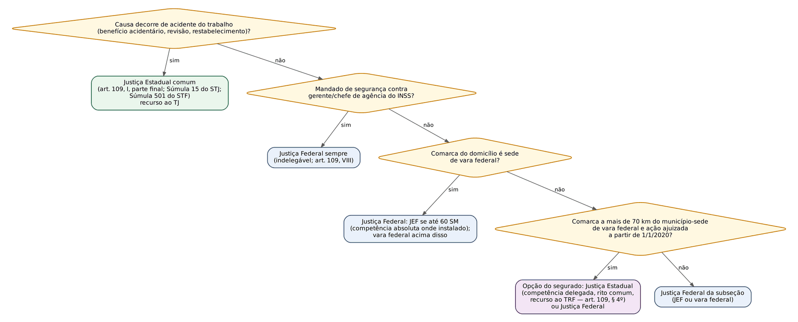
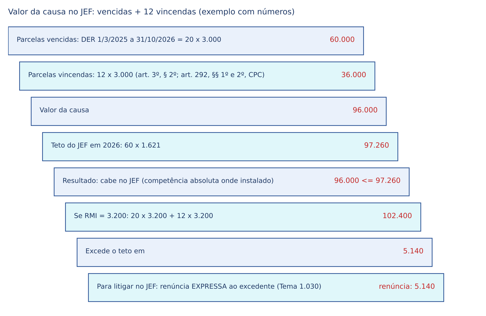
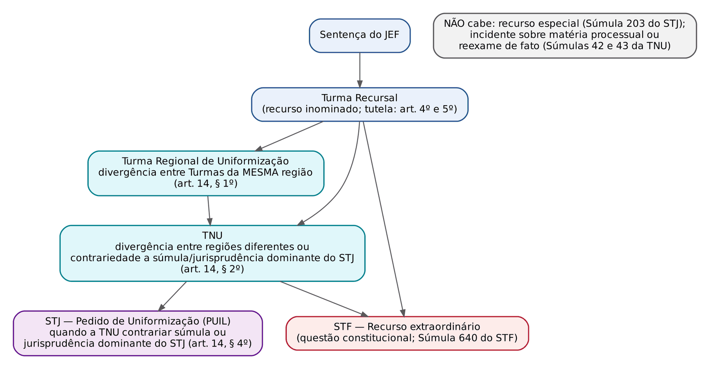
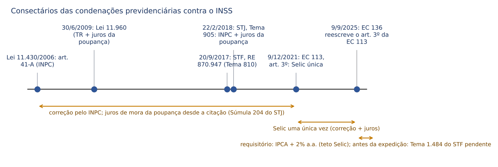
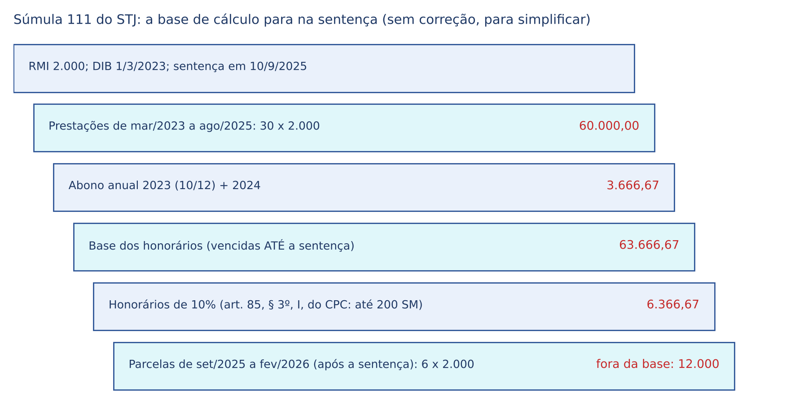
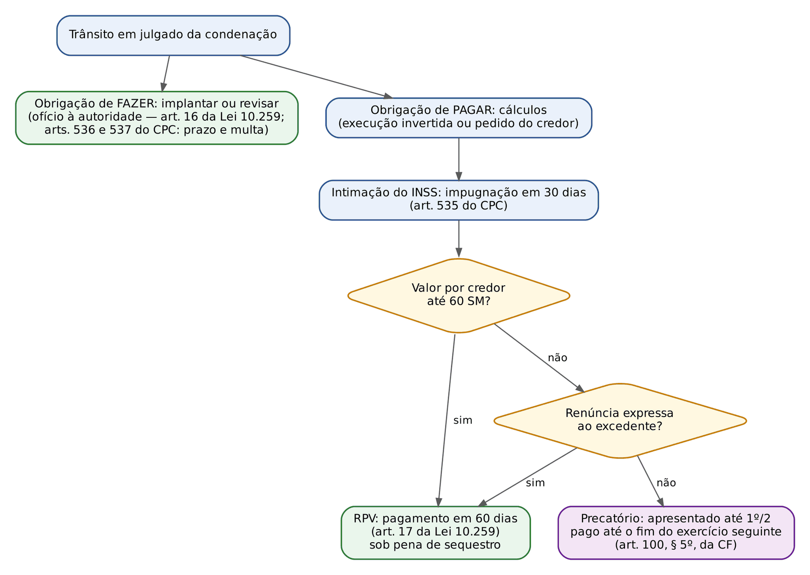

# CAPÍTULO 20 — PROCESSO JUDICIAL PREVIDENCIÁRIO: COMPETÊNCIA, JUIZADOS ESPECIAIS FEDERAIS, PROVA E PERÍCIA, TUTELAS E REPETIÇÃO, COISA JULGADA, EXECUÇÃO, HONORÁRIOS E AÇÕES REGRESSIVAS

:::INCIDENCIA
Pontos: TRF5 p. 10 (parte judicial: demandas, competência, JEF, gratuidade, prioridade, tutelas, cumprimento e implantação, uniformização). Nível A+.
Lote: 7 questões (FGV 7, FCC 0), todas de 2024 a 2026, três de concursos de magistratura (TRF5, TRF2, TJ-PE).
O que mais cai: competência (acidentária x previdenciária; delegada; JEF e seu teto), Súmula 111 do STJ, sistema de uniformização dos JEF, mandado de segurança previdenciário e ação regressiva do art. 120 da Lei 8.213/1991.
:::

O processo administrativo (requerimento, DER, dever de orientação, justificação administrativa, recursos ao CRPS, reafirmação da DER e o prévio requerimento como condição do interesse de agir) é desenvolvido no Cap. 19; prescrição e decadência, no Cap. 21; a restituição de pagamentos indevidos feitos administrativamente (Tema 979 do STJ), no Cap. 12. Aqui se trata do que acontece DEPOIS que o segurado bate à porta do Judiciário: onde propor, como provar, o que o juiz pode antecipar, o que a sentença deve dizer e como se executa contra o INSS.

## 20.1 Competência

### 20.1.1 A regra: Justiça Federal (art. 109, I, da CF)

O INSS é autarquia federal. Logo, toda causa em que figure como autor, réu, assistente ou opoente é, em princípio, da Justiça Federal. Dentro da Justiça Federal, o critério de valor separa o Juizado Especial Federal (até 60 salários mínimos, competência absoluta onde instalado) das varas federais comuns (ver 20.2).

:::LEI CF, art. 109, I, §§ 3º e 4º (redação da EC 103/2019 no § 3º)
Art. 109. Aos juízes federais compete processar e julgar:
I - as causas em que a União, entidade autárquica ou empresa pública federal forem interessadas na condição de autoras, rés, assistentes ou oponentes, EXCETO as de falência, as de ACIDENTES DE TRABALHO e as sujeitas à Justiça Eleitoral e à Justiça do Trabalho;
(...)
§ 3º LEI PODERÁ AUTORIZAR que as causas de competência da Justiça Federal em que forem parte instituição de previdência social e segurado possam ser processadas e julgadas na justiça estadual quando a comarca do domicílio do segurado não for sede de vara federal.
§ 4º Na hipótese do parágrafo anterior, o recurso cabível será SEMPRE para o Tribunal Regional Federal na área de jurisdição do juiz de primeiro grau.
:::

Três desvios da regra merecem estudo separado: (a) a causa acidentária, que a própria Constituição EXCLUI da Justiça Federal; (b) a competência federal delegada, em que o juiz estadual julga causa federal; (c) as causas que, embora tenham o INSS num polo, pertencem a outra Justiça por sua natureza (por exemplo, a complementação de aposentadoria paga por entidade fechada de previdência complementar patrocinada por empresa estatal, que é tema do Cap. 27).

Quanto ao foro dentro da Justiça Federal, a Súmula 689 do STF permite ao segurado ajuizar a ação contra a instituição previdenciária perante o juízo federal do seu domicílio ou nas varas federais da capital do Estado-membro. Trata-se de competência territorial, relativa: o juiz federal não pode declinar de ofício.

### 20.1.2 Causas acidentárias: Justiça Estadual em ambas as instâncias

A exclusão do art. 109, I, alcança as ações em que o segurado (ou seu dependente) pede ao INSS prestação ACIDENTÁRIA: auxílio por incapacidade temporária acidentário (espécie B91), aposentadoria por incapacidade permanente acidentária (B92), auxílio-acidente decorrente de acidente do trabalho (B94) e pensão por morte acidentária (B93). Para o juiz estadual que lida com isso, o critério que resolve 90% dos casos é a CAUSA DE PEDIR: se o pedido se funda em acidente do trabalho típico, de trajeto ou em doença ocupacional (profissional ou do trabalho, arts. 19 a 21 da Lei 8.213/1991), a competência é estadual; se a incapacidade decorre de doença comum ou de acidente de qualquer natureza fora do trabalho, a competência é federal (ou delegada). O fato de o INSS ter concedido administrativamente B31 (previdenciário) e o segurado sustentar natureza acidentária não muda nada: vale a causa de pedir deduzida.

:::JURIS Súmula 15 do STJ e Súmula 501 do STF
Súmula 15 do STJ: compete à Justiça Estadual processar e julgar os litígios decorrentes de acidente do trabalho.
Súmula 501 do STF: compete à Justiça ordinária estadual o processo e o julgamento, em ambas as instâncias, das causas de acidente do trabalho, ainda que promovidas contra a União, suas autarquias, empresas públicas ou sociedades de economia mista.
Consequência prática: o recurso da sentença acidentária vai para o TRIBUNAL DE JUSTIÇA, e não para o TRF. O art. 109, § 4º, não se aplica, porque aqui não há delegação: a competência estadual é ORIGINÁRIA, fixada pela própria Constituição.
:::

O alcance da expressão "causas de acidente do trabalho" é amplo. Abrange concessão, revisão (inclusive de RMI), restabelecimento e até a repetição de valores pagos a título de benefício acidentário. A pensão por morte decorrente de óbito causado por acidente do trabalho também é acidentária, porque a causa remota (o acidente do instituidor) é o fundamento do pedido; já a pensão requerida por dependente de quem estava aposentado por incapacidade acidentária havia anos, e morreu de causa diversa, é previdenciária comum e vai à Justiça Federal, porque a natureza acidentária da aposentadoria não é rediscutida (STJ, CC n. 132.034 e AgRg no CC n. 139.399, citados em material do Curso Ênfase; dados completos não conferidos).

:::PEGADINHA Revisão de benefício acidentário é acidentária
A revisão da RMI de aposentadoria por incapacidade permanente acidentária, ainda que discuta só salários de contribuição (matéria puramente previdenciária, sem rediscutir o acidente), continua na Justiça Estadual: o benefício é acidentário e a exceção constitucional acompanha a prestação. Foi exatamente a armadilha da alternativa D da Q3373892 (ver box em 20.6.4).
:::

Três pontos que distinguem a ação acidentária contra o INSS de figuras vizinhas:

| Ação | Partes | Justiça | Fundamento |
|---|---|---|---|
| Acidentária (benefício B91, B92, B93, B94) | segurado ou dependente x INSS | Estadual comum, recurso ao TJ | art. 109, I; Súmula 15 do STJ; Súmula 501 do STF |
| Indenização por acidente do trabalho (dano moral e material) | empregado x empregador | Justiça do Trabalho (desde a EC 45/2004) | art. 114, VI, da CF |
| Ação regressiva do INSS (art. 120 da Lei 8.213/1991) | INSS x empregador negligente | FEDERAL (o INSS é autor e não há benefício em discussão) | art. 109, I (ver 20.8) |
| Mandado de segurança contra ato de agente do INSS, mesmo em matéria acidentária | impetrante x autoridade federal | FEDERAL, indelegável | art. 109, VIII |
| Previdenciária comum (incapacidade por doença não ocupacional) | segurado x INSS | Federal (JEF ou vara) ou delegada | art. 109, I e § 3º |

O procedimento da ação acidentária tem regras próprias no art. 129 da Lei 8.213/1991, que a FGV explora em pormenor.

:::LEI Lei 8.213/1991, art. 129
Art. 129. Os litígios e medidas cautelares relativos a acidentes do trabalho serão apreciados:
I - na esfera administrativa, pelos órgãos da Previdência Social, segundo as regras e prazos aplicáveis às demais prestações, com prioridade para conclusão; e
II - na via judicial, pela Justiça dos Estados e do Distrito Federal, segundo o rito sumaríssimo, inclusive durante as férias forenses, mediante petição instruída pela prova de efetiva notificação do evento à Previdência Social, através de Comunicação de Acidente do Trabalho–CAT.
Parágrafo único. O procedimento judicial de que trata o inciso II deste artigo é ISENTO do pagamento de quaisquer custas e de verbas relativas à sucumbência.
:::

A isenção do parágrafo único beneficia o SEGURADO, não o INSS. Três desdobramentos cobrados:

- Honorários: "A isenção do pagamento de honorários advocatícios, nas ações acidentárias, é restrita ao segurado" (Súmula 110 do STJ); vencido o INSS, ele paga honorários normalmente.
- Preparo de recurso do advogado: a isenção não se estende ao patrono quando o recurso versa exclusivamente sobre honorários sucumbenciais fixados em seu favor (STJ, AgInt no AgInt no AREsp n. 2.246.596, Relator Ministro Teodoro Silva Santos, Segunda Turma, j. 29/4/2024, Informativo de Edição Extraordinária 19).
- Honorários periciais quando o segurado perde: o INSS antecipa a perícia nas acidentárias (art. 1º, § 7º, II, da Lei 13.876/2019); se o segurado, isento, for vencido, a despesa é suportada pelo Estado-membro, nos mesmos autos, sem necessidade de ação autônoma (STJ, REsp n. 2.126.628, Relator Ministro Afrânio Vilela, Segunda Turma, j. 23/4/2024, Informativo 809).

A exigência de CAT para instruir a inicial é lida com temperamento pela jurisprudência: a ausência de comunicação pelo empregador não pode obstar o acesso do segurado, que pode demonstrar a notificação por outros meios (a própria CAT pode ser emitida pelo segurado, dependente, sindicato, médico ou autoridade pública, art. 22, § 2º, da Lei 8.213/1991). Com a Lei 14.331/2022, a inicial de qualquer ação por incapacidade, inclusive acidentária, deve trazer comprovante da ocorrência do acidente sempre que houver um acidente apontado como causa (art. 129-A, II, b; ver 20.4.1).

Para as custas, a Súmula 178 do STJ estabelece que o INSS não goza de isenção do pagamento de custas e emolumentos nas ações acidentárias e de benefícios propostas na Justiça Estadual; a matéria depende da lei estadual de custas (em SC, confira a lei de custas vigente: ver nota de verificação).

### 20.1.3 Competência federal delegada (art. 109, § 3º) e a Lei 13.876/2019

Até a EC 103/2019, o próprio § 3º do art. 109 delegava diretamente ao juiz estadual as causas entre instituição de previdência e segurado quando a comarca não fosse sede de vara federal. A EC 103/2019 transformou a delegação em mera AUTORIZAÇÃO ao legislador ("lei poderá autorizar"). A lei já existia: a Lei 13.876/2019, publicada em 23/9/2019 (anterior, portanto, à promulgação da EC 103, em 12/11/2019, e à sua publicação, em 13/11/2019), deu nova redação ao art. 15, III, da Lei 5.010/1966, com vigência a partir de 1/1/2020 (art. 5º, I, da Lei 13.876).

:::LEI Lei 5.010/1966, art. 15, III e § 2º (redação da Lei 13.876/2019, vigente desde 1/1/2020)
Art. 15. Quando a Comarca não for sede de Vara Federal, poderão ser processadas e julgadas na Justiça Estadual:
(...)
III - as causas em que forem parte instituição de previdência social e segurado e que se referirem a BENEFÍCIOS DE NATUREZA PECUNIÁRIA, quando a Comarca de domicílio do segurado estiver localizada a MAIS DE 70 KM (setenta quilômetros) de Município sede de Vara Federal;
(...)
§ 2º Caberá ao respectivo Tribunal Regional Federal indicar as Comarcas que se enquadram no critério de distância previsto no inciso III do caput deste artigo.
:::

Mecânica, em quatro requisitos cumulativos: (1) partes: instituição de previdência e segurado (ou beneficiário/dependente); (2) objeto: benefício de natureza pecuniária; (3) a comarca do domicílio do segurado não é sede de vara federal; (4) essa comarca dista mais de 70 km do município sede de vara federal, conforme lista do TRF. Se a comarca estiver a 70 km ou menos, a ação vai à Justiça Federal (vara ou JEF da subseção), ainda que a comarca não seja sede.

:::JURIS STJ, IAC 6 (CC n. 170.051, Relator Ministro Mauro Campbell Marques, Primeira Seção, 2021)
Tese: os efeitos da Lei 13.876/2019 na modificação de competência para os processos que tramitam na Justiça Estadual no exercício da competência federal delegada aplicam-se aos feitos ajuizados APÓS 1/1/2020; as ações, em fase de conhecimento ou de execução, ajuizadas anteriormente a essa data continuam a ser processadas e julgadas no juízo estadual, nos termos do art. 109, § 3º, da CF e do art. 15, III, da Lei 5.010/1965 (a tese grafa 1965), em sua redação original.
Ganchos: *perpetuatio jurisdictionis* (art. 43 do CPC) preservada; NÃO houve redistribuição de acervo; a execução de título formado na Justiça Estadual delegada antes de 2020 também fica lá.
:::

A competência delegada é uma FACULDADE do segurado, instituída em seu benefício. Ele pode, mesmo preenchendo os requisitos, optar pela Justiça Federal com jurisdição sobre o município (o STJ, no CC n. 116.919, Terceira Seção, reconheceu essa opção; dados de julgamento não conferidos). E, como a delegação existe para facilitar o acesso do segurado, ela NÃO abrange: (a) ações propostas pelo INSS contra o segurado (cobrança de valores, ressarcimento); (b) ação regressiva acidentária; (c) mandado de segurança contra autoridade federal, de competência absoluta e indelegável. A delegação abrange, por outro lado, as ações de dependentes, as de benefício assistencial (BPC) e a justificação judicial contra o INSS.

O STF, no Tema 820 (RE n. 860.508, julgamento virtual concluído em 5/3/2021), fixou que a competência do § 3º do art. 109 pressupõe inexistência de vara federal na comarca do domicílio do segurado. Logo, instalada vara federal na comarca, cessa a delegação para as novas ações.

Na delegação, o juiz estadual aplica o rito COMUM do CPC: é vedada a aplicação da Lei 10.259/2001 no juízo estadual (art. 20 da Lei 10.259) e as causas não podem tramitar no Juizado Especial Cível estadual. Há, portanto, reexame necessário nos limites do art. 496 do CPC, honorários pelo art. 85 e recurso de apelação ao TRF (art. 109, § 4º). O mandado de segurança contra ato do juiz estadual no exercício da jurisdição delegada é julgado pelo TRF, por analogia com o art. 108, I, c, da CF.

:::QUESTAO FGV 2025 — Prefeitura de Cuiabá — Auditor Público Interno (Q3152853)
Caso: ocupante EXCLUSIVO de cargo em comissão no Executivo estadual tem a aposentadoria voluntária indeferida e reside em comarca que não é sede de vara federal. Onde ajuizar?
Gabarito: C — ele é segurado do RGPS e pode ajuizar na Justiça Estadual caso a lei o autorize.
Resolução: (1) o ocupante exclusivo de cargo em comissão, de livre nomeação e exoneração, vincula-se ao RGPS (art. 40, § 13, da CF; ver Cap. 6); (2) o réu é o INSS, autarquia federal, logo a causa é federal; (3) não sendo a comarca sede de vara federal, o § 3º do art. 109 permite que LEI autorize o julgamento na Justiça Estadual (hoje, art. 15, III, da Lei 5.010/1966: mais de 70 km). Armadilhas: A e B confundem o vínculo com o ente estadual com filiação ao RPPS; D ignora a delegação; E afirma caráter absoluto que a própria CF excepciona.
:::

### 20.1.4 Mandado de segurança em matéria previdenciária

O MS contra ato de gerente executivo, chefe de agência ou outra autoridade do INSS é sempre da Justiça Federal (art. 109, VIII), não cabe no JEF (art. 3º, § 1º, I, da Lei 10.259/2001) e não admite delegação. O cabimento depende da prova pré-constituída: o MS serve bem para (a) mora na análise do requerimento além do prazo; (b) cessação, suspensão ou redução de benefício sem devido processo (sem notificação, sem defesa e sem decisão fundamentada); (c) cumprimento de decisão administrativa do CRPS. Não serve quando o direito depende de prova pericial (incapacidade) ou testemunhal (atividade rural). Pode discutir o direito a qualquer aposentadoria, inclusive especial, se a prova documental (CNIS, PPP, laudos) bastar: não há vedação em abstrato por espécie de benefício.

:::QUESTAO FGV 2025 — TRF-3 — Juiz Federal Substituto (Q3179550)
Cobrou: hipóteses de cabimento do MS previdenciário.
Gabarito: B — cabe MS contra redução do pagamento de benefício sem comunicação ao segurado e sem decisão fundamentada (violação ao contraditório e à ampla defesa, art. 5º, LV, da CF; art. 11 da Lei 10.666/2003 e art. 69 da Lei 8.212/1991 exigem notificação e prazo para defesa antes de suspender ou cancelar benefício; ver Cap. 12).
Armadilhas: A cria prazo de 30 dias específico para auxílio por incapacidade que a questão trata como automático (a mora relevante é a que excede o prazo legal ou razoável de análise, e os prazos máximos de análise por espécie constam do acordo homologado no RE 1.171.152, Tema 1.066 do STF: v. Cap. 19, 19.2.4); C e D vedam por espécie de benefício, o que não existe: o limite é a necessidade de dilação probatória; E nega MS em cessação abrupta, que é justamente a hipótese clássica.
:::

### 20.1.5 Outras situações de competência que caem

| Situação | Competência | Observação |
|---|---|---|
| Servidor de RPPS estadual ou municipal contra o seu instituto de previdência | Justiça Estadual | não há ente federal; o § 3º do art. 109 não interfere |
| Servidor federal (RPPS da União) | Justiça Federal | réu é a União ou autarquia federal |
| Complementação de aposentadoria por entidade fechada (pedido contra a entidade) | Justiça Estadual, em regra; Justiça do Trabalho só nos casos em que o pedido é verba trabalhista a refletir na complementação | ver Cap. 27; STJ, AgInt no CC n. 185.622, j. 13/3/2024 (Info 804): reflexo de verba salarial na complementação contra CEF e FUNCEF ficou na Justiça do Trabalho |
| Dano moral cumulado com concessão de benefício | Federal (ou delegada, se o dano decorre diretamente do indeferimento) | a cumulação segue a competência do pedido principal |
| Ação ajuizada antes da instalação do JEF na localidade | permanece no juízo de origem | art. 25 da Lei 10.259/2001 |
| BPC (LOAS) contra o INSS | Federal, JEF ou delegada | o INSS é o operador; ver Cap. 18 |
| Justificação judicial contra o INSS (produção antecipada de prova, art. 381, § 4º, do CPC) | Federal ou delegada | o art. 15, II, da Lei 5.010/1966 prevê a justificação na comarca |

## 20.2 Juizados Especiais Federais (Lei 10.259/2001)

### 20.2.1 Competência: teto de 60 salários mínimos, vincendas e renúncia

O JEF Cível julga causas de competência da Justiça Federal até 60 salários mínimos e executa as suas sentenças (art. 3º). Onde instalado, sua competência é ABSOLUTA (art. 3º, § 3º): não há opção do autor pela vara comum, diferentemente do Juizado Estadual (Lei 9.099/1995), em que a opção existe. A Lei 9.099 aplica-se subsidiariamente (art. 1º da Lei 10.259).

:::LEI Lei 10.259/2001, art. 3º (competência)
Art. 3º Compete ao Juizado Especial Federal Cível processar, conciliar e julgar causas de competência da Justiça Federal até o valor de sessenta salários mínimos, bem como executar as suas sentenças.
§ 1º Não se incluem na competência do Juizado Especial Cível as causas:
I - referidas no art. 109, incisos II, III e XI, da Constituição Federal, as ações de MANDADO DE SEGURANÇA, de desapropriação, de divisão e demarcação, populares, execuções fiscais e por improbidade administrativa e as demandas sobre direitos ou interesses difusos, coletivos ou individuais homogêneos;
II - sobre bens imóveis da União, autarquias e fundações públicas federais;
III - para a anulação ou cancelamento de ato administrativo federal, SALVO O DE NATUREZA PREVIDENCIÁRIA e o de lançamento fiscal;
IV - que tenham como objeto a impugnação da pena de demissão imposta a servidores públicos civis ou de sanções disciplinares aplicadas a militares.
§ 2º Quando a pretensão versar sobre obrigações vincendas, para fins de competência do Juizado Especial, a soma de DOZE PARCELAS não poderá exceder o valor referido no art. 3º, caput.
§ 3º No foro onde estiver instalada Vara do Juizado Especial, a sua competência é ABSOLUTA.
:::

Como se calcula o valor da causa num pedido de benefício: somam-se as parcelas VENCIDAS (da DER, ou da data pretendida para a DIB, até o ajuizamento) e DOZE parcelas VINCENDAS (art. 3º, § 2º, da Lei 10.259 combinado com o art. 292, §§ 1º e 2º, do CPC). Se o resultado ultrapassar 60 salários mínimos na data do ajuizamento, o autor pode renunciar expressamente ao excedente para permanecer no JEF.

:::JURIS STJ, Tema 1.030 (REsp n. 1.807.665, Relator Ministro Sérgio Kukina, Primeira Seção, j. 28/10/2020; tese ajustada em embargos de declaração em 2021)
Tese: ao autor que deseje litigar no âmbito de Juizado Especial Federal Cível, é lícito renunciar, de modo EXPRESSO e para fins de atribuição de valor à causa, ao montante que exceda os 60 salários mínimos previstos no art. 3º, caput, da Lei 10.259/2001, aí incluídas, sendo o caso, até doze prestações vincendas, nos termos do art. 3º, § 2º, da referida lei, c/c o art. 292, §§ 1º e 2º, do CPC/2015.
Complemento: a Súmula 17 da TNU diz que não há renúncia TÁCITA no JEF, para fins de competência. Ou seja: se o autor não renunciou expressamente e o valor apurado supera o teto, o JEF é incompetente.
:::

:::EXEMPLO Valor da causa e renúncia (números conferidos)
Segurado com DER em 1/3/2025 pede aposentadoria com RMI estimada de 3.000; ajuíza em novembro de 2026. Vencidas (mar/2025 a out/2026): 20 x 3.000 = 60.000. Vincendas: 12 x 3.000 = 36.000. Valor da causa: 96.000. Teto de 2026: 60 x 1.621 = 97.260. Cabe no JEF, e lá ele TEM de propor se houver JEF na localidade.
Se a RMI fosse 3.200: 64.000 + 38.400 = 102.400, excedendo o teto em 5.140. Ou renuncia expressamente aos 5.140 (Tema 1.030) e fica no JEF, ou propõe na vara federal comum. A renúncia para fins de competência não se confunde com a renúncia ao excedente na fase de pagamento para receber por RPV (art. 17, § 4º; ver 20.7.2): são momentos e finalidades distintos.
:::

:::QUESTAO FGV 2024 — TJ-PE — Juiz Substituto (Q3117526)
Caso: servidor estadual propõe no Juizado da Fazenda Pública (Lei 12.153/2009) causa de 30.000; segurada propõe no JEF revisão de aposentadoria com valor da causa de 150.000.
Gabarito: A — o servidor está dentro da alçada do JEFP; a segurada deve demandar no juízo comum, porque ultrapassa a alçada do JEF.
Conta: em 2024, 60 x 1.412 = 84.720; 150.000 > 84.720. Também no JEFP o teto é de 60 salários mínimos (art. 2º da Lei 12.153/2009), de modo que a alternativa E erra ao falar em 40 (teto do Juizado Estadual comum da Lei 9.099). B erra porque a revisão de benefício é o núcleo da competência do JEF (ato previdenciário pode ser anulado no JEF, art. 3º, § 1º, III). Note que o enunciado não fala em renúncia: sem renúncia expressa, não há permanência no JEF (Súmula 17 da TNU).
:::

### 20.2.2 Partes e regras procedimentais que caem

- Partes (art. 6º): como autores, pessoas físicas, microempresas e empresas de pequeno porte; como rés, União, autarquias, fundações e empresas públicas federais. O INSS NÃO pode ser autor no JEF: a ação de cobrança que ele move contra o segurado vai para a vara federal.
- Sem prazo diferenciado para as pessoas jurídicas de direito público, inclusive para recorrer (art. 9º): não há prazo em dobro para o INSS no JEF; a citação para audiência de conciliação deve ter antecedência mínima de 30 dias.
- Representantes judiciais do INSS ficam autorizados a conciliar, transigir ou desistir (art. 10, parágrafo único). Daí os acordos padronizados em ações de incapacidade.
- A entidade ré deve fornecer a documentação de que disponha (processo administrativo, CNIS, laudos do SABI) até a instalação da audiência de conciliação (art. 11).
- Perícia: o juiz nomeia pessoa habilitada, que apresenta o laudo até cinco dias antes da audiência (art. 12); nas ações previdenciárias e assistenciais, as partes são intimadas para, em dez dias, apresentar quesitos e indicar assistentes (art. 12, § 2º). Os honorários são antecipados pela verba orçamentária do tribunal (art. 12, § 1º), regra hoje complementada pela Lei 13.876/2019 (ver 20.4.2).
- Medidas de urgência: o juiz pode deferir, de ofício ou a requerimento, medidas cautelares no curso do processo para evitar dano de difícil reparação (art. 4º); a jurisprudência aplica aí também a tutela antecipada. Só cabe recurso contra a sentença definitiva e contra essas decisões (art. 5º).
- Não há reexame necessário (art. 13).
- Complexidade da prova pericial NÃO afasta a competência do JEF: o critério é o valor, e a própria lei regula a perícia (art. 12). É a preliminar (ii) rejeitada na Q3996865.

:::PEGADINHA JEF x Juizado Estadual x Juizado da Fazenda Pública
JEF (Lei 10.259): 60 SM, absoluta onde instalado, INSS só como réu, sem prazo diferenciado, sem reexame. JEC estadual (Lei 9.099): 40 SM, opcional para o autor, pessoa jurídica de direito público NÃO pode ser parte (art. 8º da Lei 9.099). JEFP (Lei 12.153): 60 SM, absoluto onde instalado, réus Estados, DF, Municípios e suas autarquias. Nenhum juizado estadual julga causa federal delegada: art. 20 da Lei 10.259 veda aplicar a lei do JEF no juízo estadual.
:::

### 20.2.3 Recursos, uniformização e controle pelos tribunais superiores

O sistema recursal do JEF é fechado e cobrado com frequência em provas de juiz federal. Da sentença cabe recurso (inominado) à Turma Recursal (arts. 5º e 21). Da Turma Recursal NÃO cabe recurso especial, porque ela não é "tribunal" para os fins do art. 105, III, da CF (Súmula 203 do STJ: não cabe recurso especial contra decisão proferida por órgão de segundo grau dos Juizados Especiais). Cabe recurso extraordinário (Súmula 640 do STF), processado segundo o art. 15 da Lei 10.259.

Para a uniformização da interpretação de lei federal sobre direito MATERIAL, o art. 14 criou o pedido de uniformização, em três degraus.

:::LEI Lei 10.259/2001, art. 14, caput e §§ 1º, 2º e 4º
Art. 14. Caberá pedido de uniformização de interpretação de lei federal quando houver divergência entre decisões sobre questões de DIREITO MATERIAL proferidas por Turmas Recursais na interpretação da lei.
§ 1º O pedido fundado em divergência entre Turmas da MESMA REGIÃO será julgado em reunião conjunta das Turmas em conflito, sob a presidência do Juiz Coordenador.
§ 2º O pedido fundado em divergência entre decisões de turmas de DIFERENTES REGIÕES ou da proferida em contrariedade a súmula ou jurisprudência dominante do STJ será julgado por Turma de Uniformização, integrada por juízes de Turmas Recursais, sob a presidência do Coordenador da Justiça Federal.
(...)
§ 4º Quando a orientação acolhida pela Turma de Uniformização, em questões de direito material, contrariar súmula ou jurisprudência dominante no Superior Tribunal de Justiça - STJ, a parte interessada poderá provocar a manifestação deste, que dirimirá a divergência.
:::

Detalhes do art. 14 que costumam ser pedidos: o relator no STJ pode conceder liminar de suspensão dos processos em que a controvérsia esteja estabelecida (§ 5º); pedidos idênticos ficam retidos nas Turmas Recursais aguardando o STJ (§ 6º), que depois exercem juízo de retratação ou os declaram prejudicados (§ 9º); interessados não partes podem manifestar-se em 30 dias (§ 7º); o julgamento no STJ tem preferência, salvo réus presos, HC e MS (§ 8º). O pedido dirigido ao STJ é conhecido pela sigla PUIL (pedido de uniformização de interpretação de lei).

Limites de cognição da TNU, sumulados: não cabe incidente sobre matéria PROCESSUAL (Súmula 43 da TNU), nem sobre honorários advocatícios, por se tratar de questão de direito processual (Súmula 7 da TNU), nem que implique reexame de matéria de FATO (Súmula 42 da TNU). A Súmula 86 da TNU, que barrava incidente sobre questão constitucional ainda não definida pelo STF, foi CANCELADA em 26/8/2021.

:::QUESTAO FGV 2026 — TRF-2 — Juiz Federal Substituto (Q3996865)
Caso: revisão de benefício por incapacidade no JEF, com renúncia expressa ao excedente; sentença de procedência após perícia; recurso do INSS alegando valor real acima do teto, complexidade da perícia e divergência com o STJ; Turma Recursal mantém a sentença.
Gabarito: B — a divergência entre a Turma Recursal e a jurisprudência do STJ pode ensejar pedido de uniformização que, em certas hipóteses, chega ao próprio STJ (art. 14, §§ 2º e 4º).
Resolução: (i) a renúncia expressa resolve o teto (Tema 1.030); (ii) a complexidade da perícia não afasta o JEF (art. 12); (iii) contra acórdão de Turma Recursal não cabe REsp (Súmula 203 do STJ): o caminho é o pedido de uniformização à TNU (contrariedade a jurisprudência dominante do STJ, § 2º) e, se a TNU também contrariar o STJ, o PUIL (§ 4º). Armadilhas: A (REsp direto), C (exclusão de qualquer controle do STJ), D e E (só RE), que ignoram o art. 14.
:::

Mandado de segurança contra ato do juiz do JEF: competência da própria Turma Recursal (Súmula 376 do STJ). O STJ admite, excepcionalmente, MS no tribunal (TRF) apenas para o controle da COMPETÊNCIA do juizado, sem exame do mérito.

### 20.2.4 Súmulas da TNU que mais caem no processo previdenciário

| Súmula TNU | Enunciado (síntese fiel) | Uso |
|---|---|---|
| 7 | Descabe incidente de uniformização sobre honorários (questão processual) | cabimento |
| 17 | Não há renúncia tácita no JEF, para fins de competência | competência |
| 22 | Se a perícia judicial mostra que a incapacidade já existia na DER, esta é o termo inicial do benefício assistencial | DIB |
| 33 | Preenchidos os requisitos da aposentadoria por tempo na DER, esta é o termo inicial | DIB |
| 42 | Não se conhece de incidente que implique reexame de fato | cabimento |
| 43 | Não cabe incidente sobre matéria processual | cabimento |
| 51 | (CANCELADA em 30/8/2017) valores de tutela revogada seriam irrepetíveis | ver 20.5.3 |
| 72 | É possível receber benefício por incapacidade no período em que houve atividade remunerada, se comprovada a incapacidade na época | cálculo de atrasados |
| 77 | O julgador não é obrigado a analisar condições pessoais e sociais quando não reconhecer a incapacidade para a atividade habitual | perícia |
| 79 | No BPC, as condições socioeconômicas se comprovam por laudo de assistente social, auto de constatação do oficial de justiça ou, inviabilizados esses meios, prova testemunhal | prova |
| 81 | Impugnação de indeferimento, cessação ou cancelamento não se submete a prazo extintivo (redação alterada em 9/12/2020) | ver Cap. 21 |

## 20.3 A demanda previdenciária: interesse de agir, pedido, gratuidade, prioridade e custas

### 20.3.1 Interesse de agir e efeitos financeiros (Tema 350 do STF e Tema 1.124 do STJ)

Exige-se prévio requerimento administrativo apto, não o exaurimento da via administrativa (Tema 350 do STF), e a DIB fixada na sentença depende da origem da prova que fundamentou a procedência: DER (ou data posterior do implemento) com as mesmas provas do processo administrativo, citação quando a prova só pôde surgir em juízo (Tema 1.124 do STJ). Desenvolvimento, texto das teses e roteiro do juiz: v. Cap. 19 (19.8).

### 20.3.2 Pedido, fungibilidade e *reformatio in pejus*

A jurisprudência previdenciária abranda a congruência (arts. 141 e 492 do CPC) por duas razões: o INSS tem o dever de conceder o melhor benefício a que o segurado faz jus (Tema 334 do STF, ver Cap. 19), e o pedido de "benefício por incapacidade" é, em essência, pedido de proteção contra o risco incapacidade. Daí:

- Fungibilidade entre benefícios por incapacidade: pedido de aposentadoria por incapacidade permanente pode resultar em auxílio por incapacidade temporária ou em auxílio-acidente, e vice-versa, conforme o que a perícia revelar, sem julgamento *extra petita*. O mesmo raciocínio se aplica entre aposentadorias (por tempo, especial, por idade) quando os fatos alegados e provados permitem a concessão de outra espécie.
- Pedido implícito: a interpretação do pedido considera o conjunto da postulação e o princípio da boa-fé (art. 322, § 2º, do CPC). Correção monetária, juros e as prestações vencidas no curso do processo (art. 323 do CPC) estão implícitos.
- Limite: a causa de pedir. A reafirmação da DER (Tema 995) é admitida "observada a causa de pedir"; não se concede benefício com base em fatos não alegados (tempo especial nunca invocado, por exemplo).
- *Reformatio in pejus*: no recurso exclusivo do segurado, o tribunal não pode piorar sua situação (por exemplo, reduzir o tempo reconhecido em sentença sem recurso do INSS). A remessa necessária, por sua vez, não pode agravar a condenação da Fazenda (Súmula 45 do STJ: "No reexame necessário, é defeso, ao Tribunal, agravar a condenação imposta a Fazenda Pública").

Benefício mais vantajoso concedido administrativamente no curso da ação: o segurado opta e executa as parcelas do judicial até a implantação do administrativo (Tema 1.018 do STJ; Cap. 19, 19.3.3, e 20.7.1).

### 20.3.3 Gratuidade, custas e prioridade de tramitação

Gratuidade: aplica-se o regime geral dos arts. 98 a 102 do CPC (presunção relativa da alegação de insuficiência da pessoa natural, art. 99, § 3º). O beneficiário da gratuidade, vencido, tem as obrigações de sucumbência sob condição suspensiva por cinco anos (art. 98, § 3º), dispositivo que a Lei 13.876/2019 invoca expressamente para os honorários periciais (ver 20.4.2). No JEF, não há custas nem honorários em primeiro grau (art. 54 e 55 da Lei 9.099, aplicáveis por força do art. 1º da Lei 10.259); vencido o recorrente na Turma, paga custas e honorários (art. 55 da Lei 9.099).

Custas: na Justiça Federal, o INSS, como autarquia, é isento de custas (Lei 9.289/1996, art. 4º, I), mas reembolsa as despesas judiciais feitas pela parte vencedora (art. 4º, parágrafo único). Na Justiça Estadual (delegada ou acidentária), aplica-se a Súmula 178 do STJ: não há isenção do INSS, salvo lei estadual (ver 20.1.2 e a nota). Nas acidentárias, o SEGURADO é isento de custas e sucumbência (art. 129, parágrafo único).

Prioridade: tramitação prioritária para pessoa com 60 anos ou mais ou portadora de doença grave (art. 1.048, I, do CPC), com prioridade especial para os maiores de 80 anos (Estatuto da Pessoa Idosa, art. 71, § 5º). A acidentária tem rito sumaríssimo e corre inclusive nas férias forenses (art. 129, II). Na fase de pagamento, a prioridade constitucional do art. 100, § 2º, da CF beneficia titulares de 60 anos, portadores de doença grave e pessoas com deficiência até o triplo do valor de RPV (ver 20.7.2).

## 20.4 Prova e perícia

### 20.4.1 A ação por incapacidade depois da Lei 14.331/2022 (art. 129-A da Lei 8.213/1991)

O art. 129-A da Lei 8.213/1991 (Lei 14.331/2022) qualifica a inicial e os documentos das ações por incapacidade e permite, ouvido o autor, a improcedência sem citação do INSS quando a perícia judicial prévia confirma o laudo administrativo (§ 2º), julgamento de mérito excepcional ao lado do art. 332 do CPC; transcrição e roteiro: v. Cap. 15 (15.7.3).

Condições pessoais e sociais: só entram na análise se houver incapacidade reconhecida para a atividade habitual (Súmula 77 da TNU); nesse caso, idade, escolaridade e histórico profissional podem transformar incapacidade parcial em incapacidade para qualquer atividade (tema de mérito, Cap. 15).

Recurso especial e incapacidade: o STJ fechou a porta. "É inadmissível recurso especial interposto para rediscutir as conclusões do acórdão recorrido quanto ao preenchimento" do requisito da incapacidade, seja quanto à existência, à extensão ou à duração (STJ, Tema 1.246, REsp n. 2.082.395 e n. 2.098.629, Relator Ministro Paulo Sérgio Domingues, Primeira Seção, j. 13/11/2024, Informativo 834). Na prática, a última palavra sobre incapacidade é do TJ (acidentárias) ou do TRF/Turma Recursal.

### 20.4.2 Honorários periciais: quem antecipa e quem paga (Lei 13.876/2019, art. 1º, com a Lei 14.331/2022)

:::LEI Lei 13.876/2019, art. 1º (redação da Lei 14.331/2022), caput e §§ 4º a 7º
Art. 1º O ônus pelos encargos relativos ao pagamento dos honorários periciais referentes às perícias judiciais realizadas em ações em que o INSS figure como parte e se discuta a concessão de benefícios assistenciais à pessoa com deficiência ou benefícios previdenciários decorrentes de incapacidade laboral ficará a cargo do VENCIDO, nos termos da legislação processual civil, em especial do § 3º do art. 98 do CPC.
§ 1º Aplica-se o disposto no caput deste artigo aos processos que tramitam na Justiça Estadual, no exercício da competência delegada pela Justiça Federal.
(...)
§ 4º O pagamento dos honorários periciais limita-se a 1 (uma) perícia médica por processo judicial, e, excepcionalmente, caso determinado por instâncias superiores do Poder Judiciário, outra perícia poderá ser realizada.
§ 5º A partir de 2022, nas ações a que se refere o caput deste artigo, fica INVERTIDO o ônus da antecipação da perícia, cabendo ao RÉU, qualquer que seja o rito ou procedimento adotado, antecipar o pagamento do valor estipulado para a realização da perícia, exceto na hipótese prevista no § 6º deste artigo.
§ 6º Os autores (...) que comprovadamente disponham de condição suficiente para arcar com os custos de antecipação das despesas referentes às perícias médicas judiciais deverão antecipar os custos dos encargos relativos ao pagamento dos honorários periciais.
§ 7º O ônus da antecipação de pagamento da perícia, na forma do § 5º deste artigo, recairá sobre o Poder Executivo federal e será processado da seguinte forma:
I – nas ações de competência da Justiça Federal, incluídas as que tramitem na Justiça Estadual por delegação de competência, as dotações orçamentárias (...) serão descentralizadas (...) ao Conselho da Justiça Federal, que se incumbirá de descentralizá-las aos Tribunais Regionais Federais, os quais repassarão os valores aos peritos judiciais após o cumprimento de seu múnus, independentemente do resultado ou da duração da ação (...);
II – nas ações de ACIDENTE DO TRABALHO, de competência da Justiça Estadual, os honorários periciais serão antecipados pelo INSS.
:::

| Situação | Quem ANTECIPA | Quem PAGA ao final |
|---|---|---|
| Incapacidade ou BPC-deficiência, Justiça Federal ou delegada, autor sem recursos | Executivo federal, via CJF e TRF (§§ 5º e 7º, I) | o vencido; se for o autor beneficiário da gratuidade, condição suspensiva (art. 98, § 3º, do CPC) |
| Mesma ação, autor com condições financeiras comprovadas | o autor (§ 6º) | o vencido |
| Acidentária na Justiça Estadual | INSS (§ 7º, II) | o vencido; se for o segurado isento, o Estado-membro, nos mesmos autos (REsp n. 2.126.628, 20.1.2) |
| Segunda perícia | só excepcionalmente, por determinação de instância superior (§ 4º) | — |

O § 3º original (pagamento pelo Executivo por dois anos a partir de 2020) foi REVOGADO pela Lei 14.331/2022 e substituído pela inversão permanente do § 5º. Os valores são fixados em ato conjunto do CJF e do Ministério competente (§ 2º).

### 20.4.3 Prova do tempo rural, prova emprestada e outros meios

A disciplina do início de prova material, da prova exclusivamente testemunhal (Súmula 149 do STJ) e da justificação administrativa está no Cap. 9. No processo, três consequências:

- A falta de início de prova material no rural NÃO leva à improcedência, mas à extinção sem resolução de mérito (Tema 629, ver 20.6.5).
- Prova emprestada (art. 372 do CPC): admite-se, observado o contraditório, sobretudo laudos técnicos de atividade especial produzidos em ação de outro trabalhador da mesma empresa e função, ou perícia trabalhista; a valoração é livre e motivada.
- Perícia indireta ou por similaridade, para empresa extinta, em atividade especial (Cap. 10). Para o BPC, o estudo social segue a Súmula 79 da TNU (laudo de assistente social, auto de constatação ou, inviáveis estes, prova testemunhal).

A sentença trabalhista homologatória perdeu força como início de prova: a Súmula 31 da TNU foi REVOGADA em 22/11/2023, por incompatibilidade com o PUIL n. 293 do STJ (detalhes no Cap. 9).

## 20.5 Tutelas provisórias e repetição de valores

### 20.5.1 Cabimento contra o INSS

As vedações legais a liminares contra o Poder Público (Lei 9.494/1997, validada pelo STF na ADC 4) não alcançam as causas previdenciárias: Súmula 729 do STF ("A decisão na ADC-4 não se aplica à antecipação de tutela em causa de natureza previdenciária"). A tutela de urgência exige probabilidade do direito e perigo de dano (art. 300 do CPC); a natureza alimentar do benefício costuma preencher o segundo requisito, mas não dispensa o primeiro, que nas ações por incapacidade normalmente só aparece com o laudo judicial. A tutela de evidência (art. 311 do CPC) cabe, por exemplo, quando o pedido se apoia em tese fixada em repetitivo ou súmula vinculante e as alegações podem ser comprovadas documentalmente (inciso II).

A irreversibilidade (art. 300, § 3º) é ponderada: a jurisprudência admite tutela que implante benefício, porque o risco de não implantar (privação de subsistência) supera o risco patrimonial do INSS, até porque o valor é recuperável (20.5.3).

:::DICA Tutela na sentença
Concedida a tutela na sentença, a apelação não tem efeito suspensivo quanto a essa parte (art. 1.012, § 1º, V, do CPC). É a forma mais comum de implantação antes do trânsito: o juiz determina a implantação em prazo certo (ex.: 30 dias, ou 20 dias úteis), com DIP fixada (ver 20.6.1), e os atrasados aguardam o trânsito em julgado para RPV ou precatório, por exigência do art. 100 da CF.
:::

### 20.5.2 No JEF e na delegada

No JEF, o art. 4º da Lei 10.259 permite medida de urgência de ofício; contra ela cabe recurso à Turma Recursal (art. 5º). Na competência delegada, o agravo de instrumento contra a tutela vai ao TRF (art. 109, § 4º). Na acidentária, ao TJ.

### 20.5.3 Revogação da tutela e devolução: Tema 692 do STJ

Reformada a decisão que antecipou a tutela, o autor devolve os benefícios previdenciários ou assistenciais recebidos, por desconto de até 30% do benefício em manutenção ou por liquidação nos mesmos autos (art. 520, II, do CPC), ressalvadas as exceções da dupla conformidade e da rescisória (Tema 692 do STJ; v. Cap. 12, 12.11.2). No plano processual, a responsabilidade decorre de a tutela correr por conta e risco de quem a requer (art. 302 do CPC); o STF não reconheceu repercussão geral à matéria (Tema 799), e a TNU cancelou, em 30/8/2017, a Súmula 51, que afirmava a irrepetibilidade.

## 20.6 Sentença: DIB, DIP, consectários, honorários e coisa julgada

### 20.6.1 Os marcos da sentença previdenciária

| Sigla | Significado | Quem fixa e como |
|---|---|---|
| DER | data de entrada do requerimento | dado do processo administrativo (Cap. 19) |
| DIB | data de início do benefício | sentença: DER, data do implemento (reafirmação), DCB anterior (restabelecimento), DII posterior, ou citação (Tema 1.124, item 2.3) |
| DIP | data de início do pagamento administrativo | sentença ou decisão de tutela: a partir dela o INSS paga na folha (complemento positivo); o período DIB a DIP vira atrasados, pagos por RPV ou precatório |
| DCB | data de cessação do benefício | no auxílio por incapacidade temporária, estimada na sentença (ver Cap. 15) |
| RMI | renda mensal inicial | calculada pelo INSS na implantação ou pela contadoria; a sentença fixa os parâmetros (Cap. 11) |

A diferença entre DIB e DIP explica por que a sentença previdenciária tem duas partes de cumprimento: a obrigação de FAZER (implantar a partir da DIP) e a obrigação de PAGAR (DIB até a véspera da DIP). Errar esse corte gera pagamento em duplicidade ou lacuna.

Termos iniciais sumulados pela TNU: Súmula 22 (BPC: se a perícia judicial mostra incapacidade já existente na DER, DIB na DER) e Súmula 33 (aposentadoria por tempo: requisitos preenchidos na DER, DIB na DER). Restabelecimento de benefício por incapacidade indevidamente cessado: DIB no dia seguinte à cessação, se a perícia indicar incapacidade contínua desde então. Benefício por incapacidade sem requerimento prévio é exceção (Cap. 19).

:::SENTENCA Dispositivo de procedência com tutela (modelo enxuto)
Ante o exposto, JULGO PROCEDENTE o pedido, com resolução de mérito (art. 487, I, do CPC), para condenar o INSS a: (a) conceder ao autor F. S. (segurado) aposentadoria por incapacidade permanente, com DIB em 10/3/2025 (dia seguinte à cessação do NB anterior) e DIP em 1/11/2026; (b) pagar as parcelas vencidas entre a DIB e a DIP, descontados os valores de benefícios inacumuláveis recebidos no período, mês a mês e no limite de cada competência (Tema 1.207 do STJ), com correção monetária e juros nos termos da fundamentação.
Presentes a probabilidade do direito, reconhecida em cognição exauriente, e o perigo de dano, dada a natureza alimentar, CONCEDO tutela de urgência para determinar a implantação do benefício em 30 dias, a contar da intimação da CEAB-DJ, sob pena de multa diária de 100 (cem) reais, limitada a 3.000 (três mil) reais.
Condeno o INSS ao pagamento de honorários de 10% sobre as prestações vencidas até a data desta sentença (Súmula 111 do STJ). Sem custas (art. 4º, I, da Lei 9.289/1996). Sentença não sujeita a remessa necessária (art. 496, § 3º, I, do CPC).
:::

### 20.6.2 Correção monetária e juros: a sucessão de regimes

Este é o ponto em que a sentença federal mais muda com o tempo; o juiz deve fixar os consectários por PERÍODO.

1. Até 8/12/2021: correção monetária pelo INPC (art. 41-A da Lei 8.213/1991, incluído pela Lei 11.430/2006) a partir do vencimento de cada prestação (Jurisprudência em Teses do STJ, ed. 67, teses 6 e 7; Súmula 148 do STJ sobre a Lei 6.899/1981); juros de mora pelos índices da caderneta de poupança (art. 1º-F da Lei 9.494/1997, redação da Lei 11.960/2009) desde a CITAÇÃO válida (Súmula 204 do STJ). Fundamentos: STF, Tema 810 (RE n. 870.947, Relator Ministro Luiz Fux, Plenário, j. 20/9/2017: a TR é inconstitucional para correção; os juros da poupança são constitucionais nas relações não tributárias) e STJ, Tema 905 (REsp n. 1.495.146, Relator Ministro Mauro Campbell Marques, Primeira Seção, j. 22/2/2018, item 3.2: condenações previdenciárias corrigidas pelo INPC após a Lei 11.430/2006, com juros da poupança).
2. De 9/12/2021 (EC 113/2021, art. 3º, em sua redação original) até a entrada em vigor da EC 136/2025 (10/9/2025): incidência da taxa Selic, UMA ÚNICA VEZ, até o efetivo pagamento, englobando correção e juros. Não se cumula Selic com INPC ou juros.
3. Depois da EC 136, de 9/9/2025, publicada e em vigor em 10/9/2025 (art. 9º, vigência na data da publicação): o art. 3º da EC 113 passou a reger somente os REQUISITÓRIOS que envolvam a Fazenda Pública federal, da EXPEDIÇÃO até o pagamento: correção pelo IPCA e juros simples de 2% ao ano, vedados juros compensatórios; se o resultado superar a Selic do período, aplica-se a Selic (§ 1º); no período do art. 100, § 5º, da CF (entre a inscrição e o fim do exercício seguinte), não há juros de mora sobre o precatório pago no prazo (§ 3º).
4. Lacuna: para o período ANTERIOR à expedição (fase de conhecimento e liquidação), a EC 136 não trouxe regra. O STF reconheceu repercussão geral no Tema 1.484 (RE n. 1.623.818) para definir os índices desse período; até o julgamento, os tribunais divergem (manutenção da Selic, retorno ao INPC com juros da poupança, ou outro critério). A sentença prudente fixa os consectários "nos termos do Manual de Cálculos da Justiça Federal vigente na data da liquidação", ressalvando a definição do STF.

:::LEI EC 113/2021, art. 3º (redação da EC 136/2025)
Art. 3º Nos requisitórios que envolvam a Fazenda Pública federal, a partir da sua expedição até o efetivo pagamento, a atualização monetária será feita pela variação do Índice Nacional de Preços ao Consumidor Amplo (IPCA), e, para fins de compensação da mora, incidirão juros simples de 2% a.a. (dois por cento ao ano), vedada a incidência de juros compensatórios.
§ 1º Caso o percentual a ser aplicado a título de atualização monetária e juros de mora, apurado na forma do caput deste artigo, seja superior à variação da taxa referencial do Sistema Especial de Liquidação e de Custódia (Selic) para o mesmo período, esta deve ser aplicada em substituição àquele.
§ 2º Nos processos de natureza tributária serão aplicados os mesmos critérios de atualização e remuneração da mora pelos quais a Fazenda Pública remunera seu crédito tributário.
§ 3º Durante o período previsto no § 5º do art. 100 da Constituição Federal, não incidem juros de mora sobre os precatórios que nele sejam pagos.
:::

:::ATENCAO Questões antigas sobre consectários
Gabaritos de 2022 a 2025 que mandam aplicar "Selic desde 9/12/2021 até o pagamento" refletem a redação original do art. 3º da EC 113. Para fatos e requisitórios a partir de setembro de 2025, a resposta muda (IPCA mais 2% ao ano com teto na Selic, a partir da expedição). Em prova, identifique a data-base que a questão adota.
:::

### 20.6.3 Honorários advocatícios: Súmula 111 do STJ e regras correlatas

:::JURIS Súmula 111 do STJ e Tema 1.105 do STJ
Súmula 111 do STJ (redação de 2006): os honorários advocatícios, nas ações previdenciárias, não incidem sobre as prestações vencidas após a sentença.
Tema 1.105 (REsp n. 1.883.715, Relator Ministro Sérgio Kukina, Primeira Seção, j. 8/3/2023): continua eficaz e aplicável o conteúdo da Súmula 111/STJ, mesmo após a vigência do CPC/2015.
Leitura: o marco é a SENTENÇA de procedência; se a procedência só vier no tribunal (sentença de improcedência reformada), o marco é o acórdão que primeiro reconheceu o direito. Aplica-se também às ações acidentárias.
:::

Como se aplica o art. 85 do CPC contra o INSS: percentuais escalonados do § 3º (de 10% a 20% até 200 salários mínimos; de 8% a 10% acima de 200 até 2.000; e assim por diante), sobre o valor da condenação (as parcelas vencidas até a sentença), com a regra de faixas do § 5º. Sentença ilíquida: o percentual é definido na liquidação (§ 4º, II). Em 2026, 200 salários mínimos = 324.200, de modo que quase todas as ações individuais ficam na primeira faixa.

:::EXEMPLO Base de cálculo dos honorários (números conferidos)
RMI 2.000; DIB 1/3/2023; sentença em 10/9/2025. Prestações de mar/2023 a ago/2025: 30 x 2.000 = 60.000; abonos anuais de 2023 (10/12 = 1.666,67) e 2024 (2.000): 3.666,67. Base: 63.666,67. Honorários de 10%: 6.366,67. As seis parcelas de set/2025 a fev/2026 (12.000), vencidas depois da sentença, ficam FORA da base. Correção monetária omitida para simplificar.
:::

Outras teses de honorários que caem:

- Pagamento administrativo no curso da ação não reduz a base: "o eventual pagamento de benefício previdenciário na via administrativa, seja ele total ou parcial, após a citação válida, não tem o condão de alterar a base de cálculo para os honorários advocatícios fixados na ação de conhecimento, que será composta pela totalidade dos valores devidos" (STJ, Tema 1.050, REsp n. 1.847.860, Primeira Seção, j. 28/4/2021).
- Honorários recursais (art. 85, § 11) só quando o recurso é integralmente desprovido ou não conhecido; provimento parcial, ainda que mínimo ou limitado a consectários, afasta a majoração (STJ, Tema 1.059, Corte Especial, j. 9/11/2023).
- Cumprimento de sentença não impugnado, ainda que por RPV: não há honorários (STJ, Tema 1.190, REsp n. 2.029.636, Relatora Ministra Maria Thereza de Assis Moura, Primeira Seção, j. 20/6/2024, com modulação para os cumprimentos iniciados após a publicação do acórdão). O STF reconheceu repercussão geral sobre o tema (Tema 1.442), ainda pendente.
- Acidentárias: o segurado vencido não paga honorários (art. 129, parágrafo único; Súmula 110 do STJ); o INSS vencido paga pelas regras gerais do CPC.
- Recurso do advogado só sobre honorários: sem a isenção de preparo do segurado (AgInt no AgInt no AREsp n. 2.246.596, 20.1.2).

### 20.6.4 Remessa necessária

Na Justiça Federal comum e na delegada, a sentença contra o INSS está sujeita a remessa necessária, salvo se a condenação ou o proveito econômico for de valor certo e líquido inferior a 1.000 salários mínimos (art. 496, § 3º, I, do CPC), ou se a sentença se fundar em súmula de tribunal superior, repetitivo, IRDR ou IAC, ou em orientação vinculante do próprio ente (art. 496, § 4º). No JEF não há remessa (art. 13 da Lei 10.259). Como a condenação previdenciária individual raramente se aproxima de 1.000 salários mínimos (1.621.000 em 2026), a remessa tornou-se exceção; a jurisprudência do STJ tem admitido afastá-la mesmo em sentença ilíquida quando é evidente que o valor não alcança o limite (orientação não conferida em fonte nesta tarefa: ver nota).

:::QUESTAO FGV 2025 — TRF-5 — Juiz Substituto (Q3373892)
Caso: aposentada por incapacidade permanente ACIDENTÁRIA pede revisão da RMI (salários de contribuição averbados a menor), após indeferimento administrativo; procedência com atrasados desde a aposentadoria (três anos antes) até a implantação correta; honorários de 10% "do total devido".
Gabarito: C — os honorários incidem só sobre as prestações devidas até a sentença (Súmula 111 do STJ, mantida pelo Tema 1.105).
Por que as demais erram: A — o prévio requerimento NÃO é dispensável "em todo e qualquer caso" (Tema 350 do STF; aqui, aliás, houve requerimento); B — a isenção de preparo do art. 129, parágrafo único, não se estende ao advogado que recorre só dos honorários (AgInt no AgInt no AREsp n. 2.246.596); D — benefício acidentário, inclusive revisão, é da Justiça ESTADUAL (art. 109, I; Súmula 15 do STJ); E — não há percentual fixo nas acidentárias: valem as faixas do art. 85, § 3º, do CPC.
:::

### 20.6.5 Coisa julgada *secundum eventum probationis* no rural (Tema 629 do STJ)

Situação típica: trabalhador rural pede aposentadoria por idade sem nenhum início de prova material do período de carência. Pela técnica tradicional, julgar-se-ia improcedente o pedido (falta de prova do fato constitutivo), com coisa julgada material, e o segurado jamais poderia voltar, ainda que depois encontrasse documentos. O STJ adotou solução diversa, inspirada na doutrina da coisa julgada conforme o resultado da prova, defendida com destaque por José Antonio Savaris no processo previdenciário.

:::JURIS STJ, Tema 629 (REsp n. 1.352.721, Relator Ministro Napoleão Nunes Maia Filho, Corte Especial, j. 16/12/2015)
Tese: A ausência de conteúdo probatório eficaz a instruir a inicial, conforme determina o art. 283 do CPC [de 1973; atual art. 320], implica a carência de pressuposto de constituição e desenvolvimento válido do processo, impondo sua EXTINÇÃO SEM O JULGAMENTO DO MÉRITO (art. 267, IV do CPC [atual art. 485, IV]) e a consequente possibilidade de o autor intentar novamente a ação (art. 268 do CPC [atual art. 486]), caso reúna os elementos necessários à tal iniciativa.
Fundamentos: hipossuficiência informacional do segurado; caráter social da prestação; *in dubio pro misero* em sentido processual; o processo previdenciário não deve sepultar direito fundamental por insuficiência de prova documental.
:::

Alcance e cuidados:

- O núcleo é a falta de INÍCIO DE PROVA MATERIAL exigida por lei (art. 55, § 3º, da Lei 8.213/1991). Se houve início de prova material e a prova testemunhal não convenceu, o julgamento é de mérito (improcedência), com coisa julgada material.
- A tese, firmada para o rural, tem sido estendida pela jurisprudência a outras hipóteses de insuficiência de prova documental de tempo de contribuição (especial, urbano sem registro); a extensão não está no texto do repetitivo, e a banca costuma cobrar a tese no seu contexto original.
- Na nova ação, o autor deve apresentar o documento novo e, conforme o Tema 1.124 do STJ, levá-lo antes ao INSS em novo requerimento (Cap. 19).

:::SENTENCA Extinção por falta de início de prova material (rural)
Não há nos autos início de prova material contemporâneo do labor rural no período de carência (art. 55, § 3º, da Lei 8.213/1991; Súmula 149 do STJ), sendo inviável o reconhecimento com base exclusiva na prova testemunhal. Na linha do Tema 629 do STJ, a ausência de prova documental mínima configura falta de pressuposto de desenvolvimento válido do processo. JULGO EXTINTO o processo, sem resolução de mérito (art. 485, IV, do CPC), ressalvada a possibilidade de nova propositura, precedida de novo requerimento administrativo, caso a parte reúna os elementos necessários.
:::

### 20.6.6 Limites objetivos da coisa julgada e questões prejudiciais de família

O juiz federal frequentemente decide, como questão prejudicial, a existência de união estável, a filiação ou a dependência econômica para conceder pensão por morte. Essa resolução NÃO faz coisa julgada, porque a Justiça Federal é absolutamente incompetente para julgar tais relações como questão principal (art. 503, § 1º, III, do CPC). A união estável reconhecida incidentalmente na ação contra o INSS não vincula, por exemplo, a partilha de bens na Vara de Família.

:::QUESTAO FGV 2024 — Prefeitura de Vitória — Auditor de Controle Interno (Q3052485)
Caso: pensão por morte concedida pela Justiça Federal, com reconhecimento incidental da união estável; trânsito em julgado.
Gabarito: C — o vínculo de companheirismo NÃO está coberto pela coisa julgada material, pois o juízo é incompetente para conhecer a questão como principal (art. 503, § 1º, III, do CPC).
Armadilhas: A (relatório e motivos não fazem coisa julgada, art. 504); B (a eficácia preclusiva do art. 508 atinge as alegações que a parte poderia opor "ao acolhimento ou à rejeição do pedido"); D (coisa julgada material, não formal, é a que impede rediscutir o mérito); E (desde o CPC/2015 a prejudicial pode fazer coisa julgada SEM pedido expresso, mas aqui falta o requisito da competência).
:::

Outros limites úteis: (a) a coisa julgada de improcedência em ação por incapacidade não impede nova ação fundada em agravamento ou em novo requerimento posterior (causa de pedir diversa: relação jurídica de trato continuado, art. 505, I, do CPC); daí a exigência do art. 129-A, I, d, de declarar ações anteriores; (b) a decisão sobre benefício por incapacidade é *rebus sic stantibus*: o INSS pode convocar o segurado para revisão periódica mesmo de benefício concedido judicialmente (ver Cap. 15).

## 20.7 Cumprimento de sentença contra o INSS

### 20.7.1 Obrigação de fazer: implantar ou revisar o benefício

A implantação é obrigação de fazer e independe de precatório. No JEF, o cumprimento se faz por ofício do juiz à autoridade citada, com cópia da sentença ou do acordo (art. 16 da Lei 10.259). Fora do JEF, aplicam-se os arts. 536 e 537 do CPC: fixa-se prazo razoável e pode-se cominar multa diária (astreintes), inclusive contra a Fazenda, sempre proporcional, revisável e com teto (art. 537, § 1º). A multa reverte ao exequente. Na prática federal, a ordem é dirigida à Central de Análise de Benefícios para Atendimento de Demandas Judiciais (CEAB-DJ) do INSS.

Pontos sensíveis: (a) implantada a tutela e depois revogada, aplica-se o Tema 692 (20.5.3 e Cap. 12); (b) o INSS não pode, em sede de implantação, recalcular por critério diverso do título; divergência de RMI resolve-se no cumprimento; (c) benefício mais vantajoso concedido administrativamente no curso: opção do segurado e execução até a implantação administrativa (Tema 1.018).

### 20.7.2 Obrigação de pagar: RPV e precatório

Os atrasados (DIB até a véspera da DIP) se pagam pelo regime do art. 100 da CF. Por serem decorrentes de relação previdenciária, os débitos têm natureza ALIMENTÍCIA (art. 100, § 1º) e preferência sobre os demais, exceto sobre os superpreferenciais do § 2º (titulares com 60 anos ou mais, portadores de doença grave ou pessoas com deficiência, até o triplo do valor fixado para RPV, admitido o fracionamento apenas para essa finalidade).

Pequeno valor na esfera federal: 60 salários mínimos por credor, o mesmo teto do JEF (art. 17, § 1º, da Lei 10.259), pagos em 60 dias da entrega da requisição, sob pena de sequestro (art. 17, caput e § 2º). Acima disso, precatório: os apresentados até 1º de fevereiro são incluídos no orçamento e pagos até o fim do exercício seguinte (art. 100, § 5º, da CF, na redação vigente conferida no Planalto). A regra vale também para as execuções que correm na Justiça Estadual delegada ou acidentária contra o INSS, porque o devedor é federal.

:::LEI Lei 10.259/2001, art. 17, caput e §§ 1º, 3º e 4º
Art. 17. Tratando-se de obrigação de pagar quantia certa, após o trânsito em julgado da decisão, o pagamento será efetuado no prazo de sessenta dias, contados da entrega da requisição, por ordem do Juiz, à autoridade citada para a causa, na agência mais próxima da Caixa Econômica Federal ou do Banco do Brasil, independentemente de precatório.
§ 1º Para os efeitos do § 3º do art. 100 da Constituição Federal, as obrigações ali definidas como de pequeno valor, a serem pagas independentemente de precatório, terão como limite o mesmo valor estabelecido nesta Lei para a competência do Juizado Especial Federal Cível (art. 3º, caput).
(...)
§ 3º São vedados o fracionamento, repartição ou quebra do valor da execução, de modo que o pagamento se faça, em parte, na forma estabelecida no § 1º deste artigo, e, em parte, mediante expedição do precatório, e a expedição de precatório complementar ou suplementar do valor pago.
§ 4º Se o valor da execução ultrapassar o estabelecido no § 1º, o pagamento far-se-á, sempre, por meio do precatório, sendo facultado à parte exeqüente a renúncia ao crédito do valor excedente, para que possa optar pelo pagamento do saldo sem o precatório, da forma lá prevista.
:::

:::EXEMPLO RPV ou precatório (números conferidos)
Execução de 120.000 em 2026. Teto de RPV: 60 x 1.621 = 97.260. Excedente: 22.740. Opções: (a) precatório pelo total, apresentado até 1/2/2027 e pago até 31/12/2028; (b) renúncia expressa aos 22.740 e RPV de 97.260, paga em 60 dias. É vedado pagar 97.260 por RPV e 22.740 por precatório (art. 17, § 3º; art. 100, § 8º, da CF). Se o titular tiver 60 anos ou mais, pode haver pagamento preferencial até 3 x 97.260 = 291.780, e o restante segue a ordem do precatório (art. 100, § 2º).
:::

:::PEGADINHA Art. 128 da Lei 8.213/1991 e o valor nominal
O art. 128 da Lei 8.213 ainda traz, na redação da Lei 10.099/2000, o valor de 5.180,25 (cinco mil, cento e oitenta reais e vinte e cinco centavos) por autor para pagamento sem precatório. Não confunda: esse valor foi superado pela disciplina do art. 17, § 1º, da Lei 10.259/2001 (60 salários mínimos para a Fazenda federal), mas os parágrafos do art. 128 continuam úteis porque repetem as vedações (fracionamento, precatório complementar) e dizem que a opção pelo pagamento sem precatório IMPLICA RENÚNCIA ao restante dos créditos do mesmo processo (§ 5º) e quitação total do pedido (§ 6º).
:::

Detalhes do cumprimento contra a Fazenda (arts. 534 e 535 do CPC): o exequente apresenta demonstrativo (na prática federal, é comum a "execução invertida", em que o próprio INSS apresenta os cálculos); o INSS é intimado para impugnar em 30 dias nos próprios autos (art. 535; o art. 130 da Lei 8.213 também fixa 30 dias para a antiga oposição de embargos). Parte incontroversa: requisita-se desde logo (art. 535, § 4º). Litisconsórcio ativo: o teto de RPV é por credor. Honorários sucumbenciais são crédito autônomo do advogado e podem ser requisitados separadamente; os contratuais podem ser destacados do crédito do autor (art. 22, § 4º, da Lei 8.906/1994), sem que isso configure fracionamento vedado.

### 20.7.3 Juros entre o cálculo e a requisição e compensação de inacumuláveis

:::JURIS STF, Tema 96 (RE n. 579.431, Relator Ministro Marco Aurélio, Plenário, j. 19/4/2017)
Tese: incidem os juros da mora no período compreendido entre a data da realização dos cálculos e a da requisição ou do precatório. A tese levou o STJ a revisar o seu Tema 291, que dizia o contrário. Depois da expedição, valem o art. 100, § 5º, e o art. 3º, § 3º, da EC 113 (sem juros de mora no prazo constitucional de pagamento do precatório).
:::

:::JURIS STJ, Tema 1.207 (REsp n. 2.039.614, Relator Ministro Gurgel de Faria, Primeira Seção, j. 20/6/2024)
Tese: a compensação de prestações previdenciárias, recebidas na via administrativa, quando da elaboração de cálculos em cumprimento de sentença concessiva de outro benefício, com elas não acumulável, deve ser feita MÊS A MÊS, no limite, para cada competência, do valor correspondente ao título judicial, não devendo ser apurado valor mensal ou final negativo ao beneficiário, de modo a evitar a execução invertida ou a restituição indevida.
:::

:::EXEMPLO Compensação mês a mês (exercício elaborado para esta apostila, não é questão de banca)
Título judicial: aposentadoria de 2.000 desde jan/2025. Recebido administrativamente: auxílio por incapacidade de 2.500 em jan e fev/2025, inacumulável. Cálculo mês a mês: jan = 2.000 - 2.500 = negativo, considera-se ZERO; fev = zero; mar a dez/2025 = 10 x 2.000 = 20.000. Total devido: 20.000. Se se compensasse no total (24.000 - 5.000 = 19.000), o segurado perderia 1.000: é o que o Tema 1.207 veda, porque o excesso recebido administrativamente em jan e fev não é "dívida" a abater do título.
:::

Sucessão processual: falecido o segurado no curso, habilitam-se os dependentes habilitados à pensão ou, na falta, os sucessores na forma da lei civil (art. 112 da Lei 8.213/1991, valores não recebidos em vida). Os sucessores não têm legitimidade para pleitear direito personalíssimo não exercido em vida pelo titular (Jurisprudência em Teses do STJ, ed. 67, tese 12), mas pensionistas e sucessores podem propor revisional da aposentadoria do falecido com reflexo na pensão e nas diferenças (STJ, Tema 1.057, REsp n. 1.856.967, j. 23/6/2021; ver Cap. 21 quanto à decadência).

## 20.8 Ações regressivas do INSS

:::LEI Lei 8.213/1991, arts. 120 e 121 (redação da Lei 13.846/2019)
Art. 120. A Previdência Social ajuizará ação regressiva contra os responsáveis nos casos de:
I - NEGLIGÊNCIA quanto às normas padrão de segurança e higiene do trabalho indicadas para a proteção individual e coletiva;
II - VIOLÊNCIA DOMÉSTICA E FAMILIAR CONTRA A MULHER, nos termos da Lei nº 11.340, de 7 de agosto de 2006.
Art. 121. O pagamento de prestações pela Previdência Social em decorrência dos casos previstos nos incisos I e II do caput do art. 120 desta Lei NÃO EXCLUI a responsabilidade civil da empresa, no caso do inciso I, ou do responsável pela violência doméstica e familiar, no caso do inciso II.
:::

Mecânica da ação regressiva acidentária (inciso I):

- Autor: INSS (representado pela Procuradoria-Geral Federal). Réu: o empregador ou tomador responsável pelas normas de segurança, inclusive terceiros responsáveis (o texto diz "contra os responsáveis").
- Competência: Justiça FEDERAL (art. 109, I). Não é causa acidentária para os fins da exceção constitucional, porque não se discute benefício do segurado, e não se submete à competência delegada (instituída em favor do segurado).
- Requisitos: (a) pagamento de prestação acidentária pelo INSS; (b) culpa do empregador por descumprimento de normas de saúde e segurança do trabalho (NRs, fornecimento e fiscalização do uso de EPI, treinamento, proteção coletiva); (c) nexo causal entre a negligência e o acidente. A culpa exclusiva da vítima afasta a regressão.
- Contribuição ao SAT/RAT não exclui a regressiva: o RAT custeia o risco ordinário da atividade; a regressiva recompõe o dano decorrente de ilícito (culpa), e o art. 121 deixa claro que o pagamento previdenciário não exonera o responsável.
- Objeto: ressarcimento do que o INSS pagou e do que pagará (prestações vincendas, inclusive com constituição de capital ou caução, conforme o caso).
- Prazo: na falta de regra específica, o STJ aplica, por isonomia, a prescrição QUINQUENAL do Decreto 20.910/1932, e não o prazo trienal do art. 206, § 3º, V, do Código Civil (STJ, AREsp n. 387.412, Relator Ministro Humberto Martins, Segunda Turma, j. 10/9/2013). O termo inicial usualmente adotado é a concessão do benefício (ponto não conferido em precedente qualificado: ver nota).

A hipótese do inciso II (violência doméstica e familiar contra a mulher) foi incluída pela Lei 13.846/2019: o agressor responde pelo que o INSS pagar em razão da violência (pensão por morte em caso de feminicídio, benefícios por incapacidade da vítima).

:::QUESTAO FGV 2024 — EBSERH — Advogado (Q3248772)
Cobrou: em qual situação o INSS ajuizará ação regressiva contra a EMPRESA.
Gabarito: E — auxílio por incapacidade temporária decorrente de acidente laboral por ausência de fiscalização no uso de EPI (negligência quanto às normas de segurança, art. 120, I).
Armadilhas: A (acidente de trajeto em veículo próprio: não há negligência do empregador quanto a normas de segurança); B e D (doença degenerativa e doença inerente a grupo etário não são sequer doenças do trabalho, art. 20, § 1º, a e b, da Lei 8.213); C (violência doméstica gera regressiva contra o AGRESSOR, não contra a empresa).
:::

## 20.9 Resumo para revisão pré-prova

| Instituto | Regra | Exceções e detalhes | Fundamento |
|---|---|---|---|
| Competência geral | Justiça Federal (INSS é autarquia federal) | foro do domicílio ou capital do Estado (competência relativa) | art. 109, I, da CF; Súmula 689 do STF |
| Acidentária | Justiça Estadual, em ambas as instâncias, recurso ao TJ | inclui revisão, restabelecimento e pensão acidentária; pensão de aposentado acidentário morto por outra causa é federal | art. 109, I; Súmula 15 do STJ; Súmula 501 do STF |
| Rito e ônus na acidentária | sumaríssimo, nas férias, inicial com CAT | segurado isento de custas e sucumbência; INSS paga custas na Justiça Estadual; INSS antecipa perícia | art. 129 da Lei 8.213; Súmulas 110 e 178 do STJ; Lei 13.876, art. 1º, § 7º, II |
| Competência delegada | lei autoriza; comarca não sede de vara federal e a mais de 70 km | só ações ajuizadas a partir de 1/1/2020; anteriores ficam na Justiça Estadual; recurso ao TRF; rito comum, sem JEF | art. 109, §§ 3º e 4º; art. 15, III, da Lei 5.010/1966; IAC 6 do STJ; Tema 820 do STF |
| O que não se delega | MS, ação do INSS contra segurado, regressiva | delegação é faculdade do segurado | art. 109, VIII; CC n. 116.919 |
| JEF | até 60 SM (vencidas + 12 vincendas), absoluto onde instalado | renúncia EXPRESSA ao excedente (Tema 1.030); sem renúncia tácita (Súmula 17 da TNU); sem MS; INSS só réu | arts. 3º e 6º da Lei 10.259 |
| Procedimento do JEF | sem prazo diferenciado, sem reexame, recurso só de sentença e de tutela | perícia com laudo até 5 dias antes da audiência; quesitos em 10 dias | arts. 4º, 5º, 9º, 12 e 13 da Lei 10.259 |
| Uniformização | Turma Regional (mesma região), TNU (regiões diferentes ou contrariedade ao STJ), PUIL ao STJ | só direito material; sem reexame de fato; sem honorários; sem REsp; cabe RE | art. 14; Súmulas 7, 42 e 43 da TNU; Súmula 203 do STJ; Súmula 640 do STF |
| Interesse de agir e DIB | requerimento apto; DIB conforme a origem da prova | desenvolvimento no Cap. 19 | Tema 350 do STF; Tema 1.124 do STJ (v. Cap. 19) |
| Pedido | fungibilidade entre benefícios; pedido implícito de consectários | limite: causa de pedir | arts. 322, § 2º, e 323 do CPC; Tema 995 do STJ |
| Ação por incapacidade | inicial qualificada e documentos obrigatórios | improcedência sem citação se a perícia confirmar o INSS, ouvido o autor; desenvolvimento no Cap. 15 | art. 129-A da Lei 8.213 (v. Cap. 15) |
| Honorários periciais | antecipação pelo Executivo federal (ou pelo autor com recursos); paga o vencido | uma perícia por processo; acidentária: INSS antecipa; Estado paga se o segurado isento perde | Lei 13.876, art. 1º |
| Recurso especial e incapacidade | inadmissível para rediscutir existência, extensão ou duração | — | Tema 1.246 do STJ |
| Tutela de urgência | cabível contra o INSS | ADC 4 não se aplica; apelação sem efeito suspensivo quanto à tutela da sentença | Súmula 729 do STF; arts. 300 e 1.012, § 1º, V, do CPC |
| Tutela revogada | devolução, com desconto até 30% ou liquidação nos mesmos autos | exceções e desenvolvimento no Cap. 12; Súmula 51 da TNU cancelada; Tema 799 do STF sem RG | Tema 692 do STJ (v. Cap. 12); art. 520, II, do CPC |
| Consectários | INPC + juros da poupança desde a citação até 8/12/2021; Selic de 9/12/2021 | requisitório: IPCA + 2% a.a. com teto Selic desde a expedição (EC 136/2025); período anterior à expedição pendente | Temas 810 do STF e 905 do STJ; Súmula 204 do STJ; EC 113, art. 3º; Tema 1.484 do STF |
| Honorários | sobre as vencidas até a sentença (ou acórdão que primeiro concede) | faixas do art. 85, § 3º; pagamento administrativo não reduz a base; recursais só no desprovimento integral; sem honorários em cumprimento não impugnado | Súmula 111 e Temas 1.105, 1.050, 1.059 e 1.190 do STJ |
| Remessa necessária | não, se condenação inferior a 1.000 SM; nunca no JEF | também afastada por precedente qualificado | art. 496, §§ 3º e 4º, do CPC; art. 13 da Lei 10.259 |
| Falta de início de prova material (rural) | extinção sem mérito, permitida nova ação | prova material houve e testemunhas não convenceram: improcedência | Tema 629 do STJ |
| Prejudicial de família | união estável decidida pelo juiz federal não faz coisa julgada | incompetência absoluta para a questão principal | art. 503, § 1º, III, do CPC |
| Implantação | obrigação de fazer; ofício no JEF; prazo e multa | melhor benefício administrativo: opção + execução até a implantação | art. 16 da Lei 10.259; arts. 536 e 537 do CPC; Tema 1.018 do STJ |
| RPV e precatório | até 60 SM por credor: RPV em 60 dias; acima: precatório (até 1/2, pago até o fim do exercício seguinte) | renúncia ao excedente; vedado fracionar; superpreferência até 3 x RPV | art. 100, §§ 1º, 2º, 5º e 8º, da CF; art. 17 da Lei 10.259; art. 128 da Lei 8.213 |
| Cálculos | juros entre cálculo e requisição; compensação de inacumuláveis mês a mês, sem saldo negativo | impugnação em 30 dias | Tema 96 do STF; Tema 1.207 do STJ; art. 535 do CPC |
| Regressiva | negligência com normas de segurança (contra o empregador) e violência doméstica (contra o agressor) | Justiça Federal; RAT não exclui; prescrição quinquenal | arts. 120 e 121 da Lei 8.213; AREsp n. 387.412 |

## 20.10 Artigos de lei incidentes

- Constituição Federal: art. 100, §§ 1º, 2º, 3º, 5º e 8º; art. 109, I, VIII, §§ 3º e 4º; art. 108, I, c (por analogia).
- EC 113/2021: art. 3º (redação original e redação da EC 136/2025).
- Lei 8.213/1991: arts. 41-A, 112, 120, 121, 128, 129, 129-A e 130.
- Lei 10.259/2001: arts. 1º, 3º, 4º, 5º, 6º, 9º, 10, 11, 12, 13, 14, 15, 16, 17, 20 e 25.
- Lei 5.010/1966: art. 15, II e III, § 2º (redação da Lei 13.876/2019).
- Lei 13.876/2019: arts. 1º, 3º e 5º.
- Lei 12.153/2009: art. 2º. Lei 9.099/1995: arts. 8º, 54 e 55.
- CPC: arts. 43, 85, §§ 3º, 4º, 5º e 11, 98, § 3º, 99, 141, 292, §§ 1º e 2º, 300, 302, 311, 322, § 2º, 323, 372, 381, § 4º, 485, IV, 486, 492, 496, §§ 3º e 4º, 503, § 1º, III, 504, 505, I, 508, 520, II, 534, 535, 536, 537 e 1.048, I.
- Lei 9.494/1997: art. 1º-F (redação da Lei 11.960/2009). Lei 8.906/1994: art. 22, § 4º. Decreto 20.910/1932: art. 1º.

## 20.11 Julgados, temas e súmulas do capítulo

- STF, Tema 96 (RE n. 579.431): juros de mora entre o cálculo e a requisição.
- STF, Tema 799: devolução de tutela revogada sem repercussão geral (matéria infraconstitucional).
- STF, Tema 810 (RE n. 870.947): TR inconstitucional para correção; juros da poupança válidos.
- STF, Tema 820 (RE n. 860.508): delegação pressupõe ausência de vara federal na comarca.
- STF, Tema 1.484 (RE n. 1.623.818): índices antes da expedição do requisitório após a EC 136 (pendente).
- STF, Súmula 501: acidentárias na Justiça Estadual em ambas as instâncias.
- STF, Súmula 640: cabe RE contra decisão de turma recursal.
- STF, Súmula 689: foro do domicílio ou capital do Estado contra o INSS.
- STF, Súmula 729: ADC 4 não alcança tutela previdenciária.
- STJ, IAC 6 (CC n. 170.051): Lei 13.876 só para ações ajuizadas a partir de 1/1/2020.
- STJ, Tema 629 (REsp n. 1.352.721): falta de prova material rural, extinção sem mérito.
- STJ, Tema 905 (REsp n. 1.495.146): INPC e juros da poupança nas condenações previdenciárias.
- STJ, Tema 1.030 (REsp n. 1.807.665): renúncia expressa ao excedente no JEF, incluídas 12 vincendas.
- STJ, Tema 1.050 (REsp n. 1.847.860): pagamento administrativo não reduz a base dos honorários.
- STJ, Tema 1.059: honorários recursais só no desprovimento integral.
- STJ, Tema 1.105 (REsp n. 1.883.715): Súmula 111 mantida após o CPC/2015.
- STJ, Tema 1.190 (REsp n. 2.029.636): sem honorários no cumprimento não impugnado por RPV.
- STJ, Tema 1.207 (REsp n. 2.039.614): compensação mês a mês, sem saldo negativo.
- STJ, Tema 1.246 (REsp n. 2.082.395): REsp não rediscute incapacidade.
- STJ, Súmulas 15, 110, 111, 148, 178, 203, 204 e 376: acidentária estadual; isenção só do segurado; base dos honorários; correção; custas do INSS na Justiça Estadual; sem REsp de turma recursal; juros desde a citação; MS contra juizado na turma.
- STJ, AgInt no AgInt no AREsp n. 2.246.596: isenção de preparo não se estende ao advogado.
- STJ, REsp n. 2.126.628: perícia acidentária adiantada pelo INSS, paga pelo Estado se o segurado perde.
- STJ, AREsp n. 387.412: prescrição quinquenal da regressiva.
- TNU, Súmulas 7, 17, 22, 33, 42, 43, 51 (cancelada), 72, 77, 79 e 86 (cancelada).

Remissões a outros capítulos: Tema 1.124 do STJ (DIB conforme a origem da prova) e Tema 1.018 do STJ (Cap. 19); Tema 692 do STJ (Cap. 12); Tema 350 do STF, Tema 995 do STJ, Tema 334 do STF e justificação administrativa (Cap. 19); Tema 979 do STJ, art. 115 da Lei 8.213 e transcrição do Tema 692 (Cap. 12); art. 129-A transcrito e roteiro da ação por incapacidade (Cap. 15); Súmula 149 do STJ e prova do rural (Cap. 9); DCB e benefícios por incapacidade (Cap. 15); prescrição, decadência e Súmula 81 da TNU (Cap. 21); complementação de aposentadoria e competência (Cap. 27).

:::NOTA Notas de verificação
Conferido no Planalto (2/11/2026): CF, arts. 100 e 109; Lei 10.259/2001 (arts. 1º, 3º a 6º, 9º a 17, 20, 21 e 25); Lei 8.213/1991 (arts. 41-A, 120, 121, 128, 129, 129-A e 130); Lei 13.876/2019 (íntegra); EC 136/2025 (art. 3º, que reescreve o art. 3º da EC 113). Conferidos em 2/11/2026: texto do novo art. 3º da EC 113 e vigência da EC 136 na data da publicação (art. 9º; DOU de 10/9/2025), na publicação original do portal da Câmara; Lei 9.289/1996, art. 4º, I e parágrafo único, e Estatuto da Pessoa Idosa, art. 71, § 5º (redação da Lei 14.423/2022), no Planalto; Súmulas 45 e 110 do STJ e 640 do STF (esta menciona também o juiz de primeiro grau nas causas de alçada), em repositórios de súmulas (Damásio e tesesesumulas); acordo do RE 1.171.152 (Agência Brasil, 6/2/2021; ver Cap. 19). O art. 100, § 5º, da CF, na versão compilada consultada, fixa 1º de fevereiro como data de apresentação dos precatórios. Conferidos no portal do STJ: Temas 629, 692, 905, 1.018, 1.030, 1.050, 1.059, 1.105, 1.124, 1.190, 1.207 e 1.246. Conferidas na página da TNU no CJF: Súmulas 7, 17, 22, 31 (revogada), 33, 42, 43, 51 (cancelada), 72, 77, 79, 81 e 86 (cancelada).
Conferidos em fontes secundárias: IAC 6 do STJ (notícia do TRF3); Tema 820 do STF; Tema 96 do STF; Tema 810 do STF; Tema 799 do STF; Tema 1.484 do STF (notícia de outubro de 2026 e página de temas do Trilhante consultada em 2/11/2026: mérito pendente, sem tese); AREsp n. 387.412 (artigo doutrinário de 2014); Súmula 203 do STJ; Súmulas 178 do STJ, 689 e 729 do STF; salário mínimo de 2026 (1.621) e teto do RGPS de 2026 (8.475,55, Portaria Interministerial MPS/MF 13/2026, art. 2º, em reprodução do Normas Legais).
Não conferidos em fonte nesta tarefa (afirmados por alta segurança, confirme antes de citar o número): dados completos dos CC n. 132.034, AgRg no CC n. 139.399 e CC n. 116.919 (vistos só em material didático e notícia); orientação do STJ que dispensa remessa em sentença ilíquida de valor evidentemente inferior a 1.000 SM; termo inicial da prescrição da regressiva (adotada a concessão do benefício como posição usual).
Pendências: a regra de custas do INSS na Justiça Estadual de SC depende da lei estadual de custas vigente (não verificada). A redação original do art. 3º da EC 113/2021 (Selic única) foi descrita pela memória do conteúdo, porque o Planalto hoje exibe a redação da EC 136; os índices do período anterior à expedição aguardam o Tema 1.484 do STF. Material do Curso Ênfase de 2020 lido no Drive afirma que a Lei 13.876/2019 "nasceu inconstitucional" com efeito repristinatório: posição superada pelo IAC 6 do STJ e não adotada aqui.
Gabaritos: os sete boxes conferidos com o banco em 2/11/2026 (todos coincidem) e com a legislação e a jurisprudência vigentes. Deduplicação de 2/11/2026: Temas 350 e 1.124 (Cap. 19), art. 129-A (Cap. 15) e Tema 692 (Cap. 12) reduzidos a síntese com remissão; retirados deste capítulo a figura ch20_tema692, o exemplo do desconto de 30% e a pegadinha sobre tutela confirmada (esta, além de duplicada, omitia a exceção da dupla conformidade tratada no Cap. 12). Na Q3179550, a alternativa A foi tratada como errada por generalizar prazo; o gabarito B é inequívoco.
:::
