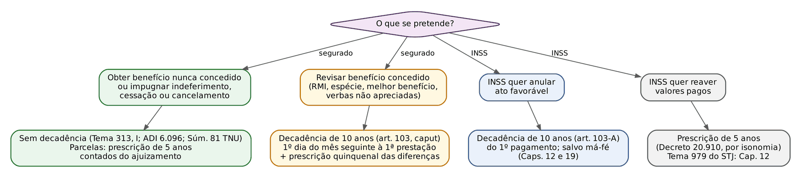
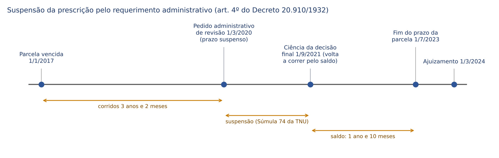
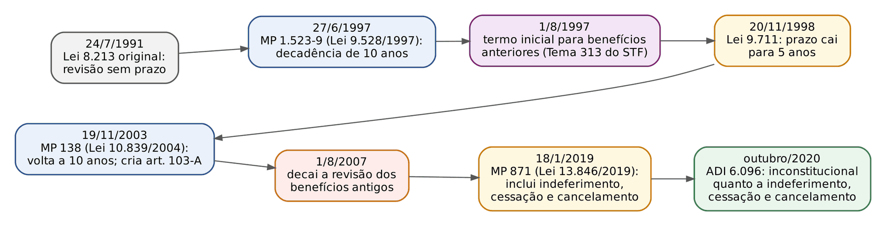
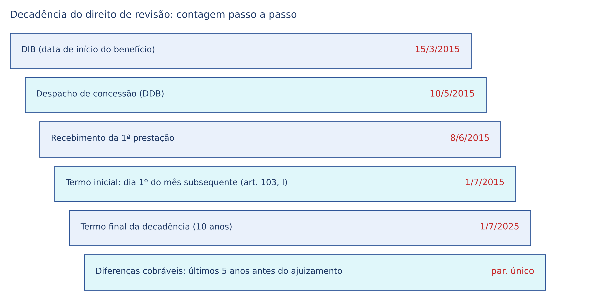
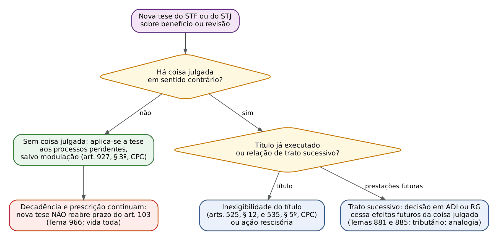

# CAPÍTULO 21 — PRESCRIÇÃO E DECADÊNCIA EM MATÉRIA PREVIDENCIÁRIA

:::INCIDENCIA
Pontos atendidos: TRF5 p. 11 (reflexos em SEFAZ/SC p. 2, quanto ao RPPS). Nível A; lote de 2 questões FGV (ambas TRF-3, 2025), mais 3 correlatas do banco (FGV 2026 TRF-2 e DPE-RJ; FGV 2025 CPRM).
O que mais cai: termo inicial e objeto da decadência do art. 103 (Temas 313, 966, 975 e 1.117), inexistência de prescrição do fundo de direito (ADI 6.096, Súmula 81 da TNU), suspensão da prescrição pelo requerimento administrativo (Súmula 74 da TNU) e o confronto art. 103 x art. 103-A.
:::

## 21.1 O mapa dos prazos extintivos

O Direito Previdenciário convive com quatro prazos extintivos que as bancas adoram embaralhar. Antes de qualquer detalhe, o juiz precisa identificar QUEM pretende O QUÊ:

| Prazo | Titular | Objeto | Termo inicial | Fundamento |
|---|---|---|---|---|
| Prescrição de 5 anos | segurado, dependente | prestações vencidas, restituições ou diferenças devidas pela Previdência | data em que cada prestação deveria ter sido paga | art. 103, parágrafo único, da Lei 8.213/1991; arts. 1º a 3º do Decreto 20.910/1932 |
| Decadência de 10 anos | segurado, beneficiário | revisão do ATO DE CONCESSÃO (e do ato que decide pedido de revisão) | dia primeiro do mês subsequente ao do recebimento da primeira prestação; ou ciência da decisão administrativa sobre o pedido de revisão | art. 103, caput, I e II, da Lei 8.213/1991 |
| Decadência de 10 anos | INSS | anulação de ato favorável ao beneficiário | data do ato; em efeitos patrimoniais contínuos, percepção do primeiro pagamento; salvo má-fé | art. 103-A da Lei 8.213/1991 (Caps. 12 e 19) |
| Prescrição de 5 anos | INSS | cobrança de valores pagos indevidamente; ação regressiva | ato ou fato de que se originar a pretensão | Decreto 20.910/1932, por isonomia (21.5) |
| Nenhum prazo | segurado | direito ao benefício em si (fundo de direito); impugnação de indeferimento, cessação ou cancelamento | — | Tema 313 do STF, item I; ADI 6.096; Súmula 81 da TNU |

Três ideias estruturam o capítulo:

- O direito ao benefício previdenciário (o "fundo de direito") NÃO se extingue pelo tempo. Quem preencheu os requisitos em 1995 e nunca pediu pode pedir hoje; perde apenas as prestações anteriores aos cinco anos que antecedem a ação.
- O que decai é o direito de REVISAR o ato de concessão. Concedido o benefício, o segurado tem 10 anos para discutir o valor, a espécie, o cálculo; depois disso, o ato se estabiliza, ainda que errado.
- Prescrição e decadência têm regimes diferentes: a prescrição se suspende e se interrompe; a decadência legal, em regra, não (art. 207 do CC), salvo disposição legal em contrário e a exceção dos absolutamente incapazes (art. 208 do CC). Ambas são conhecidas de ofício (art. 487, II, do CPC; art. 210 do CC).

:::LEI Lei 8.213/1991, art. 103 (redação da Lei 13.846/2019; vide ADI 6.096)
Art. 103. O prazo de decadência do direito ou da ação do segurado ou beneficiário para a revisão do ato de concessão, indeferimento, cancelamento ou cessação de benefício e do ato de deferimento, indeferimento ou não concessão de revisão de benefício é de 10 (dez) anos, contado:
I - do dia primeiro do mês subsequente ao do recebimento da primeira prestação ou da data em que a prestação deveria ter sido paga com o valor revisto; ou
II - do dia em que o segurado tomar conhecimento da decisão de indeferimento, cancelamento ou cessação do seu pedido de benefício ou da decisão de deferimento ou indeferimento de revisão de benefício, no âmbito administrativo.
Parágrafo único. Prescreve em cinco anos, a contar da data em que deveriam ter sido pagas, toda e qualquer ação para haver prestações vencidas ou quaisquer restituições ou diferenças devidas pela Previdência Social, salvo o direito dos menores, incapazes e ausentes, na forma do Código Civil.
:::

Atenção à leitura do caput depois da ADI 6.096 (21.3.6): o texto publicado no Planalto continua mencionando "indeferimento, cancelamento ou cessação", mas essa parte foi declarada inconstitucional. Na prova, a afirmação "decai em 10 anos o direito de impugnar o indeferimento do benefício" é FALSA, apesar de reproduzir a literalidade do caput.

| Prescrição (parágrafo único) | Decadência (caput) |
|---|---|
| Atinge a pretensão às PARCELAS, mês a mês | Atinge o próprio DIREITO de revisar o ato |
| Trato sucessivo: renova-se a cada prestação | Prazo único, contado uma só vez |
| Suspende-se (requerimento administrativo, art. 4º do Decreto 20.910) e interrompe-se (citação, uma única vez) | Não se suspende nem se interrompe (art. 207 do CC), salvo lei; o exercício do direito no prazo (pedido administrativo de revisão ou ação) basta |
| Não corre contra absolutamente incapaz (art. 198, I, do CC) | Também não corre contra absolutamente incapaz (art. 208 c/c art. 198, I, do CC) |
| Consequência: corte das parcelas anteriores aos 5 anos do ajuizamento | Consequência: improcedência do pedido revisional (art. 487, II, do CPC) |
| Existe também contra o INSS (restituição) | Para o INSS, o prazo de anular é o do art. 103-A |

## 21.2 Prescrição quinquenal das prestações

### 21.2.1 Fundamento e natureza: relação de trato sucessivo

A obrigação previdenciária é de trato sucessivo: cada prestação mensal nasce, vence e prescreve por si. Por isso a prescrição não fulmina o vínculo nem o benefício, mas apenas, progressivamente, as prestações que completarem cinco anos sem cobrança. A regra está em dois diplomas que se completam: o art. 103, parágrafo único, da Lei 8.213/1991 (incluído pela Lei 9.528/1997) e o Decreto 20.910/1932, aplicável às autarquias federais.

:::LEI Decreto 20.910/1932, arts. 1º, 3º e 4º
Art. 1º As dívidas passivas da União, dos Estados e dos Municípios, bem assim todo e qualquer direito ou ação contra a Fazenda federal, estadual ou municipal, seja qual for a sua natureza, prescrevem em cinco anos contados da data do ato ou fato do qual se originarem.
Art. 3º Quando o pagamento se dividir por dias, meses ou anos, a prescrição atingirá progressivamente as prestações à medida que completarem os prazos estabelecidos pelo presente decreto.
Art. 4º Não corre a prescrição durante a demora que, no estudo, ao reconhecimento ou no pagamento da dívida, considerada líquida, tiverem as repartições ou funcionários encarregados de estudar e apurá-la.
Parágrafo único. A suspensão da prescrição, neste caso, verificar-se-á pela entrada do requerimento do titular do direito ou do credor nos livros ou protocolos das repartições públicas, com designação do dia, mês e ano.
:::

A síntese jurisprudencial é a Súmula 85 do STJ: nas relações jurídicas de trato sucessivo em que a Fazenda Pública figure como devedora, quando não tiver sido negado o próprio direito reclamado, a prescrição atinge apenas as prestações vencidas antes do quinquênio anterior à propositura da ação. No Direito Previdenciário, a ressalva final ("quando não tiver sido negado o próprio direito") NÃO se aplica ao benefício: mesmo havendo indeferimento expresso, não há prescrição do fundo de direito (21.2.5).

:::JURIS STJ, Jurisprudência em Teses, ed. 67 (Benefícios Previdenciários), tese 4
"Nos processos relativos a benefícios previdenciários não há a prescrição do fundo de direito, mas apenas das verbas pleiteadas anteriormente aos cinco anos da propositura da ação." Precedentes de todas as Turmas da Primeira e da Terceira Seções (entre eles, REsp 1.503.295/PB, Relator Ministro Herman Benjamin, Segunda Turma, DJe 10/8/2015).
:::

### 21.2.2 Mecânica da contagem

A conta é retroativa: parte-se da data do ajuizamento (a citação válida retroage à propositura, art. 240, § 1º, do CPC) e recua-se cinco anos. Tudo o que venceu antes desse marco está prescrito; o que venceu depois é devido.

:::PASSO Como o juiz recorta as parcelas prescritas
1) Fixe a DIB judicial (DER, data do preenchimento posterior dos requisitos pela reafirmação da DER, dia seguinte à cessação indevida etc.; Caps. 19 e 20).
2) Fixe a data do ajuizamento da ação (protocolo da inicial).
3) Recue 5 anos: marco prescricional = ajuizamento menos 5 anos.
4) Verifique se houve requerimento administrativo pendente em algum momento (suspensão: 21.2.3) e se houve ação anterior, individual ou coletiva, com citação válida (interrupção: 21.2.4).
5) Verifique se o titular é absolutamente incapaz (21.2.6): contra ele não corre prescrição.
6) Condene ao pagamento das parcelas vencidas a partir do marco (ou desde a DIB, se esta for posterior ao marco), inclusive o abono anual proporcional, com correção e juros na forma do Cap. 20.
:::

:::EXEMPLO Prescrição simples: benefício requerido e indeferido há muitos anos
Segurado requereu aposentadoria por idade em 10/1/2012 e teve ciência do indeferimento em 15/2/2012. Ajuizou a ação em 10/9/2023, provando que, em 10/1/2012, já tinha os requisitos. 
Passo 1: DIB na DER, 10/1/2012 (o direito ao benefício não prescreveu nem decaiu: ADI 6.096 e Súmula 81 da TNU).
Passo 2: suspensão administrativa entre 10/1/2012 e 15/2/2012 — irrelevante, porque terminou há mais de cinco anos do ajuizamento.
Passo 3: marco prescricional: 10/9/2023 menos 5 anos = 10/9/2018.
Resultado: benefício implantado com DIB em 10/1/2012 (relevante para reajustes e para a RMI), mas pagamento apenas das parcelas vencidas a partir de 10/9/2018. As parcelas de 1/2012 a 8/2018 estão prescritas.
:::

DIB e DIP não se confundem. A prescrição não desloca a DIB; ela apenas impede a cobrança das prestações antigas. A DIB fixada na DER antiga continua importando para a RMI (salários de contribuição e regra de cálculo da época: *tempus regit actum*, Cap. 22) e para os reajustes acumulados até a data em que o pagamento passa a ser devido.

Benefícios de duração fixa merecem atenção: se o salário-maternidade (120 dias) ou o auxílio por incapacidade temporária (período certo) terminou mais de cinco anos antes do ajuizamento, a ação está INTEGRALMENTE prescrita, embora o "direito" em tese não tenha prescrito — não sobra parcela a cobrar (ver Cap. 17, 17.2.10). O mesmo raciocínio corta o auxílio-acidente com DIB antiga no dia seguinte à cessação do auxílio temporário (Cap. 15).

Armadilha correlata: na Q3757922 (FGV 2025, CPRM; gabarito C, PBC de 100% do período contributivo desde 7/1994), a alternativa E falava em "contribuições dos últimos 5 anos em razão da prescrição" — a prescrição quinquenal atinge PRESTAÇÕES vencidas, nunca salários de contribuição do cálculo (questão resolvida no Cap. 11).

### 21.2.3 Suspensão pelo requerimento administrativo

O requerimento administrativo SUSPENDE a prescrição (art. 4º, parágrafo único, do Decreto 20.910): o prazo para durante a análise e volta a correr, pelo saldo, depois da ciência da decisão final. Não é interrupção (que zeraria o prazo e o reiniciaria pela metade, art. 9º): é suspensão (o tempo já corrido é aproveitado).

:::JURIS TNU, Súmula 74 (j. 17/4/2013, DOU 22/5/2013)
"O prazo de prescrição fica suspenso pela formulação de requerimento administrativo e volta a correr pelo saldo remanescente após a ciência da decisão administrativa final." No mesmo julgamento, Tema 103 da TNU: não corre a prescrição entre a data do protocolo do requerimento administrativo e a comunicação da decisão ao interessado.
:::

Consequências práticas:

- Para as parcelas que vencem DURANTE o processo administrativo (o caso comum: requerimento de benefício novo), a prescrição sequer começa a correr; elas só começam a prescrever após a ciência da decisão final, e contam então o prazo inteiro de cinco anos.
- Para parcelas que JÁ tinham vencido antes do requerimento (típico de pedido administrativo de revisão), o tempo corrido antes do protocolo é descontado: após a decisão, corre só o saldo.
- "Decisão administrativa final" é a última decisão na via administrativa, inclusive em recurso ao CRPS (Cap. 19); a pendência de recurso administrativo mantém a suspensão.
- A demora imputável ao próprio interessado (não atender a exigências, não dar andamento) não suspende (art. 5º do Decreto 20.910).

:::EXEMPLO Saldo remanescente em pedido de revisão (contas conferidas)
Aposentado com benefício em manutenção desde 2012 recebe a menor; diferenças mensais vencem todo mês. Em 1/3/2020 protocola pedido administrativo de revisão; a ciência da decisão final (indeferimento no CRPS) ocorre em 1/9/2021; ajuíza a ação em 1/3/2024.
Diferença vencida em 1/1/2017: corridos 3 anos e 2 meses até o pedido; saldo de 1 ano e 10 meses a partir de 1/9/2021; prescreveu em 1/7/2023 (antes do ajuizamento).
Diferença vencida em 1/9/2017: corridos 2 anos e 6 meses; saldo de 2 anos e 6 meses; prescreveria em 1/3/2024, mesmo dia do ajuizamento — prescrita (o prazo se completou).
Diferença vencida em 1/10/2017: corridos 2 anos e 5 meses; saldo de 2 anos e 7 meses; vence em 1/4/2024 — exigível.
Diferença vencida em 1/6/2019: corridos 9 meses; saldo de 4 anos e 3 meses; vence em 1/12/2025 — exigível.
Diferenças vencidas durante o processo administrativo e depois: exigíveis.
Conclusão: são devidas as diferenças vencidas a partir de 1/10/2017. Sem a suspensão, o corte seria em 1/3/2019 (ajuizamento menos 5 anos). A suspensão rendeu ao segurado 17 meses de atrasados.
:::

:::QUESTAO FGV 2025 — TRF-3 — Juiz Federal Substituto (Q3179511)
Aposentadoria por tempo de contribuição decidida pelo INSS sete anos depois do requerimento; pediu-se a consequência para a prescrição. Gabarito: B — não há prescrição, porque o prazo fica suspenso pelo requerimento e volta a correr pelo saldo remanescente após a ciência da decisão final (Súmula 74 da TNU; art. 4º do Decreto 20.910). Armadilhas: A nega a suspensão; E fala em INTERRUPÇÃO (o requerimento suspende, não interrompe — a distinção é o núcleo da questão); C inventa decadência de 5 anos contada do requerimento (decadência, no art. 103, é de 10 anos e só para revisão); D mistura os institutos. Remissão: o requerimento como DER e seus efeitos estão no Cap. 19.
:::

:::PEGADINHA Suspensão x interrupção
Requerimento administrativo: SUSPENDE (art. 4º do Decreto 20.910; Súmula 74 da TNU). Citação válida na ação: INTERROMPE, retroagindo à propositura (art. 240, § 1º, do CPC; art. 202, I, do CC), e só uma vez (art. 8º do Decreto 20.910). Na interrupção contra a Fazenda, o prazo recomeça pela metade (art. 9º), mas, pela Súmula 383 do STF, não fica reduzido aquém de cinco anos se a interrupção ocorreu na primeira metade do prazo.
:::

### 21.2.4 Interrupção: ação individual, ação coletiva e reclamatória trabalhista

A ação individual interrompe a prescrição na data da propositura, desde que haja citação válida. Se o processo for anulado, a citação não interrompe (art. 7º do Decreto 20.910). Extinto o processo sem resolução de mérito (por exemplo, por falta de requerimento administrativo), a interrupção ocorrida aproveita: o prazo recomeça do último ato do processo, pela metade, observada a Súmula 383 do STF.

A ação civil pública interrompe a prescrição para os substituídos? O STJ respondeu, para o caso dos tetos das ECs 20/1998 e 41/2003, aplicando o microssistema do CDC:

:::JURIS STJ, Tema 1.005 (REsp 1.761.874/SC, Relatora Ministra Assusete Magalhães, Primeira Seção, j. 23/6/2021)
"Na ação de conhecimento individual, proposta com o objetivo de adequar a renda mensal do benefício previdenciário aos tetos fixados pelas Emendas Constitucionais 20/98 e 41/2003 e cujo pedido coincide com aquele anteriormente formulado em ação civil pública, a interrupção da prescrição quinquenal, para recebimento das parcelas vencidas, ocorre na data de ajuizamento da lide individual, salvo se requerida a sua suspensão, na forma do art. 104 da Lei 8.078/90."
:::

Mecânica: o segurado que prefere a ação individual tem duas escolhas. (a) Ajuíza e pede a suspensão do seu processo até o desfecho da ação coletiva (art. 104 do CDC): aproveita a interrupção ocorrida com a ACP e pode receber parcelas desde cinco anos antes da ACP. (b) Ajuíza e segue adiante: a interrupção é a da sua própria ação, e as parcelas recuam só cinco anos dela. Quem executa individualmente a sentença coletiva, por outro lado, aproveita o marco da ACP.

A revisão de RMI para incluir verbas reconhecidas em reclamatória trabalhista tem regra própria de prescrição, construída pela TNU:

:::JURIS TNU, Tema 200 (j. 9/12/2020)
Na pretensão ao recebimento de diferenças decorrentes de revisão de RMI em virtude de verbas salariais reconhecidas em reclamação trabalhista, a prescrição quinquenal deve ser contada retroativamente da data do ajuizamento da ação previdenciária, NÃO fluindo no período de tramitação da ação trabalhista, enquanto não definitivamente reconhecido o direito e não homologados os cálculos de liquidação.
:::

Combine com o Tema 1.117 do STJ (21.3.4), que desloca o termo inicial da DECADÊNCIA para o trânsito em julgado da reclamatória. O segurado que obteve na Justiça do Trabalho o reconhecimento de horas extras habituais tem, portanto, 10 anos do trânsito para pedir a revisão, e as diferenças não prescrevem enquanto corre a ação trabalhista.

### 21.2.5 Prescrição do fundo de direito: por que não existe no RGPS

Prescrição do fundo de direito é a extinção da própria pretensão ao direito-base (e não só das parcelas), quando a Administração nega expressamente o direito e o interessado se mantém inerte por cinco anos (art. 1º do Decreto 20.910; ressalva final da Súmula 85 do STJ). É figura viva no direito dos servidores (21.6), mas foi afastada no RGPS por três fundamentos convergentes:

- O direito à previdência social é direito fundamental (art. 6º da CF), irrenunciável e indisponível; o núcleo essencial não se submete a prazo extintivo. Foi a razão de decidir da ADI 6.096.
- O Tema 313 do STF afirmou que inexiste prazo decadencial para a concessão inicial do benefício (21.3.2); o mesmo raciocínio afasta a prescrição do direito ao benefício.
- O preenchimento dos requisitos gera direito adquirido ao benefício (Cap. 22), que pode ser exercido a qualquer tempo, com efeitos financeiros limitados pela prescrição das parcelas.

:::JURIS TNU, Súmula 81 (redação dada em 9/12/2020, no julgamento do Tema 265)
"A impugnação de ato de indeferimento, cessação ou cancelamento de benefício previdenciário não se submete a qualquer prazo extintivo, seja em relação à revisão desses atos, seja em relação ao fundo de direito."
:::

| Situação | Fundo de direito | Parcelas | Base |
|---|---|---|---|
| Nunca requereu | imprescritível | 5 anos do ajuizamento (DIB na DER ou na citação, Cap. 20) | Tema 313 do STF, item I |
| Requereu e foi indeferido há 15 anos | imprescritível; nem decadência nem prescrição do fundo | 5 anos do ajuizamento | ADI 6.096; Súmula 81 da TNU; JT 67, tese 4 |
| Benefício cessado (ou cancelado) há 12 anos | restabelecimento possível | 5 anos do ajuizamento | ADI 6.096; Súmula 81 da TNU |
| Benefício concedido, valor errado, concessão há 12 anos | o direito de REVISAR decaiu | nenhuma diferença | art. 103, caput; Tema 313 do STF |

Uma cautela processual: impugnar judicialmente indeferimento muito antigo não dispensa o interesse de agir. Se o autor leva a juízo prova nova, não apresentada ao INSS, a orientação do Tema 1.124 do STJ (Cap. 19 e Cap. 20) exige, em regra, novo requerimento; e, em qualquer caso, deve ser respeitada a prescrição das parcelas anteriores aos cinco últimos anos contados da propositura da ação (item 2.4 da tese).

:::PEGADINHA "Decorridos cinco anos do indeferimento, prescreve o direito ao benefício"
FALSO no RGPS. A frase reproduz a lógica da prescrição do fundo de direito do Decreto 20.910, aplicável a vantagens de servidor com ato expresso, mas afastada para benefícios previdenciários (JT 67, tese 4; ADI 6.096; Súmula 81 da TNU). Prescrevem apenas as parcelas.
:::

### 21.2.6 Prescrição contra incapazes e ausentes

O parágrafo único do art. 103 ressalva "o direito dos menores, incapazes e ausentes, na forma do Código Civil". A remissão ao Código Civil é decisiva, porque o CC define quem está protegido:

- Não corre prescrição contra os absolutamente incapazes do art. 3º (art. 198, I). Desde a Lei 13.146/2015 (Estatuto da Pessoa com Deficiência), absolutamente incapazes são APENAS as pessoas com menos de 16 anos.
- Não corre contra os ausentes do País em serviço público da União, dos Estados ou dos Municípios (art. 198, II), nem contra os que servem nas Forças Armadas em tempo de guerra (art. 198, III).
- Contra o adolescente de 16 a 18 anos (relativamente incapaz) a prescrição CORRE.
- A proteção estende-se à decadência: o art. 208 do CC manda aplicar à decadência o art. 198, I. Contra a criança com menos de 16 anos, portanto, não corre nem a prescrição das parcelas nem a decadência do art. 103.

A questão aberta é a da pessoa com deficiência mental ou intelectual sem discernimento, que deixou de ser absolutamente incapaz com a Lei 13.146/2015. Parte da jurisprudência aplica literalmente o novo art. 3º (a prescrição corre, cabendo ao curador agir); outra parte invoca a finalidade protetiva do Estatuto e da Convenção de Nova York para afastar a prescrição. O STJ afetou a controvérsia à Corte Especial:

:::JURIS STJ, Tema 1.321 (REsp 2.165.073/PE, REsp 2.163.797/RJ e REsp 2.259.466/GO, Relator Ministro Raul Araújo, Corte Especial — PENDENTE)
Questão submetida: incidência de prescrição ou de decadência legal contra pessoa com deficiência mental ou intelectual, após a vigência da Lei 13.146/2015, que não mais inclui entre os absolutamente incapazes a pessoa que, por enfermidade ou deficiência, não tiver o necessário discernimento. Há determinação de suspensão de todos os processos pendentes que versem sobre a questão (afetação ampliada em 3/2026 para abranger a decadência). Na prova: diga que a matéria está afetada e pendente; não afirme tese.
:::

O antigo art. 79 da Lei 8.213/1991, que afastava expressamente a prescrição e a decadência do art. 103 para o "pensionista menor, incapaz ou ausente", foi REVOGADO pela Lei 13.846/2019. A proteção remanescente é a do art. 103, parágrafo único, combinado com o CC. Na pensão por morte e no auxílio-reclusão requeridos por filho com menos de 16 anos após 180 dias do evento, a retroação dos efeitos financeiros ao óbito ou à prisão é regida pela regra especial do art. 74, I, e não pela suspensão da prescrição — o STJ fixou, no Tema 1.421, que não há retroação para eventos ocorridos na vigência da MP 871/2019 (desenvolvimento no Cap. 16, 16.7.2). A distinção é sutil e cobrável: o art. 74 trata de TERMO INICIAL do benefício (efeito material), não de prescrição; a imprescritibilidade contra a criança protege as parcelas já devidas, mas não altera a DIB legal.

:::EXEMPLO Criança titular de pensão antiga
Instituidor faleceu em 3/2010; a filha, nascida em 2008, só requereu a pensão em 2/2020, com 11 anos. Fato gerador anterior à MP 871/2019: a pensão retroage ao óbito (redação então vigente do art. 74 e jurisprudência citada no Cap. 16). Contra ela não correu prescrição (art. 198, I, do CC, até completar 16 anos em 2024). Se o INSS conceder com DIB em 2/2020, a ação ajuizada em 2026 pode cobrar as parcelas desde 3/2010? Sim quanto às parcelas vencidas enquanto absolutamente incapaz, porque o prazo prescricional só começou a correr no dia em que completou 16 anos; ajuizada a ação menos de cinco anos depois desse aniversário, nada prescreveu. Se a ação fosse ajuizada sete anos depois dos 16 anos, estariam prescritas as parcelas vencidas até dois anos após o aniversário (todas as anteriores ao marco de cinco anos contados retroativamente do ajuizamento).
:::

## 21.3 Decadência do direito à revisão (art. 103, caput)

### 21.3.1 Evolução legislativa e datas de corte

A redação original da Lei 8.213/1991 não previa prazo para o segurado revisar o ato de concessão. A sucessão de normas é cobrada pelas datas:

| Período | Norma | Prazo | Observação |
|---|---|---|---|
| 24/7/1991 a 27/6/1997 | redação original | nenhum | revisão a qualquer tempo, respeitada a prescrição das parcelas |
| a partir de 28/6/1997 | MP 1.523-9, de 27/6/1997, convertida na Lei 9.528/1997 | 10 anos | cria a decadência e o parágrafo único (prescrição quinquenal) |
| a partir de 23/10/1998 | medida provisória convertida na Lei 9.711, de 20/11/1998 | 5 anos | reduz o prazo |
| a partir de 19/11/2003 | MP 138, de 19/11/2003, convertida na Lei 10.839/2004 | 10 anos | restabelece 10 anos e cria o art. 103-A (decadência do INSS) |
| a partir de 18/1/2019 | MP 871, convertida na Lei 13.846/2019 | 10 anos | estende o prazo ao indeferimento, cancelamento e cessação e ao ato que decide pedido de revisão |
| desde o julgamento da ADI 6.096 (acórdão de 9/10/2020) | STF | — | inconstitucional a extensão a indeferimento, cancelamento e cessação |

A fase dos 5 anos não produziu nenhuma decadência consumada. Para os benefícios concedidos depois da redução, a primeira prestação mais antiga foi recebida no fim de 1998; o prazo quinquenal, contado do dia primeiro do mês seguinte, terminaria no fim de 2003, depois de 19/11/2003, quando a MP 138 já havia restabelecido os 10 anos, que se aplicam aos prazos em curso. Para os benefícios anteriores, prevaleceu a contagem do Tema 313 (abaixo). Resultado prático: hoje, todo cálculo de decadência do segurado usa 10 anos.

### 21.3.2 Benefícios concedidos antes de 28/6/1997: Tema 313 do STF

A dúvida era se a lei nova poderia criar prazo decadencial para revisar benefícios concedidos quando não havia prazo algum. O STF respondeu que não há direito adquirido a regime jurídico de prazo, mas que o prazo novo só pode correr a partir da vigência da norma que o instituiu (lógica semelhante à do art. 2.028 do CC).

:::JURIS STF, Tema 313 (RE 626.489/SE, Relator Ministro Luís Roberto Barroso, Plenário, j. 16/10/2013, Informativo 724)
"I – Inexiste prazo decadencial para a concessão inicial do benefício previdenciário; II – Aplica-se o prazo decadencial de dez anos para a revisão de benefícios concedidos, inclusive os anteriores ao advento da Medida Provisória 1.523/1997, hipótese em que a contagem do prazo deve iniciar-se em 1º de agosto de 1997."
:::

Por que 1/8/1997? Aplicou-se a própria regra do caput: a MP é de 27/6/1997; a primeira prestação paga sob sua vigência foi a da competência de junho, recebida em julho de 1997; o prazo corre do dia primeiro do mês subsequente ao do recebimento, ou seja, 1/8/1997. Dez anos depois: 1/8/2007. Desde então, todos os benefícios concedidos até 27/6/1997 estão imunes a revisão do ato de concessão.

O STJ, no Tema 544 (REsp 1.309.529/PR e REsp 1.326.114/SC, Relator Ministro Herman Benjamin, Primeira Seção, j. 28/11/2012), já havia afirmado a mesma incidência, com termo a quo na vigência da MP (28/6/1997), e explicitado que o suporte da decadência é o direito de REVISÃO dos benefícios, e não o direito ao benefício. Na prova, use a data do STF (1/8/1997), que é a tese vinculante de repercussão geral; a diferença entre as duas datas é de apenas um mês e raramente decide caso concreto.

:::DICA Item I do Tema 313: a frase que mais cai
"Inexiste prazo decadencial para a concessão inicial do benefício." Associe: quem nunca recebeu pode pedir a qualquer tempo; quem recebe e quer mudar o valor tem 10 anos. A ADI 6.096 levou o raciocínio do item I ao indeferimento, à cessação e ao cancelamento.
:::

### 21.3.3 Termo inicial

O caput fixa dois termos iniciais, conforme o ato revisado:

| Ato revisado | Termo inicial | Inciso |
|---|---|---|
| Ato de concessão | dia primeiro do mês subsequente ao do RECEBIMENTO da primeira prestação | I, primeira parte |
| Revisão administrativa com efeitos (valor revisto) | data em que a prestação deveria ter sido paga com o valor revisto | I, parte final |
| Decisão administrativa que defere ou indefere pedido de revisão | dia em que o segurado toma conhecimento da decisão | II |

Pontos de mecânica que a banca explora:

- O termo não é a DIB nem a DDB (data do despacho), mas o RECEBIMENTO da primeira prestação. Em benefícios concedidos com atraso, a primeira prestação costuma incluir os atrasados desde a DIB (o "PAB", pagamento alternativo de benefício); o prazo corre do mês seguinte a esse primeiro recebimento.
- O prazo é contado uma só vez para cada ato. A cada reajuste anual não se reinicia nada: reajuste não é ato de concessão (as revisões de reajustamento, por sua vez, envolvem apenas parcelas e prescrição).
- O pedido administrativo de revisão formulado DENTRO dos 10 anos é exercício do direito e impede a decadência. A decisão sobre esse pedido abre o prazo do inciso II para impugná-la judicialmente.
- O pedido administrativo formulado DEPOIS de consumada a decadência não a desfaz: o inciso II não serve para "ressuscitar" prazo esgotado; a decisão que indefere revisão de ato já estabilizado não é ato novo de concessão.
- Benefício precedido de outro (aposentadoria por incapacidade permanente precedida de auxílio temporário; pensão derivada de aposentadoria): a decadência para discutir o cálculo herdado conta do benefício ORIGINÁRIO; para discutir o que é próprio do derivado (cota, rateio, regra de cálculo da pensão), conta do derivado (21.3.5).

:::EXEMPLO Decadência e prescrição combinadas
Aposentadoria com DIB em 15/3/2015, despacho em 10/5/2015, primeira prestação recebida em 8/6/2015. Termo inicial: 1/7/2015. Termo final: 1/7/2025.
Hipótese A: ação revisional ajuizada em 20/5/2025 — dentro do prazo. Diferenças devidas desde a DIB? Não: marco prescricional em 20/5/2020; diferenças desde então (salvo suspensão por pedido administrativo de revisão, 21.2.3).
Hipótese B: pedido administrativo de revisão em 2/3/2025, indeferido com ciência em 10/9/2025; ação em 5/2/2026. Não há decadência: o direito foi exercido no prazo (pedido administrativo) e a ação veio dentro dos 10 anos contados da ciência da decisão de revisão (inciso II). Prescrição: suspensa entre 2/3/2025 e 10/9/2025.
Hipótese C: ação em 3/7/2025, sem pedido administrativo anterior — decadência consumada; improcedência com resolução de mérito (art. 487, II, do CPC), reconhecível de ofício.
:::

### 21.3.4 Objeto: o que é "revisão do ato de concessão"

O art. 103 alcança tudo o que, se acolhido, alteraria o ato de concessão: RMI, salários de contribuição, tempo computado, coeficiente, espécie, regra de cálculo. Quatro temas repetitivos do STJ delimitaram as zonas de dúvida.

:::JURIS STJ, Tema 975 (REsp 1.644.191/RS e REsp 1.648.336/RS, Relator Ministro Herman Benjamin, Primeira Seção, j. 11/12/2019)
"Aplica-se o prazo decadencial de dez anos estabelecido no art. 103, caput, da Lei 8.213/1991 às hipóteses em que a questão controvertida não foi apreciada no ato administrativo de análise de concessão de benefício previdenciário."
:::

O Tema 975 encerrou a tese de que a decadência só alcançaria o que o INSS efetivamente examinou. Exemplo: o segurado se aposentou em 2010 sem pedir o reconhecimento de período especial ou rural; em 2023 quer incluí-lo para elevar a RMI. Decaiu, ainda que o INSS nunca tenha examinado o período. O fundamento é a segurança jurídica: o ato de concessão estabiliza-se como um todo.

:::JURIS STJ, Tema 966 (REsp 1.612.818/PR e REsp 1.631.021/PR, Relator Ministro Mauro Campbell Marques, Primeira Seção, j. 13/2/2019)
"Incide o prazo decadencial previsto no caput do artigo 103 da Lei 8.213/1991 para reconhecimento do direito adquirido ao benefício previdenciário mais vantajoso."
:::

O Tema 966 dialoga com o Tema 334 do STF (direito ao melhor benefício, Cap. 19): o direito existe, mas, uma vez concedido benefício menos vantajoso, exercê-lo é REVISAR o ato de concessão, e isso decai em 10 anos. O STJ distinguiu os dois temas: no 966, a decadência recai sobre o direito de conceder o benefício sob regime jurídico anterior ao deferido, retroagindo à data de início; no 975, discute-se se o que não foi apreciado pelo INSS pode ser alcançado.

:::JURIS STJ, Tema 1.117 (REsp 1.947.419/RS e REsp 1.947.534/RS, Relator Ministro Gurgel de Faria, Primeira Seção, j. 24/8/2022)
"O marco inicial da fluência do prazo decadencial, previsto no caput do art. 103 da Lei n. 8.213/1991, quando houver pedido de revisão da renda mensal inicial (RMI) para incluir verbas remuneratórias recebidas em ação trabalhista nos salários de contribuição que integraram o período básico de cálculo (PBC) do benefício, deve ser o trânsito em julgado da sentença na respectiva reclamatória."
:::

A lógica do Tema 1.117 é a *actio nata*: antes do trânsito da reclamatória, o segurado não dispunha dos salários de contribuição majorados para pedir a revisão. Atenção ao limite: o tema trata de verbas RECONHECIDAS na reclamatória; não reabre prazo para fatos que o segurado já podia alegar ao INSS. Para as parcelas, a prescrição segue o Tema 200 da TNU (21.2.4).

Ficam FORA do art. 103, por não constituírem revisão do ato de concessão:

| Pretensão | Por que não decai | Fundamento |
|---|---|---|
| Concessão inicial de benefício nunca concedido | não há ato de concessão a rever | Tema 313 do STF, item I |
| Impugnação de indeferimento, cessação ou cancelamento | núcleo do direito fundamental | ADI 6.096; Súmula 81 da TNU |
| Desaposentação | não é revisão, mas renúncia para nova concessão (de resto, rejeitada pelo STF) | JT 67, tese 14, do STJ |
| Reajustamento e índices de manutenção posteriores à concessão | não alteram o ato de concessão; só prescrição das parcelas | lógica do caput |
| Readequação da renda aos tetos das ECs 20/1998 e 41/2003 | aplica limitador novo a benefício já calculado, sem rever a RMI | orientação jurisprudencial dominante (no Tema 1.023 — ARE 1.172.622, ausência de repercussão geral reconhecida em 13/12/2018 —, o STF afirmou ser "infraconstitucional, a ela se aplicando os efeitos da ausência de repercussão geral, a controvérsia relativa às situações abrangidas pelo prazo decadencial previsto no art. 103 da Lei nº 8.213/91, fundada na interpretação do termo revisão contido no referido dispositivo legal"); desenvolvimento no Cap. 22 |

:::PEGADINHA Decadência e "revisão de tese"
A banca afirma: "decisão superveniente do STF ou do STJ favorável à tese revisional reabre o prazo decadencial". FALSO. A mudança de jurisprudência não é termo inicial do art. 103 (o termo é legal: primeira prestação ou ciência da decisão de revisão). Por isso as revisões de tese (vida toda, art. 29, II, melhor benefício) só beneficiaram quem ainda estava dentro dos 10 anos (Cap. 11, 11.12, e 21.7).
:::

### 21.3.5 Benefício derivado: pensão por morte e revisão da aposentadoria do instituidor

A pensão por morte tem ato de concessão próprio, mas seu valor deriva da aposentadoria que o instituidor recebia (ou daquela a que teria direito, Cap. 16). Duas pretensões devem ser separadas:

- Revisar a PENSÃO por vício próprio (cota, rateio, duração, aplicação das regras do art. 23 da EC 103/2019): decadência de 10 anos contada da primeira prestação da pensão.
- Revisar a APOSENTADORIA do instituidor, com reflexo na pensão: decadência contada do benefício originário. Se o direito do instituidor já decaiu, o pensionista não o recupera; não há "novo prazo" com a concessão da pensão.

:::JURIS STJ, Tema 1.057 (REsp 1.856.967/ES, Relatora Ministra Regina Helena Costa, Primeira Seção, j. 23/6/2021, Informativo 702)
I. O art. 112 da Lei 8.213/1991 aplica-se aos âmbitos judicial e administrativo; II. os pensionistas têm legitimidade para pleitear, por direito próprio, a revisão do benefício derivado — caso não alcançada pela decadência —, com diferenças pretéritas não prescritas; III. caso não decaído o direito de revisar a RMI do benefício originário, os pensionistas podem postular a revisão da aposentadoria, recebendo as parcelas não prescritas devidas ao instituidor e os reflexos na pensão; IV. à falta de dependentes habilitados, os sucessores do instituidor são legitimados para pleitear a revisão do benefício original — salvo se decaído o direito ao instituidor.
:::

:::QUESTAO FGV 2025 — TRF-3 — Juiz Federal Substituto (Q3179513)
Viúva, pensionista desde o óbito do marido em 2017, soube em 2020 de uma revisão capaz de elevar a RMI; o marido estava aposentado por tempo de contribuição desde 2000. Pediu-se se ela poderia pedir em 2020 a revisão do benefício do marido. Gabarito: C — não pode, porque o direito foi alcançado pela decadência. Passos: (1) a revisão pretendida é da APOSENTADORIA originária (o reflexo na pensão é consequência); (2) termo inicial: primeira prestação da aposentadoria, recebida em 2000; termo final em 2010 (por exemplo, primeira prestação em 6/2000: prazo de 1/7/2000 a 1/7/2010); (3) em 2020 o direito do instituidor já havia decaído, e o Tema 1.057, item III, condiciona a legitimidade do pensionista a "caso não decaído o direito de revisar a renda mensal inicial do benefício originário". Armadilhas: E (prazo contado da concessão da pensão) é o erro mais tentador — o prazo próprio da pensão vale só para vícios da pensão; A ignora a decadência; B nega a legitimidade, que o Tema 1.057 reconhece; D troca decadência por prescrição. Observação: a redação do gabarito ("não tem legitimidade ativa ... porque o direito foi alcançado pela decadência") é tecnicamente imprecisa — a pensionista TEM legitimidade (Tema 1.057), mas o pedido é improcedente por decadência (mérito, art. 487, II, do CPC). Marque a alternativa que aponta a decadência.
:::

### 21.3.6 ADI 6.096: indeferimento, cancelamento e cessação

A MP 871/2019 (Lei 13.846/2019) ampliou o caput do art. 103 para submeter ao prazo de 10 anos também a revisão do ato de "indeferimento, cancelamento ou cessação de benefício", com termo inicial na ciência da decisão (inciso II). Na prática, quem tivesse o benefício negado e ficasse 10 anos inerte perderia o próprio direito, contrariando o item I do Tema 313.

:::JURIS STF, ADI 6.096 (Relator Ministro Edson Fachin, Plenário, acórdão de 9/10/2020)
A ação foi conhecida em parte (o art. 22 da MP 871/2019, não incorporado à Lei 13.846/2019, perdeu o objeto) e, na parte remanescente, julgada parcialmente procedente para declarar a inconstitucionalidade do art. 24 da Lei 13.846/2019 na parte em que deu nova redação ao art. 103 da Lei 8.213/1991, quanto ao prazo decadencial para revisão do ato de indeferimento, cancelamento ou cessação de benefício. Razão de decidir: o núcleo essencial do direito fundamental à previdência social (art. 6º da CF) é imprescritível; o prazo extintivo pode recair sobre a graduação econômica do benefício já concedido, não sobre o direito a obtê-lo. As preliminares de ilegitimidade e de falta de urgência e relevância da MP foram afastadas.
:::

O que sobrou do art. 103 depois da ADI:

| Parte do caput | Situação |
|---|---|
| revisão do ato de CONCESSÃO | válida (prazo de 10 anos; inciso I) |
| revisão do ato de INDEFERIMENTO, CANCELAMENTO ou CESSAÇÃO | inconstitucional (não há prazo) |
| revisão do ato de deferimento, indeferimento ou não concessão de REVISÃO | válida: a decisão sobre pedido de revisão do benefício já concedido abre o prazo do inciso II |
| parágrafo único (prescrição quinquenal) | intocado |

:::PEGADINHA Cessação não é revisão, e o art. 103-A não socorre o segurado
O segurado cujo auxílio por incapacidade temporária foi cessado em 2012 pode, em 2026, pedir o restabelecimento: não há decadência (ADI 6.096), e só as parcelas anteriores a cinco anos do ajuizamento estão prescritas. Ao contrário, o INSS, para ANULAR uma concessão viciada, tem 10 anos (art. 103-A), salvo má-fé. Inverter os papéis (aplicar o art. 103-A ao segurado ou o art. 103 ao INSS) é a armadilha mais comum.
:::

### 21.3.7 A decadência do segurado e a do INSS lado a lado

O art. 103-A está desenvolvido no Cap. 19 (19.7), com o Tema 214 do STJ (atos anteriores a 1/2/1999) e o procedimento do art. 69 da Lei 8.212/1991. Aqui, só o confronto que a FGV cobra:

| Aspecto | Art. 103 (segurado) | Art. 103-A (INSS) |
|---|---|---|
| Direito atingido | revisar o ato de concessão a seu favor | anular ato favorável ao beneficiário |
| Prazo | 10 anos | 10 anos |
| Termo inicial | dia primeiro do mês seguinte ao recebimento da primeira prestação; ciência da decisão de revisão | data do ato; efeitos patrimoniais contínuos: percepção do primeiro pagamento |
| Exceção | não há (salvo incapacidade absoluta, art. 208 do CC) | comprovada má-fé |
| Exercício que obsta | pedido administrativo de revisão ou ação dentro do prazo | qualquer medida de autoridade que importe impugnação à validade do ato (§ 2º) |
| Fora do alcance | concessão inicial, indeferimento, cessação, cancelamento | cessação por desaparecimento superveniente dos requisitos (não é anulação) |

No mesmo sentido do quadro: Q3996825 (FGV 2026, TRF-2, Juiz Federal; gabarito C — 10 anos em ambos os casos), resolvida no Cap. 19 (19.7.1).

## 21.4 Prescrição e decadência no processo: reconhecimento e sentença

:::PROCESSO Como os prazos extintivos aparecem no processo previdenciário
- Conhecimento de ofício: a prescrição (art. 487, II, e art. 332, § 1º, do CPC) e a decadência legal (art. 210 do CC) são reconhecíveis de ofício, mas o juiz deve ouvir as partes antes (art. 487, parágrafo único, do CPC), salvo na improcedência liminar.
- Improcedência liminar: verificada de plano a decadência do art. 103 (revisão de benefício concedido há mais de 10 anos, sem causa que afaste o prazo), cabe julgar liminarmente improcedente o pedido (art. 332, § 1º, do CPC).
- Prescrição parcial não é improcedência: é procedência com limitação temporal das parcelas; deve constar do dispositivo.
- Decadência é mérito: a sentença que a reconhece faz coisa julgada material sobre o direito de revisar aquele ato com aquele fundamento.
- Valor da causa e competência no JEF: as parcelas vencidas consideradas para o teto de 60 salários mínimos são as não prescritas, somadas a 12 vincendas (Cap. 20).
- Ônus: cabe ao INSS alegar e provar a data do primeiro pagamento (dado do sistema); ao autor, a causa suspensiva (protocolo do requerimento e data da ciência da decisão final) e, se for o caso, a incapacidade absoluta.
- Requerimento administrativo prévio: além de condição do interesse de agir (Tema 350 do STF, Cap. 19), é o marco que suspende a prescrição; junte sempre o histórico do processo administrativo para aferir a data da ciência.
:::

:::SENTENCA Dispositivo com prescrição quinquenal e afastamento de decadência
"Rejeito a prejudicial de decadência: a parte autora impugna ato de indeferimento, e não revisão de ato de concessão, hipótese em que não incide prazo extintivo (STF, ADI 6.096; Súmula 81 da TNU). Pronuncio a prescrição das parcelas vencidas antes de 10/9/2018 (cinco anos anteriores ao ajuizamento, art. 103, parágrafo único, da Lei 8.213/1991). No mérito, JULGO PROCEDENTE o pedido para condenar o INSS a implantar aposentadoria por idade com DIB em 10/1/2012 (DER) e DIP na data desta sentença, e a pagar as parcelas vencidas a partir de 10/9/2018 até a DIP, com correção monetária e juros na forma do art. 3º da EC 113/2021 (Cap. 20). Honorários sobre as parcelas vencidas até a sentença (Súmula 111 do STJ)."
:::

:::SENTENCA Pronúncia de decadência em ação revisional
"A aposentadoria da parte autora teve a primeira prestação recebida em 6/2010; o prazo decadencial do art. 103, caput e inciso I, da Lei 8.213/1991 iniciou-se em 1/7/2010 e findou em 1/7/2020, sem pedido administrativo de revisão no período. A pretensão de incluir no cálculo período especial não examinado na concessão submete-se ao mesmo prazo (STJ, Tema 975). Pronuncio a decadência e JULGO IMPROCEDENTE o pedido, com resolução de mérito (art. 487, II, do CPC)."
:::

## 21.5 Pretensões do INSS: restituição de valores e ação regressiva

O INSS também está sujeito a prazos quando é credor. Não há regra específica na Lei 8.213/1991 para a cobrança de benefícios pagos indevidamente; a jurisprudência aplica, por isonomia, o prazo de 5 anos do Decreto 20.910/1932.

:::JURIS STJ, AgInt no REsp 1.998.744/RJ (Relator Ministro Mauro Campbell Marques, Segunda Turma, j. 6/3/2023, Informativo 768)
Aplica-se o prazo prescricional de 5 anos do Decreto 20.910/1932 à pretensão do INSS de reaver valores de benefício pagos indevidamente, quando comprovada a má-fé do beneficiário, por isonomia com o prazo que rege as pretensões contra a Fazenda e à falta de prazo específico em lei.
:::

Leitura sistemática para a prova:

- Pretensão de RESSARCIMENTO (cobrar o que foi pago): prescrição de 5 anos, contada do ato ou fato de que se originar (art. 1º do Decreto 20.910); na prática, discute-se o termo inicial (pagamento indevido ou ciência do INSS, quando a irregularidade estava oculta). Sem orientação vinculante sobre o termo, descreva as duas posições.
- Pretensão de ANULAR o ato de concessão: decadência do art. 103-A, que não corre havendo má-fé. São prazos diferentes e sucessivos: anula-se o ato (sem prazo, se houve má-fé) e cobram-se os valores (5 anos).
- Se a cobrança é por DESCONTO no benefício em manutenção (art. 115, II, da Lei 8.213/1991, até 30%), ou por inscrição em dívida ativa (art. 115, §§ 3º e 4º), a mesma limitação quinquenal das parcelas cobradas é invocada pela defesa; quando a origem é erro administrativo e boa-fé objetiva, a questão prévia é a própria repetibilidade (Tema 979 do STJ, Cap. 12, 12.11).
- Imprescritibilidade: só para o ressarcimento ao erário fundado em ato DOLOSO tipificado como improbidade (Tema 897 do STF); o ilícito civil comum é prescritível (Tema 666 do STF). Fraude previdenciária sem ação de improbidade não torna imprescritível a cobrança do benefício.
- Ação regressiva acidentária (art. 120 da Lei 8.213/1991) contra o empregador negligente: prescrição quinquenal do Decreto 20.910, por isonomia, segundo a orientação dominante (desenvolvimento no Cap. 20).

## 21.6 Prescrição e decadência no RPPS (servidor público)

No regime próprio não incide o art. 103 da Lei 8.213/1991 (norma do RGPS). Os prazos vêm do Decreto 20.910/1932 (pretensões do servidor), da Lei 9.784/1999 ou da lei do ente (anulação pela Administração) e da jurisprudência do STF sobre o registro pelo Tribunal de Contas.

| Pretensão | Prazo e regra | Observação |
|---|---|---|
| Servidor cobra diferenças de proventos ou pensão | 5 anos, parcelas (Súmula 85 do STJ) | trato sucessivo |
| Servidor impugna o ATO de aposentadoria (critério de cálculo, fundamento, enquadramento) | orientação do STJ: prescrição do FUNDO DE DIREITO em 5 anos do ato (art. 1º do Decreto 20.910), por haver ato expresso | diferença central em relação ao RGPS; confirme o caso concreto (ver nota) |
| Conversão em pecúnia de licença-prêmio não gozada | 5 anos contados da aposentadoria | STJ, Tema 516 (REsp 1.254.456/PE) |
| Administração anula ato favorável | 5 anos (art. 54 da Lei 9.784/1999, ou lei local), salvo má-fé | o ato de aposentadoria é complexo: ver Tema 445 |
| Tribunal de Contas julga a legalidade da concessão inicial (registro) | 5 anos contados da chegada do processo ao Tribunal | STF, Tema 445; vencido o prazo, o ato considera-se registrado |
| Revisão após o registro | submete-se ao prazo decadencial, com contraditório | proteção da confiança |

Tese essencial do Tema 445 do STF: o Tribunal de Contas tem 5 anos, contados da chegada do processo, para julgar a legalidade da concessão inicial; antes do registro (ato complexo), não corre o prazo do art. 54 da Lei 9.784/1999 (v. Cap. 23, 23.10, onde o tema está desenvolvido, com contagem e redação-modelo). No mesmo sentido: Q4289393 (FGV 2026, DPE-RJ, Defensor Público; gabarito C, F – F – V — só a terceira afirmativa, sobre a proteção da confiança no prazo quinquenal, é verdadeira), resolvida no Cap. 23. O contraste a guardar aqui: no RGPS, o prazo do INSS para anular é de 10 anos (art. 103-A).

:::ATENCAO Para a SEFAZ/SC
No RPPS de Santa Catarina, os prazos para a Administração e para o servidor seguem a legislação estadual de processo administrativo e o Decreto 20.910/1932; não transporte para o RPPS o art. 103 (10 anos) nem o art. 103-A (10 anos) da Lei 8.213/1991. Legislação do IPREV e LC SC 412/2008: Cap. 25.
:::

## 21.7 Efeitos temporais das decisões

O ponto 11 do TRF5 termina com "efeitos temporais das decisões". O tema une o processo constitucional (modulação), a coisa julgada nas relações de trato sucessivo e os prazos extintivos.

### 21.7.1 Modulação de efeitos

A declaração de inconstitucionalidade tem, em regra, efeitos *ex tunc*; o STF pode restringi-los por razões de segurança jurídica ou de excepcional interesse social, por maioria de dois terços (art. 27 da Lei 9.868/1999). Na alteração de jurisprudência dominante dos tribunais superiores ou daquela oriunda de julgamento de casos repetitivos, pode haver modulação no interesse social e no da segurança jurídica (art. 927, § 3º, do CPC). Exemplos previdenciários de modulação que caem:

| Precedente | Modulação | Remissão |
|---|---|---|
| Revisão da vida toda (Tema 1.102 do STF, ED; ADIs 2.110 e 2.111) | valores recebidos até 5/4/2024 com base na tese anterior são irrepetíveis; sem sucumbência para o segurado nas ações pendentes | Cap. 11, 11.12.1 |
| Tema 979 do STJ (devolução por erro administrativo) | tese aplicada só aos processos distribuídos, na primeira instância, a partir da publicação do acórdão (DJe de 23/4/2021) | Cap. 12 |
| Tema 1.190 do STJ (honorários em cumprimento não impugnado com RPV) | aplicação só aos cumprimentos iniciados após a publicação do acórdão | Cap. 20 |

Mesmo quando a nova tese é FAVORÁVEL ao segurado, ela não reabre o prazo do art. 103 (21.3.4): o efeito temporal de uma tese judicial esbarra na decadência já consumada. E, quando desfavorável, a modulação costuma proteger o que já foi pago de boa-fé, não o direito de continuar a receber.

### 21.7.2 Tese posterior e coisa julgada em relação de trato sucessivo

Benefício previdenciário é relação de trato sucessivo: a sentença que concede ou revisa projeta efeitos para o futuro. O que acontece quando, depois do trânsito, o STF fixa tese em sentido contrário?

- Título judicial fundado em lei ou interpretação declarada incompatível com a CF pelo STF: o STF, na AR 2.876 QO (Plenário, j. 23/4/2025), deu interpretação conforme aos arts. 525, § 15, e 535, § 8º, do CPC — rescisória em dois anos do trânsito da decisão do STF, com retroação de no máximo cinco anos do ajuizamento, salvo modulação expressa — e admitiu a arguição de inexigibilidade seja a decisão do STF anterior ou posterior ao trânsito do título, salvo preclusão (desenvolvimento no Cap. 22).
- Prestações futuras: no Direito Tributário, o STF decidiu que as decisões em ação direta ou em repercussão geral interrompem automaticamente os efeitos temporais das decisões transitadas em julgado nas relações de trato sucessivo, a partir da nova orientação, sem necessidade de rescisória (Temas 881 e 885, RE 949.297 e RE 955.227, j. 8/2/2023, sem modulação). A transposição ao previdenciário é argumento forte (mesma natureza continuada), mas não há tese vinculante específica: use-o como fundamento analógico.
- O próprio art. 505, I, do CPC já permite rever o comando da sentença em relação continuativa quando sobrevém modificação no estado de fato ou de direito (exemplo clássico: cessação do benefício por incapacidade concedido judicialmente, depois de nova perícia — Cap. 15).
- Efeitos pretéritos ficam protegidos: o que foi pago com base no título até a mudança não se repete, salvo rescisão do julgado; mesmo então, a boa-fé e a natureza alimentar orientam as modulações.

### 21.7.3 Efeitos temporais das próprias normas sobre prazo

O Tema 313 é, ele mesmo, um precedente sobre efeitos temporais: lei nova que cria prazo extintivo aplica-se às situações pretéritas, mas o prazo corre da vigência da lei nova, nunca do fato antigo. A mesma lógica orientou o Tema 214 do STJ (art. 103-A para atos anteriores a 1999, Cap. 19) e explica por que a redução para 5 anos (1998) e o retorno a 10 anos (2003) não geraram decadência consumada. Lei que AMPLIA prazo em curso aplica-se ao prazo ainda não consumado; lei que o reduz não pode fazer o prazo terminar antes da vigência da própria lei.

Por fim, a LINDB, art. 24: a revisão, nas esferas administrativa e judicial, de ato cuja produção já se houver completado levará em conta as orientações gerais da época, sendo vedado declarar inválidas situações plenamente constituídas com base em mudança posterior de orientação geral. O dispositivo reforça, na via administrativa, a proteção do segurado contra a revisão de ofício fundada só em mudança de entendimento (o que, de resto, ainda esbarra no prazo do art. 103-A).

:::PRATIQUE Exercícios elaborados para esta apostila (não são questões de banca)
1) Benefício concedido em 1995; em 2026 o segurado pede para incluir período rural não examinado. Decadência? Resolução: sim. Benefício anterior a 28/6/1997: prazo de 10 anos contado de 1/8/1997, consumado em 1/8/2007 (Tema 313 do STF); a questão não apreciada também decai (Tema 975 do STJ).
2) Auxílio por incapacidade temporária cessado em 5/2014; ação de restabelecimento em 8/2026, com perícia que fixa a incapacidade permanente desde a cessação. O que se paga? Resolução: não há decadência (ADI 6.096); DIB do benefício judicial no dia seguinte à cessação; parcelas a partir de 8/2021 (ajuizamento menos 5 anos), salvo suspensão por requerimento administrativo posterior pendente.
3) Segurado obteve na Justiça do Trabalho, com trânsito em 3/2/2022, o reconhecimento de adicional de periculosidade em período do PBC de aposentadoria concedida em 2008. Ação revisional em 2026: há decadência? Resolução: não; o prazo conta do trânsito da reclamatória (Tema 1.117 do STJ) e vai até 3/2/2032. Prescrição: contada retroativamente do ajuizamento, sem fluir durante a reclamatória (Tema 200 da TNU).
:::

## 21.8 Resumo para revisão pré-prova

| Instituto | Regra | Exceções e detalhes | Fundamento |
|---|---|---|---|
| Prescrição das parcelas | 5 anos, contados da data em que cada prestação deveria ter sido paga; corte retroativo a partir do ajuizamento | abono anual e diferenças também; benefício de duração fixa pode prescrever por inteiro | art. 103, parágrafo único; Decreto 20.910, arts. 1º e 3º; Súmula 85 do STJ |
| Fundo de direito no RGPS | não prescreve nem decai | mesmo com indeferimento expresso | JT 67, tese 4; ADI 6.096; Súmula 81 da TNU |
| Suspensão | requerimento administrativo suspende; volta a correr pelo saldo após a ciência da decisão final | demora do interessado não suspende | Decreto 20.910, arts. 4º e 5º; Súmula 74 e Tema 103 da TNU |
| Interrupção | citação válida, retroativa à propositura; uma vez; recomeça pela metade | não aquém de 5 anos se interrompida na 1ª metade; processo anulado não interrompe | CPC, art. 240, § 1º; Decreto 20.910, arts. 7º a 9º; Súmula 383 do STF |
| Ação coletiva | ação individual: interrupção na data dela, salvo pedido de suspensão (art. 104 do CDC) | tetos das ECs 20 e 41 | Tema 1.005 do STJ |
| Reclamatória trabalhista | decadência conta do trânsito da reclamatória; prescrição não flui durante ela | só verbas reconhecidas na reclamatória | Tema 1.117 do STJ; Tema 200 da TNU |
| Incapazes | contra pessoa com menos de 16 anos não corre prescrição nem decadência | 16 a 18 anos: corre; deficiência mental: Tema 1.321 do STJ pendente; art. 79 revogado | art. 103, parágrafo único; CC, arts. 3º, 198 e 208 |
| Decadência do segurado | 10 anos para revisar o ato de concessão | concessão inicial, indeferimento, cessação e cancelamento: sem prazo | art. 103, caput; Tema 313 do STF; ADI 6.096 |
| Termo inicial | dia primeiro do mês seguinte ao recebimento da 1ª prestação; ou ciência da decisão de pedido de revisão | não é a DIB nem a DDB | art. 103, I e II |
| Benefícios antigos | concedidos antes de 28/6/1997: prazo a partir de 1/8/1997, findo em 1/8/2007 | STJ (Tema 544): a partir de 28/6/1997 | Tema 313 do STF |
| Questão não apreciada | também decai | — | Tema 975 do STJ |
| Melhor benefício | decai em 10 anos | direito existe (Tema 334 do STF), mas exercício é revisão | Tema 966 do STJ |
| Pensão derivada | revisão da aposentadoria do instituidor: prazo do benefício originário | vícios próprios da pensão: prazo da pensão | Tema 1.057 do STJ; Q3179513 |
| Fora do art. 103 | desaposentação; reajustes; readequação aos tetos | — | JT 67, tese 14; Tema 1.023 do STF (sem RG); Cap. 22 |
| Decadência do INSS | 10 anos para anular ato favorável, do 1º pagamento | má-fé afasta; atos anteriores a 1999: Tema 214 | art. 103-A; Cap. 19 |
| Cobrança pelo INSS | 5 anos (Decreto 20.910, por isonomia) | imprescritível só improbidade dolosa (Tema 897 do STF) | AgInt no REsp 1.998.744 (Info 768) |
| RPPS | Decreto 20.910 e Lei 9.784; fundo de direito prescreve contra ato expresso | Tribunal de Contas: 5 anos da chegada do processo (Cap. 23) | Tema 445 do STF; Tema 516 do STJ |
| Efeitos temporais | modulação por 2/3 (Lei 9.868, art. 27) ou art. 927, § 3º, do CPC; nova tese não reabre decadência | trato sucessivo: decisão em ADI ou RG cessa efeitos futuros da coisa julgada (tributário, por analogia) | Temas 881 e 885 do STF; CPC, arts. 505, I, 525 e 535 |

## 21.9 Artigos de lei incidentes

- Constituição Federal: art. 6º (direito fundamental à previdência, base da ADI 6.096).
- Lei 8.213/1991: art. 74 (termo inicial da pensão), art. 79 (revogado pela Lei 13.846/2019), art. 103, caput, I e II, e parágrafo único; art. 103-A; art. 112; art. 115, II e §§ 3º e 4º; art. 120.
- Lei 13.846/2019: art. 24 (nova redação do art. 103; inconstitucionalidade parcial na ADI 6.096).
- Lei 9.528/1997 (conversão da MP 1.523-9/1997); Lei 9.711/1998; Lei 10.839/2004 (conversão da MP 138/2003).
- Decreto 20.910/1932: arts. 1º, 3º, 4º e parágrafo único, 5º, 7º, 8º e 9º.
- Código Civil: arts. 3º, 198, 202, I, 207, 208 e 210.
- CPC: arts. 240, § 1º; 332, § 1º; 487, II e parágrafo único; 505, I; 525, §§ 12 a 15; 535, §§ 5º a 8º; 927, § 3º.
- CDC: art. 104.
- Lei 9.784/1999: art. 54. Lei 9.868/1999: art. 27. LINDB: art. 24.

## 21.10 Julgados, temas e súmulas do capítulo

- STF, Tema 313 (RE 626.489): sem decadência para concessão inicial; revisão de benefício anterior à MP 1.523/1997 decai a partir de 1/8/1997.
- STF, ADI 6.096: inconstitucional a decadência sobre indeferimento, cancelamento e cessação.
- STF, Tema 1.023 (ARE 1.172.622): sem repercussão geral (matéria infraconstitucional) sobre o alcance do termo "revisão" do art. 103.
- STF, Temas 881 e 885 (RE 949.297 e RE 955.227): decisão em ADI ou RG cessa efeitos futuros da coisa julgada em relação de trato sucessivo (tributário).
- STF, Súmula 383: prescrição a favor da Fazenda recomeça por dois anos e meio, não aquém de cinco anos.
- STJ, Súmula 85: trato sucessivo contra a Fazenda — prescrevem só as parcelas anteriores ao quinquênio.
- STJ, Tema 544: decadência do art. 103 alcança benefícios anteriores à MP 1.523-9/1997, com termo a quo em 28/6/1997.
- STJ, Tema 966: decai em 10 anos o direito ao benefício mais vantajoso.
- STJ, Tema 975: decai também a questão não apreciada no ato de concessão.
- STJ, Tema 1.117: decadência da revisão por verbas trabalhistas conta do trânsito da reclamatória.
- STJ, Tema 1.005: ação individual sobre tetos interrompe a prescrição na própria data, salvo suspensão (art. 104 do CDC).
- STJ, Tema 1.057: legitimidade de pensionistas e sucessores para revisar, salvo decadência do originário.
- STJ, Tema 1.321 (pendente): prescrição e decadência contra pessoa com deficiência mental ou intelectual.
- STJ, Tema 516: licença-prêmio não gozada — prescrição de 5 anos da aposentadoria.
- STJ, Jurisprudência em Teses, ed. 67, teses 4 e 14: sem prescrição do fundo de direito; desaposentação fora do art. 103.
- STJ, AgInt no REsp 1.998.744 (Info 768): 5 anos para o INSS cobrar benefício pago indevidamente com má-fé.
- TNU, Súmula 74 e Tema 103: requerimento administrativo suspende a prescrição.
- TNU, Súmula 81 (Tema 265): indeferimento, cessação e cancelamento sem prazo extintivo.
- TNU, Tema 200: prescrição não flui durante a reclamatória trabalhista.

Remissões a outros capítulos: art. 103-A e Tema 214 do STJ (Cap. 19); Tema 979 do STJ e dívida ativa (Cap. 12); Temas 334 do STF, 350 do STF, 995 e 1.124 do STJ (Cap. 19); Tema 1.421 do STJ e TNU, Tema 223 (Cap. 16); Tema 1.102 do STF e ADIs 2.110 e 2.111 (Cap. 11); Temas 1.190 do STJ e consectários (Cap. 20); tetos, buraco negro e direito adquirido, AR 2.876 QO e coisa julgada (Cap. 22); Tema 445 do STF e Q4289393 (Cap. 23); Q3996825 (Cap. 19); Q3757922 (Cap. 11); RPPS e LC SC 412/2008 (Caps. 23 a 25).

:::NOTA Notas de verificação
- Conferidos no Planalto (2/11/2026): arts. 79 (revogado), 103, 103-A e 115 da Lei 8.213/1991; arts. 1º a 11 do Decreto 20.910/1932.
- Conferidos no portal de precedentes do STJ: Temas 214, 544, 966, 975, 979 (modulação), 1.005, 1.057, 1.117, 1.124, 1.190 e 1.321 (este pendente, afetado à Corte Especial, com ampliação para a decadência em 3/2026).
- Tema 313 do STF: tese conferida em fonte secundária (Trilhante) e no banco de teses do Drive (prv-0208, com RE 626.489 e Informativo 724). A explicação de por que o termo é 1/8/1997 (primeira prestação recebida sob a MP em julho de 1997) é a racionalização usual, não transcrição do acórdão.
- ADI 6.096: ementa conferida no registro do Senado (acórdão de 9/10/2020) e nota técnica do IBDP (relator Ministro Edson Fachin); autor da ação não conferido.
- Súmula 81 da TNU: redação literal conferida em 3/11/2026 em duas páginas concordantes do Previdenciarista (Tema 200 e Tema 265, julgamento de 9/12/2020); o portal do CJF segue inacessível, por isso a conferência permanece em fonte secundária. Súmula 74 e Temas 103 e 200 da TNU: conferidos em fontes secundárias (Previdenciarista, Teses e Súmulas).
- Tema 1.023 do STF: tese literal, paradigma (ARE 1.172.622) e data do reconhecimento da ausência de repercussão geral (13/12/2018) conferidos em 3/11/2026 na enciclopédia de precedentes do TJMG (NUGEP) e no Trilhante; relator não identificado (consta "Presidente"), por isso omitido. A afirmação de que a readequação aos tetos não se sujeita ao art. 103 foi dada como orientação dominante, sem precedente qualificado visto nesta tarefa.
- Lei 9.711/1998: número da medida provisória de origem (de outubro de 1998) não conferido; por isso não citado. A afirmação de que nenhum prazo quinquenal se consumou decorre do cálculo das datas e da doutrina; confira.
- RPPS: a prescrição do fundo de direito para impugnar o ato de aposentadoria do servidor foi dada como orientação do STJ, sem número de julgado visto nesta tarefa.
- AgInt no REsp 1.998.744 (Info 768): conferido no Dizer o Direito; o termo inicial da prescrição da pretensão do INSS não é fixado de modo vinculante.
- CPC, arts. 525, §§ 14 e 15, e 535, §§ 7º e 8º: desfecho conferido em 3/11/2026 (Estratégia, Informativo 1.177 comentado; Migalhas): AR 2.876 QO, Relator Ministro Gilmar Mendes, Plenário, j. 23/4/2025 — interpretação conforme dos §§ 15 e 8º e declaração incidental de inconstitucionalidade dos §§ 14 e 7º. O desenvolvimento ficou no Cap. 22.
- Temas 897 e 666 do STF: mencionados conforme o Dizer o Direito (mesma página do Info 768).
- Q3179513 (gabarito C, conferido com o banco em 3/11/2026): a crítica procede — a alternativa fala em falta de "legitimidade ativa", mas o Tema 1.057, itens II e III, reconhece a legitimidade do pensionista e condiciona só o êxito à inexistência de decadência; o gabarito permanece correto quanto à decadência.
- Gabaritos conferidos com o banco em 3/11/2026: Q3179511 (B), Q3179513 (C); remissões Q3757922 (C, Cap. 11), Q3996825 (C, Cap. 19) e Q4289393 (C, Cap. 23).
- Deduplicação (3/11/2026): Q3996825 reduzida a remissão (titular Cap. 19); Tema 1.102 só na tabela de modulação e na pegadinha da decadência, com remissão ao Cap. 11; Tema 445 do STF e Q4289393 reduzidos a frase com remissão (desenvolvidos no Cap. 23, 23.10); AR 2.876 QO remetida ao Cap. 22. O Tema 1.005 do STJ continua desenvolvido aqui e também tem box JURIS no Cap. 22 (22.4.2): sobreposição a resolver pelo responsável do Cap. 22.
- Briefing: o "Tema 1.229" sugerido para restituição de valores trata, na verdade, de honorários na exceção de pré-executividade em execução fiscal; não foi usado.
:::
