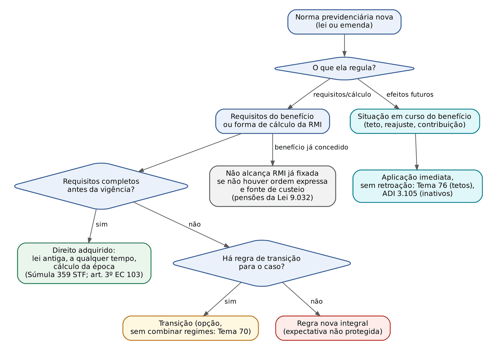
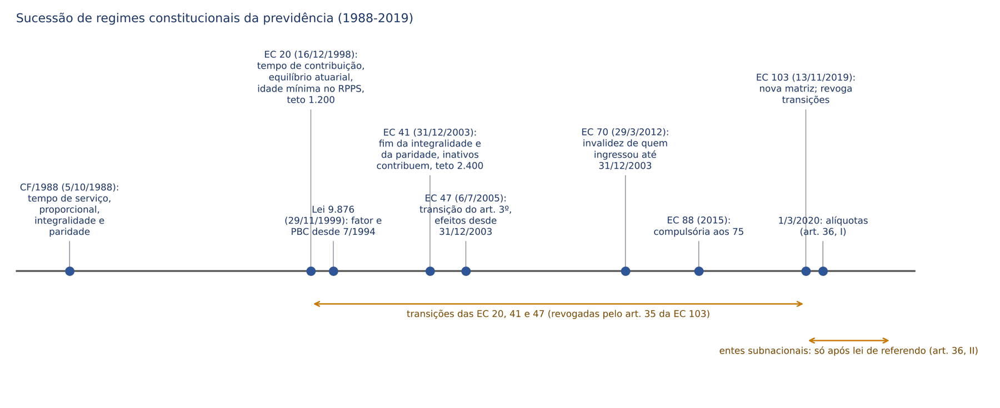
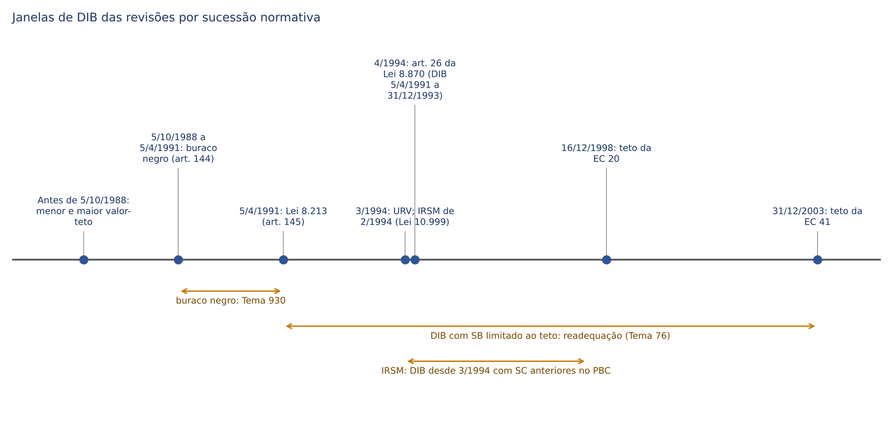
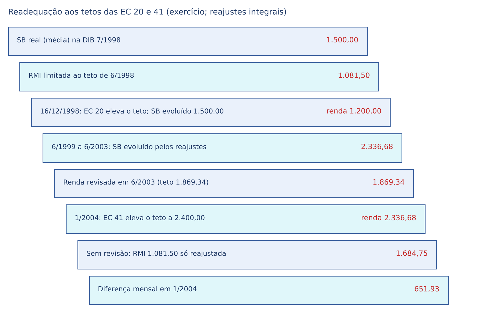
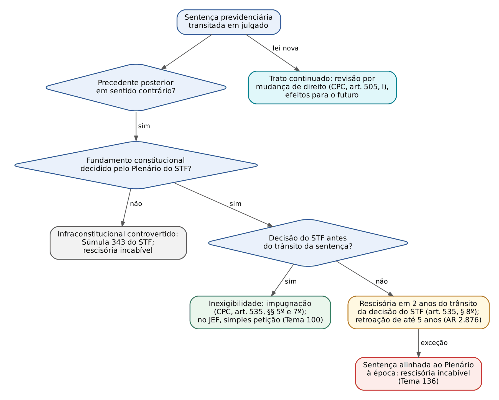

# CAPÍTULO 22 — DIREITO PREVIDENCIÁRIO INTERTEMPORAL: SUCESSÃO DE REGIMES, TRANSIÇÕES E REVISÕES

:::INCIDENCIA
Pontos: TRF5 p. 3 e 12; SEFAZ/SC p. 3. Nível A. Lote: 3 questões (FGV 2, FCC 1), mais correlatas de outros capítulos.
Mais cai: o que cada emenda (20, 41, 47, 70, 88, 103) introduziu ou revogou; vigência escalonada da EC 103 (art. 36) para os entes subnacionais; *tempus regit actum* x aplicação imediata (tetos, inativos); inexistência de direito adquirido a regime jurídico; revisões de tetos, buraco negro e IRSM; coisa julgada diante de virada do STF.
:::

Este capítulo responde a uma única pergunta, feita de vários modos: QUAL NORMA rege este benefício, nesta data, e o que acontece quando a norma (ou a jurisprudência) muda? As noções gerais de vigência, direito adquirido, expectativa e proteção da confiança estão no Cap. 1 (01.9 e 01.10); o art. 3º da EC 103/2019 e o cálculo de quem tinha direito adquirido no RGPS estão no Cap. 11 (11.10) e no Cap. 13 (13.11); a decadência e a prescrição das revisões estão no Cap. 21. Aqui ficam a técnica de solução do conflito intertemporal, a sucessão das emendas e as revisões nascidas de mudança normativa ou jurisprudencial.

## 22.1 *Tempus regit actum*, Súmula 359 do STF e seus limites

### 22.1.1 A chave: o fato gerador de cada prestação

O benefício previdenciário é regido pela lei vigente na data em que se reuniram os requisitos para obtê-lo (o "fato gerador"), e não pela lei da data do requerimento, da concessão ou da sentença. A regra é antiga no direito dos servidores e foi sumulada para a inatividade:

:::JURIS STF, Súmula 359
"Ressalvada a revisão prevista em lei, os proventos da inatividade regulam-se pela lei vigente ao tempo em que o militar, ou o servidor civil, reuniu os requisitos necessários."
Três observações cobráveis: (i) a súmula nasceu para servidores e militares, mas a jurisprudência a estende ao RGPS (a Jurisprudência em Teses do STJ, ed. 67, tese 3, afirma que os benefícios "devem ser regulados pela lei vigente ao tempo em que preenchidos os requisitos necessários à sua concessão, não sendo possível a aplicação de lei posterior"); (ii) a redação vigente não condiciona a lei aplicável ao requerimento: o requerimento fixa a DIB e os efeitos financeiros (Cap. 19), não a lei; (iii) a ressalva inicial ("revisão prevista em lei") é a porta para a retroação expressa, que depende de lei e de fonte de custeio (art. 195, § 5º, da CF).
:::

O problema prático é identificar QUAL é o fato gerador de cada prestação, porque cada uma tem o seu. O quadro abaixo é a ferramenta de trabalho do juiz:

| Matéria | Data que define a lei aplicável | Fundamento e remissão |
|---|---|---|
| Aposentadoria programada | Data em que todos os requisitos (idade, tempo, carência) estão reunidos | Súmula 359 do STF; EC 103, art. 3º; Cap. 13 |
| Pensão por morte | Data do óbito | Súmula 340 do STJ; Cap. 16 |
| Auxílio-reclusão | Data do recolhimento à prisão (inclusive para a baixa renda) | Cap. 16 |
| Aposentadoria por incapacidade permanente e auxílio temporário | Data de início da incapacidade (DII) | STF, Tema 1.300 (v. Cap. 15) |
| Caracterização e prova do tempo especial | Data da PRESTAÇÃO do trabalho | Cap. 10 |
| Conversão de tempo especial em comum | Permitida para tempo até 13/11/2019; vedada para o posterior | EC 103, art. 25, § 2º; Caps. 10 e 14 |
| Cálculo da RMI | Lei do fato gerador (não a da DER) | Lei 9.876/1999, art. 6º; Cap. 11 |
| Reajuste, teto, contribuição de inativo | Lei vigente em cada competência (aplicação imediata, sem retroação) | 22.1.4; STF, Tema 76 |
| Prazo decadencial de revisão | Lei vigente na data da concessão, contado da sua vigência para os benefícios anteriores | Cap. 21 |

:::DICA Três datas que o juiz não pode confundir
Data dos requisitos (fixa a LEI), DER (fixa, em regra, a DIB e os efeitos financeiros) e DIB (fixa o início do pagamento). Quem reuniu os requisitos em 10/11/2019 e requereu em 2025 tem o benefício calculado pela lei anterior à EC 103, com DIB na DER e sem atrasados anteriores a ela (Cap. 11, 11.10.1). Inverter a ordem (aplicar a lei da DER) é o erro mais frequente em gabaritos-armadilha.
:::

### 22.1.2 Lei nova mais benéfica não retroage, salvo ordem expressa com custeio

A irretroatividade opera nos dois sentidos: a lei nova pior não alcança quem já tinha o direito, e a lei nova melhor não alcança benefício já concedido, salvo determinação legal expressa acompanhada de fonte de custeio (art. 195, § 5º, da CF). O exemplo clássico, desenvolvido no Cap. 1 (01.9), é o das pensões concedidas antes da Lei 9.032/1995, que não tiveram o coeficiente elevado para 100%.

A jurisprudência teve um movimento pendular no auxílio-acidente, útil como pegadinha. O STJ, no Tema 18 dos repetitivos (REsp 1.096.244/SC, Relatora Ministra Maria Thereza de Assis Moura), afirmou que a majoração do percentual do auxílio-acidente pela Lei 9.032/1995, por ser lei nova mais benéfica, "deve ser aplicada imediatamente", inclusive aos benefícios já concedidos. O STF, porém, ao enfrentar as pensões e, depois, o próprio auxílio-acidente em repercussão geral, firmou a orientação oposta: benefício concedido antes da lei majoradora não é alcançado por ela sem previsão expressa e fonte de custeio. No auxílio-acidente, a tese é a do Tema 388 do STF (RE 613.033, Relator Ministro Dias Toffoli, tese aprovada em 15/4/2011): "É inviável a aplicação retroativa da majoração prevista na Lei nº 9.032/1995 aos benefícios de auxílio-acidente concedidos em data anterior à sua vigência." Em prova, prevalece a orientação do STF.

:::PEGADINHA Lei nova mais benéfica
"Em razão do caráter alimentar e do *in dubio pro misero*, a lei previdenciária mais benéfica aplica-se aos benefícios em manutenção": FALSO. A retroatividade benéfica é regra de direito penal (art. 5º, XL, da CF), não de direito previdenciário. O que se aplica de imediato a benefício em manutenção é a norma que disciplina SITUAÇÃO EM CURSO (teto, reajuste, contribuição; 22.1.4), não a que altera o cálculo da RMI já fixada.
:::

O mesmo raciocínio explica o Tema 148 do STJ (REsp 1.112.574/MG, Relator Ministro Felix Fischer): é legítima a limitação do salário de benefício ao teto do salário de contribuição na data de início do benefício, porque a Lei 8.213/1991 apenas deu cumprimento ao art. 202 da CF na redação original. A limitação vale no momento da concessão; o que acontece com o excedente quando o teto sobe é a revisão dos tetos (22.4.2).

### 22.1.3 Não há direito adquirido a regime jurídico

O segurado tem direito adquirido ao benefício cujos requisitos completou, calculado pela lei daquela data. Não tem direito adquirido a que a lei futura continue a mesma, nem a montar um regime próprio com pedaços de leis diferentes.

:::JURIS STF, Tema 70 (RE 575.089, Relator Ministro Ricardo Lewandowski, Plenário, j. 10/9/2008)
"Na sistemática de cálculo dos benefícios previdenciários, não é lícito ao segurado conjugar as vantagens do novo sistema com aquelas aplicáveis ao anterior, porquanto inexiste direito adquirido a determinado regime jurídico."
O caso: segurado que, sem ter os requisitos completos em 16/12/1998, pretendia somar tempo posterior à EC 20 e, ao mesmo tempo, usar as regras de cálculo anteriores à Emenda (sem idade mínima e sem pedágio). O STF vedou o "regime híbrido": ou se aplica integralmente a regra antiga (se os requisitos estavam completos), ou integralmente a regra nova ou a de transição.
:::

Consequências operacionais da vedação ao regime híbrido:

- Quem tinha direito adquirido em 16/12/1998 (EC 20), em 28/11/1999 (véspera da Lei 9.876) ou em 13/11/2019 (EC 103) tem o cálculo "congelado" naquela data: o tempo posterior não entra no cálculo pela regra antiga. Se quiser computar o tempo posterior, submete-se integralmente à regra posterior. É a mesma lógica do art. 188-E do Decreto 3.048/1999 (Cap. 11).
- Transições não se combinam entre si: não se pede o requisito do art. 17 da EC 103 com o cálculo do art. 20, nem o art. 15 com o coeficiente de 100% (Cap. 13, 13.11.1).
- A transição é uma OPÇÃO: o segurado pode preferir a regra permanente se ela for melhor, salvo quando a lei impõe a transição de forma cogente. Foi exatamente esse o ponto da revisão da vida toda: o STF, ao declarar constitucional o art. 3º da Lei 9.876/1999 nas ADIs 2.110 e 2.111 e rever o Tema 1.102, assentou que aquela transição é de observância obrigatória (Cap. 11, 11.12.1; 22.5.1).

Na mesma linha, o STF julgou constitucional o fator previdenciário na transição do art. 9º da EC 20/1998 (Tema 616): a transição constitucional protege os requisitos que fixou, não um modo de calcular que ela não previu (v. Cap. 13). E, no Tema 1.300, assentou que o coeficiente de 60% + 2% da aposentadoria por incapacidade permanente vale quando a incapacidade é constatada depois da reforma, de modo que a DII, e não a data de filiação, define a regra de cálculo (v. Cap. 15).

:::QUESTAO FGV 2026 — ENAC — Exame Nacional dos Cartórios (Q4130139)
Caso: escrevente aposentado, após 1988, por carteira previdenciária de serventias de caráter contributivo, com benefício fixado em múltiplos do salário mínimo por lei pré-constitucional e contribuição de inativo de 5%. Lei posterior trocou o indexador e majorou a alíquota; a Administração revisou o benefício por entender inconstitucional a lei anterior.
Gabarito: B — deve ser preservado o valor nominal do benefício recebido na data da alteração legislativa, vedados reajustes posteriores com base no salário mínimo.
Fundamento: (i) a vinculação ao salário mínimo para reajuste é vedada (art. 7º, IV, da CF), logo não há direito adquirido a um critério inconstitucional de atualização (afasta A e E); (ii) não há direito adquirido a regime jurídico, mas a irredutibilidade e a segurança jurídica protegem o valor nominal já incorporado, que não pode ser reduzido pela correção de rumo (afasta C); (iii) a contribuição previdenciária é tributo, e não existe direito adquirido à alíquota (por isso D erra ao dizer que a alteração do reajuste seria "injurídica"; o erro de D está na primeira parte).
Armadilha: confundir "não há direito adquirido ao critério" com "o valor pode ser reduzido". A solução é a do meio-termo: congela o nominal, troca o critério para frente.
:::

### 22.1.4 Aplicação imediata às situações em curso

Ao lado da irretroatividade, o art. 6º da LINDB manda aplicar a lei nova com "efeito imediato e geral" (Cap. 1, 01.10.1). No benefício de prestação continuada há uma parte que se esgota na concessão (requisitos e RMI: regida pela lei do fato gerador) e uma parte que se renova a cada mês (reajuste, teto, contribuição de quem recebe proventos, regras de manutenção). Sobre a segunda parte a lei nova incide imediatamente, para o futuro, sem que isso seja retroação. Três aplicações cobradas:

| Norma nova | Efeito sobre benefício já concedido | Precedente |
|---|---|---|
| Elevação do teto do RGPS por emenda (EC 20, art. 14; EC 41, art. 5º) | Alcança os benefícios limitados ao teto anterior, a partir da vigência da emenda | STF, Tema 76; JT STJ ed. 67, tese 2 (22.4.2) |
| Contribuição de inativos e pensionistas (EC 41, art. 4º) | Incide sobre proventos de quem já estava aposentado, a partir da emenda | ADIs 3.105 e 3.128 (22.2.2) |
| Novo índice de reajuste | Vale para os reajustes seguintes; não há direito adquirido ao índice anterior | Cap. 11, 11.11 |

:::ATENCAO Aplicação imediata não é retroação
No julgamento do Tema 76, o INSS sustentou que aplicar o novo teto a benefício antigo violaria o *tempus regit actum* e o ato jurídico perfeito. O STF respondeu que não houve retroação: o acórdão não mandou pagar diferenças anteriores à emenda nem recalcular a RMI pela lei nova; apenas permitiu que, DAQUI EM DIANTE, o limitador fosse o novo teto. A distinção (efeito imediato x efeito retroativo) é a chave para todas as questões de "lei nova x benefício antigo".
:::

## 22.2 A sucessão dos regimes constitucionais

A história constitucional da previdência pós-1988 é a história de seis emendas que endureceram progressivamente o acesso e o cálculo, cada uma com transições para quem já estava no sistema e cada uma revogando, total ou parcialmente, as transições da anterior. O quadro-síntese vem primeiro; as subseções explicam o que ainda importa (direito adquirido, transições em vigor nos entes subnacionais e questões).

| Emenda (data de publicação) | RGPS | RPPS |
|---|---|---|
| Texto original (5/10/1988) | Aposentadoria por tempo de SERVIÇO (35/30, integral; proporcional a partir de 30/25); cálculo pela média dos 36 últimos SC corrigidos (art. 202 original); contagem recíproca com compensação (art. 202, § 2º, original) | Aposentadoria por tempo de serviço sem idade; proventos integrais (última remuneração) e paridade (art. 40, §§ 4º e 5º, originais); sem caráter contributivo explícito |
| EC 20 (16/12/1998) | Tempo de CONTRIBUIÇÃO; fim da proporcional (transição do art. 9º); teto de 1.200 (art. 14); critérios do cálculo desconstitucionalizados (abrindo caminho para a Lei 9.876/1999); caráter contributivo e equilíbrio financeiro e atuarial no art. 201 | Caráter contributivo e equilíbrio financeiro e atuarial no art. 40; idade mínima na voluntária (60/55); transição do art. 8º; previdência complementar facultativa (§§ 14 a 16, por lei complementar) |
| EC 41 (31/12/2003) | Teto de 2.400 (art. 5º) | Fim da integralidade (média) e da paridade (reajuste) para os novos; contribuição de inativos e pensionistas (art. 4º e art. 40, § 18); caráter "solidário"; redutor da pensão; abono de permanência; transições dos arts. 2º e 6º; previdência complementar por lei ordinária de iniciativa do Executivo |
| EC 47 (6/7/2005, efeitos desde 31/12/2003) | Inclusão previdenciária (baixa renda, donas de casa) | Paridade à transição do art. 6º da EC 41 (art. 2º); nova transição para ingressos até 16/12/1998 (art. 3º); aposentadorias especiais por lei complementar (deficiência, risco, condições prejudiciais) |
| EC 70 (promulgada em 29/3/2012; DOU de 30/3/2012) | — | Invalidez de quem ingressou até 31/12/2003: proventos sobre a remuneração do cargo, com paridade (art. 6º-A da EC 41) |
| EC 88 (8/5/2015) | — | Compulsória aos 75 anos "na forma de lei complementar"; art. 100 do ADCT para ministros dos tribunais superiores e do TCU |
| EC 103 (13/11/2019) | Aposentadoria programada (65/62) com média de 100% e 60% + 2%; transições dos arts. 15 a 18, 20 e 21; pensão por cotas; alíquotas progressivas | Nova matriz do art. 40; idade e cálculo para os servidores federais na própria EC (arts. 4º, 10 e 20); entes subnacionais por emenda local; revoga as transições anteriores (art. 35); vigência escalonada (art. 36) |

### 22.2.1 EC 20/1998: o primeiro corte (16/12/1998)

A EC 20 é o primeiro grande marco de direito adquirido: quem completou até 16/12/1998 os requisitos da aposentadoria por tempo de serviço (integral ou proporcional) pode obtê-la a qualquer tempo, pela legislação então vigente (art. 3º da própria EC 20, hoje reproduzido em lógica pelo art. 3º da EC 103). Quem não completou passou a depender das transições do art. 9º (RGPS) e do art. 8º (RPPS), ambas com idade mínima (53/48) e "pedágio" sobre o tempo faltante.

:::LEI EC 20/1998, art. 14 (revogado pela EC 103/2019)
"Art. 14 - O limite máximo para o valor dos benefícios do regime geral de previdência social de que trata o art. 201 da Constituição Federal é fixado em R$ 1.200,00 (um mil e duzentos reais), devendo, a partir da data da publicação desta Emenda, ser reajustado de forma a preservar, em caráter permanente, seu valor real, atualizado pelos mesmos índices aplicados aos benefícios do regime geral de previdência social."
:::

A transição do art. 9º do RGPS (aposentadoria proporcional e a integral com idade) está desenvolvida no Cap. 13 (13.3.3). No RPPS, a transição do art. 8º foi absorvida e substituída pelo art. 2º da EC 41/2003; o STF fixou sobre ela uma tese ainda cobrada:

:::JURIS STF, Tema 578 (RE 662.423, j. 25/8/2020)
"(i) Ressalvado o direito de opção, a regra de transição do art. 8º, inciso II da Emenda Constitucional nº 20/98, somente se aplica aos servidores que, quando da sua publicação, ainda não reuniam os requisitos necessários para a aposentadoria; (ii) em se tratando de carreira pública escalonada em classes, a exigência instituída pelo art. 8º, inciso II da Emenda Constitucional nº 20/98, de cinco anos de efetivo exercício no cargo no qual se dará a aposentadoria, deverá ser compreendida como cinco anos de efetivo exercício na carreira a que pertencente o servidor."
Ganchos: transição só para quem NÃO tinha direito adquirido (quem tinha, aposenta-se pela regra antiga, sem os cinco anos); "cargo" em carreira escalonada = carreira.
:::

Também da EC 20 é o caráter contributivo e o equilíbrio financeiro e atuarial no *caput* dos arts. 40 e 201 (a FGV considerou correta a afirmação de que "apenas com a EC 20" a CF passou a adotar o equilíbrio financeiro e atuarial; Q2566167, abaixo).

### 22.2.2 EC 41/2003: o fim da integralidade e da paridade (31/12/2003)

A EC 41 foi promulgada em 19/12/2003 e publicada em 31/12/2003; a data de PUBLICAÇÃO é o marco para as regras que falam em "ingresso até a data de publicação desta Emenda" (31/12/2003). Seu núcleo, no RPPS: proventos pela média das remunerações de contribuição (fim da integralidade) e reajuste para preservar o valor real (fim da paridade) para quem ingressar depois; contribuição de inativos e pensionistas; regime "contributivo e solidário". O detalhamento das regras do servidor é do Cap. 23; aqui interessam o direito intertemporal e a literalidade cobrada.

:::LEI EC 41/2003, arts. 4º, caput, e 5º
"Art. 4º Os servidores inativos e os pensionistas da União, dos Estados, do Distrito Federal e dos Municípios, incluídas suas autarquias e fundações, em gozo de benefícios na data de publicação desta Emenda, bem como os alcançados pelo disposto no seu art. 3º, contribuirão para o custeio do regime de que trata o art. 40 da Constituição Federal com percentual igual ao estabelecido para os servidores titulares de cargos efetivos."
"Art. 5º O limite máximo para o valor dos benefícios do regime geral de previdência social de que trata o art. 201 da Constituição Federal é fixado em R$ 2.400,00 (dois mil e quatrocentos reais), devendo, a partir da data de publicação desta Emenda, ser reajustado de forma a preservar, em caráter permanente, seu valor real, atualizado pelos mesmos índices aplicados aos benefícios do regime geral de previdência social."
:::

A contribuição dos inativos é o caso-escola de que não há direito adquirido a não ser tributado. Nas ADIs 3.105 e 3.128 (STF, Plenário, j. 18/8/2004, por 7 votos a 4, vencida a Relatora, Ministra Ellen Gracie, prevalecendo o voto-vista do Ministro Cezar Peluso), o STF julgou constitucional o *caput* do art. 4º: o aposentado que já recebia proventos sem contribuir não tem direito adquirido à imunidade, porque a relação tributária se renova a cada fato gerador (o pagamento mensal dos proventos) e a lei nova incide imediatamente sobre os fatos futuros. Declarou inconstitucionais, porém, as expressões dos incisos I e II do parágrafo único que fixavam os percentuais de isenção, isto é, faixas de isenção diferentes para os Estados, DF e Municípios (50% do teto do RGPS) e para a União (60%), por violação à isonomia; a contribuição passou a incidir sobre a parcela que excede o teto do RGPS, como hoje prevê o art. 40, § 18, da CF.

:::DICA Inativos: duas fases que não se confundem
Até a EC 41, o aposentado do RPPS não contribuía (EC 20 previa apenas contribuição dos servidores ativos). Com a EC 41, contribui sobre o que excede o teto do RGPS. Com a EC 103 (art. 149, § 1º-A), havendo déficit atuarial, a base pode alcançar o que excede o salário mínimo; e a imunidade dobrada do portador de doença incapacitante (antigo art. 40, § 21) foi revogada (art. 35, I, a). Custeio do RPPS no Cap. 24.
:::

As transições da EC 41 (todas revogadas pelo art. 35, III, da EC 103, com a ressalva do art. 36, II, para os entes subnacionais):

| Regra | Quem | Requisitos (resumo) | Proventos |
|---|---|---|---|
| EC 41, art. 2º | Ingresso em cargo efetivo até 16/12/1998 | 53 anos (H) e 48 (M); 5 anos no cargo; 35/30 de contribuição + pedágio de 20% do tempo que faltava em 16/12/1998 | Média (art. 40, §§ 3º e 17), com redutor por ano antecipado em relação a 60/55: 3,5% (exigências cumpridas até 31/12/2005) ou 5% (a partir de 1/1/2006) |
| EC 41, art. 6º | Ingresso no serviço público até 31/12/2003 | 60/55 anos; 35/30 de contribuição; 20 anos de serviço público; 10 de carreira e 5 no cargo | Integralidade (totalidade da remuneração no cargo) e, por força da EC 47, art. 2º, paridade |
| EC 41, art. 6º-A (EC 70) | Ingresso até 31/12/2003, aposentado por invalidez | Invalidez permanente | Remuneração do cargo (integral ou proporcional), com paridade |

Os arts. 2º e 6º da EC 41 foram conferidos no Planalto (o art. 6º manda observar as reduções de idade e de tempo de contribuição do professor, art. 40, § 5º); o detalhamento está no Cap. 23.

:::JURIS STF, Tema 139 (RE 590.260, Relator Ministro Ricardo Lewandowski, Plenário, j. 24/6/2009)
"Os servidores que ingressaram no serviço público antes da EC 41/2003, mas que se aposentaram após a referida emenda, possuem direito à paridade remuneratória e à integralidade no cálculo de seus proventos, desde que observadas as regras de transição especificadas nos arts. 2º e 3º da EC 47/2005."
No mesmo sentido, para vantagens gerais estendidas a inativos (Tema 156, RE 596.962, j. 22/8/2014). Para as pensões, o pensionista enquadrado no art. 3º da EC 47 tem paridade, mas não integralidade (Tema 396 do STF, v. Cap. 23). Regras do servidor no Cap. 23.
:::

### 22.2.3 EC 47/2005: a transição retroativa

A EC 47 foi a "PEC paralela" da reforma de 2003. Sua peculiaridade intertemporal é rara: entrou em vigor na publicação "com efeitos retroativos à data de vigência da Emenda Constitucional nº 41, de 2003" (art. 6º). Ou seja, quem se aposentou entre 31/12/2003 e 6/7/2005 pelas regras da EC 41 pôde ter os proventos revistos para a regra mais favorável da EC 47.

:::LEI EC 47/2005, art. 3º, caput e parágrafo único (revogado pela EC 103/2019, art. 35, IV)
"Art. 3º Ressalvado o direito de opção à aposentadoria pelas normas estabelecidas pelo art. 40 da Constituição Federal ou pelas regras estabelecidas pelos arts. 2º e 6º da Emenda Constitucional nº 41, de 2003, o servidor da União, dos Estados, do Distrito Federal e dos Municípios, incluídas suas autarquias e fundações, que tenha ingressado no serviço público até 16 de dezembro de 1998 poderá aposentar-se com proventos integrais, desde que preencha, cumulativamente, as seguintes condições:
I trinta e cinco anos de contribuição, se homem, e trinta anos de contribuição, se mulher;
II vinte e cinco anos de efetivo exercício no serviço público, quinze anos de carreira e cinco anos no cargo em que se der a aposentadoria;
III idade mínima resultante da redução, relativamente aos limites do art. 40, § 1º, inciso III, alínea "a", da Constituição Federal, de um ano de idade para cada ano de contribuição que exceder a condição prevista no inciso I do caput deste artigo.
Parágrafo único. Aplica-se ao valor dos proventos de aposentadorias concedidas com base neste artigo o disposto no art. 7º da Emenda Constitucional nº 41, de 2003, observando-se igual critério de revisão às pensões derivadas dos proventos de servidores falecidos que tenham se aposentado em conformidade com este artigo."
:::

Mecânica do inciso III: a idade de referência é a do art. 40, § 1º, III, a, na redação da EC 20 (60 anos para homem, 55 para mulher); cada ano de contribuição acima de 35/30 reduz um ano dessa idade. Servidora com 36 anos de contribuição: excedente de 6 anos; idade mínima 55 - 6 = 49 anos. Diferencial do art. 3º: além da integralidade e da paridade, estende a paridade à PENSÃO derivada (por isso o Tema 396 exige o enquadramento no art. 3º para a paridade do pensionista).

Gancho intertemporal do Tema 1.019 do STF (policial civil com requisitos da LC 51/1985 tem integralidade, e paridade se prevista em lei complementar, sem as transições da EC 47): a tese se refere ao texto anterior à EC 103 e alcança quem preencheu os requisitos sob ele, ou servidores de entes ainda não reformados (v. Cap. 23).

### 22.2.4 EC 70/2012 e EC 88/2015

A EC 70 corrigiu um efeito colateral da EC 41: o servidor que ingressou até 31/12/2003 e se aposentava por invalidez tinha proventos calculados pela média (art. 40, §§ 3º e 17), sem paridade, ainda que tivesse direito à integralidade se chegasse à voluntária. A emenda inseriu o art. 6º-A na EC 41:

:::LEI EC 41/2003, art. 6º-A (incluído pela EC 70/2012; revogado pela EC 103/2019)
"Art. 6º-A. O servidor da União, dos Estados, do Distrito Federal e dos Municípios, incluídas suas autarquias e fundações, que tenha ingressado no serviço público até a data de publicação desta Emenda Constitucional e que tenha se aposentado ou venha a se aposentar por invalidez permanente, com fundamento no inciso I do § 1º do art. 40 da Constituição Federal, tem direito a proventos de aposentadoria calculados com base na remuneração do cargo efetivo em que se der a aposentadoria, na forma da lei, não sendo aplicáveis as disposições constantes dos §§ 3º, 8º e 17 do art. 40 da Constituição Federal.
Parágrafo único. Aplica-se ao valor dos proventos de aposentadorias concedidas com base no caput o disposto no art. 7º desta Emenda Constitucional, observando-se igual critério de revisão às pensões derivadas dos proventos desses servidores."
:::

Dois detalhes intertemporais: (i) "data de publicação desta Emenda" refere-se à EC 41 (o artigo foi inserido nela), isto é, 31/12/2003; (ii) a EC 70 (art. 2º) mandou os entes revisarem, em 180 dias, as aposentadorias por invalidez concedidas a partir de 1/1/2004, "com efeitos financeiros a partir da data de promulgação desta Emenda" (29/3/2012): revisão retroativa no cálculo, mas sem atrasados anteriores à emenda. É o modelo de retroação expressa com limitação financeira. Atenção à data: a emenda é de 29/3/2012 e foi publicada no DOU de 30/3/2012; a tese do Tema 754 do STF fala em "data de sua promulgação (30.3.2012)" (v. Cap. 23).

A EC 88/2015 alterou o art. 40, § 1º, II, para a compulsória "aos 70 (setenta) anos de idade, ou aos 75 (setenta e cinco) anos de idade, na forma de lei complementar", e criou o art. 100 do ADCT (compulsória aos 75 para ministros do STF, dos tribunais superiores e do TCU até a lei complementar). A lei complementar geral veio depois (LC 152, de 3/12/2015, que fixou a compulsória aos 75 anos para todos os servidores efetivos e membros de Poder, MP, Defensoria e Tribunais de Contas). Compulsória e seu cálculo no Cap. 23.

### 22.2.5 EC 103/2019: revogações e vigência escalonada

A EC 103 foi promulgada em 12/11/2019 e publicada no DOU de 13/11/2019. Para o RGPS e para os servidores federais, a regra geral de vigência é a da publicação (13/11/2019); daí ser essa a data de corte do direito adquirido do art. 3º (Caps. 1, 11 e 13). Para os entes subnacionais, a Emenda criou um mecanismo que a FCC adora cobrar: a revogação das transições anteriores e certas mudanças de custeio só valem depois que o próprio ente as REFERENDAR por lei.

:::LEI EC 103/2019, art. 35
"Art. 35. Revogam-se:
I - os seguintes dispositivos da Constituição Federal:
a) o § 21 do art. 40;
b) o § 13 do art. 195;
II - os arts. 9º, 13 e 15 da Emenda Constitucional nº 20, de 15 de dezembro de 1998;
III - os arts. 2º, 6º e 6º-A da Emenda Constitucional nº 41, de 19 de dezembro de 2003;
IV - o art. 3º da Emenda Constitucional nº 47, de 5 de julho de 2005."
:::

:::LEI EC 103/2019, art. 36
"Art. 36. Esta Emenda Constitucional entra em vigor:
I - no primeiro dia do quarto mês subsequente ao da data de publicação desta Emenda Constitucional, quanto ao disposto nos arts. 11, 28 e 32;
II - para os regimes próprios de previdência social dos Estados, do Distrito Federal e dos Municípios, quanto à alteração promovida pelo art. 1º desta Emenda Constitucional no art. 149 da Constituição Federal e às revogações previstas na alínea "a" do inciso I e nos incisos III e IV do art. 35, na data de publicação de lei de iniciativa privativa do respectivo Poder Executivo que as referende integralmente;
III - nos demais casos, na data de sua publicação.
Parágrafo único. A lei de que trata o inciso II do caput não produzirá efeitos anteriores à data de sua publicação."
:::

Como ler os dois artigos juntos:

| Dispositivo revogado ou alterado | O que era | Vigência da revogação/alteração |
|---|---|---|
| CF, art. 40, § 21 | Contribuição do aposentado e pensionista portador de doença incapacitante só sobre o que excedesse o DOBRO do teto do RGPS | União: 13/11/2019. Estados, DF e Municípios: só com a lei referendária (art. 36, II) |
| CF, art. 195, § 13 | Substituição gradual da contribuição sobre a folha pela incidente sobre a receita (desoneração constitucionalizada) | 13/11/2019 para todos (art. 36, III) |
| EC 20, arts. 9º, 13 e 15 | Transição da aposentadoria do RGPS (art. 9º); critério provisório de baixa renda do salário-família e do auxílio-reclusão (art. 13); manutenção provisória dos arts. 57 e 58 da Lei 8.213 até a lei complementar da aposentadoria especial (art. 15) | 13/11/2019 (RGPS; não há referendo) |
| EC 41, arts. 2º, 6º e 6º-A | Transições do servidor (idade reduzida com redutor; integralidade e paridade; invalidez com remuneração do cargo) | União: 13/11/2019. Demais entes: só com a lei referendária |
| EC 47, art. 3º | Transição com integralidade, paridade e redução da idade por tempo excedente | União: 13/11/2019. Demais entes: só com a lei referendária |
| Alteração do art. 149 da CF (§§ 1º a 1º-C: alíquotas, base sobre o que excede o mínimo, contribuição extraordinária) | — | Para os entes subnacionais, só com a lei referendária |
| Arts. 11 (alíquotas dos servidores federais), 28 (alíquotas progressivas do RGPS) e 32 (CSLL dos bancos) | — | 1/3/2020 (primeiro dia do quarto mês subsequente a novembro de 2019) |

Por que o desenho? A EC 103 "desconstitucionalizou" boa parte do regime dos servidores estaduais e municipais: idade mínima por emenda à Constituição estadual ou à Lei Orgânica, demais requisitos e cálculo por lei complementar ou ordinária do ente (art. 40, § 1º, III, e §§ 3º e 4º-A a 4º-C da CF). Se as transições das ECs 41 e 47 caíssem de imediato também para eles, os servidores estaduais ficariam, até a reforma local, sem transição alguma. Daí a revogação condicionada ao referendo. Consequência que a banca explora: em ente que NÃO editou a lei referendária, os arts. 2º, 6º e 6º-A da EC 41 e o art. 3º da EC 47 continuam aplicáveis aos seus servidores, mesmo depois de 13/11/2019. A reforma catarinense e a lei que a referendou estão no Cap. 25.

:::PEGADINHA Vigência da EC 103: as quatro datas
| Data | O que entrou em vigor |
|---|---|
| 13/11/2019 | Regra geral (art. 36, III): RGPS, servidores federais, revogações sem ressalva |
| 1/3/2020 | Alíquotas progressivas do RGPS (art. 28) e dos servidores federais (art. 11) e CSLL dos bancos (art. 32) |
| Data da lei local referendária | Revogação das transições das ECs 41 e 47 e do § 21 do art. 40, e alterações do art. 149, para Estados, DF e Municípios |
| Nunca para trás | A lei referendária "não produzirá efeitos anteriores à data de sua publicação" (parágrafo único) |
Erros típicos: dizer que a revogação das transições do servidor estadual se deu em 13/11/2019; dizer que o referendo pode ser parcial (deve ser "integral"); dizer que a iniciativa é parlamentar (é "privativa do respectivo Poder Executivo"); dizer que as alíquotas progressivas do RGPS vigoraram em 13/11/2019.
:::

:::EXEMPLO Mesma servidora, dois entes, duas respostas
Servidora nascida em 1/3/1972, que ingressou em cargo efetivo em 1/3/1990, sem tempo anterior, com 15 anos de carreira e 5 no cargo; análise em 1/3/2026 (conta conferida em Python).
1. Tempo de contribuição em 1/3/2026: 36 anos. Idade: 54 anos. Em 13/11/2019 tinha 29 anos, 8 meses e 12 dias de contribuição e 47 anos de idade.
2. Direito adquirido em 13/11/2019 a alguma regra anterior? EC 47, art. 3º exigia 30 anos de contribuição (faltavam 3 meses e 18 dias); EC 41, art. 6º exigia 55 anos de idade. Não havia direito adquirido.
3. Se for servidora FEDERAL: as transições das ECs 41 e 47 foram revogadas em 13/11/2019. Restam os arts. 4º e 20 da EC 103, ambos com idade mínima de 57 anos para mulher (requisitos no Cap. 23). Aos 54 anos, não se aposenta.
4. Se for servidora de ESTADO que ainda não editou a lei referendária: o art. 3º da EC 47 continua aplicável. Excedente de 36 - 30 = 6 anos; idade mínima 55 - 6 = 49 anos. Com 54 anos, 36 de contribuição, 36 de serviço público (mínimo 25), 15 de carreira e 5 no cargo, aposenta-se JÁ, com integralidade e paridade, e a pensão que deixar terá paridade.
5. Se o Estado editou a lei referendária: aplica-se a reforma local, com as transições que ela tiver criado (Cap. 25 para Santa Catarina).
Lição: no RPPS, antes de aplicar qualquer regra, pergunte "qual ente?" e "houve referendo, e quando?".
:::

:::QUESTAO FCC 2025 — PGE-MT — Procurador do Estado (Q3745818)
Pediu-se a alternativa correta sobre o que cada emenda fez no RPPS.
Gabarito: C — a EC 47/2005 autorizou que lei complementar federal previsse requisitos e critérios diferenciados para a aposentadoria de servidores com deficiência, e a EC 103/2019 passou essa possibilidade à legislação complementar de cada ente (art. 40, § 4º-A).
Por que as demais erram: A — a EC 41 não "facultou" a contribuição de aposentados e pensionistas; impôs (art. 4º e regime "contributivo e solidário"). B — quem facultou a previdência complementar do servidor foi a EC 20 (§§ 14 a 16 do art. 40); a EC 41 só trocou a lei complementar por lei de iniciativa do Executivo; e a EC 103 tornou obrigatória a instituição no prazo de dois anos, não de três (art. 9º, § 6º; Cap. 27). D — a idade mínima da EC 20 é verdadeira, mas a EC 103 remete a idade dos servidores estaduais e municipais a EMENDA às Constituições estaduais e Leis Orgânicas, não a "legislação complementar". E — a contagem recíproca com compensação financeira já estava no texto original de 1988 (art. 202, § 2º); não veio da EC 41 nem da EC 70 (Cap. 26).
Armadilha: a FCC alterna emenda e instrumento normativo (emenda local x lei complementar local); memorize a matriz "idade por emenda; demais requisitos por lei complementar".
:::

:::QUESTAO FGV 2024 — TCE-PA — Auditor de Controle Externo, Ciências Atuariais (Q2566167)
Pediu-se a INCORRETA sobre as reformas.
Gabarito: E — a EC 103 NÃO fixou 60 anos para mulheres e 65 para homens em ambos os regimes. No RGPS urbano e para os servidores federais, a idade é 62 (mulher) e 65 (homem) (art. 201, § 7º, I, da CF; art. 40, § 1º, III); 60/55 eram as idades da voluntária do RPPS na EC 20, e 60/55 são as idades do trabalhador rural (homem/mulher) no RGPS. Além disso, para os servidores estaduais e municipais a idade depende de emenda local.
As corretas, segundo a banca: A (equilíbrio financeiro e atuarial a partir da EC 20; depois art. 69 da LRF); B (EC 41 e a "solidariedade contributiva", base da contribuição de inativos); C (EC 47 restabeleceu integralidade e paridade, com condições); D (EC 70 e a invalidez de quem ingressou antes da EC 41).
Armadilha: idades de regimes e épocas diferentes misturadas numa só frase.
:::

## 22.3 Regras de transição, expectativas e direito adquirido: a técnica

### 22.3.1 O que a transição protege e o que não protege

A teoria geral (direito adquirido x expectativa x transição) está no Cap. 1 (01.10.1). O que o juiz federal precisa operar:

- Transição é ato de política legislativa ou constituinte, não imposição do art. 5º, XXXVI. Por isso uma emenda pode revogar a transição criada por emenda anterior para quem ainda não completou seus requisitos: foi o que fez o art. 35 da EC 103 com as transições das ECs 20, 41 e 47. Quem completou os requisitos da transição antes da revogação tem direito adquirido A ELA (o art. 3º da EC 103 fala em "requisitos para obtenção destes benefícios", o que abrange os das transições então vigentes).
- Transição é faculdade: o interessado pode optar pela regra permanente se mais favorável ("ressalvado o direito de opção", diz o art. 3º da EC 47), salvo transição de aplicação cogente (Lei 9.876/1999, art. 3º; vida toda).
- A transição se aplica por inteiro: requisitos e cálculo da mesma regra (Tema 70).
- O momento de aferição é o do implemento: verifica-se, data a data, qual regra estava em vigor quando o último requisito foi cumprido.
- Proteção da confiança e proporcionalidade são argumentos para exigir transições razoáveis e para controlar reformas abruptas; em matéria de servidores, o STF tem reconhecido limites pontuais, mas não um direito subjetivo à transição mais favorável (Cap. 1, 01.10.3).

:::PASSO Roteiro para descobrir a regra aplicável a um caso concreto
1. Identifique o regime (RGPS ou RPPS) e, no RPPS, o ENTE e a data de eventual lei referendária (art. 36, II, da EC 103).
2. Identifique o benefício e o seu fato gerador (quadro de 22.1.1).
3. No RPPS, fixe a data de INGRESSO no serviço público (16/12/1998, 31/12/2003, data de instituição da previdência complementar, 13/11/2019 são os cortes).
4. Liste as regras vigentes em cada data relevante e verifique, para cada uma, se os requisitos foram completos ENQUANTO ela vigorava (direito adquirido) ou se ainda podem ser completos (transição vigente).
5. Entre as regras disponíveis, compare o resultado (direito ao melhor benefício; Tema 334 do STF, Cap. 19), sem misturar regras (Tema 70).
6. Calcule pela lei da data do implemento da regra escolhida; reajustes e teto pela lei de cada competência.
7. Verifique decadência e prescrição (Cap. 21) e eventual modulação de efeitos de precedente do STF.
:::

### 22.3.2 Quadro do servidor por data de ingresso (visão intertemporal)

| Ingresso em cargo efetivo | Regras de transição que já teve à disposição (até a revogação) | Situação após a EC 103 (servidor federal) |
|---|---|---|
| Até 16/12/1998 | EC 20, art. 8º (absorvido pelo art. 2º da EC 41); EC 41, arts. 2º e 6º; EC 47, art. 3º | Direito adquirido às anteriores, se completas até 13/11/2019; senão, arts. 4º e 20 da EC 103 (integralidade e paridade só para ingresso até 31/12/2003, com requisitos próprios) |
| De 17/12/1998 a 31/12/2003 | EC 41, art. 6º; EC 70 (invalidez) | Idem: direito adquirido ou arts. 4º e 20 |
| De 1/1/2004 até a instituição da previdência complementar | Regra permanente (média, reajuste sem paridade) | Arts. 4º e 20, com cálculo pela média |
| Após a instituição da previdência complementar | Regra permanente, proventos limitados ao teto do RGPS | Arts. 4º e 20, limitados ao teto; complementar no Cap. 27 |
| Após 13/11/2019 | — | Regra permanente do art. 10 da EC 103 (Cap. 23) |

Para os servidores estaduais e municipais, a coluna da direita depende da reforma local e do referendo (22.2.5).

### 22.3.3 Quando a transição é atingida por controle de constitucionalidade

O controle concentrado também redesenha o direito intertemporal. Na ADI 6.309, julgada pelo Plenário em 3/6/2026 (acórdão publicado no DJe de 2/10/2026, conforme conferência em notícia do STF e informação do coordenador), o STF, por 6 votos a 5, declarou inconstitucional a idade mínima da aposentadoria especial instituída pela EC 103 e manteve a vedação de conversão do tempo especial posterior à reforma e o novo cálculo. A notícia oficial do STF não menciona modulação nem o art. 21 (regra de pontos da transição). O efeito intertemporal mais visível: a regra PERMANENTE, para quem se filiou depois da reforma, pode ter ficado mais favorável que a TRANSIÇÃO destinada a quem já estava filiado, o que reforça o caráter facultativo da transição. Os desdobramentos (opção do filiado antigo, revisão de indeferimentos por falta de idade) são do Cap. 14 (14.3.2).

## 22.4 Revisões decorrentes de alterações normativas

### 22.4.1 Panorama

As revisões "de tese" nascidas de sucessão normativa têm uma característica comum: dependem da DIB. Cada uma tem uma janela de benefícios atingidos, e a maioria está hoje esgotada pela decadência (Cap. 21), sobrevivendo em prova como teste de compreensão da lógica intertemporal e, no foro, em pensões derivadas e em casos que escaparam da decadência (como a readequação aos tetos, que não revisa o ato de concessão).

| Revisão | Benefícios atingidos (DIB) | Fundamento | Situação |
|---|---|---|---|
| Art. 58 do ADCT (equivalência em salários mínimos) | Mantidos em 5/10/1988 | ADCT, art. 58 | Esgotada; não se aplica a benefícios concedidos depois da CF (o texto fala em benefícios "mantidos" na data da promulgação) |
| Buraco negro (art. 144 da Lei 8.213) | 5/10/1988 a 5/4/1991 | Lei 8.213, art. 144 (revogado) | Recálculo feito em 1992; base para a readequação aos tetos (Tema 930) |
| Incorporação do excedente ao teto (art. 26 da Lei 8.870) | 5/4/1991 a 31/12/1993 | Lei 8.870/1994, art. 26 | Feita em 4/1994 |
| IRSM de fevereiro de 1994 | A partir de 3/1994, com SC anteriores a 3/1994 no PBC | Lei 8.880, art. 21, § 1º; Lei 10.999/2004 | Em regra decaída |
| "Índice-teto" no primeiro reajuste | A partir de 3/1994, com média acima do teto | Lei 8.880, art. 21, § 3º | Aplicada administrativamente |
| Tetos das EC 20 e 41 | Benefícios com SB limitado ao teto (inclusive buraco negro) | Tema 76 e Tema 930 do STF | Viva (sem decadência; prescrição quinquenal) |
| Art. 29, II (incapacidade) | 1999 a 2009 | Decreto contra a lei | Cap. 11, 11.12.2 |
| Vida toda | Requisitos entre 29/11/1999 e 13/11/2019 | Tema 1.102; ADIs 2.110 e 2.111 | Inviável; modulação (Cap. 11, 11.12.1) |

### 22.4.2 Revisão dos tetos das EC 20/1998 e 41/2003 (Tema 76 do STF)

O problema. Quando a média dos salários de contribuição (o salário de benefício "real") superava o teto vigente na DIB, a RMI era limitada ao teto e o excedente simplesmente desaparecia (art. 29, § 2º, da Lei 8.213/1991; Tema 148 do STJ). Os reajustes anuais incidiam sobre a renda limitada. Em 16/12/1998 e em 31/12/2003, as emendas elevaram o teto acima do que resultaria dos reajustes normais (de 1.081,50 (mil e oitenta e um reais e cinquenta centavos) para 1.200 (mil e duzentos) reais, alta de 10,96%; e de 1.869,34 (mil oitocentos e sessenta e nove reais e trinta e quatro centavos) para 2.400 (dois mil e quatrocentos) reais, alta de 28,39%). O INSS aplicou os novos tetos apenas aos benefícios concedidos depois das emendas.

A tese. Quem teve o SB limitado tem direito a que, a partir de cada emenda, a renda seja recomposta até o novo teto, recuperando a parte do excedente que o teto antigo cortava. Não é reajuste nem retroação: o teto é um LIMITADOR externo ao cálculo, e a norma que o eleva incide imediatamente sobre os benefícios em manutenção.

:::JURIS STF, Tema 76 (RE 564.354, Plenário, j. 8/9/2010)
Tese: não ofende o ato jurídico perfeito a aplicação imediata do art. 14 da EC 20/1998 e do art. 5º da EC 41/2003 aos benefícios previdenciários limitados a teto do regime geral estabelecido antes da vigência dessas normas, de modo a que passem a observar o novo teto constitucional.
Ratio: não houve retroação (nenhuma diferença anterior às emendas) nem aumento sem fonte de custeio (art. 195, § 5º): reconheceu-se o direito a ter o benefício limitado pelo teto mais alto. Vencido o Ministro Dias Toffoli, para quem o benefício se define em ato único e lei posterior não alteraria sua fórmula sem previsão expressa. No mesmo sentido, a Jurisprudência em Teses do STJ, ed. 67, tese 2.
:::

Mecânica do cálculo (como a contadoria faz):

1. Recupere o SB "real" da DIB, sem a limitação ao teto (a média efetiva).
2. Evolua esse SB, sem limitação, pelos mesmos índices de reajuste aplicados aos benefícios até a data da emenda.
3. Na data da emenda, compare: a renda passa a ser o menor entre o SB evoluído (multiplicado pelo coeficiente do benefício, se inferior a 100%) e o novo teto.
4. Continue evoluindo o SB sem limitação; em cada reajuste, a renda é o menor entre o SB evoluído (x coeficiente) e o teto da competência; repita na emenda seguinte.
5. Diferenças = renda recomposta - renda paga, desde a primeira emenda que aproveitou, respeitada a prescrição quinquenal.

:::EXEMPLO Readequação aos tetos, em números (exercício simplificado; contas em Python)
Aposentadoria com DIB em 7/1998, coeficiente de 100%, média real (SB) de 1.500,00; teto de 6/1998: 1.081,50. Supõe-se, para simplificar, reajustes integrais (sem proporcionalidade do primeiro reajuste) pelos percentuais que também corrigiram o teto: 4,61% (6/1999), 5,81% (6/2000), 7,66% (6/2001), 9,20% (6/2002) e 19,71% (6/2003).
| Data | SB evoluído sem limite | Teto | Renda revisada | Renda paga sem revisão |
|---|---|---|---|---|
| 7/1998 (DIB) | 1.500,00 | 1.081,50 | 1.081,50 | 1.081,50 |
| 16/12/1998 (EC 20) | 1.500,00 | 1.200,00 | 1.200,00 | 1.081,50 |
| 6/1999 | 1.569,15 | 1.255,32 | 1.255,32 | 1.131,36 |
| 6/2000 | 1.660,32 | 1.328,25 | 1.328,25 | 1.197,09 |
| 6/2001 | 1.787,50 | 1.430,00 | 1.430,00 | 1.288,79 |
| 6/2002 | 1.951,95 | 1.561,56 | 1.561,56 | 1.407,36 |
| 6/2003 | 2.336,68 | 1.869,34 | 1.869,34 | 1.684,75 |
| 1/2004 (EC 41) | 2.336,68 | 2.400,00 | 2.336,68 | 1.684,75 |
Leitura: a EC 20 libera 118,50 de imediato (1.200,00 - 1.081,50); a EC 41 libera todo o excedente remanescente, porque o SB evoluído (2.336,68) ficou abaixo do novo teto. Diferença mensal em 1/2004: 2.336,68 - 1.684,75 = 651,93. Os tetos oficiais (1.255,32; 1.328,25; 1.430,00; 1.561,56; 1.869,34) coincidem, com diferenças de centavos de arredondamento, com o teto de 1.200,00 corrigido pelos mesmos percentuais, o que confirma o método.
:::

Quem tem e quem não tem direito:

- Tem: benefício cujo SB foi limitado ao teto na DIB e cujo excedente não foi totalmente recuperado antes da emenda (pelo "índice-teto", 22.4.4). Inclui pensões derivadas desses benefícios, que herdam a RMI, e benefícios do buraco negro (22.4.3).
- Não tem: benefício cujo SB nunca foi limitado; benefício cujo excedente já foi integralmente incorporado no primeiro reajuste; benefício de valor mínimo; benefício concedido depois das emendas (já calculado com o teto novo).

:::PEGADINHA Tetos: o que a banca troca
- "A revisão dos tetos é revisão do ato de concessão e se sujeita à decadência do art. 103": a orientação dominante é que NÃO se trata de revisão do ato de concessão (a RMI não muda; muda o limitador da renda em manutenção), por isso não incide o prazo decadencial; incide a prescrição quinquenal das parcelas (Cap. 21).
- "A revisão alcança todos os benefícios concedidos antes das emendas": falso; só os que tiveram o SB limitado ao teto.
- "A revisão é reajuste real vedado pelo art. 195, § 5º": falso; o STF afastou o argumento no Tema 76.
- "Os efeitos financeiros retroagem à DIB": falso; começam na vigência da emenda que aproveita ao benefício (e, na prática, ficam limitados pela prescrição).
:::

Prescrição: na ação individual de readequação aos tetos, a interrupção ocorre no ajuizamento da própria ação, não no da ação civil pública anterior, salvo pedido de suspensão (Tema 1.005 do STJ, v. Cap. 21).

:::SENTENCA Readequação aos tetos das EC 20/1998 e 41/2003
"JULGO PROCEDENTE o pedido para condenar o INSS a: (a) readequar a renda mensal do benefício [espécie e número], com DIB em [data], aos limites máximos fixados pelo art. 14 da EC 20/1998 e pelo art. 5º da EC 41/2003, mediante a evolução do salário de benefício originário, sem a limitação ao teto vigente na DIB, pelos índices de reajuste dos benefícios, aplicando-se o novo teto a partir de 16/12/1998 e de 1/1/2004, conforme o Tema 76 do STF; (b) pagar as diferenças apuradas, observada a prescrição das parcelas anteriores ao quinquênio que precede o ajuizamento (art. 103, parágrafo único, da Lei 8.213/1991; Tema 1.005 do STJ), com atualização e juros pela taxa Selic, uma única vez, a partir de dezembro de 2021 (art. 3º da EC 113/2021), e pelos critérios anteriores até então; (c) honorários de 10% sobre as prestações vencidas até a sentença (Súmula 111 do STJ)."
Nota: sem decadência a pronunciar (não há revisão da RMI); se o benefício for do buraco negro, acrescente "considerado o salário de benefício recalculado na forma do art. 144 da Lei 8.213/1991 (Tema 930 do STF)".
:::

### 22.4.3 Buraco negro (art. 144 da Lei 8.213/1991) e Tema 930

"Buraco negro" é o período entre a promulgação da CF (5/10/1988) e a vigência da Lei 8.213/1991 (5/4/1991), em que os benefícios foram concedidos pela legislação anterior (CLPS), sem a correção de todos os 36 salários de contribuição exigida pelo art. 202 da CF original. A Lei 8.213 tapou o buraco com um recálculo administrativo, sem atrasados:

:::LEI Lei 8.213/1991, art. 144 (revogado pela MP 2.187-13/2001)
"Art. 144. Até 1º de junho de 1992, todos os benefícios de prestação continuada concedidos pela Previdência Social, entre 5 de outubro de 1988 e 5 de abril de 1991, devem ter sua renda mensal inicial recalculada e reajustada, de acordo com as regras estabelecidas nesta Lei.
Parágrafo único. A renda mensal recalculada de acordo com o disposto no caput deste artigo, substituirá para todos os efeitos a que prevalecia até então, não sendo devido, entretanto, o pagamento de quaisquer diferenças decorrentes da aplicação deste artigo referentes às competências de outubro de 1988 a maio de 1992."
:::

Para os benefícios concedidos a partir de 5/4/1991, o art. 145 deu à Lei 8.213 efeitos retroativos àquela data, com recálculo em 30 dias e pagamento das diferenças em até 24 parcelas. Note o contraste, que é pegadinha: no buraco negro (art. 144), recálculo SEM diferenças até 5/1992; a partir de 5/4/1991 (art. 145), recálculo COM diferenças.

O recálculo do art. 144 frequentemente produziu SB acima do teto, que foi limitado. Daí a pergunta: esses benefícios também podem ser readequados aos tetos das EC 20 e 41?

:::JURIS STF, Tema 930 (RE 937.595, Relator Ministro Luís Roberto Barroso, tese aprovada em 3/2/2017)
Os benefícios concedidos entre 5/10/1988 e 5/4/1991 (buraco negro) não estão, em tese, excluídos da possibilidade de readequação aos tetos instituídos pelas EC 20/1998 e 41/2003; a readequação deve ser aferida caso a caso, conforme os parâmetros do RE 564.354 (Tema 76).
Mecânica: parte-se do SB recalculado pelo art. 144 (sem limitação), evolui-se pelos reajustes e compara-se com os novos tetos, como em 22.4.2. "Caso a caso" significa: há direito só se, no recálculo, o SB foi efetivamente limitado ao teto e o excedente não se esgotou.
:::

Benefícios anteriores a 5/10/1988, calculados sob o sistema de "menor e maior valor-teto" da legislação anterior, têm sido objeto de pedidos de readequação com resultados divergentes nos tribunais, porque o limitador tinha natureza distinta; a orientação do STF a respeito não foi conferida nesta pesquisa (ver nota). Em prova, a resposta segura é a do Tema 930: o buraco negro NÃO está excluído; nada se afirma, sem precedente, sobre os anteriores a 1988.

### 22.4.4 A recuperação do excedente pela lei: art. 26 da Lei 8.870/1994 e art. 21, § 3º, da Lei 8.880/1994

Antes das emendas, a própria lei criou mecanismos de recuperação parcial do excedente cortado pelo teto:

| Dispositivo | Benefícios | Mecânica |
|---|---|---|
| Lei 8.870/1994, art. 26 | DIB entre 5/4/1991 e 31/12/1993, com SB inferior à média dos 36 últimos SC por força do teto (art. 29, § 2º) | Revisão a partir da competência abril de 1994, pelo percentual correspondente à diferença entre a média e o SB considerado; resultado limitado ao teto de abril de 1994 |
| Lei 8.880/1994, art. 21, § 3º | DIB a partir de 1/3/1994, com média superior ao teto | A diferença percentual entre média e teto é incorporada "juntamente com o primeiro reajuste" após a concessão, sem superar o teto da competência do reajuste (o chamado "índice-teto") |

:::LEI Lei 8.880/1994, art. 21, § 3º
"§ 3º - Na hipótese da média apurada nos termos deste artigo resultar superior ao limite máximo do salário-de-contribuição vigente no mês de início do benefício, a diferença percentual entre esta média e o referido limite será incorporada ao valor do benefício juntamente com o primeiro reajuste do mesmo após a concessão, observado que nenhum benefício assim reajustado poderá superar o limite máximo do salário-de-contribuição vigente na competência em que ocorrer o reajuste."
:::

Relação com os tetos: se o índice-teto recuperou TODO o excedente no primeiro reajuste, nada sobra para as emendas; se o próprio teto da competência do reajuste cortou parte da incorporação, o resíduo pode ser recuperado pela readequação do Tema 76. Por isso a contadoria precisa reconstituir a evolução completa.

### 22.4.5 IRSM de fevereiro de 1994

A conversão para a URV (Plano Real) mandou corrigir os SC anteriores a março de 1994 "até o mês de fevereiro de 1994, pelos índices previstos no art. 31 da Lei nº 8.213" e convertê-los em URV pelo valor de 28/2/1994 (art. 21, § 1º, da Lei 8.880/1994). O índice previsto era o IRSM; o INSS deixou de aplicar a variação de fevereiro de 1994 (39,67%), reduzindo os SC e, portanto, a RMI dos benefícios com DIB a partir de março de 1994 que tinham SC anteriores no PBC. A Justiça Federal reconheceu o direito em massa (a Súmula 19 da TNU afirma a inclusão da "variação integral do IRSM de fevereiro de 1994, na ordem de 39,67%", conforme fonte secundária consultada), e o legislador acabou autorizando a revisão por acordo:

:::LEI Lei 10.999/2004, art. 1º
"Art. 1º Fica autorizada, nos termos desta Lei, a revisão dos benefícios previdenciários concedidos com data de início posterior a fevereiro de 1994, recalculando-se o salário-de-benefício original, mediante a inclusão, no fator de correção dos salários-de-contribuição anteriores a março de 1994, do percentual de 39,67% (trinta e nove inteiros e sessenta e sete centésimos por cento), referente ao Índice de Reajuste do Salário Mínimo - IRSM do mês de fevereiro de 1994."
:::

Pontos cobráveis da Lei 10.999/2004: adesão por Termo de Acordo até 31/10/2005 ou, para quem ajuizou ação até 26/7/2004, por Termo de Transação Judicial (art. 2º); excluídos os benefícios que não usaram SC anteriores a março de 1994 e os decorrentes de benefícios com DIB anterior a fevereiro de 1994, inclusive (art. 2º, § 1º). Diferentemente da readequação aos tetos, a revisão do IRSM ALTERA a RMI (é revisão do ato de concessão), sujeitando-se à decadência; segundo fonte secundária consultada, o STJ tomou como marco a MP 201/2004 (23/7/2004), o que esgotou o prazo em 2014 (ver nota e Cap. 21). A Jurisprudência em Teses do STJ (ed. 67, tese 10) registra que o resultado da revisão do IRSM também se submete ao teto (Cap. 11, 11.3).

:::DICA Tetos x IRSM: a diferença que decide a decadência
| | Readequação aos tetos | IRSM de 2/1994 |
|---|---|---|
| O que muda | O limitador da renda em manutenção | Os SC do PBC e, logo, a RMI |
| Ato de concessão revisto? | Não | Sim |
| Decadência do art. 103 | Não incide (orientação dominante) | Incide |
| Fundamento | Aplicação imediata de emenda (Tema 76) | Erro na aplicação da lei vigente na DIB (art. 21, § 1º, da Lei 8.880) |
:::

### 22.4.6 Art. 58 do ADCT e reajuste pelo salário mínimo

O art. 58 do ADCT mandou rever os benefícios de prestação continuada "mantidos pela previdência social na data da promulgação da Constituição", para restabelecer o poder aquisitivo "expresso em número de salários mínimos" que tinham na concessão, até a implantação dos planos de custeio e benefícios (Leis 8.212 e 8.213/1991), com pagamento a partir do sétimo mês após a promulgação. É regra transitória, com termo final: não autoriza vincular ao salário mínimo os benefícios concedidos depois de 5/10/1988 nem os reajustes posteriores à implantação dos planos, porque o art. 7º, IV, da CF veda a vinculação (Cap. 11, 11.11). É o mesmo fundamento da Q4130139 (22.1.3).

### 22.4.7 Revisões de cálculo desenvolvidas em outros capítulos

- Art. 29, II (benefícios por incapacidade calculados por regulamento ilegal): Cap. 11, 11.12.2. Lição intertemporal: o decreto corrigido em 2009 não "criou" direito novo; apenas deixou de violar a lei vigente na DIB.
- Revisão da vida toda: Cap. 11, 11.12.1 (cronologia, tese vigente e modelo de sentença). A lição intertemporal está em 22.5.1.
- Desaposentação e reaposentação: Cap. 13, 13.3.6 (Tema 503 e modulação de 6/2/2020).
- Pensões anteriores à Lei 9.032/1995: Cap. 1, 01.9.

## 22.5 Revisões por mudança de orientação jurisprudencial

### 22.5.1 Viradas jurisprudenciais e modulação

Jurisprudência não é lei: a decisão que muda a interpretação declara o sentido que a norma sempre teve e, em princípio, tem efeitos retroativos. O que limita esse efeito é a modulação, que o CPC autoriza expressamente quando há alteração de jurisprudência dominante do STF e dos tribunais superiores ou da oriunda de casos repetitivos, no interesse social e no da segurança jurídica (art. 927, § 3º; para o controle concentrado, art. 27 da Lei 9.868/1999). O Direito Previdenciário é o campo onde as modulações mais se repetem, por três razões: verbas alimentares, massa de processos e boa-fé de quem seguiu a orientação anterior.

| Virada | Antes | Depois | Modulação |
|---|---|---|---|
| Desaposentação (Tema 503) | STJ admitia, sem devolução (repetitivo) | STF: inexiste sem lei (2016) | Embargos (6/2/2020): irrepetíveis os valores recebidos de boa-fé por decisão judicial até a proclamação; preservados os benefícios obtidos por decisão transitada em julgado até essa data (Cap. 13) |
| Vida toda (Tema 1.102; ADIs 2.110 e 2.111) | STJ (2019) e STF (2022) admitiam a opção | STF (2024/2025): art. 3º da Lei 9.876 é cogente | Irrepetíveis os valores recebidos por decisões até 5/4/2024; sem honorários, custas e perícias para autores de ações pendentes naquela data (Cap. 11) |
| Aposentadoria especial (ADI 6.309) | Idade mínima da EC 103 aplicada | Idade mínima inconstitucional (3/6/2026) | Sem modulação na notícia oficial; ver Cap. 14 |

Lições para a prova e para a sentença:

- O controle CONCENTRADO prevalece sobre tese de repercussão geral anterior em sentido contrário: na vida toda, a declaração de constitucionalidade do art. 3º da Lei 9.876/1999 nas ADIs levou ao cancelamento da tese do Tema 1.102 em embargos.
- A modulação costuma proteger o PASSADO RECEBIDO (irrepetibilidade de verbas alimentares recebidas de boa-fé) e, às vezes, a coisa julgada formada; raramente protege o FUTURO (a renda indevida cessa).
- A boa-fé do segurado que confiou em decisão judicial é o fundamento recorrente (proteção da confiança; Cap. 1, 01.10.3). Para a devolução de tutela revogada fora dessas modulações, aplica-se o Tema 692 do STJ (Cap. 20).

### 22.5.2 Coisa julgada diante da mudança de orientação

Dois cenários distintos, que a banca embaralha:

(a) Mudança de LEI depois do trânsito, em relação de trato continuado. A sentença previdenciária que concede benefício é título de relação continuativa; sobrevindo modificação no estado de direito, a parte pode pedir a revisão do que foi estatuído (art. 505, I, do CPC), com efeitos para o futuro. Exemplo: benefício concedido judicialmente sob regras de manutenção que lei posterior alterou validamente (novas perícias de revisão, regras de cessação).

(b) Mudança de JURISPRUDÊNCIA sobre o fundamento da sentença. Aqui a coisa julgada resiste mais, e as regras são:

:::JURIS STF, Súmula 343 e Tema 136 (RE 590.809, Relator Ministro Marco Aurélio, tese de 22/10/2014)
Súmula 343: não cabe ação rescisória por ofensa a literal disposição de lei quando a decisão rescindenda se baseou em texto legal de interpretação controvertida nos tribunais.
Tema 136: "Não cabe ação rescisória quando o julgado estiver em harmonia com o entendimento firmado pelo Plenário do Supremo" à época da formalização do acórdão rescindendo, ainda que o precedente venha a ser superado depois.
Gancho: a superação posterior de precedente NÃO autoriza rescindir a sentença que o seguiu. Quem ganhou a desaposentação com base na jurisprudência do STJ, antes do STF, teve a situação resolvida pela modulação; quem ganhou depois de a matéria estar pacificada em sentido contrário pelo Plenário do STF está sujeito às regras abaixo.
:::

:::LEI CPC, art. 535, §§ 5º a 8º
"§ 5º Para efeito do disposto no inciso III do caput deste artigo, considera-se também inexigível a obrigação reconhecida em título executivo judicial fundado em lei ou ato normativo considerado inconstitucional pelo Supremo Tribunal Federal, ou fundado em aplicação ou interpretação da lei ou do ato normativo tido pelo Supremo Tribunal Federal como incompatível com a Constituição Federal, em controle de constitucionalidade concentrado ou difuso.
§ 6º No caso do § 5º, os efeitos da decisão do Supremo Tribunal Federal poderão ser modulados no tempo, de modo a favorecer a segurança jurídica.
§ 7º A decisão do Supremo Tribunal Federal referida no § 5º deve ter sido proferida antes do trânsito em julgado da decisão exequenda.
§ 8º Se a decisão referida no § 5º for proferida após o trânsito em julgado da decisão exequenda, caberá ação rescisória, cujo prazo será contado do trânsito em julgado da decisão proferida pelo Supremo Tribunal Federal."
:::

O § 8º gerava um problema evidente: o prazo da rescisória poderia reabrir-se décadas depois. O STF o resolveu em questão de ordem:

:::JURIS STF, AR 2.876 QO (Plenário, j. 23/4/2025)
Teses (em síntese): (1) o STF pode definir, caso a caso, os efeitos temporais de seus precedentes vinculantes sobre a coisa julgada, inclusive restringindo a retroação para fins de rescisória ou afastando seu cabimento diante de grave risco à segurança jurídica ou ao interesse social; (2) no silêncio, os efeitos retroativos da rescisória do art. 525, § 15, e do art. 535, § 8º, não excedem cinco anos da data do seu ajuizamento, e ela deve ser proposta em até dois anos do trânsito em julgado da decisão do STF; (3) é possível arguir a inexigibilidade do título fundado em norma ou interpretação declarada inconstitucional, seja a decisão do STF anterior ou posterior ao trânsito em julgado, salvo preclusão.
:::

:::JURIS STF, Tema 100 (RE 586.068/PR, Relatora Ministra Rosa Weber, tese de 9/11/2023)
Em síntese: (1) a inexigibilidade do título fundado em interpretação incompatível com a Constituição (art. 535, § 5º) aplica-se aos Juizados Especiais, se o trânsito em julgado da fase de conhecimento for posterior a 27/8/2001; (2) cabe quando houver pronunciamento contrário ao do Plenário do STF, em controle difuso ou concentrado; (3) o art. 59 da Lei 9.099/1995 (que veda rescisória nos Juizados) não impede desconstituir a coisa julgada: usa-se impugnação ao cumprimento de sentença ou SIMPLES PETIÇÃO, no prazo equivalente ao da rescisória, com os limites temporais (dois anos do trânsito da decisão do STF; retroação de até cinco anos da petição, salvo disposição expressa do STF).
Importância no foro federal: a maior parte das ações previdenciárias tramita nos JEFs (Cap. 20); a "simples petição" é o instrumento do INSS (ou do segurado) para atacar título contrário a posterior entendimento do Plenário do STF.
:::

:::PROCESSO Roteiro: o INSS alega que o título contraria tese posterior do STF
1. A tese é de natureza constitucional e emana do Plenário do STF (difuso com repercussão geral, ou concentrado)? Se a divergência é infraconstitucional (STJ), aplica-se a Súmula 343: rescisória incabível se a interpretação era controvertida.
2. A decisão do STF é anterior ao trânsito em julgado do título? Então a obrigação é inexigível, arguível na impugnação (art. 535, III e § 5º) ou, no JEF, por simples petição (Tema 100).
3. É posterior? Rescisória (no JEF, simples petição) em até dois anos do trânsito da decisão do STF, com retroação de até cinco anos, salvo modulação específica (AR 2.876 QO; art. 535, § 8º).
4. O próprio STF modulou e preservou a coisa julgada (como na desaposentação, até 6/2/2020)? Então a desconstituição é inviável.
5. A sentença seguia o entendimento do Plenário vigente à época? Rescisória incabível (Tema 136).
6. Em qualquer caso, valores recebidos de boa-fé por força do título até a modulação tendem a ser irrepetíveis; verifique o teor da modulação.
:::

### 22.5.3 Mudança de interpretação na via administrativa

O INSS também muda de interpretação (instruções normativas, pareceres, enunciados do CRPS). Duas normas impedem que a nova leitura alcance situações já constituídas:

:::LEI Lei 9.784/1999, art. 2º, parágrafo único, XIII, e LINDB, arts. 23 e 24
Lei 9.784, art. 2º, parágrafo único: "XIII - interpretação da norma administrativa da forma que melhor garanta o atendimento do fim público a que se dirige, vedada aplicação retroativa de nova interpretação."
LINDB, "Art. 23. A decisão administrativa, controladora ou judicial que estabelecer interpretação ou orientação nova sobre norma de conteúdo indeterminado, impondo novo dever ou novo condicionamento de direito, deverá prever regime de transição quando indispensável para que o novo dever ou condicionamento de direito seja cumprido de modo proporcional, equânime e eficiente e sem prejuízo aos interesses gerais."
"Art. 24. A revisão, nas esferas administrativa, controladora ou judicial, quanto à validade de ato, contrato, ajuste, processo ou norma administrativa cuja produção já se houver completado levará em conta as orientações gerais da época, sendo vedado que, com base em mudança posterior de orientação geral, se declarem inválidas situações plenamente constituídas.
Parágrafo único. Consideram-se orientações gerais as interpretações e especificações contidas em atos públicos de caráter geral ou em jurisprudência judicial ou administrativa majoritária, e ainda as adotadas por prática administrativa reiterada e de amplo conhecimento público."
:::

Aplicação: benefício concedido conforme a orientação administrativa da época não pode ser cancelado porque o INSS passou a interpretar a norma de modo mais restritivo; a revisão por ilegalidade (não por mudança de interpretação) segue o rito do art. 69 da Lei 8.212/1991 e a decadência de dez anos do art. 103-A da Lei 8.213/1991, salvo má-fé (Cap. 12, 12.5). A FGV cobrou o tema na magistratura federal de 2025 (vedação à retroatividade de nova interpretação prejudicial e regime de transição), segundo o mapa de incidência consultado.

:::PEGADINHA Distinções que caem
| Isto | Aquilo |
|---|---|
| Aplicação imediata (teto, reajuste, contribuição; efeitos daqui para frente) | Retroação (alterar RMI já fixada ou pagar diferenças anteriores à norma) |
| Direito adquirido (requisitos completos sob a regra) | Expectativa (incompletos), protegida só se houver transição |
| Revogação de transição pela EC 103 para a União (13/11/2019) | Para Estados, DF e Municípios, só com lei referendária integral (art. 36, II) |
| Readequação aos tetos (sem decadência) | IRSM, art. 29, II e vida toda (revisam a RMI; decadência) |
| Buraco negro: recálculo sem diferenças até 5/1992 (art. 144) | Benefícios a partir de 5/4/1991: recálculo com diferenças (art. 145) |
| Súmula 343 (divergência infraconstitucional) | Art. 535, §§ 5º a 8º (contrariedade ao STF em matéria constitucional) |
| Rescisória comum: dois anos do trânsito da própria decisão | Art. 535, § 8º: dois anos do trânsito da decisão do STF, retroação de até cinco anos (AR 2.876 QO) |
| Juizado: sem rescisória (art. 59 da Lei 9.099) | Mas cabe simples petição no prazo equivalente (Tema 100) |
:::

## 22.6 Resumo para revisão pré-prova

| Instituto | Regra | Exceções e detalhes | Fundamento |
|---|---|---|---|
| Lei aplicável ao benefício | Lei da data em que reunidos os requisitos (fato gerador) | Pensão: óbito; incapacidade: DII; tempo especial: data da prestação; requerimento fixa DIB, não a lei | Súmula 359 do STF; Súmula 340 do STJ; EC 103, art. 3º |
| Lei nova mais benéfica | Não alcança benefício concedido | Só com ordem expressa e fonte de custeio; STJ chegou a aplicar ao auxílio-acidente (Tema 18), prevaleceu a orientação do STF (Tema 388) | CF, art. 195, § 5º |
| Regime jurídico | Não há direito adquirido; vedado combinar regras | Transição é opção, salvo cogente (vida toda) | STF, Tema 70 |
| Fator na transição da EC 20 | Constitucional | Transição protege requisitos, não modo de cálculo | STF, Tema 616 (Cap. 13) |
| Invalidez após a reforma | 60% + 2% se a incapacidade é posterior a 13/11/2019 | DII anterior: 100% | STF, Tema 1.300 (Cap. 15) |
| Situações em curso | Aplicação imediata (teto, reajuste, contribuição) | Não é retroação | Tema 76; ADIs 3.105 e 3.128 |
| EC 20 (16/12/1998) | Tempo de contribuição; equilíbrio atuarial; idade no RPPS; teto 1.200 | Transições dos arts. 8º e 9º; Tema 578 | EC 20, arts. 3º, 8º, 9º, 14 |
| EC 41 (31/12/2003) | Fim de integralidade e paridade; inativos contribuem; teto 2.400 | Transições dos arts. 2º e 6º; faixas diferenciadas de isenção dos inativos inconstitucionais | EC 41, arts. 2º, 4º, 5º, 6º, 7º |
| EC 47 (6/7/2005) | Efeitos retroativos a 31/12/2003; art. 3º para ingresso até 16/12/1998 | Idade de 60/55 menos 1 ano por ano excedente de contribuição; paridade à pensão | EC 47, arts. 2º, 3º, 6º; Temas 139, 156, 396 |
| EC 70 (2012) | Invalidez de quem ingressou até 31/12/2003: remuneração do cargo e paridade | Revisão em 180 dias, efeitos financeiros desde a promulgação | EC 41, art. 6º-A; EC 70, art. 2º |
| EC 88 (2015) | Compulsória aos 75 por lei complementar | ADCT, art. 100 | CF, art. 40, § 1º, II |
| EC 103: revogações | Arts. 9º, 13 e 15 da EC 20; arts. 2º, 6º e 6º-A da EC 41; art. 3º da EC 47; art. 40, § 21, e art. 195, § 13, da CF | Ressalva do art. 36, II | EC 103, art. 35 |
| EC 103: vigência | Publicação (13/11/2019) | Alíquotas em 1/3/2020; entes subnacionais: revogações das transições do servidor, do § 21 e alterações do art. 149 só com lei referendária integral, de iniciativa do Executivo, sem efeito retroativo | EC 103, art. 36 |
| Tetos | Readequação do SB limitado ao novo teto a partir de cada emenda | Sem decadência; prescrição quinquenal; ACP não recua a interrupção | STF, Tema 76; STJ, Tema 1.005 (Cap. 21) |
| Buraco negro | Benefícios de 5/10/1988 a 5/4/1991, recalculados pelo art. 144 sem diferenças até 5/1992 | Readequação aos tetos caso a caso | Lei 8.213, art. 144; STF, Tema 930 |
| Índice-teto | Excedente incorporado no primeiro reajuste (DIB desde 3/1994) ou em 4/1994 (DIB de 5/4/1991 a 1993) | Limitado ao teto da competência | Lei 8.880, art. 21, § 3º; Lei 8.870, art. 26 |
| IRSM de 2/1994 | 39,67% nos SC anteriores a 3/1994, DIB posterior a 2/1994 | Acordo da Lei 10.999/2004; decadência | Lei 8.880, art. 21, § 1º; Lei 10.999, arts. 1º e 2º |
| Art. 58 do ADCT | Equivalência salarial só para benefícios mantidos em 5/10/1988, até os planos de 1991 | Vedada a vinculação posterior ao mínimo | ADCT, art. 58; CF, art. 7º, IV |
| Viradas jurisprudenciais | Retroagem, salvo modulação | Desaposentação (6/2/2020), vida toda (5/4/2024) | CPC, art. 927, § 3º |
| Coisa julgada x STF | Inexigibilidade se o STF decidiu antes do trânsito; rescisória se depois | Dois anos do trânsito do STF, retroação de cinco anos; JEF: simples petição; título alinhado ao Plenário à época não se rescinde | CPC, art. 535, §§ 5º a 8º; AR 2.876 QO; Temas 100 e 136; Súmula 343 |
| Nova interpretação administrativa | Não retroage | Revisão por ilegalidade segue o art. 103-A | Lei 9.784, art. 2º, par. único, XIII; LINDB, arts. 23 e 24 |

## 22.7 Artigos de lei incidentes

- Constituição Federal: art. 5º, XXXVI; art. 7º, IV; art. 40 (§ 1º, II e III; § 4º-A; §§ 14 a 16; § 18; § 21, revogado); art. 149, § 1º-A; art. 195, § 5º e § 13 (revogado); art. 201, *caput* e § 7º; art. 202, § 2º (redação original). ADCT: arts. 58 e 100.
- EC 20/1998: arts. 3º, 8º, 9º, 13, 14 e 15. EC 41/2003: arts. 2º, 4º, 5º, 6º, 6º-A e 7º. EC 47/2005: arts. 2º, 3º e 6º. EC 70/2012: arts. 1º e 2º. EC 88/2015: arts. 1º e 2º. EC 103/2019: arts. 3º, 4º, 9º, § 6º, 10, 11, 20, 25, § 2º, 26, 28, 32, 35 e 36.
- Lei 8.213/1991: arts. 29, § 2º, 41-A, § 1º, 102, § 1º, 103, 103-A, 144 e 145 (revogados).
- Lei 8.870/1994: art. 26. Lei 8.880/1994: art. 21, §§ 1º a 3º. Lei 9.876/1999: arts. 3º e 6º. Lei 10.999/2004: arts. 1º e 2º.
- Lei 9.784/1999: art. 2º, parágrafo único, XIII. LINDB: arts. 6º, 23 e 24.
- CPC: arts. 505, I, 525, §§ 12 a 15, 535, §§ 5º a 8º, e 927, § 3º. Lei 9.099/1995: art. 59. Lei 9.868/1999: art. 27.
- Decreto 3.048/1999: art. 188-E.

## 22.8 Julgados, temas e súmulas do capítulo

- STF, Súmula 359: proventos regulam-se pela lei do tempo em que reunidos os requisitos.
- STF, Tema 70 (RE 575.089): inexiste direito adquirido a regime jurídico; vedado o regime híbrido.
- STF, Tema 76 (RE 564.354): novos tetos das EC 20 e 41 aplicam-se de imediato aos benefícios limitados.
- STF, Tema 930 (RE 937.595): buraco negro não está excluído da readequação aos tetos.
- STF, Tema 578 (RE 662.423): transição do art. 8º da EC 20 só para quem não tinha os requisitos; cargo = carreira.
- STF, Tema 139 (RE 590.260): integralidade e paridade para ingressos antes da EC 41 que cumpram a EC 47.
- STF, Tema 156 (RE 596.962): extensão de vantagens gerais a inativos segundo as transições.
- STF, ADIs 3.105 e 3.128 (j. 18/8/2004): contribuição de inativos constitucional; faixas diferenciadas inconstitucionais.
- STF, Tema 388 (RE 613.033): majoração do auxílio-acidente pela Lei 9.032/1995 não retroage.
- STF, Súmula 343 e Tema 136 (RE 590.809): sem rescisória contra julgado alinhado ao entendimento da época.
- STF, Tema 100 (RE 586.068): coisa julgada contrária ao STF nos Juizados, por simples petição.
- STF, AR 2.876 QO: rescisória do art. 535, § 8º, em dois anos do trânsito do STF, retroação de cinco anos.
- STJ, Tema 18 (REsp 1.096.244): majoração do auxílio-acidente aplicada aos já concedidos (superada pela orientação do STF).
- STJ, Tema 148 (REsp 1.112.574): limitação do SB ao teto na DIB é legítima.
- STJ, Jurisprudência em Teses, ed. 67, teses 2 e 3: tetos sem ofensa ao ato jurídico perfeito; lei do tempo dos requisitos.
- TNU, Súmula 19: IRSM de fevereiro de 1994 (39,67%) na correção dos SC.

Remissões a outros capítulos: Tema 616 do STF (Cap. 13); Tema 1.300 do STF (Cap. 15); Temas 396 e 1.019 do STF e Tema 754 do STF (Cap. 23); Tema 1.005 do STJ (Cap. 21); Súmula 340 do STJ (Caps. 1 e 16); Tema 334 do STF (Cap. 19); Tema 1.102 do STF e ADIs 2.110 e 2.111 (Cap. 11); Tema 503 do STF (Cap. 13); ADI 6.309 (Cap. 14); Tema 692 do STJ (Cap. 20); decadência e prescrição das revisões, Tema 313 do STF (Cap. 21); regras dos arts. 4º, 10 e 20 da EC 103 (Cap. 23); custeio do RPPS e art. 149 (Cap. 24); reforma de Santa Catarina e lei referendária (Cap. 25); previdência complementar do servidor (Cap. 27).

:::NOTA Notas de verificação
- Conferidos no Planalto (via navegador): EC 103, arts. 35 e 36; EC 20, art. 14; EC 41, arts. 2º, 4º e 5º; EC 47, arts. 2º, 3º e 6º; EC 70, arts. 1º e 2º; EC 88, arts. 1º e 2º; Lei 8.880/1994, art. 21; Lei 8.870/1994, art. 26; Lei 8.213/1991, arts. 41-A, 102, 144 e 145 (estes dois na versão "cons", com o texto revogado); Lei 10.999/2004, arts. 1º e 2º; Lei 9.784/1999, art. 2º; LINDB, arts. 23 e 24; CPC, arts. 505 e 535; ADCT, art. 58.
- Valores dos tetos (1.081,50; 1.200,00; 1.869,34; 2.400,00 e reajustes de 1999 a 2003) conferidos em tabela histórica de fonte secundária, coerentes entre si (teto de 1.200 corrigido pelos percentuais reproduz os tetos oficiais com diferenças de centavos). O exemplo da escada é simplificado (reajustes integrais).
- Teses conferidas em fonte secundária especializada ou no Radar: Temas 70, 76 (tese e ratio; relatoria não vista, por isso omitida), 100, 136, 930, 616, 1.300, 578, 139, 156, 396, 1.019 do STF; Temas 18 e 148 do STJ (PDF do Drive), Tema 1.005 do STJ (relator e processo não vistos). AR 2.876 QO (23/4/2025) em notícia especializada. Súmula 359 em repositório de súmulas. Súmula 343: enunciado parafraseado de memória, número visto em fontes da pesquisa.
- ADI 6.309: notícia oficial do STF (sessão de 3/6/2026; seis votos vencedores nominados, cinco vencidos); placar de 6 a 5 e publicação do acórdão no DJe de 2/10/2026 confirmados pelo coordenador (IBDP). A notícia não menciona modulação nem o art. 21.
- Conferidos em 3/11/2026: no Planalto (Chrome), EC 41, art. 6º; EC 20, art. 8º (53/48 anos, 5 no cargo, 35/30 + pedágio de 20%; proporcional com 30/25 + 40%); EC 103, art. 9º, § 6º (prazo máximo de 2 anos); LC 152, de 3/12/2015, arts. 1º a 3º; EC 70 (29/3/2012, DOU de 30/3/2012); EC 88 (7/5/2015, DOU de 8/5/2015); DOU da EC 20 (16/12/1998), da EC 41 (31/12/2003) e da EC 47 (6/7/2005). ADIs 3.105 e 3.128 em notícias oficiais do STF de 18/8/2004 (placar de 7 a 4, Relatora vencida, voto-vista de Peluso, inconstitucionalidade das expressões percentuais de 50% e 60% dos incisos I e II do parágrafo único); quem redigiu o acórdão não foi visto. Tema 388 do STF em tesesesumulas.com.br.
- Deduplicação (3/11/2026): Temas 616 (Cap. 13), 1.300 (Cap. 15), 396 e 1.019 (Cap. 23) e Tema 1.005 do STJ (Cap. 21) reduzidos a frase com remissão.
- Não conferidos: decadência da revisão do IRSM com marco na MP 201/2004 e Súmula 19 da TNU (fonte secundária); readequação de benefícios anteriores a 1988 (sem precedente do STF conferido; não afirmado).
- Ausência de decadência na readequação aos tetos: orientação dos TRFs referida em fonte secundária; tratada como "orientação dominante".
- Q3745818 (FCC): prazo de dois anos da previdência complementar conferido no art. 9º, § 6º, da EC 103 (Planalto, 3/11/2026). Q2566167 (FGV): gabarito E coerente; a afirmação B ("princípio da solidariedade contributiva" criado pela EC 41) é formulação da banca.
- Fontes do Drive: Mapa de incidência — Juiz (seção de Direito Previdenciário e de LINDB), APGE Juris EC 103, PDF de precedentes qualificados do STJ (Temas 18 e 148).
:::
