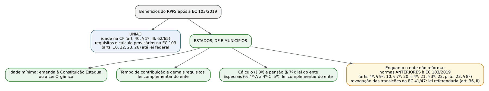
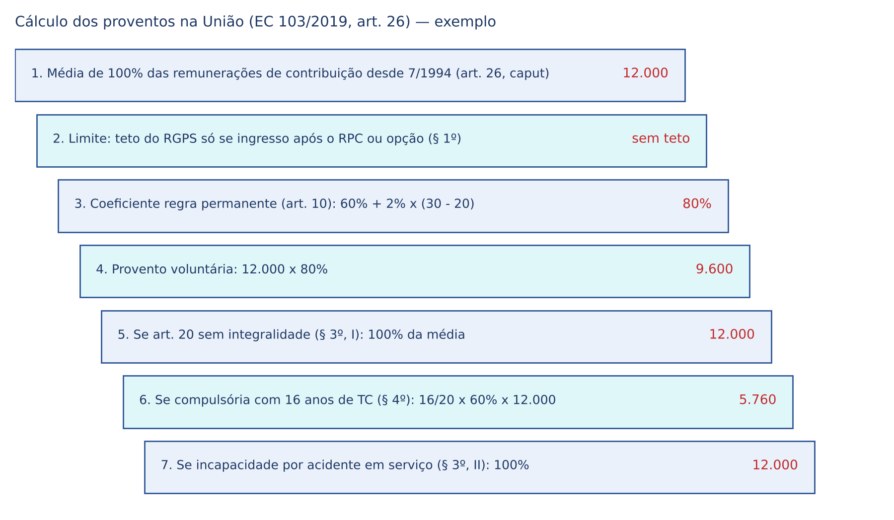
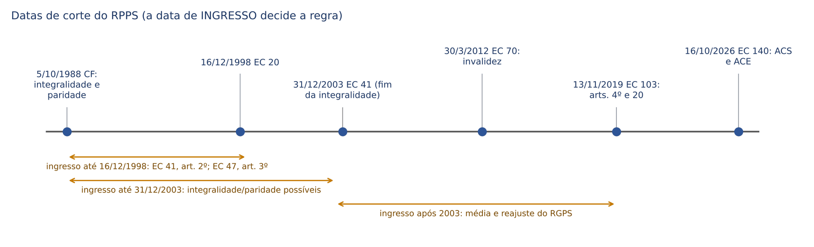
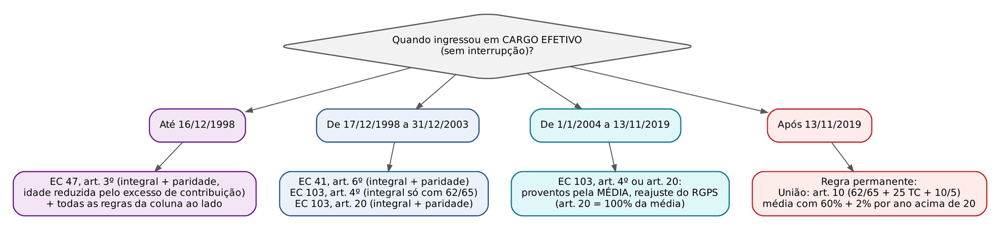
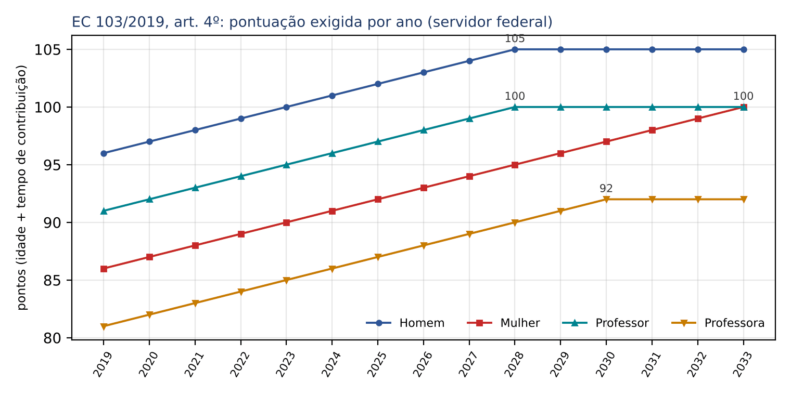
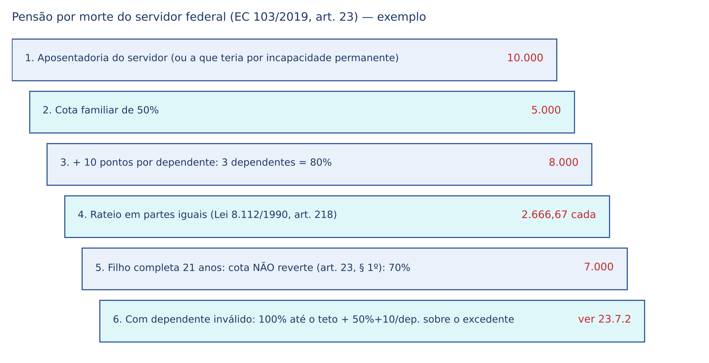
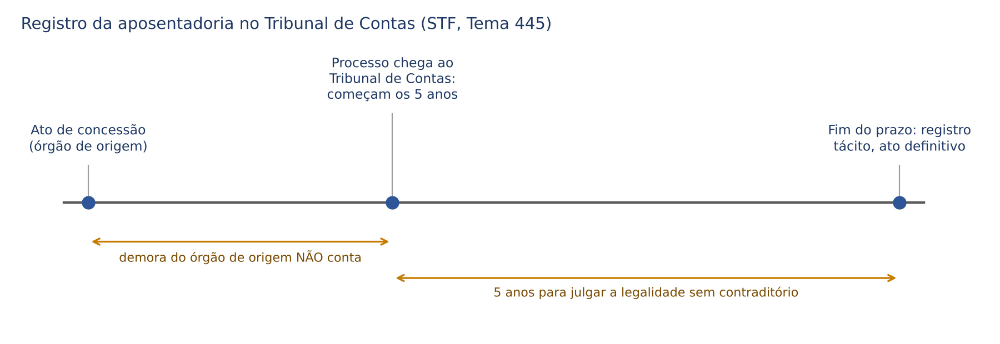

# CAPÍTULO 23 — REGIME PRÓPRIO DOS SERVIDORES I: ART. 40 DA CF APÓS A EC 103/2019, APOSENTADORIAS, CÁLCULO, INTEGRALIDADE E PARIDADE, TRANSIÇÕES, ABONO, PENSÃO E TEMPO DE CONTRIBUIÇÃO

:::INCIDENCIA
TRF5 p. 3; SEFAZ/SC p. 1 e 3. Nível A+; lote de 64 questões (FGV 48, FCC 16).
O que mais cai: quem legisla o quê depois da EC 103/2019 (União x entes subnacionais; lei complementar x emenda local), aposentadorias com critérios diferenciados (§§ 4º-A a 5º), transições dos arts. 4º e 20 com integralidade e paridade, pensão do art. 23, abono "no máximo" e registro no Tribunal de Contas (Tema 445).
:::

| Subtema | FGV | FCC | Padrão de cobrança |
|---|---|---|---|
| Estrutura do art. 40 e competência de cada ente | 7 | 4 | "lei", "lei complementar" ou "emenda" do ente; literalidade dos §§ 3º, 4º, 20 e 22 |
| Aposentadorias com critérios diferenciados (deficiência, risco, nocivos, professor) | 12 | 5 | reserva de lei complementar do ente; vedação de categoria profissional; carreiras sem previsão constitucional |
| Voluntária, transições, integralidade e paridade | 3 | 0 | caso com datas: data de ingresso, idade, pontos, pedágio |
| Incapacidade, compulsória e afastamentos | 5 | 1 | readaptação prévia; compulsória fora do cargo efetivo (notários, comissionados) |
| Abono de permanência | 2 | 1 | "no máximo" x "equivalente"; lei do ente |
| Pensão por morte do servidor | 7 | 4 | cota familiar de 50% + 10 por dependente; lei do ente; rol de dependentes da Lei 8.112/1990 |
| Tribunal de Contas e revisão do ato | 5 | 0 | prazo de 5 anos contado da chegada do processo (Tema 445) |
| Segurados, rol, acumulação, rompimento de vínculo e leis locais | 7 | 1 | art. 37, §§ 14 e 15; leis estaduais e municipais específicas |

## 23.1 O art. 40 depois da EC 103/2019: o que é da Constituição, o que é da União e o que é de cada ente

### 23.1.1 A "desconstitucionalização" seletiva

A estrutura geral do RPPS (caput contributivo e solidário, segurados, unidade de regime e de gestora, vedação de novos regimes) está no Cap. 6 (6.4). Aqui interessa o regime de BENEFÍCIOS. A EC 103/2019 fez duas coisas ao mesmo tempo, e quase toda questão de prova explora a diferença entre elas:

- Para a UNIÃO, fixou na própria Constituição a idade mínima da aposentadoria voluntária (art. 40, § 1º, III: 62 anos, se mulher, e 65, se homem) e, nas disposições transitórias da emenda, todos os demais requisitos e o cálculo, "até que entre em vigor lei federal" (arts. 10, 22, 23 e 26 da EC 103/2019).
- Para ESTADOS, DISTRITO FEDERAL E MUNICÍPIOS, retirou da Constituição Federal os requisitos e o cálculo e os devolveu ao ente: idade por emenda à Constituição Estadual ou à Lei Orgânica; tempo de contribuição e demais requisitos por lei complementar do ente; cálculo e pensão por lei do ente; critérios diferenciados por lei complementar do ente. Enquanto o ente não reforma, aplicam-se as normas constitucionais e infraconstitucionais ANTERIORES à EC 103/2019 (cláusula repetida nos arts. 4º, § 9º; 10, § 7º; 20, § 4º; 21, § 3º; 22, parágrafo único; e 23, § 8º).

:::LEI CF, art. 40, § 1º, III, e § 3º (redação da EC 103/2019)
"III - no âmbito da União, aos 62 (sessenta e dois) anos de idade, se mulher, e aos 65 (sessenta e cinco) anos de idade, se homem, e, no âmbito dos Estados, do Distrito Federal e dos Municípios, na idade mínima estabelecida mediante emenda às respectivas Constituições e Leis Orgânicas, observados o tempo de contribuição e os demais requisitos estabelecidos em lei complementar do respectivo ente federativo."
"§ 3º As regras para cálculo de proventos de aposentadoria serão disciplinadas em lei do respectivo ente federativo."
:::

| Matéria | Instrumento no ente subnacional | Fundamento | Para a União (enquanto não vier a lei federal) |
|---|---|---|---|
| Idade mínima da voluntária | emenda à Constituição Estadual ou à Lei Orgânica | art. 40, § 1º, III | 62/65 na própria CF |
| Tempo de contribuição e demais requisitos da voluntária | lei complementar do ente | art. 40, § 1º, III | 25 anos de contribuição, 10 de serviço público, 5 no cargo (EC 103, art. 10, § 1º, I) |
| Cálculo dos proventos | lei (ordinária) do ente | art. 40, § 3º | média de 100% (EC 103, art. 26) |
| Avaliações periódicas na incapacidade | lei do ente | art. 40, § 1º, I | EC 103, art. 10, § 1º, II |
| Deficiência, risco (policiais e agentes), agentes nocivos | lei complementar do ente | art. 40, §§ 4º-A, 4º-B e 4º-C | EC 103, arts. 5º, 10, § 2º, 21 e 22 |
| Professor: tempo de magistério | lei complementar do ente (a redução de 5 anos na idade é da CF) | art. 40, § 5º | EC 103, art. 10, § 2º, III |
| Pensão por morte | lei do ente | art. 40, § 7º | EC 103, art. 23 |
| Abono de permanência | lei do ente ("critérios") | art. 40, § 19 | EC 103, art. 8º (equivale à contribuição) |
| Alíquotas e base de contribuição | lei do ente (Cap. 24) | art. 149, § 1º | Lei 10.887/2004 e EC 103, art. 11 |

:::PEGADINHA Lei, lei complementar ou emenda?
- Idade: EMENDA à Constituição Estadual ou à Lei Orgânica (não lei complementar).
- Tempo de contribuição e demais requisitos da voluntária: LEI COMPLEMENTAR do ente.
- Critérios diferenciados (deficiência, risco, agentes nocivos) e tempo de magistério do professor: LEI COMPLEMENTAR do ente.
- Cálculo, pensão, abono: LEI do ente (ordinária basta).
- Normas gerais de organização do RPPS: LEI COMPLEMENTAR FEDERAL (art. 40, § 22), ainda não editada (vale a Lei 9.717/1998 — Cap. 24).
A FGV inverte qualquer um desses pares; a FCC troca "lei" por "lei complementar" ou acrescenta "exclusivamente".
:::

:::QUESTAO FCC 2026 — PGM Manaus — Procurador do Município (Q4338832)
O que o Município estabelece "exclusivamente" por qual instrumento. Gabarito oficial: B — por emenda à Lei Orgânica, a idade mínima da aposentadoria voluntária. Armadilhas: cálculo e reajuste por lei COMPLEMENTAR (A — o § 3º fala em "lei"); alíquota e base por lei complementar (C — lei ordinária); "rol de doenças" para proventos integrais na incapacidade (D — a integralidade por doença grave saiu do texto permanente); requisitos por lei ORDINÁRIA (E — o § 1º, III, exige lei complementar).
:::

:::QUESTAO FGV 2025 — TRF-1 — Juiz Federal Substituto (Q3425283)
O que a EC 103/2019 trouxe para os RPPS municipais. Gabarito oficial: E — as regras de cálculo dos proventos serão disciplinadas em lei do respectivo ente (art. 40, § 3º). Erradas: todos submetidos às regras do RGPS (A); impossibilidade de idades distintas por sexo (B — a própria CF fixa 62/65 para a União); inexistência de alíquota mínima (C — art. 9º, § 4º, da EC 103/2019, Cap. 24); proventos inferiores ao mínimo (D — o § 2º manda observar o piso do art. 201, § 2º).
No mesmo sentido: FGV 2025, PC-MG, Delegado (Q3171373), gabarito E — transcrição do § 22 ("Vedada a instituição de novos regimes próprios [...] lei complementar federal estabelecerá, para os que já existam, normas gerais"); erradas o cálculo "em lei de caráter nacional" (A), critérios diferenciados para magistrados (B), lei complementar NACIONAL para policiais e agentes (C — é do ente) e a pluralidade de RPPS no ente (D — vedada pelo § 20).
:::

:::QUESTAO FGV 2026 — PGE-AC — Procurador do Estado (Q4079350)
Proposições de comissão estadual: (I) cálculo dos proventos por lei ordinária estadual; (II) idade e tempo diferenciados para agente socioeducativo por lei complementar estadual; (III) entidades gestoras disciplinadas em lei complementar e "vinculadas a cada estrutura de poder ou instituição autônoma". Gabarito oficial: D — só I e II. A armadilha é a III: o § 20 veda "mais de um órgão ou entidade gestora desse regime em cada ente federativo, abrangidos todos os poderes"; a menção à transparência na internet é isca.
:::

:::QUESTAO FGV 2026 — TCE-SC — Auditor Fiscal de Controle Externo (Q4088907 e Q4088906)
Q4088907 — gabarito oficial: C — a contribuição do ente continua obrigatória (art. 40, caput: "mediante contribuição do respectivo ente federativo, de servidores ativos, de aposentados e de pensionistas"). Erradas: Estados e Municípios obrigados aos requisitos da União (A — a EC 103/2019 desconstitucionalizou e devolveu a matéria ao ente); afastamentos por saúde "impedidos" (B — continuam existindo, apenas são pagos pelo ente fora do RPPS, art. 9º, § 3º, da EC 103/2019; ver 6.4.5); fim das aposentadorias por agentes nocivos (D — § 4º-C as mantém); fim da contribuição de inativos salvo déficit (E — o déficit amplia a base, não é condição da cobrança; Cap. 24).
Q4088906 — lei estadual que cria aposentadoria voluntária aos 55 anos sem previsão de reforço de custeio. Gabarito oficial: D — inconstitucional, por ampliar benefício sem fonte de custeio (regra da contrapartida, art. 195, § 5º, aplicada ao RPPS por força do caráter contributivo e do equilíbrio financeiro e atuarial do caput do art. 40). A alternativa B ("somente a União pode legislar") é a armadilha clássica: a competência é concorrente (art. 24, XII) e a idade é fixada pelo próprio ente.
:::

### 23.1.2 Entes que não reformaram e a lei referendária

A EC 103/2019 revogou as regras de transição das ECs 41/2003 e 47/2005 (art. 35, III e IV) e o antigo § 21 do art. 40 (contribuição de inativo com doença incapacitante; art. 35, I, a). Para a União, a revogação vale desde 13/11/2019. Para Estados, DF e Municípios, a revogação SÓ produz efeito "na data de publicação de lei de iniciativa privativa do respectivo Poder Executivo que as referende integralmente" (art. 36, II), e essa lei "não produzirá efeitos anteriores à data de sua publicação" (art. 36, parágrafo único). Consequências práticas:

- O servidor estadual ou municipal cujo ente não editou a lei referendária continua podendo se aposentar pelos arts. 2º e 6º da EC 41/2003 e pelo art. 3º da EC 47/2005, com integralidade e paridade se preencher os requisitos.
- Se o ente editou emenda local e lei complementar com novas regras, mas não referendou a revogação, há convivência das transições antigas com as novas (o servidor escolhe a mais favorável que preencha).
- Para Santa Catarina, a reforma estadual e suas transições são objeto do Cap. 25.

:::LEI EC 103/2019, art. 36, II, e parágrafo único
"II - para os regimes próprios de previdência social dos Estados, do Distrito Federal e dos Municípios, quanto à alteração promovida pelo art. 1º desta Emenda Constitucional no art. 149 da Constituição Federal e às revogações previstas na alínea "a" do inciso I e nos incisos III e IV do art. 35, na data de publicação de lei de iniciativa privativa do respectivo Poder Executivo que as referende integralmente; [...] Parágrafo único. A lei de que trata o inciso II do caput não produzirá efeitos anteriores à data de sua publicação."
:::

:::QUESTAO FGV 2026 — TJ-PR — Juiz Substituto (Q3898983)
Requisitos da Constituição do Paraná para aposentadoria voluntária comum de servidora estadual em 2026. Gabarito oficial: A — 62 anos de idade, 25 de contribuição, 10 de efetivo exercício no serviço público e 5 no cargo efetivo. O Paraná reproduziu, para seus servidores, o desenho do art. 10 da EC 103/2019 (requisitos da União). As distratoras combinam idades e tempos de regras revogadas (58/30/20 lembra a EC 41/2003) ou inventadas.
No mesmo sentido (lei municipal): FGV 2025, TCE-RR, Auditor (Q3186490), gabarito D — Boa Vista exige, além de idade e tempo de contribuição, 10 anos de efetivo exercício no serviço público e 5 no cargo efetivo. Os "10 + 5" são o padrão mais copiado pelas leis locais.
:::

### 23.1.3 Segurados: remissão e o que as leis locais acrescentam

Quem é segurado (só o titular de cargo efetivo; comissionado puro, temporário, mandato eletivo e empregado público vão para o RGPS; estabilizado do art. 19 do ADCT também — Tema 1.254) e o que o RPPS paga (rol limitado a aposentadorias e pensão; licenças por incapacidade e maternidade pagas pelo ente) estão em 6.4.2 e 6.4.5. As questões do lote exploram a projeção dessas regras nas leis locais:

:::QUESTAO FCC 2025 — PGE-TO — Procurador do Estado (Q3745612)
"EXCETO": quem NÃO é segurado obrigatório do RPPS do Tocantins. Gabarito oficial: A — os deputados estaduais (mandato eletivo sem vínculo efetivo vai para o RGPS, art. 40, § 13). São segurados: o efetivo no exercício de mandato de deputado federal (art. 38, I e V — permanece no regime de origem); o procurador do Estado cedido a fundação municipal (cessão não rompe a filiação); o afastado sem remuneração que recolhe as contribuições do servidor e do ente; magistrados, membros do MP, da Defensoria e do Tribunal de Contas, ativos e inativos.
No mesmo sentido: FGV 2025, AL-AM, Procurador (Q3777987), gabarito C — permanece filiado ao RPPS/AM o servidor cedido a outro órgão ou ente, com ou sem ônus para o cessionário. Erradas: vereador filiado ao RPPS "em ambos os cargos" (A — a vereança, sem vínculo efetivo próprio, gera RGPS); exoneração para posse em cargo de outro ente (B — passa ao RPPS do novo ente); exoneração para cargo exclusivamente em comissão (D — RGPS); afastado sem remuneração "independentemente do recolhimento" (E — a manutenção depende do recolhimento).
:::

:::QUESTAO FGV 2024 — Prefeitura de Macaé — Analista Previdenciário (Q3048286)
Qual benefício NÃO é de oferta obrigatória pelos RPPS. Gabarito oficial: C — o pecúlio (pagamento único) por óbito. Hoje a resposta é ainda mais forte: o rol do RPPS "fica limitado às aposentadorias e à pensão por morte" (EC 103/2019, art. 9º, § 2º; ver 6.4.5), de modo que o pecúlio não só não é obrigatório como não pode ser pago pelo RPPS.
:::

## 23.2 Aposentadorias da regra permanente

### 23.2.1 Voluntária

Ficha da regra permanente da União (EC 103/2019, art. 10, § 1º, I), aplicável a quem ingressou no serviço público federal a partir de 14/11/2019 e, por opção, a qualquer servidor federal:

| Benefício | Requisitos | Cálculo | Reajuste | Fundamento |
|---|---|---|---|---|
| Aposentadoria voluntária (União) | 62 anos (mulher) ou 65 (homem); 25 anos de contribuição; 10 anos de efetivo exercício no serviço público; 5 anos no cargo efetivo | 60% da média de 100% das remunerações desde 7/1994 + 2 pontos por ano acima de 20 anos de contribuição; teto do RGPS se ingresso após o RPC ou opção | índices do RGPS | CF, art. 40, § 1º, III; EC 103, arts. 10, § 1º, I, § 4º, e 26, §§ 2º, II, e 7º |

:::LEI EC 103/2019, art. 10, § 1º, I
"I - voluntariamente, observados, cumulativamente, os seguintes requisitos: a) 62 (sessenta e dois) anos de idade, se mulher, e 65 (sessenta e cinco) anos de idade, se homem; e b) 25 (vinte e cinco) anos de contribuição, desde que cumprido o tempo mínimo de 10 (dez) anos de efetivo exercício no serviço público e de 5 (cinco) anos no cargo efetivo em que for concedida a aposentadoria;"
:::

Três conceitos que o juiz estadual costuma confundir: (i) tempo de contribuição: qualquer contribuição a qualquer regime (RGPS, RPPS de qualquer ente, militar), aproveitada por contagem recíproca (Cap. 26); (ii) tempo de efetivo exercício no serviço público: tempo em cargo, emprego ou função na administração direta, autárquica e fundacional de qualquer ente (inclusive celetista), não necessariamente no mesmo ente; (iii) tempo no cargo: no cargo efetivo em que se dará a aposentadoria. Promoção na carreira não reinicia a contagem do tempo no cargo (Tema 1.207 do STF).

:::JURIS STF, Tema 1.207 (promoção não reinicia os 5 anos no cargo)
Tese: "A promoção por acesso de servidor a classe distinta na carreira não representa ascensão a cargo diverso daquele em que já estava efetivado, de modo que, para fins de aposentadoria, o prazo mínimo de cinco anos no cargo efetivo, exigido pelo artigo 40, § 1º, inciso III, da Constituição Federal, na redação da Emenda Constitucional 20/1998, e pelos artigos 6º da Emenda Constitucional 41/2003 e 3º da Emenda Constitucional 47/2005, não recomeça a contar pela alteração de classe."
:::

:::QUESTAO FGV 2025 — TRF-1 — Juiz Federal Substituto (Q3425277)
Advogado autônomo desde 1/2020 toma posse como juiz federal em 3/2025. Com que idade terá aposentadoria voluntária? Gabarito oficial: B — 65 anos. Ingressou no serviço público após 13/11/2019: não há transição (os arts. 4º e 20 exigem ingresso ou filiação até a entrada em vigor da EC 103/2019 — e o art. 20 alcança o segurado do RGPS filiado até essa data apenas para a aposentadoria NO RGPS; para o RPPS, exige ingresso em cargo efetivo). Aplica-se o art. 40, § 1º, III (65 anos para homem), com os requisitos do art. 10, § 1º, I. Armadilhas: 60 ou 62 (idades de transições) e 55 (idade policial).
:::

### 23.2.2 Compulsória

A aposentadoria compulsória ocorre aos 75 anos, com proventos PROPORCIONAIS ao tempo de contribuição (art. 40, § 1º, II, na redação da EC 88/2015; LC 152/2015). É automática: o ato apenas declara a vacância, que se dá no dia em que o servidor completa a idade.

:::LEI LC 152/2015, art. 2º
"Serão aposentados compulsoriamente, com proventos proporcionais ao tempo de contribuição, aos 75 (setenta e cinco) anos de idade: I - os servidores titulares de cargos efetivos da União, dos Estados, do Distrito Federal e dos Municípios, incluídas suas autarquias e fundações; II - os membros do Poder Judiciário; III - os membros do Ministério Público; IV - os membros das Defensorias Públicas; V - os membros dos Tribunais e dos Conselhos de Contas."
:::

Quem NÃO se submete à compulsória: (i) ocupante exclusivamente de cargo em comissão (Tema 763); (ii) titular de serventia judicial não estatizada que não ocupe cargo efetivo nem seja remunerado pelos cofres públicos (Tema 571); (iii) notários e registradores (delegatários do art. 236, que não são servidores titulares de cargo efetivo; orientação do STF que a FGV cobra em conjunto com o Tema 571). O vitalício, ao contrário, está sujeito a ela (Súmula 36 do STF: "Servidor vitalício está sujeito à aposentadoria compulsória, em razão da idade").

:::JURIS STF, Tema 763 (cargo em comissão e compulsória)
Tese: "1. Os servidores ocupantes de cargo exclusivamente em comissão não se submetem à regra da aposentadoria compulsória prevista no art. 40, § 1º, II, da Constituição Federal, a qual atinge apenas os ocupantes de cargo de provimento efetivo, inexistindo, também, qualquer idade limite para fins de nomeação a cargo em comissão; 2. Ressalvados impedimentos de ordem infraconstitucional, não há óbice constitucional a que o servidor efetivo aposentado compulsoriamente permaneça no cargo comissionado que já desempenhava ou a que seja nomeado para cargo de livre nomeação e exoneração, uma vez que não se trata de continuidade ou criação de vínculo efetivo com a Administração."
:::

:::QUESTAO FGV 2024 — Prefeitura de Vitória — Procurador (Q3044179)
A quais agentes NÃO se aplica a compulsória, segundo o STF. Gabarito oficial: C — tabeliães e notários. Magistrados, procuradores municipais e conselheiros de Tribunal de Contas estão expressamente na LC 152/2015 ou são titulares de cargo efetivo. A alternativa E (efetivo lotado em cargo em comissão "com relação ao cargo efetivo") é a armadilha: em relação ao cargo EFETIVO a compulsória incide; o que o Tema 763 permite é que o aposentado compulsoriamente continue no comissionado.
:::

Cálculo na União (art. 26, § 4º, da EC 103/2019): o provento é a fração "tempo de contribuição dividido por 20 (vinte) anos, limitado a um inteiro", multiplicada pelo valor apurado pela regra de 60% + 2 pontos. Ressalva expressa: se o servidor já preencheu os requisitos de alguma voluntária mais favorável, aplica-se a voluntária. Exemplo (média de 12.000 (doze mil) reais):

- 16 anos de contribuição: 16/20 × 60% × 12.000 = 5.760.
- 30 anos de contribuição: fração limitada a 1 × (60% + 2% × 10) × 12.000 = 9.600.

### 23.2.3 Por incapacidade permanente

:::LEI CF, art. 40, § 1º, I (redação da EC 103/2019)
"I - por incapacidade permanente para o trabalho, no cargo em que estiver investido, quando insuscetível de readaptação, hipótese em que será obrigatória a realização de avaliações periódicas para verificação da continuidade das condições que ensejaram a concessão da aposentadoria, na forma de lei do respectivo ente federativo;"
:::

A mecânica tem três degraus, sempre nesta ordem:

:::PASSO Da licença à aposentadoria por incapacidade
1. Licença para tratamento de saúde, paga pelo ENTE (não pelo RPPS — EC 103/2019, art. 9º, § 3º). Na União, a aposentadoria "será precedida de licença para tratamento de saúde, por período não excedente a 24 (vinte e quatro) meses" (Lei 8.112/1990, art. 188, § 1º); o período entre o fim da licença e a publicação do ato é prorrogação da licença (§ 3º).
2. Perícia por junta médica oficial. Se há limitação compatível com outro cargo: READAPTAÇÃO, isto é, "investidura do servidor em cargo de atribuições e responsabilidades compatíveis com a limitação que tenha sofrido" (Lei 8.112/1990, art. 24), em cargo de atribuições afins, respeitadas habilitação, escolaridade e equivalência de vencimentos (art. 24, § 2º; como excedente, se não houver vaga).
3. Se insuscetível de readaptação: aposentadoria por incapacidade permanente "no cargo em que estiver investido", com avaliações periódicas obrigatórias. Recuperada a capacidade, cabe a REVERSÃO (retorno do aposentado à atividade).
:::

Cálculo:

| Situação | Antes da EC 103/2019 (texto permanente) | União após a EC 103/2019 | Fundamento |
|---|---|---|---|
| Regra | proventos proporcionais ao tempo de contribuição | 60% da média + 2 pontos por ano acima de 20 | EC 103, art. 26, § 2º, II (via art. 10, § 4º) |
| Acidente em serviço, moléstia profissional ou doença grave, contagiosa ou incurável "na forma da lei" | proventos integrais (da média, após a EC 41/2003) | só acidente de trabalho, doença profissional e doença do trabalho dão 100% da média; doença grave deixou de ser critério | EC 103, art. 26, § 3º, II |
| Ingresso até 31/12/2003 | EC 41, art. 6º-A (EC 70/2012): base na remuneração do cargo, com paridade | EC 41, art. 6º-A revogado para a União (art. 35, III, da EC 103/2019); preservado o direito de quem já se aposentara | EC 70/2012; Tema 754 |

:::JURIS STF, Tema 524 (rol de doenças para proventos integrais)
Tese: "A concessão de aposentadoria de servidor público por invalidez com proventos integrais exige que a doença incapacitante esteja prevista em rol taxativo da legislação de regência." Útil para as aposentadorias regidas pelo texto anterior (entes sem reforma e direito adquirido): fora do rol legal (na União, Lei 8.112/1990, art. 186, § 1º), proventos proporcionais.
:::

:::JURIS STF, Tema 754 (EC 70/2012: efeitos financeiros)
Tese: "Os efeitos financeiros das revisões de aposentadoria concedidas com base no art. 6º-A da Emenda Constitucional nº 41/2003, introduzido pela Emenda Constitucional nº 70/2012, somente se produzirão a partir da data de sua promulgação (30.3.2012)." A EC 70/2012 mandou revisar as aposentadorias por invalidez de quem ingressou até 31/12/2003 (base na remuneração do cargo, paridade), mas sem retroativos anteriores a 30/3/2012.
:::

:::JURIS STJ, Jurisprudência em Teses, ed. 207, tese 1, e ed. 76, tese 11
- Ed. 207, tese 1: "Não é possível estender a servidor público federal aposentado por invalidez em Regime Próprio de Previdência Social (RPPS) o adicional de 25% devido apenas a segurado aposentado por invalidez vinculado ao Regime Geral de Previdência Social (RGPS), por ausência de previsão legal." (REsp 1.861.390/SC, Relatora Ministra Assusete Magalhães, Segunda Turma, DJe 26/10/2021.) O art. 40, § 12 (aplicação subsidiária do RGPS "no que couber"), não cria benefício.
- Ed. 76, tese 11: "O termo inicial para o pagamento dos proventos integrais devidos na conversão da aposentadoria proporcional por tempo de serviço em aposentadoria integral por invalidez é a data do requerimento administrativo."
:::

:::QUESTAO FGV 2025 — CNU — Bloco 1 (Q3641534)
Motorista de universidade federal fica cego após acidente de trabalho. Quais processos após a alta? Gabarito oficial: C — reabilitação física e readaptação. A cegueira impede o cargo de motorista, mas não necessariamente outro cargo de atribuições afins: antes de aposentar, a Administração tenta a readaptação (art. 40, § 1º, I: "quando insuscetível de readaptação"). Armadilhas: "reversão" (B — retorno do aposentado), "reintegração" (A e E — retorno após invalidação da demissão), "reabilitação profissional" (D — serviço do RGPS, Cap. 15).
:::

:::QUESTAO FGV 2024 — AL-TO — Analista Legislativo (Q2456279)
Três assertivas sobre servidores. Gabarito oficial: C — corretas I (vedação de incorporação de vantagens temporárias ou de função de confiança, art. 39, § 9º) e III (caput do art. 40). A II é a pegadinha de uma letra: aposentadoria por incapacidade "quando SUSCETÍVEL de readaptação" — o texto diz INSUSCETÍVEL.
No mesmo sentido: FCC 2024, PIAUIPREV, Analista (Q3884624), gabarito D — a aposentadoria por incapacidade permanente é concedida "no cargo em que estiverem investidos", quando insuscetíveis de readaptação, com avaliações periódicas. Erradas: rol fechado "apenas" de compulsória, incapacidade e voluntária (A — há as especiais); compulsória como ato de vontade (B); "especial" aos 75 anos (C — é a compulsória); voluntária como modalidade para categorias específicas (E — essas são as especiais).
:::

:::QUESTAO FGV 2025 — TRF-5 — Juiz Substituto (Q3373847)
Juiz federal afastado por incapacidade temporária após acidente. Gabarito oficial: B — se o quadro se agravar, a aposentadoria por incapacidade permanente será concedida pelo RPPS da União. Erradas: aposentadoria compulsória após 12 meses (A — não há prazo constitucional; na Lei 8.112/1990, a licença vai até 24 meses e a aposentadoria depende de perícia); auxílio-acidente no INSS (C — benefício exclusivo do RGPS; magistrado não é segurado do RGPS pelo cargo); readaptação "em qualquer atividade do tribunal" (D — readaptação exige atribuições afins e compatíveis, e magistrado não é readaptado em cargo de servidor); pensão a cargo do Tesouro e não do RPPS (E — pensão é benefício do RPPS).
:::

:::QUESTAO FGV 2025 — TCE-RR — Auditor, Ciências Atuariais (Q3187889)
Lei de Roraima (LC estadual 54/2001): servidora incapacitada por 60 dias. Gabarito oficial: D — auxílio-doença no valor da remuneração de contribuição, devido a partir do 16º dia do afastamento, sobre ele incidindo a contribuição ordinária. Questão de lei local editada antes da EC 103/2019, que previa o benefício no RPPS. Lição geral: hoje, o afastamento por incapacidade temporária é pago pelo ENTE e não corre à conta do RPPS (art. 9º, § 3º, da EC 103/2019); leis locais anteriores que o mantinham no regime precisam ser adaptadas. Não há carência (C) em RPPS para esse fim.
:::

:::QUESTAO FCC 2025 — TRT-15 — Analista Judiciário, Oficial de Justiça (Q3302515)
Afirmações gerais sobre RPPS. Gabarito oficial: A — o abono de permanência é devido a quem cumpriu os requisitos da voluntária e permanece em atividade, "equivalente ao valor da sua contribuição". Erradas: auxílio-doença só para comissionados (B — comissionado puro está no RGPS); assistência à saúde "integralmente" financiada pelo ente, vedada contribuição (C); aposentadoria por invalidez sem perícia oficial, com laudo particular (D — exige junta médica oficial); pensão igual à remuneração integral, sem cotas (E — art. 23 da EC 103/2019). A alternativa A é correta para a União (EC 103/2019, art. 8º) e para os entes que não legislaram; o texto permanente diz "no máximo" (ver 23.6).
:::

### 23.2.4 Aposentadorias com requisitos diferenciados: a lista é fechada

O § 4º do art. 40 é a chave: "É vedada a adoção de requisitos ou critérios diferenciados para concessão de benefícios em regime próprio de previdência social, ressalvado o disposto nos §§ 4º-A, 4º-B, 4º-C, 5º e 5º-A deste artigo" (redação da EC 140/2026, que acrescentou o § 5º-A). Fora dessas cinco hipóteses, nenhum ente pode criar aposentadoria antecipada: nem para magistrados, membros do MP, defensores, procuradores, oficiais de justiça ou auditores fiscais, nem por "categoria profissional".

| Hipótese | Dispositivo | Quem fixa idade e tempo | Regra provisória da União | Entes sem reforma |
|---|---|---|---|---|
| Servidor com deficiência | § 4º-A | lei complementar do ente, com avaliação biopsicossocial prévia por equipe multiprofissional e interdisciplinar | LC 142/2013 + 10 anos de serviço público e 5 no cargo (EC 103, art. 22) | normas anteriores (art. 22, parágrafo único) |
| Agente penitenciário, agente socioeducativo e policiais (Câmara, Senado, PF, PRF, PFF, polícias civis e penais — art. 144, I a IV) | § 4º-B | lei complementar do ente | 55 anos, 30 de contribuição e 25 na carreira, ambos os sexos (art. 10, § 2º, I); transição do art. 5º | normas anteriores (art. 5º, § 2º) |
| Efetiva exposição a agentes químicos, físicos e biológicos | § 4º-C | lei complementar do ente; VEDADA a caracterização por categoria profissional ou ocupação | 60 anos, 25 de efetiva exposição e contribuição, 10 de serviço público, 5 no cargo (art. 10, § 2º, II); transição por pontos (art. 21) | normas anteriores (art. 21, § 3º) |
| Professor da educação infantil e do ensino fundamental e médio | § 5º | a CF reduz a idade em 5 anos; o tempo de magistério é fixado em lei complementar do ente | 57/60 anos, 25 de contribuição exclusivamente em magistério, 10 de serviço público, 5 no cargo (art. 10, § 2º, III) | normas anteriores (art. 4º, § 10) |
| Agente comunitário de saúde e agente de combate às endemias | § 5º-A (EC 140/2026) | a própria CF: 57 (mulher) ou 60 (homem) com 25 anos de contribuição e de efetivo exercício na atividade | não se aplica distinção União/entes: a regra é constitucional | transições próprias da EC 140/2026 (arts. 3º a 5º) |

:::DICA A palavra "poderão"
Os §§ 4º-A, 4º-B e 4º-C dizem que idade e tempo diferenciados "Poderão ser estabelecidos por lei complementar do respectivo ente federativo". É faculdade do ente, não dever: o Município pode não criar aposentadoria especial de policial (nem tem polícia) e pode não criar a de agentes nocivos. Antes da EC 103/2019, o § 4º dizia "ressalvados, nos termos definidos em leis complementares" — e o STF supriu a omissão por mandado de injunção e pela Súmula Vinculante 33. Depois da EC 103/2019, a omissão do ente mantém as normas anteriores (inclusive a SV 33) até que ele legisle.
:::

#### Servidor com deficiência (§ 4º-A)

Na União, até lei específica, aplica-se a LC 142/2013 "inclusive quanto aos critérios de cálculo dos benefícios", exigidos 10 anos de efetivo exercício no serviço público e 5 no cargo (EC 103/2019, art. 22). A LC 142/2013 tem duas modalidades: por tempo de contribuição, SEM idade mínima (25/20 anos na deficiência grave, 29/24 na moderada, 33/28 na leve, para homem/mulher) e por idade (60/55 anos com 15 de contribuição e deficiência no período). O detalhe da LC 142/2013 (graus, IFBr-A, conversões, controvérsia sobre a média) está no Cap. 14 (14.6 a 14.8). Nos entes, a regra é a da lei complementar local; até ela, as normas anteriores, isto é, o regime de mandado de injunção que mandava aplicar a LC 142/2013 aos servidores.

:::QUESTAO FGV 2025 — TRF-1 — Juiz Federal Substituto (Q3425279)
Analista judiciária do TRF1, ingresso em 2015, sem vínculos anteriores, pessoa com deficiência desde 2020. Gabarito oficial: A — pode aposentar-se como pessoa com deficiência independentemente de idade mínima, cumprido o tempo de contribuição da lei complementar (LC 142/2013, modalidade por tempo, via art. 22 da EC 103/2019, mais 10 anos de serviço público e 5 no cargo). Erradas: grau "irrelevante" (B — o tempo varia conforme o grau, e a deficiência superveniente gera conversão proporcional dos períodos — Cap. 14); só aos 55 anos com 20 de contribuição (C — mistura as duas modalidades); "não existe regra distinta" por falta de lei (D — o art. 22 é a regra provisória); "no máximo" aposentadoria por incapacidade (E — deficiência não é incapacidade).
:::

:::QUESTAO FGV 2025 — CNU — Bloco 1 (Q3641525)
Servidora federal com deficiência, sem atividade anterior ao cargo. Gabarito oficial: E — "poderá aposentar-se após 20 anos de contribuição, independentemente de idade, caso sua deficiência seja qualificada como leve".
Gabarito discutível (a crítica procede): pela LC 142/2013, art. 3º, 20 anos de contribuição para a MULHER correspondem à deficiência GRAVE; na leve, exigem-se 28 anos. A alternativa B ("a depender do grau de deficiência, aposentar-se concluídos 20 anos de atividade, após regular avaliação pericial") está mais próxima da lei. O gabarito oficial é E; em sentença, prevalece a lei. Erradas sem discussão: idade de 62 com 20 anos (A); irrelevância do IFBr-A (C — a avaliação é o próprio critério de grau); "presunção de invalidez após 15 anos" (D).
:::

:::QUESTAO FGV 2024 — Prefeitura de Abreu e Lima — Técnico em Controle Interno (Q3008998)
Servidor efetivo municipal com deficiência em Município com RPPS. Gabarito oficial: D — o tratamento diferenciado pode ser estabelecido em lei complementar MUNICIPAL (§ 4º-A: "lei complementar do respectivo ente federativo"). Armadilhas: "previsto na própria ordem constitucional" (B — a CF autoriza, mas não fixa os critérios); lei complementar FEDERAL (C — era assim antes da EC 103/2019, e continua assim no RGPS, art. 201, § 1º, I); exigência de determinação judicial (E).
No mesmo sentido: FGV 2024, TCE-PA, Auditor (Q2566139), gabarito D — são compatíveis com a CF a avaliação biopsicossocial (I) e a idade inferior conforme o grau (III); é inconstitucional contar como tempo de contribuição férias e licenças não fruídas (II — tempo fictício, art. 40, § 10; ver 23.8).
:::

:::QUESTAO FGV 2025 — TJ-RS — Analista Judiciário (Q3742943)
Proposta municipal de critérios diferenciados para servidores com deficiência que ocupem EXCLUSIVAMENTE cargos em comissão. Gabarito oficial: B — incompatível com a CF. Comissionado puro é segurado do RGPS (art. 40, § 13); o Município não legisla sobre requisitos de aposentadoria do RGPS (competência da União, por lei complementar federal, art. 201, § 1º, I). A alternativa A ("deve ter a forma de lei complementar") é a isca: a forma estaria certa se o destinatário fosse o efetivo.
:::

:::QUESTAO FGV 2025 — Município Alfa (Q3185932) e MPE-RJ — Promotor de Justiça (Q3532405)
Q3185932 — proposição municipal: (I) comissionados no RGPS; (II) instituição do RPPS municipal; (III) requisitos diferenciados para servidores com deficiência. Gabarito oficial: D — só I e III. A II esbarra no § 22 do art. 40 ("Vedada a instituição de novos regimes próprios"). Pressuposto implícito: Alfa já tem RPPS, porque a III só faz sentido para efetivos vinculados a regime próprio.
Q3532405 — anteprojeto em Município SEM RPPS: (I) criação do RPPS para efetivos; (II) vereadores no RGPS; (III) critérios diferenciados para efetivos com deficiência. Gabarito oficial: C — só a II. A diferença em relação à questão anterior é o pressuposto: como Beta não pode criar RPPS (I), seus efetivos continuam no RGPS, e o Município não pode fixar requisitos de aposentadoria do RGPS (III cai junto). A II é mera reprodução do § 13 ("inclusive mandato eletivo").
:::

#### Policiais e agentes penitenciários e socioeducativos (§ 4º-B)

O § 4º-B substituiu a antiga cláusula aberta "atividades de risco" (§ 4º, II, na redação da EC 47/2005) por uma LISTA de cargos: agente penitenciário, agente socioeducativo e policiais dos órgãos dos arts. 51, IV (polícia da Câmara), 52, XIII (polícia do Senado) e 144, I a IV (Polícia Federal, Rodoviária Federal, Ferroviária Federal e polícias civis). As polícias penais (art. 144, VI) entram pela menção a "agente penitenciário". Policiais militares e bombeiros NÃO estão aqui: integram o sistema de proteção social dos militares (Cap. 28). Guardas municipais não estão na lista.

Para os policiais federais (e os do Legislativo federal e da Polícia Civil do DF, organizada e mantida pela União, art. 21, XIV) e agentes federais penitenciários e socioeducativos:

| Regra | Requisitos | Proventos | Fundamento |
|---|---|---|---|
| Permanente (ingresso após 13/11/2019) | 55 anos, ambos os sexos; 30 anos de contribuição; 25 anos de efetivo exercício em cargo dessas carreiras | média (art. 26) | EC 103, art. 10, § 2º, I, e § 4º |
| Transição (ingresso na carreira até 13/11/2019) | LC 51/1985 + idade mínima de 55 anos; OU 52 (mulher) / 53 (homem) com pedágio de 100% do tempo que faltava em 13/11/2019 para o tempo de contribuição da LC 51/1985 | conforme a lei (integralidade e paridade, se cumpridos os requisitos do Tema 1.019 e da legislação aplicável) | EC 103, art. 5º, caput e § 3º |
| Pensão por agressão no exercício ou em razão da função | — | vitalícia para cônjuge ou companheiro, equivalente à remuneração do cargo | EC 103, art. 10, § 6º; CF, art. 40, § 7º, parte final |

O art. 5º, § 1º, da EC 103/2019 manda considerar como tempo em cargo de natureza estritamente policial o tempo de atividade militar nas Forças Armadas, nas polícias militares e nos corpos de bombeiros militares e o tempo como agente penitenciário ou socioeducativo.

:::JURIS STF, Tema 1.019 (policial civil: integralidade e paridade pela LC 51/1985)
Tese: "O servidor público policial civil que preencheu os requisitos para a aposentadoria especial voluntária prevista na LC nº 51/85 tem direito ao cálculo de seus proventos com base na regra da integralidade e, quando também previsto em lei complementar, na regra da paridade, independentemente do cumprimento das regras de transição especificadas nos arts. 2º e 3º da EC 47/05, por enquadrar-se na exceção prevista no art. 40, § 4º, inciso II, da Constituição Federal, na redação anterior à EC 103/19, atinente ao exercício de atividade de risco."
Leitura: integralidade decorre da própria LC 51/1985; paridade só "quando também prevista em lei complementar". Vale para quem preencheu os requisitos sob o texto anterior à EC 103/2019 (ou, nos entes, enquanto vigentes as normas anteriores).
:::

:::JURIS STF, ADI 7.494 (Rondônia), Relatora Ministra Cármen Lúcia, Plenário, sessão virtual encerrada em 3/4/2024
"São inconstitucionais dispositivos de Constituição estadual que definem como atividade de risco análoga ao exercício da atividade policial a atuação dos membros do Ministério Público, do Poder Judiciário, da Defensoria Pública e dos Procuradores do Estado e dos Municípios, dos Oficiais de Justiça e Auditores Fiscais de tributos estaduais, e a eles estendem benefícios previdenciários exclusivos dos servidores policiais, tais como a aposentadoria especial e a pensão por morte." Fundamentos: a CF não prevê aposentadoria especial por risco para essas carreiras; a extensão exigiria iniciativa do chefe do Executivo; a norma estadual sobre servidores municipais violou a autonomia municipal; houve aumento de despesa por emenda parlamentar.
:::

:::QUESTAO FGV 2024 — TJ-SC — Juiz Substituto (Q3049421)
Constituição estadual equipara magistrados, MP e Defensoria à atividade policial para fins de aposentadoria especial. Gabarito oficial: C — inconstitucional, pois a CF não conferiu a essas carreiras critérios diferenciados. É exatamente a ADI 7.494. Erradas: autonomia estadual "sem vinculação" à CF (A); reprodução de regras da CF (B — não existem); falta de competência estadual para dispor sobre as carreiras (D — o vício é material); constitucional quanto ao MP e à Defensoria (E).
:::

:::QUESTAO FGV 2025 — Defensoria (Q3395828)
Agente socioeducativa estadual pergunta se pode ter idade e tempo diferenciados. Gabarito oficial: D — o Estado pode estabelecer esses critérios por lei complementar (§ 4º-B). Armadilhas: Constituição Estadual (A — a CE fixa a IDADE geral, mas o § 4º-B exige lei complementar); lei ordinária (B); "apenas lei nacional" (C — era a lógica anterior); vedação por isonomia (E).
:::

:::QUESTAO FGV 2025 — TRF-1 — Juiz Federal Substituto (Q3425268)
Lei distrital vincula os policiais civis do DF ao RPPS da generalidade dos servidores distritais; questiona-se no STF. Gabarito oficial: E — constitucional, porque os policiais civis integram a estrutura do Executivo distrital e é vedada a existência de mais de um RPPS em cada ente (art. 40, § 20). A FGV apostou na unidade de regime; a alternativa C ("deveria criar RPPS próprio para a segurança pública") é o erro mais sedutor.
O gabarito coincide com o que o STF decidiu na ADI 5.801 (Relator Ministro Luiz Fux, Plenário, sessão virtual encerrada em 30/8/2024, unânime): a lei do DF que incluiu policiais civis e militares distritais no RPPS do DF é válida, porque a CF veda mais de um regime próprio e mais de um órgão gestor em cada ente e, embora a União organize e mantenha essas forças (art. 21, XIV), elas se subordinam ao Governador.
Atenção: a EC 103/2019 incluiu os policiais civis do DF nas regras federais de aposentadoria (arts. 5º e 10, § 2º, I). Não há contradição: uma coisa é o regime ao qual estão filiados; outra, as regras de requisitos aplicáveis.
:::

#### Agentes nocivos (§ 4º-C)

Antes da EC 103/2019, o STF supriu a omissão legislativa (§ 4º, III, na redação da EC 47/2005) com a Súmula Vinculante 33: "Aplicam-se ao servidor público, no que couber, as regras do Regime Geral de Previdência Social sobre aposentadoria especial de que trata o artigo 40, parágrafo 4º, inciso III, da Constituição Federal, até edição de lei complementar específica." Depois, no Tema 942, admitiu também a conversão do tempo especial em comum até a EC 103/2019; após a emenda, a conversão depende de lei complementar de cada ente.

:::JURIS STF, Tema 942 (RE 1.014.286, tese aprovada em 31/8/2020)
Tese (reproduzida com siglas no lugar dos nomes por extenso): até a edição da EC 103/2019, o direito à conversão, em tempo comum, do prestado sob condições especiais que prejudiquem a saúde ou a integridade física de servidor público decorre da previsão de adoção de requisitos e critérios diferenciados para a jubilação daquele enquadrado na hipótese prevista no então vigente inciso III do § 4º do art. 40 da Constituição, devendo ser aplicadas as normas do RGPS relativas à aposentadoria especial contidas na Lei 8.213/1991 para viabilizar sua concretização enquanto não sobrevier lei complementar disciplinadora da matéria. Após a vigência da EC 103/2019, o direito à conversão em tempo comum do prestado sob condições especiais pelos servidores obedecerá à legislação complementar dos entes federados, nos termos da competência conferida pelo art. 40, § 4º-C, da Constituição. Para a União, o art. 10, § 3º, da EC 103/2019 VEDA a conversão de tempo especial em comum.
:::

Na União, a regra permanente é a do art. 10, § 2º, II (60 anos, 25 de efetiva exposição e contribuição, 10 de serviço público, 5 no cargo), com o § 3º mandando observar subsidiariamente o RGPS. Quem ingressou até 13/11/2019 tem a transição por pontos do art. 21, a mesma do RGPS (ver Cap. 14, 14.3), com o acréscimo, para o servidor, de 20 anos de serviço público e 5 no cargo:

:::LEI EC 103/2019, art. 21, caput (trecho) e incisos
"[...] desde que cumpridos, no caso do servidor, o tempo mínimo de 20 (vinte) anos de efetivo exercício no serviço público e de 5 (cinco) anos no cargo efetivo em que for concedida a aposentadoria, na forma dos arts. 57 e 58 da Lei nº 8.213, de 24 de julho de 1991, poderão aposentar-se quando o total da soma resultante da sua idade e do tempo de contribuição e o tempo de efetiva exposição forem, respectivamente, de: I - 66 (sessenta e seis) pontos e 15 (quinze) anos de efetiva exposição; II - 76 (setenta e seis) pontos e 20 (vinte) anos de efetiva exposição; e III - 86 (oitenta e seis) pontos e 25 (vinte e cinco) anos de efetiva exposição."
:::

:::QUESTAO FCC 2024 — PIAUIPREV — Analista Previdenciário (Q3884620)
Servidor do Piauí que ingressou até a emenda estadual 54/2019, exposto a agentes nocivos, com 20 anos de serviço público e 5 no cargo: quais combinações de pontos e exposição? Gabarito oficial: E — II, III e IV (66/15, 76/20, 86/25). O Piauí copiou o art. 21 da EC 103/2019. A I (62 pontos e 12 anos) é inventada. Os pontos e os anos de exposição andam em pares fixos: 15 anos de exposição (atividades de risco mais alto) exigem 66 pontos.
:::

:::QUESTAO FGV 2025 — AL-AM — Procurador (Q3777898)
Estado quer fixar requisitos diferenciados para servidores de "determinada categoria profissional" por serem expostos a agentes biológicos. Gabarito oficial: E — não pode, por afrontar os balizamentos da CF: o § 4º-C VEDA "a caracterização por categoria profissional ou ocupação". O direito decorre da EFETIVA exposição, servidor a servidor. Armadilhas: Constituição Estadual (A) ou lei complementar estadual (B) — seriam o veículo certo se o critério fosse a exposição efetiva; competência privativa da União (D).
Contraponto: FGV 2024, Prefeitura de Niterói, Auditor (Q3099304), gabarito A — reivindicação de critérios para quem EXERCE atividades com efetiva exposição a agentes nocivos pode ser acolhida, na forma de projeto de lei complementar. A diferença entre as duas questões é exatamente "categoria" x "efetiva exposição".
:::

:::QUESTAO FCC 2025 — Prefeitura de São Paulo — Auditor Municipal (Q3290885)
Município estabeleceu (I) idade e tempo diferenciados para exposição efetiva a agentes nocivos, vedada a caracterização por categoria, e (II) abono de permanência "no máximo" igual à contribuição até a compulsória. Gabarito oficial: A — ambas podiam ser adotadas por lei municipal, exigindo-se lei COMPLEMENTAR para a I. O abono (II) depende de "critérios a serem estabelecidos em lei do respectivo ente" (§ 19), e lei ordinária basta.
:::

#### Professor (§ 5º)

:::LEI CF, art. 40, § 5º (redação da EC 103/2019)
"Os ocupantes do cargo de professor terão idade mínima reduzida em 5 (cinco) anos em relação às idades decorrentes da aplicação do disposto no inciso III do § 1º, desde que comprovem tempo de efetivo exercício das funções de magistério na educação infantil e no ensino fundamental e médio fixado em lei complementar do respectivo ente federativo."
:::

Pontos de prova: (i) só educação infantil, ensino fundamental e médio — professor universitário não tem redução desde a EC 20/1998; (ii) na União, 57/60 anos com 25 anos de contribuição exclusivamente em magistério (art. 10, § 2º, III) — repare que o TEMPO (25) é igual para ambos os sexos na regra permanente federal; (iii) "funções de magistério" incluem a direção de unidade escolar e a coordenação e o assessoramento pedagógico exercidas por professor em estabelecimento de educação básica (ADI 3.772, v. Cap. 13); (iv) lei estadual não pode ampliar o conceito a atividades administrativas e técnico-pedagógicas desempenhadas por quem não é professor (ADI 856).

:::JURIS STF, ADI 856 (Rio Grande do Sul), Plenário, j. 1/9/2023 (Informativo 1106)
É inconstitucional — por vício de iniciativa (lei de iniciativa parlamentar sobre regime de servidores), por invadir a competência da União para legislar sobre seguridade social e sobre diretrizes e bases da educação e "por violar o núcleo da norma que restringe a aposentadoria especial a funções de magistério" — lei estadual que estende essa aposentadoria a atividades administrativas, técnico-pedagógicas e outras que não as de professor, inclusive representação associativa ou sindical.
:::

:::QUESTAO FCC 2024 — PIAUIPREV — Analista Previdenciário (Q3884609)
Projeto de lei estadual estende a redução de idade do magistério a exercentes de atividades administrativas e técnico-pedagógicas, contrariando a definição da lei federal. Gabarito oficial: C — inconstitucional, por ofender o núcleo da disposição que restringe a aposentadoria especial a funções de magistério e por invadir competência legislativa da União (diretrizes e bases da educação). É a ADI 856. Armadilhas: B (admite o vício material, mas nega o formal) e D/E (constitucionalidade condicionada à forma de lei complementar ou à iniciativa do Governador — mesmo com a forma certa, o conteúdo é inválido).
Correlata: FCC 2024, PGE-GO (Q2654927, Cap. 13), gabarito C — contam como magistério a direção de unidade escolar e a coordenação e o assessoramento pedagógico em estabelecimentos de educação infantil ou de ensino fundamental e médio.
:::

#### Agentes comunitários de saúde e de combate às endemias (§ 5º-A; EC 140/2026)

A EC 140, de 16/10/2026 (em vigor na publicação), é a novidade mais recente do art. 40 e ainda não apareceu em questões do lote. Fixou na própria CF, para o RPPS (§ 5º-A) e para o RGPS (art. 201, § 8º-A), idade de 57 anos (mulher) ou 60 (homem), com 25 anos de tempo de contribuição E de efetivo exercício na atividade. Determinou também que esses agentes se submetam ao regime dos servidores de cargo efetivo (art. 198, § 4º-B) e que os vinculados de forma precária sejam admitidos pelos entes até 31/12/2028 (art. 12 da emenda).

| Regra da EC 140/2026 (servidor em RPPS que ingressou até a emenda ou em virtude dela) | Requisitos | Proventos |
|---|---|---|
| Art. 3º (idade progressiva) | idade: 50/52 até 31/12/2030; 52/54 até 31/12/2035; 54/56 até 31/12/2040; 57/60 a partir de 1/1/2041 (mulher/homem), reduzida em 1 ano por ano de contribuição e exercício acima de 25, até 5 anos; 25 anos de contribuição e de efetivo exercício na atividade | integralidade e paridade (§§ 3º a 5º) |
| Art. 4º (pontos) | 60/63 anos; 15 anos de contribuição; 10 de efetivo exercício na atividade; 83/86 pontos | integralidade e paridade |
| Art. 5º (incapacidade por acidente de trabalho, doença profissional ou do trabalho) | — | integralidade e paridade |

Contam como exercício da atividade o afastamento para mandato classista e o tempo como readaptado, se a readaptação decorreu de acidente de trabalho ou doença profissional ou do trabalho (art. 2º). A União prestará assistência financeira complementar aos entes para cobrir o aumento de despesa (art. 10). Para os aposentados no RGPS, a emenda criou benefício extraordinário pago pela União (art. 8º).

:::NOTA Por que a EC 140/2026 é exceção dentro da exceção
É a única hipótese de requisito diferenciado em que a CF fixa diretamente idade e tempo para TODOS os entes, sem remeter a lei complementar local, e a única regra de transição posterior a 2019 que devolve integralidade e paridade. Também é a única a admitir, no RPPS, critério ligado a uma atividade específica sem passar pelos §§ 4º-A a 4º-C. Por ser de outubro de 2026, a leitura pelas bancas ainda é incerta (ver nota de verificação).
:::

## 23.3 Cálculo dos proventos: da última remuneração à média

### 23.3.1 Três sistemas sucessivos

| Período | Base | Regra | Fundamento |
|---|---|---|---|
| Até a EC 41/2003 (regra geral) | última remuneração do cargo (INTEGRALIDADE) | proventos integrais ou proporcionais ao tempo | art. 40, §§ 1º e 3º, redação original e da EC 20/1998 |
| Da EC 41/2003 à EC 103/2019 (sem transição com integralidade) | média das remunerações de contribuição | média aritmética simples das 80% maiores remunerações de contribuição desde 7/1994, atualizadas; aposentadoria voluntária "por idade" e proporcionais aplicam fração | art. 40, §§ 3º e 17 (redação da EC 41/2003); Lei 10.887/2004, art. 1º |
| União após 13/11/2019 (e entes que adotaram o modelo) | média de 100% | 60% da média + 2 pontos por ano acima de 20 anos de contribuição; exceções de 100% | EC 103/2019, art. 26 |

Nos entes que não editaram lei própria de cálculo, continua valendo a média dos 80% maiores da Lei 10.887/2004 (as alternativas C e E da Q4338833, adiante, reproduzem essa linguagem de "maiores remunerações").

:::LEI EC 103/2019, art. 26, caput e § 1º
"Até que lei discipline o cálculo dos benefícios do regime próprio de previdência social da União e do Regime Geral de Previdência Social, será utilizada a média aritmética simples dos salários de contribuição e das remunerações adotados como base para contribuições a regime próprio de previdência social e ao Regime Geral de Previdência Social, ou como base para contribuições decorrentes das atividades militares de que tratam os arts. 42 e 142 da Constituição Federal, atualizados monetariamente, correspondentes a 100% (cem por cento) do período contributivo desde a competência julho de 1994 ou desde o início da contribuição, se posterior àquela competência. § 1º A média a que se refere o caput será limitada ao valor máximo do salário de contribuição do Regime Geral de Previdência Social para os segurados desse regime e para o servidor que ingressou no serviço público em cargo efetivo após a implantação do regime de previdência complementar ou que tenha exercido a opção correspondente, nos termos do disposto nos §§ 14 a 16 do art. 40 da Constituição Federal."
:::

Coeficientes no RPPS da União (o art. 26 é comum ao RGPS; aqui só o que vale para o servidor — o detalhe da média, inclusive o descarte do § 6º, está no Cap. 11):

| Aposentadoria do servidor federal | Coeficiente | Dispositivo |
|---|---|---|
| Voluntária permanente (art. 10, § 1º, I), especial por agentes nocivos (art. 10, § 2º, II), professor (art. 10, § 2º, III), policial (art. 10, § 2º, I), incapacidade comum | 60% + 2 pontos por ano que exceder 20 anos de contribuição | art. 26, § 2º, II (via art. 10, § 4º) |
| Transição por pontos (art. 4º) sem integralidade | 60% + 2 pontos por ano acima de 20 | art. 26, § 2º, I (remete ao art. 4º, § 6º, II) |
| Transição do pedágio de 100% (art. 20) sem integralidade | 100% da média | art. 26, § 3º, I |
| Incapacidade decorrente de acidente de trabalho, doença profissional ou do trabalho | 100% da média | art. 26, § 3º, II |
| Transição de agentes nocivos (art. 21) | 60% + 2 pontos por ano acima de 20 | art. 26, § 2º, IV |
| Compulsória | (tempo / 20, limitado a 1) × (60% + 2 pontos por ano acima de 20) | art. 26, § 4º |
| Pessoa com deficiência | LC 142/2013 | art. 22 |

:::EXEMPLO Escada completa (servidor federal sem direito à integralidade, média de 12.000)
1. Média de 100% das remunerações de contribuição desde 7/1994, atualizadas: 12.000.
2. Teto: o servidor ingressou antes do RPC e não optou, logo NÃO há limitação ao teto do RGPS (art. 26, § 1º).
3. Voluntária permanente com 30 anos de contribuição: 60% + 2% × (30 − 20) = 80% → 9.600.
4. Se cumpriu a transição do art. 20 (ingresso até 13/11/2019, mas após 31/12/2003): 100% da média → 12.000.
5. Se compulsória com 16 anos: 16/20 × 60% × 12.000 = 5.760.
6. Se incapacidade por acidente em serviço: 100% → 12.000; por doença comum com 25 anos de contribuição: 70% → 8.400.
O provento não pode ser inferior ao salário mínimo (art. 40, § 2º) e, se calculado pela média, é reajustado pelos índices do RGPS (art. 26, § 7º).
:::

### 23.3.2 Piso, teto e o § 2º

:::LEI CF, art. 40, § 2º (redação da EC 103/2019)
"Os proventos de aposentadoria não poderão ser inferiores ao valor mínimo a que se refere o § 2º do art. 201 ou superiores ao limite máximo estabelecido para o Regime Geral de Previdência Social, observado o disposto nos §§ 14 a 16."
:::

Leitura correta: o teto do RGPS só se aplica aos proventos do servidor que ingressou após a instituição do regime de previdência complementar (RPC) pelo seu ente ou que optou expressamente por ele (§§ 14 e 16). Quem ingressou antes e não optou mantém proventos acima do teto, limitados apenas pelo teto remuneratório do art. 37, XI (§ 11; ver 23.9). A EC 103/2019 tornou OBRIGATÓRIA a instituição do RPC por todos os entes com RPPS (§ 14: "instituirão"), permitindo plano apenas na modalidade contribuição definida, por entidade fechada OU ABERTA (§ 15). O detalhe do RPC, da Funpresp e do benefício especial de quem migra é do Cap. 27.

:::QUESTAO FCC 2024 — PIAUIPREV — Analista Previdenciário (Q3884628)
Disciplina constitucional do RPPS. Gabarito oficial: D — é vedada a percepção de mais de uma aposentadoria à conta do RPPS, ressalvadas as dos cargos acumuláveis, aplicando-se outras vedações e regras de acumulação do RGPS (art. 40, § 6º, literal). Erradas: abono "observados os critérios estabelecidos em lei FEDERAL" e equivalente "NO MÍNIMO" à contribuição (A — é lei do ente e "no máximo"); RPC "efetivado APENAS por intermédio de entidade fechada" (B — o § 15 admite entidade fechada OU aberta desde a EC 103/2019); cálculo em lei geral nacional (C — lei do ente); cargos temporários e mandatos no RPPS (E — vão ao RGPS).
:::

## 23.4 Integralidade e paridade

### 23.4.1 Conceitos

- INTEGRALIDADE: proventos iguais à totalidade da remuneração do servidor no cargo efetivo em que se der a aposentadoria. Para as transições da EC 103/2019, a "remuneração no cargo efetivo" é "o valor constituído pelo subsídio, pelo vencimento e pelas vantagens pecuniárias permanentes do cargo, estabelecidos em lei, acrescidos dos adicionais de caráter individual e das vantagens pessoais permanentes" (art. 4º, § 8º), com duas regras de média para parcelas variáveis: (I) carga horária variável entra pela média proporcional aos anos de recebimento em relação ao tempo total exigido; (II) vantagens vinculadas a desempenho ou produtividade entram pela média do indicador, proporcional aos anos de recebimento e contribuição.
- PARIDADE: revisão dos proventos "na mesma proporção e na mesma data, sempre que se modificar a remuneração dos servidores em atividade", com extensão aos inativos de "quaisquer benefícios ou vantagens posteriormente concedidos aos servidores em atividade, inclusive quando decorrentes da transformação ou reclassificação do cargo" (EC 41/2003, art. 7º). O oposto é o reajuste "para preservar o valor real" (art. 40, § 8º), feito por índice (na União, o do RGPS).

As duas garantias andam em regra juntas, mas são independentes: há integralidade sem paridade (EC 103, art. 4º, § 6º, I, exige idade maior para a integralidade; a paridade vem pelo § 7º, I, como consequência) e houve paridade sem integralidade (pensões do Tema 396).

:::LEI EC 41/2003, art. 7º
"Observado o disposto no art. 37, XI, da Constituição Federal, os proventos de aposentadoria dos servidores públicos titulares de cargo efetivo e as pensões dos seus dependentes pagos pela União, Estados, Distrito Federal e Municípios, incluídas suas autarquias e fundações, em fruição na data de publicação desta Emenda, bem como os proventos de aposentadoria dos servidores e as pensões dos dependentes abrangidos pelo art. 3º desta Emenda, serão revistos na mesma proporção e na mesma data, sempre que se modificar a remuneração dos servidores em atividade, sendo também estendidos aos aposentados e pensionistas quaisquer benefícios ou vantagens posteriormente concedidos aos servidores em atividade, inclusive quando decorrentes da transformação ou reclassificação do cargo ou função em que se deu a aposentadoria ou que serviu de referência para a concessão da pensão, na forma da lei."
:::

### 23.4.2 Quem ainda tem

| Situação | Integralidade | Paridade | Fundamento |
|---|---|---|---|
| Aposentado ou pensionista em fruição em 31/12/2003, ou com requisitos preenchidos até então | sim (pela regra da época) | sim | EC 41, arts. 3º e 7º |
| Ingresso até 31/12/2003 + EC 41, art. 6º (60/55 anos, 35/30 de contribuição, 20 de serviço público, 10 de carreira, 5 no cargo) | sim | sim (EC 47, art. 2º) | revogado para a União; nos entes, até a lei referendária |
| Ingresso até 16/12/1998 + EC 47, art. 3º (fórmula 95/85) | sim | sim, extensiva à pensão derivada | idem |
| Invalidez de quem ingressou até 31/12/2003 | base na remuneração do cargo | sim | EC 41, art. 6º-A (EC 70/2012); idem |
| União: art. 4º da EC 103 com ingresso até 31/12/2003, sem opção pelo RPC, e 62/65 anos (57/60 professor) | sim | sim | EC 103, art. 4º, §§ 6º, I, e 7º, I |
| União: art. 20 da EC 103 com ingresso até 31/12/2003 e sem opção pelo RPC | sim (sem idade adicional) | sim | EC 103, art. 20, §§ 2º, I, e 3º, I |
| Policial civil com requisitos da LC 51/1985 sob o texto anterior | sim | se prevista em lei complementar | Tema 1.019 |
| ACS e ACE (arts. 3º a 5º da EC 140/2026) | sim | sim | EC 140/2026 |
| Ingresso após 31/12/2003 em qualquer regra | não | não | média; reajuste do índice |

:::PEGADINHA A opção pelo RPC derruba a integralidade
Os arts. 4º, § 6º, I, e 20, § 2º, I, exigem que o servidor "não tenha feito a opção de que trata o § 16 do art. 40". Quem ingressou até 2003 e migrou para a previdência complementar perde a integralidade (e passa a ter proventos limitados ao teto do RGPS, com eventual benefício especial — Cap. 27). A FGV usa o detalhe "não optou pelo regime de previdência complementar" como dado do caso (Q3373907, 23.5.4): é informação para conferir, não para enganar.
:::

### 23.4.3 Gratificações de desempenho e paridade: a jurisprudência que decide processos

Com a paridade, o inativo tem direito às vantagens GENÉRICAS concedidas aos ativos, mas não às vantagens *pro labore faciendo* (dependentes de efetivo desempenho). O problema prático são as gratificações de desempenho criadas como variáveis mas pagas a todos os ativos em valor fixo enquanto não regulamentada a avaliação. A sequência de teses do STF:

| Tese | Conteúdo | Número |
|---|---|---|
| GDASST: falta de regulamentação das avaliações transforma a gratificação em genérica, extensível aos inativos (60 pontos a partir da MP 198/2004) | inativo com paridade recebe como o ativo | Tema 67; SV 34 |
| GDATA e GDASST: inativos seguem os critérios dos ativos conforme a sucessão das leis | — | Tema 153 |
| GDPST e GDPGTAS: é constitucional estender aos inativos os critérios de cálculo dos ativos | — | Temas 409 e 410 |
| Termo final da paridade nessas gratificações: data da homologação do resultado das avaliações, após o primeiro ciclo; vedado retroagir | depois disso, ativos e inativos recebem de modo diferente | Tema 664; reafirmado no Tema 1.289 (GDASS) |
| Gratificação *pro labore faciendo* incorpora-se conforme sua norma; incorporação em valor inferior à última remuneração não ofende a integralidade do art. 3º da EC 47 | integralidade não é "última remuneração bruta" | Tema 1.082 |
| Reestruturação de carreira: o aposentado na última classe da carreira antiga não tem direito à última classe da carreira nova, mantida a irredutibilidade | paridade não garante reenquadramento | Tema 439 |
| Assistente jurídico aposentado antes da Lei 9.028/1995: direito à transposição para Advogado da União, com apostilamento | caso de transformação de cargo | Tema 553 |

:::JURIS STF, Tema 396 (pensão com paridade, sem integralidade)
Tese: "Os pensionistas de servidor falecido posteriormente à EC 41/2003 têm direito à paridade com servidores em atividade (EC 41/2003, art. 7º), caso se enquadrem na regra de transição prevista no art. 3º da EC 47/2005. Não tem, contudo, direito à integralidade (CF, art. 40, § 7º, inciso I)."
:::

:::JURIS STJ, Tema 1.292 (RSC do magistério federal e paridade)
Tese: "O Reconhecimento de Saberes e Competências (RSC), modo especial de cálculo da Retribuição por Titulação (RT), é extensível ao servidor do Magistério Federal Básico, Técnico e Tecnológico aposentado antes da Lei 12.772/2012 e que tenha direito à paridade remuneratória constitucional."
:::

:::QUESTAO FGV 2024 — Prefeitura de Macaé — Analista Previdenciário, Ciências Atuariais (Q3048283)
Emendas constitucionais e RPPS. Gabarito oficial: D — a EC 47/2005 permitiu aos que ingressaram antes da EC 41/2003 (rigorosamente, o art. 3º exige ingresso até 16/12/1998) aposentar-se com integralidade e paridade em condições menos rigorosas (idade reduzida pelo excesso de contribuição). Erradas: a EC 20/1998 "restabeleceu" integralidade para invalidez por doença grave (A — a integralidade da invalidez de quem ingressou até 2003 veio com a EC 70/2012); a EC 41/2003 distinguiu "pela primeira vez" o titular de cargo efetivo (B — foi a EC 20/1998); "EC 70/2021" e teto remuneratório (C — a EC 70 é de 2012 e trata de invalidez); a EC 103/2019 manteve fator previdenciário e regra 85/95 (E).
Correlatas (Cap. 22): FGV 2024, TCE-PA (Q2566167) e FCC 2025, PGE-MT (Q3745818), sobre a sucessão das emendas.
:::

## 23.5 Regras de transição

### 23.5.1 Qual regra se aplica?

O critério é a data de INGRESSO NO SERVIÇO PÚBLICO em cargo efetivo (não no cargo atual, não no ente atual), desde que sem quebra de vínculo. A Administração e a jurisprudência admitem a continuidade quando o servidor passa de um cargo efetivo a outro, ainda que de outro ente, sem interrupção; a exoneração seguida de nova posse após intervalo, em regra, faz perder a data antiga (confira a lei do ente; ver nota de verificação).

Antes de qualquer transição, verifique o DIREITO ADQUIRIDO: quem preencheu todos os requisitos de uma regra antes da sua revogação pode aposentar-se "a qualquer tempo" por ela, com o cálculo e o reajuste então vigentes (EC 103/2019, art. 3º, e § 1º; EC 41/2003, art. 3º; Súmula 359 do STF e teoria geral no Cap. 22).

:::LEI EC 103/2019, art. 3º, caput e § 1º
"A concessão de aposentadoria ao servidor público federal vinculado a regime próprio de previdência social e ao segurado do Regime Geral de Previdência Social e de pensão por morte aos respectivos dependentes será assegurada, a qualquer tempo, desde que tenham sido cumpridos os requisitos para obtenção desses benefícios até a data de entrada em vigor desta Emenda Constitucional, observados os critérios da legislação vigente na data em que foram atendidos os requisitos para a concessão da aposentadoria ou da pensão por morte. § 1º Os proventos de aposentadoria devidos ao servidor público a que se refere o caput e as pensões por morte devidas aos seus dependentes serão calculados e reajustados de acordo com a legislação em vigor à época em que foram atendidos os requisitos nela estabelecidos para a concessão desses benefícios."
:::

### 23.5.2 As transições das ECs 41/2003 e 47/2005 (ainda vivas nos entes sem lei referendária)

| Regra | Quem pode usar | Requisitos | Cálculo e reajuste |
|---|---|---|---|
| EC 41, art. 2º | ingresso até 16/12/1998 | 53 anos (homem) / 48 (mulher); 5 anos no cargo; 35/30 de contribuição + pedágio de 20% do tempo que faltava em 16/12/1998 | média (Lei 10.887/2004) com redutor por ano antecipado em relação a 60/55: 3,5% (requisitos até 31/12/2005) ou 5% (a partir de 1/1/2006); reajuste pelo índice. Magistrados, MP e TC (homens): tempo até 16/12/1998 com acréscimo de 17%; professor: acréscimo de 17% (homem) ou 20% (mulher) no tempo de magistério anterior a 16/12/1998 |
| EC 41, art. 6º | ingresso no serviço público até 31/12/2003 | 60/55 anos; 35/30 de contribuição; 20 de serviço público; 10 de carreira e 5 no cargo; professor da educação básica: idade e contribuição reduzidas em 5 anos | integralidade; paridade (EC 47, art. 2º) |
| EC 47, art. 3º | ingresso até 16/12/1998 | 35/30 de contribuição; 25 de serviço público, 15 de carreira e 5 no cargo; idade de 60/55 reduzida em 1 ano por ano de contribuição acima de 35/30 (equivale a somar 95/85 pontos) | integralidade; paridade extensiva à pensão derivada |

:::LEI EC 47/2005, art. 3º, caput e incisos
"Ressalvado o direito de opção à aposentadoria pelas normas estabelecidas pelo art. 40 da Constituição Federal ou pelas regras estabelecidas pelos arts. 2º e 6º da Emenda Constitucional nº 41, de 2003, o servidor da União, dos Estados, do Distrito Federal e dos Municípios, incluídas suas autarquias e fundações, que tenha ingressado no serviço público até 16 de dezembro de 1998 poderá aposentar-se com proventos integrais, desde que preencha, cumulativamente, as seguintes condições: I trinta e cinco anos de contribuição, se homem, e trinta anos de contribuição, se mulher; II vinte e cinco anos de efetivo exercício no serviço público, quinze anos de carreira e cinco anos no cargo em que se der a aposentadoria; III idade mínima resultante da redução, relativamente aos limites do art. 40, § 1º, inciso III, alínea "a", da Constituição Federal, de um ano de idade para cada ano de contribuição que exceder a condição prevista no inciso I do caput deste artigo."
:::

:::EXEMPLO EC 47, art. 3º (servidor estadual, Estado sem lei referendária)
Homem, ingresso em 1/3/1990, 38 anos de contribuição em 2026. Excesso sobre 35: 3 anos → idade mínima 60 − 3 = 57 anos (38 + 57 = 95). Se tiver 25 anos de serviço público, 15 de carreira e 5 no cargo, aposenta-se aos 57 com integralidade e paridade. Pelo art. 6º da EC 41, precisaria de 60 anos.
:::

:::QUESTAO FCC 2026 — PGM Manaus — Procurador do Município (Q4338833)
Professor municipal do ensino fundamental, ingresso em janeiro de 1991 aos 27 anos, pede aposentadoria em janeiro de 2026. Gabarito oficial: B — art. 6º da EC 41/2003, com proventos iguais à totalidade da remuneração do cargo efetivo.
Resolução em passos: (1) nascimento entre 2/1963 e 1/1964 → 55 anos entre 2018 e 1/2019; (2) art. 6º com a redução do professor (§ 5º do art. 40 na redação anterior): 55 anos de idade e 30 de contribuição para o homem; (3) 30 anos de contribuição exclusivamente em magistério em 1/2021; 20 anos de serviço público, 10 de carreira e 5 no cargo já cumpridos; (4) os requisitos foram reunidos em 1/2021, ANTES da lei municipal de 2025 (a LC 27/2025 citada na alternativa A) — direito adquirido à regra, com integralidade e paridade (EC 47, art. 2º). As alternativas C e E aplicam a média dos "maiores" salários (Lei 10.887/2004) ou o 70% + 2% de regras novas, que só valeriam se ele não tivesse direito adquirido.
:::

:::QUESTAO FCC 2025 — PGE-MT — Procurador do Estado (Q3745819)
Professora estadual desde 1/1/1994, 57 anos em 15/7/2025, pede aposentadoria pelo art. 6º da EC 41/2003; foi diretora de escola entre 2010 e 2014. Gabarito oficial: B — deferimento, com integralidade e paridade.
Passos: (1) requisitos da professora no art. 6º: 50 anos de idade e 25 de contribuição (reduções de 5 anos), 20 de serviço público, 10 de carreira, 5 no cargo; (2) 50 anos: entre 7/2017 e 7/2018; 25 anos de contribuição em magistério: 1/1/2019; (3) a direção de escola conta como função de magistério (ADI 3.772), logo não interrompe o tempo "exclusivamente" de magistério; (4) requisitos completos em 1/1/2019, antes da EC 103/2019 e antes da emenda estadual 91/2020 — direito adquirido. Armadilhas: indeferimento por não ter direito adquirido na EC 103 (A — para servidora estadual, o marco é a reforma estadual, e de todo modo ela já o tinha); média e reajuste por índice (D).
:::

### 23.5.3 As transições da EC 103/2019 para o servidor federal

Ficha comparada (ingresso em cargo efetivo até 13/11/2019):

| Regra | Requisitos | Integralidade e paridade | Sem integralidade | Fundamento |
|---|---|---|---|---|
| Art. 4º (pontos) | 56/61 anos até 31/12/2021 e 57/62 a partir de 1/1/2022; 30/35 de contribuição; 20 de serviço público; 5 no cargo; pontos 86/96 em 2019, +1 por ano a partir de 1/1/2020, até 100/105 (apurados em dias) | ingresso até 31/12/2003, sem opção pelo RPC e com 62/65 anos (57/60 professor) | 60% + 2 pontos por ano acima de 20; reajuste do RGPS | art. 4º, §§ 1º a 3º, 6º e 7º |
| Art. 4º, professor | 51/56 anos e 52/57 a partir de 2022; 25/30 de contribuição em magistério; 81/91 pontos, +1 por ano, até 92/100 | idem, com 57/60 anos | idem | art. 4º, §§ 4º e 5º |
| Art. 20 (pedágio de 100%) | 57/60 anos; 30/35 de contribuição; 20 de serviço público; 5 no cargo; período adicional igual ao tempo que faltava, em 13/11/2019, para 30/35 | ingresso até 31/12/2003 e sem opção pelo RPC — SEM idade adicional | 100% da média; reajuste do RGPS | art. 20 e § 2º; art. 26, § 3º, I |
| Art. 20, professor | idade e contribuição reduzidas em 5 anos, para ambos os sexos (52/55 e 25/30) | idem | idem | art. 20, § 1º |
| Art. 5º (policiais e agentes federais) | ver 23.2.4 | conforme a lei | — | art. 5º |
| Art. 21 (agentes nocivos) | 66/15, 76/20, 86/25 + 20 de serviço público e 5 no cargo | não | 60% + 2 pontos | art. 21 |
| Art. 22 (deficiência) | LC 142/2013 + 10 e 5 | não | LC 142/2013 | art. 22 |

:::LEI EC 103/2019, art. 4º, § 6º, I
"I - à totalidade da remuneração do servidor público no cargo efetivo em que se der a aposentadoria, observado o disposto no § 8º, para o servidor público que tenha ingressado no serviço público em cargo efetivo até 31 de dezembro de 2003 e que não tenha feito a opção de que trata o § 16 do art. 40 da Constituição Federal, desde que tenha, no mínimo, 62 (sessenta e dois) anos de idade, se mulher, e 65 (sessenta e cinco) anos de idade, se homem, ou, para os titulares do cargo de professor de que trata o § 4º, 57 (cinquenta e sete) anos de idade, se mulher, e 60 (sessenta) anos de idade, se homem;"
:::

| Ano | Mulher | Homem | Professora | Professor |
|---|---|---|---|---|
| 2019 | 86 | 96 | 81 | 91 |
| 2020 | 87 | 97 | 82 | 92 |
| 2021 | 88 | 98 | 83 | 93 |
| 2022 | 89 | 99 | 84 | 94 |
| 2023 | 90 | 100 | 85 | 95 |
| 2024 | 91 | 101 | 86 | 96 |
| 2025 | 92 | 102 | 87 | 97 |
| 2026 | 93 | 103 | 88 | 98 |
| 2027 | 94 | 104 | 89 | 99 |
| 2028 | 95 | 105 (limite) | 90 | 100 (limite) |
| 2029 | 96 | 105 | 91 | 100 |
| 2030 | 97 | 105 | 92 (limite) | 100 |
| 2031 | 98 | 105 | 92 | 100 |
| 2032 | 99 | 105 | 92 | 100 |
| 2033 | 100 (limite) | 105 | 92 | 100 |

:::DICA Pontos x pedágio: a escolha do servidor que ingressou até 2003
O art. 4º oferece integralidade apenas com 62/65 anos; o art. 20 oferece integralidade já aos 57/60, desde que pago o pedágio de 100%. Para quem estava perto dos 30/35 anos de contribuição em 13/11/2019, o art. 20 quase sempre é melhor. Para quem estava longe (pedágio alto), o art. 4º pode chegar antes, mas sem integralidade (salvo se esperar os 62/65). E para quem ingressou após 2003, o art. 20 dá 100% da média, contra 60% + 2 pontos no art. 4º.
:::

### 23.5.4 Casos resolvidos

:::EXEMPLO Servidora federal: art. 4º x art. 20
Helena nasceu em 10/5/1967, contribui sem interrupção desde 1/3/1990 (12 anos no RGPS) e tomou posse em cargo efetivo federal em 1/3/2002, sem opção pelo RPC.
1. Tempo de contribuição em 13/11/2019: 29 anos, 8 meses e 12 dias. Faltavam 3 meses e 17 dias (109 dias) para 30 anos.
2. Art. 20: 30 anos completos em 1/3/2020; pedágio de 109 dias → requisito contributivo cumprido em 18/6/2020; 20 anos de serviço público em 1/3/2022; 57 anos em 10/5/2024. Aposentadoria possível em 10/5/2024, com INTEGRALIDADE e PARIDADE (ingresso até 31/12/2003; art. 20, § 2º, I, e § 3º, I).
3. Art. 4º na mesma data: idade 57 (exigida desde 2022), 34 anos e 2 meses de contribuição, pontos 57,00 + 34,19 = 91,2 ≥ 91 (2024). Requisitos cumpridos, mas a integralidade só viria com 62 anos (10/5/2029); antes disso, 60% + 2% × 14 = 88% da média.
Conclusão: em 10/5/2024, o art. 20 é a regra a requerer.
:::

:::QUESTAO FGV 2025 — TRF-5 — Juiz Substituto (Q3373907)
Servidor federal, posse em 1/1/2004, em 12/11/2024 com 61 anos de idade e 38 de contribuição, sem opção pelo RPC. Gabarito oficial: C — faz jus à aposentadoria, SEM integralidade e paridade.
Passos: (1) art. 4º: idade mínima de 62 anos desde 2022 — não cumpre; pontos 61 + 38 = 99, abaixo dos 101 exigidos em 2024 — não cumpre; (2) art. 20: idade de 60 — cumpre; em 13/11/2019 tinha 33 anos de contribuição (38 − 5), faltavam 2 → precisa de 35 + 2 = 37 — cumpre (38); 20 anos de serviço público (1/1/2004 a 12/11/2024: 20 anos e 10 meses) — cumpre; 5 no cargo — cumpre; (3) ingresso em 1/1/2004, um dia DEPOIS do corte de 31/12/2003 → sem integralidade e paridade: 100% da média (art. 26, § 3º, I) e reajuste do RGPS. Armadilhas: A e E (verdadeiras só no art. 4º) e D (integralidade, para quem não leu a data de posse).
:::

## 23.6 Abono de permanência

:::LEI CF, art. 40, § 19 (redação da EC 103/2019)
"Observados critérios a serem estabelecidos em lei do respectivo ente federativo, o servidor titular de cargo efetivo que tenha completado as exigências para a aposentadoria voluntária e que opte por permanecer em atividade poderá fazer jus a um abono de permanência equivalente, no máximo, ao valor da sua contribuição previdenciária, até completar a idade para aposentadoria compulsória."
:::

| Aspecto | Antes da EC 103/2019 (EC 41/2003) | Depois da EC 103/2019 |
|---|---|---|
| Valor | "equivalente ao valor da sua contribuição" (fixo) | "equivalente, NO MÁXIMO, ao valor da sua contribuição" (o ente pode pagar menos ou não pagar) |
| Fonte das regras | a própria CF (§ 19, redação da EC 41) | "critérios a serem estabelecidos em lei do respectivo ente" |
| União | — | até lei federal: equivalente à contribuição, para quem cumprir os arts. 4º, 5º, 20, 21 e 22 (art. 8º) ou o art. 10 (§ 5º), ou quem tinha direito adquirido às regras antigas (art. 3º, § 3º) |
| Entes sem lei nova | — | normas anteriores: abono igual à contribuição |
| Termo final | compulsória | compulsória |

Natureza e reflexos: (i) é parcela REMUNERATÓRIA paga pelo ente, não benefício do RPPS; incide imposto de renda (STJ, Tema 424, reafirmado sem modulação no EREsp 1.596.978, Relator Ministro Herman Benjamin, Primeira Seção, j. 14/8/2019); (ii) por ser remuneratório e permanente, integra a base do adicional de férias e da gratificação natalina (STJ, Tema 1.233, REsp 1.993.530 e REsp 2.055.836, Relatora Ministra Regina Helena Costa, Primeira Seção, j. 11/6/2025); (iii) não integra a base da contribuição previdenciária (correlata Q2524480, Cap. 24); (iv) também cabe a quem preencheu os requisitos de aposentadoria especial (Tema 888).

:::JURIS STF, Tema 888
Tese: "É legítimo o pagamento do abono de permanência previsto no art. 40, § 19, da Constituição Federal ao servidor público que opte por permanecer em atividade após o preenchimento dos requisitos para a concessão da aposentadoria voluntária especial (art. 40, § 4º, da Carta Magna)."
:::

:::QUESTAO FCC 2025 — PGE-TO — Procurador do Estado (Q3745614)
Diretrizes do RPPS segundo o ordenamento e o STF. Gabarito oficial: B — vedação à instituição de novos regimes próprios (art. 40, § 22). Erradas: Estados e Municípios podem fixar alíquota inferior à da União desde que não inferior à do RGPS (A — a exceção do art. 9º, § 4º, da EC 103/2019 exige demonstrar a ausência de déficit atuarial; Cap. 24); equiparação do estabilizado do art. 19 do ADCT ao efetivo (C — Tema 1.254); impossibilidade de a União sancionar os entes (D — Tema 968; Cap. 24); não cabimento do abono na aposentadoria especial (E — Tema 888, acima).
:::

:::JURIS STJ, RMS 65.384, Relator Ministro Gurgel de Faria, Primeira Turma, j. 3/2/2026 (Informativo 878)
"O marco inicial da prescrição quinquenal dos efeitos financeiros do abono de permanência especial é a data do requerimento administrativo em que o servidor efetivamente comprova o direito vindicado." Pedido anterior indeferido por falta de prova, sem impugnação, não serve de marco.
:::

:::SENTENCA Abono de permanência: dispositivo-modelo
"Julgo procedente o pedido para condenar o réu a pagar ao autor o abono de permanência previsto no art. 40, § 19, da Constituição Federal [e no art. 8º da EC 103/2019 / na lei local n. ...], em valor equivalente à contribuição previdenciária descontada, desde [data em que comprovado o preenchimento dos requisitos, observada a prescrição quinquenal contada do ajuizamento ou do requerimento administrativo] até a aposentadoria ou a compulsória, com reflexos no adicional de férias e na gratificação natalina (Tema 1.233 do STJ), corrigidas as parcelas e acrescidas de juros pela taxa Selic, na forma do art. 3º da EC 113/2021." Na Justiça Federal (servidor federal), a ré é a União ou a autarquia; na Justiça Estadual, o ente ou o órgão pagador.
:::

:::QUESTAO FGV 2026 — PGE-AC — Procurador do Estado (Q4079435)
Estado reduz o abono a 50% da contribuição com base em "diretriz administrativa". Gabarito oficial: B — constitucional, porque após a EC 103/2019 o abono é "no máximo" igual à contribuição e o ente tem margem para fixar critérios e valores em lei própria. Erradas: natureza de reembolso que impõe 100% (A); extinção do abono (C); competência privativa da União (D); condição de déficit atuarial (E).
Ressalva técnica: a redução deve vir em LEI do ente (§ 19: "critérios a serem estabelecidos em lei"); "diretriz administrativa" não basta. A banca deu por pressuposta a lei estadual.
:::

:::QUESTAO FGV 2024 — TCE-PA — Auditor de Controle Externo (Q2565254)
Servidora estadual do Pará completa os requisitos da voluntária e decide continuar. Gabarito oficial: C — fará jus ao abono desde que solicite expressamente. A lei paraense condiciona o pagamento a requerimento. Erradas: pagamento automático (A), inexistência do abono no Pará (B), indicação de data de saída (D), "até metade" da contribuição (E).
:::

:::QUESTAO FCC 2025 — TRT-2 — Analista Judiciário, Oficial de Justiça (Q3660535)
Diretrizes constitucionais do RPPS. Gabarito oficial: E — transcrição do § 20 (vedação de mais de um RPPS e de mais de uma gestora em cada ente). A alternativa D (abono "equivalente ao valor da sua contribuição") foi considerada ERRADA porque o texto vigente diz "no máximo"; compare com a Q3302515 (23.2.3), em que a mesma FCC aceitou "equivalente" numa assertiva não literal sobre o RPPS em geral. Regra prática: se a alternativa reproduz o § 19, cobre "no máximo"; se descreve o direito do servidor federal, "equivalente" está certo (art. 8º da EC 103/2019). Outras erradas: contribuição dos inativos com percentual "igual ou inferior" ao dos ativos (A — o § 18 diz "igual"); vedação de mais de uma aposentadoria "à conta do RPPS e do RGPS" (B — o § 6º fala só em RPPS); caput com a redação antiga "dos servidores ativos e inativos e dos pensionistas" (C — redação da EC 41/2003, substituída).
:::

## 23.7 Pensão por morte do servidor

### 23.7.1 Estrutura: CF, EC 103/2019 (União) e lei do ente

:::LEI CF, art. 40, § 7º (redação da EC 103/2019)
"Observado o disposto no § 2º do art. 201, quando se tratar da única fonte de renda formal auferida pelo dependente, o benefício de pensão por morte será concedido nos termos de lei do respectivo ente federativo, a qual tratará de forma diferenciada a hipótese de morte dos servidores de que trata o § 4º-B decorrente de agressão sofrida no exercício ou em razão da função."
:::

Três camadas: (i) a CF garante o piso de um salário mínimo SÓ quando a pensão for a única fonte de renda formal do dependente e manda tratar de forma diferenciada a morte de policial ou agente por agressão; (ii) para a União (e para o RGPS), o art. 23 da EC 103/2019 fixa o cálculo por cotas; (iii) estados e municípios seguem sua lei e, enquanto não a alterarem, as normas anteriores (art. 23, § 8º), que em regra davam pensão igual à totalidade dos proventos até o teto do RGPS mais 70% da parcela excedente (redação do art. 40, § 7º, dada pela EC 41/2003).

:::LEI EC 103/2019, art. 23, caput e § 1º
"A pensão por morte concedida a dependente de segurado do Regime Geral de Previdência Social ou de servidor público federal será equivalente a uma cota familiar de 50% (cinquenta por cento) do valor da aposentadoria recebida pelo segurado ou servidor ou daquela a que teria direito se fosse aposentado por incapacidade permanente na data do óbito, acrescida de cotas de 10 (dez) pontos percentuais por dependente, até o máximo de 100% (cem por cento). § 1º As cotas por dependente cessarão com a perda dessa qualidade e não serão reversíveis aos demais dependentes, preservado o valor de 100% (cem por cento) da pensão por morte quando o número de dependentes remanescente for igual ou superior a 5 (cinco)."
:::

O mecanismo das cotas é o mesmo do RGPS (detalhado no Cap. 16, inclusive quanto ao dependente inválido); aqui, o que é próprio do servidor federal:

- Base: a aposentadoria que o servidor recebia ou, se em atividade, a aposentadoria por incapacidade permanente "a que teria direito" na data do óbito (não a remuneração, não a aposentadoria voluntária que já poderia ter pedido).
- Rateio entre os habilitados em partes iguais (Lei 8.112/1990, art. 218).
- Dependente inválido ou com deficiência intelectual, mental ou grave: 100% da aposentadoria até o teto do RGPS + cota familiar (50% + 10 por dependente) sobre o que exceder o teto (art. 23, § 2º); cessada essa condição, recálculo pelo caput (§ 3º).
- Duração das cotas, rol e qualificação dos dependentes: os da Lei 8.213/1991 (art. 23, § 4º), embora a Lei 8.112/1990 (arts. 217 a 222) continue sendo a referência expressa nas provas federais.
- Equiparados a filho: "exclusivamente o enteado e o menor tutelado, desde que comprovada a dependência econômica" (art. 23, § 6º, transcrição).
- Policial ou agente federal morto por agressão no exercício ou em razão da função: pensão vitalícia ao cônjuge ou companheiro, igual à remuneração do cargo (art. 10, § 6º).

### 23.7.2 Cálculos

:::EXEMPLO Escadas de pensão (União)
1. Aposentado com proventos de 10.000; deixa cônjuge e dois filhos de 15 e 19 anos: 50% + 3 × 10% = 80% → 8.000, rateados em 3 cotas de 2.666,67. O filho de 19 anos completa 21: sua cota cessa e não reverte → 70% → 7.000, 3.500 para cada um dos dois remanescentes. Quando o outro filho completar 21: 60% → 6.000 para o cônjuge.
2. Servidor em atividade, com 25 anos de contribuição e média de 12.000, morre por doença comum: base = aposentadoria por incapacidade que teria (60% + 2% × 5 = 70% → 8.400); único dependente: 60% × 8.400 = 5.040. Se a morte decorre de acidente em serviço: base de 100% (12.000) → 7.200.
3. Aposentado com 12.000; dependentes: cônjuge e filho inválido; teto do RGPS de 2026: 8.475,55. Parcela acima do teto: 12.000 − 8.475,55 = 3.524,45. Pensão: 100% × 8.475,55 + (50% + 2 × 10%) × 3.524,45 = 8.475,55 + 2.467,12 = 10.942,67. Cessada a invalidez: 70% × 12.000 = 8.400.
:::

:::QUESTAO FGV 2026 — TCE-PE — Auditor de Controle Externo (Q4288563)
Servidor federal aposentado, casado há 12 anos, morre deixando 3 dependentes não inválidos. Gabarito oficial: E — cota familiar de 50% da aposentadoria + 10% por dependente (art. 23). Armadilhas: valor integral (A — regra anterior até o teto); 60% + 2% acima de 20 anos (C — é o coeficiente da APOSENTADORIA, art. 26); salário mínimo + 5% (B) e salário mínimo (D).
:::

:::QUESTAO FCC 2025 — UNICAMP — Procurador (Q3891357)
Servidor municipal de Campinas morre em atividade após a EC 103/2019, com 30 anos de contribuição e direito adquirido à aposentadoria voluntária; última remuneração de 10.000 (dez mil) reais; viúva única dependente. Gabarito oficial: E — 60% do valor da aposentadoria a que teria direito na data do óbito. Armadilhas: 60% da REMUNERAÇÃO (B e D — a base é a aposentadoria, não a remuneração); pensão integral (C).
Gabarito discutível quanto à base: o art. 23 da EC 103/2019 manda tomar a aposentadoria "a que teria direito se fosse aposentado por incapacidade permanente na data do óbito", e não a voluntária; e a regra é federal, valendo para Campinas só se reproduzida na lei municipal. A alternativa E fala em "aposentadoria por tempo de contribuição a que João teria direito" — a FCC privilegiou o direito adquirido à voluntária. O núcleo cobrado (50% + 10% = 60% de uma APOSENTADORIA, não da remuneração) está certo; mas a alternativa A (50% da aposentadoria a que teria direito, mais 10% por dependente, "totalizando 60%") diz o mesmo de modo mais fiel ao art. 23, o que reforça a crítica.
:::

:::QUESTAO FGV 2024 — TCE-PA — Auditor de Controle Externo (Q2611669)
Aposentado estadual do Pará morre em 2/2024 com proventos de 10.000 (dez mil) reais; viúva e dois filhos maiores e capazes (30 e 27 anos, servidores federais); a viúva requer em 7/2024. Gabarito oficial: B — 6.000 (seis mil) reais, a partir do requerimento. Passos: (1) filhos maiores e capazes não são dependentes; (2) viúva única: 50% + 10% = 60% de 10.000 = 6.000 (a lei paraense adotou as cotas); (3) requerimento depois de 90 dias do óbito → efeitos desde o requerimento (regra também da Lei 8.112/1990, art. 219, II).
:::

:::QUESTAO FGV 2025 — TCE-RR — Auditor, Ciências Jurídicas (Q3186489)
Servidor de Roraima morre em 2024; esposa e filho de 20 anos. Gabarito oficial: C — viúva e filho ratearão em partes iguais; o filho perde o direito aos 21 anos e sua cota reverte para a viúva. Roraima não havia adotado a regra de cotas não reversíveis; aplica-se a lei local anterior (art. 23, § 8º, da EC 103/2019). Erradas: cota não reversível (A — regra federal); filho de 20 anos excluído por ser "maior" civilmente (B — o limite previdenciário é 21); manutenção até o fim do ensino superior (D — não há essa extensão no RPPS federal nem na lei roraimense); só a viúva (E).
:::

### 23.7.3 Dependentes do servidor federal (Lei 8.112/1990)

:::LEI Lei 8.112/1990, art. 217, I a VI, e §§ 1º a 3º
"São beneficiários das pensões: I - o cônjuge; II - o cônjuge divorciado ou separado judicialmente ou de fato, com percepção de pensão alimentícia estabelecida judicialmente; III - o companheiro ou companheira que comprove união estável como entidade familiar; IV - o filho de qualquer condição que atenda a um dos seguintes requisitos: a) seja menor de 21 (vinte e um) anos; b) seja inválido; c) tenha deficiência grave; ou d) tenha deficiência intelectual ou mental; V - a mãe e o pai que comprovem dependência econômica do servidor; e VI - o irmão de qualquer condição que comprove dependência econômica do servidor e atenda a um dos requisitos previstos no inciso IV. § 1º A concessão de pensão aos beneficiários de que tratam os incisos I a IV do caput exclui os beneficiários referidos nos incisos V e VI. § 2º A concessão de pensão aos beneficiários de que trata o inciso V do caput exclui o beneficiário referido no inciso VI. § 3º O enteado e o menor tutelado equiparam-se a filho mediante declaração do servidor e desde que comprovada dependência econômica, na forma estabelecida em regulamento."
:::

Regras de prova e julgados:

- Cônjuge, companheiro e filho: dependência PRESUMIDA. A existência de renda própria do companheiro não afasta o direito (a dependência econômica só é exigida de pais e irmãos).
- Filho maior inválido: não precisa provar dependência econômica, mas a invalidez deve ser anterior ao óbito do instituidor:

:::JURIS STJ, Jurisprudência em Teses, ed. 207 (Benefícios Previdenciários II), teses 5 e 6
Tese 5: "Na concessão de pensão por morte ao filho inválido de servidor público federal, a invalidez do dependente deve ser antecedente ao óbito do instituidor." Tese 6: "O direito à pensão por morte de servidor público federal ao filho maior inválido não depende de comprovação de dependência econômica." Ambas com base no art. 217, IV, da Lei 8.112/1990. Leis locais podem exigir a prova (é o caso de Santa Catarina; Cap. 25). Para o RGPS, a tese 3 da mesma edição (Caps. 8 e 16).
:::

- Ex-cônjuge com alimentos fixados em ESCRITURA PÚBLICA de divórcio extrajudicial: tem direito, embora o inciso II diga "estabelecida judicialmente" (STJ, EDcl no AgInt no REsp 2.126.307, Segunda Turma, 2025: o divórcio extrajudicial introduzido pela Lei 11.441/2007 tem a mesma eficácia do judicial, inclusive para efeitos previdenciários).
- Alimentos temporários: pensão pelo prazo remanescente (art. 222, § 5º).
- Termo inicial (art. 219): óbito, se requerida em até 180 dias (filhos com menos de 16 anos) ou 90 dias (demais); requerimento, se depois; decisão judicial, na morte presumida. Habilitação posterior só produz efeito a partir da publicação da portaria de concessão ao novo habilitado (§ 1º).
- Duração para cônjuge e companheiro (art. 222, VII): 4 meses se o servidor não verteu 18 contribuições ou se o casamento ou união tinha menos de 2 anos; caso contrário, conforme a idade do pensionista: menos de 21 anos, 3 anos; 21 a 26, 6 anos; 27 a 29, 10 anos; 30 a 40, 15 anos; 41 a 43, 20 anos; 44 ou mais, vitalícia. Morte por acidente ou doença profissional dispensa as 18 contribuições e os 2 anos (§ 2º).
- Lei aplicável: a vigente na data do óbito (Súmula 340 do STJ, v. Cap. 16).

:::QUESTAO FGV 2024 — SES-MT — Administrador Hospitalar (Q2480469)
Pela Lei 8.112/1990, quem tem pensão: (I) filho de 18 anos sem limitação; (II) mãe com dependência econômica comprovada; (III) companheira de 10 anos "que não comprove união estável". Gabarito oficial: B — I e II. A III cai porque o inciso III exige comprovar a união estável. Atenção: a assertiva II está correta isoladamente, mas, se houvesse filho habilitado, a mãe seria EXCLUÍDA (§ 1º); a questão perguntou quem "faz jus" em abstrato.
:::

:::QUESTAO FGV 2026 — PGE-AC — Procurador do Estado (Q4079434)
Companheira de servidor estadual, em união estável não registrada há mais de dez anos, com emprego próprio de dois salários mínimos, tem a pensão negada por falta de dependência econômica. Gabarito oficial: B — indeferimento incorreto: a união estável faz presumir a dependência econômica do companheiro. Erradas: exigência de necessidade financeira (A); sentença declaratória prévia de união estável (C — a prova pode ser feita no processo administrativo); presunção "absoluta" para parentes até o segundo grau (D); extinção da presunção pela EC 103/2019 (E).
:::

:::QUESTAO FGV 2025 — ENAC — Exame Nacional dos Cartórios (Q3328187)
Ex-esposa de servidor federal com alimentos fixados em escritura pública de divórcio extrajudicial. Gabarito oficial: C — tem direito à pensão, porque os alimentos fixados em escritura de divórcio extrajudicial equivalem aos estabelecidos judicialmente. Erradas: falta de previsão legal (A e B); exigência de ratificação judicial (D e E).
:::

:::QUESTAO FCC 2024 — PIAUIPREV — Analista Previdenciário (Q3884619)
Servidor do Piauí morre em 24/4/2023; ex-esposa com alimentos judiciais, mãe que vivia às suas expensas e irmão de 28 anos com incapacidade permanente e deficiência intelectual. Gabarito oficial: B — Mariane, Maria e Israel. A resposta decorre da lei piauiense, que NÃO adota a exclusão por classes. Cuidado: na Lei 8.112/1990, a ex-cônjuge com alimentos (inciso II) EXCLUIRIA a mãe e o irmão (§ 1º); a resposta federal seria "Mariane, apenas" (alternativa D). Questão de lei local: memorize a lógica, não o resultado.
:::

:::QUESTAO FCC 2024 — PGE-GO — Procurador do Estado (Q2654926)
LC goiana 161/2020: causas de extinção da pensão de cônjuge, companheiro ou ex-cônjuge com alimentos. Gabarito oficial: B — I (novo casamento ou nova união estável) e IV (escala de idades 3/6/10/15/20/vitalícia, depois de 18 contribuições e 2 anos de união). A III erra o prazo: o padrão é 4 MESES (não 6) quando faltam as 18 contribuições ou os 2 anos (é a regra da Lei 8.112/1990, art. 222, VII, a, e do RGPS). A II (simulação ou fraude apuradas em processo administrativo) ficou fora do gabarito; não foi possível conferir o texto da lei goiana para identificar a razão (ver nota de verificação). No RGPS, a perda por simulação ou fraude no casamento ou na união exige processo JUDICIAL (Lei 8.213/1991, art. 74, § 2º; ver 16.6); a assertiva fala em processo ADMINISTRATIVO, o que provavelmente explica o erro, se a lei goiana seguiu o modelo federal. Observação: novo casamento NÃO extingue a pensão na Lei 8.112/1990 nem no RGPS; é peculiaridade da lei goiana.
:::

:::QUESTAO FCC 2025 — PGE-TO — Procurador do Estado (Q3745616)
Servidor estadual morre em 26/12/2019; viúva e filho de 5 anos habilitados; em 22/4/2025 aparece filho maior inválido (doença congênita). Gabarito oficial: C — terá direito, calculado pela lei estadual vigente na data do óbito, em conjunto com os demais. Passos: (1) tempo rege o ato — Súmula 340 do STJ; (2) no Tocantins, a EC 103/2019 não alcançava a pensão em 12/2019 (art. 23, § 8º), e a LC estadual 150/2023 é posterior ao óbito (A e E erram ao aplicá-la); (3) não há prazo decadencial para habilitação: o atraso afeta apenas o termo inicial dos efeitos financeiros (B errada); (4) a invalidez congênita é anterior ao óbito, como exige o STJ.
:::

:::QUESTAO FGV 2024 — Macaé (Q3047811)
Beneficiários pela LC municipal 138/2009 de Macaé. Gabarito oficial: E — filha solteira adotiva da segurada, até 18 anos. Erradas: filho inválido "somente até 24 anos" (A — invalidez não tem limite de idade), ex-companheiro sem alimentos (B), filho CASADO universitário (C), filha solteira até 24 sem atividade remunerada (D). Questão de lei local; a lição geral é que a adoção iguala o filho para todos os fins (CF, art. 227, § 6º).
:::

## 23.8 Tempo de contribuição, tempo fictício e averbação

:::LEI CF, art. 40, §§ 9º e 10
"§ 9º O tempo de contribuição federal, estadual, distrital ou municipal será contado para fins de aposentadoria, observado o disposto nos §§ 9º e 9º-A do art. 201, e o tempo de serviço correspondente será contado para fins de disponibilidade. § 10 - A lei não poderá estabelecer qualquer forma de contagem de tempo de contribuição fictício."
:::

Desde a EC 20/1998, a aposentadoria do servidor exige TEMPO DE CONTRIBUIÇÃO, não mais tempo de serviço. O tempo de serviço público anterior a 16/12/1998, considerado pela lei de então para aposentadoria, é contado como tempo de contribuição (EC 20/1998, art. 4º). Tempo FICTÍCIO é o que não corresponde a trabalho efetivo com contribuição (ou a período que a lei equipare): contagem em dobro de licença-prêmio ou férias não gozadas, acréscimos percentuais para carreiras, tempo de advocacia sem contribuição para magistrados. A vedação vale para períodos posteriores à EC 20/1998; o que foi validamente contado em dobro antes dela fica preservado (direito adquirido à contagem segundo a lei da época).

Consequências práticas:

| Situação | Solução | Fundamento |
|---|---|---|
| Licença-prêmio não gozada nem contada em dobro, servidor aposentado | conversão em pecúnia, independentemente de prévio requerimento e de prova de necessidade do serviço | STJ, Tema 1.086 |
| Prescrição dessa conversão | 5 anos contados da aposentadoria | STJ, Tema 516 |
| Férias ou licença não fruídas contadas como tempo de contribuição (lei nova) | inconstitucional (tempo fictício) | art. 40, § 10 (Q2566139, 23.2.4) |
| Tempo de serviço militar | conta para aposentadoria e disponibilidade do servidor estadual | Súmula 10 do STF (v. Cap. 26) |
| Tempo celetista anterior ao Regime Jurídico Único | conta para anuênio e licença-prêmio; leis que o afastam são inconstitucionais | Súmula 678 do STF |
| Tempo de outro regime (RGPS, RPPS de outro ente) | averbação por CTC, com compensação financeira; vedada contagem de tempo concomitante e de tempo especial convertido após a EC 103/2019 | art. 201, §§ 9º e 14; Cap. 26 |
| Tempo excluído do cálculo da média (descarte) | não pode ser usado para nenhuma finalidade, nem averbado em outro regime | EC 103, art. 26, § 6º |

:::QUESTAO FGV 2026 — TJ-MS — Analista Judiciário (Q3856333)
Lei 3.150/2005 de Mato Grosso do Sul: (I) declaração, na inscrição, de tempo anterior em outros regimes, repassada à AGEPREV para avaliação atuarial; (II) formalização da intenção de averbar o tempo anterior até 12 meses antes do implemento do direito; (III) comunicação imediata de alterações cadastrais. Gabarito oficial: E — todas corretas. A lógica geral: o RPPS precisa conhecer o tempo averbável (passivo atuarial) e a compensação financeira com o regime de origem (Cap. 26).
:::

## 23.9 Acumulação, teto remuneratório, rompimento do vínculo e complementação

:::LEI CF, art. 40, § 6º, e art. 37, § 10
"§ 6º Ressalvadas as aposentadorias decorrentes dos cargos acumuláveis na forma desta Constituição, é vedada a percepção de mais de uma aposentadoria à conta de regime próprio de previdência social, aplicando-se outras vedações, regras e condições para a acumulação de benefícios previdenciários estabelecidas no Regime Geral de Previdência Social."
"§ 10. É vedada a percepção simultânea de proventos de aposentadoria decorrentes do art. 40 ou dos arts. 42 e 142 com a remuneração de cargo, emprego ou função pública, ressalvados os cargos acumuláveis na forma desta Constituição, os cargos eletivos e os cargos em comissão declarados em lei de livre nomeação e exoneração."
:::

Mapa:

- Duas aposentadorias no RPPS: só de cargos acumuláveis (art. 37, XVI: dois de professor; um de professor com outro de qualquer natureza — redação da EC 138/2025, que substituiu "técnico ou científico"; dois privativos de profissionais de saúde com profissão regulamentada), ou de magistrado e professor, membro do MP e professor. Cada aposentadoria tem seus requisitos próprios no respectivo cargo.
- Aposentadoria do RPPS + aposentadoria do RGPS: permitida se decorrentes de vínculos distintos com contribuições distintas (Cap. 12, 12.8).
- Proventos + remuneração de cargo: só cargo acumulável, eletivo ou em comissão (art. 37, § 10). O aposentado que reingressa em cargo efetivo inacumulável precisa renunciar aos proventos.
- Teto remuneratório: incide sobre a SOMA dos proventos e sobre proventos + remuneração (art. 40, § 11), mas, nos casos de acumulação constitucionalmente autorizada, o STF manda considerar cada vínculo isoladamente (Temas 377 e 384; detalhe em 28.8).
- Pensões: acumulação de pensão de cônjuge com outra pensão ou aposentadoria sofre redução por faixas (EC 103/2019, art. 24; Cap. 12, 12.7).

:::LEI CF, art. 37, §§ 14 e 15 (incluídos pela EC 103/2019)
"§ 14. A aposentadoria concedida com a utilização de tempo de contribuição decorrente de cargo, emprego ou função pública, inclusive do Regime Geral de Previdência Social, acarretará o rompimento do vínculo que gerou o referido tempo de contribuição. § 15. É vedada a complementação de aposentadorias de servidores públicos e de pensões por morte a seus dependentes que não seja decorrente do disposto nos §§ 14 a 16 do art. 40 ou que não seja prevista em lei que extinga regime próprio de previdência social."
:::

Duas observações: o § 14 alcança também o EMPREGADO público aposentado pelo RGPS com tempo do próprio emprego (a EC 103/2019, art. 6º, ressalvou as aposentadorias do RGPS concedidas até sua entrada em vigor); e o § 15 proíbe as "complementações" de proventos pagas pelo Tesouro fora do RPC, salvo a prevista em lei que extinga o RPPS (art. 34, II, da EC 103/2019; ver 6.4.7).

:::QUESTAO FGV 2024 — Prefeitura de Niterói — Auditor (Q3090477)
Empregada pública municipal se aposenta e é informada do rompimento do vínculo. Gabarito oficial: A — o rompimento é consequência de usar tempo de contribuição decorrente do emprego público (art. 37, § 14). Erradas: só para cargo (B — o texto diz "cargo, emprego ou função"); complementação municipal (C); necessidade de tempo no RGPS (D); inaplicável a entes com RPPS (E). O enunciado diz que ela estava "vinculada ao RPPS" — impropriedade (empregado público é do RGPS, art. 40, § 13), que não altera a resposta.
:::

:::QUESTAO FGV 2026 — TJ-MS — Outorga de Delegações (Q3914543)
Aposentada municipal recebe complementação de proventos; o Tribunal de Contas avalia. Gabarito oficial: C — a complementação com recursos públicos é possível se prevista na lei que extinguiu o RPPS do Município (art. 37, § 15, parte final). Erradas: vedação absoluta (A); determinação constitucional para garantir integralidade e paridade (B); só se decorrer de RPC instituído por lei de iniciativa do Executivo (D — o RPC é uma das hipóteses, não a única; e complementação via RPC é benefício da entidade, não do Tesouro); "regime híbrido" (E).
:::

## 23.10 Controle pelo Tribunal de Contas e revisão do ato de aposentadoria

A competência do Tribunal de Contas para registrar aposentadorias e pensões (art. 71, III), e sua inexistência quando o benefício é do RGPS, estão em 6.4.3. Aqui, o regime temporal.

A aposentadoria é ato administrativo complexo segundo a jurisprudência tradicional do STF: só se aperfeiçoa com o registro. Por isso, a decadência do art. 54 da Lei 9.784/1999 não corre antes do registro. Mas o STF, no Tema 445, fixou prazo para o PRÓPRIO Tribunal de Contas:

:::JURIS STF, Tema 445 (RE 636.553, Relator Ministro Gilmar Mendes, Plenário, j. 19/2/2020)
Em atenção à segurança jurídica e à confiança legítima, os Tribunais de Contas estão sujeitos ao prazo de 5 anos para o julgamento da legalidade do ato de concessão inicial de aposentadoria, reforma ou pensão, "a contar da chegada do processo à respectiva Corte de Contas". Decorrido o prazo, o ato considera-se definitivamente registrado. Dentro do prazo, o controle de legalidade para registro não exige contraditório e ampla defesa (não é processo litigioso); fica superada a ressalva da Súmula Vinculante 3 para os casos de demora superior a 5 anos.
:::

:::PASSO Controle de aposentadoria pelo Tribunal de Contas
1. O órgão de origem concede e publica o ato (proventos já são pagos).
2. O processo é remetido ao Tribunal de Contas. A demora do órgão de origem NÃO entra nos 5 anos.
3. Da chegada do processo, o Tribunal tem 5 anos para julgar a legalidade, sem necessidade de contraditório.
4. Negado o registro, a Administração deve corrigir o ato ou suspender os pagamentos; os valores recebidos de boa-fé até a decisão, em regra, não são devolvidos.
5. Passados os 5 anos sem julgamento, o ato está registrado tacitamente; revisão posterior pela própria Administração só no prazo do art. 54 da Lei 9.784/1999 (ou da lei local), contado do registro, ressalvada a má-fé.
:::

:::QUESTAO FGV 2025 — TJ-ES — Atividade Notarial e de Registro (Q3520307)
Aposentadoria concedida; processo remetido ao Tribunal de Contas só 3 anos depois; análise por pouco mais de 5 anos; o setor técnico detecta irregularidade no tempo de contribuição. Gabarito oficial: B — passados mais de 5 anos do ingresso do expediente no Tribunal, o ato tornou-se imutável. Armadilhas: "análise inicial não se sujeita a prazo" (A — tese superada pelo Tema 445); prazo de 10 anos (C); 5 anos contados da CONCESSÃO (D — o termo é a chegada ao Tribunal); contraditório após 5 anos (E — era a solução da época da SV 3, superada).
:::

:::QUESTAO FGV 2025 — Tribunal de Contas (Q3154551)
Ato de aposentadoria compulsória expedido em 10/9/2018 e ainda não apreciado. Gabarito oficial: E — é possível o registro por decurso de prazo, mas o termo inicial é o ingresso do processo no Tribunal de Contas. O enunciado não informa quando o processo chegou ao Tribunal; por isso, não se pode afirmar a irreversibilidade (B). Erradas: dispensa de registro para compulsória (A); análise "a qualquer tempo" (C); contraditório obrigatório pelo tempo decorrido (D).
No mesmo sentido: FGV 2025, MPE-ES, Promotor (Q3752708), gabarito A — negativa de registro cinco anos depois do recebimento dos autos pelo Tribunal é injurídica pelo decurso do prazo.
:::

:::QUESTAO FGV 2026 — MPE-ES — Agente Técnico, Atuarial (Q4220462)
TCE nega registro a aposentadoria que incluía gratificação declarada inconstitucional pelo STF. Gabarito oficial: E — a aposentadoria é ato complexo, só se aperfeiçoa com o registro, e o Tribunal, negando-o, determina as medidas para sustar pagamentos irregulares. Erradas: registro tácito em 90 dias (A); ato perfeito na publicação (B); Tribunal como órgão auxiliar do Judiciário (C); incompetência do TCE (D).
:::

:::QUESTAO FGV 2026 — DPE-RJ — Defensor Público (Q4289393)
Aposentadoria integral concedida em 2017 pelo art. 3º da EC 47/2005, alterada em 2022 para proventos parciais por determinação do TCE, com ordem de devolução. Gabarito oficial: C — F, F, V. Primeira (F): devolução de valores recebidos de boa-fé por erro de interpretação da Administração não é cabível nem quando há superação do teto; a boa-fé protege as parcelas já recebidas. Segunda (F): não existe "faculdade de escolha entre reversão e redução" como requisito de validade da revisão, e a assertiva ainda desprezou o contraditório. Terceira (V): a proteção da confiança, projeção subjetiva da segurança jurídica, impede a anulação de situações com aparência de legalidade, de boa-fé e consolidadas pelo tempo por inércia do próprio ente (decadência quinquenal; Tema 445 no âmbito do Tribunal de Contas).
:::

:::SENTENCA Anulação de negativa de registro por decurso do prazo
"Comprovado que o processo de concessão ingressou no Tribunal de Contas em [data] e que a decisão de negativa de registro somente foi proferida em [data], após o transcurso de cinco anos, reconheço o registro tácito do ato de aposentadoria (STF, Tema 445) e declaro a nulidade da decisão que determinou a revisão dos proventos e a suspensão dos pagamentos, condenando o réu ao restabelecimento dos proventos na forma originária e ao pagamento das diferenças, corrigidas e com juros pela taxa Selic (EC 113/2021, art. 3º)."
:::

## 23.11 Leis locais nas provas: como responder

Parte relevante do lote (Roraima, Pará, Piauí, Goiás, Tocantins, Amazonas, Mato Grosso do Sul, Paraná, Acre, Macaé, Boa Vista, Campinas) cobra leis estaduais e municipais que o candidato a juiz federal ou a auditor de SC não terá estudado. A técnica: identifique o padrão constitucional ou federal reproduzido e veja se a alternativa o contraria; o que destoa do padrão quase sempre é a distratora, salvo quando o enunciado avisa que o ente não reformou (aí vale a regra antiga).

:::QUESTAO Questões de lei local sem paralelo nas demais seções
| Questão | Lei | Gabarito oficial | Padrão de referência |
|---|---|---|---|
| FGV 2024, AL-PR, Advogado (Q2449767) | LC PR 233/2021 (recurso ao Conselho da Paranaprevidência) | E — 15 dias úteis para recorrer, 45 dias para diligência, 120 dias de permanência no órgão julgador | prazos de processo administrativo local; não há padrão federal único (no RGPS, o recurso ao CRPS é de 30 dias — Cap. 19) |
| FGV 2024, Macaé, Analista (Q3049557) | LC 15/1999 de Macaé | A — o Instituto assegura pensão e auxílio-reclusão, mas não auxílio-doença | lei anterior à EC 103/2019; hoje o RPPS paga só aposentadorias e pensão (art. 9º, § 2º) |
| FGV 2024, Macaé (Q3047811) | LC 138/2009 de Macaé | E (ver 23.7.3) | filiação adotiva igual à biológica |
| FGV 2025, TCE-RR (Q3187889) | LC RR 54/2001 | D (ver 23.2.3) | licença paga pelo ente após a EC 103/2019 |
:::

Para Santa Catarina (LC SC 412/2008 e reforma estadual), ver Cap. 25: lá estão as idades e transições catarinenses e a previdência complementar do servidor do Estado.

## 23.12 Resumo para revisão pré-prova

| Instituto | Regra | Exceções e detalhes | Fundamento |
|---|---|---|---|
| Competência após a EC 103/2019 | União: idade na CF e demais regras na EC 103 até lei federal; entes: idade por emenda local, requisitos por LC do ente, cálculo e pensão por lei do ente | ente sem reforma: normas anteriores; revogação das transições da EC 41/47 só com lei referendária | CF, art. 40, §§ 1º, III, 3º, 7º; EC 103, arts. 4º, § 9º, 36, II |
| Voluntária (União) | 62/65 anos, 25 de contribuição, 10 de serviço público, 5 no cargo | promoção não reinicia os 5 anos (Tema 1.207) | EC 103, art. 10, § 1º, I |
| Compulsória | 75 anos, proventos proporcionais; União: TC/20 × (60% + 2 pontos) | não alcança comissionado puro (Tema 763), serventuário não estatizado sem cargo (Tema 571), notários; alcança vitalícios (Súmula 36) | CF, art. 40, § 1º, II; LC 152/2015; EC 103, art. 26, § 4º |
| Incapacidade permanente | licença → readaptação → aposentadoria se insuscetível de readaptação; avaliações periódicas | União: 60% + 2 pontos; 100% se acidente de trabalho ou doença profissional ou do trabalho; sem acréscimo de 25% | CF, art. 40, § 1º, I; EC 103, art. 26, §§ 2º e 3º; Lei 8.112, arts. 24 e 188 |
| Critérios diferenciados | lista fechada: deficiência, policiais e agentes penitenciários e socioeducativos, agentes nocivos, professor, ACS e ACE | LC do ente (exceto professor — redução constitucional — e ACS/ACE — regra na CF); vedada categoria profissional; magistrados, MP etc. não têm (ADI 7.494) | CF, art. 40, §§ 4º a 5º-A |
| Deficiência (União) | LC 142/2013 + 10 de serviço público e 5 no cargo | grave 25/20, moderada 29/24, leve 33/28 anos de contribuição; ou 60/55 com 15 | EC 103, art. 22 |
| Policial federal | 55 anos, 30 de contribuição, 25 na carreira | transição: 55 com LC 51/1985 ou 52/53 com pedágio de 100%; pensão vitalícia e integral por agressão | EC 103, arts. 5º e 10, §§ 2º, I, e 6º |
| Agentes nocivos (União) | 60 anos, 25 de exposição e contribuição, 10 e 5 | transição 66/15, 76/20, 86/25 + 20 e 5; conversão de tempo especial vedada após a EC 103 (Tema 942) | EC 103, arts. 10, §§ 2º, II, e 3º, e 21; SV 33 |
| Professor (União) | 57/60 anos, 25 de contribuição em magistério na educação básica, 10 e 5 | direção, coordenação e assessoramento pedagógico contam (ADI 3.772); extensão a não professores é inconstitucional (ADI 856) | CF, art. 40, § 5º; EC 103, art. 10, § 2º, III |
| ACS e ACE | 57/60 anos com 25 de contribuição e atividade | transições com integralidade e paridade (EC 140, arts. 3º a 5º) | CF, art. 40, § 5º-A |
| Cálculo | União: média de 100% desde 7/1994; 60% + 2 pontos acima de 20 | 100%: art. 20 sem integralidade; acidente de trabalho; teto do RGPS só após RPC ou opção | EC 103, art. 26; CF, art. 40, §§ 2º e 14 a 16 |
| Integralidade e paridade | só para ingresso até 31/12/2003 nas regras que as preveem | art. 4º exige 62/65 (57/60 professor); art. 20 não exige idade adicional; opção pelo RPC exclui | EC 41, arts. 6º, 6º-A e 7º; EC 47, arts. 2º e 3º; EC 103, arts. 4º, § 6º, e 20, § 2º |
| Gratificações e paridade | genéricas estendem-se aos inativos; *pro labore faciendo* não; termo final: homologação do 1º ciclo | reestruturação não reenquadra (Tema 439) | Temas 67, 153, 409, 410, 664, 1.082, 1.289; SV 34 |
| Art. 4º (pontos) | 57/62 anos (desde 2022), 30/35, 20 e 5; 86/96 + 1 por ano até 100/105 | professor 52/57; 81/91 até 92/100; pontos em dias | EC 103, art. 4º |
| Art. 20 (pedágio) | 57/60, 30/35 + 100% do que faltava em 13/11/2019, 20 e 5 | professor: menos 5 anos em idade e contribuição | EC 103, art. 20 |
| ECs 41 e 47 | art. 6º (ingresso até 2003): 60/55, 35/30, 20, 10 e 5; EC 47, art. 3º (até 16/12/1998): 95/85 | art. 2º da EC 41: média com redutor | vivas nos entes sem lei referendária |
| Abono de permanência | "no máximo" a contribuição, critérios em lei do ente | União: igual à contribuição; cabe na especial (Tema 888); IR incide (Tema 424 STJ); reflexo em férias e 13º (Tema 1.233 STJ) | CF, art. 40, § 19; EC 103, arts. 3º, § 3º, 8º e 10, § 5º |
| Pensão (União) | 50% + 10 pontos por dependente até 100% da aposentadoria (ou da incapacidade que teria) | cotas não reversíveis; dependente inválido: 100% até o teto; piso só se única renda formal | CF, art. 40, § 7º; EC 103, art. 23 |
| Dependentes (Lei 8.112) | cônjuge, ex com alimentos, companheiro, filho até 21/inválido/deficiente, pais e irmãos dependentes | classes I a IV excluem V e VI; alimentos por escritura bastam; filho inválido sem prova de dependência | Lei 8.112, arts. 217 a 222; Súmula 340 do STJ |
| Tempo | contribuição, não serviço; vedado tempo fictício | licença-prêmio não gozada: pecúnia (Tema 1.086 STJ), prescrição da aposentadoria (Tema 516 STJ) | CF, art. 40, §§ 9º e 10 |
| Acumulação e vínculo | duas aposentadorias no RPPS só de cargos acumuláveis; aposentadoria rompe o vínculo cujo tempo usou | complementação só por RPC ou lei que extinga o RPPS | CF, arts. 37, §§ 10, 14 e 15, e 40, §§ 6º e 11 |
| Tribunal de Contas | 5 anos da chegada do processo para julgar a legalidade, sem contraditório | depois, registro tácito; demora do órgão de origem não conta | Tema 445 do STF |

## 23.13 Artigos de lei incidentes

- Constituição Federal: art. 37, XI, XVI e §§ 10, 14 e 15; art. 40, caput, §§ 1º a 22 (com os §§ 4º-A a 4º-C e 5º-A); art. 71, III; art. 201, § 2º.
- EC 20/1998: art. 4º.
- EC 41/2003: arts. 2º, 3º, 6º, 6º-A (EC 70/2012) e 7º.
- EC 47/2005: arts. 2º e 3º.
- EC 103/2019: arts. 3º, 4º, 5º, 8º, 9º, §§ 2º e 3º, 10, 20, 21, 22, 23, 26, 35 e 36.
- EC 140/2026: arts. 1º a 5º, 10 e 12.
- LC 51/1985; LC 142/2013; LC 152/2015, art. 2º.
- Lei 8.112/1990: arts. 24, 186, 188, 215, 217, 218, 219 e 222.
- Lei 10.887/2004: art. 1º (média dos entes sem lei própria).
- Lei 9.394/1996: art. 67, § 2º.

## 23.14 Julgados, temas e súmulas do capítulo

- STF, Tema 445: Tribunal de Contas tem 5 anos, da chegada do processo, para julgar a concessão inicial.
- STF, Tema 524: integralidade por invalidez depende de doença em rol taxativo da lei.
- STF, Tema 754: revisão da EC 70/2012 só produz efeitos financeiros desde 30/3/2012.
- STF, Tema 763: comissionado puro não se sujeita à compulsória.
- STF, Tema 571: serventuário não estatizado sem cargo efetivo não se sujeita à compulsória.
- STF, Súmula 36: vitalício sujeita-se à compulsória.
- STF, Tema 888: abono de permanência também na aposentadoria especial.
- STF, Tema 942: conversão de tempo especial do servidor até a EC 103/2019; depois, lei do ente.
- STF, SV 33: regras do RGPS para a aposentadoria especial do servidor até lei complementar.
- STF, Tema 1.019: policial civil pela LC 51/1985 tem integralidade (e paridade se prevista em LC).
- STF, ADI 7.494: inconstitucional estender aposentadoria policial a magistrados, MP, Defensoria e outras carreiras.
- STF, ADI 856: inconstitucional estender a aposentadoria do magistério a não professores.
- STF, Tema 1.207: promoção não reinicia os 5 anos no cargo.
- STF, Tema 396: pensionista da EC 47, art. 3º, tem paridade, não integralidade.
- STF, Temas 67, 153, 409, 410, 664, 1.082, 1.289 e SV 34: gratificações de desempenho e paridade.
- STF, Tema 439: paridade não garante reenquadramento na carreira reestruturada.
- STF, Tema 553: transposição de assistente jurídico aposentado para Advogado da União.
- STF, Súmula 678: tempo celetista anterior ao RJU conta para anuênio e licença-prêmio.
- STJ, Tema 424 (EREsp 1.596.978): imposto de renda sobre o abono de permanência.
- STJ, Tema 1.233: abono integra a base de férias e gratificação natalina.
- STJ, RMS 65.384: prescrição do abono especial conta do requerimento que comprova o direito.
- STJ, Temas 1.086 e 516: conversão em pecúnia da licença-prêmio e prescrição desde a aposentadoria.
- STJ, Tema 1.292: RSC estende-se ao aposentado do magistério federal com paridade.
- STJ, Jurisprudência em Teses, ed. 207, teses 1, 5 e 6, e ed. 76, tese 11: sem acréscimo de 25% no RPPS; invalidez do filho anterior ao óbito e sem prova de dependência (servidor federal); termo inicial da conversão em invalidez integral.
- STJ, EDcl no AgInt no REsp 2.126.307: ex-cônjuge com alimentos fixados em escritura pública tem pensão.

Remissões a outros capítulos: segurados, Tema 1.254 do STF, rol do RPPS, competência do Tribunal de Contas e extinção do RPPS (Cap. 6); ADI 3.772 (Cap. 13); Súmula 340 do STJ (Cap. 16); Súmula 10 do STF (Cap. 26); média e descarte (Cap. 11); acumulação de pensões, art. 24 da EC 103/2019 (Cap. 12); LC 142/2013 e aposentadoria especial do RGPS (Cap. 14); cotas e duração da pensão no RGPS (Cap. 16); direito intertemporal e quadro por data de ingresso (Cap. 22, 22.3.2); custeio, alíquotas e CRP (Cap. 24); Santa Catarina (Cap. 25); CTC e compensação (Cap. 26); RPC, Funpresp e benefício especial (Cap. 27, 27.11); teto na acumulação, Temas 377 e 384 (Cap. 28, 28.8).

:::NOTA Notas de verificação
- Conferidos no Planalto (Chrome, 2/11/2026): CF, art. 40 (redação vigente, com a EC 140/2026), art. 37, XI, XVI, §§ 10, 14 e 15 (alínea b do inciso XVI com a redação da EC 138/2025); EC 103/2019, arts. 3º, 4º, 5º, 6º, 8º, 10, 20, 21, 22, 23, 26, 35 e 36; EC 41/2003, arts. 2º, 3º, 6º, 6º-A e 7º; EC 47/2005; EC 140/2026 (íntegra); LC 152/2015; Lei 8.112/1990, arts. 24, 186, 188, 215, 217 a 219 e 222.
- Não conferidos na fonte primária (transcritos ou descritos de memória com alta segurança): EC 20/1998, art. 4º (tempo de serviço contado como contribuição); redação do art. 40, § 7º, dada pela EC 41/2003 (pensão até o teto + 70% do excedente); requisitos da LC 51/1985 (30 anos de contribuição e 20 de cargo policial, homem; 25 e 15, mulher, pela LC 144/2014); graus e tempos da LC 142/2013 (conferir com o Cap. 14); Lei 10.887/2004, art. 1º (média dos 80% maiores); Lei 9.394/1996, art. 67, § 2º.
- Julgados: Temas 445 (Dizer o Direito, Info 967), 942 (tesesesumulas), ADI 7.494 (notícia do STF), ADI 856 (Info 1106, sem relator identificado), ADI 3.772 (resumo secundário, sem data nem tese literal), EDcl no AgInt no REsp 2.126.307 (página do MPS, sem relator e data exata), Temas 424 e 1.233 do STJ e RMS 65.384 (banco de teses do Drive). Demais temas e súmulas: Radar de Editais.
- Gabaritos discutíveis (revistos em 3/11/2026): Q3641525 (crítica procede: 20 anos de contribuição correspondem à deficiência GRAVE da mulher, não à leve); Q3891357 (crítica procede: o art. 23 usa a aposentadoria por incapacidade que teria, não a voluntária, e a alternativa A diz o mesmo que E); Q4079435 (ressalva procede: redução do abono exige lei, não "diretriz"; o enunciado menciona a LC acreana, por isso a banca a pressupôs). Q3425268: a crítica NÃO procedia e foi retirada; o gabarito coincide com a ADI 5.801 (notícia do STF de 2024 sobre sessão virtual encerrada em 30/8; ano inferido da data da notícia).
- Valores de 2026: teto do RGPS de 8.475,55 (Portaria Interministerial MPS/MF 13, de 9/1/2026, conferida em fontes secundárias concordantes, sem acesso ao DOU) aplicado à escada 3 da pensão (conta em Python).
- Deduplicação (3/11/2026): ADI 3.772 (titular Cap. 13), Súmula 340 do STJ (Cap. 16) e Súmula 10 do STF (Cap. 26) reduzidas a remissão. Temas 445 e 763 permanecem aqui (o Cap. 6 só os menciona em questão e resumo; o Cap. 21 remete quanto ao Tema 445 e à Q4289393). JT ed. 207, teses 5 e 6, transcritas do Radar (titular aqui).
- Leis locais não conferidas (resposta baseada no gabarito oficial): Q3884619 (Piauí, sem exclusão por classes), Q2654926 (Goiás, razão da exclusão da assertiva II), Q2565254 (Pará), Q3186489 (Roraima, reversão de cotas), Q3898983 (Constituição do Paraná), Q3186490 (Boa Vista), Q2449767 (Paraná), Q3856333 (MS), Q3049557 e Q3047811 (Macaé), Q3187889 (Roraima), Q3777987 (Amazonas), Q3745612 (Tocantins).
- EC 140/2026 é de 16/10/2026: ainda sem regulamentação, jurisprudência ou questões; a transição do art. 3º (idades progressivas) e o financiamento federal (art. 10) podem ter leitura diversa pelas bancas.
- Continuidade da data de ingresso entre cargos efetivos de entes diferentes: tratada segundo a orientação administrativa corrente, sem precedente qualificado conferido nesta pesquisa.
- Fontes do Drive lidas: APGE Juris RPPS e APGE Juris EC 103 (pouco conteúdo útil); registros do banco de teses (índice "Regime próprio", abono). Obras doutrinárias do briefing não foram lidas por limitação de tempo.
:::
