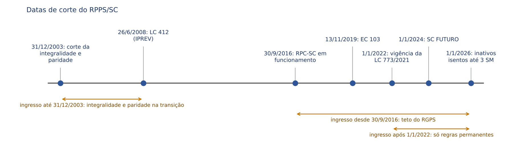
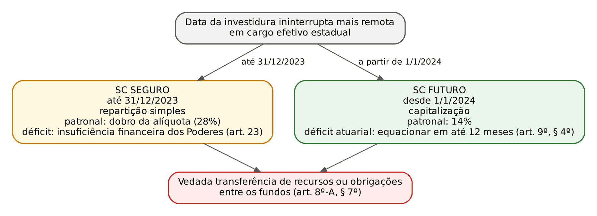
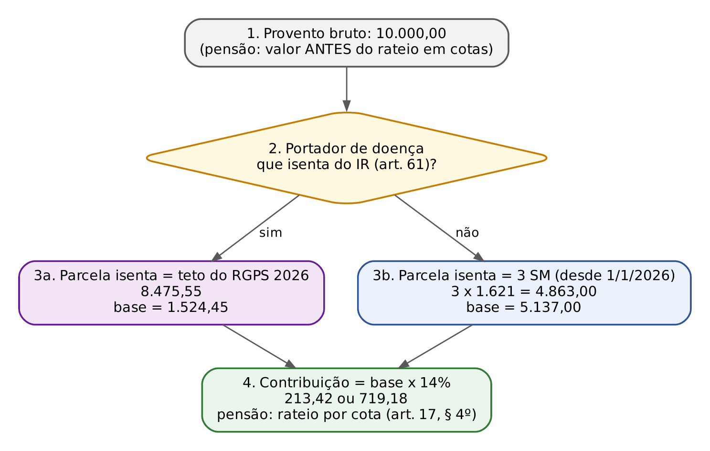
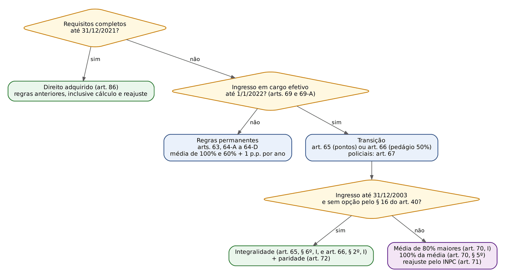
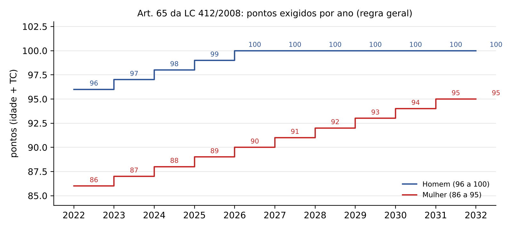

# CAPÍTULO 25 — REGIME PRÓPRIO DE SANTA CATARINA: LC SC 412/2008 E IPREV

:::INCIDENCIA
Pontos: SEFAZ/SC p. 5 (LC SC 412/2008). Nível A. Lote: nenhuma questão atribuída (FGV 0, FCC 0); busca no banco inteiro achou 1 correlata FGV 2026 (TCE-SC) sobre vínculo do servidor catarinense ao RGPS.
O que deve cair (FCC, letra seca): rol de segurados e de dependentes; alíquotas (14% do segurado, patronal em dobro no SC SEGURO e igual no SC FUTURO); faixa isenta dos inativos (2, 2,5 e 3 salários mínimos); fundos e datas de corte (1/1/2022, 31/12/2023, 1/1/2024); requisitos das aposentadorias e das transições (pontos e pedágio de 50%); cálculo (60% + 1 ponto por ano); pensão (cota familiar de 60%); RPC-SC e SCPREV.
:::

Este capítulo trata EXCLUSIVAMENTE do direito positivo catarinense. As normas gerais (art. 40 da CF, EC 103/2019, integralidade e paridade, abono de permanência, regras federais de transição) estão no Cap. 23; custeio, equilíbrio atuarial, segregação de massa, unidade gestora e CRP como institutos gerais, no Cap. 24; contagem recíproca e compensação, no Cap. 26; previdência complementar em geral, no Cap. 27; militares estaduais, no Cap. 28. Aqui se responde à pergunta que a FCC faz: o que diz a LC SC 412/2008, com a redação atual, e onde ela se afasta do modelo federal.

## 25.1 Moldura normativa e linha do tempo

### 25.1.1 Por que o Estado precisou de lei própria

A EC 103/2019 dividiu a reforma em duas camadas. Para a União, as regras de aposentadoria e de transição vieram prontas no próprio texto da emenda (arts. 4º, 10, 20 a 23 e 26). Para Estados, Distrito Federal e Municípios, o art. 40, § 1º, III, da CF passou a remeter a idade mínima à Constituição estadual ou à Lei Orgânica e o tempo de contribuição e os demais requisitos à lei complementar do ente; e o art. 36 da EC 103 condicionou a vigência, para os entes subnacionais, de parte das alterações (entre elas a nova redação do art. 149, que permite alíquotas progressivas e a base ampliada dos inativos, e as revogações) a lei de iniciativa privativa do Executivo local que as referende (ver Cap. 23). Enquanto o ente não legisla, continuam valendo para os seus servidores as regras anteriores à emenda.

Santa Catarina fez a sua reforma em 2021, em dois diplomas:

- a Emenda à Constituição do Estado nº 82, de 2021 (EC estadual 82/2021), que deu nova redação ao art. 30 da Constituição catarinense (idades mínimas de 62 e 65 anos, vedação de critérios diferenciados fora dos §§ 4º-A, 4º-B, 4º-C e 5º do art. 40 da CF, vedação de mais de uma aposentadoria à conta de RPPS, abono de permanência e remessa do cálculo à lei complementar);
- a LC SC 773, de 11/8/2021, que reescreveu a LC SC 412/2008. Pelo art. 86 da LC 412, as novas regras de aposentadoria e pensão entraram em vigor em 1/1/2022; até essa data aplicaram-se as normas vigentes no dia anterior à publicação da EC 103/2019.

Depois vieram ajustes relevantes: LC 795, de 6/1/2022 (concessão e folha pelos Poderes e órgãos autônomos; redução de idade do art. 65, § 10), LC 848, de 22/12/2023 (segregação de massa em SC SEGURO e SC FUTURO; nova faixa isenta dos inativos; aposentadoria da pessoa com deficiência grave; data de ingresso por mandato eletivo), LC 867, de 22/1/2025 (averbação de afastamentos sem remuneração até 30/9/2025; mandatos dos conselheiros; opção dos policiais do art. 67, §§ 5º e 6º) e LC 883, de 10/10/2025 (cálculo para quem tem 10 anos de mandato eletivo).

:::LEI Constituição do Estado de SC, art. 30, caput e § 1º (redação da EC estadual 82/2021)
Art. 30. O regime próprio de previdência social dos servidores titulares de cargos efetivos terá caráter contributivo e solidário, mediante contribuição do Estado, de servidores ativos, de aposentados e de pensionistas, observados critérios que preservem o equilíbrio financeiro e atuarial.
§ 1º O servidor abrangido pelo regime próprio de previdência social será aposentado:
I – por incapacidade permanente para o trabalho, no cargo em que estiver investido, quando insuscetível de readaptação, hipótese em que será obrigatória a realização de avaliações periódicas para verificação da continuidade das condições que ensejaram a concessão da aposentadoria, na forma definida em lei complementar;
II – compulsoriamente, nos termos do inciso II do § 1º do art. 40 da Constituição da República;
III – voluntariamente, aos 62 (sessenta e dois) anos de idade, se mulher, e aos 65 (sessenta e cinco) anos de idade, se homem, observados o tempo de contribuição e os demais requisitos estabelecidos em lei complementar.
:::

### 25.1.2 Datas de corte que a prova usa

| Data | O que marca | Fundamento |
|---|---|---|
| 16/12/1998 | ingresso até essa data: redução de idade no art. 65 (1 ano por ano de contribuição excedente, até 4) e pontos congelados em 86/96 | art. 65, § 10 |
| 31/12/2003 | ingresso até essa data: integralidade e paridade nas transições dos arts. 65, 66 e 67; direito adquirido às regras anteriores à EC 41 | arts. 65, § 6º, I; 66, § 2º, I; 67, § 3º; 68; 72 |
| 26/6/2008 | LC 412: IPESC passa a IPREV, unidade gestora única | arts. 10 e 11 |
| 30/9/2016 | início de funcionamento do RPC-SC (aprovação do plano da SCPREV): quem ingressa depois tem benefício limitado ao teto do RGPS | LC 661/2015, arts. 3º, § 2º, e 28 |
| 13/11/2019 | EC 103: limite da conversão de tempo especial em comum | art. 98, § 1º |
| 1/1/2022 | vigência das novas regras; ingresso até essa data dá acesso às transições e à média dos 80% maiores; requisitos cumpridos até 31/12/2021 geram direito adquirido | arts. 65 a 67, 70, 86 |
| 31/12/2023 e 1/1/2024 | segregação de massa: SC SEGURO (ingresso até 31/12/2023) x SC FUTURO (ingresso desde 1/1/2024) | art. 8º-A |
| 1/1/2024, 1/1/2025 e 1/1/2026 | faixa isenta da contribuição de inativos e pensionistas: 2, 2,5 e 3 salários mínimos | art. 17, § 2º |

:::PEGADINHA
A data de vigência da reforma catarinense não é a da EC 103 (13/11/2019) nem a da publicação da LC 773 (agosto de 2021): é 1/1/2022 (art. 86). E o marco de ingresso das transições é "até 1º de janeiro de 2022" (arts. 65, 66 e 70, I), não 31/12/2021. Já o direito adquirido às regras antigas exige requisitos completos ANTES de 1/1/2022 ("até a data prevista no caput", art. 86, parágrafo único).
:::

## 25.2 Natureza, diretrizes e conceitos legais

O RPPS/SC é de "caráter contributivo e solidário" (art. 1º). O art. 2º enumera 15 diretrizes; as que a FCC tende a cobrar pela letra são:

- garantia da totalidade dos riscos com equilíbrio atuarial, mediante contribuições dos segurados, dos beneficiários e dos Poderes e órgãos (I);
- avaliação atuarial em cada balanço anual para organizar e rever os planos de custeio e de benefícios (II);
- cobertura exclusiva aos segurados e dependentes, VEDADO pagar benefícios mediante convênio ou consórcio (III; reforçado pelo art. 88);
- filiação automática e obrigatória (IX);
- proibição de criar, majorar ou estender benefício sem a correspondente fonte de custeio total (X);
- vedação de benefícios diversos da aposentadoria e da pensão por morte (XI, redação da LC 773/2021);
- gestão participativa e paritária (XII) e aplicação de recursos conforme o Conselho Monetário Nacional (XIV).

O inciso XI reproduz, no plano estadual, o art. 9º, §§ 2º e 3º, da EC 103/2019: o rol do RPPS fica limitado a aposentadorias e pensão, e os afastamentos por incapacidade temporária e o salário-maternidade são pagos diretamente pelo ente, fora do regime próprio. Por isso a LC 773/2021 revogou o auxílio-reclusão (art. 80) e o art. 59 hoje lista apenas aposentadoria por incapacidade permanente, compulsória e voluntária e, para o dependente, pensão por morte. Licença para tratamento de saúde e licença-maternidade do servidor catarinense são vantagens estatutárias pagas pela folha do Poder a que ele pertence, não benefícios do IPREV.

:::PEGADINHA
"O RPPS/SC assegura auxílio-doença, salário-maternidade, salário-família e auxílio-reclusão" é falso na redação vigente. O salário-família aparece na LC 412 apenas como parcela EXCLUÍDA do salário de contribuição (art. 27, IV).
:::

O art. 3º traz 27 conceitos (dois foram revogados). Os que mudam o resultado de questões:

| Conceito | Definição legal (síntese fiel) | Inciso |
|---|---|---|
| Acidente em serviço | o ocorrido no exercício do cargo, relacionado direta ou indiretamente com as atribuições, que cause lesão ou perturbação funcional com perda PERMANENTE da capacidade para o trabalho | I |
| Dependência econômica | viver às expensas do segurado por inexistência ou insuficiência de recursos | V |
| Insuficiência de recursos | renda familiar bruta mensal igual ou inferior a 1 salário mínimo | XI |
| Equilíbrio atuarial | equivalência, a valor presente, entre receitas estimadas e obrigações projetadas a longo prazo | IX |
| Tempo de efetivo exercício no serviço público | tempo de cargo, função ou emprego público, ainda que descontínuo, na Administração direta e indireta de qualquer ente, e tempo de mandato eletivo | XXVIII |

:::DICA
Tempo de "efetivo exercício no serviço público" (art. 3º, XXVIII) é conceito amplo: inclui EMPREGO público, administração INDIRETA de qualquer ente e MANDATO eletivo. Já "tempo de contribuição" é outra coisa (pode incluir RGPS e outros RPPS). Os 10 anos de serviço público exigidos nas aposentadorias voluntárias contam pela primeira régua; os 25, 30 ou 35 anos de contribuição, pela segunda.
:::

## 25.3 Segurados

### 25.3.1 Quem é segurado

:::LEI LC SC 412/2008, art. 3º, XXV, e art. 4º, caput e § 1º
XXV - segurado: o servidor ocupante de cargo efetivo, o magistrado, o membro do Ministério Público e o do Tribunal de Contas, o servidor abrangido pelo art. 19 do ADCT da Constituição Federal, o servidor admitido até 5 de outubro de 1988 que não tenha cumprido, naquela data, o tempo previsto para aquisição de estabilidade no serviço público, desde que regido pelo Estatuto dos Servidores Públicos do Estado, e o inativo, participantes do RPPS/SC;
Art. 4º Os segurados definidos no art. 3º, XXV, desta Lei Complementar, são obrigatoriamente filiados ao RPPS/SC, quando integrantes:
I - do Poder Executivo, neste incluídas suas autarquias e fundações;
II - do Poder Judiciário;
III - do Poder Legislativo;
IV - do Ministério Público; e
V - do Tribunal de Contas.
§ 1º A filiação ao RPPS/SC se dá automaticamente a partir da investidura em cargo público efetivo, em cargo da carreira da Magistratura e do Ministério Público, e em cargo de membro do Tribunal de Contas, no âmbito do Estado de Santa Catarina.
:::

Três observações sobre o rol:

- a Defensoria Pública não figura no art. 4º, mas é expressamente devedora da contribuição patronal no art. 17, II e IV, e o RPC-SC menciona a DPE/SC (LC 661/2015, art. 1º); o defensor público, como titular de cargo efetivo, é segurado pelo art. 3º, XXV ("servidor ocupante de cargo efetivo");
- o art. 3º, XXV, ainda inclui o estabilizado do art. 19 do ADCT e o servidor admitido até 5/10/1988 sem estabilidade, se regido pelo Estatuto. Essa parte do texto colide com a tese do Tema 1.254 do STF (v. Cap. 6), que exclui do RPPS os estáveis do art. 19 do ADCT e os demais admitidos sem concurso, ressalvadas as aposentadorias e pensões já concedidas ou com requisitos satisfeitos até a publicação da ata do julgamento dos embargos. Efeito para SC: essa parte do art. 3º, XXV, não pode fundamentar vinculação nova ao RPPS/SC; a ressalva modulatória preserva quem já estava aposentado ou já tinha os requisitos;
- ficam fora do RPPS/SC, por força do art. 40, § 13, da CF, os ocupantes exclusivamente de cargo em comissão, os temporários e os empregados públicos (filiados ao RGPS; ver Cap. 6). A LC 661/2015 permite à SCPREV administrar plano complementar para comissionados puros e membros do Legislativo, mediante convênio (art. 19-G), o que não os transforma em segurados do RPPS.

:::JURIS STF, ADI 4.641 (art. 95 da LC 412)
Declarada a inconstitucionalidade parcial do art. 95 no que diz respeito aos cartorários extrajudiciais (notários, registradores, oficiais maiores e escreventes juramentados), com efeitos a partir da publicação da ata do julgamento (*ex nunc*), preservado o direito adquirido de quem já recebia benefício ou já cumprira os requisitos no RPPS estadual (acórdão publicado em 10/4/2015, conforme a ficha da norma na ALESC). O art. 95 continua a garantir os benefícios aos juízes de paz investidos até a EC 20/1998 e, nos §§ 3º a 7º (LC 773/2021), disciplina a perda da vinculação por inadimplência: 6 meses consecutivos ou 12 alternados sem contribuição, notificação com 3 meses para quitar ou parcelar e perda no dia seguinte ao fim do prazo, com aproveitamento do tempo contributivo por certidão para contagem recíproca.
:::

### 25.3.2 Acumulação, afastamentos e servidor cedido

- Acumulação lícita de cargos: o servidor é segurado obrigatório em relação a CADA cargo (art. 4º, § 2º), com contribuição e benefício distintos (e com o teto do art. 37, XI, aplicado à soma: art. 47).
- Continua filiado, mediante contribuição, o segurado afastado quando cedido a outro órgão ou entidade de qualquer ente, afastado ou licenciado temporariamente, ou em exercício de mandato eletivo (art. 4º, § 3º). A contribuição é calculada sobre o salário de contribuição do cargo efetivo de que é titular (art. 20).
- Afastamento SEM remuneração: regra geral, ficam vedados o recolhimento e a averbação do período (art. 4º, § 5º); a exceção do § 4º permitiu averbar os afastamentos sem vencimento entre a EC 20/1998 e 1/1/2022 mediante recolhimento das duas cotas (servidor e patronal) pelo interessado, até 30/9/2025 (prazo já esgotado). E o art. 83, § 5º, veda averbar contribuições vertidas ao RGPS ou a outro RPPS durante licença ou afastamento sem vencimento.
- Cessão a outro ente: recolhem as contribuições do segurado e patronal o órgão de origem, se a remuneração continuar paga na origem, ou o cessionário, se a remuneração correr à conta dele (art. 19); se o cessionário não repassar, o cedente recolhe e cobra o reembolso (art. 19, § 3º). No mandato eletivo, recolhe o Poder em que o mandato é exercido (art. 19, § 4º).
- Servidor de OUTRO ente cedido a órgão catarinense, com ou sem ônus, permanece no regime de origem (art. 21).

Q4088909 (FGV, 2026, TCE-SC, Auditor Fiscal de Controle Externo): cobrou se o servidor efetivo de SC pode contribuir também para o RGPS para acumular aposentadorias, gabarito C (só se tiver outra atividade remunerada que o vincule ao RGPS) — comentada no Cap. 6. No plano estadual, o art. 45 da LC 412 só limita a acumulação de mais de uma aposentadoria À CONTA DE RPPS.

### 25.3.3 Perda da condição de segurado

A condição se perde por morte; ausência ou morte presumida declarada por sentença transitada em julgado; exoneração; demissão em processo disciplinar; perda do cargo por decisão judicial transitada em julgado; e cassação de aposentadoria (art. 5º). Nas quatro últimas hipóteses, é VEDADA a concessão de benefício ao segurado e aos dependentes, assegurado o aproveitamento do período contributivo por certidão (art. 83) para contagem recíproca em outro regime (art. 5º, parágrafo único). Não há, no RPPS/SC, "período de graça" como no RGPS (ver Cap. 8): o vínculo existe enquanto existe o cargo.

:::PEGADINHA
No RGPS, a perda da qualidade de segurado não prejudica direito já adquirido. No RPPS/SC, a exoneração, a demissão, a perda do cargo e a CASSAÇÃO de aposentadoria cortam o benefício também dos dependentes: o que sobra é o tempo, levado por certidão a outro regime.
:::

### 25.3.4 Militares estaduais

Os policiais e bombeiros militares não são segurados do RPPS/SC. A Constituição catarinense, desde a EC estadual 89/2022, declara que todos os militares estaduais ativos e inativos e os pensionistas militares integram o Sistema de Proteção Social dos Militares Estaduais de Santa Catarina (art. 31, § 14), e remete à lei complementar estadual as questões específicas de inatividade e pensão que não conflitem com as normas gerais da União (art. 31, § 11, II). O art. 92 da LC 412, ainda não revogado, manda aplicar aos militares vários dispositivos da lei (dependentes, contribuição, pensão, certidões) "até a edição de legislação instituidora" do regime dos militares. O regime dos militares e a Lei 13.954/2019 estão no Cap. 28; quanto às alíquotas sobre inativos e pensionistas militares, o STF reconheceu a competência estadual (Tema 1.177; ver Cap. 28).

## 25.4 Dependentes

### 25.4.1 Rol, presunção e preferência

:::LEI LC SC 412/2008, art. 6º, caput e §§ 1º, 2º e 6º
Art. 6º São considerados dependentes:
I - filho solteiro menor de 21 (vinte e um) anos;
II - filho maior, solteiro, inválido em caráter permanente para o exercício de toda e qualquer atividade laboral e que viva sob a dependência econômica do segurado;
III - cônjuge;
IV - companheiro;
V - ex-cônjuge ou ex-companheiro que perceba pensão alimentícia;
VI - enteado, nas condições dos incisos I e II, que não perceba pensão alimentícia ou benefício de outro órgão previdenciário e que não possua bens e direitos aptos a lhe garantir o sustento e a educação;
VII - tutelado, menor de 18 (dezoito) anos, que não perceba pensão alimentícia, rendas ou benefícios de outro órgão previdenciário;
VIII - pais que vivam sob a dependência econômica do segurado; e
IX - irmão solteiro, nas condições dos incisos I e II, e que viva sob a dependência econômica do segurado.
§ 1º A dependência econômica é condição para caracterização da dependência previdenciária e deverá ser exclusivamente em relação ao segurado e comprovada na forma prevista no regulamento do RPPS/SC.
§ 2º Presume-se a dependência econômica em relação aos:
I - filhos solteiros menores de 21 (vinte e um) anos; e
II - cônjuge e companheiro.
§ 6º Os dependentes arrolados nos incisos I a VII do caput são beneficiários preferenciais, concorrendo entre si, e os arrolados nos incisos VIII e IX do caput somente poderão perceber benefício previdenciário na falta daqueles.
:::

A mecânica é de DOIS grupos, não de três classes como no RGPS: os incisos I a VII concorrem entre si; pais e irmãos (VIII e IX) só recebem na falta de todos os preferenciais. A dependência econômica é a regra (§ 1º, que exige que ela seja exclusiva em relação ao segurado), e a presunção só alcança filhos solteiros com menos de 21 anos, cônjuge e companheiro (§ 2º). O filho inválido (II) precisa comprovar invalidez total e permanente "para toda e qualquer atividade laboral", atestada por perícia do IPREV ou por ela designada (§ 5º), e dependência econômica. Companheiro inclui a relação homoafetiva (§ 4º). São vedadas condições de dependência diferentes das da lei (§ 3º): o rol é taxativo.

| Ponto | RPPS/SC (LC 412) | RGPS (Lei 8.213; ver Cap. 8) |
|---|---|---|
| Estrutura | 2 grupos: preferenciais (I a VII) e subsidiários (pais e irmão) | 3 classes excludentes |
| Filho | solteiro com menos de 21 anos; maior inválido, solteiro e economicamente dependente | menos de 21 anos; inválido ou com deficiência intelectual, mental ou grave, sem exigência de prova de dependência |
| Enteado e tutelado | dependentes nominados (enteado até 21 anos ou inválido; tutelado com menos de 18), sem renda, pensão ou benefício | equiparados a filho, mediante declaração e prova de dependência |
| Ex-cônjuge e ex-companheiro | só se perceber pensão alimentícia | idem (alimentos), na mesma classe do cônjuge |
| Irmão | solteiro, com menos de 21 anos ou inválido, dependente | com menos de 21 anos, inválido ou com deficiência, dependente |
| Presunção de dependência | filhos solteiros com menos de 21 anos, cônjuge e companheiro | toda a 1ª classe |

:::PEGADINHA
O estado civil importa no RPPS/SC: o filho e o irmão precisam ser SOLTEIROS (art. 6º, I, II e IX), e a perda da cota ocorre com casamento, união estável ou concubinato do pensionista (art. 77, IV). Outra: o filho maior inválido do RPPS/SC precisa provar dependência econômica (art. 6º, II), ao passo que, para o servidor FEDERAL, a jurisprudência do STJ dispensa essa prova (Jurisprudência em Teses, ed. 207, tese 6, sobre o art. 217, IV, da Lei 8.112/1990; v. Cap. 23). Não transporte a tese federal para a lei catarinense, cuja letra é expressa.
:::

### 25.4.2 Prova da união estável e da dependência

A LC 773/2021 trouxe para o RPPS/SC as exigências probatórias que a Lei 13.846/2019 criou no RGPS:

- prova de união estável e de dependência econômica exige início de prova material CONTEMPORÂNEA, produzida em período não superior a 24 meses antes do óbito; não se admite prova exclusivamente testemunhal, salvo força maior ou caso fortuito (art. 6º, § 10);
- para afastar a pensão de 4 meses (art. 77, VI, "b"), deve haver também início de prova material de união estável por pelo menos 2 anos antes do óbito (art. 6º, § 11);
- a inscrição de dependentes faz-se no setor de recursos humanos do Poder ou órgão (§ 7º), com prova documental e, nos casos dos incisos II e IV a IX, "prova inequívoca" da condição (§ 8º); cabe ao segurado comunicar fatos de inclusão ou exclusão (§ 9º).

### 25.4.3 Perda da qualidade de dependente

| Dependente | Perde a qualidade (art. 7º) |
|---|---|
| Cônjuge | divórcio, separação judicial ou de fato SEM pensão alimentícia; nulidade ou anulação do casamento; divórcio ou separação extrajudicial sem alimentos; novo casamento ou união estável |
| Companheiro | cessação da união de fato sem pensão alimentícia |
| Filhos e enteados | 21 anos, salvo inválidos; emancipação, AINDA QUE inválido |
| Tutelado | 18 anos ou emancipação |
| Todos | cessação da invalidez ou da dependência econômica; morte; perda da qualidade de segurado por aquele de quem dependem |

A condição de dependente é aferida na data do óbito (art. 79), com uma exceção: o filho pensionista que se torna inválido ANTES dos 21 anos mantém a pensão além dessa idade (art. 74, § 4º). A invalidez superveniente aos 21 anos não reabre o benefício.

## 25.5 Organização: IPREV, conselhos e fundos

### 25.5.1 IPREV, unidade gestora única

O antigo IPESC, criado pela Lei 3.138/1962, passou a chamar-se IPREV (art. 10). O IPREV é a unidade gestora do RPPS/SC: autarquia com personalidade jurídica própria e autonomia administrativa, patrimonial e financeira em relação ao Executivo, VINCULADA à Secretaria de Estado da Administração, com sede em Florianópolis e foro na Comarca da Capital (art. 11). Tem por objetivo exclusivo as operações de previdência dos segurados do RPPS/SC e dependentes (art. 11, § 3º). É representado em juízo pelo Diretor Jurídico, que pode receber citações e intimações (art. 13). O patrimônio do IPESC passou ao IPREV, que o destina ao RPPS/SC (art. 14); aquisição, alienação, oneração ou construção de imóveis depende de autorização do Conselho de Administração (art. 15).

O conceito geral de unidade gestora única e a exigência do art. 40, § 20, da CF estão no Cap. 24. O ponto catarinense que confunde é a divisão de tarefas na concessão: desde a LC 795/2022, o ato de concessão, a elaboração da folha e o pagamento das aposentadorias e pensões dos segurados do Judiciário, do Legislativo, do Ministério Público e do Tribunal de Contas cabem a esses próprios Poderes e órgãos (art. 44, § 5º), com descentralização de créditos orçamentários do IPREV (art. 44, § 9º); o IPREV concede e paga os benefícios do Executivo e presta informações aos demais (§ 6º). Os Poderes remetem ao IPREV, em 30 dias, cópia do ato, da composição de tempo e de proventos e dos contracheques (§ 7º); havendo divergência, o IPREV a representa ao Tribunal de Contas e comunica o concedente, até o registro (§ 8º).

:::LEI LC SC 412/2008, art. 44, §§ 2º, 3º e 5º
§ 2º O ato de concessão de benefícios previdenciários será remetido ao Tribunal de Contas para exame e registro.
§ 3º O ato de concessão de benefício vigorará a partir da publicação em diário oficial, exceto no caso de concessão de aposentadoria compulsória.
§ 5º O ato de concessão, a elaboração da folha e o respectivo pagamento dos benefícios de aposentadoria e pensão por morte caberão ao Poder Judiciário, ao Poder Legislativo, ao Ministério Público e ao Tribunal de Contas, com relação aos segurados e seus dependentes oriundos de seus quadros de pessoal.
:::

:::PEGADINHA
Aposentadoria compulsória não vigora da publicação: o ato tem vigência a partir do dia IMEDIATO àquele em que o segurado atinge a idade-limite (art. 62, parágrafo único, e art. 44, § 3º).
:::

Deveres cobráveis: requisições do IPREV atendidas em 15 dias (art. 44, § 10); comunicação de óbitos pelos cartórios em até 5 dias (art. 50, § 2º); recadastramento anual no mês do aniversário, sob pena de suspensão (art. 56); parecer prévio do IPREV, em 10 dias úteis, sobre anteprojetos com impacto previdenciário (art. 89, parágrafo único).

### 25.5.2 Conselho de Administração e Conselho Fiscal

| Item | Conselho de Administração | Conselho Fiscal |
|---|---|---|
| Natureza | órgão de deliberação e orientação superior (art. 38) | órgão de fiscalização da gestão financeira (art. 41) |
| Composição | 14 membros (art. 39): Secretário da Administração (nato); 2 do Executivo; 1 do Judiciário (Tribunal Pleno); 1 do Legislativo (Mesa); 1 do TCE (Tribunal Pleno); 1 do MP (Colégio de Procuradores); 5 eleitos entre segurados ativos, 1 por Poder e órgão; 1 eleito entre inativos e 1 entre pensionistas | 6 membros (art. 42): 1 do Executivo, 1 do Judiciário, 1 do Legislativo; 3 eleitos entre ativos, inativos e pensionistas |
| Quórum de instalação | 10 membros (art. 39, § 4º) | 4 membros (art. 42, § 2º) |
| Deliberação | maioria absoluta dos membros, voto de qualidade do Presidente (art. 39, § 6º) | aplica-se o art. 39 no que couber (art. 42, § 4º) |
| Reuniões | ordinária mensal; extraordinária com 48 horas de antecedência | idem; extraordinária também a requerimento de 3 membros |
| Mandato | 4 anos, de 1º de julho a 30 de junho, uma recondução (art. 39, § 9º, redação da LC 867/2025) | idem |
| Jetom | 10% do subsídio do Presidente do IPREV, proporcional às sessões (art. 39, § 11) | idem (remissão do art. 42, § 4º) |

Competências privativas do Conselho de Administração (art. 40) que costumam cair: aprovar a política de investimentos; autorizar contratação de instituição financeira para a gestão dos recursos garantidores; autorizar operações com imóveis e aceitar doações; aprovar o orçamento do IPREV e a indicação da taxa de administração; deliberar sobre casos omissos; apreciar o parecer do Conselho Fiscal sobre a prestação de contas anual, encaminhada depois ao TCE. Compete ao Conselho Fiscal examinar balancetes, balanços, livros e documentos, fiscalizar o cumprimento da legislação e remeter ao Conselho de Administração parecer anual sobre as contas (art. 43).

:::DICA
Duas regras transitórias da LC 867/2025: os mandatos dos conselheiros empossados para o biênio 2023/2025 ficaram prorrogados até 30/6/2027, e esses conselheiros não podem ser reconduzidos para o quadriênio seguinte (art. 39, § 9º, I e II). O Presidente do IPREV pode ocupar uma das vagas do Executivo no Conselho de Administração (art. 39, § 8º) e participa do Conselho Fiscal sem voto (art. 42, § 5º).
:::

### 25.5.3 Segregação de massa: SC SEGURO e SC FUTURO

A LC 848/2023 revogou o antigo modelo de fundos (art. 8º) e criou, como unidades orçamentárias do IPREV, dois fundos (art. 8º-A). O critério de separação é a data de ingresso no serviço público estadual em cargo de provimento efetivo, pela investidura ininterrupta mais remota (art. 69):

:::LEI LC SC 412/2008, art. 8º-A, caput, e art. 9º, caput (redação da LC 848/2023)
Art. 8º-A. Ficam criados no âmbito do RPPS/SC os seguintes fundos, constituindo unidades orçamentárias de sua unidade gestora:
I – Fundo em Repartição (SC SEGURO): destinado ao pagamento de benefícios previdenciários até a extinção do último benefício a ser custeado com os recursos desse Fundo aos segurados e aos dependentes de segurados do RPPS/SC que tenham ingressado no serviço público estadual até 31 de dezembro de 2023, por meio de cargo de provimento efetivo, conforme investidura ininterrupta mais remota, nos termos do art. 69 desta Lei Complementar; e
II – Fundo em Capitalização (SC FUTURO): destinado ao pagamento de benefícios previdenciários aos segurados e aos dependentes de segurados do RPPS/SC que tenham ingressado no serviço público estadual a partir de 1º de janeiro de 2024, por meio de cargo de provimento efetivo.
Art. 9º Fica o SC SEGURO estruturado em regime de repartição simples e fica o SC FUTURO estruturado em regime de capitalização.
:::

| Ponto | SC SEGURO (fundo em repartição) | SC FUTURO (fundo em capitalização) |
|---|---|---|
| Massa | ingresso até 31/12/2023 | ingresso desde 1/1/2024 |
| Regime financeiro | repartição simples | capitalização |
| Patronal | dobro da alíquota do segurado (art. 17, II): 28% | igual à do segurado (art. 17, IV): 14% |
| Falta de recursos | insuficiência financeira coberta pelos Poderes e órgãos e, na falta de repasse, pelo Tesouro (arts. 23 e 25) | Poderes e órgãos cobrem insuficiência de seus segurados, conforme plano de equacionamento (art. 8º-A, § 3º); déficit atuarial deve ser equacionado em até 12 meses (art. 9º, § 4º) |
| Benefícios custeados | pelos recursos do § 1º do art. 8º-A, com complementação pelo art. 23 | EXCLUSIVAMENTE pelos recursos dos §§ 2º e 3º do art. 8º-A (art. 9º, § 3º) |
| Precatórios e RPVs previdenciários | Tesouro do Estado (art. 29) | o próprio SC FUTURO (art. 29) |

A vedação central é a da comunicação entre as massas: é proibida a transferência de recursos ou obrigações entre SC SEGURO e SC FUTURO, e a destinação de contribuições de um grupo ao financiamento de benefícios do outro (art. 8º-A, § 7º). O IPREV mantém separação orçamentária, financeira e contábil e conta bancária específica para cada fundo (§§ 4º e 5º); as aplicações do SC FUTURO obedecem a segurança, rentabilidade, liquidez e economicidade (§ 6º). Os conceitos de segregação de massa, plano de equacionamento e insuficiência financeira como institutos gerais estão no Cap. 24.

:::PEGADINHA
Três datas diferentes, três consequências: ingresso até 1/1/2022 dá acesso às transições de aposentadoria; ingresso até 31/12/2023 coloca o segurado no SC SEGURO; ingresso desde 30/9/2016 (funcionamento do RPC-SC) limita o benefício ao teto do RGPS. Um servidor que ingressou em 2017, por exemplo, está no SC SEGURO, tem acesso às transições dos arts. 65 e 66, mas sem integralidade (ingresso posterior a 31/12/2003) e com benefício limitado ao teto.
:::

### 25.5.4 Insuficiência financeira, despesas e contabilidade

A insuficiência financeira dos Poderes e órgãos, relativa ao SC SEGURO, é a diferença entre as contribuições (segurados, pensionistas e patronais) e as despesas com benefícios (art. 23). Cada Poder a repassa ao IPREV até o dia do efetivo pagamento dos benefícios (art. 23, § 1º), em conta individualizada por Poder e órgão (art. 26). Se o Poder não depositar, o Tesouro do Estado suporta a insuficiência e adota as medidas cabíveis contra o responsável (art. 25). A falta de recolhimento das contribuições ou do repasse da insuficiência implica responsabilidade funcional, comunicação ao Conselho de Administração e, se for o caso, representação ao TCE e ao Ministério Público, inclusive com as providências da Lei 9.983/2000 (crimes contra a previdência), ressalvado o atraso de duodécimo (art. 24; art. 90).

:::LEI LC SC 412/2008, art. 30, caput e § 8º
Art. 30. A taxa de administração não poderá exceder a 2% (dois por cento) do valor total das remunerações de contribuição dos servidores ativos vinculados ao RPPS/SC.
§ 8º A taxa de administração poderá ser acrescida em percentual de até 20% (vinte por cento), para pagamento de despesas relacionadas à certificação institucional do RPPS/SC no Programa de Certificação Institucional e Modernização da Gestão dos Regimes Próprios de Previdência Social da União, dos Estados, do Distrito Federal e dos Municípios (Pró-Gestão RPPS) e para certificação profissional de seus dirigentes e conselheiros.
:::

A taxa de administração é custeada pelas contribuições do art. 17, I e II; seu percentual, indicado pelo IPREV com aprovação do Conselho de Administração, é fixado anualmente por ato do Governador até o envio da LDO; as sobras formam reserva, desde que o percentual esteja definido em lei; o descumprimento dos critérios é utilização indevida de recursos previdenciários (art. 30, §§ 1º a 7º).

Contabilidade, atuária e auditoria: balancete mensal divulgado após deliberação do Conselho de Administração e resumo do balanço anual até 1º de março (art. 31); contas bancárias e escrituração distintas das do Tesouro, por fundo e por Poder (art. 32); avaliação atuarial anual, realizada entre JANEIRO e JUNHO, que indica a alíquota e serve de base à revisão das alíquotas do art. 17 (arts. 33 e 34); constatado déficit ou superávit que leve a desequilíbrio, o IPREV, após aprovação do Conselho, comunica o Governador, a quem cabe, se for o caso, remeter projeto de lei complementar alterando alíquotas (art. 34, parágrafo único); auditoria previdenciária permanente do IPREV nos Poderes e órgãos, sem prejuízo do controle interno e do TCE (arts. 35 e 36).

Precatórios e RPVs de ações previdenciárias contra o IPREV são custeados pelo Tesouro, salvo os de competência do SC FUTURO; os relativos a benefícios do Legislativo, Judiciário, MP e TCE são ressarcidos ao Tesouro pelas dotações desses Poderes e órgãos; a regra vale qualquer que seja a data do fato gerador (art. 29).

## 25.6 Custeio

### 25.6.1 Fontes e alíquotas

O art. 16 lista 14 fontes de custeio: contribuições dos segurados, dos pensionistas e patronais; compensação financeira entre regimes; créditos parcelados; receitas patrimoniais; bens e direitos do IPREV; bens transferidos pelo Estado e doações; aportes extraordinários; dívidas de prefeituras e câmaras; juros, multas e atualização; alienações; e a insuficiência financeira do art. 23.

:::LEI LC SC 412/2008, art. 17, I, II e IV
Art. 17 A contribuição previdenciária será devida ao RPPS/SC:
I – pelos segurados e pensionistas, com alíquota de 14% (quatorze por cento), calculada sobre o salário de contribuição, observado o § 2º deste artigo; e
II – pelo Poder Executivo, incluídas suas autarquias e fundações, pelo Poder Legislativo, pelo Poder Judiciário, pelo Ministério Público, pela Defensoria Pública e pelo Tribunal de Contas, destinada ao Fundo Financeiro, com alíquota patronal em dobro à prevista no inciso I do caput deste artigo, calculada sobre o salário de contribuição dos segurados ativos pertencentes àquele Fundo; e
IV – pelo Poder Executivo, incluídas suas autarquias e fundações, pelo Poder Legislativo, pelo Poder Judiciário, pelo Ministério Público, pela Defensoria Pública e pelo Tribunal de Contas, destinada ao SC FUTURO, com alíquota patronal equivalente à prevista no inciso I do caput deste artigo, calculada sobre o salário de contribuição dos segurados ativos pertencentes àquele Fundo.
:::

Leitura correta do art. 17:

- a alíquota do segurado e do pensionista é ÚNICA, de 14%, sem escalonamento progressivo por faixas como o do servidor federal (art. 11 da EC 103; ver Cap. 24). É o mínimo que o art. 9º, § 4º, da EC 103 impõe ao ente com déficit atuarial (alíquota não inferior à da União);
- a patronal do inciso II ainda menciona o "Fundo Financeiro", nome do modelo anterior à LC 848/2023, mas se aplica à massa de repartição, hoje SC SEGURO (o inciso IV, criado pela LC 848, é o que trata do SC FUTURO): 28% sobre o salário de contribuição dos ativos dessa massa. É o teto do art. 2º da Lei 9.717/1998 (patronal não inferior à do servidor nem superior ao dobro dela);
- no SC FUTURO, a patronal é igual à do segurado: 14%;
- o antigo art. 18 ("a alíquota dos segurados só poderia ser majorada quando a patronal atingisse o dobro") foi revogado pela LC 662/2015;
- incide sobre a gratificação natalina (§ 6º);
- o servidor que ingressou depois do funcionamento do RPC-SC (30/9/2016) contribui, e o Estado também, só sobre a parcela do salário de contribuição que não exceder o teto do RGPS (§ 7º e LC 661/2015, art. 37).

:::EXEMPLO Contribuições mensais de um ativo
Servidor do SC SEGURO, ingresso em 2010, salário de contribuição de 10.000,00. Segurado: 10.000 x 14% = 1.400,00. Patronal (art. 17, II): 10.000 x 28% = 2.800,00.
Servidor do SC FUTURO, ingresso em 2025, remuneração de 15.000,00 e teto do RGPS de 2026 = 8.475,55. Base limitada ao teto (art. 17, § 7º): 8.475,55. Segurado: 8.475,55 x 14% = 1.186,58. Patronal (art. 17, IV): 1.186,58. A parcela acima do teto (6.524,45) é a base da previdência complementar (25.13).
:::

### 25.6.2 Contribuição de inativos e pensionistas

:::LEI LC SC 412/2008, art. 17, §§ 2º a 4º
§ 2º A contribuição previdenciária dos inativos e pensionistas, observado o disposto no art. 61 desta Lei Complementar, será calculada sobre a parcela dos proventos e das pensões por morte que supere:
I – 2 (dois) salários mínimos nacionais, a partir de 1º de janeiro de 2024;
II – 2,5 (dois inteiros e cinco décimos) salários mínimos nacionais, a partir de 1º de janeiro de 2025; e
III – 3 (três) salários mínimos nacionais, a partir de 1º de janeiro de 2026.
§ 3º Para fins do limite de que trata o § 2º deste artigo, deverá ser considerado o valor do benefício de pensão por morte antes de sua divisão em cotas-parte.
§ 4º O valor da contribuição previdenciária será rateado entre os pensionistas, na proporção de sua cota-parte.
:::

A base dos inativos inferior ao teto do RGPS só é constitucionalmente possível porque o art. 149, § 1º-A, da CF (redação da EC 103) admite, havendo déficit atuarial, que a contribuição de aposentados e pensionistas incida sobre o que supere o salário mínimo (regime geral do instituto no Cap. 24). Santa Catarina usou essa faculdade de forma escalonada e decrescente no tempo: a faixa isenta SUBIU de 2 para 3 salários mínimos entre 2024 e 2026.

Exceção do art. 61: quando o beneficiário (aposentado ou pensionista) é portador de doença que dá isenção do imposto de renda, a contribuição incide apenas sobre o que supera o TETO DO RGPS, mesmo que a doença tenha sido adquirida depois da concessão (art. 61, parágrafo único).

:::EXEMPLO Escada: provento de 10.000,00 em três anos
Salário mínimo: 1.412 (2024), 1.518 (2025), 1.621 (2026).
| Ano | Faixa isenta | Base | Contribuição (14%) |
|---|---|---|---|
| 2024 | 2 x 1.412 = 2.824,00 | 7.176,00 | 1.004,64 |
| 2025 | 2,5 x 1.518 = 3.795,00 | 6.205,00 | 868,70 |
| 2026 | 3 x 1.621 = 4.863,00 | 5.137,00 | 719,18 |
| 2026, portador de doença isentiva (art. 61) | teto do RGPS: 8.475,55 | 1.524,45 | 213,42 |
:::

:::EXEMPLO Pensão rateada (art. 17, §§ 3º e 4º)
Pensão total de 9.600,00, dividida entre 2 pensionistas (4.800,00 cada), em 2026. Errado: aplicar a faixa de 3 SM a cada cota (4.800 < 4.863, contribuição zero). Certo: faixa sobre o valor ANTES da divisão: (9.600,00 - 4.863,00) x 14% = 663,18, rateados na proporção das cotas: 331,59 para cada pensionista.
:::

### 25.6.3 Salário de contribuição

Base: subsídio do cargo efetivo, ou vencimento + vantagens pecuniárias permanentes + adicionais de caráter individual + vantagens pessoais permanentes; e, para inativos e pensionistas, proventos e pensões (art. 27). Excluem-se: diárias; ajuda de custo; indenização de transporte; salário-família; auxílio-alimentação; auxílio-creche; parcelas pagas em razão do local de trabalho; parcela de cargo em comissão ou função de confiança; abono de permanência; demais verbas indenizatórias não incorporáveis (art. 27, I a X).

Regras de opção e de vinculação entre base e benefício:

- é vedado incorporar aos proventos e pensões verbas que não integraram o salário de contribuição (§ 1º);
- o segurado pode OPTAR por incluir na base as parcelas de local de trabalho e de cargo em comissão ou função de confiança, para refletirem no cálculo pela média do art. 70 (§ 2º);
- o segurado que ingressou antes da EC 41/2003 e não tem direito à incorporação de vantagens temporárias (art. 39, § 9º, da CF e art. 13 da EC 103) tem as contribuições sobre essas verbas retidas para eventual aposentadoria por incapacidade ou pensão, podendo optar, de forma IRRETRATÁVEL e até 1/8/2022, pela não incidência, caso em que elas não entram na média desses benefícios (§§ 3º e 4º).

Nas ações judiciais, ainda que o IPREV não seja parte, o juízo determina de ofício a retenção da contribuição devida, para repasse imediato ao IPREV (art. 17, § 5º).

### 25.6.4 Recolhimento, mora, parcelamento, decadência e prescrição

| Tema | Regra | Artigo |
|---|---|---|
| Responsável | Poder ou órgão que paga a folha | 22 |
| Prazo | até a data do crédito aos segurados; em cessão ou afastamento, dia 5 do mês seguinte | 22, § 1º; 20, § 1º |
| Mora | juros de 1% ao mês + multa de 2% + atualização pelo INPC, ressalvado atraso do duodécimo | 22, § 2º |
| Restituição de contribuições | vedada sem anuência do IPREV | 22, § 5º |
| Compensação | pagamento indevido ou a maior pode ser compensado com período anterior ou posterior | 22, § 7º |
| Parcelamento | até 60 prestações mensais, só débitos vencidos; débito com exigibilidade suspensa exige renúncia ao direito em que se funda a ação ou o recurso; contribuição parcelada só conta para benefício após quitação TOTAL | 22-A, caput e §§ 1º a 3º |
| Reparcelamento | primeira parcela de 10% do consolidado, ou 20% se já houve reparcelamento | 22-A, § 4º |
| Parcelamento vedado | tributos retidos na fonte ou descontados de terceiros; valores recebidos e não recolhidos; fraude à execução | 22-A, § 5º |
| Rescisão | 3 parcelas não pagas, consecutivas ou não, ou até 2 se as demais estiverem pagas ou vencida a última; parcela paga em parte é inadimplida | 22-A, §§ 6º e 7º |
| Parcelamento longo | até 180 prestações se a parcela superar 30% dos rendimentos brutos do segurado ou sucessor; não se aplica a entes públicos | 22-A, §§ 9º e 10 |
| Decadência do crédito | 5 anos, do primeiro dia do exercício seguinte ou da decisão que anulou o lançamento por vício formal | 54, I e II |
| Prescrição da cobrança | 5 anos do crédito constituído | 54, parágrafo único |
| Prescrição contra o beneficiário | o direito pode ser requerido a qualquer tempo; prescrevem só as prestações exigíveis há mais de 5 anos | 53 |

:::PEGADINHA
O art. 53 consagra, no plano estadual, a imprescritibilidade do fundo de direito do benefício (só as parcelas vencidas há mais de 5 anos prescrevem). Não confundir com o art. 54, que é decadência e prescrição dos CRÉDITOS da previdência estadual contra o contribuinte, com redação inspirada no art. 173 do CTN.
:::

Reposição ao erário: o recebimento indevido de benefício (ou a falta de quitação de contribuição) obriga a restituir o total, atualizado pelo INPC, em parcelas mensais de até 30% do provento ou da pensão, com prévia notificação e contraditório antes do desconto (art. 51, caput e § 1º); havendo fraude, dolo, má-fé ou mora comprovados, a devolução é em parcela ÚNICA, com juros de 1% ao mês e multa de 2% (§ 2º); sem devolução, inscrição em dívida ativa (§ 3º). Débitos não quitados pelo segurado falecido são descontados dos pensionistas em parcelas de 10% da pensão (art. 52, parágrafo único). O regime federal de repetição de benefícios do RGPS (Tema 979 do STJ) está no Cap. 12.

## 25.7 Benefícios: disposições gerais

### 25.7.1 Plano de benefícios e vedações gerais

O plano compreende, para o segurado, aposentadoria por incapacidade permanente, compulsória ou voluntária e, para o dependente, pensão por morte (art. 59). Regras comuns:

- vedação de requisitos e critérios diferenciados de aposentadoria, salvo para servidores com deficiência (com avaliação biopsicossocial), policiais penais, agentes de segurança socioeducativos, policiais civis, peritos oficiais, técnicos periciais e auxiliares periciais, servidores expostos a agentes químicos, físicos e biológicos (vedada a caracterização por categoria ou ocupação) e professores da educação infantil e do ensino fundamental e médio (art. 57); a diferenciação limita-se à idade e ao tempo de contribuição, nos termos dos §§ 4º-A, 4º-B, 4º-C e 5º do art. 40 da CF (art. 57, parágrafo único);
- piso: proventos não inferiores ao salário mínimo (art. 48);
- teto: aplica-se o art. 37, XI, da CF aos benefícios, AINDA QUE legalmente acumulados (art. 47);
- gratificação natalina a inativos e pensionistas igual ao benefício de dezembro, proporcional no ano de início ou extinção, contando-se como mês a fração de 15 dias ou mais (art. 49);
- descontos permitidos: contribuições e valores devidos ao RPPS, restituições, imposto de renda, alimentos fixados por decisão judicial ou escritura pública, mensalidades associativas autorizadas pelo beneficiário E pelo IPREV, e outras consignações legais (art. 52);
- habilitação e recadastramento pessoais, admitido procurador por instrumento público ou advogado só em caso de ausência justificada, moléstia contagiosa ou impossibilidade de locomoção; o incapaz é representado por pais, tutor ou curador (art. 55).

### 25.7.2 Acumulação de benefícios

| Hipótese | Regra | Artigo |
|---|---|---|
| Mais de uma aposentadoria à conta de RPPS | vedada, salvo cargos acumuláveis; aplicam-se as demais vedações e regras de acumulação do RGPS | 45 (e CE, art. 30, § 3º) |
| Pensão do RPPS/SC com mais de uma pensão de OUTRO regime público | vedada, garantido o direito de opção | 46 |
| Mais de duas pensões do próprio RPPS/SC | vedada | 46, parágrafo único, I |
| Pensão previdenciária com pensão graciosa de lei estadual | vedada | 46, parágrafo único, II |
| Mais de uma pensão deixada por cônjuge ou companheiro no RPPS/SC | vedada, salvo do mesmo instituidor por cargos acumuláveis | 46-A, caput |
| Pensão de cônjuge no RPPS/SC + pensão de outro regime ou militar; ou + aposentadoria de qualquer regime ou proventos militares; pensão militar + aposentadoria | permitida, com redutor por faixas sobre os benefícios menos vantajosos | 46-A, §§ 1º e 2º |
| Direito adquirido antes da EC 103 | redutor não se aplica | 46-A, § 4º |

O art. 46-A reproduz para o RPPS/SC o art. 24 da EC 103/2019 (desenvolvido no Cap. 12). O benefício mais vantajoso é pago integralmente; de cada um dos demais, paga-se uma parte apurada cumulativamente: 60% do que exceder 1 salário mínimo até 2; 40% do que exceder 2 até 3; 20% do que exceder 3 até 4; 10% do que exceder 4 (art. 46-A, § 2º). A revisão pode ser pedida a qualquer tempo se algum benefício se alterar (§ 3º).

:::EXEMPLO Redutor do art. 46-A em 2026 (salário mínimo de 1.621,00)
Viúva recebe aposentadoria do RGPS de 9.000,00 (mais vantajosa, paga por inteiro) e passa a ter direito a pensão do RPPS/SC de 5.000,00 (óbito em 2026).
- até 1 SM (1.621,00): pago integralmente, porque o redutor incide sobre o que EXCEDE 1 SM = 1.621,00
- de 1.621,00 a 3.242,00: 60% x 1.621,00 = 972,60
- de 3.242,00 a 4.863,00: 40% x 1.621,00 = 648,40
- de 4.863,00 a 5.000,00: 20% x 137,00 = 27,40
- pensão efetivamente paga: 1.621,00 + 972,60 + 648,40 + 27,40 = 3.269,40
:::

## 25.8 Aposentadorias permanentes

Para quem ingressou depois de 1/1/2022 (ou para quem, tendo ingressado antes, prefere a regra permanente), valem as regras dos arts. 60 a 64-D.

### 25.8.1 Aposentadoria por incapacidade permanente (art. 60)

Mecânica em etapas:

:::PASSO Da licença à aposentadoria por incapacidade permanente
1. Licença para tratamento de saúde por até 2 anos, prorrogável UMA vez por igual período, mediante perícia oficial (art. 60, § 1º, I).
2. Laudo médico-pericial circunstanciado, com CID, por perícia do IPREV, por ela designada ou do próprio Poder ou órgão, e declaração de incapacidade permanente (§ 1º).
3. Atestado do setor de gestão de pessoas de que é impossível a readaptação em cargo de atribuições afins no mesmo Poder ou órgão, respeitadas habilitação e escolaridade e mantida a remuneração de origem (§ 1º-A).
4. Expirado o prazo máximo da licença sem condições de retorno ou readaptação, aposentadoria; o intervalo até a publicação do ato é prorrogação da licença (§ 1º, II e III).
5. Dispensa-se a licença prévia se a doença impuser afastamento compulsório atestado em laudo conclusivo (§ 4º).
6. A lei aplicável é a vigente na data de início da incapacidade fixada no laudo ou, se indefinível, na data do laudo (§ 10).
:::

Manutenção: avaliação médica periódica, com periodicidade mínima de 2 e máxima de 5 anos, até os 65 anos de idade (§ 2º); insubsistentes os motivos, cessa o benefício e o segurado é revertido ou posto em disponibilidade (§ 3º); o aposentado por incapacidade não pode exercer atividade remunerada, sob pena de suspensão, e a notícia de trabalho gera processo administrativo e nova perícia (§§ 11, 12 e 14); recusa à perícia ou à entrega de documentos suspende os proventos (§ 13).

Valor: 60% da média + 1 ponto percentual por ano completo de contribuição (art. 70, § 4º, I), salvo quando decorrente de acidente de trabalho, doença profissional ou do trabalho, caso em que é 100% da média (art. 70, § 5º, I). Doença PREEXISTENTE ao ingresso, ainda que decorrente de acidente ou doença ocupacional, gera a aposentadoria pela regra geral (60% + 1 ponto), e não pela de 100% (art. 60, § 5º).

Acidente em serviço (art. 60, §§ 6º e 7º) tem definição ampla: concausa direta, acidente no local e horário de trabalho, contaminação acidental no exercício do cargo e, por equiparação, acidente fora do local e horário em serviço relacionado ao cargo, em prestação espontânea de serviço ao Estado, em viagem a serviço custeada pelo Estado e no PERCURSO residência-trabalho, por qualquer meio, inclusive veículo próprio.

:::PEGADINHA
No modelo federal, a aposentadoria por incapacidade permanente "comum" é de 60% + 2 pontos por ano que exceder 20 anos de contribuição (art. 26, § 2º, da EC 103). Em SC, é 60% + 1 ponto por CADA ano completo de contribuição, desde o primeiro (art. 70, § 4º). Com 25 anos: federal = 70%; SC = 85%. Com 40 anos: federal = 100%; SC = 100%.
:::

### 25.8.2 Aposentadoria compulsória (art. 62)

O segurado é aposentado compulsoriamente nos termos do art. 40, § 1º, II, da CF (ver Cap. 23), com vigência a partir do dia imediato ao que completar a idade-limite (art. 62, parágrafo único). Cálculo: (tempo de contribuição / 20 anos, limitado a 1) x valor do art. 70, § 4º (60% + 1 ponto por ano), ressalvada situação mais favorável se o segurado cumprir os requisitos de aposentadoria voluntária (art. 70, §§ 6º e 10).

:::EXEMPLO Compulsória com 15 anos de contribuição
Média de 10.000,00. Coeficiente do art. 70, § 4º: 60% + 15 x 1% = 75%, isto é, 7.500,00. Fator do § 6º: 15/20 = 0,75. Provento: 0,75 x 7.500,00 = 5.625,00. Com 20 anos ou mais, o fator é 1 e o provento seria 60% + 20% = 80% da média.
:::

### 25.8.3 Aposentadorias voluntárias permanentes

| Espécie | Idade | Tempo de contribuição | Serviço público / cargo | Valor | Artigo |
|---|---|---|---|---|---|
| Regra geral | 62 (M) / 65 (H) | 25 | 10 / 5 | 60% + 1 p.p. por ano | 63; 70, § 4º, II |
| Professor (educação infantil, fundamental e médio) | 57 (M) / 60 (H) | 25, exclusivamente em magistério | 10 / 5 | 60% + 1 p.p. por ano | 64-A; 70, § 4º, III |
| Policiais civis, peritos, técnicos e auxiliares periciais, policiais penais, agentes socioeducativos | 55 (ambos) | 30 + 25 anos de efetivo exercício na carreira, em qualquer ente | — | 60% + 1 p.p. por ano | 64-C; 70, § 4º, V |
| Exposição a agentes nocivos | 60 | 25 de efetiva exposição e contribuição | 10 / 5 | 60% + 1 p.p. por ano | 64-D; 70, § 4º, VI |
| Deficiência grave | — | 20 (ambos) | 10 / 5 | integralidade e reajuste pelo INPC (§ 10) | 64-B, I e § 10 |
| Deficiência moderada | — | 29 (H) / 24 (M) | 10 / 5 | 100% da média | 64-B, II; 70, § 5º, II |
| Deficiência leve | — | 33 (H) / 28 (M) | 10 / 5 | 100% da média | 64-B, III; 70, § 5º, II |
| Deficiência, por idade | 60 (H) / 55 (M) | 15, com deficiência por igual período | 10 / 5 | 60% + 1 p.p. por ano | 64-B, IV; 70, § 4º, IV |

Pormenores da letra:

- policiais: conta como tempo de carreira o de atividade militar nas Forças Armadas, nas polícias militares e nos corpos de bombeiros militares (art. 64-C, parágrafo único);
- agentes nocivos: aplicam-se, no que não conflitar, as condições do RGPS (ver Cap. 14), e é vedada a conversão de tempo especial em comum (art. 64-D, parágrafo único);
- pessoa com deficiência: conceito da Convenção de Nova Iorque (art. 64-B, § 2º); graus e avaliação, até regulamento estadual, pelo regulamento federal da LC 142/2013 (§§ 3º e 4º); perícia do IPREV ou do Poder (§ 5º); ajuste proporcional se a deficiência surgir ou mudar de grau após a filiação (§ 7º); vedado cumular a redução por deficiência com a de atividade especial no mesmo período (§ 9º);
- a deficiência grave tem tratamento diferenciado desde a LC 848/2023: 20 anos para ambos os sexos e renda igual à totalidade da remuneração no cargo efetivo, reajustada pelo INPC (art. 64-B, I e § 10), desde que o segurado não tenha optado pelo RPC (art. 40, § 16, da CF).

:::PEGADINHA
O art. 64-B, § 10, dá à pessoa com deficiência GRAVE totalidade da remuneração (integralidade), mas o reajuste é pelo art. 71 (INPC), NÃO pela paridade do art. 72. Integralidade sem paridade.
:::

## 25.9 Regras de transição (arts. 65 a 69-A)

### 25.9.1 Quem pode usar e qual regra escolher

As transições alcançam quem ingressou no serviço público em cargo efetivo até 1/1/2022 (arts. 65 e 66) ou, no caso dos policiais e demais carreiras do art. 67, quem ingressou "na respectiva carreira" até 1/1/2022. A data de ingresso é a da investidura ininterrupta mais remota em cargos efetivos sucessivos da Administração direta, autárquica e fundacional de QUALQUER ente (art. 69), e o tempo de mandato eletivo em qualquer ente também a fixa (art. 69-A), com revisão das aposentadorias e pensões concedidas até a LC 773/2021, efeitos financeiros desde a publicação do ato de concessão e prescrição quinquenal (art. 69-A, parágrafo único).

### 25.9.2 Regra de pontos (art. 65)

:::LEI LC SC 412/2008, art. 65, caput, §§ 1º e 2º
Art. 65. O segurado que tenha ingressado no serviço público por meio de cargo efetivo até 1º de janeiro de 2022 poderá aposentar-se voluntariamente quando preencher, cumulativamente, os seguintes requisitos:
I – 56 (cinquenta e seis) anos de idade, se mulher, e 61 (sessenta e um) anos de idade, se homem, observado o disposto no § 1º deste artigo;
II – 30 (trinta anos) de contribuição, se mulher, e 35 (trinta e cinco) anos de contribuição, se homem;
III – 10 (dez) anos de efetivo exercício no serviço público;
IV – 5 (cinco) anos no cargo efetivo em que se der a aposentadoria; e
V – somatório da idade e do tempo de contribuição, incluídas as frações, equivalente a 86 (oitenta e seis) pontos, se mulher, e 96 (noventa e seis) pontos, se homem, observado o disposto nos §§ 2º e 3º deste artigo.
§ 1º A partir de 1º de janeiro de 2023, a idade mínima de que trata o inciso I do caput deste artigo será de 57 (cinquenta e sete) anos de idade, se mulher, e 62 (sessenta e dois) anos de idade, se homem.
§ 2º A partir de 1º de janeiro de 2023, a pontuação de que trata o inciso V do caput deste artigo será acrescida a cada ano de 1 (um) ponto, até atingir o limite de 95 (noventa e cinco) pontos, se mulher, e de 100 (cem) pontos, se homem.
:::

Idade e tempo são apurados em DIAS para somar os pontos (§ 3º). Para o professor da educação infantil e do ensino fundamental e médio: 51 (M) / 56 (H) anos, e 52 / 57 desde 1/1/2023; 25 (M) / 30 (H) anos de contribuição exclusivamente no magistério; pontos de 76 (M) / 86 (H), +1 por ano desde 2023, até 90 (M) / 95 (H) (§§ 4º e 5º).

| Ano | Mulher | Homem | Professora | Professor |
|---|---|---|---|---|
| 2022 | 86 | 96 | 76 | 86 |
| 2023 | 87 | 97 | 77 | 87 |
| 2024 | 88 | 98 | 78 | 88 |
| 2025 | 89 | 99 | 79 | 89 |
| 2026 | 90 | 100 | 80 | 90 |
| 2027 | 91 | 100 | 81 | 91 |
| 2028 | 92 | 100 | 82 | 92 |
| 2029 | 93 | 100 | 83 | 93 |
| 2030 | 94 | 100 | 84 | 94 |
| 2031 | 95 | 100 | 85 | 95 |
| 2036 em diante | 95 | 100 | 90 | 95 |

(Professora: 86 em 2032, 87 em 2033, 88 em 2034, 89 em 2035 e 90 a partir de 2036.)

Regra especial para quem ingressou até 16/12/1998 (art. 65, § 10, redação da LC 795/2022): os pontos ficam CONGELADOS em 86 (M) / 96 (H), sem os acréscimos dos §§ 1º e 2º, e a idade do inciso I (56 / 61) é reduzida em 1 ano para cada ano de contribuição que exceder 30 (M) / 35 (H), limitada a 4 reduções.

:::EXEMPLO Art. 65 em 2026
Caso 1. Servidora, ingresso em 2001, em 2026 com 58 anos de idade e 32 de contribuição, 25 de serviço público e 10 no cargo. Idade mínima 57: cumpre. TC 30: cumpre. Pontos exigidos em 2026: 90; ela tem 58 + 32 = 90: cumpre. Proventos: como ingressou em 2001, antes de 31/12/2003, recebe a totalidade da remuneração do cargo (§ 6º, I) com paridade (art. 72), se não optou pelo RPC.
Caso 2. Servidor, ingresso em 1995, em 2026 com 38 anos de contribuição. Pelo § 10: excedente de 3 anos sobre 35, idade mínima 61 - 3 = 58 anos; pontos congelados em 96. Aos 58 anos: 58 + 38 = 96 pontos: cumpre. Sem o § 10, precisaria de 62 anos e 100 pontos.
Caso 3. Servidor, ingresso em 2012, 62 anos e 36 de contribuição em 2026: 98 pontos < 100: não cumpre o art. 65 (verificar o art. 66).
:::

Proventos do art. 65 (§ 6º): totalidade da remuneração no cargo efetivo (com o conceito do § 9º, que inclui as vantagens do art. 13 da EC 103) para quem ingressou até 31/12/2003 e não optou pelo RPC; para os demais, 100% da média do art. 70 (art. 70, § 5º, III). Nunca abaixo do salário mínimo (§ 7º). Reajuste: paridade (art. 72) para o primeiro grupo; INPC (art. 71) para o segundo. Os proventos integrais não podem superar a remuneração do cargo (§ 8º).

:::PEGADINHA
Transição de pontos FEDERAL (art. 4º da EC 103): para ter integralidade, quem ingressou até 31/12/2003 precisa ter também 62 (M) / 65 (H) anos (art. 4º, § 6º, I; ver Cap. 23). Na transição de pontos CATARINENSE, basta o ingresso até 31/12/2003 e a não adesão ao RPC: não há idade adicional para a integralidade. E, para os demais, o federal paga 60% + 2 pontos acima de 20 anos, enquanto SC paga 100% da média.
:::

### 25.9.3 Regra do pedágio de 50% (art. 66)

:::LEI LC SC 412/2008, art. 66, caput
Art. 66. O segurado que tenha ingressado no serviço público por meio de cargo efetivo até 1º de janeiro de 2022 poderá aposentar-se voluntariamente quando preencher, cumulativamente, os seguintes requisitos:
I – 57 (cinquenta e sete) anos de idade, se mulher, e 60 (sessenta) anos de idade, se homem;
II – 30 (trinta) anos de contribuição, se mulher, e 35 (trinta e cinco) anos de contribuição, se homem;
III – 10 (dez) anos de efetivo exercício no serviço público;
IV – 5 (cinco) anos no cargo efetivo em que se der a aposentadoria; e
V – período adicional de contribuição correspondente à 50% (cinquenta por cento) do tempo que, em 1º de janeiro de 2022, faltaria para atingir o tempo mínimo de contribuição de que trata o inciso II do caput deste artigo.
:::

Professor da educação infantil e do ensino fundamental e médio: idade e tempo reduzidos em 5 anos para ambos os sexos (52 / 55 anos; 25 / 30 de contribuição) (§ 1º). Proventos: integralidade e paridade para ingresso até 31/12/2003 sem opção pelo RPC; 100% da média para os demais, com reajuste pelo INPC (§§ 2º e 3º; art. 70, § 5º, IV).

Peculiaridade sem paralelo federal: o segurado pode aposentar-se SEM cumprir todo o pedágio, com valor proporcional (§ 5º):

- quem teria integralidade recebe 1/40 por ano completo de contribuição (1/35 para o professor), desprezadas as frações, aplicado sobre a remuneração do cargo;
- os demais recebem pela regra geral do art. 70, § 4º (60% + 1 ponto por ano).

:::EXEMPLO Pedágio do art. 66
Servidor, ingresso em 2000, com 30 anos de contribuição em 1/1/2022. Faltavam 5 anos para 35; pedágio = 50% x 5 = 2,5 anos. Tempo total exigido: 35 + 2,5 = 37,5 anos, com 60 anos de idade. Servidora com 26 anos em 1/1/2022: faltavam 4; pedágio de 2; exige 32 anos e 57 de idade.
Proporcional (§ 5º, I): o mesmo servidor, com remuneração de 15.000,00, decide aposentar-se aos 60 anos com 37 anos completos (sem completar os 37,5): 37/40 x 15.000,00 = 13.875,00. Se fosse professor (com 30 anos completos): 30/35 x 15.000,00 = 12.857,14.
:::

| Ponto | Art. 20 da EC 103 (União) | Art. 66 da LC 412 (SC) |
|---|---|---|
| Idade | 57 (M) / 60 (H) | 57 (M) / 60 (H) |
| Tempo | 30 / 35 | 30 / 35 |
| Serviço público | 20 anos | 10 anos |
| Cargo | 5 anos | 5 anos |
| Pedágio | 100% do tempo faltante em 13/11/2019 | 50% do tempo faltante em 1/1/2022 |
| Aposentadoria sem pedágio completo | não prevista | proporcional (1/40 ou 1/35; ou art. 70, § 4º) |

### 25.9.4 Policiais e carreiras de segurança (art. 67)

Para quem ingressou na carreira até 1/1/2022 (art. 67):

- inciso I: 55 anos para ambos os sexos e 30 anos de contribuição com pelo menos 20 na carreira (H), ou 25 de contribuição com pelo menos 15 na carreira (M), contando tempo em qualquer das carreiras do caput e tempo militar (§ 1º);
- inciso II: 52 (M) / 53 (H) anos, com pedágio de 50% do tempo que, em 1/1/2022, faltaria para o tempo das alíneas do inciso I;
- proventos: 100% da média, com reajuste pelo INPC (§ 2º); integralidade e paridade para quem ingressou em cargo efetivo até 31/12/2003 e não optou pelo RPC (§ 3º); quem se aposenta sem completar o pedágio do inciso II recebe pela regra do art. 70, § 4º (§ 4º).

:::EXEMPLO Pedágio do policial (art. 67, II)
Policial civil (homem), 24 anos de contribuição em 1/1/2022. Faltavam 6 anos para 30; pedágio = 3. Exigência: 53 anos de idade e 33 de contribuição. Se ingressou em 1999 e não aderiu ao RPC, totalidade da remuneração e paridade (§ 3º).
:::

O § 5º do art. 67 (LC 867/2025) estendia integralidade e paridade aos policiais e demais carreiras que ingressaram entre 1/1/2004 e 29/9/2016, desde que optassem, de forma irretratável (§ 6º e Anexo III), até 31/12/2025, por requisitos diferenciados (55 anos; 35 de contribuição com 20 na carreira, se homem; 30 com 15, se mulher). Esses §§ 5º e 6º foram declarados inconstitucionais pelo TJSC (ADI 5037574-55.2025.8.24.0000), com modulação de efeitos; ver 25.14.

### 25.9.5 Direito adquirido

Duas cláusulas de salvaguarda, com datas diferentes:

- art. 68: quem cumpriu os requisitos até 31/12/2003 tem aposentadoria e pensão pelos critérios da legislação então vigente, a qualquer tempo, com proventos integrais ou proporcionais ao tempo até 31/12/2003, ou pelas condições da legislação vigente (o que for mais favorável), observado o teto do art. 37, XI;
- art. 86, parágrafo único: quem cumpriu todos os requisitos até 1/1/2022 (data de vigência das novas regras) tem aposentadoria e pensão pelas regras então vigentes, INCLUSIVE quanto ao cálculo e ao reajustamento. As regras "então vigentes" eram as da CF e das leis no dia anterior à publicação da EC 103 (art. 86, caput), isto é, as transições das ECs 41/2003 e 47/2005 (ver Cap. 23), cujos proventos têm paridade pelo art. 72, § 1º, I e II.

O abono de permanência pago a quem já cumpriu requisitos não impede aposentadoria por outra regra mais favorável cumprida depois (art. 84, § 3º; ver 25.12).

## 25.10 Cálculo e reajuste dos proventos

### 25.10.1 Média (art. 70)

:::LEI LC SC 412/2008, art. 70, caput, I e II
Art. 70. No cálculo dos benefícios do RPPS/SC, será utilizada a média aritmética simples dos salários de contribuição e das remunerações adotados como base para contribuições a regime próprio de previdência social de qualquer ente federativo e ao RGPS ou como base para contribuições decorrentes das atividades militares de que tratam os arts. 42 e 142 da Constituição da República, atualizados monetariamente, correspondentes a:
I – 80% (oitenta por cento) dos maiores salários de contribuição de todo o período contributivo desde a competência relativa ao mês de julho de 1994 ou desde a do início da contribuição, se posterior àquela competência, para os segurados que tenham ingressado no serviço público por meio de cargo de provimento efetivo até 1º de janeiro de 2022; ou
II – 100% (cem por cento) do período contributivo desde a competência de julho de 1994 ou desde o início da contribuição, para o segurado que tenha ingressado no serviço público por meio de cargo de provimento efetivo após 1º de janeiro de 2022.
:::

Mecânica: (1) reunir todas as remunerações de contribuição desde 7/1994 (RPPS de qualquer ente, RGPS e atividade militar); (2) atualizar mês a mês pelo índice do RGPS (§ 1º-A); (3) cada remuneração não pode ser inferior ao salário mínimo nem, nos meses de RGPS, superior ao teto do RGPS (§ 8º); nas competências sem contribuição a regime próprio, usa-se a remuneração do cargo, inclusive em período de isenção (§ 2º); (4) para quem ingressou até 1/1/2022, descartar os 20% menores; para os demais, usar 100%; (5) limitar a média ao teto do RGPS se o servidor ingressou após o funcionamento do RPC ou optou por ele (§ 1º); (6) aplicar o coeficiente.

Coeficientes:

| Coeficiente | Quando | Fundamento |
|---|---|---|
| 60% + 1 p.p. por ano completo de contribuição, até 100% | incapacidade permanente comum; voluntária geral; professor; deficiência por idade; policiais (art. 64-C); agentes nocivos; art. 66 sem pedágio completo (grupo sem integralidade); art. 67 sem pedágio completo | art. 70, § 4º |
| 100% da média | incapacidade por acidente de trabalho ou doença profissional ou do trabalho; deficiência moderada e leve; transições dos arts. 65, 66 e 67 para quem não tem integralidade | art. 70, § 5º |
| (TC/20) x (60% + 1 p.p. por ano) | compulsória | art. 70, § 6º |
| totalidade da remuneração do cargo | transições com ingresso até 31/12/2003; deficiência grave | arts. 65, § 6º, I; 66, § 2º, I; 67, § 3º; 64-B, § 10 |

Pode o segurado excluir da média contribuições que a reduzam, desde que mantido o tempo mínimo, mas o tempo excluído não serve para nada mais: nem para o acréscimo de 1 ponto, nem para averbação em outro regime, nem para inatividade militar (§ 7º). A LC 883/2025 acrescentou o § 11: para quem tem pelo menos 10 anos de mandato eletivo em qualquer ente, o cálculo usa a maior remuneração percebida, atualizada.

:::EXEMPLO Voluntária geral (art. 63) x modelo federal
Média de 10.000,00 e 30 anos de contribuição. SC: 60% + 30 x 1% = 90%, provento de 9.000,00. Na fórmula federal do art. 26, § 2º, da EC 103 (2 pontos por ano acima de 20): 60% + 10 x 2% = 80%, ou 8.000,00. Com 40 anos, os dois chegam a 100%.
:::

:::DICA
Duas vantagens catarinenses para quem ingressou até 1/1/2022 e não tem integralidade: a média despreza os 20% menores salários (art. 70, I), e a transição paga 100% dessa média (art. 70, § 5º, III e IV). No modelo federal, a média é de 100% do período e o coeficiente da transição de pontos é 60% + 2 pontos acima de 20 anos.
:::

### 25.10.2 Reajuste: INPC ou paridade

| Regime de reajuste | Quem | Artigo |
|---|---|---|
| INPC, por decreto do Governador, na mesma data do reajuste do RGPS, para preservar o valor real | aposentadorias calculadas pela média do art. 70 e pensões concedidas desde 31/12/2003 (salvo as do art. 3º, parágrafo único, da EC 47/2005 e as da EC 70/2012); deficiência grave; pensão do art. 73, §§ 4º e 5º | 71 |
| Paridade: revisão na mesma proporção e data da remuneração dos ativos, com extensão de vantagens, inclusive por transformação ou reclassificação do cargo | benefícios em fruição em 31/12/2003; direito adquirido do art. 68; aposentadorias dos arts. 6º e 6º-A da EC 41 e 3º da EC 47; transições dos arts. 65, § 6º, I, 66, § 2º, I, e 67, § 3º | 72 |

Os temas gerais sobre paridade (extensão de gratificações de desempenho a inativos, reestruturação de carreira, Temas 439, 664 e 1.082 do STF) estão no Cap. 23.

## 25.11 Pensão por morte

### 25.11.1 Valor: cota familiar de 60%

:::LEI LC SC 412/2008, art. 73, caput e § 1º
Art. 73. A pensão por morte concedida a dependente de segurado do RPPS/SC será equivalente a uma cota familiar de 60% (sessenta por cento) do valor da aposentadoria recebida pelo segurado ou daquela a que teria direito se fosse aposentado por incapacidade permanente decorrente de acidente de trabalho, doença profissional e doença do trabalho na data do óbito, acrescida de cotas de 10 (dez) pontos percentuais por dependente, até o máximo de 100% (cem por cento).
§ 1º As cotas por dependente cessarão com a perda dessa qualidade e não serão reversíveis aos demais dependentes, preservado o valor de 100% (cem por cento) da pensão por morte quando o número de dependentes remanescente for igual ou superior a 4 (quatro).
:::

| Ponto | RPPS/SC (art. 73) | União e RGPS (art. 23 da EC 103; ver Caps. 16 e 23) |
|---|---|---|
| Cota familiar | 60% | 50% |
| Cota por dependente | 10 pontos, até 100% | 10 pontos, até 100% |
| Base, se o segurado era ativo | aposentadoria por incapacidade ACIDENTÁRIA (100% da média) | aposentadoria por incapacidade permanente na data do óbito (regra comum) |
| Reversão de cotas | não há; 100% preservado se restarem 4 ou mais dependentes | não há; 100% preservado com 5 ou mais remanescentes |
| Dependente inválido ou com deficiência intelectual, mental ou grave | 100% até o teto do RGPS + (50% + 10 por dependente) sobre o excedente | 100% até o teto do RGPS + (50% + 10) sobre o excedente |
| Morte de ativo por acidente no exercício da função ou agressão em razão da atividade | pensão VITALÍCIA ao cônjuge ou companheiro, igual à totalidade da remuneração do cargo, reajustada pelo INPC (§ 4º) | regra específica só para policiais e agentes de segurança federais (ver Cap. 23) |

Demais regras: se o segurado ativo já tinha direito adquirido a aposentadoria voluntária mais favorável, a pensão pode ser calculada sobre ela (§ 5º); a base da pensão não pode superar o teto do art. 37, XI, da CF, o subteto da EC estadual 68/2013 nem eventual subteto legal (§ 6º); a cada perda de qualidade de dependente, recalcula-se a pensão (§ 7º); a pensão é rateada em cotas-partes iguais entre os habilitados (art. 74, § 1º).

:::EXEMPLO Cálculo da pensão
Caso 1. Aposentado com provento de 12.000,00 deixa viúva e um filho de 15 anos: 60% + 2 x 10% = 80%, pensão de 9.600,00, 4.800,00 para cada. Aos 21 anos do filho, a cota dele cessa sem reverter: 70% x 12.000,00 = 8.400,00, todos para a viúva.
Caso 2. Mesmo provento, com viúva e filho inválido. Teto do RGPS de 2026: 8.475,55. Parcela até o teto: 100% = 8.475,55. Excedente: 12.000,00 - 8.475,55 = 3.524,45; sobre ele, 50% + 2 x 10% = 70% = 2.467,12 (arredondado). Pensão: 10.942,67. Cessada a invalidez, recalcula-se pelo caput (§ 3º).
Caso 3. Segurado ATIVO, média de 10.000,00 e 18 anos de contribuição, morre de doença comum. Base: aposentadoria por incapacidade acidentária hipotética, 100% da média = 10.000,00 (não 60% + 18% = 78%). Com 1 dependente: 70% x 10.000,00 = 7.000,00.
:::

### 25.11.2 Termo inicial e habilitação

| Situação | DIB | Art. 74 |
|---|---|---|
| Requerimento em até 180 dias do óbito | data do óbito | I |
| Requerimento após 180 dias, ou havendo concorrência pelo benefício | data do requerimento | II |
| Morte presumida ou ausência | ajuizamento da ação declaratória, reconhecida por sentença transitada em julgado | III |
| Dependente que precisa de declaração judicial do direito | ajuizamento da ação, reconhecida por sentença transitada em julgado | IV |

O prazo de 180 dias vale para TODOS os dependentes (no RGPS, ele só beneficia filhos com menos de 16 anos; os demais têm 90 dias: ver Cap. 16). A concessão não espera habilitação de possível dependente, e inclusão ou exclusão posterior só produz efeitos da habilitação (§ 3º). Ajuizada ação para reconhecer a condição de dependente, o autor deve requerer habilitação PROVISÓRIA (ou o IPREV a faz de ofício), apenas para fins de rateio; a cota fica retida até o trânsito em julgado, salvo decisão judicial em contrário; se a ação for improcedente, o retido é pago, corrigido, aos demais dependentes, na proporção das cotas (§§ 5º e 6º).

:::PROCESSO Ações contra o IPREV
O IPREV é autarquia estadual: a competência é da Justiça Estadual (vara da Fazenda Pública ou, até o limite de valor da Lei 12.153/2009, Juizado Especial da Fazenda Pública), não da Justiça Federal. A representação judicial cabe ao Diretor Jurídico do IPREV (art. 13). Nos benefícios de segurados do Judiciário, Legislativo, MP e TCE, o ato de concessão e a folha são do próprio Poder ou órgão (art. 44, § 5º), o que deve ser considerado na definição do polo passivo e no cumprimento de obrigação de fazer; o pagamento de precatórios e RPVs segue o art. 29 (Tesouro ou SC FUTURO). Sobre verbas remuneratórias deferidas, o juízo determina de ofício a retenção da contribuição (art. 17, § 5º).
:::

### 25.11.3 Duração e extinção da cota

A cota individual se extingue: pela morte; pela emancipação ou pelos 21 anos do pensionista (salvo inválido); pela cessação da invalidez; pelo casamento, união estável ou concubinato do pensionista; pela renúncia expressa; e, para cônjuge, companheiro e ex-cônjuge ou ex-companheiro, pelo decurso dos prazos do art. 77, VI.

| Situação do cônjuge ou companheiro na data do óbito | Duração no RPPS/SC (art. 77, VI) | Referência: tabela do RGPS atualizada em 2020 (ver Cap. 16) |
|---|---|---|
| Segurado com menos de 18 meses de contribuição OU casamento ou união com menos de 2 anos | 4 meses | 4 meses |
| Menos de 21 anos de idade | 3 anos | menos de 22: 3 anos |
| 21 a 26 | 6 anos | 22 a 27: 6 anos |
| 27 a 29 | 10 anos | 28 a 30: 10 anos |
| 30 a 40 | 15 anos | 31 a 41: 15 anos |
| 41 a 43 | 20 anos | 42 a 44: 20 anos |
| 44 ou mais | vitalícia | 45 ou mais: vitalícia |

Regras complementares: se o óbito decorre de acidente de qualquer natureza ou de doença profissional ou do trabalho, aplica-se a tabela por idade independentemente dos 18 meses e dos 2 anos (§ 1º); se o cônjuge ou companheiro for considerado inválido por perícia do IPREV antes do óbito ou durante a pensão, a cota dura enquanto durar a invalidez, observada a tabela (§ 2º); os 18 meses podem ser cumpridos com tempo em outro RPPS ou no RGPS (§ 3º); os períodos e idades podem ser revistos por ato do Governador para manter simetria com o ato federal do art. 77, § 2º-B, da Lei 8.213/1991 (§ 4º); a pensão se extingue com a última cota (§ 5º). Para o dependente inválido (art. 6º, II), a invalidez precisa ser anterior ao óbito e confirmada por perícia, com reavaliação periódica sob pena de suspensão (art. 76).

:::PEGADINHA
A tabela da LC 412 (redação da LC 689/2017) ainda usa as idades originais da Lei 13.135/2015; a do RGPS foi elevada em 1 ano em 2020. Viúva de 44 anos: no RPPS/SC, pensão vitalícia; no RGPS, 20 anos. O § 4º do art. 77 autoriza o Governador a atualizar a tabela por ato próprio; se houver decreto nesse sentido, ele prevalece sobre a letra da lei (confirmar antes da prova; ver nota de verificação).
:::

Indignidade: não faz jus à pensão o dependente condenado, com trânsito em julgado, como autor, coautor ou partícipe de homicídio doloso, consumado ou tentado, contra o segurado (art. 78); havendo fundados indícios, a cota pode ser suspensa provisoriamente em processo administrativo, salvo absolutamente incapazes e inimputáveis, com pagamento corrigido de tudo em caso de absolvição (art. 78, parágrafo único). Ex-cônjuge ou ex-companheiro com alimentos fixados judicialmente ou em escritura recebe pensão no mesmo percentual dos alimentos, limitada à sua cota-parte (art. 75).

## 25.12 Tempo de contribuição, certidão e abono de permanência

O art. 81 veda a contagem de tempo fictício ou em condições especiais (I), a de tempo concomitante no mesmo ou em outro regime, salvo acumulação lícita (II), e a conversão de tempo especial em comum com acréscimos (IV); na reversão no interesse da administração, o segurado pode aposentar-se pelas regras atuais após 5 anos de exercício, computando o tempo antes utilizado (III).

A vedação da conversão tem exceção temporal (art. 98): para trabalho prestado até 13/11/2019, comprovado por LTCAT, admite-se converter o tempo especial em comum com acréscimo de 20% (mulher) e 40% (homem), aplicando-se no que couber o art. 57 da Lei 8.213/1991; é vedada a conversão de período posterior à EC 103 (§ 1º) e a conversão não alcança o tempo de magistério para a aposentadoria de professor nem o das hipóteses dos §§ 4º-A e 4º-B do art. 40 da CF (deficiência e policiais) (§ 2º). A conversão no serviço público e a Súmula Vinculante 33 estão nos Caps. 10 e 23.

:::EXEMPLO Conversão do art. 98
Servidor (homem) com 10 anos de atividade especial até 13/11/2019, comprovados por LTCAT: 10 x 1,4 = 14 anos de tempo comum (acréscimo de 4 anos). Servidora com os mesmos 10 anos: 10 x 1,2 = 12 anos. O período especial posterior a 13/11/2019 conta apenas como tempo simples.
:::

Certidão: o tempo é averbado por certidão do órgão gestor do regime de origem (art. 83); no RPPS/SC, SÓ o IPREV emite certidão de tempo de contribuição dos seus segurados (§ 2º); o tempo de serviço público estadual é comprovado por certidão do Poder ou órgão (§ 3º). Contagem recíproca, CTC e compensação financeira estão no Cap. 26; os recursos da compensação da Lei 9.796/1999 pertencem exclusivamente ao RPPS/SC (LC 661/2015, art. 36).

O segurado ativo que cumpre os requisitos da aposentadoria voluntária e opta por permanecer em atividade recebe abono de permanência equivalente ao valor da sua contribuição, até a idade da compulsória (art. 84), devido desde o cumprimento dos requisitos, mediante opção expressa (§ 2º).

O abono é pago pelo Poder ou órgão de lotação (não pelo IPREV), é excluído do salário de contribuição (art. 27, IX) e é vedado fora das hipóteses constitucionais (art. 84, § 4º). A Constituição estadual (art. 30, § 4º) fala em abono "equivalente, no máximo" ao valor da contribuição; a LC fixou-o no valor integral da contribuição. Sobre o abono na aposentadoria especial, o STF admitiu o pagamento (Tema 888; ver Cap. 23).

## 25.13 Previdência complementar do servidor catarinense (LC SC 661/2015)

### 25.13.1 RPC-SC e SCPREV

A LC 661/2015 instituiu o Regime de Previdência Complementar (RPC-SC) previsto nos §§ 14 a 16 do art. 40 da CF para os titulares de cargo efetivo do Estado, autarquias e fundações, incluídos membros do Judiciário, do MPSC, da DPE/SC e do TCE/SC, que ingressarem após o início do funcionamento do regime (art. 1º). A entidade é a Fundação de Previdência Complementar do Estado de Santa Catarina (SCPREV), entidade fechada de previdência complementar, organizada como fundação de natureza pública com personalidade jurídica de DIREITO PRIVADO, sem fins lucrativos, com autonomia administrativa, financeira e patrimonial, sede e foro na Capital (art. 5º). Estrutura: Conselho Deliberativo, Conselho Fiscal e Diretoria Executiva (art. 6º); pessoal regido pela legislação trabalhista e contratado por concurso, salvo diretoria e funções gerenciais e de assessoramento (arts. 9º e 13, II); custeio integral por receitas próprias, vedado aporte do Estado salvo como patrocinador (art. 14); fiscalização pelo órgão regulador federal das entidades fechadas e pelos patrocinadores (art. 27). A teoria geral (LC 108 e 109/2001, Previc, Funpresp) está no Cap. 27.

O regime considera-se em funcionamento a partir da publicação do ato do órgão federal que aprovar o regulamento do plano e o convênio de adesão (art. 3º, § 2º); segundo o portal do TJSC, isso ocorreu em 30/9/2016 (a SCPREV iniciou formalmente as atividades em 1/2/2017, segundo a Secretaria da Fazenda).

### 25.13.2 Adesão, teto e contribuições

| Ponto | Regra | LC 661/2015 |
|---|---|---|
| Quem ingressou após o funcionamento | benefício do RPPS/SC limitado ao teto do RGPS, aderindo ou não ao plano | 28, I |
| Inscrição | AUTOMÁTICA, desde o início do exercício se a remuneração superar o teto do RGPS, ou desde quando passar a superá-lo | 2º, caput |
| Cancelamento | a qualquer tempo; se em até 90 dias da inscrição, restituição das contribuições em até 60 dias, atualizadas pela rentabilidade do plano (não é resgate); a contribuição do patrocinador volta à fonte | 2º, §§ 1º a 4º |
| Quem ingressou antes | pode aderir (art. 40, § 16, da CF): sem contrapartida, a qualquer tempo, mantendo direito a benefício do RPPS acima do teto; ou COM contrapartida, a qualquer tempo (redação da LC 848/2023), ficando o benefício do RPPS limitado ao teto | 3º, I e II |
| Opção com contrapartida | irrevogável e irretratável; sem restituição da contribuição já paga ao RPPS sobre a parcela acima do teto | 3º, § 1º |
| Plano | contribuição definida (art. 40, § 15, da CF); benefícios mínimos: aposentadoria programada, aposentadoria por invalidez e pensão | 16 e 19 |
| Base de contribuição | parcela da remuneração do cargo efetivo que EXCEDER o teto do RGPS (exclusões semelhantes às do art. 27 da LC 412) | 20 |
| Alíquota normal | iguais para patrocinador e participante, até 8% | 21 |
| Contribuições extras | adicional e facultativa do participante, sem contrapartida | 22 |
| Outros planos | Municípios catarinenses, estatais estaduais, entidades de classe, comissionados puros e membros do Legislativo, mediante convênio | 19-A a 19-G |

:::LEI LC SC 661/2015, arts. 21 e 28
Art. 21. As alíquotas normais de contribuição do patrocinador e do participante serão iguais e não poderão exceder a 8% (oito por cento), observado o definido no regulamento do plano de benefícios.
Art. 28. As aposentadorias, as pensões e os demais benefícios previdenciários concedidos pelo RPPS/SC não poderão exceder o limite máximo estabelecido para os benefícios do RGPS de que trata o art. 201 da Constituição da República, para os servidores efetivos do Estado, incluídos os membros do Poder Judiciário, do MPSC, da DPE/SC e do TCE/SC, que tiverem ingressado no serviço público:
I – a partir da data de funcionamento do RPC-SC, independentemente de sua adesão a plano de benefícios do RPC-SC; ou
II – em data anterior à de funcionamento do RPC-SC, sem interrupção do vínculo efetivo, desde que tenham optado, nos termos do § 16 do art. 40 da Constituição da República, por aderir ao plano de benefícios do RPC-SC com direito à contrapartida do patrocinador.
:::

:::EXEMPLO Servidor com remuneração de 15.000,00, ingresso em 2025 (2026)
RPPS/SC (base limitada ao teto, art. 17, § 7º, da LC 412): 8.475,55 x 14% = 1.186,58 do servidor e 1.186,58 do Estado (SC FUTURO).
SCPREV (base = excedente, art. 20 da LC 661): 15.000,00 - 8.475,55 = 6.524,45. À alíquota máxima de 8%: 521,96 do participante e 521,96 do patrocinador.
Se o servidor cancelar a inscrição, deixa de haver contribuição sobre o excedente, mas o benefício do RPPS continua limitado ao teto (art. 28, I): a adesão é facultativa; o teto não.
:::

:::PEGADINHA
A data de ingresso que separa quem tem teto no RPPS é a do FUNCIONAMENTO do RPC-SC (30/9/2016), não a da LC 661 (2/12/2015). E a data é a da investidura ininterrupta mais remota em cargos efetivos de qualquer ente (art. 28, parágrafo único): quem passou, sem interrupção, de cargo efetivo municipal anterior a 2016 para cargo estadual em 2018 não tem o teto imposto.
:::

## 25.14 Controle de constitucionalidade da LC 412 e jurisprudência aplicável

| Decisão | Objeto | Resultado (conforme a ficha da norma na ALESC) |
|---|---|---|
| STF, ADI 4.641 | art. 95: cartorários extrajudiciais no RPPS/SC | inconstitucionalidade parcial, efeitos *ex nunc*, ressalvados benefícios em manutenção e requisitos cumpridos (acórdão publicado em 10/4/2015) |
| TJSC, ADI 5037574-55.2025.8.24.0000 | arts. 57, II, 64-C e 67, caput e § 3º (menção a peritos e técnicos e auxiliares periciais) e art. 67, §§ 5º e 6º (integralidade e paridade por opção, LC 867/2025) | julgamento de 7/8/2025: procedência; embargos de declaração de 19/11/2025: efeitos infringentes para RECONHECER a constitucionalidade dos arts. 57, II, 64-C e 67, caput e § 3º, e para MODULAR os efeitos da inconstitucionalidade do art. 67, §§ 5º e 6º |

Portanto, na data de fechamento deste capítulo: policiais civis, peritos oficiais, técnicos e auxiliares periciais, policiais penais e agentes socioeducativos mantêm as regras diferenciadas dos arts. 57, II, 64-C e 67, caput e § 3º (integralidade e paridade só para ingresso até 31/12/2003); a extensão da integralidade e da paridade a quem ingressou entre 2004 e 2016 (art. 67, §§ 5º e 6º) foi declarada inconstitucional, com efeitos modulados cujo alcance exato (por exemplo, preservação de opções já exercidas) deve ser conferido no acórdão dos embargos.

O Tema 1.019 do STF (integralidade, e paridade se prevista em lei complementar, ao policial civil que preencheu os requisitos da LC federal 51/1985 sob o texto anterior à EC 103; desenvolvido no Cap. 23) tem este reflexo em SC: protege quem cumpriu requisitos antes da reforma estadual (direito adquirido do art. 86), mas não autoriza o legislador estadual, depois da EC 103 (art. 40, § 4º-B, da CF, e art. 30, § 2º, da Constituição catarinense, que limitam a diferenciação à idade e ao tempo de contribuição), a criar integralidade e paridade para quem ingressou após 31/12/2003, o que ajuda a compreender o desfecho da ADI 5037574 quanto ao art. 67, §§ 5º e 6º.

Outros precedentes gerais com reflexo direto na LC 412 (desenvolvidos em outros capítulos): Tema 1.254 do STF (estabilizados do art. 19 do ADCT fora do RPPS; Cap. 6, com o reflexo local em 25.3.1); Súmula Vinculante 33 (aplicação das regras do RGPS à aposentadoria especial do servidor até lei específica; hoje suprida em SC pelo art. 64-D); Tema 888 do STF (abono de permanência na aposentadoria especial); Tema 1.177 do STF (alíquota estadual sobre militares inativos; Cap. 28).

## 25.15 Resumo para revisão pré-prova

| Instituto | Regra | Exceções e detalhes | Fundamento |
|---|---|---|---|
| Diplomas | LC 412/2008 (RPPS/SC e IPREV), reescrita pela LC 773/2021; EC estadual 82/2021; LC 661/2015 (RPC-SC) | alterações: LCs 795/2022, 848/2023, 867/2025, 883/2025 | — |
| Vigência da reforma | 1/1/2022 | antes: regras do dia anterior à EC 103; direito adquirido até essa data, inclusive cálculo e reajuste | art. 86 |
| Benefícios | só aposentadorias e pensão | licença-saúde e maternidade pagas pelo Poder; auxílio-reclusão revogado | arts. 2º, XI; 59 |
| Segurados | efetivos, magistrados, membros do MP e do TCE, inativos (e, na letra, estabilizados do art. 19 do ADCT) | Tema 1.254 exclui estabilizados não concursados; cartorários fora (ADI 4.641); militares em sistema próprio | arts. 3º, XXV; 4º; 95; CE, art. 31, § 14 |
| Filiação | automática, na investidura; obrigatória por cargo na acumulação | afastado sem remuneração: sem contribuição nem averbação (exceção até 30/9/2025) | art. 4º |
| Perda | morte, ausência, exoneração, demissão, perda do cargo, cassação | nas 4 últimas, nenhum benefício; tempo por certidão | art. 5º |
| Dependentes | preferenciais (filho, inválido, cônjuge, companheiro, ex com alimentos, enteado, tutelado) concorrem; pais e irmão na falta deles | presunção só para filho solteiro com menos de 21, cônjuge e companheiro; prova material de até 24 meses | arts. 6º e 7º |
| IPREV | autarquia vinculada à Secretaria da Administração, unidade gestora | concessão e folha dos demais Poderes e órgãos autônomos por eles mesmos | arts. 11; 44, § 5º |
| Conselhos | Administração: 14 membros, quórum 10, maioria absoluta; Fiscal: 6 membros, quórum 4 | mandato de 4 anos; prorrogação até 30/6/2027 | arts. 39 a 43 |
| Fundos | SC SEGURO (ingresso até 31/12/2023, repartição) e SC FUTURO (desde 1/1/2024, capitalização) | vedada transferência entre fundos; déficit do SC FUTURO equacionado em 12 meses | arts. 8º-A e 9º |
| Taxa de administração | até 2% das remunerações de contribuição dos ativos | + até 20% para Pró-Gestão e certificação | art. 30 |
| Avaliação atuarial | anual, entre janeiro e junho | base para rever alíquotas por lei complementar | arts. 33 e 34 |
| Alíquotas | segurado e pensionista: 14%; patronal: 28% (SC SEGURO), 14% (SC FUTURO) | incide no 13º; após o RPC, só até o teto | art. 17 |
| Inativos e pensionistas | sobre o que exceder 2 SM (2024), 2,5 SM (2025), 3 SM (2026) | doença isentiva do IR: acima do teto do RGPS; pensão: limite antes do rateio | arts. 17, §§ 2º a 4º; 61 |
| Mora e parcelamento | juros 1% ao mês, multa 2%, INPC; até 60 parcelas | 180 parcelas se desconto superar 30% dos rendimentos; parcelado só conta após quitação | arts. 22 e 22-A |
| Prescrição e decadência | prestações: 5 anos; créditos do IPREV: decadência e prescrição de 5 anos | fundo de direito imprescritível | arts. 53 e 54 |
| Incapacidade permanente | após licença de até 2 + 2 anos e impossibilidade de readaptação | reavaliação a cada 2 a 5 anos até 65; acidentária: 100% da média | art. 60 |
| Voluntária permanente | 62/65 anos, 25 de contribuição, 10 de serviço, 5 no cargo | professor 57/60; policiais 55 + 30 + 25 na carreira; agentes nocivos 60 + 25 | arts. 63 a 64-D |
| Deficiência | grave 20; moderada 29/24; leve 33/28; idade 60/55 + 15 | grave: integralidade com INPC | art. 64-B |
| Transição de pontos | ingresso até 1/1/2022; 57/62 anos; 30/35; pontos 86/96 + 1 por ano até 95/100 | ingresso até 16/12/1998: pontos congelados e redução de idade até 4 anos | art. 65 |
| Transição do pedágio | 57/60 anos; 30/35; pedágio de 50% do faltante em 1/1/2022 | aposentadoria proporcional sem pedágio completo (1/40 ou 1/35) | art. 66 |
| Policiais (transição) | 55 anos + 30/20 (H) ou 25/15 (M); ou 52/53 + pedágio de 50% | integralidade e paridade só para ingresso até 31/12/2003; §§ 5º e 6º inconstitucionais | art. 67 |
| Integralidade e paridade | ingresso até 31/12/2003 sem opção pelo RPC, nas transições | sem idade adicional (diferente do art. 4º da EC 103) | arts. 65, § 6º; 66, § 2º; 72 |
| Média | 80% maiores desde 7/1994 (ingresso até 1/1/2022); 100% (ingresso depois) | limitada ao teto após o RPC; exclusão de contribuições com perda do tempo | art. 70 |
| Coeficiente | 60% + 1 p.p. por ano completo | 100% na acidentária, deficiência moderada e leve e transições; compulsória x TC/20 | art. 70, §§ 4º a 6º |
| Reajuste | INPC, na data do RGPS | paridade para os casos do art. 72 | arts. 71 e 72 |
| Pensão | 60% + 10 p.p. por dependente, sobre a aposentadoria ou a incapacidade acidentária hipotética | sem reversão; 100% com 4 ou mais; inválido: 100% até o teto; morte em serviço: vitalícia integral | art. 73 |
| DIB da pensão | óbito, se requerida em 180 dias | requerimento; ajuizamento da ação; habilitação provisória | art. 74 |
| Duração da pensão | 4 meses ou tabela 3/6/10/15/20/vitalícia (menos de 21 / 21-26 / 27-29 / 30-40 / 41-43 / 44+) | acidente afasta 18 meses e 2 anos | art. 77 |
| Acumulação | 1 aposentadoria de RPPS; pensões de cônjuge com redutor por faixas | direito adquirido antes da EC 103 | arts. 45 a 46-A |
| Tempo | vedados tempo fictício, concomitante e conversão | conversão até 13/11/2019 com LTCAT (20% e 40%) | arts. 81 e 98 |
| Abono de permanência | igual à contribuição, até a compulsória, pago pelo Poder | não impede outra regra depois | art. 84 |
| RPC-SC | funcionamento em 30/9/2016; SCPREV, fundação de direito privado; CD; até 8% paritário sobre o excedente do teto | inscrição automática; opção dos antigos com contrapartida a qualquer tempo | LC 661/2015 |

## 25.16 Artigos de lei incidentes

- Constituição Federal: art. 37, XI; art. 40, §§ 1º, 4º-A a 5º, 13 a 16 e 19; art. 149, § 1º-A; art. 201, § 5º.
- EC 103/2019: arts. 4º, 9º, 20, 23, 24, 26 e 36 (por comparação).
- Constituição do Estado de SC: art. 30 (EC estadual 82/2021); art. 31, §§ 11 e 14 (EC estadual 89/2022).
- LC SC 412/2008: arts. 1º a 7º, 8º-A, 9º, 10, 11, 13, 15 a 17, 19 a 27, 29 a 31, 33 a 36, 38 a 57, 59 a 79, 81, 83, 84, 86, 88, 89, 92, 95 e 98.
- LC SC 661/2015: arts. 1º a 5º, 14, 16, 19 a 22, 28, 36 e 37.
- Lei 9.717/1998, art. 2º (limite da patronal); Lei 9.983/2000 (art. 24 da LC 412); LC federal 142/2013 (art. 64-B, §§ 3º e 4º); Lei 8.213/1991, arts. 57 e 77, § 2º-B (por remissão).

## 25.17 Julgados, temas e súmulas do capítulo

- STF, ADI 4.641: cartorários extrajudiciais excluídos do RPPS/SC (art. 95), efeitos *ex nunc*.
- TJSC, ADI 5037574-55.2025.8.24.0000: constitucionalidade dos arts. 57, II, 64-C e 67, caput e § 3º; inconstitucionalidade modulada do art. 67, §§ 5º e 6º.

Remissões a outros capítulos: Tema 1.254 do STF (Cap. 6); Tema 1.019 do STF e Jurisprudência em Teses do STJ, ed. 207, tese 6 (Cap. 23); Súmula Vinculante 33 (Cap. 23); Temas 888, 439, 664 e 1.082 (Cap. 23); Tema 1.177 (Cap. 28); Tema 979 do STJ (Cap. 12).

:::NOTA Notas de verificação
Conferido em 2/11/2026 na ALESC (texto compilado, com supressão das partes riscadas): LC SC 412/2008 na íntegra, inclusive a ficha de alterações e de ADIs; LC SC 661/2015 na íntegra; Constituição do Estado, arts. 30 e 31 (EC estaduais 82/2021 e 89/2022). A data de 11/8/2021 da LC 773 consta da ficha da ADI 5037574. Datas das LCs conferidas em 3/11/2026 no portal e-Legis da ALESC: LC 795, de 6/1/2022 (citada na LC 883 e em ofícios da SEF); LC 848, de 22/12/2023 (citada em ofício da Casa Civil e no parecer do PLC 20/2024); LC 867, de 22/1/2025 (texto da própria lei); LC 883, de 10/10/2025 (texto da própria lei). A data exata da EC estadual 82/2021 continua não vista (o texto compilado da Constituição na ALESC traz só a marca "EC nº 82 - Art. 30 (NR)"); por isso o texto cita apenas o ano.
Fontes secundárias: data de funcionamento do RPC-SC (30/9/2016) tirada do portal do TJSC, sem ver a portaria da Previc; início formal das atividades da SCPREV (1/2/2017), do sítio da Secretaria da Fazenda. Salário mínimo de 2026 (1.621,00) e teto do RGPS de 2026 (8.475,55): Portaria Interministerial MPS/MF 13, de 9/1/2026, conferida em 3/11/2026 por fontes secundárias concordantes (o DOU não foi aberto); salários mínimos de 2024 e 2025 usados só na escada deliberadamente histórica. Contas refeitas em Python em 3/11/2026.
Incertezas: (a) o art. 17, II, ainda fala em "Fundo Financeiro", nome anterior à LC 848/2023; tratou-se a patronal de 28% como aplicável ao SC SEGURO, que sucedeu a massa de repartição; (b) o art. 3º, I, da LC 661 conserva no texto compilado a redação original ("a qualquer tempo, sem contrapartida"), sem marca de alteração, ao lado do inciso II da LC 848/2023; (c) as ADIs TJSC 9098851-97.2008, 9158395-69.2015 e 5090924-55.2025 constam da ficha da ALESC sem objeto descrito; não se afirmou o conteúdo (uma ADI do STF listada na ficha, cujo objeto não se confirmou em 3/11/2026, foi retirada da nota); (d) o alcance da modulação na ADI 5037574 (art. 67, §§ 5º e 6º) não foi lido no acórdão; (e) não se verificou se decreto do Governador atualizou a tabela de duração da pensão (art. 77, § 4º); (f) a tabela do RGPS usada para comparação (Portaria ME 424/2020, óbitos desde 1/1/2021: 42 a 44 anos, 20 anos; 45 ou mais, vitalícia) e a regra federal de 5 ou mais dependentes para manter 100% (art. 23, § 1º, da EC 103) conferem com o Cap. 16 (3/11/2026); (g) no redutor do art. 46-A, o pagamento integral da parcela até 1 salário mínimo decorre da leitura de que as faixas incidem sobre o que EXCEDE 1 SM, como na prática federal; (h) não há regime próprio dos militares em lei complementar estadual verificado nesta tarefa; registrou-se só o que diz a Constituição estadual e o art. 92; (i) número e data da Lei 12.153/2009 citados de memória (alta segurança).
Não há questões de banca sobre a LC 412 no banco; usou-se uma correlata FGV (Q4088909). Drive não usado: os arquivos indicados no briefing são gerais e anteriores à reforma catarinense ou não tratam dela.
:::
