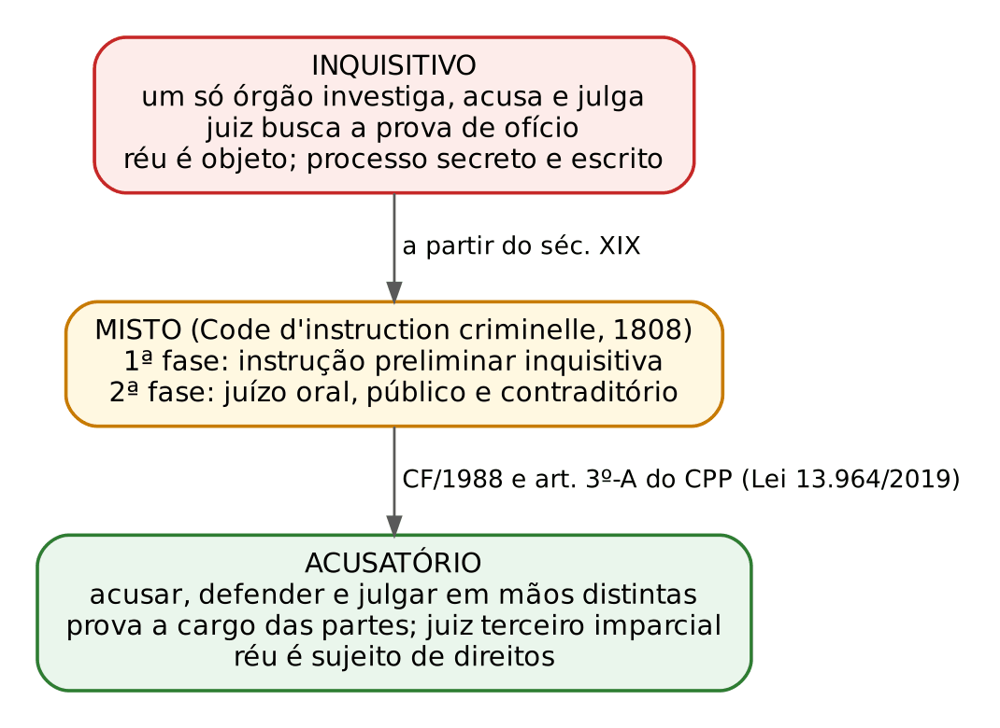
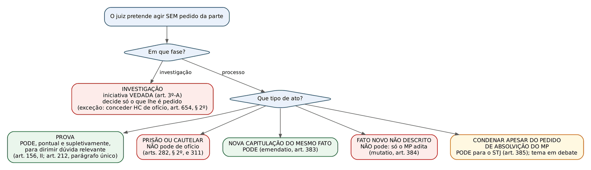
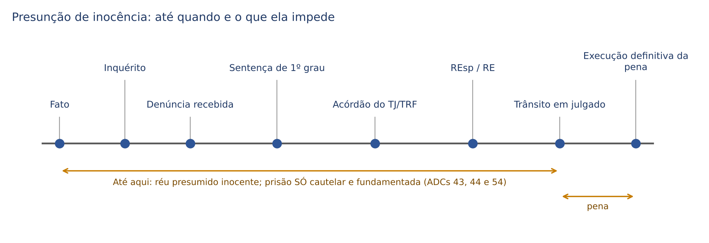
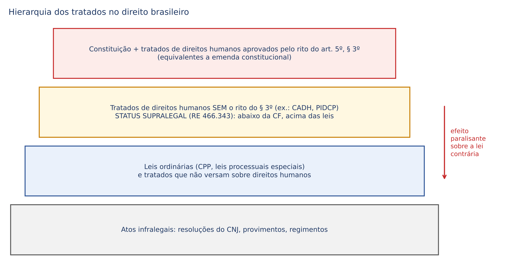
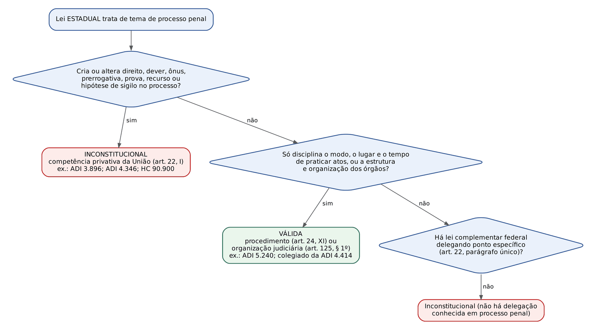

# CAPÍTULO 01 — FUNDAMENTOS DO PROCESSO PENAL: CONCEITO, FINALIDADE, SISTEMAS PROCESSUAIS, FONTES, PRINCÍPIOS, GARANTIAS E CONTROLE DE CONVENCIONALIDADE

:::INCIDENCIA
Pontos: TRF5 p. 1; TJRS p. 1; TJSC p. 2. Nível A. Lote: 13 questões (FGV 11, FCC 2), mais cerca de 20 correlatas em outros capítulos.
O que mais cai: estrutura acusatória e o que o juiz pode ou não fazer de ofício (art. 3º-A lido pelo STF); presunção de inocência (ADCs 43, 44 e 54, condução coercitiva, algemas); "qual princípio é este?" com rótulos trocados; limites do *nemo tenetur se detegere*.
:::

| Subtema | FGV | FCC | Padrão de cobrança |
|---|---|---|---|
| Sistemas processuais e art. 3º-A | 2 | 1 | o que é traço do acusatório; o que o juiz ainda pode fazer de ofício |
| Presunção de inocência | 3 | 0 | ADCs 43, 44 e 54; júri; algemas; condução coercitiva; ônus da prova |
| Princípios em geral (juiz natural, defesa, publicidade, motivação, duplo grau, identidade física, *nemo tenetur*) | 4 | 1 | itens I, II, III com rótulos trocados e afirmações absolutas ("sempre", "irrestrita") |
| Devido processo nas instâncias sancionatórias | 1 | 0 | jurisprudência do STJ e do STF sobre PAD e poderes do CNJ |
| Intranscendência | 1 | 0 | caso de sucessores do condenado |

## 01.1 O que é o processo penal e para que serve

### 01.1.1 Conceito e a regra da necessidade

Direito Processual Penal é o ramo do direito público que disciplina a persecução penal: a investigação dos fatos que aparentam ser crime, o exercício da ação penal, a atuação dos sujeitos processuais, a produção da prova, as medidas cautelares, o julgamento, os recursos e a execução da pena. É o caminho pelo qual o Estado verifica se alguém praticou um crime e, se for o caso, aplica a sanção.

A primeira diferença em relação ao processo civil está na NECESSIDADE do processo. No cível, o processo é um dos modos de resolver o conflito: as partes podem cumprir espontaneamente a obrigação, transigir, renunciar ou reconhecer o pedido sem que um juiz diga o direito. No penal, o direito de punir só se realiza por meio do processo (*nulla poena sine iudicio*; art. 5º, LIV, da CF): ainda que o autor do fato confesse e queira cumprir a pena, ela não pode ser imposta sem processo e sentença. Por isso se diz que o processo penal é instrumento NECESSÁRIO para a aplicação da pena. As exceções são os espaços de consenso que a própria Constituição e a lei abriram (transação penal, suspensão condicional do processo, acordo de não persecução penal), estudados no Cap. 8 e na Apostila de Direito Penal, Cap. 25.

Características usualmente apontadas: autonomia (o processo penal tem princípios e categorias próprios, não é mero apêndice do Direito Penal nem do processo civil), instrumentalidade (serve à aplicação do Direito Penal e, sobretudo, à proteção do acusado contra o arbítrio) e normatividade (é disciplina normativa, com codificação própria: o CPP de 1941, sucessivamente reformado).

### 01.1.2 Finalidade: eficiência e garantia

A doutrina atual descreve a finalidade do processo penal como um equilíbrio entre duas funções. De um lado, a EFICIÊNCIA da persecução: dar resposta estatal ao crime, apurar fatos e punir culpados. De outro, a GARANTIA: o processo é o limite que protege o indivíduo contra o poder punitivo, assegurando que só seja punido quem for provado culpado, por meio de um procedimento justo. Renato Brasileiro fala do binômio eficiência e garantismo; Aury Lopes Jr. fala em instrumentalidade constitucional: o processo não serve apenas para aplicar a pena, mas para realizar os direitos fundamentais previstos na Constituição, de modo que a forma processual é garantia, não formalismo.

O garantismo penal de Luigi Ferrajoli sintetiza esse modelo em dez axiomas. Os quatro últimos são processuais e ajudam a memorizar a lógica do capítulo:

| Axioma | Tradução | Princípio correspondente |
|---|---|---|
| *nulla culpa sine iudicio* | não há culpa sem processo | necessidade do processo; juiz natural |
| *nullum iudicium sine accusatione* | não há processo sem acusação | sistema acusatório |
| *nulla accusatio sine probatione* | não há acusação (procedente) sem prova | ônus da prova da acusação; presunção de inocência |
| *nulla probatio sine defensione* | não há prova sem defesa | contraditório e ampla defesa |

### 01.1.3 O civilista no processo penal: intuições que levam ao erro

Esta tabela antecipa as diferenças que mais derrubam quem vem do cível. Cada linha é desenvolvida no capítulo indicado.

| Tema | No processo civil | No processo penal | Onde |
|---|---|---|---|
| Revelia | presunção de veracidade dos fatos (art. 344 do CPC) | NÃO há confissão ficta; o processo só segue sem o réu (art. 367 do CPP); citado por edital e ausente, suspende-se (art. 366) | Cap. 20 |
| Defesa técnica | sem advogado, a parte sofre as consequências | indispensável: o juiz nomeia defensor (arts. 261 e 263) | 01.4.4 |
| Ônus da prova | distribuição legal e dinâmica (art. 373 do CPC), possível inversão | todo da acusação quanto à culpa; não há inversão | 01.4.5 |
| Confissão | prova contra o confitente | relativa, retratável e divisível; não supre o exame de corpo de delito (arts. 158, 197 e 200) | Caps. 14 e 15 |
| Disponibilidade | autocomposição ampla | ação pública indisponível (arts. 42 e 576); consenso só nos limites da lei | Caps. 6 e 8 |
| Limite da sentença | adstrição ao PEDIDO | vinculação ao FATO descrito, não à capitulação (*emendatio*, art. 383) | Cap. 21 |
| Coisa julgada | rescisória para ambos os lados | revisão criminal SÓ em favor do réu (art. 621) | Caps. 21 e 30 |
| Prazos | dias úteis (art. 219 do CPC) | dias corridos e contínuos (art. 798 do CPP) | Caps. 2 e 20 |
| Silêncio da parte | pode gerar presunções contra quem se omite | não pode ser interpretado em prejuízo do réu (art. 186, parágrafo único) | 01.4.6 |

:::PEGADINHA
"Aplica-se o CPC subsidiariamente, logo..." é o começo de muitos erros. O art. 3º do CPP admite analogia e o art. 15 do CPC manda aplicá-lo supletivamente aos processos eleitorais, trabalhistas e administrativos (o penal não está na lista), mas a aplicação supletiva do CPC ao processo penal só ocorre onde houver lacuna e compatibilidade com os princípios do processo penal (ver Cap. 2). Prazo em dias úteis, revelia com efeito material e inversão do ônus da prova são exemplos de transposições INCOMPATÍVEIS.
:::

## 01.2 Sistemas processuais

### 01.2.1 Inquisitivo, acusatório e misto

"Sistema processual" é o modelo que define como se distribuem, no processo, as funções de investigar, acusar, defender e julgar, e qual o papel do juiz na produção da prova. A distinção é cobrada em quase toda prova, quase sempre pelo caminho "qual destas é característica do sistema acusatório?".

| Traço | Inquisitivo | Acusatório | Misto (francês) |
|---|---|---|---|
| Funções | concentradas no mesmo órgão (juiz-inquisidor) | separadas: acusador, defensor e juiz distintos | separadas na fase judicial; concentradas na instrução preliminar |
| Iniciativa e gestão da prova | do juiz, de ofício | das partes; juiz terceiro, em regra inerte | do juiz instrutor na 1ª fase |
| Posição do acusado | objeto da investigação | sujeito de direitos | objeto na 1ª fase, sujeito na 2ª |
| Contraditório e defesa | inexistentes ou mínimos | plenos | só na fase judicial |
| Publicidade e forma | sigiloso e escrito | público e predominantemente oral | 1ª fase sigilosa e escrita; 2ª pública e oral |
| Valoração da prova | prova tarifada; confissão como "rainha das provas" | livre convencimento motivado | livre convencimento |
| Prisão do acusado | regra durante o processo | exceção (cautelar) | variável |
| Imparcialidade | comprometida (quem busca a prova julga com base nela) | assegurada pela separação | depende da separação entre juiz instrutor e julgador |

Termos que aparecem nas alternativas: "verdade real", "juiz com ampla iniciativa probatória", "confissão suficiente para condenar" e "processo sigiloso" são marcas do INQUISITIVO. "Separação das funções", "presunção de inocência", "oralidade", "publicidade", "contraditório" e "livre convencimento motivado" são marcas do ACUSATÓRIO.

:::QUESTAO FCC 2025 — DPE-RS — Defensor Público (Q3387017)
O que se perguntou: quais são características do sistema acusatório adotado pela Constituição e reforçado pelo art. 3º-A do CPP.
Gabarito oficial: D (separação das funções de acusar e julgar, presunção de inocência e oralidade como regra).
Armadilhas: (A) misturava traços acusatórios com "suficiência da confissão como único meio", que é marca inquisitiva e contraria os arts. 158 e 197 do CPP; (B) incluía a "verdade real", bandeira histórica do inquisitivo; (C) "ampla iniciativa probatória do juiz" é o núcleo do inquisitivo; (E) reexame obrigatório da absolvição não é traço do modelo acusatório (e o recurso de ofício da absolvição sumária no júri é tido por revogado pela maioria; ver Cap. 28).
:::

:::QUESTAO FGV 2024 — TJ-RJ — Residência Jurídica (Q2375306)
O que se perguntou: a partir de texto sobre o julgamento de Tiradentes (uma Alçada de desembargadores de Lisboa criada pela Coroa por carta régia, depois dos fatos, para julgar os sediciosos), qual sistema se reconhece e se houve violação de princípios.
Gabarito oficial: A (sistema com traços inquisitivos e violação do juiz natural).
Raciocínio: órgão julgador criado DEPOIS do fato e especialmente para aquele caso é tribunal de exceção, a negação do juiz natural (01.4.7). As alternativas que diziam "acusatório" ou "não é possível observar violação" ignoravam o dado decisivo do texto: a composição *ad hoc* do órgão julgador.
:::

### 01.2.2 Qual é o núcleo do sistema acusatório?

Há duas leituras na doutrina, e elas explicam as divergências sobre os poderes do juiz:

- Para uma corrente (associada, entre outros, a Jacinto Coutinho e Aury Lopes Jr.), o critério que define o sistema é a GESTÃO DA PROVA: se o juiz pode buscar prova de ofício, o sistema é inquisitivo, ainda que acusar e julgar estejam em mãos distintas. Para essa corrente, dispositivos como os arts. 156, 209 e 385 do CPP seriam incompatíveis com o modelo acusatório.
- Para outra corrente, majoritária na jurisprudência, o núcleo é a SEPARAÇÃO DAS FUNÇÕES de acusar e julgar, que é compatível com uma iniciativa probatória do juiz SUPLETIVA, pontual e motivada, desde que ele não substitua o acusador.

Quanto à classificação do sistema brasileiro, antes de 2019 parte da doutrina falava em sistema misto (inquérito inquisitivo seguido de processo acusatório) ou acusatório "não ortodoxo"; outros sustentavam que a Constituição de 1988 já adotara o acusatório (art. 129, I: titularidade privativa da ação penal pública pelo Ministério Público; art. 5º, LIV, LV, LVII; art. 93, IX). Hoje a lei é expressa.

:::LEI CPP, art. 3º-A (Lei 13.964/2019)
O processo penal terá estrutura acusatória, vedadas a iniciativa do juiz na fase de investigação e a substituição da atuação probatória do órgão de acusação.
:::

O dispositivo tem duas vedações, que convém separar: na INVESTIGAÇÃO, o juiz não tem iniciativa nenhuma (só decide o que lhe for pedido, como guardião de direitos fundamentais); no PROCESSO, o juiz não pode SUBSTITUIR a atuação probatória da acusação, isto é, suprir a omissão do Ministério Público produzindo a prova que este deixou de produzir.

### 01.2.3 A leitura do STF e o que o juiz ainda pode fazer de ofício

Quanto ao art. 3º-A, o STF deu interpretação conforme para admitir que o juiz, pontualmente e nos limites legalmente autorizados, determine diligências suplementares para dirimir dúvida sobre questão relevante para o julgamento do mérito (ADIs 6.298, 6.299, 6.300 e 6.305, j. 24/8/2023; v. Cap. 3; arquivamento no Cap. 4).

Resultado prático: subsiste o art. 156, II, do CPP (o juiz pode, "no curso da instrução, ou antes de proferir sentença", determinar diligências para dirimir dúvida sobre ponto relevante), mas apenas como poder RESIDUAL. Ele não serve para suprir a deficiência probatória da acusação nem para iniciar linha de prova que as partes não abriram. Quanto ao inciso I do art. 156 (produção antecipada de provas de ofício "mesmo antes de iniciada a ação penal"), parte da doutrina sustenta sua incompatibilidade com a vedação de iniciativa na fase de investigação; o STF não o examinou especificamente nas ADIs, e a FGV cobra o inciso II.

Os pontos do fluxograma, com remissão aos capítulos que os desenvolvem:

- Prisão e cautelares de ofício: a Lei 13.964/2019 retirou a expressão "de ofício" dos arts. 282, § 2º, e 311; não cabe decretar preventiva nem converter flagrante em preventiva sem requerimento (Súmula 676 do STJ — ver Cap. 18; preventiva no Cap. 19).
- Inquirição de testemunhas: as partes perguntam diretamente; o juiz indefere perguntas impertinentes e pode COMPLEMENTAR a inquirição sobre pontos não esclarecidos (art. 212 e parágrafo único — ver Cap. 15).
- *Emendatio libelli* (dar ao mesmo fato definição jurídica diversa, art. 383) é permitida de ofício; *mutatio libelli* (fato ou circunstância nova não descrita, art. 384) exige aditamento do Ministério Público (ver Cap. 21).
- Habeas corpus de ofício (art. 654, § 2º) e relaxamento de prisão ilegal (art. 5º, LXV, da CF) não violam o sistema acusatório: são atuações em FAVOR da liberdade.
- Condenação apesar de pedido de absolvição do Ministério Público (art. 385): a 6ª Turma do STJ decidiu que o dispositivo é compatível com o sistema acusatório e não foi derrogado pelo art. 3º-A, porque o pedido absolutório em alegações finais não equivale à retirada da acusação (REsp 2.022.413, j. 14/2/2023). Há precedente da 5ª Turma em sentido contrário (AgRg no AREsp 1.940.726, j. 6/9/2022), e o Conselho Federal da OAB questiona o artigo no STF (ADPF 1.122). Na prova objetiva, prevalece a validade do art. 385.
- Diligência pessoal do juiz x instauração de investigação: consultar redes sociais públicas do investigado para fundamentar cautelar REQUERIDA pela parte não viola o acusatório (v. Cap. 19); já a INSTAURAÇÃO de investigação criminal pelo juiz ou por órgão administrativo do tribunal é nula, por ofensa ao art. 3º-A (v. Cap. 5).

:::QUESTAO FGV 2026 — PC-PR — Delegado de Polícia (Q4378270)
O que se perguntou: qual afirmação é compatível com a estrutura acusatória do processo penal brasileiro.
Gabarito oficial: C (as partes perguntam diretamente à testemunha; o juiz indefere perguntas impertinentes e pode complementar a inquirição sobre pontos não esclarecidos — art. 212).
Por que as demais estão erradas: (A) descreve a *mutatio libelli*, que depende de aditamento do MP, e não correção de ofício pelo juiz (art. 384); (B) cautelares pessoais de ofício foram abolidas pela Lei 13.964/2019; (D) é a afirmação "absoluta" típica da FGV: o juiz PODE determinar diligências para dirimir dúvida relevante (art. 156, II, com a interpretação conforme do STF); (E) com o juiz das garantias, quem atua na investigação não julga a ação penal (art. 3º-C; ver Cap. 3), e não há prevenção para o julgamento.
:::

:::SENTENCA Diligência de ofício e pedido de absolvição do MP
Onde entra: na decisão que, antes da sentença, determina diligência (art. 156, II) e, na sentença, quando o MP pede absolvição nas alegações finais e o juiz condena.
O que fundamentar: (i) qual é a dúvida concreta e por que o ponto é relevante; (ii) que a diligência é complementar e não supre omissão da acusação; (iii) abertura de contraditório às partes sobre o resultado. Na condenação contra o pedido do MP, enfrentar expressamente os argumentos do parecer absolutório.
Redação-modelo: "Subsistindo dúvida relevante quanto ao horário do fato, ponto sobre o qual as partes produziram prova contraditória, determino, com fundamento no art. 156, II, do CPP, a requisição das imagens já identificadas nos autos, abrindo-se vista sucessiva às partes por cinco dias."
Erro que a banca pune: usar o art. 156 para produzir a prova da autoria que o MP não requereu (substituição da acusação), ou decidir com base em diligência sem dar vista às partes.
:::

:::QUESTAO FGV 2024 — TJ-MT — Oficial de Justiça (Q3114504)
O que se perguntou: três afirmações sobre princípios: (I) vedação de juízo de exceção decorre do juiz natural; (II) indiciamento é ato privativo do delegado e vincula o MP; (III) a produção de prova depende SEMPRE da iniciativa das partes, pela inércia da jurisdição.
Gabarito oficial: B (apenas I).
Armadilhas: em II, a primeira metade é verdadeira (o indiciamento é privativo do delegado, art. 2º, § 6º, da Lei 12.830/2013 — ver Cap. 4), mas o indiciamento NÃO vincula o titular da ação penal; em III, o "sempre" está errado pelo art. 156, II.
:::

## 01.3 Fontes do Direito Processual Penal

Fonte é de onde a norma vem. A classificação tradicional distingue:

- Fonte MATERIAL (ou de produção): quem tem competência para criar a norma. Em processo penal, é a UNIÃO (art. 22, I, da CF), com espaço para Estados e Distrito Federal em procedimentos (art. 24, XI), organização judiciária (art. 125, § 1º) e, em tese, mediante delegação por lei complementar (art. 22, parágrafo único). O tema é desenvolvido em 01.7.
- Fontes FORMAIS (ou de cognição): a forma pela qual a norma se exterioriza.
  - Imediatas (diretas): a lei em sentido amplo, que abrange a Constituição, as leis ordinárias e complementares federais e os tratados e convenções internacionais incorporados.
  - Mediatas (indiretas ou supletivas): costume, princípios gerais do direito e, para parte da doutrina, a analogia (que outros classificam como forma de integração, e não fonte). O art. 3º do CPP admite interpretação extensiva, aplicação analógica e o suplemento dos princípios gerais de direito (ver Cap. 2).

Pontos cobrados:

- Medida provisória NÃO pode versar sobre direito processual penal (art. 62, § 1º, I, "b", da CF, incluído pela EC 32/2001). Regimentos internos de tribunais disciplinam o processamento interno dos feitos (art. 96, I, "a"), mas não criam regra processual em contrariedade à lei federal.
- Súmula vinculante é hoje tratada como fonte formal: vincula os demais órgãos do Judiciário e a administração pública (art. 103-A da CF). Os precedentes qualificados (repercussão geral e recursos repetitivos) também orientam obrigatoriamente o julgamento; o STJ aplica ao processo penal, por analogia, a lógica do art. 927 do CPC.
- Costume: não cria nem revoga norma processual penal, mas orienta a prática (por exemplo, usos forenses quanto à forma de certos atos). Doutrina não é fonte formal, para a posição majoritária.
- Tratados internacionais de direitos humanos ingressam com hierarquia própria (01.5.1) e são fonte das garantias processuais convencionais.

:::DICA
Na prova, "fonte material" = QUEM faz a norma (União; Estados no que a CF permite); "fonte formal" = COMO a norma aparece (lei, tratado, costume, princípios). Alternativa que chama a lei de "fonte material" ou que admite medida provisória em processo penal está errada.
:::
## 01.4 Princípios e garantias constitucionais do processo penal

### 01.4.1 Como estudar os princípios para a prova

Princípios são normas de alto grau de abstração que orientam a interpretação das regras e servem de fundamento direto de decisões (o juiz anula um ato "por violação ao contraditório"). Quase todos estão no art. 5º da CF e se repetem, com outra redação, na Convenção Americana de Direitos Humanos (CADH) e no Pacto Internacional sobre Direitos Civis e Políticos (PIDCP), o que permite à banca cobrar o mesmo conteúdo pela via constitucional ou convencional (01.5.2).

A FGV cobra princípios de duas formas: (i) "qual princípio é este?", com rótulos trocados (dá-se o conteúdo da inafastabilidade e chama-se de congruência); (ii) afirmações absolutas ("sempre", "irrestrita", "absolutamente vedada", "não encontra exceção"), que quase sempre são falsas, porque todos os princípios processuais têm exceções ou limites previstos na própria Constituição ou na lei.

| Princípio | Fonte constitucional | Conteúdo em uma linha |
|---|---|---|
| Devido processo legal | art. 5º, LIV | ninguém será privado da liberdade ou de seus bens sem o devido processo legal |
| Contraditório e ampla defesa | art. 5º, LV | informação e possibilidade de reação; defesa técnica e autodefesa |
| Presunção de inocência | art. 5º, LVII | ninguém será considerado culpado até o trânsito em julgado |
| *Nemo tenetur se detegere* | art. 5º, LXIII | ninguém é obrigado a produzir prova contra si |
| Juiz natural | art. 5º, XXXVII e LIII | juízo competente pré-constituído; vedação de tribunal de exceção |
| Publicidade | arts. 5º, LX, e 93, IX | atos públicos, salvo restrição legal por intimidade ou interesse social |
| Motivação | art. 93, IX | toda decisão fundamentada, sob pena de nulidade |
| Duração razoável | art. 5º, LXXVIII | processo em tempo razoável e meios que garantam a celeridade |
| Vedação de provas ilícitas | art. 5º, LVI | inadmissíveis as provas obtidas por meios ilícitos |
| Duplo grau | implícito (e art. 8.2.h da CADH) | direito de recorrer da decisão condenatória |
| *Ne bis in idem* | implícito (e art. 8.4 da CADH) | ninguém é processado duas vezes pelo mesmo fato |

### 01.4.2 Devido processo legal

É o princípio-matriz: dele derivam todos os demais. Em sentido FORMAL (procedimental), assegura o processo previamente previsto em lei, com juiz natural, contraditório, ampla defesa, publicidade e motivação. Em sentido MATERIAL (substancial), exige que as decisões estatais sejam razoáveis e proporcionais: é a sede da proporcionalidade (adequação, necessidade e proporcionalidade em sentido estrito), usada pelo STF no controle de medidas cautelares e meios invasivos de prova.

O devido processo não é exclusivo do processo penal: incide em toda a atividade sancionatória do Estado (processo administrativo disciplinar, processos perante o CNJ e os tribunais de contas). Por isso aparece em questões que misturam instâncias.

:::QUESTAO FGV 2026 — ENAM 2026.1 (Q4102403)
O que se perguntou: qual afirmação, segundo o STJ e o STF, é correta sobre garantias em procedimentos administrativos e investigativos.
Gabarito oficial: E (o controle judicial do PAD restringe-se à regularidade do procedimento e à legalidade do ato, à luz do contraditório, da ampla defesa e do devido processo legal, sem incursão no mérito administrativo, ressalvadas flagrante ilegalidade, teratologia ou manifesta desproporcionalidade da sanção — é o texto da Súmula 665 do STJ).
Armadilhas: (A) a denúncia anônima autoriza instaurar PAD se devidamente motivada e amparada em investigação ou sindicância (Súmula 611 do STJ; v. Cap. 4); (B) o MP tem dever de comunicar ao juízo a instauração e o encerramento de procedimento investigatório (ver Cap. 5); (C) a investigação criminal não é atividade exclusiva do delegado (Tema 184 do STF — ver Cap. 5); (D) o STF julgou CONSTITUCIONAL a requisição de dados bancários e fiscais pelo Corregedor Nacional de Justiça, sem prévia autorização judicial, em processo regularmente instaurado contra sujeito determinado, por decisão fundamentada e com indícios concretos (ADI 4.709, j. 27/5/2022).
:::

### 01.4.3 Contraditório

Contraditório é o binômio INFORMAÇÃO + POSSIBILIDADE DE REAÇÃO: a parte deve ser cientificada dos atos e ter oportunidade efetiva de influir na decisão. Doutrina mais recente acrescenta a paridade (*par conditio*): a reação deve ser possível em igualdade de condições com a parte contrária.

A distinção mais cobrada é quanto ao MOMENTO:

| Espécie | O que é | Exemplos |
|---|---|---|
| Contraditório para a prova (real) | as partes participam da PRODUÇÃO da prova | prova testemunhal colhida em audiência; perguntas diretas das partes |
| Contraditório sobre a prova (diferido ou postergado) | a prova é produzida sem a participação da parte, que depois a discute em juízo | perícia realizada no inquérito; interceptação telefônica; busca e apreensão; provas cautelares, não repetíveis e antecipadas (art. 155) |

Consequência para a sentença: elementos informativos colhidos no inquérito, sem contraditório, não podem fundamentar SOZINHOS a condenação; ressalvam-se as provas cautelares, não repetíveis e antecipadas, que se submetem ao contraditório diferido (art. 155 — desenvolvido no Cap. 14; ver Q4150730, FGV 2026, TJ-SC, em que a sentença baseada só nos depoimentos policiais foi tida por nula).

No inquérito não há contraditório pleno: é procedimento administrativo e preparatório. Isso não significa ausência de direitos do investigado: ele tem direito ao silêncio, à assistência de advogado e ao acesso aos elementos já documentados (Súmula Vinculante 14 — ver Cap. 4).

### 01.4.4 Ampla defesa, defesa técnica e autodefesa

Ampla defesa é o direito de utilizar todos os meios lícitos para resistir à acusação. Divide-se em:

| Defesa técnica | Autodefesa |
|---|---|
| exercida por advogado ou defensor público | exercida pessoalmente pelo acusado |
| INDISPONÍVEL: nenhum acusado, ainda que ausente ou foragido, será processado ou julgado sem defensor (art. 261); se não tiver, o juiz nomeia (art. 263) | DISPONÍVEL: o réu pode calar, não comparecer, não recorrer |
| deve ser efetiva: manifestação fundamentada (art. 261, parágrafo único) | compreende: direito de audiência (ser ouvido, no interrogatório), direito de presença (acompanhar os atos) e capacidade postulatória autônoma em certos atos (habeas corpus, revisão criminal, interposição de recurso por termo) |

Pontos de prova:

- Mesmo o réu que deseje dispensar advogado não pode fazê-lo, salvo se tiver habilitação técnica para defender-se a si mesmo (art. 263). Ausência de defesa é nulidade absoluta; deficiência só anula se houver prejuízo (Súmula 523 do STF — ver Cap. 27).
- Divergência entre réu e defensor quanto a recorrer: Súmula 705 do STF (ver Cap. 28).
- Entrevista prévia e reservada com o defensor antes do interrogatório (art. 185, § 5º — ver Cap. 15).
- No júri, a Constituição fala em PLENITUDE de defesa (art. 5º, XXXVIII, "a"), mais ampla do que a ampla defesa, porque admite argumentos extrajurídicos perante os jurados (ver Cap. 23).
- Paridade de armas: igualdade de oportunidades processuais entre acusação e defesa. Não exige tratamento idêntico: prerrogativas como o prazo em dobro e a intimação pessoal da Defensoria Pública (ver Cap. 12) concretizam a igualdade material.
- Defensor natural: decorre das garantias da Defensoria Pública (art. 4º-A, IV, da LC 80/1994, incluído pela LC 132/2009, assegura ao assistido o patrocínio pelo defensor natural). Veda o afastamento casuístico do defensor que, por critérios legais prévios, deveria atuar no caso; protege tanto o membro quanto o assistido.

:::QUESTAO FGV 2024 — TJ-MT — Analista Judiciário (Q3114274)
O que se perguntou: três afirmações: (I) o duplo grau permite revisão irrestrita do mérito de QUALQUER condenação, independentemente do órgão prolator; (II) a defesa técnica é indisponível, ainda que o réu queira abdicar dela; (III) todos os julgamentos são públicos, sem qualquer limitação legal admissível.
Gabarito oficial: B (apenas II).
Armadilhas: I erra porque há julgamentos em instância única (competência originária do STF), e o duplo grau não é garantia constitucional absoluta (01.4.10); III erra porque o art. 93, IX, e o art. 5º, LX, autorizam a lei a restringir a publicidade (01.4.8).
:::

:::QUESTAO FCC 2025 — DPE-RS — Defensor Público (Q3387019)
O que se perguntou: quatro assertivas sobre princípios: (I) o acesso à justiça penal abrange jurisdicionalidade, acusatório, presunção de inocência, contraditório, ampla defesa e motivação; (II) a "verdade real" é o objetivo fundamental do processo e autoriza o juiz a buscar provas; (III) a paridade de armas, implementada gradualmente, mitiga paulatinamente o *favor rei*; (IV) o defensor natural veda o afastamento casuístico do defensor público e é garantia dupla, do membro e do assistido.
Gabarito oficial: E (I e IV).
Armadilhas: II reproduz a visão inquisitiva da verdade real, criticada pela doutrina contemporânea (01.4.9); III inverte a lógica: a paridade de armas não reduz o *favor rei*, que decorre da presunção de inocência e da desigualdade estrutural entre Estado e acusado.
:::

### 01.4.5 Presunção de inocência

:::LEI CF, art. 5º, LVII; CPP, art. 283
Ninguém será considerado culpado até o trânsito em julgado de sentença penal condenatória.
Art. 283. Ninguém poderá ser preso senão em flagrante delito ou por ordem escrita e fundamentada da autoridade judiciária competente, em decorrência de prisão cautelar ou em virtude de condenação criminal transitada em julgado.
:::

A Constituição usa a fórmula "não será considerado culpado"; daí a expressão "princípio da não culpabilidade", usada como sinônimo (Q2450550, FGV 2024, Câmara de Fortaleza, pedia exatamente a identificação do princípio; gabarito C). A CADH fala em presunção de inocência "enquanto não se comprove legalmente sua culpa" (art. 8.2): o marco temporal brasileiro (trânsito em julgado) é MAIS protetivo que o convencional.

A presunção opera em três dimensões, e a banca cobra cada uma separadamente:

| Dimensão | O que impõe | Consequências práticas |
|---|---|---|
| Regra de TRATAMENTO | o investigado e o réu devem ser tratados como inocentes | prisão antes do trânsito só como CAUTELAR fundamentada, nunca como antecipação de pena; vedação de prisão obrigatória ou de vedação abstrata de liberdade provisória; uso de algemas excepcional (Súmula Vinculante 11 — ver Cap. 18); vedação de exposição indevida |
| Regra PROBATÓRIA | o ônus de provar a culpa é integralmente da acusação | não há inversão do ônus da prova; o réu não precisa provar a inocência |
| Regra de JULGAMENTO | na dúvida, absolve-se (*in dubio pro reo*) | absolvição por insuficiência de prova (art. 386, VII) e por fundada dúvida sobre excludente de ilicitude ou de culpabilidade (art. 386, VI, parte final) |

:::JURIS STF, ADCs 43, 44 e 54, j. 7/11/2019
O Plenário, por 6 votos a 5, declarou constitucional o art. 283 do CPP: a execução da pena só pode começar depois do trânsito em julgado da condenação. Ficou superada a orientação do HC 126.292 (2016), que admitira a execução provisória após a confirmação da condenação em segunda instância, e restabeleceu-se a do HC 84.078 (2009). A prisão antes do trânsito continua possível, mas apenas como prisão cautelar, com os requisitos do art. 312 (ver Cap. 19).
:::

A única exceção hoje admitida pelo STF é a condenação pelo Tribunal do Júri, cuja execução imediata decorre da soberania dos veredictos (Tema 1.068 do STF — desenvolvido no Cap. 23).

Outras projeções cobradas:

- Condução coercitiva: a expressão "para o interrogatório" do art. 260 não foi recepcionada, mas subsiste a condução para atos que exigem presença, como o reconhecimento (ADPFs 395 e 444; v. Cap. 4; Q3951760, FGV 2026, TJ-PA, gabarito B).
- Vedações abstratas de liberdade provisória (Estatuto do Desarmamento, Lei de Drogas) são inconstitucionais; a Constituição veda fiança, graça e anistia para hediondos (art. 5º, XLIII), não a liberdade provisória sem fiança (ADI 3.112 e HC 104.339; v. Cap. 19).
- Concurso público: sem previsão constitucionalmente adequada e instituída por lei, é ilegítima a cláusula de edital que restrinja a participação de candidato pelo simples fato de responder a inquérito ou ação penal (RE 560.900, Tema 22, j. 6/2/2020).
- Dosimetria: inquéritos e ações penais em curso não podem agravar a pena-base (Súmula 444 do STJ — ver Apostila de Direito Penal, Cap. 13).

:::QUESTAO FGV 2026 — PC-PR — Delegado de Polícia (Q4378261)
O que se perguntou: qual afirmação sobre a presunção de inocência é correta.
Gabarito oficial: E (a presunção de inocência não impede que o condenado pelo júri inicie imediatamente o cumprimento da pena, ainda que caiba apelação — Tema 1.068; ver Cap. 23).
Armadilhas: (A) culpa e início da pena após acórdão de segundo grau: orientação superada pelas ADCs 43, 44 e 54; (B) "no júri o réu permanecerá sempre algemado" contraria a Súmula Vinculante 11 e o art. 474, § 3º, do CPP; (C) o ônus da prova da acusação NÃO pode ser invertido por despacho do juiz (a intuição civilista do art. 373, § 1º, do CPC leva a esse erro); (D) a presunção não tem exceções por espécie de crime ou por reincidência.
:::

:::QUESTAO FGV 2024 — ENAM 2024.2 (Q3058612)
O que se perguntou: três afirmações sobre a não culpabilidade na jurisprudência do STF: (I) o texto da Súmula Vinculante 11 (algemas); (II) a condução coercitiva para interrogatório é compatível com a presunção de inocência porque o conduzido pode calar e ter advogado; (III) a vedação constitucional de liberdade provisória para hediondos é compatível com a presunção e o flagrado deve permanecer preso toda a instrução.
Gabarito oficial: A (apenas I).
Armadilhas: II contraria as ADPFs 395 e 444 (a possibilidade de calar não legitima a condução forçada); III parte de premissa falsa: a CF veda a FIANÇA, não a liberdade provisória, e a prisão obrigatória por espécie de crime é incompatível com a presunção.
:::

:::SENTENCA Presunção de inocência na sentença
Onde entra: no dispositivo condenatório (direito de recorrer em liberdade e manutenção ou decretação de prisão) e no exame da prova (absolvição pelo art. 386, VI ou VII).
O que fundamentar: a manutenção ou decretação da preventiva na sentença exige fundamentação CONCRETA e atual dos requisitos do art. 312 (art. 387, § 1º); "gravidade abstrata" e "garantia da execução da pena" não bastam. Na absolvição por dúvida, indicar qual é o ponto incerto e por que a prova não o supera.
Redação-modelo: "Concedo ao réu o direito de recorrer em liberdade, porque respondeu solto ao processo e não sobreveio fato novo que indique risco concreto à ordem pública ou à aplicação da lei penal (art. 387, § 1º, do CPP)."
Erro que a banca pune: determinar "expeça-se mandado de prisão para início do cumprimento da pena" em condenação não transitada (fora do júri), ou manter a prisão "em razão da condenação", como efeito automático.
:::

### 01.4.6 *Nemo tenetur se detegere*: direito ao silêncio e não autoincriminação

A Constituição assegura ao preso o direito de permanecer calado (art. 5º, LXIII); a CADH (art. 8.2.g) e o PIDCP (art. 14.3.g) asseguram o direito de não ser obrigado a depor contra si mesmo nem a confessar-se culpado. A garantia beneficia QUALQUER pessoa sujeita à persecução (investigado, réu, testemunha quanto a fatos que a incriminem), solta ou presa.

:::LEI CPP, art. 186, parágrafo único
O silêncio, que não importará em confissão, não poderá ser interpretado em prejuízo da defesa.
:::

A parte final do art. 198 do CPP ("mas poderá constituir elemento para a formação do convencimento do juiz") é tida por não recepcionada. No júri, as partes não podem fazer referência ao silêncio do acusado em prejuízo dele, sob pena de nulidade (art. 478, II — ver Cap. 23). O silêncio pode ser SELETIVO, pergunta a pergunta (RHC 213.849 AgR; v. Cap. 15), e o dever de advertir o abordado já na abordagem policial está pendente no STF (Tema 1.185; v. Cap. 15).

O critério que resolve os casos-limite é a distinção entre comportamento ATIVO e PASSIVO: o *nemo tenetur* protege contra a obrigação de FAZER algo que produza prova contra si (falar, soprar, escrever, encenar), mas não impede que o corpo da pessoa seja objeto de prova que dispense sua colaboração ativa (ser visto, ser fotografado, ser reconhecido).

| Situação | Pode ser obrigado? | Fundamento |
|---|---|---|
| Responder ao interrogatório de mérito | NÃO | art. 5º, LXIII; art. 186 |
| Identificar-se (qualificação) | SIM: o silêncio não alcança a qualificação; atribuir-se falsa identidade é crime | Súmula 522 do STJ; RE 640.139 (Tema 478 do STF) |
| Fornecer padrões gráficos para exame grafotécnico | NÃO; mas a perícia pode usar padrões preexistentes obtidos licitamente (fonte independente) | art. 174, IV; STF, HC 99.289, j. 23/6/2009 |
| Participar da reprodução simulada (reconstituição) | NÃO (comportamento ativo) | art. 7º do CPP lido com o *nemo tenetur* |
| Soprar o etilômetro ou fazer exame de sangue | NÃO quanto à prova penal; a recusa sujeita o condutor a sanções ADMINISTRATIVAS, constitucionais | art. 165-A do CTB; RE 1.224.374 (Tema 1.079 do STF, j. 19/5/2022); embriaguez provada por outros meios (art. 306, § 2º, do CTB) |
| Ser submetido a reconhecimento pessoal | SIM (participação passiva); admite-se a condução para esse fim | ADPFs 395 e 444 (alcance limitado ao interrogatório) |
| Fornecer material genético | disciplina legal própria (identificação criminal e banco de perfis) | ver Caps. 4 e 16 |

:::QUESTAO FGV 2024 — Pref. São José dos Campos — Procurador (Q3888048)
O que se perguntou: qual afirmação sobre princípios é correta.
Gabarito oficial: B (o *nemo tenetur* impede que o investigado seja obrigado a produzir prova contra si, mas o direito ao silêncio não afasta a tipicidade da autoatribuição de falsa identidade — Súmula 522 do STJ).
Armadilhas, uma por princípio: (A) a motivação NÃO é absoluta: o veredicto dos jurados dispensa fundamentação (íntima convicção e sigilo das votações, art. 5º, XXXVIII, "b"); (C) a revelia permite a produção de prova sem a presença do réu, desde que presente o defensor (art. 367); (D) troca de rótulos: o conteúdo descrito é a inafastabilidade da jurisdição (art. 5º, XXXV), e não a congruência, que é a correlação entre acusação e sentença (Cap. 21); (E) a identidade física do juiz não é absoluta: o sucessor do juiz falecido sentencia, sem refazer a instrução (01.4.7).
:::

Correlatas, no mesmo sentido: Q4088252 (FGV 2026, MPE-RJ) e Q3966684 (FGV 2026, TJ-GO), ambas sobre recusa legítima de fornecer padrões gráficos e validade do laudo feito com padrões preexistentes (fonte independente — ver Cap. 14).

### 01.4.7 Juiz natural, imparcialidade, identidade física e promotor natural

O juiz natural tem duplo conteúdo constitucional: ninguém será processado nem sentenciado senão pela autoridade competente (art. 5º, LIII) e não haverá juízo ou tribunal de exceção (art. 5º, XXXVII). Daí três exigências: o órgão deve estar previsto na Constituição ou na lei, deve ser anterior ao fato e sua competência deve decorrer de regras gerais e abstratas, não de escolha para o caso concreto. Tribunal de exceção é o criado depois do fato ou designado especialmente para julgá-lo (era o caso da Alçada de Tiradentes, Q2375306, 01.2.1).

O que NÃO viola o juiz natural, segundo o STF:

- Criação de varas especializadas por resolução do tribunal com redistribuição dos inquéritos, por se tratar de organização judiciária (o STF validou a especialização de varas federais em lavagem de dinheiro; a regra da ADI 4.414 de que ações penais em andamento não podem ser redistribuídas consta em 01.7).
- Julgamento de recurso por órgão do tribunal composto majoritariamente por juízes de primeiro grau convocados na forma da lei (RE 597.133; v. Cap. 9).
- Desaforamento no júri (art. 427), modificação de competência por conexão e continência e julgamento conjunto no tribunal de quem não tem foro, nos termos da lei (Súmula 704 do STF — ver Cap. 10).

O juiz natural se completa com a IMPARCIALIDADE: o juiz deve ser terceiro desinteressado. Ela é protegida pelas hipóteses de impedimento e suspeição (arts. 252 a 256 — ver Cap. 12) e, estruturalmente, pelo juiz das garantias, inspirado na ideia de que quem decide sobre medidas investigativas forma pré-juízos (ver Cap. 3).

Identidade física do juiz: "o juiz que presidiu a instrução deverá proferir a sentença" (art. 399, § 2º, incluído pela Lei 11.719/2008). Não é absoluta: a jurisprudência admite exceções nos casos de afastamento do juiz (convocação, licença, promoção, aposentadoria, morte), aplicando por analogia a regra que existia no art. 132 do CPC/1973. O sucessor sentencia e pode, se entender necessário, repetir provas.

:::QUESTAO FGV 2024 — Câmara dos Deputados — Consultor Legislativo (Q2513066)
O que se perguntou: qual afirmação sobre princípios reitores é correta.
Gabarito oficial: C (a identidade física, embora não absoluta, determina que o juiz que presidiu a instrução profira, em princípio, a sentença).
Armadilhas: (A) o acesso do defensor alcança os elementos JÁ DOCUMENTADOS, não diligências em curso (Súmula Vinculante 14 — ver Cap. 4); (B) a pena cumprida no estrangeiro atenua ou é computada na pena imposta no Brasil (art. 8º do CP — ver Apostila de Direito Penal, Cap. 4), sem relação com o juiz natural; (D) a falta de defesa anula; a deficiência só anula com prejuízo (Súmula 523 do STF — ver Cap. 27); (E) o silêncio não pode ser usado em prejuízo do réu (art. 186, parágrafo único).
:::

Promotor natural: garantia de que o acusado seja processado por membro do Ministério Público com atribuição fixada previamente por critérios legais e abstratos, vedadas as designações casuísticas do "acusador de exceção". O STF reconhece o princípio desde o HC 67.759 (1992), associando-o à independência funcional e à inamovibilidade (art. 127, § 1º, e art. 128, § 5º, I, "b", da CF). Designação de grupos especializados (como GAECOs) criados previamente e com critérios objetivos não ofende o princípio. Na Q3362150 (FGV 2025, MPE-RJ), o promotor que remete ao Procurador-Geral de Justiça peças sobre crime de prefeito apenas reconhece a atribuição do PGJ, decorrente da competência originária do Tribunal de Justiça (art. 29, X, da CF — ver Cap. 10).

### 01.4.8 Publicidade e motivação

A publicidade permite o controle social e das partes sobre a atividade jurisdicional. Há publicidade GERAL (ou popular: qualquer pessoa assiste aos atos) e RESTRITA (ou especial: só as partes e seus advogados, ou só estes). A Constituição admite a restrição por lei quando a defesa da intimidade ou o interesse social o exigirem (art. 5º, LX), e o art. 93, IX, permite limitar a presença às partes e advogados, ou só a estes, quando a preservação da intimidade do interessado no sigilo não prejudicar o interesse público à informação. No CPP: art. 792, § 1º (restrição por risco de escândalo, inconveniente grave ou perigo de perturbação da ordem); art. 201, § 6º (preservação da intimidade da vítima); art. 20 (sigilo do inquérito). Nos crimes contra a dignidade sexual, os processos correm em segredo de justiça (art. 234-B do CP).

A motivação (art. 93, IX) é garantia das partes e condição de controle das decisões, sob pena de NULIDADE. A Lei 13.964/2019 trouxe ao CPP (art. 315, § 2º) rol de decisões consideradas não fundamentadas que reproduz, com adaptações, o art. 489, § 1º, do CPC: limitar-se a indicar ou parafrasear ato normativo, empregar conceitos jurídicos indeterminados sem explicar o motivo concreto, invocar motivos que se prestariam a justificar qualquer outra decisão, não enfrentar todos os argumentos capazes de infirmar a conclusão, invocar precedente sem identificar seus fundamentos determinantes ou deixar de seguir precedente invocado pela parte sem demonstrar distinção ou superação. O civilista já conhece a lista; a novidade é que ela se aplica expressamente à decisão sobre prisão preventiva e, por extensão, às decisões penais em geral.

Exceção constitucional à motivação: o veredicto dos jurados, protegido pelo sigilo das votações (art. 5º, XXXVIII, "b"); a sentença do juiz-presidente, porém, é fundamentada na dosimetria.

### 01.4.9 Duração razoável, *favor rei* e a "verdade" no processo penal

Duração razoável: assegurada pelo art. 5º, LXXVIII (EC 45/2004), e pelos arts. 7.5 e 8.1 da CADH. No processo penal, a consequência mais importante é o controle do excesso de prazo da prisão cautelar, que se resolve por habeas corpus, e não pela extinção do processo (Súmulas 21, 52 e 64 do STJ e revisão periódica do art. 316, parágrafo único — ver Cap. 19).

*Favor rei* (ou *favor libertatis*): na colisão entre o direito de punir e o direito de liberdade, o sistema pende em favor do acusado. Manifestações: *in dubio pro reo* na sentença (01.4.5); revisão criminal só em favor do réu (art. 621); embargos infringentes e de nulidade só para a defesa (art. 609, parágrafo único); vedação da *reformatio in pejus* direta (art. 617) e indireta (ver Cap. 28); interpretação restritiva de normas que limitam a liberdade.

Verdade real x verdade processual: a expressão "princípio da verdade real" justificou, historicamente, poderes instrutórios amplos do juiz e o desprezo por limites probatórios. A doutrina contemporânea a critica: a verdade alcançável no processo é a verdade PROCESSUAL (aproximativa, obtida com respeito às regras do jogo), e a busca da verdade é LIMITADA pelas garantias, sobretudo pela vedação das provas ilícitas. Na FGV, alternativa que invoca a "verdade real" para validar prova ilícita, condenar com base só no inquérito ou autorizar busca domiciliar sem mandado é sempre falsa (Q4150727 e Q4150730, FGV 2026, TJ-SC; Q4083767, FGV 2026, TJ-BA). Já a busca da verdade como objetivo do processo, dentro dos limites legais, é tese aceita.

### 01.4.10 Duplo grau de jurisdição

É o direito de submeter a decisão a reexame por órgão jurisdicional diverso e, em regra, hierarquicamente superior. A Constituição não o prevê expressamente como garantia individual: decorre implicitamente da estrutura do Judiciário (tribunais com competência recursal) e expressamente da CADH (art. 8.2.h: "direito de recorrer da sentença para juiz ou tribunal superior") e do PIDCP (art. 14.5: direito de que a condenação e a pena sejam reexaminadas por tribunal superior).

Para o STF, o duplo grau NÃO é garantia constitucional absoluta (RHC 79.785, j. 29/3/2000): a própria Constituição prevê julgamentos em instância única, como as ações penais originárias do STF, em que não há tribunal acima. A Corte Interamericana tem posição mais exigente: no caso Barreto Leiva vs. Venezuela (2009), entendeu que mesmo o réu julgado por tribunal superior em razão de foro (próprio ou de corréu) tem direito a recurso que permita revisão ampla da condenação. É a base da Q3390900 (FGV 2025, DPE-PE): o réu sem foro julgado pelo STF por conexão, esgotados os recursos internos, pode peticionar à Comissão Interamericana alegando violação ao duplo grau e pedir medidas cautelares (gabarito E; ver 01.6.3).

### 01.4.11 Vedação das provas ilícitas

"São inadmissíveis, no processo, as provas obtidas por meios ilícitos" (art. 5º, LVI). A regra é constitucional e não comporta ponderação em desfavor do réu na jurisprudência dominante; admite-se o uso da prova ilícita PRO REO (para absolver, por força da presunção de inocência e da proporcionalidade). Ilicitude por derivação, fonte independente, descoberta inevitável, desentranhamento e o § 5º do art. 157 (declarado inconstitucional pelo STF) são desenvolvidos no Cap. 14.

### 01.4.12 *Ne bis in idem* processual

No plano processual, ninguém pode ser processado duas vezes pelo mesmo fato. A CADH dispõe que o acusado ABSOLVIDO por sentença passada em julgado não poderá ser submetido a novo processo pelos mesmos fatos (art. 8.4); o PIDCP é mais amplo e protege o já absolvido ou CONDENADO por sentença definitiva (art. 14.7). Instrumentos processuais que o realizam: exceção de litispendência e de coisa julgada (arts. 95, III e V, e 110 — ver Cap. 13) e trancamento da segunda ação penal por habeas corpus (ver Cap. 30).

A identidade relevante é a do FATO (o acontecimento histórico), não a da qualificação jurídica: absolvido do fato descrito, o réu não pode ser novamente processado pelo mesmo fato sob outro *nomen iuris*. A dimensão material (vedação de dupla punição e de dupla valoração na dosimetria) e o problema dos fatos julgados no estrangeiro estão na Apostila de Direito Penal (Caps. 2 e 4).

:::QUESTAO FGV 2024 — TJ-MS — Técnico de Nível Superior (Q2490880)
O que se perguntou: condenado por crime patrimonial a pena restritiva de direitos e à reparação do dano morre logo após o trânsito em julgado, sem deixar patrimônio; o que cabe aos dois filhos.
Gabarito oficial: D (não cumprem a pena nem ressarcem o dano).
Passos: (1) a pena não passa da pessoa do condenado (art. 5º, XLV): a morte extingue a punibilidade (art. 107, I, do CP); (2) a obrigação de reparar o dano e o perdimento de bens podem ser estendidos aos sucessores, mas SÓ até o limite do patrimônio transferido; (3) sem herança, nada é exigível. Erro sedutor: a alternativa B (só ressarcir o dano) ignora o limite da herança. Princípio desenvolvido na Apostila de Direito Penal, Cap. 2 (02.8).
:::

### 01.4.13 Princípios ligados à ação penal e à iniciativa

Oficialidade (persecução por órgãos oficiais), obrigatoriedade e indisponibilidade da ação penal pública, oportunidade e disponibilidade da ação privada, indivisibilidade, intranscendência da ação e *ne procedat iudex ex officio* (inércia da jurisdição) são estudados no Cap. 6. Para este capítulo basta fixar que a inércia da jurisdição é a projeção, na ação penal, da separação de funções do sistema acusatório: o juiz não instaura processo penal de ofício (o antigo "processo judicialiforme" das contravenções não foi recepcionado pelo art. 129, I, da CF).
## 01.5 Tratados internacionais de direitos humanos e garantias convencionais

### 01.5.1 Hierarquia dos tratados

:::LEI CF, art. 5º, §§ 2º e 3º
§ 2º Os direitos e garantias expressos nesta Constituição não excluem outros decorrentes do regime e dos princípios por ela adotados, ou dos tratados internacionais em que a República Federativa do Brasil seja parte.
§ 3º Os tratados e convenções internacionais sobre direitos humanos que forem aprovados, em cada Casa do Congresso Nacional, em dois turnos, por três quintos dos votos dos respectivos membros, serão equivalentes às emendas constitucionais.
:::

O quadro atual resulta da combinação do § 3º (EC 45/2004) com o julgamento do RE 466.343:

- Tratados de direitos humanos aprovados pelo rito do § 3º têm status de EMENDA CONSTITUCIONAL (exemplos: Convenção sobre os Direitos das Pessoas com Deficiência e seu Protocolo Facultativo, Decreto 6.949/2009; Tratado de Marraqueche, Decreto 9.522/2018; Convenção Interamericana contra o Racismo, a Discriminação Racial e Formas Correlatas de Intolerância, Decreto 10.932/2022).
- Tratados de direitos humanos incorporados SEM esse rito, como a CADH (Decreto 678/1992) e o PIDCP (Decreto 592/1992), têm status SUPRALEGAL: estão abaixo da Constituição e acima da legislação ordinária.
- Tratados que não versam sobre direitos humanos têm status de lei ordinária.

:::JURIS STF, RE 466.343, j. 3/12/2008
O Plenário afastou a prisão civil do depositário infiel, embora prevista no art. 5º, LXVII, da CF, porque a CADH (art. 7.7) só admite prisão por dívida alimentar. Prevaleceu a tese da supralegalidade (voto do Min. Gilmar Mendes): o tratado de direitos humanos não revoga a Constituição, mas tem efeito PARALISANTE sobre a legislação infraconstitucional com ele conflitante, anterior ou posterior. Resultado: Súmula Vinculante 25 ("É ilícita a prisão civil de depositário infiel, qualquer que seja a modalidade do depósito"). A tese minoritária, do Min. Celso de Mello, sustentava hierarquia constitucional.
:::

### 01.5.2 As garantias da CADH e do PIDCP no processo penal

A CADH concentra as garantias judiciais no art. 8º e as relativas à liberdade no art. 7º. A tabela mostra onde cada garantia está e qual é o correspondente interno, porque a banca troca a fonte.

| Garantia | CADH | PIDCP | Correspondente interno |
|---|---|---|---|
| Ser ouvido, com as devidas garantias, em prazo razoável, por juiz competente, independente e imparcial, previamente estabelecido por lei | art. 8.1 | art. 14.1 | art. 5º, XXXVII, LIII, LV e LXXVIII, da CF |
| Presunção de inocência | art. 8.2 | art. 14.2 | art. 5º, LVII, da CF (marco mais protetivo) |
| Tradutor ou intérprete gratuito | art. 8.2.a | art. 14.3.f | arts. 193 e 223 do CPP |
| Comunicação PRÉVIA e PORMENORIZADA da acusação | art. 8.2.b | art. 14.3.a | citação e requisitos da denúncia (arts. 41 e 351 e seguintes) |
| Tempo e meios adequados para a defesa | art. 8.2.c | art. 14.3.b | prazos de defesa; acesso aos autos |
| Defender-se pessoalmente ou por defensor de sua escolha e comunicar-se livre e reservadamente com ele | art. 8.2.d | art. 14.3.d | autodefesa; entrevista reservada (art. 185, § 5º) |
| Defensor proporcionado pelo Estado, se não o constituir | art. 8.2.e | art. 14.3.d | art. 263 do CPP; Defensoria Pública |
| Inquirir testemunhas e obter o comparecimento de testemunhas e peritos | art. 8.2.f | art. 14.3.e | contraditório na prova oral e pericial |
| Não ser obrigado a depor contra si nem a confessar-se culpado | art. 8.2.g | art. 14.3.g | art. 5º, LXIII, da CF |
| Recorrer da sentença a juiz ou tribunal superior | art. 8.2.h | art. 14.5 | duplo grau (implícito) |
| Confissão só é válida sem coação | art. 8.3 | — | art. 5º, LVI, da CF; art. 157 do CPP |
| Proibição de novo processo após absolvição definitiva | art. 8.4 | art. 14.7 (absolvido ou condenado) | *ne bis in idem* |
| Publicidade do processo penal, salvo para preservar interesses da justiça | art. 8.5 | art. 14.1 | arts. 5º, LX, e 93, IX, da CF |
| Condução, sem demora, à presença de um juiz | art. 7.5 | art. 9.3 | audiência de custódia (art. 310 do CPP — ver Cap. 18) |
| Recurso a juiz ou tribunal contra a prisão (habeas corpus) | art. 7.6 | art. 9.4 | art. 5º, LXVIII, da CF |
| Vedação de prisão por dívida, salvo alimentar | art. 7.7 | art. 11 | SV 25 |

### 01.5.3 Assistência consular ao preso estrangeiro

A Convenção de Viena sobre Relações Consulares (1963; Decreto 61.078/1967), art. 36, assegura ao estrangeiro preso o direito de ser informado, sem demora, de que pode comunicar-se com o consulado de seu país, e às autoridades consulares o direito de visitá-lo e providenciar sua defesa. A Corte Interamericana, na Opinião Consultiva 16/1999, afirmou que esse direito à informação integra as garantias do devido processo legal; a Corte Internacional de Justiça reconheceu-o como direito individual nos casos LaGrand (2001) e Avena (2004). Na prática brasileira, a comunicação deve ocorrer desde a prisão em flagrante e constar do auto; a consequência processual da omissão segue o regime das nulidades, com exigência de demonstração de prejuízo na jurisprudência dominante (ver Cap. 27).

## 01.6 Controle de convencionalidade

### 01.6.1 Conceito, modalidades e efeitos

Controle de convencionalidade é a verificação da compatibilidade das normas e atos internos com os tratados de direitos humanos de que o Estado é parte, tendo como parâmetro também a interpretação que deles faz a Corte Interamericana de Direitos Humanos. A expressão foi consolidada pela Corte no caso Almonacid Arellano vs. Chile (2006); no caso Trabalhadores Demitidos do Congresso (Aguado Alfaro e outros) vs. Peru (2006), a Corte afirmou que os juízes nacionais devem exercê-lo inclusive DE OFÍCIO, e decisões posteriores estenderam o dever a todos os órgãos do Estado.

| Aspecto | Controle concentrado (internacional) | Controle difuso (nacional) |
|---|---|---|
| Quem exerce | Corte Interamericana de Direitos Humanos | qualquer juiz ou tribunal brasileiro, no caso concreto |
| Iniciativa | provocação da Comissão ou de Estado | pedido da parte ou de ofício |
| Parâmetro | CADH e demais tratados do sistema interamericano | tratados de direitos humanos incorporados + jurisprudência da Corte IDH |
| Efeito | responsabilidade internacional do Estado; dever de cumprir a sentença (art. 68.1 da CADH) | afastamento, no caso, da norma interna incompatível (efeito paralisante) |

Pontos-chave:

- Controle de convencionalidade não se confunde com controle de constitucionalidade: o parâmetro é o tratado. Quanto aos tratados aprovados pelo rito do § 3º, por serem equivalentes a emenda, há também controle de constitucionalidade (inclusive concentrado, no STF).
- Por terem status supralegal, os tratados como a CADH permitem ao juiz deixar de aplicar lei ordinária incompatível, mas não autorizam afastar norma constitucional.
- O CNJ recomenda aos órgãos do Judiciário a observância dos tratados e convenções de direitos humanos e o uso da jurisprudência da Corte IDH, bem como o controle de convencionalidade das leis internas (Recomendação 123/2022).

Exemplos de controle difuso em matéria penal e processual penal: a prisão civil do depositário infiel (01.5.1); a audiência de custódia, extraída do art. 7.5 da CADH antes mesmo de sua previsão no CPP (ver Cap. 18); o crime de desacato, que a 3ª Seção do STJ considerou compatível com a CADH (HC 379.269, j. 24/5/2017), em linha depois seguida pelo STF (ADPF 496, que declarou recepcionado o art. 331 do CP).

### 01.6.2 Casos da Corte Interamericana contra o Brasil relevantes ao processo penal

| Caso (ano da sentença) | Ponto processual relevante |
|---|---|
| Ximenes Lopes (2006) | primeira condenação do Brasil; dever de investigar e punir com diligência e em prazo razoável a morte de pessoa sob custódia em instituição de saúde |
| Escher e outros (2009) | interceptação telefônica de integrantes de movimento social autorizada sem fundamentação adequada e divulgação indevida das gravações: violação da vida privada; reforça a reserva de jurisdição e o sigilo (ver Cap. 16) |
| Garibaldi (2009) | falta de devida diligência na investigação de homicídio de trabalhador rural, com arquivamento do inquérito |
| Gomes Lund (Guerrilha do Araguaia) (2010) | as disposições da Lei de Anistia que impedem investigar e punir graves violações de direitos humanos carecem de efeitos jurídicos (em sentido oposto, o STF validara a lei na ADPF 153, em 2010) |
| Fazenda Brasil Verde (2016) | trabalho escravo; imprescritibilidade da escravidão e falhas da persecução penal |
| Favela Nova Brasília (2017) | mortes e violência sexual em operações policiais no Rio de Janeiro; exigência de investigação por órgão independente da força policial envolvida e de participação das vítimas (dialoga com a ADPF 635 — ver Cap. 5) |
| Herzog (2018) | crimes contra a humanidade cometidos na ditadura: inaplicabilidade de anistia e de prescrição |
| Márcia Barbosa de Souza (2021) | uso da imunidade parlamentar processual para obstruir processo por feminicídio; dever de julgar com perspectiva de gênero (ver Cap. 3) |

### 01.6.3 Acesso ao sistema interamericano

O indivíduo não acessa diretamente a Corte. O caminho é a petição à COMISSÃO Interamericana (art. 44 da CADH), que exige, em regra, o esgotamento dos recursos internos e a apresentação no prazo de seis meses contados da notificação da decisão definitiva (art. 46); a Comissão pode adotar medidas cautelares e, se o Estado não cumprir suas recomendações, submeter o caso à Corte (art. 61: só os Estados e a Comissão podem submeter casos à Corte). A Corte pode determinar medidas provisórias em casos de extrema gravidade e urgência (art. 63.2). Por isso, na Q3390900 (01.4.10), eram erradas as alternativas que falavam em "habeas corpus perante a Corte", "solicitação de interpretação" pela parte ou "medidas cautelares pela Corte" a pedido do réu.

:::PASSO Como fazer controle de convencionalidade numa decisão
1. Identifique a norma interna aplicável e o dispositivo convencional potencialmente violado (CADH, PIDCP, outro tratado incorporado).
2. Verifique a hierarquia do tratado: supralegal (afasta lei ordinária) ou equivalente a emenda (permite também controle de constitucionalidade).
3. Consulte a interpretação da Corte IDH sobre o dispositivo (Recomendação 123/2022 do CNJ) e eventual decisão do STF sobre a mesma questão (se o STF já afirmou a compatibilidade, como no desacato, a divergência deve ser enfrentada expressamente).
4. Tente primeiro a interpretação conforme a Convenção; só se impossível, afaste a aplicação da norma interna no caso concreto.
5. Fundamente: cite o dispositivo convencional, o status supralegal (RE 466.343) e a consequência concreta para o caso.
:::

## 01.7 Repartição constitucional de competências em matéria processual penal

### 01.7.1 Quem pode legislar sobre processo penal

:::LEI CF, arts. 22, I, e 24, XI
Art. 22. Compete privativamente à União legislar sobre: I - direito civil, comercial, penal, processual, eleitoral, agrário, marítimo, aeronáutico, espacial e do trabalho;
Art. 24. Compete à União, aos Estados e ao Distrito Federal legislar concorrentemente sobre: XI - procedimentos em matéria processual;
:::

| Norma | Competência | O que abrange no processo penal |
|---|---|---|
| art. 22, I | PRIVATIVA da União | direito processual: ação, prova e meios de prova, recursos, prisão, nulidades, direitos e deveres processuais, competência como regra processual |
| art. 22, parágrafo único | delegável a Estados por lei complementar federal | questões específicas (não há, em processo penal, delegação conhecida e relevante para a prova) |
| art. 24, XI | CONCORRENTE (União: normas gerais; Estados: suplementar) | PROCEDIMENTOS: modo, forma, tempo e lugar de praticar os atos, desde que não contrariem a lei federal |
| art. 24, X e IV | concorrente | processo dos juizados de pequenas causas; custas dos serviços forenses |
| art. 125, § 1º, e art. 96 | Estados e tribunais | organização judiciária: criação de varas, especialização, distribuição interna, regimentos |
| art. 98, I | União (DF e Territórios) e Estados | criação dos Juizados Especiais Criminais (o rito é federal: Lei 9.099/1995 — ver Cap. 24) |

A distinção entre PROCESSO e PROCEDIMENTO é o critério decisivo, e o STF a aplica caso a caso: é processual a norma que cria, altera ou extingue direitos, deveres, ônus, faculdades e prerrogativas dos sujeitos do processo, ou que disciplina provas e recursos; é procedimental a que apenas organiza a sequência e a forma dos atos.

### 01.7.2 Leis estaduais examinadas pelo STF

| Julgado | Norma estadual | Resultado e fundamento |
|---|---|---|
| ADI 3.896, j. 4/6/2008 | lei de Sergipe dava ao delegado de polícia a prerrogativa de ser ouvido, como testemunha ou ofendido, em dia, hora e local ajustados com o juiz | INCONSTITUCIONAL: prerrogativa processual é matéria do art. 22, I |
| HC 90.900, j. 30/10/2008 | lei paulista (Lei 11.819/2005) que instituía o interrogatório por videoconferência | INCONSTITUCIONAL formalmente: forma do interrogatório é processo; a matéria veio depois pela Lei federal 11.900/2009 (ver Cap. 20) |
| ADI 4.414, j. 31/5/2012 | lei de Alagoas que criou vara criminal colegiada para crimes praticados por organizações criminosas | VÁLIDOS: a criação de vara especializada e colegiada (procedimento e organização judiciária); INCONSTITUCIONAIS: a definição estadual de crime organizado (só lei federal), o sigilo de todos os inquéritos e processos, a escolha dos juízes pelo Presidente do Tribunal, o mandato temporário dos juízes da vara e a delegação de atos a outros juízes (juiz natural) |
| ADI 5.240, j. 20/8/2015 | provimento do TJSP que disciplinou a audiência de custódia | VÁLIDO: não inovou no ordenamento; apenas regulamentou o procedimento extraído da CADH (art. 7.5) e do CPP |
| ADI 4.346 (julgamento concluído em 2023) | lei complementar de Minas Gerais que permitia à Defensoria Pública requisitar a instauração de inquérito policial | INCONSTITUCIONAL: a disciplina da instauração do inquérito é processual (art. 5º do CPP) e exige uniformidade nacional (art. 22, I) |

:::DICA
Na prova, a pergunta-chave é: "a lei estadual mudou o que as partes PODEM ou DEVEM fazer no processo, ou só COMO e ONDE o ato é praticado?". Prerrogativa de testemunha, nova hipótese de sigilo, novo meio de prova, novo legitimado para requisitar inquérito, definição de crime: União. Criação de vara, especialização, distribuição, rotina cartorária, regulamentação da forma de um ato já previsto em lei federal: Estado.
:::

### 01.7.3 Repartição constitucional da jurisdição penal

A Constituição também distribui a JURISDIÇÃO penal entre as Justiças: Justiça Federal (arts. 108 e 109), Eleitoral (art. 121), Militar da União (art. 124) e dos Estados (art. 125, §§ 4º e 5º) e, por exclusão, Justiça Estadual comum; fixa as competências originárias dos tribunais por prerrogativa de função (arts. 102, I, "b" e "c"; 105, I, "a"; 108, I, "a"; 29, X; 96, III) e o Tribunal do Júri para crimes dolosos contra a vida (art. 5º, XXXVIII, "d"). Essa repartição é matéria dos Caps. 9 a 11; aqui basta registrar que regra constitucional de competência não pode ser alterada por lei, e que a competência fixada na Constituição prevalece sobre a fixada em lei.

## 01.8 Resumo para revisão pré-prova

| Instituto | Regra | Exceções e detalhes | Fundamento |
|---|---|---|---|
| Necessidade do processo | não há pena sem processo | espaços de consenso previstos em lei (transação, *sursis* processual, ANPP) | art. 5º, LIV, CF |
| Sistema acusatório | separação das funções; vedada a iniciativa do juiz na investigação e a substituição da atuação probatória da acusação | juiz pode, pontualmente, determinar diligências para dirimir dúvida relevante (art. 156, II); HC de ofício; *emendatio* | art. 3º-A CPP; ADIs 6.298 e outras |
| Poderes do juiz de ofício | NÃO: prisão e cautelares, *mutatio*, instaurar investigação | art. 385 válido para o STJ (REsp 2.022.413), tema em debate (ADPF 1.122) | arts. 282, § 2º, 311, 384, 385 |
| Fontes | material: União (art. 22, I); formais imediatas: CF, lei, tratados; mediatas: costume, princípios | MP vedada em processo penal; SV como fonte formal | arts. 22, 24, XI, 62, § 1º, I, "b", 103-A CF; art. 3º CPP |
| Contraditório | informação + reação; para a prova e sobre a prova | diferido nas provas cautelares, não repetíveis e antecipadas; inquérito sem contraditório pleno | art. 5º, LV, CF; art. 155 CPP |
| Ampla defesa | técnica (indisponível) + autodefesa (disponível) | réu com habilitação pode defender-se; falta x deficiência (Súmula 523 STF, Cap. 27) | arts. 261 e 263 CPP |
| Presunção de inocência | tratamento, ônus probatório da acusação e *in dubio pro reo* | execução imediata no júri (Tema 1.068, Cap. 23) | art. 5º, LVII, CF; art. 283 CPP; ADCs 43, 44 e 54 |
| Condução coercitiva | inconstitucional para interrogatório | possível para outros atos (reconhecimento) | ADPFs 395 e 444 |
| Vedação abstrata de liberdade provisória | inconstitucional | CF veda só a fiança em hediondos | ADI 3.112; HC 104.339 |
| *Nemo tenetur* | ninguém é obrigado a comportamento ativo autoincriminador; silêncio não prejudica | não abrange a identificação (Súmula 522 STJ); participação passiva (reconhecimento) é exigível; recusa ao etilômetro tem sanção administrativa válida | art. 5º, LXIII, CF; art. 186, parágrafo único; Tema 1.079 STF; HC 99.289 |
| Silêncio seletivo | réu escolhe a que perguntas responder | dever de advertência na abordagem: Tema 1.185 pendente | RHC 213.849 AgR |
| Juiz natural | juízo competente pré-constituído; vedação de tribunal de exceção | não violam: varas especializadas, convocação de juízes, desaforamento, conexão | art. 5º, XXXVII e LIII, CF |
| Identidade física | quem instrui sentencia | exceções por afastamento do juiz | art. 399, § 2º, CPP |
| Promotor e defensor natural | atribuição prévia por critérios legais | GAECO e designações com critérios objetivos são válidos | HC 67.759; LC 80/1994, art. 4º-A, IV |
| Publicidade | regra: atos públicos | restrição legal por intimidade ou interesse social | arts. 5º, LX, e 93, IX, CF; art. 792, § 1º, CPP |
| Motivação | toda decisão fundamentada, sob pena de nulidade | veredicto do júri (sigilo das votações) | art. 93, IX, CF; art. 315, § 2º, CPP |
| Duplo grau | implícito na CF, expresso na CADH | não absoluto para o STF (competência originária); Corte IDH: Barreto Leiva | RHC 79.785; art. 8.2.h CADH |
| *Ne bis in idem* | não há segundo processo pelo mesmo fato | CADH protege o absolvido; PIDCP, absolvido ou condenado | arts. 8.4 CADH e 14.7 PIDCP |
| Intranscendência | pena não passa do condenado | reparação e perdimento até o limite da herança | art. 5º, XLV, CF |
| Status dos tratados de DH | supralegais; com rito do § 3º, equivalentes a EC | efeito paralisante da lei contrária | RE 466.343; SV 25 |
| Controle de convencionalidade | difuso (qualquer juiz, até de ofício) e concentrado (Corte IDH) | indivíduo acessa a Comissão, não a Corte | Recomendação CNJ 123/2022; arts. 44, 46 e 61 CADH |
| Competência legislativa | processo: União (art. 22, I); procedimento: concorrente (art. 24, XI); organização judiciária: Estados | leis estaduais inconstitucionais: ADI 3.896, HC 90.900, ADI 4.346, partes da ADI 4.414 | arts. 22, 24 e 125 CF |

## 01.9 Artigos de lei incidentes

- Constituição Federal: art. 5º, XXXV, XXXVII, XXXVIII, XLIII, XLV, LIII, LIV, LV, LVI, LVII, LX, LXIII, LXV, LXVII, LXVIII, LXXVIII e §§ 2º e 3º; art. 22, I e parágrafo único; art. 24, IV, X e XI; art. 29, X; art. 62, § 1º, I, "b"; art. 93, IX; art. 96; art. 98, I; art. 103-A; art. 125, § 1º; art. 127, § 1º; art. 128, § 5º, I, "b"; art. 129, I.
- Código de Processo Penal: arts. 3º, 3º-A, 3º-C, 7º, 20, 155, 156, 174, IV, 185, § 5º, 186, parágrafo único, 198, 212, 252 a 256, 260, 261, 263, 282, § 2º, 283, 311, 315, § 2º, 367, 383, 384, 385, 386, VI e VII, 387, § 1º, 399, § 2º, 427, 474, § 3º, 478, II, 609, parágrafo único, 617, 621, 654, § 2º, 792, § 1º.
- Código de Trânsito Brasileiro: arts. 165-A, 277 e 306, § 2º.
- Código Penal: arts. 8º, 107, I, 234-B, 307.
- Lei Complementar 80/1994: art. 4º-A, IV.
- Lei 12.830/2013: art. 2º, § 6º.
- Convenção Americana de Direitos Humanos (Decreto 678/1992): arts. 7.5, 7.6, 7.7, 8.1 a 8.5, 44, 46, 61, 63.2 e 68.1.
- Pacto Internacional sobre Direitos Civis e Políticos (Decreto 592/1992): arts. 9.3, 9.4, 14.1 a 14.7.
- Convenção de Viena sobre Relações Consulares (Decreto 61.078/1967): art. 36.

## 01.10 Julgados, temas e súmulas do capítulo

- STJ, REsp 2.022.413 (j. 14/2/2023): art. 385 compatível com o sistema acusatório; ADPF 1.122 pendente.
- STF, ADCs 43, 44 e 54 (j. 7/11/2019): execução da pena só após o trânsito em julgado.
- STF, RE 560.900 (Tema 22): candidato não pode ser excluído só por responder a inquérito ou ação penal.
- STF, RE 640.139 (Tema 478) e Súmula 522 do STJ: falsa identidade é típica, mesmo em autodefesa.
- STF, RE 1.224.374 (Tema 1.079): validade das sanções administrativas pela recusa ao etilômetro.
- STF, HC 99.289: recusa a fornecer padrões gráficos; validade de padrões preexistentes.
- STF, HC 67.759: reconhecimento do promotor natural.
- STF, RHC 79.785: duplo grau não é garantia constitucional absoluta.
- STF, ADI 4.709 (j. 27/5/2022): requisição de dados pelo Corregedor Nacional de Justiça.
- Súmula 665 do STJ: limites do controle judicial do PAD.
- STF, RE 466.343 (j. 3/12/2008) e Súmula Vinculante 25: supralegalidade dos tratados de direitos humanos.
- STJ, HC 379.269 (j. 24/5/2017) e STF, ADPF 496: desacato compatível com a CADH.
- STF, ADI 3.896, HC 90.900, ADI 4.414, ADI 5.240 e ADI 4.346: leis estaduais e competência legislativa processual.
- Corte IDH: Almonacid Arellano (2006), Trabalhadores Demitidos do Congresso (2006), Barreto Leiva (2009), OC-16/1999 e casos contra o Brasil (01.6.2).

Remissões a outros capítulos: ADIs 6.298, 6.299, 6.300 e 6.305, inclusive quanto ao art. 3º-A (Cap. 3); Súmula Vinculante 14, arquivamento, ADPFs 395 e 444 e Súmula 611 do STJ (Cap. 4); AgRg no HC 943.946, Tema 184 e ADPF 635 (Cap. 5); RE 597.133 (Cap. 9); Súmula 704 do STF (Cap. 10); RHC 213.849 AgR e Tema 1.185 do STF (Cap. 15); Súmula Vinculante 11 e Súmula 676 do STJ (Cap. 18); ADI 3.112, HC 104.339, AgRg no AREsp 2.655.165, Súmulas 21, 52 e 64 do STJ e art. 316 (Cap. 19); Tema 1.068 do STF (Cap. 23); Súmula 523 do STF (Cap. 27); Súmula 705 do STF (Cap. 28); Súmula 444 do STJ e art. 8º do CP (Apostila de Direito Penal, Caps. 13 e 4).

:::NOTA Notas de verificação
Conferido em fonte primária ou segura: teses das ADIs 6.298 e outras quanto aos arts. 3º-A, 3º-C, 3º-D, 28 e 157, § 5º (certidão de julgamento publicada pelo Senado); ADI 3.896 e ADI 4.346 (resumos de julgamento); ADI 4.414 (Informativo 668 do STF); ADI 4.709; REsp 2.022.413, AgRg no AREsp 1.940.726 e HC 99.289 (Sinopse de Jurisprudência TJSC 2026, Drive). Estado do Tema 1.185: ver Cap. 15.
Transcrições conferidas no Planalto em 17/10/2026, sem divergência: arts. 3º-A, 156, II, 186, parágrafo único, 198, 283 e 399, § 2º, do CPP; art. 5º, LVII, §§ 2º e 3º, e arts. 22, I, e 24, XI, da CF.
Datas a confirmar: RHC 79.785 (29/3/2000) e data de conclusão da ADI 4.346 (2023). ADPF 1.122 (art. 385): não se localizou julgamento de mérito; confirmar.
Afirmações sem número de julgado por insegurança: validade da especialização de varas federais de lavagem por resolução (o Cap. 9 a atribui ao HC 88.660); consequência da omissão da assistência consular (regime de nulidades com prejuízo). Casos da Corte IDH citados apenas pelo ano da sentença de mérito.
Deduplicação: ADI 4.414 mantida desenvolvida aqui (01.7.2), porque o Cap. 9 só a lista, sem desenvolver o conteúdo da decisão.
Gabaritos: todos os oficiais foram conferidos com o banco em 17/10/2026. Na Q3387017, a alternativa E toca o art. 574, II, cuja revogação tácita quanto ao júri é posição majoritária, não unânime. A correlata Q2360701 (FGV 2024, PC-SC, Cap. 4) teve o gabarito corrigido para A (V-V-F-F): a quarta afirmativa, que mandava advertir que o silêncio "poderá prejudicar" a defesa, é FALSA, em harmonia com o art. 186, parágrafo único; não é mais gabarito discutível.
Lei 15.358/2026: deu nova redação ao art. 3º-B, § 1º, e ao art. 310 do CPP (audiência de custódia por videoconferência; ver Caps. 3 e 18); não alterou os dispositivos estudados neste capítulo.
:::
