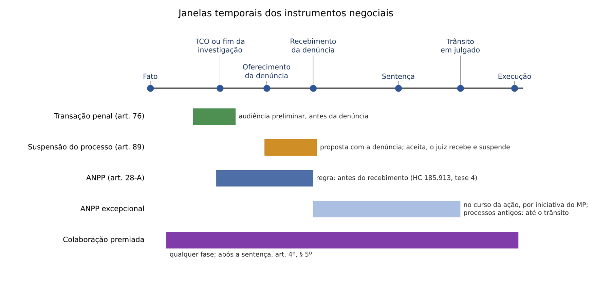
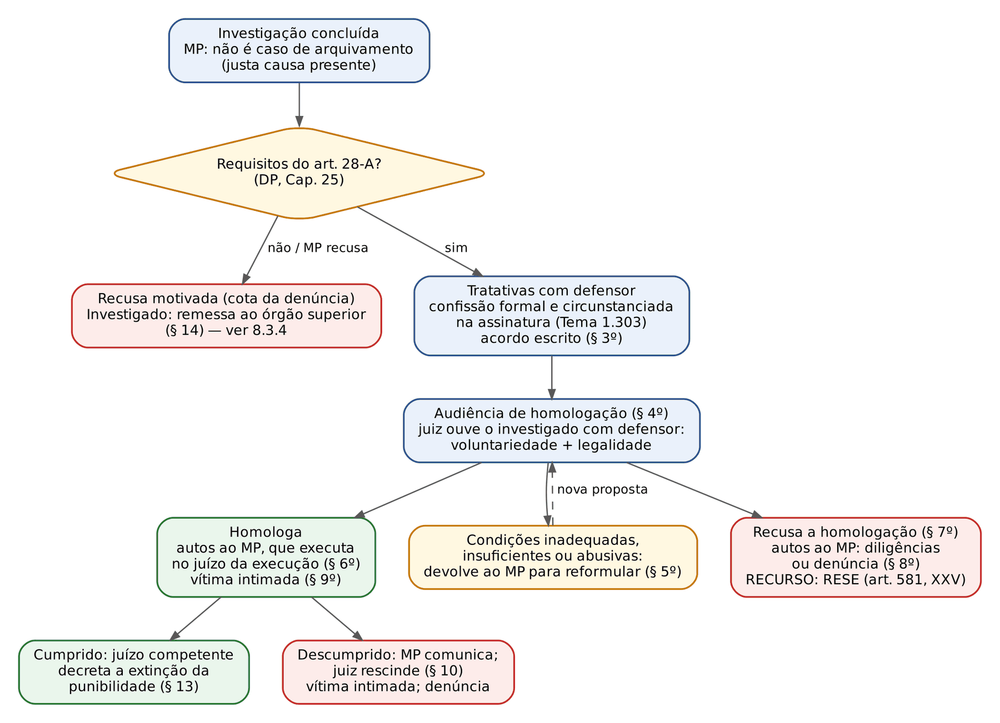
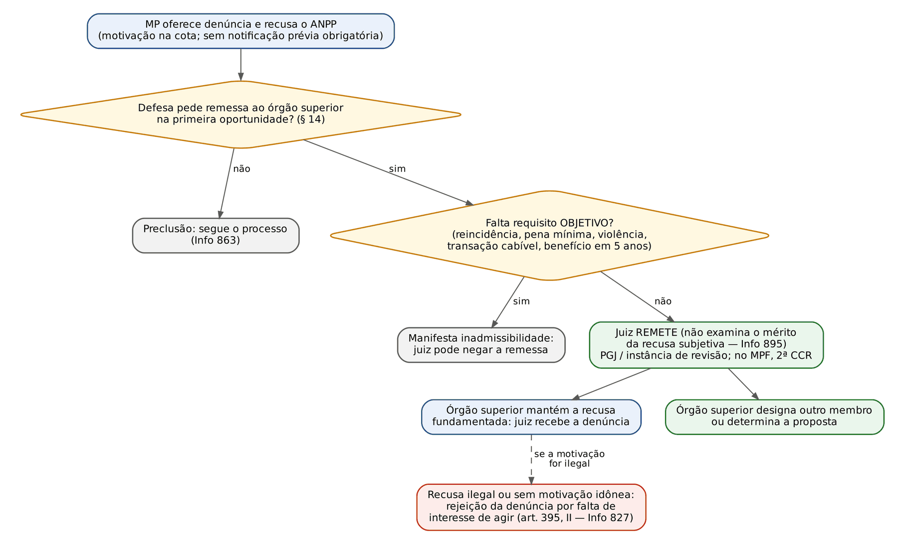
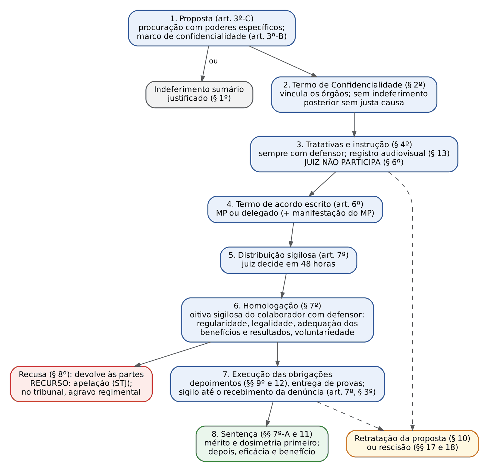
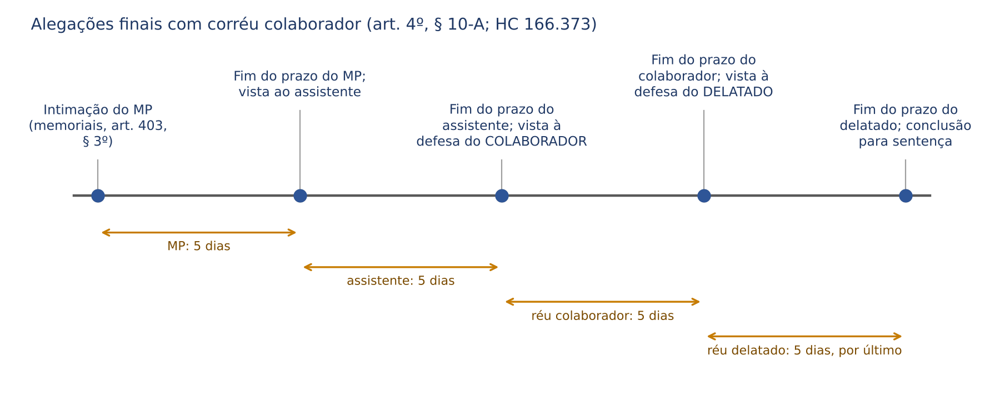

# CAPÍTULO 08 — JUSTIÇA PENAL NEGOCIAL: VISÃO PROCESSUAL DO ANPP, DA TRANSAÇÃO E DA SUSPENSÃO CONDICIONAL DO PROCESSO; COLABORAÇÃO PREMIADA; JUSTIÇA RESTAURATIVA

:::INCIDENCIA
TRF5 p. 4; TJRS p. 10; TJSC p. 19. Nível A; lote de 53 questões (FGV 47, FCC 6), o maior da disciplina.
O que mais cai: cabimento do ANPP em casos com várias personagens, papel do juiz diante da recusa do MP, recurso contra a recusa de homologação e, na colaboração, os "quatro erros" da FGV: juiz que negocia, renúncia à impugnação, não denúncia do líder e retratação.
:::

| Subtema | FGV | FCC | Padrão de cobrança |
|---|---|---|---|
| ANPP: cabimento e vedações | 12 | 3 | várias personagens; pena mínima com o § 1º; violência doméstica; crimes raciais |
| ANPP: recusa do MP e controle judicial | 5 | 1 | juiz não oferece o acordo; remessa ao órgão superior; rejeição da denúncia |
| ANPP: homologação, condições, recurso e rescisão | 4 | 2 | literalidade dos §§ 4º a 11; RESE do art. 581, XXV |
| ANPP no tempo | 2 | 0 | HC 185.913 e Tema 1.098 |
| Colaboração: partes, negociação, prêmios e cláusulas | 12 | 0 | três ou quatro colaboradores; §§ 4º, 6º, 7º-B e 10 |
| Colaboração: homologação, sigilo, corroboração e improbidade | 6 | 0 | § 7º, art. 7º, § 16; Tema 1.043 do STF |
| Transação e suspensão condicional do processo | 6 | 0 | literalidade da Lei 9.099/1995 |

## 08.1 O espaço de consenso no processo penal: a lógica antes das regras

O juiz cível homologa acordos quase como formalidade (art. 487, III, b, do CPC). No processo penal a premissa é a inversa: a pretensão punitiva é indisponível, o MP, presente justa causa, deve denunciar (obrigatoriedade) e não pode desistir (art. 42 do CPP). O consenso só existe onde a lei o autoriza, com requisitos rígidos e controle judicial ("obrigatoriedade mitigada" ou "discricionariedade regrada"). Três consequências atravessam o capítulo e são exploradas sem cessar pela banca:

- O JUIZ NÃO PROPÕE, NÃO NEGOCIA E NÃO "CONCEDE" o benefício contra a vontade do titular da ação penal; controla a legalidade e a voluntariedade do que as partes ajustaram (sistema acusatório, art. 3º-A do CPP).
- O investigado não tem direito subjetivo ao acordo, mas tem direito a uma recusa MOTIVADA, controlada, em regra, dentro do próprio MP (órgão superior), e não pelo juiz.
- A homologação não é sentença de mérito: não declara culpa nem produz os efeitos de uma condenação.

A analogia útil para o civilista é o negócio processual do art. 190 do CPC, com três diferenças: o objeto é a própria persecução; o acordo é personalíssimo e sempre exige defensor; e o juiz exerce controle intenso, com oitiva pessoal do investigado ou colaborador.

Há quatro instrumentos negociais. Transação, suspensão do processo e ANPP evitam ou paralisam o processo em troca de condições (requisitos materiais e efeitos penais na Apostila de Direito Penal, Cap. 25, doravante DP); a colaboração premiada não evita o processo: troca informações e provas por prêmios, e recebe aqui tratamento completo. O que distingue os três primeiros, para o juiz, é o MOMENTO em que operam:

## 08.2 Transação penal e suspensão condicional do processo: o que o juiz decide

### 08.2.1 Transação penal: momento, forma e recurso

O ambiente é o Juizado Especial Criminal (procedimento no Cap. 24). Na audiência preliminar, tenta-se primeiro a composição civil (art. 74 da Lei 9.099/1995); frustrada ou incabível, e presente a representação quando exigida, o MP pode propor pena restritiva de direitos ou multa (art. 76).

:::PASSO Transação penal na audiência preliminar
1. Confira se é infração de menor potencial ofensivo (máximo não superior a 2 anos, observado o concurso; art. 61) e se não há exclusão legal (violência doméstica contra a mulher, art. 41 da Lei 11.340/2006; Justiça Militar, art. 90-A).
2. Colha a aceitação do autor do fato E do defensor (§ 3º); divergindo, prevalece, para a maioria, a vontade do autor, devidamente esclarecido.
3. Controle a legalidade: restritiva ou multa, nunca privativa de liberdade; sendo a multa a única pena aplicável, você pode reduzi-la até a METADE (§ 1º), nunca aumentá-la.
4. Homologue por sentença: sem reincidência, sem antecedentes, sem efeitos civis, com registro só para impedir novo benefício em 5 anos (§§ 4º e 6º).
5. Recurso: apelação em 10 dias, com razões na petição, à Turma Recursal (art. 76, § 5º, c/c art. 82, § 1º).
6. Descumprida, não há conversão em prisão: retoma-se a persecução (Súmula Vinculante 35; DP, Cap. 25).
:::

Se o MP se recusa a propor, o juiz que discorda NÃO formula a proposta: aplica, por analogia, a Súmula 696 do STF (remessa ao órgão superior do MP; DP, Cap. 25). Foi a alternativa errada da FGV 2024 — TJ-SC — Juiz Substituto (Q2387006), em caso de violência doméstica, no qual a transação nem sequer cabia.

:::QUESTAO FGV 2025 — TJ-SC — Juiz Leigo (Q3592817)
Caso: injúria contra funcionário público em razão da função; o autor fora condenado definitivamente, dois meses antes, por CONTRAVENÇÃO, a prisão simples, e recebera transação havia sete anos.
Gabarito: D — cabe a proposta, que, aceita pelo autor e pelo defensor, será submetida ao juiz.
Passos: a injúria majorada (art. 141, II, do CP) tem máximo de 8 meses; o art. 76, § 2º, I, só impede quem foi condenado por CRIME a pena privativa; o impedimento do inciso II é de 5 anos. Armadilha: C diz que a transação servirá como maus antecedentes (§ 6º).
No mesmo sentido, literalidade do art. 76: FGV 2025 — DPE-PE (Q3390869, gabarito A; erradas as que negam recurso, atribuem efeitos civis ou deixam o juiz dobrar a multa) e FGV 2025 — TJ-SC — Juiz Leigo (Q3592809, gabarito D: proposta de restritiva imediata é transação e pressupõe menor potencial ofensivo).
:::

### 08.2.2 Suspensão condicional do processo: a ordem dos atos

A suspensão (art. 89) vale em qualquer rito e juízo, inclusive na Justiça Federal, se a pena MÍNIMA for igual ou inferior a 1 ano. A pegadinha está na ordem: a proposta vem COM a denúncia; aceita pelo acusado e pelo defensor "na presença do Juiz", este RECEBE a denúncia e só então suspende (§ 1º). Sem recebimento não há processo a suspender; por isso o juiz controla antes a aptidão da denúncia e a justa causa (a aceitação não impede HC para trancar a ação: Súmula 667 do STJ; DP, Cap. 25).

:::PROCESSO Suspensão condicional do processo: atos e recursos
| Ato | Detalhe processual |
|---|---|
| Proposta | com a denúncia; recusa do MP: Súmula 696 do STF |
| Audiência | aceitação do acusado e do defensor "na presença do Juiz" (não do promotor) |
| Recebimento e suspensão | 2 a 4 anos; condições legais e outras adequadas (§§ 1º e 2º); prescrição suspensa (§ 6º) |
| Revogação obrigatória | processado por outro CRIME; dano não reparado sem motivo justificado (§ 3º) |
| Revogação facultativa | processado por CONTRAVENÇÃO; outra condição descumprida (§ 4º) |
| Extinção | prazo expirado sem revogação (§ 5º); revogação possível depois, por fato do período (Tema 920 do STJ) |
| Recurso | contra a revogação, RESE por analogia ao art. 581, XI (há quem sustente apelação residual — ver nota) |
:::

Antes de revogar por falta de reparação, ouça a defesa: a lei ressalva o "motivo justificado".

:::QUESTAO FGV 2025 — TJ-SC — Juiz Leigo (Q3592816)
Caso: dano qualificado ao patrimônio estadual (6 meses a 3 anos); o denunciado responde a outro processo, por roubo.
Gabarito: D — não cabe a suspensão, porque o acusado está sendo processado por outro crime (art. 89, caput). Armadilhas: A inverte a ordem ("antes de receber a denúncia, poderá suspender"); B e C supõem que só a condenação definitiva impede.
No mesmo sentido: FGV 2026 — MPE-GO (Q3865767, gabarito B, V-F-F: no "racha" com lesão grave culposa — art. 308, § 1º, do CTB, 3 a 6 anos — não cabem transação nem suspensão, e quem suspende é o juiz, não o promotor); FGV 2025 — TJ-SC — Juiz Leigo (Q3592821, gabarito A: dano não reparado revoga obrigatoriamente; processo por contravenção, facultativamente).
:::

Se a desclassificação ou a procedência parcial tornam cabível um benefício, o juiz não condena direto: abre vista ao MP (art. 383, § 1º, do CPP; Súmula 337 do STJ; DP, Cap. 25). O STJ admite ainda a correção da capitulação já no recebimento, quando repercute no cabimento do benefício (FCC 2025 — DPE-SP, Q3304104, gabarito C; *emendatio libelli* no Cap. 21).

## 08.3 Acordo de não persecução penal: procedimento, controle judicial e recursos

### 08.3.1 O teste de cabimento visto pelo juiz

O ANPP (art. 28-A do CPP) é negócio jurídico pré-processual entre MP e investigado assistido por defensor: em vez de denunciar, o MP ajusta condições cujo cumprimento extingue a punibilidade. A norma é híbrida, o que explica sua retroatividade (08.3.5). Requisitos, vedações e contas de pena estão na DP, Cap. 25 (25.6.2 e 25.6.3). Como a banca cobra o cabimento em casos com várias personagens, use o teste abaixo, nesta ordem:

:::PASSO Cabe ANPP? Teste em seis perguntas
1. É caso de arquivamento (atipicidade, prescrição, falta de justa causa, prova ilícita)? Então não há acordo.
2. Violência doméstica ou familiar, ou crime contra a mulher por razões da condição do sexo feminino? Vedado (§ 2º, IV). Crime racial ou homofóbico? Vedado pela jurisprudência (08.3.7).
3. Violência ou grave ameaça à PESSOA? Vedado (violência contra a coisa não impede).
4. Pena mínima, com aumentos pela fração mínima e diminuições pela máxima (§ 1º), INFERIOR a 4 anos? Quatro anos exatos não bastam.
5. Cabe transação? Então não cabe ANPP (§ 2º, I). Cabe suspensão do processo? Isso NÃO impede o ANPP.
6. Reincidência, ou elementos de conduta habitual, reiterada ou profissional (salvo infrações pretéritas insignificantes), ou benefício (ANPP, transação ou suspensão) nos 5 anos anteriores ao cometimento da infração? Vedado (§ 2º, II e III).
Superado o teste, o MP avalia se o acordo é "necessário e suficiente" (juízo motivado, revisável internamente). A confissão pode ser colhida na assinatura (Tema 1.303 do STJ; DP, Cap. 25).
:::

:::QUESTAO FCC 2026 — TJ-CE — Analista Judiciário (Q4231784)
Caso: quatro primários. Murilo: 4 a 8 anos. Thiago: grave ameaça, 1 a 6 meses. Maurício: 1 a 5 anos, beneficiado por suspensão do processo nos 5 anos anteriores. Vinícius: 2 a 6 anos.
Gabarito: C — apenas Vinícius. Murilo cai na pergunta 4; Thiago, nas 3 e 5; Maurício, na 6.
No mesmo sentido: FCC 2025 — TRF4 (Q3538958, A: só a lavagem; lesão grave tem violência, o art. 337-E tem mínimo de 4 anos, a ameaça à esposa esbarra no § 2º, IV); FCC 2024 — TRF3 (Q2564678, B: moeda falsa e facilitação de contrabando; coação no curso do processo e resistência têm grave ameaça ou violência); FGV 2024 — EBSERH (Q3248778, D: corrupção passiva, 2 a 12 anos, admite; tentativa de crime com mínimo de 12 anos chega a 4 anos exatos); FGV 2024 — TJ-RJ — Residência (Q2375309, E: silêncio na polícia e passagens insignificantes não impedem); FGV 2024 — TJ-RJ — Mediador (Q2370301, C: o acordo exige confissão).
:::

:::QUESTAO FGV 2024 — PC-SC — Delegado (Q2360691)
Caso: Sidnei, falso testemunho (2 a 4 anos); Fabiano, fraude em contrato (art. 337-L: 4 a 8 anos); Ailton, lesão grave (1 a 5 anos).
Gabarito: A — I e II: ANPP só para Sidnei e suspensão do processo só para Ailton.
Passos: Sidnei admite ANPP (mínimo de 2 anos, sem violência), mas não suspensão (mínimo acima de 1 ano); Fabiano não admite ANPP (mínimo de 4 anos não é "inferior a 4") nem suspensão; Ailton admite suspensão (mínimo de 1 ano), mas não ANPP (violência). Armadilha: a assertiva IV estende o ANPP a Fabiano, ignorando que 4 anos exatos excluem o acordo.
:::

:::QUESTAO FGV 2026 — TJ-PR — Juiz Substituto (Q3898934)
Caso: furto simples, primário confesso; o MP recusa porque houve transação "há 6 anos".
Gabarito: B — a recusa é incorreta: o § 2º, III, alcança os 5 anos anteriores ao cometimento da infração e abrange ANPP, transação e suspensão.
No mesmo sentido: FGV 2025 — TJ-ES — Cartórios (Q3520644, D: suspensão há 4 anos impede o acordo); FGV 2025 — MPE-RJ (Q3362528, E: reincidência dolosa, transação há 3 anos e violência doméstica vedam o acordo); FGV 2026 — TJ-MS — Cartórios (Q3914515, E: peculatário reincidente não celebra ANPP; o crime contra a Administração, em si, não é vedação).
:::

### 08.3.2 Proposta, confissão e formalização

Se entender que o acordo não cabe, o MP não precisa notificar o investigado: motiva a recusa na cota da denúncia, e a defesa, ciente na citação, pede a remessa ao órgão superior na primeira oportunidade (Jurisprudência em Teses do STJ, ed. 185, tese 4; 5ª Turma, AgRg no REsp 2.039.021-TO, j. 8/8/2023). Por isso estava errada a alternativa E da FGV 2024 — MPE-GO (Q2367585). Nas tratativas, o investigado está sempre com defensor; a confissão formal e circunstanciada é colhida perante o MP e registrada em áudio e vídeo (Res. CNMP 181/2017, art. 18); o acordo é escrito e assinado pelo membro do MP, pelo investigado e pelo defensor (§ 3º).

:::LEI Código de Processo Penal, art. 28-A, II e III
II - renunciar voluntariamente a bens e direitos indicados pelo Ministério Público como instrumentos, produto ou proveito do crime;
III - prestar serviço à comunidade ou a entidades públicas por período correspondente à pena mínima cominada ao delito diminuída de um a dois terços, em local a ser indicado pelo juízo da execução, na forma do art. 46 do Decreto-Lei nº 2.848, de 7 de dezembro de 1940 (Código Penal);
:::

:::PEGADINHA Quem indica o quê nas condições
Os bens a renunciar são indicados pelo MINISTÉRIO PÚBLICO; o local da prestação de serviços e a entidade beneficiária da prestação pecuniária, pelo JUÍZO DA EXECUÇÃO (incisos III e IV). Por isso o STJ validou a recusa de homologação de acordo que já nomeava a entidade (5ª Turma, AREsp 2.419.790-MG, j. 6/2/2024, Info 800). A redução da prestação de serviços é de UM a dois terços. A FGV 2026 — MPE-GO (Q3865779, gabarito C) trocava MP por juízo da execução e "um" por "um sexto".
:::

### 08.3.3 Audiência de homologação: controle, decisões e recurso

Competência: na investigação, o juiz das garantias (art. 3º-B, XVII, do CPP); como a competência dele cessa com o OFERECIMENTO da denúncia (ADIs 6.298, 6.299, 6.300 e 6.305; Cap. 3), o acordo posterior é homologado pelo juiz da causa; havendo foro por prerrogativa, pelo tribunal (FGV 2026 — ALERJ, Q3880803, gabarito B: corrupção passiva de deputado estadual no mandato, homologação pelo TJ).

A audiência é OBRIGATÓRIA (§ 4º): o juiz ouve o investigado, na presença do defensor, e verifica a VOLUNTARIEDADE e a LEGALIDADE. O controle é de legalidade, não de conveniência: o juiz não reescreve cláusulas.

:::LEI Código de Processo Penal, art. 28-A, §§ 5º a 8º
§ 5º Se o juiz considerar inadequadas, insuficientes ou abusivas as condições dispostas no acordo de não persecução penal, devolverá os autos ao Ministério Público para que seja reformulada a proposta de acordo, com concordância do investigado e seu defensor.
§ 6º Homologado judicialmente o acordo de não persecução penal, o juiz devolverá os autos ao Ministério Público para que inicie sua execução perante o juízo de execução penal.
§ 7º O juiz poderá recusar homologação à proposta que não atender aos requisitos legais ou quando não for realizada a adequação a que se refere o § 5º deste artigo.
§ 8º Recusada a homologação, o juiz devolverá os autos ao Ministério Público para a análise da necessidade de complementação das investigações ou o oferecimento da denúncia.
:::

Os destinatários são a pegadinha: no § 5º os autos voltam ao MP oficiante (não ao Procurador-Geral); no § 6º o juiz devolve ao MP, que inicia a execução (não "encaminha ao juízo da execução"). Erradas, por isso, a alternativa C da FGV 2025 — TRF3 (Q3179531) e a C da FGV 2024 — MPE-GO (Q2367585).

O controle de legalidade inclui a justa causa: acordo apoiado em prova ilícita ou sobre fato atípico não se homologa, ainda que o investigado queira "não correr o risco do processo" (FGV 2026 — DPE-RJ, Q4289369, gabarito A: busca domiciliar sem mandado nem consentimento registrado; a defesa deve pedir a recusa da homologação e o trancamento; busca no Cap. 15).

:::QUESTAO FGV 2025 — PC-MG — Delegado (Q3171419)
Afirmativas: (I) condições abusivas: remessa ao órgão superior do MP; (II) audiência com oitiva do investigado e defensor, para voluntariedade e legalidade; (III) vítima intimada da homologação e do descumprimento.
Gabarito: D — II e III. A I troca o destinatário do § 5º.
No mesmo sentido: FGV 2025 — TRF3 — Juiz Federal (Q3179531), em que também estava errada a alternativa E (dispensa da audiência).
:::

Recursos: contra a decisão que RECUSA a homologação cabe RESE (art. 581, XXV), em 5 dias (art. 586). Contra a que HOMOLOGA não há recurso específico, e o STJ fecha as vias de rediscussão: HC não discute condições da proposta, cujo controle é a revisão interna do § 14 (6ª Turma, RHC 184.507-MT, j. 1º/4/2025, Info 846), e cláusulas validamente homologadas não se rediscutem (6ª Turma, HC 969.749-RJ, j. 18/3/2025, Info 844).

:::QUESTAO FCC 2025 — DPE-AM — Defensor Público (Q3531600)
Gabarito: D — cabe ANPP na ação penal privada, com legitimidade supletiva do MP diante da inércia ou recusa infundada do querelante (STJ, REsp 2.083.823-DF; DP, Cap. 20).
Armadilhas: B ("apelação em 10 dias" contra a recusa de homologação: é RESE em 5 dias); C (delegado propõe ANPP); A (acordo em caso de arquivamento); E (confissão no inquérito exigida).
:::

:::SENTENCA Decisão de homologação do ANPP
O que fundamentar: competência; requisitos do caput e ausência das vedações do § 2º; justa causa; voluntariedade (oitiva do investigado assistido); legalidade e proporcionalidade das condições, sem nomear a entidade beneficiária; determinações: intimação da vítima (§ 9º), devolução ao MP (§ 6º), anotação só para o fim do § 2º, III (§ 12), prescrição suspensa (art. 116, IV, do CP).
Redação-modelo: "Ouvido o investigado na presença de seu defensor, constato que aderiu livre e conscientemente ao acordo, cujas condições são lícitas e proporcionais, presentes os requisitos do art. 28-A, caput, do CPP e ausentes as vedações do § 2º. Homologo o acordo e determino a intimação da vítima e a devolução dos autos ao Ministério Público para a execução (§§ 6º e 9º)."
Erro que a banca pune: alterar de ofício as condições (o caminho é o § 5º); dispensar a audiência; homologar acordo sobre prova ilícita.
:::

### 08.3.4 Recusa do MP: remessa ao órgão superior e limites do juiz

A recusa motivada é controlada INTERNAMENTE: o investigado requer a remessa a órgão superior, na forma do art. 28 (§ 14) — nos MPs estaduais, o Procurador-Geral ou a instância de revisão; no MPF, a 2ª Câmara de Coordenação e Revisão. O juiz é o canal, não o revisor:

- Só nega a remessa diante de manifesta inadmissibilidade (falta de requisito OBJETIVO); recusa por critério subjetivo, como habitualidade inferida do histórico, deve ser remetida (ed. 185, tese 3; 6ª Turma, AgRg no REsp 2.088.701-PR, j. 22/4/2026, Info 895).
- Não oferece o acordo, não homologa proposta da defesa e não suspende o processo à espera dele.
- Recusa ILEGAL (impedimento inexistente, gravidade abstrata, erro de direito) mantida autoriza a REJEIÇÃO da denúncia por falta de interesse de agir (art. 395, II; 6ª Turma, REsp 2.038.947-SP, j. 17/9/2024, Info 827), decisão impugnável por RESE (art. 581, I).
- O pedido vem na primeira oportunidade, em regra na resposta à acusação; a apresentação tardia sofre preclusão (6ª Turma, AgRg no Acordo no AREsp 2.600.503-ES, j. 16/9/2025, Info 863).

:::QUESTAO FCC 2026 — DPE-MA — Defensor Público (Q4012645)
Caso: primário flagrado vendendo 17 g de cocaína, confesso; o MP recusa porque "o tráfico tem pena mínima superior a 4 anos"; a Procuradoria-Geral mantém a recusa com o mesmo fundamento.
Gabarito: E — rejeitar a denúncia por falta de interesse de agir.
Passos: a pena mínima se afere com as diminuições aplicáveis (§ 1º): com o redutor máximo do art. 33, § 4º, da Lei 11.343/2006, 5 anos viram 1 ano e 8 meses; a recusa ignorou a lei e deveria explicar concretamente por que o privilégio não incidiria; mantida, autoriza a rejeição (REsp 2.038.947-SP). Armadilhas: A e D invocam o "sistema acusatório" para receber; B nega o § 1º; C fala em pressuposto processual; D ainda envia a questão à Procuradoria-Geral da República.
:::

:::QUESTAO FGV 2026 — PC-PR — Delegado (Q4378290)
Caso: receptação qualificada, primário confesso; recusa motivada pela lesividade concreta.
Gabarito: C — o ANPP é negócio processual e poder-dever do MP; a via da defesa é a remessa ao órgão superior. Erradas: direito subjetivo imposto pelo juiz, homologação de proposta da defesa, recusa imune a controle, necessidade e suficiência como juízo exclusivo do Judiciário.
No mesmo sentido: FGV 2025 — CGE-SP (Q3781279, C: contra a recusa, remessa; não agravo, RESE, pedido ao juiz ou suspensão).
:::

:::QUESTAO FGV 2026 — ENAC — Cartórios (Q4130173)
Caso: estelionatário com dois inquéritos e uma condenação não definitiva, mesmo *modus operandi*; recusa por habitualidade.
Gabarito: D — recusa válida: inquéritos e processos em curso são "elementos probatórios" de habitualidade (6ª Turma, AgRg no RHC 215.549-GO, j. 10/2/2026, Info 879). Armadilha: B transporta a Súmula 444 do STJ, que é regra de pena-base.
No mesmo sentido: FGV 2026 — MPE-MT (Q4116992, D), em que estavam erradas a continuidade delitiva tratada como habitualidade (DP, Cap. 25) e a resposta à proposta só depois da instrução (a manifestação segue o oferecimento: 5ª Turma, AgRg no REsp 2.171.590-SP, j. 14/5/2025, Info 852).
:::

:::QUESTAO FGV 2025 — TJ-CE — Juiz Substituto (Q3505805)
Caso: estelionato; investigado em silêncio no inquérito; recusa exclusivamente por falta de confissão; a defesa pede a remessa.
Gabarito: B — o juiz remete, porque a confissão pode ser formalizada na assinatura (Tema 1.303; antes, HC 657.165-RJ). Armadilhas: D e E mandam o juiz determinar a proposta sem remessa.
:::

### 08.3.5 ANPP depois do recebimento da denúncia e em processos em curso

O regime temporal (STF, HC 185.913, j. 18/9/2024; STJ, Tema 1.098) está na DP, Cap. 25. No procedimento, o juiz distingue:

:::PASSO O pedido de ANPP chegou depois do recebimento
1. Processo em curso em 23/1/2020: cabe o acordo, mesmo sem confissão anterior, se pedido antes do trânsito em julgado; se ainda em curso em 18/9/2024 sem manifestação do MP, o juiz provoca o MP a manifestar-se motivadamente (tese 3), sem nulidade automática.
2. Processo iniciado depois de 18/9/2024: proposta ou motivação ANTES do recebimento (tese 4); no curso da ação, só por iniciativa do MP (por exemplo, após desclassificação).
3. A defesa pede na primeira oportunidade (Info 863) e responde logo à proposta (Info 852).
4. Celebrado o acordo, o juízo da causa (ou o tribunal, se pendente recurso) faz a audiência do § 4º; o processo fica sobrestado, com a prescrição suspensa; cumprido, extingue-se a punibilidade; rescindido, retoma-se do ponto em que parou.
:::

:::QUESTAO FGV 2025 — TJ-CE — Juiz Substituto (Q3505804)
Caso: estelionato de 2019, denúncia recebida em fevereiro de 2020; antes das alegações finais a defesa pede o ANPP, negado por ser posterior ao recebimento.
Gabarito: D — cabe em processos em curso, mesmo após o recebimento, até o trânsito em julgado. Armadilhas: A (após o trânsito), B (limite do recebimento, tese 1 da ed. 185 da Jurisprudência em Teses, superada), E (irretroatividade).
No mesmo sentido: FGV 2025 — MPE-ES (Q3752771, C: cabe ANPP no tráfico privilegiado; erradas a retroação a condenações transitadas, o direito subjetivo, a confissão pré-processual indispensável e o reaproveitamento da confissão após a revogação).
:::

### 08.3.6 Descumprimento, rescisão e destino da confissão

Descumprida qualquer condição, o MP comunica ao juízo para a rescisão e posterior denúncia (§ 10), e a vítima é intimada (§ 9º). O STJ decidiu que a revogação não exige a intimação do investigado para justificar o descumprimento, por falta de previsão legal, afastando a analogia com o art. 118, § 2º, da LEP (6ª Turma, AgRg no HC 809.639-GO, j. 17/10/2023, Info 795) — gabarito D da FGV 2024 — MPE-GO (Q2367585). É a orientação vigente: não localizei precedente do STJ de 2024 a 2026 em sentido contrário. Ouvir a defesa técnica antes de decidir continua sendo cautela recomendável (por exemplo, diante de alegada impossibilidade de pagar), não exigência. Pendente: a Terceira Seção afetou, em junho de 2026, o REsp 2.052.234 para definir QUEM rescinde o acordo, o juiz que o homologou ou o juízo da execução penal (ver nota). Rescindido o acordo, a prescrição volta a correr (art. 116, IV, do CP), o MP denuncia e o descumprimento pode justificar a recusa de suspensão do processo (§ 11). Contra a rescisão não há recurso previsto: a doutrina divide-se entre RESE por analogia ao art. 581, XXV, e apelação residual; na urgência, HC (ver nota).

:::QUESTAO FCC 2025 — DPE-SP — Analista (Q3304100)
Gabarito: A — o descumprimento do ANPP pode justificar o não oferecimento da suspensão do processo (§ 11). Armadilhas: B (apelação contra a recusa de homologação), C (falta de confissão no inquérito), D (reincidente "ainda que insignificante" a infração pretérita) e E (norma só processual, irretroativa).
:::

A confissão do acordo rescindido: (1) nunca basta sozinha para condenar (arts. 155 e 197 do CPP); (2) não serve a outros fins em prejuízo do beneficiário — o STJ não a admitiu para negar o tráfico privilegiado em processo posterior (5ª Turma, AgRg no HC 895.165-SP, j. 6/8/2024, Info 827); (3) a FGV tratou como errada a afirmação de que "admite-se o reaproveitamento da confissão como prova desfavorável" (Q3752771, alternativa E). Parte da doutrina sustenta sua imprestabilidade absoluta; outra admite uso como elemento informativo a corroborar. Na sentença, não fundamente a condenação nela.

### 08.3.7 ANPP na violência doméstica, nos crimes raciais e na Justiça Federal

Violência doméstica e de gênero: o § 2º, IV, somado ao art. 41 da Lei 11.340/2006 e à Súmula 536 do STJ (DP, Cap. 25), afasta TODOS os instrumentos consensuais no contexto doméstico contra a mulher, inclusive no descumprimento de medida protetiva (FCC 2025 — DPE-AM, Q3531597, gabarito E). A FGV combina essa vedação com a preventiva para garantir medida protetiva (art. 313, III, do CPP; Cap. 19): TJ-BA 2026 (Q4083768, D), TJ-PA 2026 (Q3951767, E), TJ-MS 2025 (Q3786386, D), MPE-RJ 2025 (Q3532365, E), TJ-SE 2025 (Q3301276, C).

:::QUESTAO FGV 2026 — TJ-GO — Juiz Substituto (Q3966685)
Caso: ameaça e lesão leve contra a esposa, por razões da condição de mulher; primário, sem benefícios anteriores, confesso.
Gabarito: E — nem transação para a ameaça, nem ANPP para a lesão: o art. 41 da Lei 11.340/2006 afasta a Lei 9.099/1995 por inteiro, e a lesão esbarra no § 2º, IV (e tem violência).
No mesmo sentido: FGV 2024 — TJ-RJ — Mediador (Q2370304, D: a vontade da vítima é irrelevante; ação penal).
:::

Crimes raciais e homofóbicos: sem vedação expressa, o STF (2ª Turma, RHC 222.599, j. 7/2/2023) e o STJ (5ª Turma, AREsp 2.607.962-GO, j. 13/8/2024, Info 821) afastam o ANPP, inclusive na injúria racial e nas condutas homofóbicas e transfóbicas (DP, Cap. 41). Cobrado na FGV 2025 — TJ-CE (Q3505807, C) e na FGV 2025 — TRF3 (Q3179531, D).

Justiça Federal: descaminho, contrabando, moeda falsa, estelionato contra entidade pública, crimes tributários e lavagem cabem, em regra, no acordo. A remessa do § 14 vai à 2ª Câmara de Coordenação e Revisão do MPF; nos crimes tributários, a possibilidade de extinguir a punibilidade pelo pagamento não afasta o ANPP (errada a alternativa B da Q3179531); a reparação à União ou à autarquia é condição frequente (inciso I), e o conflito sobre sua execução entre juízos cível e criminal é da 3ª Seção do STJ (CC 210.253-DF; DP, Cap. 25).

:::QUESTAO FGV 2025 — TRF5 — Juiz Federal Substituto (Q3373863)
Caso: estelionato previdenciário (art. 171, § 3º: 1 a 5 anos + 1/3); primário que negou o fato na polícia.
Gabarito: D — condenado a pena não superior a 2 anos, o juiz poderá suspender a execução se incabível a substituição (art. 77 do CP).
Passos: suspensão do processo não cabe (mínimo de 1 ano e 4 meses); transação não cabe; o juiz não oferece ANPP. A alternativa E (ANPP "condicionado à reparação do dano") é discutível: o acordo cabe em tese, e a negativa na polícia não o impede após o Tema 1.303 (março de 2025); a FGV a considerou errada (ver nota).
:::

## 08.4 Colaboração premiada (Lei 12.850/2013, arts. 3º-A a 7º)

### 08.4.1 Natureza jurídica e consequências práticas

:::LEI Lei 12.850/2013, art. 3º-A
Art. 3º-A. O acordo de colaboração premiada é negócio jurídico processual e meio de obtenção de prova, que pressupõe utilidade e interesse públicos.
:::

O dispositivo positivou o que o STF assentara no HC 127.483 (Plenário, j. 27/8/2015). Cada expressão tem consequência:

- NEGÓCIO JURÍDICO PROCESSUAL personalíssimo: partes, cláusulas, planos de validade e eficácia; efeitos não se estendem a corréus (Jurisprudência em Teses do STJ, ed. 195, tese 6).
- MEIO DE OBTENÇÃO DE PROVA, não prova: o acordo é técnica para chegar a documentos, extratos, gravações e bens; as declarações do colaborador, sozinhas, não são prova nem indício suficiente (ed. 195, tese 2), daí a regra de corroboração (08.4.7).
- UTILIDADE E INTERESSE PÚBLICOS: não há direito subjetivo ao acordo; a recusa é motivada e revisável pelo órgão superior do MP, por analogia ao art. 28; sem acordo, o réu pode colaborar e ser premiado na sentença, se a lei aplicável o prever (STF, 2ª Turma, MS 35.693 AgR, j. 28/5/2019).

Âmbito: cabe também em crimes praticados em concurso de agentes fora de organização criminosa (STJ, HC 582.678-RJ, Info 742); a vítima não pode ser colaboradora (HC 750.946-RJ, Info 754). A Lei 15.358/2026 não alterou os arts. 3º-A a 7º: manda aplicar aos seus crimes os meios de obtenção de prova da Lei 12.850/2013 (arts. 8º e 32) e criou figura distinta, o TERCEIRO não réu que colabora na ação civil de perdimento, com retribuição de até 5% do produto da liquidação, fixada na sentença (art. 28; DP, Cap. 46; Cap. 26). Os benefícios não se aplicam ao processo disciplinar (ed. 194, tese 9). Na improbidade, a tese do STJ em sentido contrário (ed. 194, tese 10) foi superada pelo STF:

:::JURIS STF, Tema 1.043 (ARE 1.175.650, Plenário, julgamento concluído em 30/6/2023)
É constitucional usar a colaboração da Lei 12.850/2013 na ação de improbidade movida pelo MP, com as diretrizes: homologação judicial com oitiva sigilosa do colaborador; declarações desacompanhadas de outras provas não bastam para iniciar a ação; ressarcimento INTEGRAL, sendo negociáveis só o modo e as condições; celebração pelo MP com a INTERVENIÊNCIA da pessoa jurídica interessada; preservação dos acordos anteriores com ressarcimento total, homologados e cumpridos.
:::

:::QUESTAO FGV 2024 — AL-PR — Procurador (Q2448943)
Gabarito: E — para a improbidade, o acordo exige interveniência da pessoa jurídica interessada e homologação judicial.
No mesmo sentido: FGV 2024 (Q2564187, C: ressarcimento integral, negociáveis modo e condições). Correlata: FGV 2025 — MPE-RJ (Q3532436, D). Questão geral sobre os instrumentos da operação Lava Jato (preventiva e delação): FGV 2025 (Q3578684, B).
:::

### 08.4.2 Quem celebra: MP, delegado e o juiz que não negocia

Celebram o MP, em qualquer fase, e o delegado, no inquérito, "com a manifestação do Ministério Público" (art. 4º, §§ 2º e 6º). O STF declarou constitucional a legitimidade do delegado, com manifestação prévia do MP sem caráter vinculante (ADI 5.508, Plenário, j. 20/6/2018); depois, assentou que a anuência do MP é condição de eficácia do acordo policial (Pet 8.482 AgR, Plenário, j. 31/5/2021). Pacífico: sem manifestação do MP o juiz não homologa o acordo do delegado; e o delegado não pactua o não oferecimento de denúncia (disposição da ação penal, art. 129, I, da CF) nem concede imunidade; o perdão judicial ele apenas representa ao juiz (§ 2º).

:::QUESTAO FGV 2026 — PC-PR — Delegado (Q4378299)
Gabarito: B — o delegado conduz as tratativas e subscreve o termo, remetido ao juízo com prévia manifestação do MP "sem poder de veto vinculante" (fórmula da ADI 5.508; sobre a Pet 8.482, ver nota). Erradas: ilegitimidade do delegado, dispensa da ciência do MP, juiz que autoriza e participa, imunidade concedida pelo delegado.
:::

:::QUESTAO FGV 2025 — TRF1 — Juiz Federal Substituto (Q3425296)
Caso: Alessandro, não líder, firma acordo com o delegado prevendo perdão judicial, homologado SEM ouvir o MP; Osmilton, LÍDER e não o primeiro a colaborar, pactua com o MP o não oferecimento de denúncia.
Gabarito: A — nenhum dos dois podia ser homologado: o primeiro, por falta de manifestação do MP; o segundo, porque o § 4º exige não ser o líder e ser o primeiro a colaborar.
No mesmo sentido: FGV 2025 — MPE-ES (Q3752776, D), errada a afirmação de que o STF teria declarado inconstitucional o acordo do delegado.
:::

O JUIZ NÃO PARTICIPA das negociações (§ 6º), nem quando o prêmio é o perdão judicial: quem negocia pré-julga a credibilidade do colaborador e se compromete com o resultado (art. 3º-A do CPP). Também não sugere cláusulas nem condiciona a homologação a obrigações que ele próprio impõe (STF, Pet 7.074 QO, Plenário, 2017).

Defensor em todos os atos de negociação, confirmação e execução (§ 15; art. 3º-C, § 1º); havendo conflito de interesses ou hipossuficiência, outro advogado ou defensor público (art. 3º-C, § 2º). O advogado não pode colaborar contra quem seja ou tenha sido seu cliente (art. 7º, § 6º-I, do Estatuto da OAB, Lei 14.365/2022): é inadmissível a prova assim obtida (STJ, 6ª Turma, RHC 179.805-PR, Info 813), a vedação alcança acordos anteriores à lei (5ª Turma, AgRg no RHC 194.064-SP, j. 7/10/2025), mas é válida a colaboração sobre fatos em que o advogado atuou como AGENTE, e não sobre o que soube no exercício da profissão (6ª Turma, AgRg no RMS 73.012-SP, j. 17/3/2026, Info 882).

### 08.4.3 As fases do acordo

- O recebimento da proposta é MARCO DE CONFIDENCIALIDADE; a proposta pode ser sumariamente indeferida, com justificativa; não o sendo, firma-se Termo de Confidencialidade, que impede o indeferimento posterior sem justa causa e não suspende, por si, a investigação (art. 3º-B, §§ 1º a 3º).
- Se o acordo não for celebrado por iniciativa do celebrante, este não pode usar as informações e provas dadas de boa-fé pelo colaborador (art. 3º-B, § 6º).
- O colaborador narra TODOS os fatos ilícitos de que participou relacionados ao objeto (art. 3º-C, § 3º); a defesa instrui os anexos e indica os elementos de corroboração (§ 4º).
- Tratativas e atos de colaboração DEVEM ser gravados, com cópia ao colaborador (§ 13).
- Termo escrito (art. 6º): relato e possíveis resultados, condições, aceitação do colaborador e do defensor, assinaturas e medidas de proteção.
- Para cumprir a colaboração, o prazo da denúncia ou o processo do colaborador podem ser suspensos por até 6 meses, prorrogáveis por igual período, SUSPENDENDO-SE a prescrição (§ 3º). A FGV troca os três números: "oito meses" e "interrompendo-se" (TJ-SC 2024, Q2387005, alternativa B, errada); "sem que se suspenda" a prescrição (Q3049387, alternativa B, e Q3324279, alternativa E, ambas erradas).

### 08.4.4 Homologação: o que o juiz controla, competência e recurso

O pedido é distribuído SIGILOSAMENTE, sem identificar colaborador e objeto; as informações pormenorizadas vão ao juiz sorteado, que decide em 48 horas (art. 7º, § 1º), depois de ouvir sigilosamente o colaborador com o defensor (oitiva obrigatória desde 2019).

:::LEI Lei 12.850/2013, art. 4º, §§ 7º, 7º-B e 8º
§ 7º Realizado o acordo na forma do § 6º deste artigo, serão remetidos ao juiz, para análise, o respectivo termo, as declarações do colaborador e cópia da investigação, devendo o juiz ouvir sigilosamente o colaborador, acompanhado de seu defensor, oportunidade em que analisará os seguintes aspectos na homologação:
I - regularidade e legalidade;
II - adequação dos benefícios pactuados àqueles previstos no caput e nos §§ 4º e 5º deste artigo, sendo nulas as cláusulas que violem o critério de definição do regime inicial de cumprimento de pena do art. 33 do Decreto-Lei nº 2.848, de 7 de dezembro de 1940 (Código Penal), as regras de cada um dos regimes previstos no Código Penal e na Lei nº 7.210, de 11 de julho de 1984 (Lei de Execução Penal) e os requisitos de progressão de regime não abrangidos pelo § 5º deste artigo;
III - adequação dos resultados da colaboração aos resultados mínimos exigidos nos incisos I, II, III, IV e V do caput deste artigo;
IV - voluntariedade da manifestação de vontade, especialmente nos casos em que o colaborador está ou esteve sob efeito de medidas cautelares.
§ 7º-B. São nulas de pleno direito as previsões de renúncia ao direito de impugnar a decisão homologatória.
§ 8º O juiz poderá recusar a homologação da proposta que não atender aos requisitos legais, devolvendo-a às partes para as adequações necessárias.
:::

O juiz NÃO examina a veracidade das declarações, a culpa dos delatados nem a conveniência do acordo: a decisão é de delibação, resolve questão incidente e não atesta credibilidade, que será aferida na sentença (Pet 7.074 QO; HC 127.483). Cumpridas as obrigações e eficaz a colaboração, o prêmio vincula o julgador (ed. 194, tese 8).

Voluntariedade não é espontaneidade: voluntário é o ato livre de coação, ainda que sugerido por outrem; espontâneo é o de iniciativa do próprio agente. A Lei 12.850/2013 exige só voluntariedade (a de lavagem fala em colaboração "espontânea"). A prisão do colaborador, por si, não invalida o acordo; o § 7º, IV, manda apenas redobrar a atenção. Ilícito é usar a prisão como pressão: a frustração do acordo não autoriza preventiva sem os requisitos do art. 312 (ed. 197, tese 3), salvo se a colaboração foi o fundamento único da liberdade concedida (ed. 197, tese 4); e cautelares pessoais não entram no acordo (ed. 197, tese 2).

:::QUESTAO FGV 2026 — TJ-PR — Juiz Substituto (Q3898937)
Caso: preso preventivamente que, dias depois, colabora assistido por advogado; o delatado alega vontade viciada pelo cárcere.
Gabarito: C — a prisão não invalida, por si, o acordo voluntário homologado após o controle legal. Armadilhas: A e E exigem espontaneidade; B exige liberdade; D mistura corroboração com a prisão.
:::

Cláusulas que o juiz não homologa: renúncia ao direito de impugnar a homologação (§ 7º-B); regime e progressão fora do art. 33 do CP e do § 5º (§ 7º, II); cautelares pessoais. Admitem-se sanções premiais ATÍPICAS que não violem a Constituição, o ordenamento, a moral ou a ordem pública, nem fixem pena mais severa que a cominada (STJ, Corte Especial, AgRg nos EDcl na Pet 13.974-DF, j. 5/10/2022; DP, Cap. 46).

Competência para homologar: juiz das garantias no inquérito (art. 3º-B, XVII, do CPP); juiz da causa na ação; nos tribunais, o relator, monocraticamente (ed. 195, tese 4); colaborador ou delatado com foro, o tribunal competente (STF, HC 151.605). A mera menção a autoridade com foro, sobre fatos distintos, não desloca a competência (ed. 196, tese 3); a descoberta fortuita do envolvimento dela impõe a remessa ao foro prevalente (ed. 196, tese 2), sem anular o acordo já homologado (ed. 196, tese 1). O acordo não fixa nem concentra competência para todos os fatos relatados (ed. 196, tese 4), e os elementos sobre crimes não conexos recebem o tratamento do encontro fortuito (FGV 2025 — TRF3, Q3179529, alternativa C errada; serendipidade no Cap. 14).

:::PROCESSO Colaboração premiada: QUAL RECURSO CABE
| Decisão | Recurso ou meio | Fundamento |
|---|---|---|
| Juiz recusa a homologação | apelação residual (art. 593, II); correição parcial admitida por fungibilidade | STJ, REsp 1.834.215-RS (Info 683); ed. 194, teses 2 e 3 |
| Relator recusa a homologação | agravo regimental | ed. 194, tese 4 |
| Acordo entre a sentença e o julgamento do recurso | homologação no acórdão; contra a não homologação, *habeas corpus* | STF, HC 192.063 (Info 1004) |
| Decisão que homologa | sem recurso; renúncia à impugnação é nula | § 7º-B |
| Cláusulas (pelo colaborador) | impugnação após o julgamento da ação penal | ed. 196, tese 10 |
:::

:::SENTENCA Decisão homologatória da colaboração
O que fundamentar: competência; legitimidade do celebrante (no acordo policial, a manifestação do MP); defensor em todos os atos; adequação dos benefícios (com as vedações do § 4º, se pactuado o não oferecimento) e dos resultados; voluntariedade, com atenção à prisão; cláusulas nulas.
Redação-modelo: "Ouvido sigilosamente o colaborador, assistido por seu defensor, verifico a regularidade, a legalidade, a adequação dos benefícios e resultados ao art. 4º da Lei 12.850/2013 e a voluntariedade da adesão. Declaro nula a cláusula de renúncia ao direito de impugnar esta decisão (§ 7º-B) e homologo o acordo quanto ao mais, sem juízo sobre a veracidade das declarações, a ser aferida na sentença (§ 11)."
Erro que a banca pune: participar das tratativas; homologar não denúncia do líder; afirmar que as declarações são verdadeiras.
:::

### 08.4.5 Benefícios: quem requer, quando e com que exigências

O quadro material completo está na DP, Cap. 46 (46.11.3 e 46.11.4).

| Prêmio | Momento | Requisitos | Quem decide |
|---|---|---|---|
| Perdão judicial, redução até 2/3 ou substituição por restritiva | investigação ou processo | colaboração efetiva e voluntária com ao menos UM resultado do caput (I a V); ponderação do § 1º | juiz, a requerimento das partes; perdão pedido pelo MP a qualquer tempo ou representado pelo delegado, com manifestação do MP, ainda que fora da proposta inicial (§ 2º) |
| NÃO OFERECIMENTO da denúncia | antes da denúncia | infração de que o MP não tinha PRÉVIO conhecimento (há conhecimento se já instaurado inquérito ou procedimento — § 4º-A) + colaborador NÃO líder + PRIMEIRO a colaborar (§ 4º) | MP no acordo; juiz controla na homologação |
| Redução até a METADE ou progressão sem requisitos OBJETIVOS | após a sentença | colaboração posterior à sentença (§ 5º); vale para o líder | juiz da execução ou tribunal |

Aplicação: depende da eficácia efetiva (ed. 194, tese 8); fração motivada, até 2/3 (ed. 197, teses 10 e 11); mentira em plenário do júri justifica redução menor que a pactuada (STJ, REsp 1.973.397-MG, Info 748); não se soma a minorante de delação unilateral pelo mesmo fato (ed. 194, tese 7).

:::QUESTAO FGV 2026 — TJ-BA — Juiz Substituto (Q4083766)
Caso: Rafael, não líder, primeiro a colaborar, revela crimes desconhecidos; Miguel, líder, pactua renúncia à impugnação da homologação; Leonardo negocia com o delegado e com o JUIZ, porque o prêmio era perdão judicial.
Gabarito: C — o MP pode deixar de denunciar Rafael e é inválida a renúncia de Miguel; o acordo de Leonardo é inválido (§ 6º).
No mesmo sentido (os mesmos filtros em combinações diferentes): FGV 2026 — MPE-RJ (Q4088251, E: acordo policial sem manifestação do MP e renúncia do líder, ambos inválidos); FGV 2026 — TJ-GO (Q3966688, C: juiz não negocia e não homologa a renúncia); FGV 2025 — TJ-SE (Q3301275, B: o líder não obtém o § 4º, ainda que primeiro; e o juiz DEVE ouvir o colaborador); FGV 2024 — TJ-SC (Q3049387, A: não líder, primeiro, infração desconhecida); FGV 2024 — TJ-SC (Q2387005, A) e FGV 2025 — TJ-SC (Q3324279, D): colaboração do líder após a sentença admite o § 5º. Correlatas: Q3786387 (TJ-MS 2025, D), Q3532368 (MPE-RJ 2025, E) e Q2513056 (Câmara 2024, C: perdão fora da proposta inicial).
:::

:::QUESTAO FGV 2026 — TJ-PE — Juiz Substituto (Q4349522)
Caso: interceptação de 15 dias continuou por mais 30 sem prorrogação; desses diálogos resultou busca que apreendeu drogas, armas e produto de crimes; Edson, LÍDER, pactuou o não oferecimento de denúncia.
Gabarito: A — a busca é prova ilícita por derivação (art. 157, § 1º, do CPP; Caps. 14 e 16) e é inválida a cláusula de não denúncia do líder. Armadilhas: B e D, que salvam a cláusula por ser Edson o primeiro ou por revelar crime desconhecido.
:::

### 08.4.6 Direitos e deveres do colaborador

:::LEI Lei 12.850/2013, art. 5º
Art. 5º São direitos do colaborador:
I - usufruir das medidas de proteção previstas na legislação específica;
II - ter nome, qualificação, imagem e demais informações pessoais preservados;
III - ser conduzido, em juízo, separadamente dos demais coautores e partícipes;
IV - participar das audiências sem contato visual com os outros acusados;
V - não ter sua identidade revelada pelos meios de comunicação, nem ser fotografado ou filmado, sem sua prévia autorização por escrito;
VI - cumprir pena ou prisão cautelar em estabelecimento penal diverso dos demais corréus ou condenados.
:::

A proteção é a da Lei 9.807/1999 (Cap. 12). Deveres: narrar todos os fatos relacionados; cessar o envolvimento ilícito ligado ao objeto (§ 18); depor sempre com defensor. Nos depoimentos o colaborador "renunciará, na presença de seu defensor, ao direito ao silêncio e estará sujeito ao compromisso legal de dizer a verdade" (§ 14); o STF leu o dispositivo como opção voluntária de não exercer o silêncio sobre os fatos do acordo, e não como renúncia irrevogável (ADI 5.567, Plenário, j. 21/11/2023). Em prova literal, porém, "preserva-se o direito ao silêncio do colaborador" foi tratada como errada (FGV 2026 — MPE-MT, Q4117003, alternativa B).

Ainda que perdoado ou não denunciado, o colaborador pode ser ouvido em juízo (§ 12); se não for réu no mesmo processo, como testemunha (ed. 194, tese 5); a indicação errônea do corréu colaborador como testemunha não gera nulidade (ed. 196, tese 6), mas o acusado deve saber da condição de colaborador do depoente (ed. 194, tese 6).

### 08.4.7 Valor probatório: a regra de corroboração

:::LEI Lei 12.850/2013, art. 4º, § 16
§ 16. Nenhuma das seguintes medidas será decretada ou proferida com fundamento apenas nas declarações do colaborador:
I - medidas cautelares reais ou pessoais;
II - recebimento de denúncia ou queixa-crime;
III - sentença condenatória.
:::

Quem delata tem interesse no prêmio, e o interesse compromete a credibilidade. A palavra do colaborador basta para INICIAR a investigação, não para receber a denúncia (ed. 195, tese 1), decretar prisão, sequestro ou busca, nem condenar: exige-se corroboração por elementos EXTERNOS. A corroboração "cruzada" (delação confirmada só por outra delação) é insuficiente para a 2ª Turma do STF (ver nota). A condenação exige provas judicializadas harmônicas, não só o acordo (STJ, Corte Especial, APn 1.074-DF, j. 15/10/2025, Info 869), e é nula a sentença que usa delação não submetida ao contraditório (ed. 195, tese 10).

:::QUESTAO FGV 2026 — TJ-MS — Cartórios (Q3914517)
Caso: só com as declarações do colaborador, o juiz recebe a denúncia contra Lucas e decreta a preventiva, dizendo que a autoria não poderia ser provada de outro modo.
Gabarito: D — inadequado nos dois pontos (§ 16, I e II). Armadilha: a ressalva "se a prova não puder ser produzida por outros meios" é da interceptação (art. 2º, II, da Lei 9.296/1996), não da colaboração.
:::

:::SENTENCA Réu colaborador e corréu delatado na sentença
O que fundamentar: (1) para o delatado, os elementos externos que corroboram cada afirmação do colaborador; sem eles, absolvição (art. 386, VII, do CPP); (2) para o colaborador, mérito, perdão e primeiras etapas da dosimetria ANTES do prêmio (§ 7º-A), salvo acordo de não denúncia ou sentença já proferida; (3) tópico próprio sobre os termos do acordo e sua eficácia (§ 11).
Redação-modelo: "As declarações do colaborador quanto ao réu B encontram confirmação nos extratos bancários e nos registros de acesso à Secretaria, elementos externos e independentes, de modo que a condenação não se funda apenas na palavra do colaborador (art. 4º, § 16, III, da Lei 12.850/2013)."
Erro que a banca pune: condenar com base só na delação ou em delações cruzadas; aplicar o prêmio sem a dosimetria prévia (detalhes na DP, Cap. 46).
:::

### 08.4.8 O delatado no processo: ordem das manifestações, acesso e impugnação

O delator tem interesse em reforçar a acusação; se as defesas falassem juntas, o delatado não rebateria o que o colaborador diz. O STF reconheceu ao delatado o direito de falar DEPOIS (HC 166.373, Plenário; tese de 30/11/2022: havendo pedido expresso da defesa no momento processual adequado — art. 403 do CPP e art. 11 da Lei 8.038/1990 —, os réus apresentam alegações finais após as defesas dos colaboradores, sob pena de nulidade). A lei generalizou a regra:

:::LEI Lei 12.850/2013, art. 4º, § 10-A
§ 10-A Em todas as fases do processo, deve-se garantir ao réu delatado a oportunidade de manifestar-se após o decurso do prazo concedido ao réu que o delatou.
:::

:::EXEMPLO Contando os memoriais com delator e delatado
A (colaborador) delata B; há assistente. Encerrada a instrução, os debates são convertidos em memoriais (art. 403, § 3º: prazos sucessivos de 5 dias, contínuos, excluído o dia do começo — art. 798, § 1º; Cap. 2). MP intimado na segunda-feira, 2/3/2026: prazo de 3/3 a 7/3, sábado, prorrogado para segunda, 9/3 (art. 798, § 3º). Seguem o assistente, a defesa de A e, só depois de esgotado o prazo desta, a defesa de B. Prazo comum às duas defesas, com pedido oportuno de B para falar depois, anula a sentença quanto a B; sem pedido e sem prejuízo, a nulidade tende a não ser reconhecida (Cap. 27).
:::

Sigilo e acesso: o acordo e os depoimentos ficam em sigilo até o RECEBIMENTO da denúncia, vedado ao juiz decidir por sua publicidade em qualquer hipótese (art. 7º, § 3º); antes disso, o acesso é do juiz, do MP e do delegado, com acesso do defensor ao que interessa à defesa, mediante autorização judicial, ressalvadas diligências em andamento (§ 2º; Súmula Vinculante 14, Cap. 4). Recebida a denúncia, o sigilo pode ser afastado (ed. 195, tese 3). O delatado não acessa anexos de terceiros que não lhe digam respeito (ed. 195, tese 7) nem negociações preliminares que não integram o pacto (ed. 195, tese 8).

:::QUESTAO FGV 2026 — PC-PI — Delegado (Q3848997)
Gabarito: D — I (48 horas) e II (acesso restrito e direito do defensor com autorização judicial) corretas; a III troca o marco do sigilo: vai até o RECEBIMENTO, não o oferecimento, da denúncia.
:::

Pode o delatado impugnar a VALIDADE do acordo?

| Corrente | Fundamento | Precedentes |
|---|---|---|
| Não (predominante) | negócio personalíssimo; o delatado se defende confrontando as declarações e as provas e impugnando as medidas contra ele | STF, HC 127.483; STF, 1ª Turma, HC 217.396 AgR (2022); STJ, Corte Especial, AgRg no Inq 1.467 (2022) |
| Sim, quanto a ilegalidades que o prejudicam | meio de obtenção de prova contra terceiros; acesso às gravações das tratativas e da homologação | STJ, 6ª Turma, REsp 1.954.842-RJ (Info 814) e RHC 179.805-PR (Info 813) |

Na objetiva, a resposta segura ainda é a primeira; na sentença, enfrente a impugnação, à luz do prejuízo concreto. O patrocínio de colaboradores e delatados pelo mesmo escritório não presume conluio (ed. 195, tese 5).

### 08.4.9 Retratação, rescisão e execução do acordo

RETRATAÇÃO é o arrependimento de qualquer das partes quanto à PROPOSTA, antes de o acordo se aperfeiçoar; RESCISÃO desfaz acordo homologado, por descumprimento.

:::LEI Lei 12.850/2013, art. 4º, §§ 10, 17 e 18
§ 10. As partes podem retratar-se da proposta, caso em que as provas autoincriminatórias produzidas pelo colaborador não poderão ser utilizadas exclusivamente em seu desfavor.
§ 17. O acordo homologado poderá ser rescindido em caso de omissão dolosa sobre os fatos objeto da colaboração.
§ 18. O acordo de colaboração premiada pressupõe que o colaborador cesse o envolvimento em conduta ilícita relacionada ao objeto da colaboração, sob pena de rescisão.
:::

"Não poderão ser utilizadas EXCLUSIVAMENTE em seu desfavor": desfeita a proposta, essas provas não servem só contra o colaborador; a doutrina majoritária as admite contra os demais envolvidos. A banca inverte a frase ou nega a retratação.

:::QUESTAO FGV 2026 — TJ-PA — Juiz Substituto (Q3951766)
Caso: Douglas, LÍDER, primeiro a colaborar, revela crimes desconhecidos; Frederico revela crime desconhecido e depois se RETRATA.
Gabarito: D — o MP não pode deixar de denunciar Douglas, e as provas autoincriminatórias de Frederico não podem ser usadas exclusivamente contra ele.
No mesmo sentido: FGV 2024 — TJ-SC (Q3049387, erradas a D, que inverte o § 10, e a E, que nega a rescisão por omissão); FGV 2025 — TJ-SE (Q3301275, alternativa E, que inverte o § 10).
:::

:::QUESTAO FGV 2024 — PC-SC — Delegado (Q2360702)
Afirmativas: (I) o juiz deve participar das negociações; (II) aceita a proposta, o colaborador não pode retratar-se; (III) a colaboração deve ser efetiva, não bastando confessar ou incriminar terceiros, e o colaborador deve afastar-se das práticas delitivas.
Gabarito: B — apenas III (colaboração efetiva, com resultado, e cessação do envolvimento ilícito: caput e § 18). A I é falsa (o juiz não participa, § 6º) e a II é falsa (as partes podem retratar-se da proposta, § 10).
:::

A rescisão é decidida pelo juiz, com contraditório; o colaborador que descumpre perde os prêmios, pois o cumprimento dos deveres é condição dos direitos (Pet 7.074). Prevalece que as provas fornecidas continuam válidas contra terceiros (ver nota). Não é teratológica a homologação de aditivo a acordo antes revogado (ed. 197, tese 1). Na execução, vale o pactuado, não as regras da LEP para penas de sentença: o juízo da execução não cria condições fora do acordo (STJ, 5ª Turma, HC 846.476-RJ, j. 22/10/2024, Info 831), mas pode impor monitoramento eletrônico como fiscalização (ed. 197, tese 6).

### 08.4.10 Colaboração (ou delação) em outras leis

As leis anteriores preveem DELAÇÃO unilateral, sem acordo, premiada pelo juiz na sentença (distinção e requisitos materiais na DP, Cap. 46, 46.11.1):

| Lei | Prêmio | Observações processuais |
|---|---|---|
| Lei 11.343/2006, art. 41 | redução de 1/3 a 2/3, na condenação | colaboração voluntária na identificação dos coautores E na recuperação do produto; exige concurso de agentes (ed. 196, tese 8) |
| Lei 9.613/1998, art. 1º, § 5º | redução de 1/3 a 2/3, regime aberto ou semiaberto, perdão ou substituição, a qualquer tempo | colaboração ESPONTÂNEA; requisitos alternativos (ed. 197, tese 7) |
| Lei 9.807/1999, arts. 13 e 14 | perdão judicial (primário) ou redução de 1/3 a 2/3 | qualquer crime (ed. 195, tese 9); presentes os requisitos, é obrigatória (ed. 197, tese 8) |
| CP, art. 159, § 4º | redução de 1/3 a 2/3 | obrigatória se presentes os requisitos (ed. 197, tese 9) |
| Lei 15.358/2026, arts. 8º, 28 e 32 | acordo da Lei 12.850/2013; terceiro colaborador da ação de perdimento: até 5% | arts. 8º e 32 remetem à Lei 12.850/2013 |

## 08.5 Justiça restaurativa e práticas restaurativas

### 08.5.1 Conceito e regras da Resolução CNJ 225/2016

A justiça restaurativa não é um quinto acordo penal, e sim outro modo de olhar o conflito: além de perguntar que norma foi violada e que pena cabe, pergunta que dano foi causado, quem foi afetado e como reparar e evitar a repetição, com participação do ofensor, da vítima, das famílias e da comunidade. A política judiciária está na Resolução CNJ 225/2016 (alterada pelas Resoluções 300/2019 e 458/2022, sobre implantação e estrutura). Pontos cobráveis:

- Conceito (art. 1º): conjunto ordenado e sistêmico de princípios, métodos e técnicas voltados à conscientização sobre os fatores relacionais, institucionais e sociais do conflito, conduzido por facilitadores capacitados, com foco nas necessidades de todos, na responsabilização ativa, na reparação do dano e na recomposição do tecido social. Pode ocorrer de forma ALTERNATIVA ou CONCORRENTE ao processo convencional (§ 2º).
- Princípios (art. 2º): corresponsabilidade, reparação, atendimento às necessidades de todos, informalidade, voluntariedade, imparcialidade, participação, empoderamento, consensualidade, confidencialidade, celeridade e urbanidade.
- Os participantes reconhecem os fatos essenciais em ambiente confidencial, SEM que isso implique admissão de culpa se o caso voltar ao processo (art. 2º, § 1º); o consentimento é prévio, livre e revogável até a homologação (§ 2º).
- Encaminhamento (art. 7º): pelo juiz, em qualquer fase, de ofício ou a requerimento do MP, da Defensoria, das partes ou dos setores técnicos; a autoridade policial pode sugeri-lo no termo circunstanciado ou no relatório do inquérito.
- Sessões (art. 8º): vedada coação ou intimação judicial para participar; havendo acordo, o juiz o homologa, ouvido o MP (§ 3º); o insucesso não pode majorar a pena e as informações do procedimento não servem como prova (§ 5º); o facilitador não depõe sobre o que soube (art. 15).

:::DICA Como o resultado restaurativo entra no processo
A prática restaurativa não extingue, por si, a punibilidade na ação pública. Seu resultado ingressa por uma porta legal: reparação na composição civil; condição de transação, de suspensão (art. 89, § 2º) ou de ANPP (art. 28-A, V: "outra condição indicada pelo Ministério Público"); arrependimento posterior ou atenuante na sentença (arts. 16 e 65, III, b, do CP). O Enunciado 28 da Jornada de Direito Processual Penal do CJF recomenda práticas restaurativas nos ANPPs, observadas as Resoluções 225 do CNJ e 118/2014 do CNMP; enunciado do FONAJE manda observar seus princípios na transação (FGV 2025 — TJ-SC — Juiz Leigo, Q3592814, gabarito B).
:::

### 08.5.2 Ação penal pública e violência doméstica

O MP continua obrigado a agir: a prática restaurativa não suspende a prescrição nem impede a denúncia, salvo quando seu resultado se converte em instrumento legal (composição civil na ação privada ou condicionada; condição cumprida de ANPP). Nos crimes leves, pode preceder a solução consensual; nos graves, corre ao lado do processo e repercute na dosimetria e na execução.

Na violência doméstica contra a mulher, admite-se a prática restaurativa com cautelas:

- É COMPLEMENTAR: a lesão é de ação pública incondicionada (Súmula 542 do STJ; DP, Cap. 20) e estão vedados todos os instrumentos consensuais (08.3.7).
- Sem pressão sobre a vítima para participar, reconciliar-se ou desistir; o objetivo é a responsabilização do agressor e as necessidades da vítima, não a reconciliação do casal.
- Avaliação de risco e facilitadores com formação em gênero, atentos ao desequilíbrio de poder (perspectiva de gênero no Cap. 3).
- Vedadas penas de cesta básica, prestação pecuniária e multa isolada (art. 17 da Lei 11.340/2006): errada a alternativa E da FGV 2024 — TJ-AP (Q2448368), que tratava cestas básicas como "medidas restaurativas".
- Instrumentos reeducativos próprios: comparecimento do agressor a programas de recuperação e acompanhamento psicossocial como medida protetiva (art. 22, VI e VII, da Lei 11.340/2006, pela Lei 13.984/2020; Cap. 19) e, na execução, art. 152, parágrafo único, da LEP.

## 08.6 Quadro comparativo final dos quatro institutos negociais

Requisitos materiais na DP, Caps. 25 e 46; aqui, o que interessa a quem conduz o processo.

| Aspecto | Transação penal | Suspensão do processo | ANPP | Colaboração premiada |
|---|---|---|---|---|
| Finalidade | evitar o processo | paralisar o processo | evitar o processo | obter provas e informações |
| Faixa de pena | máxima até 2 anos | mínima até 1 ano | mínima inferior a 4 anos, sem violência ou grave ameaça | qualquer |
| Momento | audiência preliminar | com a denúncia | em regra, antes do recebimento | qualquer fase, inclusive após a sentença |
| Confissão | não | não | sim, formal e circunstanciada | narra todos os fatos; não exerce o silêncio nos depoimentos |
| Quem celebra | MP (ou querelante) | MP (ou querelante) | MP | MP ou delegado, com manifestação do MP |
| Papel do juiz | homologa por sentença | recebe a denúncia e suspende | audiência: voluntariedade e legalidade | oitiva sigilosa; homologa; aplica o prêmio na sentença |
| Recusa do MP | Súmula 696 do STF, por analogia | Súmula 696 do STF | remessa ao órgão superior (§ 14) | revisão interna, por analogia ao art. 28 |
| Prescrição | corre | suspensa no período de prova | suspensa até cumprimento ou rescisão | suspensa na suspensão do § 3º |
| Descumprimento | retoma-se a persecução (SV 35) | revogação | rescisão e denúncia | rescisão e perda dos prêmios |
| Violência doméstica contra a mulher | vedada | vedada | vedado | não há vedação |

:::PROCESSO QUAL RECURSO CABE: decisões estudadas no capítulo
| Decisão | Recurso | Observação |
|---|---|---|
| Sentença que homologa a transação | apelação (arts. 76, § 5º, e 82) | 10 dias, com razões; Turma Recursal |
| Recusa do MP em propor transação, suspensão ou ANPP | não há recurso: remessa ao órgão superior | pedir na primeira oportunidade |
| Juiz nega a remessa do § 14 | sem recurso específico; *habeas corpus* | o STJ concede a ordem se a negativa examinou o mérito (Info 895) |
| Revogação da suspensão do processo | RESE por analogia (art. 581, XI) | 5 dias; ver nota |
| Recusa de homologação do ANPP | RESE (art. 581, XXV) | 5 dias |
| Rejeição da denúncia por recusa ilegal do ANPP | RESE (art. 581, I) | 5 dias |
| Rescisão do ANPP | sem previsão; RESE por analogia ou apelação residual; HC na urgência | ver nota |
| Recusa de homologação da colaboração | apelação (primeiro grau); agravo regimental (relator) | fungibilidade com a correição parcial |
:::

## 08.7 Resumo para revisão pré-prova

| Instituto | Regra | Exceções/detalhes | Fundamento |
|---|---|---|---|
| Consenso penal | juiz não propõe nem negocia; MP motiva a recusa | revisão interna no MP | art. 3º-A CPP; Súmula 696 STF |
| Transação | audiência preliminar; aceitação de autor e defensor; sentença homologatória; apelação em 10 dias | multa única reduzível à metade; contravenção anterior não impede | Lei 9.099, arts. 76 e 82 |
| Suspensão do processo | proposta com a denúncia; aceitação na presença do juiz; recebimento e suspensão | revogação obrigatória (crime; dano) e facultativa (contravenção; condição) | art. 89, §§ 1º a 4º |
| ANPP: cabimento | justa causa; sem violência ou grave ameaça; mínimo inferior a 4 anos com o § 1º | transação cabível, reincidência ou habitualidade, benefício em 5 anos, violência doméstica: vedado; crimes raciais: não cabe | art. 28-A; Info 879; RHC 222.599 |
| ANPP: proposta e condições | recusa motivada na cota, sem notificação; confissão na assinatura | bens indicados pelo MP; local e entidade pelo juízo da execução; serviços: mínimo menos 1/3 a 2/3 | ed. 185, tese 4; Tema 1.303; Info 800 |
| ANPP: homologação | audiência obrigatória; voluntariedade e legalidade; juiz das garantias até o oferecimento da denúncia | inadequação: autos ao MP (§ 5º); recusa: RESE (art. 581, XXV) | §§ 4º a 8º; art. 3º-B, XVII |
| ANPP: recusa | remessa ao órgão superior; juiz só nega se faltar requisito objetivo | recusa ilegal: rejeição da denúncia por falta de interesse de agir | § 14; Infos 895 e 827 |
| ANPP no tempo | processos em curso: até o trânsito; novos: antes do recebimento | pedido na primeira oportunidade | HC 185.913; Tema 1.098; Info 863 |
| ANPP: rescisão | comunicação do MP, decisão judicial, vítima intimada, denúncia | sem exigência de intimar para justificar; confissão não basta para condenar | §§ 9º a 11; Info 795; art. 155 |
| Colaboração: partes | MP; delegado com manifestação do MP; juiz não negocia | advogado não delata cliente | §§ 2º e 6º; ADI 5.508; Pet 8.482 |
| Colaboração: homologação | oitiva sigilosa; regularidade, legalidade, adequação, voluntariedade; 48 horas | não examina veracidade; preso pode colaborar; renúncia à impugnação é nula | § 7º; § 7º-B; art. 7º; Pet 7.074 |
| Colaboração: prêmios | não denúncia: infração desconhecida + não líder + primeiro; após a sentença: metade ou progressão | líder só não obtém a não denúncia | §§ 4º, 4º-A e 5º |
| Colaboração: prova | nem cautelar, nem recebimento da denúncia, nem condenação só com a delação | corroboração cruzada insuficiente | § 16; Info 869 |
| Colaboração: delatado | fala depois do colaborador; sigilo até o recebimento da denúncia | impugnação do acordo: predominante não; 6ª Turma do STJ admite | § 10-A; art. 7º, § 3º; HC 166.373; REsp 1.954.842 |
| Colaboração: retratação e rescisão | provas da proposta retratada não usadas exclusivamente contra o colaborador | rescisão por omissão dolosa ou reiteração | §§ 10, 17 e 18 |
| Colaboração: recursos e improbidade | apelação contra recusa de homologação; agravo regimental no tribunal | improbidade: interveniência da pessoa jurídica e ressarcimento integral | REsp 1.834.215; Tema 1.043 |
| Justiça restaurativa | alternativa ou concorrente; voluntária e confidencial | reconhecer fatos não é admitir culpa; na violência doméstica, só complementar | Res. CNJ 225/2016; art. 17 da Lei 11.340 |

## 08.8 Artigos de lei incidentes

- Constituição Federal: arts. 5º, XL; 98, I; 129, I.
- Código de Processo Penal: arts. 3º-A; 3º-B, XVII; 28; 28-A; 42; 155; 197; 383, § 1º; 395, II; 403, § 3º; 581, I, XI e XXV; 586; 593, II; 798.
- Código Penal: arts. 16; 33; 65, III, b; 77; 116, IV; 159, § 4º.
- Lei 9.099/1995: arts. 61, 72 a 76, 82, 89 e 90-A.
- Lei 12.850/2013: arts. 3º-A a 3º-C; 4º (inclusive §§ 4º-A, 7º-A, 7º-B e 10-A); 5º a 7º.
- Lei 8.906/1994: art. 7º, § 6º-I (Lei 14.365/2022). Lei 15.358/2026: arts. 8º, 28 e 32.
- Lei 11.343/2006: arts. 33, § 4º, e 41. Lei 9.613/1998: art. 1º, § 5º. Lei 9.807/1999: arts. 13 a 15.
- Lei 11.340/2006: arts. 17, 22, VI e VII, 24-A e 41. LEP: art. 152, parágrafo único.
- Resolução CNJ 225/2016: arts. 1º, 2º, 7º, 8º e 15. Resolução CNMP 181/2017: art. 18.

## 08.9 Julgados, temas e súmulas do capítulo

- STF, ADI 5.508: delegado celebra colaboração, com manifestação do MP.
- STF, Pet 8.482 AgR: anuência do MP como condição de eficácia do acordo policial.
- STF, HC 127.483: negócio personalíssimo; delatado não impugna o acordo.
- STF, Pet 7.074 QO: homologação é delibação; prêmio vincula se cumprido o acordo.
- STF, HC 166.373: delatado apresenta alegações finais depois do colaborador.
- STF, ADI 5.567: § 14 como opção de não exercer o silêncio.
- STF, Tema 1.043: colaboração na improbidade.
- STF, HC 151.605 e HC 192.063: homologação no foro competente e após a sentença.
- STF, MS 35.693 AgR: sem direito líquido e certo ao acordo.
- STJ, REsp 1.834.215-RS: apelação contra a recusa de homologação da colaboração.
- STJ, REsp 1.954.842-RJ e RHC 179.805-PR: delatado questiona o acordo; advogado não delata cliente.
- STJ, AgRg no RHC 194.064-SP e AgRg no RMS 73.012-SP: limites da colaboração do advogado.
- STJ, APn 1.074-DF: condenação não se apoia só na colaboração.
- STJ, HC 846.476-RJ: execução segue o acordo, não a LEP.
- STJ, REsp 1.973.397-MG: mentira em plenário reduz o prêmio.
- STJ, Jurisprudência em Teses, eds. 194 a 197: colaboração premiada.
- STJ, Jurisprudência em Teses, ed. 185, teses 3 e 4: controle objetivo; recusa sem notificação.
- STJ, AgRg no REsp 2.088.701-PR: remessa salvo manifesta inadmissibilidade.
- STJ, REsp 2.038.947-SP: recusa ilegal do ANPP, rejeição da denúncia.
- STJ, AgRg no HC 809.639-GO: rescisão do ANPP sem intimação para justificar.
- STJ, REsp 2.052.234 (afetado à Terceira Seção, pendente): juízo competente para rescindir o ANPP.
- STJ, AREsp 2.419.790-MG: entidade beneficiária escolhida pelo juízo da execução.
- STJ, HC 969.749-RJ e RHC 184.507-MT: cláusulas homologadas não se rediscutem; HC não discute condições.
- STJ, AgRg no REsp 2.171.590-SP e AgRg no Acordo no AREsp 2.600.503-ES: resposta imediata; pedido na primeira oportunidade.
- STJ, AgRg no REsp 2.039.021-TO: recusa motivada na cota.
- STJ, AgRg no HC 895.165-SP: confissão do ANPP não afasta o tráfico privilegiado.
- STF, RHC 222.599, e STJ, AREsp 2.607.962-GO: sem ANPP em crimes raciais e homofóbicos.

Remissões a outros capítulos: AgRg no RMS 73.012, quanto à ilegitimidade da OAB para MS em defesa individual de advogado (Cap. 30; aqui só a tese sobre a colaboração do advogado, julgada no mesmo processo, Info 882); SV 35, Súmulas 696 e 723 do STF, 243, 337, 536, 542 e 667 do STJ, Temas 920, 1.098 e 1.303 do STJ, HC 185.913, RHC 215.549 e REsp 2.083.823 (DP, Caps. 20, 25 e 41); SV 14 (Cap. 4); ADIs 6.298 e outras (Cap. 3); serendipidade (Cap. 14); interceptação (Cap. 16); Lei 9.807/1999 (Cap. 12); prisão e medidas protetivas (Cap. 19); *emendatio libelli* (Cap. 21); nulidades (Cap. 27).

:::NOTA Notas de verificação
- Conferidos na lei seca do Drive (atualizada em 19/7/2026) os arts. 3º-A a 7º da Lei 12.850/2013, e no CPP da Legislação 360 (2025) os arts. 28-A, 3º-B, XVII, e 581, XXV. Conferidos no Planalto em 17/10/2026: art. 28-A (incisos II e III e §§ 5º a 8º, idênticos aos boxes; única alteração registrada no compilado é a da Lei 13.964/2019), art. 3º-B, XVII, art. 581, XXV, e Lei 12.850/2013, arts. 3º-A, 4º, §§ 7º-B, 8º, 10, 10-A e 16 (sem alteração posterior à Lei 13.964/2019). A Lei 15.358/2026 não alterou esses dispositivos.
- ADI 5.508 x Pet 8.482 AgR: a FGV (Q4378299) adotou a fórmula da ADI 5.508 (manifestação não vinculante); a Pet 8.482 AgR fala em anuência como condição de eficácia. Conferir o inteiro teor.
- Q2360691 e Q2360702 (PC-SC 2024): gabaritos corrigidos no banco em 17/10/2026 (A e B, respectivamente), coincidentes com a análise pela lei. Q3373863 (TRF5 2025): alternativa E discutível após o Tema 1.303.
- Rescisão do ANPP: AgRg no HC 809.639-GO (6ª Turma, j. 17/10/2023, Info 795) conferido em notícia do STJ (24/10/2023) e em comentário do Info 795; relator não identificado nas fontes. Pesquisa de 17/10/2026 não encontrou precedente do STJ de 2024 a 2026 em sentido contrário nem localizou o HC 615.384 citado na DP, Cap. 25 (25.6.6), que deve ser ajustada a esta orientação. REsp 2.052.234 (afetação à Terceira Seção sobre o juízo competente para rescindir: notícia do Conjur de 15/6/2026; relator e data da afetação não conferidos).
- Sem precedente conferido: RESE contra a revogação da suspensão do processo; recurso contra a rescisão do ANPP; validade, contra terceiros, das provas de colaboração rescindida; número do julgado sobre corroboração cruzada (a DP, Cap. 46, cita a AP 1.003).
- Res. CNJ 225/2016 conferida em compilação do TJCE (com as Res. 300/2019 e 458/2022); não localizei ato do CNJ com artigo específico sobre justiça restaurativa na violência doméstica: as cautelas são doutrinárias. Enunciado do FONAJE citado sem número; Enunciado 28 da Jornada de Direito Processual Penal transcrito do CPP comentado da Legislação 360.
- Fontes do Drive: lei seca 12.850/2013, Mapeamento FGV, CPP Legislação 360 e cópias locais da Sinopse TJSC 2026, do Caderno Dizer o Direito e do Compilado TRF6; Aury Lopes Jr. veio truncado (sem o capítulo do ANPP), por isso não há atribuição de posições a autores.
:::
