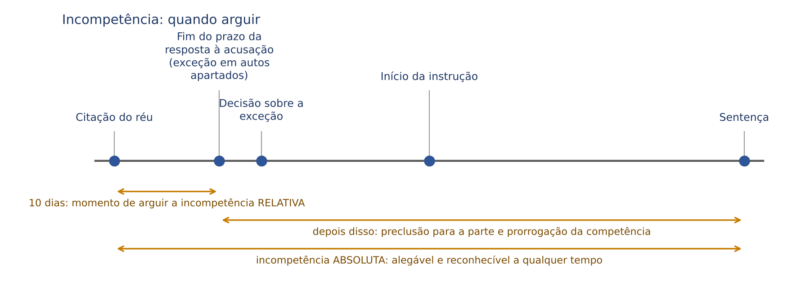
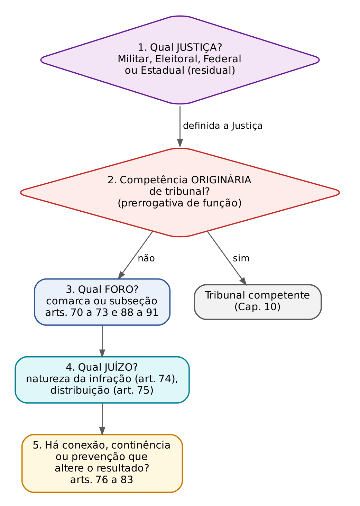
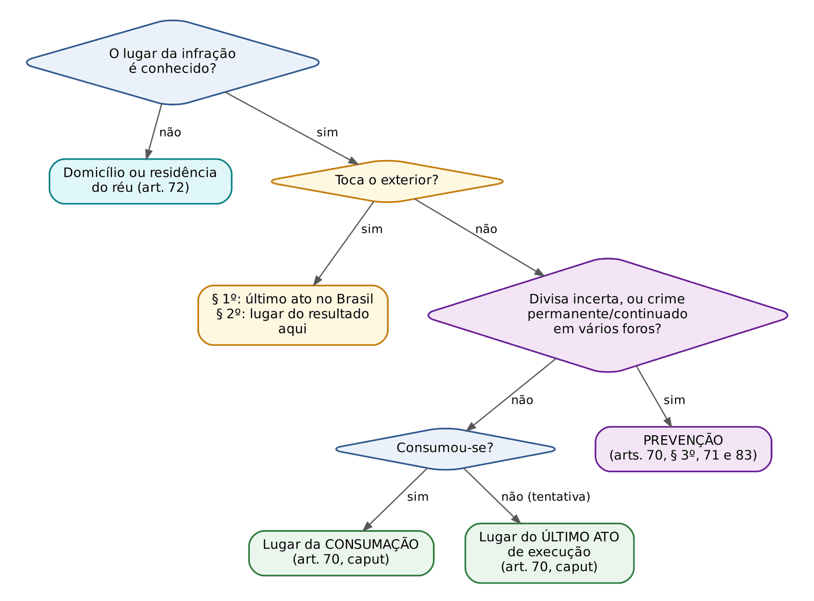
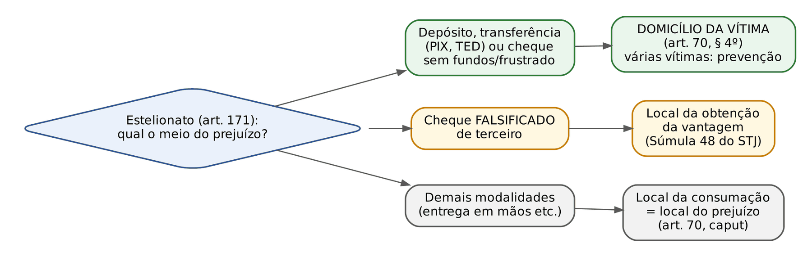
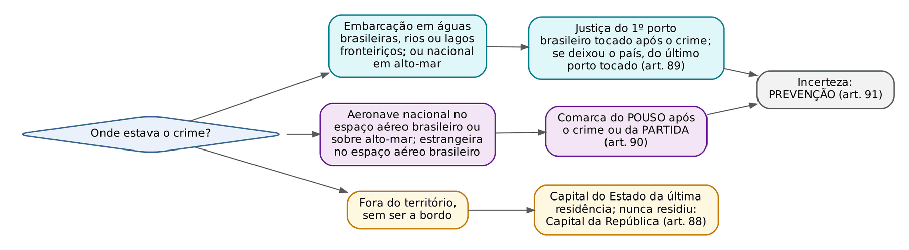

# CAPÍTULO 09 — JURISDIÇÃO E COMPETÊNCIA I: PRINCÍPIOS, CRITÉRIOS DE FIXAÇÃO, COMPETÊNCIA TERRITORIAL E PELA NATUREZA DA INFRAÇÃO, PREVENÇÃO E DISTRIBUIÇÃO, CRIMES NO EXTERIOR E A BORDO, COLEGIADOS CRIMINAIS DE PRIMEIRO GRAU

:::INCIDENCIA
Pontos: TRF5 p. 8; TJRS p. 4; TJSC p. 7. Nível A. Lote: 8 questões (FGV 7, FCC 1), quase todas com CASO.
O que mais cai: estelionato por transferência ou PIX e o domicílio da vítima (art. 70, § 4º); crime em divisa ou em vários foros (prevenção); crime a distância (art. 70, §§ 1º e 2º); crime a bordo de navio; e, por arrasto, continência (Cap. 11).
:::

| Subtema | FGV | FCC | Padrão |
|---|---|---|---|
| Estelionato eletrônico: domicílio da vítima (09.4.6) | 2 | 0 | caso com quatro ou cinco cidades (vítima, autor, conta, banco); só a da vítima importa |
| Lugar da infração: §§ 1º a 3º do art. 70 (09.4.3 e 09.4.4) | 1 | 1 | literalidade dos parágrafos; roubo na divisa = prevenção |
| Crime a bordo e crimes no exterior (09.8) | 1 | 0 | navio de grande porte: Justiça Federal; foro do porto (art. 89); vereador não tem foro |
| Crime pela internet (09.4.7) | 1 | 0 | quando a internet atrai a Justiça Federal e qual é o foro |
| Critérios do art. 69 e continência (09.3) | 2 | 0 | distinguir conexão e continência pela literalidade dos arts. 76 e 77 |

## 09.1 Jurisdição penal: conceito, características e princípios

### 09.1.1 Jurisdição x competência

Jurisdição é o poder-dever do Estado de aplicar o direito ao caso concreto, substituindo a vontade das partes, com aptidão para a definitividade. No processo penal ela tem uma nota que o civilista precisa internalizar logo: é NECESSÁRIA. No cível, o credor pode receber sem juiz, transigir, desistir; no crime, a pena só pode ser imposta por um juiz, por meio de um processo (*nulla poena sine iudicio*). Até a transação penal e o ANPP, que dispensam processo, passam por homologação judicial (ver Cap. 8).

A jurisdição é UNA: todo juiz a tem por inteiro. O que se reparte entre os órgãos é o exercício dela, e essa repartição se chama competência, a "medida da jurisdição". Daí a frase clássica: o juiz incompetente tem jurisdição, mas não tem competência para AQUELE caso. Consequência prática: o ato do juiz incompetente não é inexistente; é nulo (absoluta ou relativamente, ver 09.2), e por isso pode ser ratificado em certos casos. Ato de quem não é juiz (não investido, aposentado, em férias sem designação) é que é inexistente.

Características cobradas: substitutividade (o Estado-juiz substitui a atividade das partes), inércia (*ne procedat iudex ex officio*: o juiz não inicia a ação penal; a portaria judicial que abria processo nas contravenções, art. 531 do CPP na redação antiga, não foi recepcionada), imparcialidade, definitividade (coisa julgada, mitigada pela revisão criminal *pro reo*, Cap. 30) e lide penal discutida (parte da doutrina, com Aury Lopes Jr., nega a existência de "lide" no processo penal e prefere falar em pretensão acusatória).

### 09.1.2 Princípios da jurisdição

| Princípio | Conteúdo | Ponto cobrável |
|---|---|---|
| Investidura | só exerce jurisdição quem foi regularmente investido no cargo de juiz | sentença de juiz aposentado ou não empossado: ato inexistente |
| Indelegabilidade | o juiz não transfere a outro o poder de julgar | a carta precatória não é delegação: o deprecado exerce a própria competência para o ato (art. 222); a carta de ordem, sim, é delegação de tribunal a juiz |
| Inevitabilidade | as partes se sujeitam à jurisdição independentemente de vontade | não há "foro de eleição" penal; a exceção relativa do art. 73 é escolha do querelante entre foros legais |
| Indeclinabilidade (inafastabilidade) | o juiz não pode deixar de julgar; a lei não exclui lesão da apreciação judicial (art. 5º, XXXV, CF) | *non liquet* proibido; dúvida resolve-se pelo *in dubio pro reo*, não pela abstenção |
| Inércia | a jurisdição depende de provocação | o juiz não adita a denúncia nem condena por fato não imputado (Cap. 21) |
| Improrrogabilidade | o juiz não pode invadir a competência alheia, ainda que as partes concordem | admite exceções legais: conexão, continência, desclassificação, incompetência relativa não arguida (prorrogação) |
| Juiz natural | ninguém será processado nem sentenciado senão pela autoridade competente, fixada por regra geral e prévia; não haverá juízo ou tribunal de exceção | art. 5º, XXXVII e LIII, CF; ver 09.1.3 |
| Territorialidade (aderência ao território) | o juiz exerce jurisdição nos limites de sua comarca, seção ou subseção | ato fora do território exige precatória, salvo comarcas contíguas ou da mesma região metropolitana para citações e intimações (art. 255 do CPC, aplicado subsidiariamente, e regras locais) |
| Unidade | a jurisdição é una; a repartição é de competência | — |

### 09.1.3 Juiz natural: conteúdo e o que NÃO o viola

O juiz natural tem três camadas, e a banca costuma explorar a terceira: (1) só órgãos previstos na Constituição exercem jurisdição; (2) proíbem-se tribunais de exceção, criados depois do fato para julgá-lo; (3) a competência é fixada por regras gerais, abstratas e ANTERIORES ao fato, que impedem a escolha do juiz para o caso concreto. A ideia não é "o juiz que já estava lá no dia do crime", e sim "o juiz que as regras prévias, gerais e impessoais apontarem". Por isso, várias mudanças posteriores ao fato são válidas:

- criação de nova vara ou especialização de vara por resolução de tribunal, com redistribuição de processos em curso: válida, por se tratar de organização judiciária (art. 96, I, "a", da CF) e de regra geral (STF, HC 88.660, que validou a especialização de vara federal para crimes contra o sistema financeiro e lavagem por resolução de TRF);
- julgamento em tribunal por turma composta majoritariamente por juízes de primeiro grau convocados na forma da lei: válido (STF, RE 597.133, repercussão geral);
- desaforamento no Júri, atração por conexão ou continência ao foro de um corréu com prerrogativa (Súmula 704 do STF — ver Cap. 10) e prorrogação pela não arguição da incompetência relativa: hipóteses previstas em lei, logo compatíveis com o juiz natural;
- nova lei processual de competência: aplicação imediata (art. 2º do CPP), salvo se o processo já tiver sentença, caso em que a doutrina majoritária manda observar a *perpetuatio jurisdictionis* (ver Cap. 2). Exemplo concreto: o art. 70, § 4º (09.4.6) foi aplicado de imediato aos inquéritos em curso.

:::PEGADINHA
"O princípio do juiz natural impede que outro magistrado sentencie no lugar do colega falecido, devendo a instrução ser refeita" é FALSO (Q3888048, FGV 2024, ver Cap. 1). A identidade física do juiz (art. 399, § 2º, do CPP) cede diante de morte, aposentadoria, promoção, afastamento ou convocação, aplicando-se por analogia o regime que o CPC/1973 previa no art. 132; o sucessor sentencia e, se entender necessário, repete provas.
:::

Promotor natural e defensor natural são extensões do mesmo raciocínio às instituições (vedação do acusador de encomenda; ver Cap. 12).

## 09.2 Competência: conceito, espécies e regime jurídico

### 09.2.1 Os três critérios clássicos e a competência funcional

A doutrina (desde Chiovenda, adotado por Renato Brasileiro de Lima e Badaró) distribui a competência por três critérios:

- em razão da MATÉRIA (*ratione materiae*): a natureza da infração define a Justiça (Militar, Eleitoral, Federal, Estadual) e, dentro dela, o órgão (Júri, Juizado, vara especializada);
- em razão da PESSOA (*ratione personae* ou *ratione funcionae*): a função exercida pelo acusado leva o caso a um tribunal (prerrogativa de função; ver Cap. 10);
- em razão do LUGAR (*ratione loci*): qual comarca (Justiça Estadual) ou subseção judiciária (Justiça Federal) julgará.

Ao lado deles há a competência FUNCIONAL, que reparte atividades dentro do mesmo processo: por fases (juiz das garantias até o oferecimento da denúncia e juiz da instrução e julgamento; no Júri, juiz sumariante, jurados e juiz presidente; juiz da condenação e juiz da execução), por objeto do juízo (no Júri, os jurados decidem o fato e o presidente fixa a pena) e por grau de jurisdição (horizontal ou vertical: recursos). A competência funcional é absoluta.

### 09.2.2 Absoluta x relativa: a tabela que resolve as questões

A divisão em absoluta e relativa não está no CPP; é construção doutrinária e jurisprudencial. Regra prática: matéria, pessoa e funcional são ABSOLUTAS; lugar (e prevenção, e distribuição) são RELATIVOS.

| Aspecto | Competência absoluta | Competência relativa |
|---|---|---|
| Critérios | matéria (inclusive Júri), prerrogativa de função, funcional; e as de assento constitucional | territorial (arts. 70 a 73 e 88 a 91), prevenção (Súmula 706 do STF), distribuição |
| Interesse protegido | público, estrutural (a Constituição desenhou a Justiça) | prioritariamente das partes e da boa colheita da prova |
| Momento de alegação | a qualquer tempo, em qualquer grau, inclusive em HC e, após o trânsito, em favor do réu (revisão criminal, HC) | na primeira oportunidade de falar nos autos: resposta à acusação (exceção de incompetência, art. 95, II, e art. 396-A, § 1º), sob pena de preclusão |
| Reconhecimento de ofício | sempre (art. 109) | também pode (art. 109): a Súmula 33 do STJ é do processo CIVIL e NÃO se aplica ao penal; parte da doutrina limita o reconhecimento de ofício ao início da instrução |
| Prorrogação | não se prorroga | prorroga-se se não arguida a tempo |
| Vício e consequência | nulidade absoluta; prejuízo presumido | nulidade relativa; exige arguição tempestiva e demonstração de prejuízo (art. 563) |
| Atos aproveitáveis | atos instrutórios podem ser ratificados; os decisórios, em regra, são anulados (art. 567), mas o STF admite ratificação até do recebimento da denúncia pelo juízo competente | ratificação ampla, inclusive dos atos decisórios |

:::ATENCAO Intuição civilista que leva ao erro
No CPC, o juiz não declara de ofício a incompetência relativa (art. 337, § 5º, do CPC; Súmula 33 do STJ) e ela se prorroga se o réu não a alegar em preliminar de contestação. No processo penal, o art. 109 do CPP manda o juiz declarar a incompetência "em qualquer fase do processo", e a jurisprudência admite fazê-lo de ofício também na territorial, ao menos até a instrução. A preclusão atinge a PARTE, não necessariamente o juiz.
:::

### 09.2.3 Efeitos do reconhecimento da incompetência

O art. 567 do CPP diz que a incompetência "anula somente os atos decisórios", com remessa ao juiz competente. Três refinamentos jurisprudenciais, cobrados em sentença:

- ratificação: o juízo competente pode ratificar os atos praticados, inclusive o recebimento da denúncia, desde que o faça expressamente e o órgão acusatório com atribuição ratifique a peça (o promotor ou procurador que oficia no juízo competente). A ratificação do recebimento produz efeito a partir de quando ocorre, o que importa para a prescrição (o recebimento por juiz absolutamente incompetente não interrompe a prescrição; ver Apostila de Direito Penal, Cap. 22);
- teoria do juízo aparente: medidas cautelares (interceptação, busca, quebra de sigilo) deferidas por juiz que, no momento da decisão e à luz dos elementos então disponíveis, parecia competente, são válidas mesmo que depois se descubra que o crime era da competência de outro juízo (STF, HC 81.260; aplicação aos meios de obtenção de prova no Cap. 16);
- *perpetuatio jurisdictionis*: fixada a competência por conexão ou continência, a absolvição ou desclassificação do crime atrativo não a desfaz (art. 81; ver Cap. 11). Em regra, alterações de fato posteriores (mudança de domicílio do réu, por exemplo) não deslocam o processo.

### 09.2.4 Como a incompetência chega ao juiz e qual recurso cabe

:::PROCESSO Incompetência: veículo, decisão e recurso
| Situação | Veículo e prazo | Decisão | Recurso |
|---|---|---|---|
| Defesa alega incompetência relativa | exceção de incompetência (arts. 95, II, e 108), em autos apartados, no prazo da resposta à acusação (10 dias, art. 396-A, § 1º) | juiz ouve o MP e decide | acolhida: RESE (art. 581, III); rejeitada: irrecorrível; matéria volta em preliminar de apelação ou por HC |
| Juiz reconhece de ofício, em qualquer fase | declaração nos autos (art. 109) | remessa ao juízo competente | RESE (art. 581, II: decisão que "concluir pela incompetência do juízo") |
| Juiz declara-se competente contra alegação de incompetência absoluta | preliminar da defesa | rejeição | irrecorrível de imediato; HC, se houver constrangimento, e preliminar de apelação |
| Dois juízes se declaram competentes ou incompetentes | conflito de competência (arts. 113 a 117) | tribunal decide | ver Cap. 11 |
:::

:::SENTENCA Preliminar de incompetência na sentença
Onde entra: nas preliminares, antes do mérito; se a defesa arguiu tempestivamente e a exceção ainda não foi decidida, ou se há incompetência absoluta visível (por exemplo, crime doloso contra a vida desclassificado mal, ou interesse da União). O que fundamentar: o critério (absoluto ou relativo), a regra de fixação aplicada e, se relativa, a preclusão. Redação-modelo: "Rejeito a preliminar de incompetência territorial. Trata-se de competência relativa, que deveria ter sido arguida por exceção no prazo da resposta à acusação (arts. 95, II, e 396-A, § 1º, do CPP), o que não ocorreu, operando-se a prorrogação; ademais, a consumação deu-se nesta comarca (art. 70 do CPP)." Erro que a banca pune: tratar como absoluta a incompetência territorial ou de prevenção (Súmula 706 do STF) e anular o processo inteiro; ou, inversamente, julgar o mérito sendo absolutamente incompetente, em vez de declinar com fundamento no art. 109.
:::

## 09.3 O método de fixação: a ordem das perguntas

O art. 69 lista sete critérios (lugar da infração, domicílio ou residência do réu, natureza da infração, distribuição, conexão ou continência, prevenção e prerrogativa de função), mas a ordem da lista NÃO é a ordem lógica de aplicação. Quem resolve um caso de competência deve seguir um roteiro, do mais amplo ao mais estreito, porque cada resposta delimita a pergunta seguinte. É o mesmo método que o juiz usa para decidir uma exceção ou um conflito.

:::PASSO Como resolver qualquer questão de competência
Este é o roteiro da apostila para competência (o Cap. 10 remete a ele). Antes de começar: a lei brasileira se aplica ao fato? Se o crime tocou o exterior, confira a territorialidade ou a extraterritorialidade (arts. 5º a 7º do CP) e, para o foro, os arts. 70, §§ 1º e 2º, e 88 a 91 (09.4.3 e 09.8).
1. Qual JUSTIÇA? Primeiro as especiais (Militar, Eleitoral), depois a Federal (art. 109 da CF, rol taxativo), por fim a Estadual, residual. Competência absoluta. Desenvolvimento no Cap. 10.
2. Há competência ORIGINÁRIA de tribunal pela prerrogativa de função? Se sim, a pergunta de foro acaba aí (o tribunal tem sede única). Competência absoluta. Ver Cap. 10.
3. Qual FORO (comarca na Justiça Estadual; subseção na Federal)? Lugar da infração (art. 70); subsidiariamente, domicílio do réu (art. 72); na ação exclusivamente privada, opção do querelante (art. 73); regras especiais (arts. 70, § 4º, e 88 a 91); prevenção nos casos de incerteza ou pluralidade (arts. 70, § 3º, e 71). Competência relativa.
4. Qual JUÍZO dentro do foro? Natureza da infração segundo a lei de organização judiciária (Júri, Juizado, vara especializada, Vara Criminal Colegiada: art. 74 e 09.6 e 09.9) e, havendo vários juízos igualmente competentes, distribuição (art. 75).
5. Há CONEXÃO ou CONTINÊNCIA (arts. 76 a 82; Cap. 11) ou PREVENÇÃO já firmada (art. 83)? Volte às perguntas anteriores, porque a reunião pode redesenhá-las: a Justiça Federal atrai o crime estadual conexo (Súmula 122 do STJ); o foro por prerrogativa atrai o corréu, salvo desmembramento (Súmula 704 do STF); o Júri atrai o crime comum conexo (art. 78, I, com a ressalva da Lei 15.358/2026); entre foros da mesma categoria, os critérios do art. 78, II. Crime militar e crime comum não se reúnem (art. 79, I); a infração de menor potencial ofensivo conexa a crime comum vai ao juízo comum, preservadas a composição e a transação (art. 60, parágrafo único, da Lei 9.099/1995).
6. Resolvida a competência, confira o REGIME do vício, se houver: absoluta ou relativa, momento de arguição, aproveitamento de atos e recurso (09.2).
:::

:::EXEMPLO Aplicando o roteiro
A, servidor estadual sem foro, furta em Joinville um notebook da autarquia federal em que presta serviço terceirizado. (1) Justiça: bem de autarquia federal, art. 109, IV, da CF: Federal. (2) Sem prerrogativa: primeiro grau. (3) Foro: lugar da consumação, Joinville: subseção judiciária de Joinville. (4) Juízo: havendo duas varas federais criminais, distribuição. (5) Se A também falsificou, para esconder o furto, um documento estadual, há conexão (art. 76, II) e a Justiça Federal atrai o crime estadual (Súmula 122 do STJ; ver Cap. 10).
:::

:::QUESTAO FGV 2026 — PC-PI — Delegado de Polícia (Q3848990)
Pergunta: em qual hipótese a competência se determina pela continência? Gabarito: E, quando duas ou mais pessoas forem acusadas pela mesma infração (art. 77, I, continência por cumulação subjetiva). Armadilha: as alternativas A, B, C e D reproduzem os incisos do art. 76 (conexão intersubjetiva por simultaneidade e por concurso, objetiva e probatória). Regra de memória: continência = UMA infração com vários agentes, ou UMA conduta com vários resultados; conexão = VÁRIAS infrações ligadas entre si. Desenvolvimento no Cap. 11.
:::

:::QUESTAO FGV 2024 — MPE-GO — Promotor de Justiça Substituto (Q2367583)
Caso: um só agente, num coletivo, simula arma e subtrai, com uma única abordagem, os celulares de duas vítimas; denúncia por dois roubos em concurso formal próprio. Gabarito: B, continência por cumulação OBJETIVA (art. 77, II, que remete ao concurso formal, hoje art. 70 do CP). Armadilhas: cumulação subjetiva exigiria vários agentes para a mesma infração; conexão exigiria pluralidade de condutas ligadas. Desenvolvimento no Cap. 11.
:::

## 09.4 Competência pelo lugar da infração (art. 70)

### 09.4.1 A regra: teoria do resultado

:::LEI CPP, art. 70, caput
A competência será, de regra, determinada pelo lugar em que se consumar a infração, ou, no caso de tentativa, pelo lugar em que for praticado o último ato de execução.
:::

Por que o lugar da consumação: é ali, em regra, que estão os vestígios, as testemunhas e a comunidade afetada; o processo perto do fato produz prova melhor e cumpre a função de prevenção geral. Daí se diz que o CPP adotou a teoria do RESULTADO para a competência interna. Não confunda com o art. 6º do CP (ubiquidade), que serve para saber SE o Brasil pode julgar um crime que tocou outro país (ver Apostila de Direito Penal, Cap. 4, item 04.3, onde está a tabela crime a distância x crime plurilocal). Mnemônico útil: art. 6º do CP responde "qual país"; art. 70 do CPP responde "qual comarca".

O raciocínio, portanto, depende de saber ONDE o crime se consuma, o que é matéria penal (art. 14, I, do CP). Para aplicar a regra processual, basta a tabela:

| Espécie de crime | Momento e lugar da consumação | Exemplo e foro |
|---|---|---|
| Material (exige resultado naturalístico) | onde o resultado ocorre | furto: onde a coisa sai da esfera da vítima (inversão da posse, Súmula 582 do STJ); estelionato: onde se dá o prejuízo (com a regra especial do § 4º, 09.4.6) |
| Formal (o resultado é dispensável) | onde a conduta se completa | extorsão: onde a vítima é constrangida, ainda que a vantagem seja obtida alhures (Súmula 96 do STJ); concussão: onde a exigência chega à vítima |
| De mera conduta | onde a conduta é praticada | violação de domicílio: onde está a casa |
| Omissivo próprio | onde o agente deveria ter agido | omissão de socorro: local em que estava a vítima |
| Permanente | em todos os lugares por onde a consumação se protrai | sequestro que atravessa comarcas: prevenção (art. 71) |
| Falso e uso | onde o documento é usado (o uso é crime autônomo) | uso de passaporte falso: lugar onde o delito se consumou (Súmula 200 do STJ) |
| Tráfico internacional por remessa postal | destino da droga | juízo federal do local de DESTINO, e não mais o da apreensão: a Súmula 528 do STJ foi CANCELADA após o CC 177.882 |

:::EXEMPLO Furto com fuga
A furta um carro em Itajaí e é preso dirigindo-o em Blumenau. Competência: Itajaí. O furto se consumou com a inversão da posse em Itajaí (Súmula 582 do STJ: basta a posse, ainda que breve e não mansa e pacífica). O lugar da prisão em flagrante é irrelevante para a competência; o auto de prisão será remetido ao juízo de Itajaí após a audiência de custódia, que se realiza onde ocorreu a prisão (ver Cap. 18).
:::

### 09.4.2 Tentativa

Na tentativa, não há lugar de consumação; a lei usa o lugar do ÚLTIMO ato de execução, porque é ali que o *iter criminis* foi interrompido. Exemplo: B envia de Lages a Chapecó uma encomenda com bomba destinada a C; a polícia intercepta o pacote nos Correios de Lages. O último ato de execução (postagem) ocorreu em Lages: competente Lages.

### 09.4.3 Crimes a distância (§§ 1º e 2º)

Quando um pedaço do crime está fora do Brasil, o art. 70 cria duas regras de fechamento, para que sempre haja um juiz brasileiro definido:

- § 1º: execução INICIADA no Brasil e consumação no exterior: competente o lugar do ÚLTIMO ato de execução praticado no Brasil. Exemplo: carta-bomba postada em Porto Alegre que explode em Montevidéu: Porto Alegre;
- § 2º: último ato de execução no EXTERIOR e resultado (total ou parcial, produzido ou que deveria produzir-se) no Brasil: competente o lugar em que o crime produziu ou deveria produzir seu resultado. Exemplo: veneno enviado de Buenos Aires a vítima em Uruguaiana: Uruguaiana.

Crime a distância, por si só, não leva o processo à Justiça Federal; isso depende de hipótese do art. 109 da CF, como a do inciso V (crime previsto em tratado, com transnacionalidade). Ver Cap. 10.

:::QUESTAO FGV 2026 — TJ-MS — Outorga de Delegações (Q3914317)
Pergunta: três afirmativas reproduzindo os §§ 1º, 2º e 3º do art. 70. Gabarito: E (I, II e III corretas). Armadilha: o candidato que "decorou" a teoria do resultado tende a desconfiar do § 1º (que usa o último ato de execução para crime consumado no exterior) e do § 3º (prevenção). Os três parágrafos são literais; a FGV cobra a letra da lei.
:::

### 09.4.4 Incerteza, divisas, crimes permanentes e continuados (§ 3º e art. 71)

Quando não se consegue dizer em qual de dois ou mais foros o fato ocorreu, a lei não manda escolher o "melhor"; manda aplicar a PREVENÇÃO (09.7), isto é, fica com o caso o juízo que primeiro praticar ato decisório no processo ou em medida a ele relativa. São três hipóteses de incerteza no § 3º e duas de pluralidade no art. 71:

- limite territorial incerto entre duas ou mais jurisdições;
- jurisdição incerta porque a infração foi consumada ou tentada na DIVISA de duas ou mais jurisdições;
- infração CONTINUADA (art. 71 do CP) praticada em território de duas ou mais jurisdições;
- infração PERMANENTE praticada em território de duas ou mais jurisdições (sequestro, extorsão mediante sequestro, "manter em depósito" drogas em várias cidades);
- contrabando ou descaminho: juízo federal do lugar da apreensão (Súmula 151 do STJ; v. Cap. 10).

:::QUESTAO FCC 2024 — TRF3 — Analista Judiciário, Área Judiciária (Q2564499)
Caso: dois agentes, residentes na subseção X, roubam com grave ameaça, na DIVISA entre as subseções Y e Z, o veículo da União conduzido por servidor federal em serviço (residente em A); são presos em flagrante, na fuga, já na subseção B.
Passo 1, Justiça: bem da União e servidor federal no exercício da função: Justiça Federal (art. 109, IV, da CF; Súmula 147 do STJ; Cap. 10).
Passo 2, foro: o roubo se consumou com a inversão da posse, na divisa (Súmula 582 do STJ). Divisa = incerteza entre Y e Z = prevenção (art. 70, § 3º).
Gabarito: C (prevenção entre Y e Z). Armadilhas: B estende a prevenção a "qualquer das subseções" (a prevenção só opera entre os foros em que a incerteza existe); D usa o local da prisão (irrelevante); A e E usam domicílio da vítima e do réu, critérios inaplicáveis quando o lugar da infração é conhecido.
:::

### 09.4.5 Exceções à teoria do resultado

A jurisprudência e leis especiais afastam a regra em situações que convém memorizar:

| Situação | Regra aplicada | Fundamento |
|---|---|---|
| Crimes dolosos contra a vida plurilocais (tiro em Gaspar, morte no hospital de Blumenau) | foro da CONDUTA (teoria da atividade), por ser onde estão a prova e a comunidade que formará o conselho de sentença | jurisprudência do STJ e do STF; o STJ admite modificar o foro do art. 70 quando outro local for o melhor para a apuração (Jurisprudência em Teses, ed. 72, tese 6) |
| Infrações de menor potencial ofensivo | "lugar em que foi praticada a infração penal" (art. 63 da Lei 9.099/1995): a doutrina diverge entre atividade e ubiquidade | ver Cap. 24 |
| Atos infracionais | lugar da ação ou omissão (art. 147, § 1º, do ECA) | regra do ECA, não do CPP |
| Estelionato por depósito, transferência ou cheque sem fundos | domicílio da VÍTIMA | art. 70, § 4º (09.4.6) |
| Falso testemunho em carta precatória | juízo DEPRECADO, onde o depoimento falso foi prestado | lugar da consumação: o falso testemunho se consuma com o encerramento do depoimento |
| Crimes contra a honra pela internet | regras próprias do STJ | 09.4.7 |

:::DICA
Na prova objetiva, a FGV costuma pedir a regra geral ("lugar da consumação") e a exceção do § 4º. A exceção do homicídio plurilocal é cobrada como "entendimento jurisprudencial" e é a única que o candidato erra por excesso de literalidade.
:::

### 09.4.6 Estelionato: o § 4º do art. 70 (Lei 14.155/2021)

Antes de 2021, a jurisprudência do STJ fixava a competência do estelionato no lugar da obtenção da vantagem, que, no golpe por transferência, era a agência da conta do golpista, frequentemente em outro Estado; e, no cheque sem fundos, o lugar da recusa do pagamento pelo banco sacado (Súmula 521 do STF e Súmula 244 do STJ). Resultado prático: a vítima de Itajaí precisava ir a Manaus para ver o processo andar, e o juízo de lá, sem vítima nem prova, investigava mal. A Lei 14.155/2021 resolveu o problema deslocando a competência para o domicílio da vítima.

:::LEI CPP, art. 70, § 4º (incluído pela Lei 14.155/2021)
Nos crimes previstos no art. 171 do Decreto-Lei nº 2.848, de 7 de dezembro de 1940 (Código Penal), quando praticados mediante depósito, mediante emissão de cheques sem suficiente provisão de fundos em poder do sacado ou com o pagamento frustrado ou mediante transferência de valores, a competência será definida pelo local do domicílio da vítima, e, em caso de pluralidade de vítimas, a competência firmar-se-á pela prevenção.
:::

Pontos de aplicação:

- alcance material: "crimes previstos no art. 171", o que abrange o *caput*, as figuras equiparadas e a fraude eletrônica (§ 2º-A), desde que o MEIO do prejuízo seja depósito, transferência (TED, DOC, PIX) ou cheque sem fundos ou frustrado;
- o que fica de fora: estelionato com cheque FALSIFICADO de terceiro, em que a vantagem se obtém no saque (STJ, CC 182.977, Terceira Seção, j. 9/3/2022: competência do local da agência em que a vítima mantém a conta; continua válida a Súmula 48 do STJ: local da obtenção da vantagem); estelionato com entrega física de bens ou dinheiro (regra geral, local do prejuízo); e crimes que não são do art. 171, como o furto mediante fraude eletrônica (art. 155, § 4º-B, do CP: segue o art. 70, *caput*);
- Súmula 521 do STF e Súmula 244 do STJ: SUPERADAS para o cheque sem fundos, que agora segue o domicílio da vítima;
- várias vítimas em domicílios diversos: prevenção;
- direito intertemporal: norma processual de aplicação imediata, que alcança inquéritos e processos relativos a fatos anteriores, preservados os atos já praticados (STJ, CC 180.832, Terceira Seção, j. 25/8/2021);
- Justiça Federal: o § 4º define o FORO; se a vítima for a Caixa ou o INSS, a Justiça é a Federal (art. 109, IV, da CF) e o domicílio da "vítima" passa a ser o critério dentro dela. Uso do PIX ou da internet, por si só, não atrai a Justiça Federal (Cap. 10).

:::QUESTAO FGV 2026 — PC-PR — Delegado de Polícia (Q4378298)
Caso: vítima residente em Maringá cai no golpe da falsa central bancária; o golpista age de Curitiba e a vítima faz PIX para conta de "laranja" aberta em Foz do Iguaçu.
O que se pergunta: o foro. Regra: estelionato mediante transferência de valores = domicílio da vítima (art. 70, § 4º). Aplicação: Maringá.
Gabarito: D (instaurar o inquérito em Maringá, foro do domicílio da vítima). Armadilhas: A (lugar do último ato do ardil, Curitiba) aplica a regra da tentativa a crime consumado; C (Foz, local do crédito) é o critério ANTERIOR à Lei 14.155/2021; B (Justiça Federal pelo uso do PIX) confunde meio de pagamento com interesse da União; E inventa prevenção quando há regra expressa.
No mesmo sentido: Q2515597 (FGV 2024, TJ-SC, Oficial de Justiça): vítima de Itajaí, autor morador de Blumenau com casa em Balneário Camboriú, conta destinatária em Joinville e banco sediado em Florianópolis; gabarito E, Itajaí. A banca empilha cidades para testar se o candidato isola o único dado relevante: o domicílio da vítima.
:::

### 09.4.7 Crimes praticados pela internet: o foro

A internet suscita duas perguntas distintas, que a banca mistura de propósito: QUAL JUSTIÇA (a Federal só se houver hipótese do art. 109, em regra o inciso V, com transnacionalidade; Cap. 10) e QUAL FORO (a regra do lugar da infração adaptada ao ambiente digital). Para o foro, nos crimes contra a honra, o STJ consolidou (Jurisprudência em Teses, ed. 280):

| Hipótese | Foro |
|---|---|
| Ofensa publicada em rede ou página visível a terceiros | local onde o conteúdo ofensivo foi INCLUÍDO (postado), porque ali a ofensa se torna acessível a terceiros (tese 5) |
| Ofensa por mensagens PRIVADAS, que só autor e destinatário leem | local em que a vítima TOMOU CONHECIMENTO do conteúdo (tese 4) |
| Calúnia ou difamação pela internet sem identificação do local de onde partiram as ofensas | domicílio do réu (art. 72; tese 6) |
| Site hospedado no exterior, local da consumação incerto e domicílio do autor desconhecido | prevenção (tese 7) |
| Ofensa à honra de particular em rede social de alcance internacional | Justiça ESTADUAL: a internet, por si só, não atrai a Federal (tese 3) |

:::QUESTAO FGV 2026 — TJ-SC — Oficial de Justiça e Avaliador (Q4153636)
Caso: injúria racial praticada por usuários de sala de bate-papo de provedor; o MPF pede o declínio à Justiça Estadual pela regra do domicílio da vítima. Gabarito oficial: B (praticada pela rede mundial de computadores, a competência é da Justiça Federal, art. 109, V, da CF). Fundamento: o Brasil é signatário da Convenção Internacional sobre a Eliminação de Todas as Formas de Discriminação Racial, e o STJ presume a transnacionalidade quando o conteúdo discriminatório é divulgado em ambiente de acesso aberto a partir do exterior (Jurisprudência em Teses, ed. 280, tese 1). Armadilhas: A é falsa porque a injúria racial do art. 2º-A da Lei 7.716/1989 (Lei 14.532/2023) inclui a procedência nacional; D nega a transnacionalidade em qualquer caso. Cuidado: a afirmação B é ampla demais; se a ofensa for por mensagem privada (WhatsApp, chat fechado), sem potencial de acesso no exterior, a competência é estadual. Desenvolvimento no Cap. 10.
:::

## 09.5 Competência pelo domicílio ou residência do réu (arts. 72 e 73)

O domicílio do réu é foro SUBSIDIÁRIO na ação pública: só se usa quando NÃO se conhece o lugar da infração (art. 72). Exemplo: cadáver encontrado em rio que corta três municípios, sem indícios de onde ocorreu a morte, mas com autor identificado: foro do domicílio do autor.

- Réu com mais de uma residência: prevenção (art. 72, § 1º).
- Réu sem residência certa ou de paradeiro ignorado: competente o juiz que primeiro tomar conhecimento do fato (art. 72, § 2º), outra forma de prevenção.
- Domicílio e residência são usados como sinônimos para esse fim (não se exige o ânimo definitivo do art. 70 do CC).

A segunda regra é uma faculdade do querelante:

:::LEI CPP, art. 73
Nos casos de exclusiva ação privada, o querelante poderá preferir o foro de domicílio ou da residência do réu, ainda quando conhecido o lugar da infração.
:::

Detalhes que caem: (a) só na ação EXCLUSIVAMENTE privada (inclusive a personalíssima), NUNCA na ação privada subsidiária da pública, que segue as regras da ação pública; (b) a escolha é do querelante, não do querelado nem do juiz; (c) é foro concorrente: o querelante escolhe entre o do lugar da infração e o do domicílio do réu, e não o seu próprio domicílio. Exemplo: injúria verbal (art. 140, *caput*, do CP) cometida em Florianópolis por réu domiciliado em Criciúma: a vítima pode propor a queixa em Florianópolis ou em Criciúma.

:::PEGADINHA
O art. 73 fala em domicílio do RÉU. A afirmação "na ação penal privada, o querelante pode optar pelo foro de seu próprio domicílio" é falsa. O domicílio da VÍTIMA só aparece, como critério de competência penal, no art. 70, § 4º (estelionato), e, por construção jurisprudencial, nos crimes contra a honra por mensagem privada (local onde a vítima tomou conhecimento, que costuma coincidir com seu domicílio). Para a Lei Maria da Penha, o domicílio da ofendida é foro opcional nas causas CÍVEIS (art. 15 da Lei 11.340/2006), não nas criminais.
:::

## 09.6 Competência pela natureza da infração (art. 74) e varas especializadas

### 09.6.1 A regra e a ressalva do Júri

Definidos a Justiça e o foro, falta saber qual juízo da comarca julga. O art. 74 entrega essa tarefa às LEIS DE ORGANIZAÇÃO JUDICIÁRIA (estaduais, para a Justiça Estadual; Lei 5.010/1966 e resoluções dos TRFs, para a Federal), com uma única ressalva de nível constitucional: a competência do Tribunal do Júri para os crimes dolosos contra a vida, consumados ou tentados (art. 5º, XXXVIII, "d", da CF). O rol do § 1º do art. 74 está desatualizado na numeração (não menciona o feminicídio, hoje tipo autônomo no art. 121-A do CP, incluído pela Lei 14.994/2024), mas isso não importa: a competência do Júri vem da Constituição e alcança todo crime DOLOSO contra a vida. Procedimento, latrocínio (Súmula 603 do STF) e demais pontos: ver Cap. 23.

:::ATENCAO Novidade de 2026: homicídio de facção fora do Júri
A Lei 15.358/2026 (Marco Legal do Combate ao Crime Organizado, publicada em 25/3/2026 e em vigor na data da publicação) alterou o art. 78, I, do CPP para excepcionar da prevalência do Júri os homicídios, consumados ou tentados, cometidos por membros de organizações criminosas ultraviolentas, grupo paramilitar ou milícia privada, na forma do art. 2º daquela lei; e o seu art. 2º, § 8º, manda julgá-los nas Varas Criminais Colegiadas do art. 1º-A da Lei 12.694/2012, quando conexos aos crimes de domínio social estruturado (aplicável também ao favorecimento, art. 3º, parágrafo único). A constitucionalidade está em xeque (a competência mínima do Júri é cláusula pétrea, art. 60, § 4º, IV, da CF) e há ações diretas no STF. Desenvolvimento em 09.9 e no Cap. 26.
:::

### 09.6.2 Desclassificação (art. 74, §§ 2º e 3º)

Desclassificar é dar ao fato definição jurídica diferente da imputada, com reflexo na competência. As regras:

- § 2º: iniciado o processo perante um juiz, se houver desclassificação para infração da competência de outro, o processo é remetido a este, SALVO se mais graduada for a jurisdição do primeiro, que terá sua competência prorrogada. "Mais graduada" é a jurisdição de categoria superior (por exemplo, o tribunal que julga originariamente: desclassificado o crime que justificava a competência originária, o tribunal prossegue);
- § 3º, primeira parte: no Júri, se o juiz da PRONÚNCIA desclassificar para crime não doloso contra a vida, remete os autos ao juiz competente (hoje art. 419 do CPP; a remissão ao art. 410 é da redação antiga). Recurso: RESE (art. 581, II, pois a decisão "conclui pela incompetência do juízo");
- § 3º, segunda parte: se a desclassificação for feita pelo próprio Conselho de Sentença, o juiz PRESIDENTE profere a sentença (hoje art. 492, § 1º), inclusive quanto aos crimes conexos (art. 492, § 2º). Ver Cap. 23.

Para a desclassificação feita na sentença do juízo comum (*emendatio libelli* com reflexo em competência, art. 383, § 2º): ver Cap. 21.

:::EXEMPLO Desclassificação na decisão de pronúncia
Denúncia por tentativa de homicídio na Vara do Júri de Joinville. Ao fim da primeira fase, o juiz conclui que não houve *animus necandi* e desclassifica para lesão corporal grave. Ele NÃO julga a lesão: remete à vara criminal comum (art. 419). Se a lesão for de menor potencial ofensivo, ao Juizado. O MP pode interpor RESE (art. 581, II). Se, ao contrário, a desclassificação ocorrer em plenário pelos jurados, o próprio juiz presidente julga a lesão.
:::

Correlata de juiz de Direito: Q3324274 (FGV 2025, TJ-SC, Juiz Substituto): denúncia por latrocínio e estupro na vara criminal; o juiz entende que houve homicídio, estupro e roubo conexos; gabarito C, declina de TUDO para o Júri (art. 78, I, força atrativa do Júri sobre os conexos). Ver Cap. 11.

### 09.6.3 Varas especializadas, Juizados e execução

Dentro da competência pela natureza da infração, as leis de organização judiciária e as resoluções dos tribunais criam juízos especializados: Juizados Especiais Criminais (art. 98, I, da CF e Lei 9.099/1995; competência para infrações de menor potencial ofensivo; Cap. 24), Juizados ou varas de Violência Doméstica e Familiar contra a Mulher (arts. 14 e 33 da Lei 11.340/2006: enquanto não estruturados, as varas criminais acumulam as competências cível e criminal; Cap. 25), varas de crimes contra crianças e adolescentes (Lei 13.431/2017, art. 23), varas especializadas em lavagem, crimes financeiros e organizações criminosas (Justiça Federal), varas de execução penal (Cap. 31) e as Varas Criminais Colegiadas (09.9).

Três ideias organizam o tema:

- a criação e a especialização de varas por resolução de tribunal, com base no art. 96, I, "a", da CF, são válidas e não violam o juiz natural, ainda que haja redistribuição de processos em curso (09.1.3);
- a competência da vara especializada, por decorrer da natureza da infração, é tratada pela doutrina tradicional como absoluta; a jurisprudência, porém, vem relativizando o vício quando a especialização é mera divisão interna do trabalho por organização judiciária: há precedente da Quinta Turma do STJ (j. 14/10/2025, em segredo de justiça, divulgado na Edição Extraordinária 30 do Informativo) afirmando que a especialização de varas em razão da matéria configura competência relativa, admitida a ratificação dos atos pelo juízo competente. Na prova objetiva, diante de afirmação genérica, prefira a regra (natureza da infração = absoluta) e use o precedente quando o enunciado o reproduzir;
- a competência dos Juizados é regra de organização judiciária com sede constitucional, mas o próprio legislador a afasta por conexão e continência (art. 60, parágrafo único, da Lei 9.099/1995) e quando o réu não é encontrado para citação pessoal (art. 66, parágrafo único). Ver Cap. 24.

## 09.7 Distribuição e prevenção (arts. 75 e 83)

### 09.7.1 Distribuição

Quando, no MESMO foro, há mais de um juiz igualmente competente (duas varas criminais de Blumenau), o critério é a distribuição: o sorteio eletrônico, aleatório e equitativo, que concretiza o juiz natural (ninguém escolhe o juiz). A precedência da distribuição fixa a competência (art. 75, *caput*).

:::LEI CPP, art. 75, parágrafo único
A distribuição realizada para o efeito da concessão de fiança ou da decretação de prisão preventiva ou de qualquer diligência anterior à denúncia ou queixa prevenirá a da ação penal.
:::

Em outras palavras, o juiz que atuou na investigação (decretou a preventiva, deferiu a busca) fica prevento para a ação penal. Essa regra convive hoje com o juiz das garantias: onde ele está implantado, a atuação na fase investigatória é do juiz das garantias, e a competência dele cessa com o OFERECIMENTO da denúncia (STF, ADIs 6.298, 6.299, 6.300 e 6.305; ver Cap. 3); a ação penal é então distribuída ao juiz da instrução e julgamento, e a prevenção do parágrafo único passa a operar entre os juízes das garantias e entre os juízes da instrução, cada qual na sua fase (competência funcional por fases). O STF declarou inconstitucional o art. 3º-D do CPP, que tornava impedido para a ação penal o juiz que tivesse praticado atos na investigação; assim, nas comarcas sem o sistema implantado, continua a valer a prevenção do art. 75, parágrafo único, sem impedimento.

### 09.7.2 Prevenção

Prevenção é o critério de desempate entre juízes IGUALMENTE competentes ou com jurisdição cumulativa: fica com o caso o que primeiro praticou ato do processo ou medida a ele relativa, ainda que anterior à denúncia ou à queixa (art. 83). Para prevenir, o ato deve ter conteúdo decisório (decretar prisão, deferir busca, interceptação, quebra de sigilo, conceder fiança, decidir sobre a prisão em flagrante); despachos de mero expediente, como deferir prorrogação de prazo do inquérito, não previnem, segundo a doutrina majoritária.

Não confunda os dois papéis da prevenção:

- critério SUBSIDIÁRIO de fixação, quando os demais não resolvem: arts. 70, § 3º (divisa ou limite incerto), 70, § 4º (várias vítimas de estelionato), 71 (crime continuado ou permanente), 72, §§ 1º e 2º (réu com várias residências ou sem paradeiro), 78, II, "c" (conexão entre jurisdições da mesma categoria, esgotados os critérios de pena e número de infrações; Cap. 11) e 91 (embarcações e aeronaves);
- critério de concentração, quando já há juiz que atuou no caso (art. 75, parágrafo único, e art. 83).

:::LEI Súmula 706 do STF
É relativa a nulidade decorrente da inobservância da competência penal por prevenção.
:::

Consequência: a inobservância da prevenção deve ser arguida no primeiro momento (exceção de incompetência no prazo da resposta à acusação ou, se o vício surgir depois, na primeira oportunidade), sob pena de preclusão, e exige demonstração de prejuízo (Jurisprudência em Teses do STJ, ed. 72, tese 5). Por ser relativa, NÃO se presume o prejuízo.

:::EXEMPLO Prevenção em crime permanente
Sequestradores capturam a vítima em Palhoça, mantêm-na em cativeiro em São José e depois em Biguaçu. O juiz de São José decreta a prisão temporária dos investigados a pedido do delegado. Crime permanente em três comarcas (art. 71): competente o juízo de São José, que primeiro praticou ato decisório (art. 83). Se a denúncia for distribuída em Biguaçu e a defesa nada alegar na resposta à acusação, a nulidade relativa (Súmula 706) preclui e a competência de Biguaçu se prorroga.
:::

:::PEGADINHA
"Prevenção" não é "o juiz que recebeu primeiro o inquérito" nem "o juiz do lugar da prisão". É o juiz que primeiro DECIDIU algo no caso entre os igualmente competentes. E prevenção só desempata entre foros ou juízos que já são competentes por algum critério: o juiz de comarca alheia ao fato não fica prevento por ter decretado uma prisão (sua decisão, aliás, pode ser válida pela teoria do juízo aparente, 09.2.3).
:::

## 09.8 Crimes praticados no exterior e a bordo de embarcações e aeronaves (arts. 88 a 91)

### 09.8.1 Primeiro a Justiça, depois o foro

Os arts. 88 a 91 definem só o FORO. Antes, é preciso saber (a) se a lei brasileira se aplica (territorialidade, art. 5º do CP, ou extraterritorialidade, art. 7º do CP; ver Apostila de Direito Penal, Cap. 4) e (b) qual a Justiça. Para (b), duas regras bastam aqui (desenvolvimento no Cap. 10):

- crime cometido no EXTERIOR e processado no Brasil é, em regra, da Justiça ESTADUAL; só será da Federal se houver hipótese do art. 109 da CF (por exemplo, crime contra bem da União, ou previsto em tratado com transnacionalidade);
- crime cometido A BORDO de navio ou aeronave é da Justiça FEDERAL (art. 109, IX, da CF), ressalvada a Justiça Militar. "Navio" é embarcação de grande porte, apta a navegação em alto-mar ou de longo curso; crime em lancha, barco de pesca ou escuna de passeio é da Justiça Estadual. Para aeronave não há restrição de porte (questões sobre aeronave em solo: ver Cap. 10).

### 09.8.2 As regras de foro

| Situação | Foro | Dispositivo |
|---|---|---|
| Crime praticado fora do território brasileiro (não a bordo) | juízo da CAPITAL do Estado onde o acusado residiu por último; se nunca residiu no Brasil, juízo da Capital da República | art. 88 |
| Crime em QUALQUER embarcação nas águas territoriais, rios e lagos fronteiriços, ou a bordo de embarcação NACIONAL em alto-mar | justiça do PRIMEIRO porto brasileiro em que tocar a embarcação após o crime; se ela se afastar do País, a do ÚLTIMO porto em que tocou | art. 89 |
| Crime a bordo de aeronave NACIONAL no espaço aéreo brasileiro ou sobre alto-mar, ou de aeronave ESTRANGEIRA no espaço aéreo brasileiro | comarca em cujo território se verificar o POUSO após o crime, ou a de onde houver PARTIDO a aeronave | art. 90 |
| Incerteza na aplicação dos arts. 89 e 90 | prevenção | art. 91 |

Leitura comentada:

- art. 88: a lei usa a "Capital", e não a cidade da última residência. Exemplo: brasileiro residente em Londrina mata outro brasileiro em Lisboa e volta ao País (extraterritorialidade condicionada, art. 7º, II, "b", e § 2º, do CP): Justiça Estadual, comarca de Curitiba. Se nunca residiu no Brasil: Justiça do Distrito Federal (Brasília). Se a Justiça for a Federal, aplica-se o mesmo raciocínio às seções judiciárias das capitais. Se parte da execução ou o resultado tocou o Brasil, não é "crime praticado fora do território": aplica-se o art. 70, §§ 1º e 2º (09.4.3);
- art. 89: atenção à assimetria. Nas águas territoriais, vale para QUALQUER embarcação, brasileira ou estrangeira (é território nacional, art. 5º do CP); em alto-mar, só para embarcação NACIONAL (território por extensão, art. 5º, § 1º, do CP). O critério do primeiro porto tocado APÓS o crime privilegia o lugar onde se pode desembarcar o preso e colher a prova;
- art. 90: são alternativos o lugar do pouso posterior ao crime e o de partida; havendo dúvida ou concorrência, prevenção (art. 91).

:::QUESTAO FGV 2025 — TJ-TO — Juiz Substituto (Q3453271)
Caso: casal parte do porto do Rio de Janeiro rumo à Argentina em transatlântico; ainda em águas brasileiras, o marido, vereador no Rio, agride gravemente a esposa; o comandante regressa ao porto e ele é preso em flagrante.
Passo 1, Justiça: crime a bordo de NAVIO (transatlântico é embarcação de grande porte), em águas territoriais: Justiça Federal (art. 109, IX, da CF). A lesão grave não é crime doloso contra a vida, logo não vai ao Júri.
Passo 2, prerrogativa: vereador NÃO tem foro por prerrogativa de função na Constituição Federal (só imunidade material, art. 29, VIII), e o caso não tem relação com o mandato; a Justiça Eleitoral só julga crimes eleitorais e conexos.
Passo 3, foro: primeiro porto brasileiro tocado após o crime, Rio de Janeiro (art. 89).
Gabarito: D (Justiça Federal do Rio de Janeiro). Armadilhas: A (Justiça Estadual) ignora o art. 109, IX, e cairia se a embarcação fosse uma lancha; C (TJ) atribui foro inexistente ao vereador; B (Argentina) ignora a territorialidade; E (Eleitoral) não tem base alguma.
:::

Correlata: Q4150726 (FGV 2026, TJ-SC, Analista Jurídico; Cap. 2): estelionato por estrangeiro a bordo de embarcação mercante privada estrangeira ATRACADA em porto brasileiro; gabarito B, aplica-se a lei processual brasileira, pois o porto é território nacional (art. 1º do CPP; art. 5º, § 2º, do CP). Para a competência, a embarcação estrangeira em porto brasileiro está em águas territoriais: art. 89 (foro do porto) e, se for navio, Justiça Federal.

## 09.9 Colegiados criminais de primeiro grau

### 09.9.1 Por que existem

O juiz criminal que decide sobre organizações criminosas armadas, milícias e facções fica pessoalmente exposto: seu nome está na decisão que prende o chefe da facção. O assassinato de juízes criminais no Brasil (casos conhecidos no Espírito Santo, em 2003, e no Rio de Janeiro, em 2011) levou o legislador a "despersonalizar" a decisão: em vez de um juiz, três assinam; ninguém sabe quem votou como. Essa é a lógica da Lei 12.694/2012, que convive com o juiz natural porque as regras são gerais e prévias (o colegiado é formado por sorteio e a vara colegiada é criada por resolução, com competência abstrata). O Brasil NÃO adotou o "juiz sem rosto": os juízes são identificados; o que se oculta é o voto divergente.

### 09.9.2 O colegiado formado para o caso (art. 1º da Lei 12.694/2012)

| Elemento | Regra |
|---|---|
| Cabimento | processos ou procedimentos que tenham por objeto crimes praticados por organizações criminosas |
| Iniciativa | o juiz natural do processo decide, por decisão fundamentada, indicando os motivos e as circunstâncias que acarretam RISCO à sua integridade física, com comunicação ao órgão correicional (§ 1º) |
| Natureza | FACULTATIVO ("poderá decidir pela formação") |
| Atos | qualquer ato processual, especialmente decretação de prisão ou de medidas assecuratórias, concessão de liberdade provisória ou revogação de prisão, SENTENÇA, progressão ou regressão de regime, concessão de "liberdade condicional" (*sic*: é o livramento condicional), transferência para presídio de segurança máxima e inclusão no RDD (incisos I a VII) |
| Composição | o juiz do processo e mais 2 (dois) juízes escolhidos por SORTEIO ELETRÔNICO entre os de competência criminal em exercício no primeiro grau (§ 2º) |
| Extensão | a competência do colegiado limita-se ao ATO para o qual foi convocado (§ 3º) |
| Reuniões | podem ser sigilosas quando houver risco de a publicidade prejudicar a eficácia da decisão (§ 4º); reunião eletrônica se os juízes estiverem em cidades diversas (§ 5º) |
| Decisão | fundamentada e firmada, sem exceção, por TODOS os integrantes, publicada SEM qualquer referência a voto divergente (§ 6º) |
| Regulamentação | pelos tribunais (§ 7º) |

O conceito de organização criminosa do art. 2º da Lei 12.694/2012 (três ou mais pessoas, crimes com pena máxima igual ou superior a 4 anos ou de caráter transnacional) foi seguido pelo da Lei 12.850/2013 (quatro ou mais pessoas, penas máximas superiores a 4 anos ou caráter transnacional). Parte da doutrina sustenta que o conceito de 2013 revogou o de 2012; outra parte, que o de 2012 subsiste apenas para fins da formação do colegiado. A banca, em regra, não explora a controvérsia.

:::DICA
O colegiado do art. 1º é para o ATO e não retira o processo do juiz natural: o juiz convoca, os três decidem aquele ato, e o processo volta a ele. A Vara Colegiada do art. 1º-A é ÓRGÃO permanente, com competência para o processo inteiro.
:::

Correlata: Q2513056 (FGV 2024, Câmara dos Deputados, Consultor Legislativo; Cap. 26): item I, correto, reproduz o *caput* do art. 1º ("o juiz poderá decidir pela formação de órgão colegiado para a prática de qualquer ato processual"), inclusive a sentença.

### 09.9.3 As Varas Criminais Colegiadas (art. 1º-A, incluído pela Lei 13.964/2019)

O Pacote Anticrime autorizou os Tribunais de Justiça e os TRFs a instalar, por resolução, nas comarcas sedes de circunscrição ou seção judiciária, Varas Criminais Colegiadas com competência para o processo e julgamento: (I) dos crimes de pertinência a organizações criminosas ARMADAS ou que tenham armas à disposição; (II) do crime de constituição de milícia privada (art. 288-A do CP); (III) das infrações penais conexas a esses crimes. Características:

- competência para TODOS os atos jurisdicionais da investigação, da ação penal e da execução da pena, inclusive transferência para presídio de segurança máxima e RDD (§ 1º);
- o juiz que receber, pelas regras normais de distribuição, processo ou procedimento sobre esses crimes deve DECLINAR da competência e remeter os autos à Vara Colegiada da circunscrição ou seção, em qualquer fase (§ 2º);
- feita a remessa, a Vara Colegiada é competente para todos os atos posteriores, inclusive os da execução (§ 3º);
- a instalação é FACULTATIVA ("poderão instalar"): onde não há Vara Colegiada, aplica-se o colegiado ocasional do art. 1º.

### 09.9.4 A Lei 15.358/2026: homicídios de facção e o Júri

O art. 2º, § 8º, da Lei 15.358/2026 determina que os homicídios, consumados ou tentados, cometidos por membros de organizações criminosas ultraviolentas, grupo paramilitar ou milícia privada, quando CONEXOS aos crimes de domínio social estruturado (art. 2º) ou de favorecimento (art. 3º, parágrafo único), sejam julgados pelas Varas Criminais Colegiadas do art. 1º-A da Lei 12.694/2012; e a mesma lei alterou o art. 78, I, do CPP para excepcionar esses homicídios da força atrativa do Júri. A lei não alterou o texto da Lei 12.694/2012.

Pontos de debate (cobráveis em discursiva e, com cautela, em objetiva):

- constitucionalidade: a competência do Júri para crimes dolosos contra a vida é garantia individual e cláusula pétrea (arts. 5º, XXXVIII, "d", e 60, § 4º, IV, da CF). A doutrina majoritária que se manifestou até aqui vê inconstitucionalidade material; há quem proponha interpretação conforme, mantendo o homicídio no Júri e levando à Vara Colegiada apenas o crime de domínio social estruturado. O argumento contrário invoca a proteção dos jurados e a possibilidade de o legislador regular o Júri. Há ações diretas pendentes no STF (número e estado a conferir; ver nota);
- direito intertemporal: os tipos dos arts. 2º e 3º são novos, de modo que a regra só alcança homicídios conexos a fatos praticados a partir de 25/3/2026; além disso, regra de competência que retira o Júri afeta garantia do acusado, o que reforça a leitura restritiva;
- comarca sem Vara Colegiada instalada: a lei não diz; parte da doutrina sustenta que o juiz deve formar o colegiado do art. 1º, enquanto outra entende que o caso permanece no Júri até a instalação. Questão aberta.

:::SENTENCA Decisão colegiada de primeiro grau
Onde entra: decisão de formação do colegiado (art. 1º, § 1º), decisões do colegiado (prisão, sentença) e declínio para Vara Colegiada (art. 1º-A, § 2º). O que fundamentar: na formação, o risco CONCRETO à integridade física do juiz (não basta a gravidade abstrata do crime) e o enquadramento como crime de organização criminosa; na decisão colegiada, motivação completa e assinatura dos três, sem menção a divergência. Redação-modelo da formação: "Diante das ameaças documentadas nos autos (evento X) e da natureza do feito, que apura crimes praticados por organização criminosa armada, instauro o colegiado previsto no art. 1º da Lei 12.694/2012 para a prolação da sentença, determinando o sorteio eletrônico de dois juízes criminais e a comunicação à Corregedoria-Geral da Justiça." Erro que a banca pune: formar colegiado sem indicar o risco concreto; publicar voto vencido; tratar o colegiado ocasional como facultativo para o ato mas "permanente" para o processo.
:::

## 09.10 Competência na execução penal (remissão)

A execução da pena compete ao juízo indicado na lei de organização judiciária e, na sua ausência, ao da sentença (art. 65 da LEP); sobre o preso de outra Justiça recolhido em estabelecimento estadual, Súmula 192 do STJ (ver Cap. 31). Desenvolvimento no Cap. 31 e na Apostila de Direito Penal, Caps. 23 e 24.

## 09.11 Resumo para revisão pré-prova

| Instituto | Regra | Exceções e detalhes | Fundamento |
|---|---|---|---|
| Jurisdição x competência | jurisdição é una; competência é sua medida | ato de juiz incompetente é nulo, não inexistente; ato de não juiz é inexistente | doutrina |
| Juiz natural | regra geral, abstrata e prévia; vedação de tribunal de exceção | não violam: vara especializada por resolução com redistribuição, turma com convocados, desaforamento, conexão | art. 5º, XXXVII e LIII, CF; STF, HC 88.660 e RE 597.133 |
| Absoluta | matéria, pessoa, funcional | alegável a qualquer tempo; reconhecível de ofício; não se prorroga | art. 109 CPP |
| Relativa | território, prevenção, distribuição | arguir por exceção no prazo da resposta (10 dias), sob pena de preclusão e prorrogação; juiz pode reconhecer de ofício (Súmula 33 do STJ não se aplica) | arts. 95, II, 108, 109 e 396-A, § 1º |
| Efeito da incompetência | anula os atos decisórios | ratificação possível, inclusive do recebimento da denúncia; juízo aparente salva cautelares | art. 567; STF, HC 81.260 |
| Recursos | acolhe exceção: RESE (art. 581, III); declara incompetência: RESE (art. 581, II) | rejeição da exceção: irrecorrível (HC ou preliminar de apelação) | art. 581 |
| Ordem de fixação | Justiça → originária → foro → juízo → conexão/prevenção | art. 69 lista critérios, não a ordem | art. 69 |
| Lugar da infração | consumação; tentativa: último ato de execução | crimes contra a vida plurilocais: foro da conduta (jurisprudência); Juizados: art. 63 da Lei 9.099; ECA: art. 147, § 1º | art. 70, caput |
| Crime a distância | início aqui e consumação fora: último ato aqui; último ato fora e resultado aqui: lugar do resultado | não atrai, por si, a Justiça Federal | art. 70, §§ 1º e 2º |
| Incerteza e pluralidade | prevenção | divisa, limite incerto, crime permanente ou continuado em vários foros | arts. 70, § 3º, e 71 |
| Estelionato | depósito, transferência, cheque sem fundos ou frustrado: domicílio da vítima; várias vítimas: prevenção | cheque falsificado: Súmula 48 do STJ e CC 182.977; aplicação imediata (CC 180.832); Súmulas 521 do STF e 244 do STJ superadas | art. 70, § 4º |
| Honra pela internet | publicação aberta: local da inclusão; mensagem privada: onde a vítima tomou conhecimento | local desconhecido: domicílio do réu; site no exterior e autor desconhecido: prevenção | JT do STJ, ed. 280 |
| Tráfico por via postal | foro do destino da droga | Súmula 528 do STJ cancelada | STJ, CC 177.882 |
| Domicílio do réu | subsidiário: lugar da infração desconhecido | várias residências: prevenção; sem residência: juiz que primeiro conhecer | art. 72 |
| Ação exclusivamente privada | querelante escolhe lugar da infração ou domicílio do RÉU | não vale na subsidiária da pública | art. 73 |
| Natureza da infração | organização judiciária, salvo Júri | Lei 15.358/2026: homicídio de facção conexo vai à Vara Colegiada (constitucionalidade discutida) | art. 74; art. 78, I |
| Desclassificação | remessa ao juiz competente, salvo jurisdição mais graduada | pronúncia: art. 419 (RESE); plenário: presidente julga | art. 74, §§ 2º e 3º |
| Distribuição | fixa o juízo entre juízes igualmente competentes do mesmo foro | distribuição para fiança, preventiva ou diligência previne a ação penal | art. 75 |
| Prevenção | quem primeiro praticou ato decisório | nulidade RELATIVA; art. 3º-D (impedimento) declarado inconstitucional | art. 83; Súmula 706 do STF |
| Crime no exterior | capital do Estado da última residência; nunca residiu: Capital da República | em regra, Justiça Estadual | art. 88 |
| Embarcações | 1º porto brasileiro após o crime; se saiu do País, último porto | navio de grande porte: Justiça Federal; lancha: Estadual | art. 89; art. 109, IX, CF |
| Aeronaves | comarca do pouso após o crime ou da partida | incerteza: prevenção (art. 91) | art. 90 |
| Colegiado do art. 1º | facultativo, por risco concreto, para o ato; juiz do processo + 2 sorteados; sem voto divergente | competência limitada ao ato | Lei 12.694/2012, art. 1º |
| Vara Colegiada | facultativa, por resolução; orcrim armada, milícia (art. 288-A) e conexos; investigação, ação e execução | juiz que recebe o feito declina em qualquer fase | Lei 12.694/2012, art. 1º-A |

## 09.12 Artigos de lei incidentes

- Constituição Federal: art. 5º, XXXV, XXXVII, XXXVIII ("d") e LIII; art. 29, VIII; art. 60, § 4º, IV; art. 96, I, "a"; art. 98, I; art. 109, IV, V e IX.
- CPP: arts. 1º, 2º, 69 a 75, 78, I, 79 a 83, 88 a 91, 95, II, 108, 109, 383, § 2º, 396-A, § 1º, 399, § 2º, 419, 492, §§ 1º e 2º, 567 e 581, II e III; art. 3º-D (declarado inconstitucional).
- Código Penal: arts. 5º, 6º, 7º, 14, 155, § 4º-B, 171 (inclusive § 2º-A) e 288-A.
- Lei 9.099/1995: arts. 60, parágrafo único, 63 e 66, parágrafo único.
- Lei 11.340/2006: arts. 14, 15 e 33.
- Lei 12.694/2012: arts. 1º, 1º-A (Lei 13.964/2019) e 2º.
- Lei 12.850/2013: art. 1º, § 1º.
- Lei 13.431/2017: art. 23.
- Lei 14.155/2021: inclusão do art. 70, § 4º, do CPP.
- Lei 15.358/2026: art. 2º, § 8º; art. 3º, parágrafo único; art. 38 (nova redação do art. 78, I, do CPP); art. 44 (vigência).
- Lei 7.716/1989: art. 2º-A (Lei 14.532/2023).
- ECA: art. 147, § 1º. LEP: art. 65.

## 09.13 Julgados, temas e súmulas do capítulo

- Súmula 706 do STF: inobservância da prevenção gera nulidade relativa.
- Súmula 521 do STF e Súmula 244 do STJ: foro do local da recusa do cheque sem fundos; superadas pelo art. 70, § 4º.
- Súmula 48 do STJ: cheque falsificado, foro da obtenção da vantagem; subsiste.
- Súmula 200 do STJ: uso de passaporte falso, foro da consumação.
- Súmula 528 do STJ (cancelada) e STJ, CC 177.882: tráfico por via postal, foro do destino.
- STJ, CC 180.832, j. 25/8/2021: art. 70, § 4º, de aplicação imediata.
- STJ, CC 182.977, j. 9/3/2022: § 4º não alcança saque de cheque falsificado.
- Jurisprudência em Teses do STJ, ed. 280, teses 3 a 7: foro dos crimes contra a honra pela internet.
- Jurisprudência em Teses do STJ, ed. 72, teses 5 e 6: prevenção relativa; foro diverso da consumação para melhor apuração.
- STJ, Quinta Turma, j. 14/10/2025 (Informativo, Edição Extraordinária 30): especialização de vara como competência relativa, com ratificação.
- STF, HC 88.660: especialização de vara por resolução não viola o juiz natural.
- STF, RE 597.133: turma com maioria de juízes convocados não viola o juiz natural.
- STF, HC 81.260: teoria do juízo aparente.
- STF, ADI 4.414: vara criminal colegiada estadual; limites impostos pelo juiz natural.

- Remissões: ADIs 6.298, 6.299, 6.300 e 6.305 (Cap. 3); Súmulas 122, 147, 151 e 704 e Súmula Vinculante 45 (Cap. 10); Súmula 235 do STJ e art. 78 (Cap. 11); Súmula 603 do STF (Cap. 23); Súmula 192 do STJ (Cap. 31); Súmula 582 do STJ e Súmula 96 do STJ (Apostila de Direito Penal).

:::NOTA Notas de verificação
- Conferidos no CPP da Legislação 360 (Drive, 2025): arts. 69 a 91 (texto dos boxes LEI dos arts. 70, caput e § 4º, 73 e 75, parágrafo único). Conferida na lei seca da Lei 15.358/2026 (Drive, atualizada em 20/7/2026): art. 2º, § 8º, art. 3º, parágrafo único, art. 38 (nova redação do art. 78, I, do CPP) e art. 44 (vigência na publicação, DOU de 25/3/2026); a lei não alterou o texto da Lei 12.694/2012. Conferidos no Planalto em 17/10/2026: arts. 70 (caput e § 4º; no box do § 4º restaurada a remissão literal ao "Decreto-Lei nº 2.848, de 7 de dezembro de 1940 (Código Penal)"), 73, 74, 75, parágrafo único, e 78, I (redação dada pela Lei 15.358/2026), do CPP; arts. 1º e 1º-A da Lei 12.694/2012, sem alteração pela Lei 15.358/2026 (a tabela de 09.9.2 passou a registrar a expressão legal "liberdade condicional" do inciso V); art. 3º-D do CPP com a anotação "Vide ADI 6.298" e seguintes.
- ADIs contra a Lei 15.358/2026 (Júri e varas colegiadas): fonte doutrinária (Migalhas, 2026) noticia ao menos duas; número, relator e eventual liminar NÃO conferidos. Conferir antes da prova.
- CC 180.832 (j. 25/8/2021, Info 706) e CC 182.977 (j. 9/3/2022, Info 728), ambos da Terceira Seção, rel. Min. Laurita Vaz: conferidos em repositório de informativos. CC 177.882 e o cancelamento da Súmula 528: conferidos em notícias do STJ; data exata do cancelamento não conferida.
- Precedente da Quinta Turma de 14/10/2025 (especialização de vara = competência relativa): extraído do Radar (ementa curta, processo em segredo); contexto fático não conferido; usar com cautela.
- STF, HC 88.660, RE 597.133, HC 81.260 e ADI 4.414: citados de memória, sem conferência do inteiro teor; o conteúdo exato da ADI 4.414 (lei alagoana de vara colegiada; dispositivos invalidados) deve ser conferido.
- Inconstitucionalidade do art. 3º-D do CPP: coerente com o Cap. 3 (03.6.3), titular do tema; inteiro teor das ADIs não conferido aqui.
- Gabarito discutível: Q4153636 (alternativa B) é ampla demais; a competência federal depende de potencial de acesso transnacional, não do mero uso da internet. Explicado no box.
- Limite temporal do reconhecimento de ofício da incompetência relativa (início da instrução) e a afirmação de que despachos de mero expediente não previnem: posição doutrinária, sem julgado conferido.
- Drive: lidos o mapeamento FGV, o CPP Legislação 360 (arts. 69 a 91), a lei seca da Lei 15.358/2026 e a Sinopse TJSC 2026 (busca por tema; pouco material territorial). Não lidos: Capez, CPP comentado, Dizer o Direito e compilado TRF6.
:::
