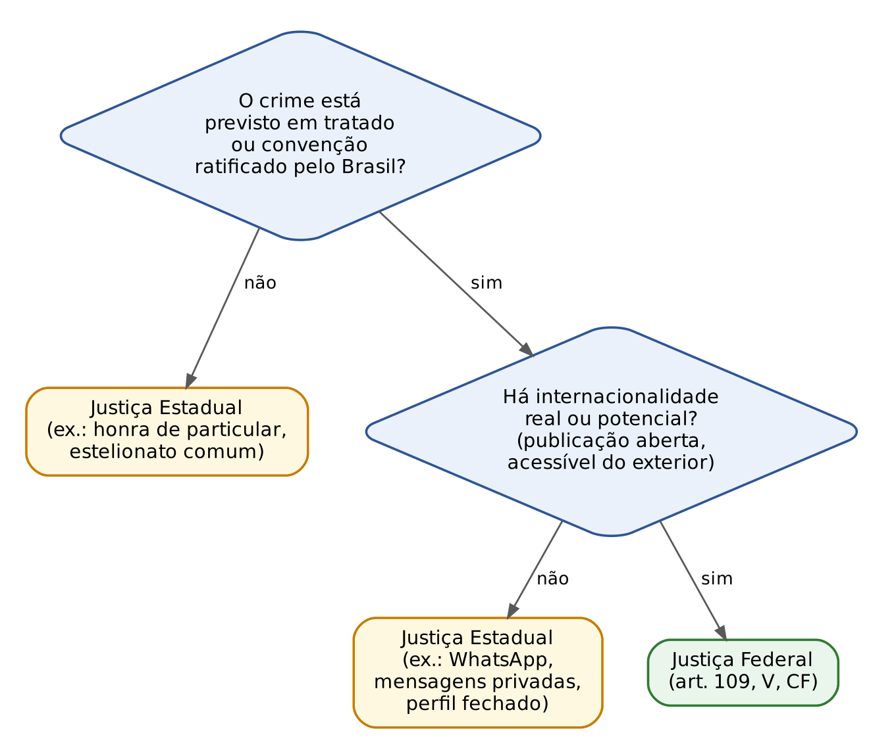
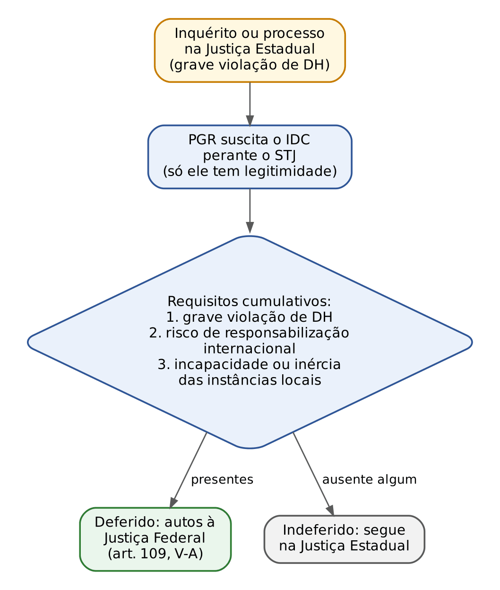
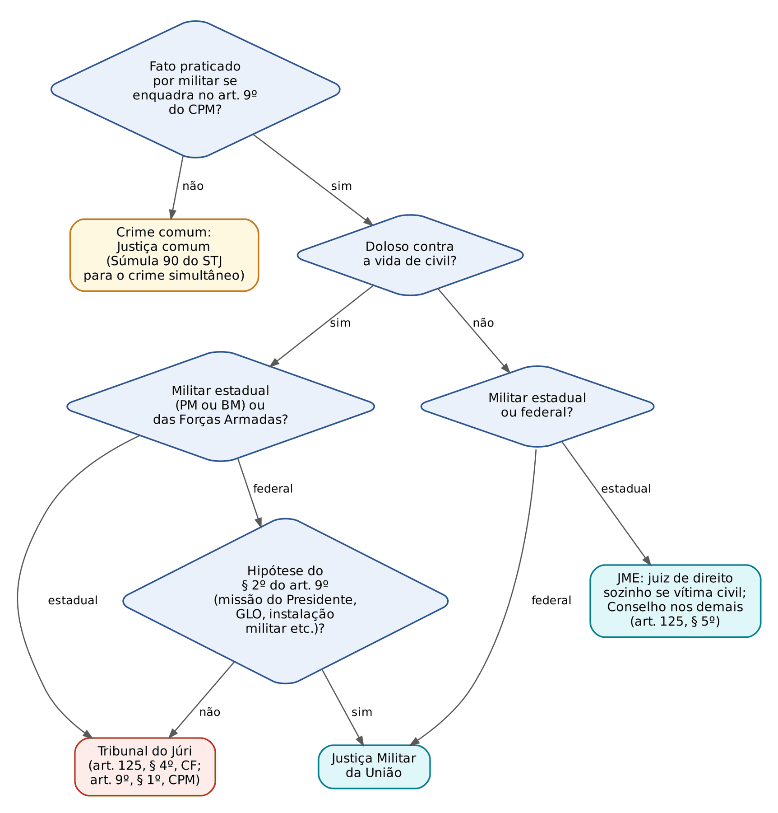
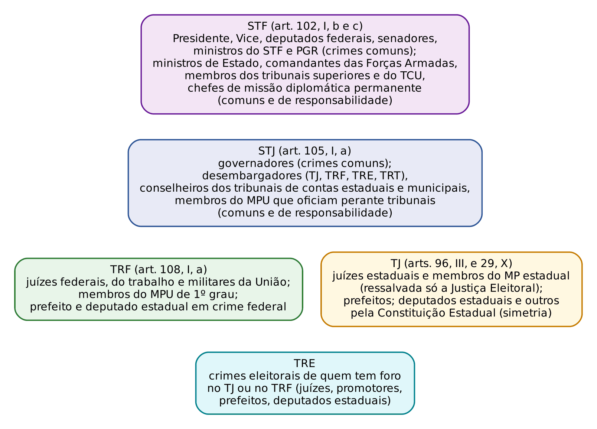
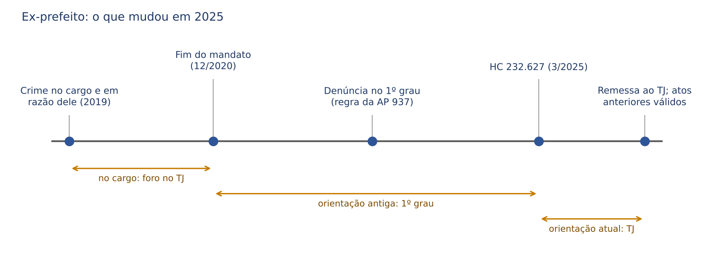

# CAPÍTULO 10 — JURISDIÇÃO E COMPETÊNCIA II: JUSTIÇA FEDERAL, JUSTIÇA ELEITORAL, JUSTIÇA MILITAR, PRERROGATIVA DE FUNÇÃO E COMPETÊNCIA DOS TRIBUNAIS SUPERIORES

:::INCIDENCIA
TRF5 p. 8; TJRS p. 4; TJSC p. 7. Nível A+. Lote: 22 questões (FGV 19, FCC 3), quase todas com caso concreto.
O que mais cai: foro por prerrogativa depois da virada de 2025 (HC 232.627) e dos cargos vitalícios (2026); Justiça Federal x Estadual em casos de internet, Caixa x Banco do Brasil, correspondente bancário e Súmula 122; Justiça Militar após a Lei 13.491/2017.
:::

| Subtema | FGV | FCC | Padrão de cobrança |
|---|---|---|---|
| Foro por prerrogativa de função | 11 | 1 | caso com autoridade (prefeito, deputado estadual, promotor, juiz, MPU); pergunta-se o tribunal e o efeito da saída do cargo |
| Justiça Federal (art. 109) | 7 | 1 | "assinale a hipótese federal" ou caso com vários crimes; armadilhas: sociedade de economia mista, internet sem transnacionalidade, instrumento federal irrelevante |
| IDC (art. 109, § 5º) | 0 | 1 | legitimidade exclusiva do PGR e requisitos cumulativos |
| Justiça Militar e Eleitoral | 1 | 0 | GLO e art. 9º, § 2º, do CPM; conexão com crime eleitoral |

## 10.1 Onde este capítulo entra no raciocínio de competência

O roteiro de fixação da competência e o regime da incompetência estão no Cap. 9 (09.2 e 09.3). Este capítulo desenvolve as duas primeiras perguntas desse roteiro: qual "Justiça" julga (Federal, Estadual, Militar ou Eleitoral) e se o caso começa em primeiro grau ou diretamente num tribunal, por causa do cargo do acusado. São regras constitucionais de competência absoluta (regime em 09.2; nulidade no Cap. 27).

Para o civilista, a intuição perigosa é a do art. 109, I, da CF: no cível, a Justiça Federal se define pela PESSOA que está no processo (União, autarquia ou empresa pública federal como parte). No crime, a regra é outra (art. 109, IV): importa se o CRIME ofendeu, de forma direta, bens, serviços ou interesses federais. A vítima pode ser a Caixa (federal), mas o processo penal não tem a Caixa como parte; quem acusa é o Ministério Público. Por isso as Súmulas 208 e 209 do STJ, pensadas para o crime, nem sequer se aplicam às ações de improbidade, em que vale o critério do art. 109, I.

Lembre que a resposta "há foro" encerra a busca do lugar, porque o tribunal tem sede única, e que o Júri existe tanto na Justiça Estadual quanto na Federal (10.2.5).

:::PROCESSO Qual recurso cabe: o que é próprio deste capítulo
| Decisão | Recurso ou meio | Fundamento |
|---|---|---|
| Declínio de ofício, exceção acolhida ou rejeitada, conflito | ver a tabela de 09.2.4 | art. 581, II e III, do CPP; arts. 113 a 117 |
| Juiz de primeiro grau pratica ato contra autoridade com foro (usurpação) | reclamação ao tribunal usurpado | arts. 102, I, l, e 105, I, f, da CF (Cap. 29) |
| Acórdão condenatório em ação penal originária | não há apelação; cabem embargos e recursos excepcionais | Lei 8.038/1990 (Caps. 24 e 29) |
| Decisão da Terceira Seção do STJ no IDC | recurso extraordinário, se houver questão constitucional | art. 102, III, da CF |
:::

## 10.2 Justiça Federal

### 10.2.1 O critério do inciso IV: ofensa direta a bem, serviço ou interesse federal

O art. 109, IV, da CF atribui aos juízes federais "os crimes políticos e as infrações penais praticadas em detrimento de bens, serviços ou interesse da União ou de suas entidades autárquicas ou empresas públicas, excluídas as contravenções e ressalvada a competência da Justiça Militar e da Justiça Eleitoral". Quatro filtros saem daí e resolvem a maior parte das questões:

- QUEM é o ente federal protegido: União, autarquias (inclusive as fundações públicas federais, que são autarquias fundacionais, e o INSS) e empresas públicas (Caixa, Correios, BNDES). Sociedade de economia mista federal NÃO está na lista (Banco do Brasil, Petrobras): Súmula 42 do STJ, que manda à Justiça Estadual os crimes praticados em detrimento delas. A razão é textual: o constituinte listou só empresas públicas.
- QUE infração: só crimes. Contravenção penal é SEMPRE da Justiça Estadual, ainda que contra a União (Súmula 38 do STJ), e isso vale mesmo com conexão com crime federal: separam-se os processos.
- QUE ofensa: direta e específica. Interesse genérico, reflexo ou indireto não basta. O fato de o crime ter sido investigado pela Polícia Federal não fixa a competência (STJ, RHC 205.658, Sexta Turma, j. 7/10/2025); a inserção de dados falsos em sistema federal também não, se não houver lesão direta à União (mesmo julgado); a mera procedência estrangeira de insumos não basta sem prova de que o agente participou da internacionalização (STJ, RHC 234.894, Sexta Turma, j. 9/6/2026).
- QUE ressalvas: crime militar e crime eleitoral saem da Justiça Federal mesmo que atinjam a União (justiças especiais prevalecem; ver 10.3 e 10.4).

:::ESQUEMA Entra ou não entra no inciso IV
| É federal | NÃO é federal |
|---|---|
| Crime contra a Caixa, os Correios (agência própria), o INSS, o Ibama, universidade federal, conselho profissional (autarquias) | Crime contra o Banco do Brasil, a Petrobras ou qualquer sociedade de economia mista (Súmula 42) |
| Crime contra servidor federal relacionado à função (Súmula 147) | Contravenção penal, ainda que contra a União (Súmula 38) |
| Crime praticado por servidor federal no exercício da função | Roubo em correspondente bancário "Caixa Aqui" ou em agência franqueada dos Correios (empresas privadas) |
| Desvio de verba sujeita à prestação de contas a órgão federal (Súmula 208) | Desvio de verba federal já incorporada ao patrimônio municipal (Súmula 209) |
| Estelionato contra o INSS (fraude previdenciária) | Estelionato com guia previdenciária falsa sem lesão à autarquia (Súmula 107) |
:::

:::QUESTAO FGV 2025 — TJ-CE — Juiz Substituto (Q3505806)
Um roubo armado numa loja de conveniência que funcionava como correspondente bancário da Caixa levou 520 (quinhentos e vinte) reais do correspondente, 15.000 (quinze mil) reais do caixa da loja e o celular de uma empregada da Caixa que prestava serviço no local. A defesa pediu o envio à Justiça Federal com três argumentos (valor do correspondente, vítima empregada da Caixa, serviço bancário afetado).
Passo 1, o que se pergunta: houve ofensa direta a bem, serviço ou interesse da empresa pública federal? Passo 2, a regra: o correspondente é empresa privada credenciada pela Caixa, que com ela não se confunde (STJ, AgRg no CC 131.474, Terceira Seção, j. 12/3/2014). Passo 3, aplicação: o dinheiro era do correspondente e da loja, e o celular era da empregada (bem particular). Gabarito B: Justiça Estadual. Erram a alternativa que divide a competência por vítima (não há cisão sem crime federal autônomo) e a que adota critério "quantitativo" de prejuízo, que não existe.
:::

:::QUESTAO FGV 2026 — TRF2 — Juiz Federal Substituto (Q3996840)
Armadilha central: instrumento federal não é bem federal. No caso, o empregado da Caixa armazenou pornografia infantil no computador da agência. Usar um bem federal como INSTRUMENTO do crime não atrai a Justiça Federal, porque o bem jurídico ofendido não é federal; e o fato de o material ter sido achado em busca ordenada pela Justiça Federal em outra investigação também não, porque descoberta fortuita não fixa competência e não há conexão probatória (STJ, AgRg no CC 200.833, Terceira Seção, j. 13/3/2024). Como a divulgação foi por mensagens diretas a seguidores de perfil fechado, sem acesso transnacional (ver 10.2.4), tudo ficou na Justiça Estadual: gabarito D.
:::

### 10.2.2 Os incisos do art. 109 em matéria penal

| Inciso | Hipótese | Exemplos e súmulas que caem |
|---|---|---|
| IV, 1ª parte | crimes políticos | exigem motivação política e lesão real ou potencial à integridade territorial, à soberania ou ao regime (STF, RC 1.468, j. 23/3/2000); a sentença do juiz federal desafia recurso ORDINÁRIO direto ao STF (art. 102, II, b), sem passar pelo TRF |
| IV, 2ª parte | crimes contra bens, serviços ou interesse da União, autarquias e empresas públicas | ver 10.2.1 e 10.2.3; Súmulas 38, 42, 62, 104, 107, 122, 147, 165, 208, 209 e 546 do STJ; Súmula Vinculante 36 |
| V | crimes previstos em tratado ou convenção, quando, iniciada a execução no País, o resultado ocorreu ou devia ocorrer no estrangeiro, ou o inverso | tráfico internacional de drogas, de armas e de pessoas; pornografia infantojuvenil na internet acessível do exterior (Tema 393); racismo em rede aberta; direito autoral transnacional (Tema 580); fauna transnacional (Tema 648) |
| V-A e § 5º | causas relativas a direitos humanos deslocadas pelo IDC | ver 10.2.6 |
| VI | crimes contra a organização do trabalho e, nos casos determinados por lei, contra o sistema financeiro e a ordem econômico-financeira | redução à condição análoga à de escravo (STF, RE 459.510, j. 26/11/2015); crimes da Lei 7.492/1986 (art. 26); lavagem quando o crime antecedente for federal (art. 2º, III, da Lei 9.613/1998) |
| VII e VIII | *habeas corpus* e mandado de segurança em matéria criminal contra ato de autoridade federal não sujeita a outro tribunal | HC contra delegado da Polícia Federal vai ao juiz federal (Cap. 30) |
| IX | crimes a bordo de navios ou aeronaves, ressalvada a Justiça Militar | navio = embarcação de grande porte, em viagem internacional ou em potencial deslocamento; aeronave, ainda que pousada (STJ, CC 118.503, Terceira Seção, j. 22/4/2015); o lugar e o juízo da circunscrição estão no Cap. 9 |
| X | ingresso ou permanência irregular de estrangeiro; execução de carta rogatória e de sentença estrangeira; nacionalidade | crimes de migração (Cap. 26); cooperação (Cap. 32) |
| XI | disputa sobre direitos indígenas | crime comum em que indígena é autor ou vítima é da Justiça Estadual (Súmula 140 do STJ); federal só quando em jogo direitos coletivos da comunidade (terras, cultura, sobrevivência do grupo, genocídio) |

Os requisitos do inciso V são CUMULATIVOS: o crime deve estar previsto em tratado ratificado pelo Brasil E deve haver internacionalidade (real ou potencial) entre o início da execução e o resultado. Estelionato pela internet com vítimas no exterior não é federal só por isso, porque o estelionato comum não é crime "previsto em tratado" (FGV 2025, ENAM, Q3692366, alternativa C, errada). Tráfico interestadual de drogas é da Justiça Estadual, ainda que investigado pela Polícia Federal (mesma questão, gabarito E). E o tráfico internacional se caracteriza pela destinação ao exterior, ainda que a fronteira não tenha sido transposta (Súmula 607 do STJ, que é regra material de majorante mas define, por tabela, a competência federal).

:::DICA Organização do trabalho: coletivo x individual
O inciso VI não leva à Justiça Federal qualquer crime do Título IV do CP. Leva os que ofendem a organização do trabalho como sistema (direitos coletivos dos trabalhadores, liberdade de trabalho de categorias, trabalho escravo, que fere a dignidade e a organização do trabalho). Violação a direito individual de um trabalhador (ex.: frustrar direito trabalhista de um empregado) fica na Justiça Estadual. O falso testemunho em processo trabalhista, porém, é federal porque ofende a administração da Justiça da União (Súmula 165 do STJ).
:::

### 10.2.3 Situações recorrentes do inciso IV

#### Falsidades documentais

A competência nas falsidades depende de QUEM é enganado ou lesado, não de quem expediu o papel. A regra-chave é a Súmula 546 do STJ: a competência para o crime de uso de documento falso firma-se em razão da entidade ou órgão ao qual o documento foi apresentado, pouco importando a qualificação do órgão expedidor. Assim, carteira de identidade estadual falsa exibida a policial rodoviário federal é crime federal; CNH falsa (documento federal na origem) mostrada a policial militar é crime estadual.

| Situação | Competência | Fundamento |
|---|---|---|
| Uso de documento falso perante órgão federal (PRF, Polícia Federal, INSS) | Federal | Súmula 546 do STJ |
| Falsificação ou uso de Caderneta de Inscrição e Registro (CIR) ou Carteira de Habilitação de Amador (CHA) da Marinha, por civil | Federal comum (não a Militar) | Súmula Vinculante 36 |
| Passaporte falso | Federal, no lugar onde o crime se consumou | Súmula 200 do STJ (o território está no Cap. 9) |
| Anotação falsa na CTPS atribuída a empresa privada | Estadual | Súmula 62 do STJ |
| Omissão de registro de vínculo na CTPS (art. 297, § 4º, do CP), que frustra a arrecadação previdenciária | Federal, segundo a Terceira Seção do STJ | STJ, CC 145.567, j. 27/4/2016 |
| Falsificação e uso de documento de estabelecimento particular de ensino | Estadual | Súmula 104 do STJ (diploma de instituição federal seria federal) |
| Guias de recolhimento previdenciário falsificadas sem lesão ao INSS | Estadual | Súmula 107 do STJ |

Aplicação cobrada: identidade estadual falsa exibida à PRF, com petrechos de falsificação no carro, é crime federal que atrai o conexo (FGV 2025, ENAC, Q3328215, resolvida em 11.4; a alternativa errada inverte a Súmula 546).

#### Crimes patrimoniais e verbas públicas

- Caixa Econômica Federal (empresa pública): furto, roubo, estelionato e fraudes contra ela são federais. Banco do Brasil (sociedade de economia mista): estaduais (Súmula 42). A FGV e a FCC cobram exatamente esse contraste.
- Correios: crime contra a ECT (agência própria, carteiro em serviço, carga postal) é federal; agência franqueada é empresa privada, logo estadual.
- INSS: estelionato previdenciário (benefício obtido com fraude, saque de benefício após a morte do titular) é federal, porque a autarquia é a lesada.
- Verbas públicas repassadas: o critério é a fiscalização. Se a verba continua sujeita à prestação de contas a órgão federal (TCU, ministério), a União mantém interesse e o crime é federal (Súmula 208 do STJ); se a verba foi transferida e incorporada ao patrimônio do Município, é estadual (Súmula 209 do STJ). Em 2026 o STJ aplicou o mesmo raciocínio, por analogia, a recursos do Sistema S: a competência federal depende, caso a caso, de as verbas estarem sujeitas à fiscalização do TCU e de haver envolvimento efetivo de bens ou interesses da União (STJ, AgRg no CC 213.525, Terceira Seção, j. 7/5/2026).
- Empresa estadual, sem dinheiro federal: estadual, ainda que a operação policial conexa tramite na Justiça Federal, porque competência absoluta não se prorroga por conexão probatória ou prevenção (STJ, AgRg nos EDcl no CC 213.422, Terceira Seção, j. 11/3/2026).

#### Moeda falsa, contrabando e descaminho, drogas

- Moeda falsa (art. 289 do CP): federal, porque a emissão de moeda é serviço da União. Mas a falsificação GROSSEIRA, incapaz de enganar o homem médio, não ofende a fé pública da moeda: o fato pode configurar estelionato, de competência estadual (Súmula 73 do STJ).
- Contrabando e descaminho: SEMPRE federais (interesse fiscal e aduaneiro da União), mesmo quando a mercadoria é apreendida longe da fronteira, numa feira (FGV 2025, ENAM, Q3692366, alternativa D, errada por afirmar a Justiça Estadual). O juízo federal competente é o do lugar da apreensão (Súmula 151 do STJ). A facilitação de circulação de produto NACIONAL com sonegação de tributo estadual não é descaminho, e a conduta do servidor estadual não atrai a Justiça Federal (STJ, CC 210.869, Terceira Seção, j. 9/4/2025).
- Drogas: estadual, salvo tráfico com o exterior (Súmula 522 do STF; art. 70 da Lei 11.343/2006, que manda o processo à vara federal da circunscrição quando o Município não for sede de vara federal). A remessa postal de droga do exterior é julgada no juízo federal do destino, depois do cancelamento da antiga Súmula 528 do STJ (território: Cap. 9).

#### Meio ambiente (só a regra)

A regra é a competência ESTADUAL, porque a proteção ambiental é comum a todos os entes (art. 23 da CF). Vai à Justiça Federal quando houver lesão direta a bem ou interesse da União (unidade de conservação federal, terra indígena, bem da União afetado de modo relevante) ou transnacionalidade, como na fauna silvestre traficada para o exterior (STF, RE 835.558, Tema 648, j. 9/2/2017). A simples localização no mar territorial não basta sem reflexo regional ou nacional do dano (STJ, AREsp 2.313.729, Sexta Turma, j. 3/6/2025). Sobre flora ameaçada de extinção há decisões em sentidos opostos na Terceira Seção: em 18/2/2025 (AgRg no CC 206.862) afirmou-se a competência federal; em 4/12/2025 (CC 215.970) prevaleceu que constar de lista oficial não basta sem transnacionalidade ou interesse direto da União. O tratamento processual dos crimes ambientais está no Cap. 26.

:::QUESTAO FGV 2025 — TJ-GO — Residente Jurídico (Q3345954)
Pediu-se a única hipótese NÃO federal. Gabarito C: fraude à licitação contra a Petrobras, sociedade de economia mista, é da Justiça Estadual (Súmula 42 do STJ). As demais são federais: contrabando de animal silvestre ameaçado (transnacionalidade, Tema 648), roubo contra a Caixa (empresa pública), extração ilegal de areia (recurso mineral é bem da União; art. 2º da Lei 8.176/1991) e moeda falsa. Armadilha: o adjetivo "federal" em "sociedade de economia mista federal".
:::

:::QUESTAO FCC 2024 — TRF3 — Técnico Judiciário (Q2564679)
Quatro casos: transporte de 490 kg de cocaína rumo ao Paraguai, preso antes de cruzar a fronteira (federal, tráfico transnacional, Súmula 607 do STJ); furto em agência do Banco do Brasil (estadual, Súmula 42); homicídio de policial rodoviário federal que abordava o autor (federal, Súmula 147, perante o Júri federal); roubo dentro de avião estacionado em Guarulhos (federal, art. 109, IX, ainda que a aeronave esteja pousada). Gabarito A: Rinaldo, Marco e Sofia.
:::

:::QUESTAO FGV 2025 — ENAM 2025.2 (Q3692367)
Pediu-se o fato federal. Gabarito D: homicídio culposo no trânsito que matou servidor federal dirigindo viatura da União em serviço (Súmula 147 do STJ: crime contra servidor federal no exercício da função). Por que as outras caem: tráfico por militar a bordo de navio militar é crime militar (art. 9º, II, do CPM, após a Lei 13.491/2017), logo da Justiça Militar da União; ato infracional de adolescente é da Vara da Infância estadual, ainda que análogo a crime financeiro; violência doméstica entre indígenas é estadual (Súmula 140); homicídio de estrangeiro no Brasil não tem interesse da União, e a cooperação internacional prestada não muda isso.
:::

:::QUESTAO FGV 2025 — ENAM 2025.2 (Q3692366)
Pediu-se a afirmação correta sobre competência em cinco casos. Gabarito E: tráfico INTERESTADUAL de drogas (Paraná para São Paulo) é da Justiça Estadual, ainda que investigado pela Polícia Federal (Súmula 522 do STF). Erradas: juiz de direito acusado de crime financeiro vai ao TJ, não ao TRF (art. 96, III; 10.5.2); compartilhar pornografia infantil em grupos de aplicativo de mensagens não é, por si, federal (Tema 393 exige acesso transnacional; 10.2.4); estelionato pela internet com vítimas no exterior não é crime previsto em tratado; contrabando é sempre federal, ainda que a mercadoria seja apreendida numa feira.
:::

### 10.2.4 Crimes pela internet

Usar a internet não torna o crime federal. O caminho é o do inciso V: o crime precisa estar em tratado e a conduta precisa ter potencial de alcançar o exterior.

:::JURIS STF, RE 628.624, Tema 393, j. 29/10/2015 (tese ajustada nos embargos em 18/8/2020)
Compete à Justiça Federal processar e julgar os crimes de disponibilizar ou adquirir material pornográfico envolvendo criança ou adolescente (arts. 241, 241-A e 241-B do ECA), "acessível transnacionalmente", quando praticados pela internet. A expressão entre aspas foi incluída nos embargos de declaração justamente para evitar que qualquer uso da rede levasse o caso à Justiça Federal.
:::

Consequências práticas cobradas: troca por WhatsApp, chat privado ou grupos fechados de mensagens, entre pessoas determinadas, não tem acesso transnacional e fica na Justiça Estadual (FGV 2025, ENAM, Q3692366, alternativa B, errada; FGV 2026, TRF2, Q3996840). Publicação em site, rede social ou perfil ABERTO, acessível de qualquer país, presume a transnacionalidade.

O mesmo raciocínio vale para o racismo e a injúria racial (crimes previstos na Convenção Internacional sobre a Eliminação de Todas as Formas de Discriminação Racial): conteúdo discriminatório em plataforma de alcance internacional atrai a Justiça Federal (Jurisprudência em Teses do STJ, ed. 280, tese 1; no mesmo sentido FGV 2026, TJ-SC, Oficial de Justiça, Q4153636, classificada no Cap. 9), mas é preciso demonstrar que o perfil era ABERTO (STJ, AgRg no HC 717.984, Sexta Turma, j. 2/9/2024). Por isso está errada a afirmação de que a competência federal existe "independentemente de se tratar de perfil aberto ou fechado" (FGV 2025, TRF3, Q3179526, alternativa D). Aplica-se também à discriminação contra pessoa com deficiência do art. 88 da Lei 13.146/2015 em rede social aberta (STJ, CC 205.569, Terceira Seção, j. 13/11/2024) e à violação de direito autoral com transnacionalidade (STF, RE 702.362, Tema 580, j. 19/12/2023).

Ao contrário, crime contra a honra de PARTICULAR pela internet, mesmo em rede de alcance mundial, não é federal: a honra individual não está protegida por tratado em termos que atraiam o inciso V (Jurisprudência em Teses do STJ, ed. 280, tese 3). O lugar (onde a ofensa foi inserida ou conhecida) é tema do Cap. 9.

:::QUESTAO FGV 2026 — prova não identificada no banco (Q3868568)
Pergunta: quando o crime do art. 88 do Estatuto da Pessoa com Deficiência é federal? Gabarito D: publicação em rede social aberta (presunção de transnacionalidade, CC 205.569). Revista online, pôster, troca de mensagens por aplicativo e jornal impresso não bastam: o primeiro e o último por falta de demonstração de alcance transnacional; os demais por não terem alcance internacional algum.
:::

### 10.2.5 Conexão entre crime federal e estadual (Súmula 122) e Júri federal

Quando um crime federal e um estadual são conexos, o art. 78, II, a, do CPP mandaria julgar tudo no foro do crime mais grave. A Súmula 122 do STJ afasta essa regra: compete à Justiça Federal o processo e julgamento unificado dos crimes conexos de competência federal e estadual. A razão é hierárquica: a competência federal é constitucional e expressa; a estadual é residual; logo, a federal atrai a estadual e nunca o contrário. A súmula, porém, pressupõe CONEXÃO verdadeira (art. 76 do CPP, estudado no Cap. 11): crimes descobertos no mesmo contexto, sem vínculo probatório, separam-se (STJ, AgRg no CC 200.833, j. 13/3/2024). Não alcança contravenção (Súmula 38), crime militar nem crime eleitoral, que têm justiça especial (art. 79, I, do CPP e 10.3).

:::QUESTAO FGV 2026 — TRF2 — Juiz Federal Substituto (Q3996841)
Caso: Viviane é sequestrada por Amaury para exploração sexual em outro Estado; a polícia, após 24 horas sem decisão judicial, requisita diretamente dados de estação rádio base; numa segunda diligência, prende Sergio e resgata Maria e Alejandra, venezuelanas trazidas ao Brasil mediante fraude pelo mesmo grupo. Gabarito B: ambas as prisões são válidas e a Justiça Federal julga os dois.
Passo 1, a prova: no tráfico de pessoas, o art. 13-B do CPP autoriza o delegado a requisitar diretamente os dados de localização se o juiz não se manifestar em 12 horas (detalhes no Cap. 16). Passo 2, a competência: o tráfico internacional de pessoas (vítimas trazidas da Venezuela) é crime previsto em tratado (Protocolo de Palermo) com internacionalidade, logo federal (art. 109, V). Passo 3, o tráfico interno de Viviane, cometido pelo mesmo grupo, é conexo e é atraído (Súmula 122). Armadilhas: a alternativa que cinde (Amaury no Estadual, Sergio no Federal) ignora a conexão; a que anula a prisão de Sergio por incompetência do juiz estadual que expediu a busca esquece que a decisão foi tomada quando a internacionalidade ainda não aparecia (juízo aparente).
:::

O crime doloso contra a vida de competência federal (homicídio de servidor federal em razão da função, homicídio a bordo de navio, homicídio conexo com crime federal) é julgado pelo Tribunal do Júri FEDERAL, presidido por juiz federal e composto por jurados alistados na seção judiciária (STJ, CC 194.981, Terceira Seção, j. 24/5/2023). O procedimento é o mesmo do Júri estadual (Cap. 23).

:::SENTENCA Preliminar de competência na Justiça Federal
Onde entra: no recebimento da denúncia (o juiz federal verifica de ofício a própria competência) e, na sentença, como preliminar quando a defesa a suscita. O que fundamentar: qual bem, serviço ou interesse federal foi DIRETAMENTE atingido e, havendo crime estadual, qual o vínculo de conexão que justifica a Súmula 122.
Redação-modelo: "Rejeito a preliminar de incompetência. O uso do documento falso deu-se perante a Polícia Rodoviária Federal, órgão da União, o que fixa a competência deste juízo (art. 109, IV, da CF; Súmula 546 do STJ), atraindo o crime conexo de petrechos de falsificação (art. 76, III, do CPP; Súmula 122 do STJ)."
Erro comum punido: fundamentar a competência federal no fato de a investigação ter sido conduzida pela Polícia Federal, na nacionalidade da vítima ou no uso de instrumento pertencente à União.
:::

### 10.2.6 Incidente de deslocamento de competência (IDC)

Criado pela EC 45/2004 (art. 109, V-A e § 5º, da CF), o IDC é a "federalização" de um caso de grave violação de direitos humanos. A lógica é de responsabilidade internacional: quem responde perante a Corte Interamericana é a República Federativa do Brasil, representada pela União; se o Estado-membro não investiga nem pune, a União precisa de um instrumento para assumir a persecução e evitar a condenação internacional. O texto é curto e por isso a banca cobra os detalhes:

- Legitimidade: EXCLUSIVA do Procurador-Geral da República. Nem a vítima, nem a Defensoria, nem o juiz suscitam (o STJ não conheceu de IDC proposto por particular).
- Órgão: STJ (no regimento, a Terceira Seção).
- Momento: "em qualquer fase do inquérito ou processo".
- Finalidade: assegurar o cumprimento de obrigações de tratados de direitos humanos de que o Brasil seja parte.
- Requisitos construídos pelo STJ, CUMULATIVOS: (1) grave violação de direitos humanos; (2) risco de responsabilização internacional do Brasil pelo descumprimento de obrigações convencionais; (3) incapacidade, inércia ou ineficácia, demonstradas, das instâncias estaduais em investigar, processar e julgar com isenção. A gravidade ou a repercussão do caso, sozinhas, NÃO bastam: o IDC é medida excepcionalíssima, em respeito ao pacto federativo.

Casos de referência: IDC 1 (morte da missionária Dorothy Stang, 2005), indeferido porque as autoridades paraenses atuavam; IDC 2 (assassinato do advogado e ex-vereador Manoel Mattos, 2010), deferido; IDC 5 (homicídio do promotor de justiça Thiago Faria Soares, em Pernambuco, 2014), deferido; IDC 24 (homicídio de Marielle Franco e Anderson Gomes, 2020), indeferido porque a investigação estadual avançava.

:::QUESTAO FCC 2026 — DPE-MT — Defensor Público (Q3954682)
Caso: ataques a defensores de direitos humanos com suspeita de conivência e inércia das autoridades locais. Gabarito A: a federalização é hipótese constitucional excepcional de modificação da competência e depende de iniciativa institucional específica (do PGR) perante o STJ. Erradas: a que a diz automática e decidida por juiz de primeiro grau; as que a ligam ao esgotamento de recursos internos para o sistema interamericano (são planos distintos); a que considera a repercussão social suficiente (os requisitos são cumulativos).
:::

## 10.3 Justiça Eleitoral

A Justiça Eleitoral é ramo do Judiciário da União, mas NÃO se confunde com a Justiça Federal comum: o art. 109, IV, ressalva expressamente a sua competência. Não tem quadro próprio de juízes de primeiro grau: o juiz eleitoral é o juiz de direito estadual designado para a zona eleitoral; o Ministério Público Eleitoral é chefiado pelo Procurador-Geral Eleitoral (do MPF) e atua em primeiro grau por promotores de justiça designados; a polícia judiciária eleitoral é, em regra, a Polícia Federal.

Crime eleitoral é o definido na legislação eleitoral (Código Eleitoral, Lei 9.504/1997, LC 64/1990, Lei 6.091/1974). Compete ao juiz eleitoral processar e julgar os crimes eleitorais e os COMUNS que lhes forem conexos (art. 35, II, do Código Eleitoral), e o art. 78, IV, do CPP dá prevalência à jurisdição especial no concurso com a comum.

:::JURIS STF, Inq 4.435 AgR-quarto, Plenário, j. 13 e 14/3/2019
Compete à Justiça Eleitoral julgar os crimes eleitorais e os comuns que lhes forem conexos, inclusive crimes federais como corrupção e lavagem de dinheiro ligados a "caixa dois" de campanha (art. 350 do Código Eleitoral). Cabe à própria Justiça Eleitoral examinar se há conexão; se concluir que não há, remete os crimes comuns ao juízo competente.
:::

O ponto que a banca explora é que a atração alcança também crimes que seriam da Justiça FEDERAL: a ressalva do art. 109, IV, faz a Eleitoral prevalecer sobre a Federal. Por isso está errada a frase "a Justiça Eleitoral julga os crimes eleitorais e os conexos, exceto os de competência da Justiça Federal e da Justiça Militar" (FGV 2025, TRF3, Q3179526, alternativa B): só a exceção militar procede (art. 79, I, do CPP manda separar crime militar de crime comum). Também não se reúnem ao processo eleitoral o ato infracional de adolescente (art. 79, II) e, para a doutrina majoritária, o crime doloso contra a vida conexo, porque a competência do Júri tem assento constitucional e não cede a regra legal de conexão (Cap. 11).

:::ESQUEMA Quem julga crime eleitoral
| Acusado | Órgão |
|---|---|
| Sem foro | juiz eleitoral (zona) |
| Juiz de direito, promotor, juiz federal, procurador da República de primeiro grau, prefeito | TRE (ressalvas dos arts. 96, III, e 108, I, a, da CF; Súmula 702 do STF) |
| Juízes eleitorais, pelos crimes eleitorais | TRE (art. 29, I, d, do Código Eleitoral) |
| Governador | STJ (a expressão "crimes comuns" do art. 105, I, a, abrange os eleitorais) |
| Deputado federal, senador, ministro de Estado | STF (as "infrações penais comuns" do art. 102, I, b e c, abrangem crimes eleitorais e contravenções) |
:::

O TSE não tem competência criminal originária. O procedimento e os recursos eleitorais (recurso criminal ao TRE, prazo de 10 dias do art. 362 do Código Eleitoral) estão no Cap. 26; os tipos penais, na Apostila de Direito Penal, Cap. 48.

## 10.4 Justiça Militar

### 10.4.1 Dois ramos com regras diferentes

A Constituição tem duas Justiças Militares, e quase todas as pegadinhas vêm de aplicar a regra de uma à outra.

| | Justiça Militar da União (JMU) | Justiça Militar estadual (JME) |
|---|---|---|
| Base | art. 124 da CF: "crimes militares definidos em lei" | art. 125, §§ 3º a 5º, da CF |
| Quem pode ser réu | militares das Forças Armadas e também CIVIS (ex.: civil que furta bem sob administração militar dentro do quartel) | SOMENTE militares dos Estados (policiais e bombeiros militares); civil NUNCA (Súmula 53 do STJ) |
| Primeiro grau | Conselhos de Justiça (juiz federal da Justiça Militar e oficiais) e, monocraticamente, o juiz federal da Justiça Militar quando houver civil acusado, sozinho ou com militares (art. 30, I-B, da Lei 8.457/1992, na redação da Lei 13.774/2018) | juiz de direito do juízo militar, SOZINHO, nos crimes militares contra civis e nas ações contra atos disciplinares; Conselho de Justiça, presidido pelo juiz de direito, nos demais (art. 125, § 5º) |
| Segundo grau | Superior Tribunal Militar (STM) | Tribunal de Justiça Militar onde houver efetivo superior a 20 mil integrantes (existem em SP, MG e RS) ou o próprio Tribunal de Justiça (como em SC) — art. 125, § 3º |
| Crime doloso contra a vida de civil | em regra Júri, mas JMU nas hipóteses do art. 9º, § 2º, do CPM | SEMPRE Tribunal do Júri (art. 125, § 4º; art. 9º, § 1º, do CPM) |

Para o TJRS a distinção tem peso prático: no Rio Grande do Sul o segundo grau da JME é o Tribunal de Justiça Militar, de modo que o conflito entre juiz de direito comum e juiz da Justiça Militar estadual é julgado pelo STJ (tribunais diversos, art. 105, I, d). Nos Estados sem TJM, como SC, o conflito entre juiz de direito e a Justiça Militar local é julgado pelo próprio Tribunal de Justiça (Súmula 555 do STF).

### 10.4.2 O que é crime militar depois da Lei 13.491/2017

O art. 9º do CPM define crime militar por critério legal (*ratione legis*): o fato precisa estar tipificado e ocorrer numa das situações do inciso II (militar da ativa contra militar da ativa, em lugar sujeito à administração militar, em serviço ou atuando em razão da função, entre outras). Até 2017, o inciso II só alcançava os crimes PREVISTOS NO CPM. A Lei 13.491/2017 passou a incluir "os crimes previstos neste Código e os previstos na legislação penal", criando os chamados crimes militares por extensão: tortura, abuso de autoridade, crimes da Lei de Drogas ou do Estatuto do Desarmamento praticados por militar em serviço, por exemplo, tornaram-se crimes militares. Os detalhes de direito material estão na Apostila de Direito Penal, Cap. 51.

Efeitos processuais que caem:

- A lei, por alterar competência, aplica-se de imediato aos processos em curso, que devem ser remetidos à Justiça Militar; mas o juiz militar aplica a lei material mais favorável do tempo do fato (STJ, CC 161.898, Terceira Seção, j. 13/2/2019).
- A Súmula 172 do STJ (abuso de autoridade por militar em serviço é da Justiça comum) ficou superada.
- Súmulas antigas que exigem atenção: a Súmula 47 do STJ (crime de militar contra civil com arma da corporação, fora de serviço, seria militar) está superada desde a Lei 9.299/1996; as Súmulas 6 (acidente de trânsito com viatura da PM é da Justiça comum, salvo se autor e vítima forem policiais militares em atividade) e 75 (PM que promove ou facilita fuga de preso de estabelecimento penal comum responde na Justiça comum) do STJ seguem formalmente vigentes, mas sua compatibilidade com a Lei 13.491/2017 é discutida (ver nota de verificação).
- Seguem firmes: Súmula 53 (civil que atenta contra instituição militar estadual é julgado na Justiça comum estadual), Súmula 78 (o PM é julgado pela Justiça Militar do SEU Estado, ainda que o crime ocorra em outra unidade da Federação) e Súmula 90 (crime militar e crime comum simultâneos separam-se: o militar na JME, o comum na Justiça comum, conforme art. 79, I, do CPP).

### 10.4.3 Crime doloso contra a vida praticado por militar

Militar estadual que mata civil dolosamente vai ao Júri (art. 125, § 4º, da CF), e também o crime conexo de ocultação de cadáver, por força da conexão (FCC 2025, DPE-RS, Q3387016, gabarito A, classificada no Cap. 11). O inquérito, porém, pode ser militar: o art. 82, § 2º, do CPPM manda a Justiça Militar encaminhar os autos do IPM à Justiça comum.

Para as Forças Armadas, a Lei 13.491/2017 inseriu o § 2º no art. 9º do CPM: o crime doloso contra a vida de civil será da Justiça Militar da União quando praticado no cumprimento de atribuições estabelecidas pelo Presidente da República ou pelo Ministro da Defesa; em ação que envolva a segurança de instituição militar ou de missão militar, ainda que não beligerante; ou em atividade de natureza militar, operação de paz, de garantia da lei e da ordem (GLO) ou de atribuição subsidiária, nos termos do art. 142 da CF e das leis indicadas (LC 97/1999, Código Brasileiro de Aeronáutica, CPPM e Código Eleitoral). Fora dessas hipóteses, o militar federal que mata civil vai ao Júri.

:::QUESTAO FGV 2025 — TRF3 — Juiz Federal Substituto (Q3179526)
Gabarito C: compete à Justiça Militar julgar crimes dolosos contra a vida de civis praticados por militares das Forças Armadas em missão de GLO (art. 9º, § 2º, III, do CPM). As demais estavam erradas: (A) o Júri NÃO prevalece sobre foro previsto na própria Constituição (10.5.6); (B) a Justiça Eleitoral atrai também os crimes federais conexos (10.3); (D) racismo em rede social exige perfil aberto (10.2.4); (E) "pirâmide financeira" é crime contra a economia popular (art. 2º, IX, da Lei 1.521/1951), de competência estadual (Súmula 498 do STF), e não crime contra o sistema financeiro.
:::

:::JURIS STJ, CC 218.865, Terceira Seção, j. 8/4/2026 (Informativo 884)
Soldado do Exército mata a namorada, também militar, dentro do quartel e depois incendeia a sala e leva a arma funcional dela. O feminicídio, crime doloso contra a vida centrado na violência de gênero, é do Tribunal do Júri, ainda que praticado por militar em dependência militar; os crimes que atingem diretamente bens castrenses (incêndio, dano às instalações, furto da arma, fraude processual) ficam na Justiça Militar da União; a separação dos processos é obrigatória e não configura *bis in idem*.
:::

:::ATENCAO Justiça Federal não controla inquérito militar
Se o crime investigado é militar, só o juízo militar pode suspender o inquérito policial militar; o juiz federal comum, em ação cível, pode no máximo controlar a sindicância disciplinar (STJ, CC 200.708, Terceira Seção, j. 13/12/2023).
:::

A constitucionalidade da ampliação da competência da JMU (art. 15, § 7º, da LC 97/1999 e o § 2º do art. 9º do CPM) é questionada no STF (ADI 5.032 e ADI 5.901); até a data de fechamento deste capítulo não se localizou decisão definitiva, e as bancas aplicam o texto legal.

## 10.5 Competência por prerrogativa de função

### 10.5.1 Fundamento e natureza

Certas autoridades são processadas e julgadas originariamente por tribunais, e não por juiz de primeiro grau. A justificativa clássica é proteger a FUNÇÃO, e não a pessoa: um órgão colegiado e de maior hierarquia estaria menos exposto a pressões políticas e à intimidação, e se evitaria que um juiz julgasse autoridade que lhe é superior. Por isso a doutrina prefere "foro por prerrogativa de função" a "foro privilegiado" (que sugeriria benefício pessoal, incompatível com a isonomia), e a jurisprudência repete que a prerrogativa é da função, não do titular.

Três consequências conceituais que a banca testa:

- Foro NÃO é imunidade. A autoridade é processada normalmente; muda apenas o órgão julgador. As imunidades parlamentares (art. 53 da CF) são outra coisa.
- O foro abrange a fase de investigação: o tribunal competente supervisiona o inquérito desde a sua instauração (ver 10.5.8).
- Foro é competência penal; não alcança a ação de improbidade administrativa, processada em primeiro grau (STF, Pet 3.240 AgR, j. 10/5/2018), nem ações cíveis.

O art. 84 do CPP repete que a competência por prerrogativa é do STF, do STJ, dos TRFs e dos TJs quanto às pessoas que devam responder perante eles. Os §§ 1º e 2º, acrescentados pela Lei 10.628/2002 para manter o foro após o cargo e estendê-lo à improbidade, foram declarados inconstitucionais (STF, ADI 2.797, j. 15/9/2005). Os arts. 86 e 87 do CPP refletem a ordem constitucional anterior e não foram recepcionados: a fonte real é a Constituição.

### 10.5.2 Quem julga quem

:::PROCESSO Ficha de consulta: foro por prerrogativa de função
| Autoridade | Crime comum | Crime eleitoral | Crime doloso contra a vida | Fundamento |
|---|---|---|---|---|
| Presidente e Vice, deputados federais, senadores, ministros do STF, PGR | STF | STF | STF | art. 102, I, b |
| Ministros de Estado, comandantes das Forças Armadas, membros dos tribunais superiores e do TCU, chefes de missão diplomática permanente | STF | STF | STF | art. 102, I, c |
| Governador | STJ | STJ | STJ | art. 105, I, a |
| Desembargadores (TJ, TRF, TRE, TRT), conselheiros de tribunais de contas estaduais e municipais, membros do MPU que oficiam perante tribunais | STJ | STJ | STJ | art. 105, I, a |
| Juízes federais, do trabalho e da Justiça Militar da União; membros do MPU de primeiro grau | TRF da área | TRE | TRF | art. 108, I, a |
| Juízes estaduais e membros do MP estadual | TJ (mesmo em crime federal ou praticado em outro Estado) | TRE | TJ | art. 96, III |
| Prefeito | TJ; TRF se o crime for federal | TRE | TJ | art. 29, X; Súmula 702 do STF |
| Deputado estadual | TJ; TRF se federal | TRE | controvertido: TJ ou Júri (ver 10.5.3) | Constituição Estadual, lida com o art. 27, § 1º, da CF |
| Autoridade com foro criado SÓ pela Constituição Estadual (vice-governador, secretários de Estado, conforme a Constituição local) | TJ | TRE | Tribunal do Júri | SV 45 |
| Oficiais-generais das Forças Armadas, por crime militar | STM | — | — | Lei 8.457/1992, art. 6º, I, a |
:::

Notas sobre a ficha:

- Juiz e promotor estaduais respondem SEMPRE no TJ do Estado onde exercem a função, ainda que o crime seja federal ou cometido em outro Estado, porque a própria Constituição (art. 96, III) só ressalva a Justiça Eleitoral. Já o juiz de direito acusado de crime contra o sistema financeiro é julgado pelo TJ, e não pelo TRF (FGV 2025, ENAM, Q3692366, alternativa A, errada).
- Membros do MPU: quem oficia perante TRIBUNAL (procurador regional da República, subprocurador-geral, procurador de justiça do MPDFT) vai ao STJ; quem oficia em primeiro grau (procurador da República, promotor do MPDFT) vai ao TRF.
- Delegados de polícia, procuradores do Estado, defensores públicos e vereadores NÃO têm foro (ver 10.5.3). Conselheiros do CNJ e do CNMP não têm foro por esse cargo nos crimes comuns; o art. 52, II, da CF só lhes atribui julgamento pelo Senado nos crimes de responsabilidade.
- Crime de responsabilidade em sentido próprio (infração político-administrativa, Lei 1.079/1950) não é crime para fins do processo penal: Presidente, ministros do STF, PGR e AGU são julgados pelo Senado (art. 52, I e II); prefeitos, pela Câmara de Vereadores (art. 4º do DL 201/1967). Os "crimes de responsabilidade" do art. 1º do DL 201/1967 são crimes comuns, julgados pelo TJ (Cap. 24).

:::QUESTAO FGV 2025 — PC-MG — Delegado de Polícia Substituto (Q3171415)
Encontro fortuito de indícios contra um delegado estadual, um juiz estadual e um membro do MPU que oficia perante o TRF6. Gabarito A: o delegado não tem foro (primeiro grau); o membro do MPU que oficia perante tribunal vai ao STJ (art. 105, I, a); o juiz estadual vai ao TJ (art. 96, III). No mesmo sentido, para o membro do MPU que atua perante TRF: FCC 2025, TRF4, Oficial de Justiça (Q3562225), gabarito D (STJ).
:::

:::QUESTAO FGV 2025 — TJ-ES — Atividade Notarial e de Registro (Q3520645)
Deputado estadual e notário integram organização criminosa; a Constituição estadual dá foro no TJ a notários. Gabarito C: o deputado estadual responde no TJ (crimes relacionados ao mandato); o notário, em primeiro grau, porque a Constituição estadual não pode criar foro sem simetria com o modelo federal. Armadilha: as alternativas que mandam o deputado estadual ao STJ ou ao STF.
:::

:::QUESTAO FGV 2024 — TJ-AP — Analista Judiciário (Q2442332)
Advogado nomeado conselheiro do CNJ recebe 1.000.000 (um milhão de) reais para decidir em favor de terceiro. Gabarito E: primeira instância. A Constituição não lhe dá foro para crime comum; o art. 52, II, só trata de crime de responsabilidade. Armadilha: supor que integrar órgão do Judiciário (art. 92, I-A) dá foro no STF ou no STJ.
:::

### 10.5.3 Constituição Estadual e simetria

O art. 125, § 1º, da CF deixa à Constituição Estadual definir a competência do TJ, o que inclui criar foro para autoridades estaduais. O STF, porém, limita esse poder pelo princípio da SIMETRIA: o Estado só pode dar foro a autoridade estadual equivalente a uma autoridade federal que tenha foro na Constituição Federal (vice-governador como o Vice-Presidente; secretários de Estado como os ministros). Por isso são inconstitucionais normas estaduais que dão foro a procuradores do Estado, procuradores da Assembleia, defensores públicos e delegados de polícia (STF, ADI 2.553, j. 15/5/2019; ADIs 6.501, 6.508, 6.515 e 6.516, j. 20/8/2021). Também é inconstitucional a Constituição estadual que exige autorização colegiada do TJ para medidas cautelares contra autoridades com foro, porque a matéria é processual (competência da União) e o relator pode decidir monocraticamente (STF, ADI 7.496 MC-Ref, j. 24/6/2024).

Mesmo quando válido, o foro estabelecido EXCLUSIVAMENTE pela Constituição Estadual cede diante do Júri:

:::LEI Súmula Vinculante 45 (antiga Súmula 721 do STF)
A competência constitucional do Tribunal do Júri prevalece sobre o foro por prerrogativa de função estabelecido exclusivamente pela Constituição estadual.
:::

A razão é hierárquica: o Júri está na Constituição Federal (art. 5º, XXXVIII, d); norma estadual não pode excepcioná-lo. Quando o foro está na própria Constituição Federal (deputado federal, juiz, promotor, prefeito), as duas regras têm a mesma hierarquia e prevalece a especial, o foro (ver 10.5.6). O deputado estadual é caso limite. Para uma corrente, seu foro no TJ tem matriz na própria Constituição Federal, que estende aos deputados estaduais as regras dos parlamentares federais (art. 27, § 1º), e por isso prevaleceria sobre o Júri; para outra (Capez, por exemplo), o foro está apenas na Constituição Estadual e cede ao Júri nos crimes dolosos contra a vida, por força da SV 45. Não se localizou precedente recente do STF que encerre a discussão; em prova, siga o comando da questão e, na sentença, enfrente a controvérsia expressamente.

### 10.5.4 Alcance do foro no tempo: de 2018 a 2026

Este é o tema mais cobrado do capítulo, porque mudou duas vezes.

#### A QO na AP 937 (2018): só crimes no cargo e em razão dele

Em 3/5/2018, o STF restringiu o foro dos parlamentares federais com duas teses: (1) o foro aplica-se apenas aos crimes cometidos DURANTE o exercício do cargo E RELACIONADOS às funções (contemporaneidade + pertinência funcional); (2) após o fim da instrução, com a publicação do despacho de intimação para alegações finais, a competência não se altera mais se o agente deixar o cargo ou assumir outro. Na prática, quem deixava o cargo antes desse marco perdia o foro, e o processo descia ao primeiro grau.

A primeira tese CONTINUA VÁLIDA e foi estendida a outras autoridades com mandato ou cargo de natureza política: o STJ a aplicou aos governadores (QO na APn 857, Corte Especial, 2018) e o STF e as bancas a aplicam aos prefeitos. Para os cargos vitalícios a solução é outra (ver adiante). Crime anterior à diplomação ou à posse, ou sem relação com as funções, não tem foro. Para o parlamentar, o marco inicial é a DIPLOMAÇÃO (art. 53, § 1º, da CF), não a eleição nem a posse.

:::QUESTAO FGV 2026 — PC-PR — Delegado de Polícia (Q4378269)
Prefeito leva a namorada grávida a uma clínica clandestina no Município vizinho, onde ela morre durante o aborto. Gabarito E: prefeito e médico são julgados pelo Tribunal do Júri do Município onde o crime se consumou. Passo 1: o prefeito tem foro no TJ (art. 29, X), que, por estar na CF, prevaleceria até sobre o Júri. Passo 2: mas o crime não tem relação com as funções de prefeito, logo não há foro (AP 937). Passo 3: sem foro, vale o Júri e o lugar da consumação (art. 70 do CPP). Armadilhas: alternativa que manda o prefeito ao TJ e o médico ao Júri (ignora a pertinência funcional) e a que leva o médico ao TJ por conexão.
:::

:::QUESTAO FGV 2026 — ALERJ — Procurador Legislativo (Q3880803)
Deputado estadual eleito recebe, ANTES da diplomação, oferta de vantagem e silencia; já no mandato, aceita a vantagem, pratica atos de ofício e a recebe. Confessa e pede ANPP antes da denúncia. Gabarito B: competência do TJ para homologar o ANPP, porque a aceitação e o recebimento, que consumam a corrupção passiva (art. 317 do CP), ocorreram no mandato e em razão dele; e o ANPP é cabível em ação penal originária (o tribunal homologa). Armadilhas: deslocar o marco para a oferta (o crime do funcionário consuma-se na solicitação, aceitação ou recebimento) e cindir a competência por "etapas" de um único crime.
:::

#### A virada de 2025: o foro sobrevive à saída do cargo

:::JURIS STF, HC 232.627 e Inq 4.787 QO, Plenário, j. 12/3/2025 (Informativo 1.168)
"A prerrogativa de foro para julgamento de crimes praticados no cargo e em razão das funções subsiste mesmo após o afastamento do cargo, ainda que o inquérito ou a ação penal sejam iniciados depois de cessado seu exercício." A tese tem aplicação imediata aos processos em curso, preservados os atos praticados pelo STF e pelos demais juízos com base na jurisprudência anterior.
:::

O critério passou a ser o VÍNCULO entre o crime e a função, e não a permanência no cargo. Renúncia, fim do mandato, não reeleição, exoneração ou aposentadoria deixam de afetar a competência quanto aos crimes funcionais. A orientação absorve a antiga discussão dos "mandatos cruzados" (deputado federal que passa a senador sem interrupção: STF, Pet 9.189 AgR, j. 12/5/2021, e Inq 4.342 QO, j. 4/4/2022). A Súmula 451 do STF permanece coerente com a nova tese: o foro não se estende ao crime cometido APÓS a cessação definitiva do exercício funcional.

O STJ seguiu a mesma linha para as autoridades do art. 105, I, a, e foi além quanto ao momento: o foro deve ser observado com o deslocamento da competência para o tribunal ainda que a instrução já tenha terminado ou que já exista sentença condenatória do juízo então competente (STJ, QO na APn 1.140, Corte Especial, j. 6/5/2026, Informativo 888). Com isso, fica sem efeito prático a "regra de estabilização" da segunda tese da AP 937.

:::QUESTAO FGV 2026 — TJ-PR — Juiz Substituto (Q3898930)
Após o fim do mandato, surgem indícios de que o ex-prefeito participou de desvio de verbas no cargo e em razão dele; não há interesse federal. Gabarito B: competência do TJ, porque o foro subsiste após o mandato para crimes funcionais (HC 232.627). Erram as alternativas que limitam a nova tese aos parlamentares federais e a que atribui competência ao TRF porque a investigação foi da Polícia Federal (a polícia investigante não define a Justiça). No mesmo sentido, para deputado estadual que renuncia no curso da ação: FGV 2026, ALERJ, Procurador Legislativo (Q3880807), gabarito B (a competência do TJ se mantém).
:::

:::SENTENCA Declínio de competência por foro superveniente ou subsistente
Onde entra: decisão interlocutória, a qualquer tempo, de ofício (competência absoluta), antes da sentença; se a sentença já foi proferida, a matéria é levada ao tribunal pela via recursal ou de reclamação. O que fundamentar: data do fato, cargo então ocupado, relação do crime com as funções e a orientação do HC 232.627; registrar a validade dos atos já praticados.
Redação-modelo: "Os fatos imputados teriam sido praticados em 2019, no exercício do mandato de prefeito e em razão dele. Nos termos da orientação firmada pelo STF no HC 232.627, a prerrogativa de foro subsiste após o afastamento do cargo. Declino da competência em favor do Tribunal de Justiça (art. 29, X, da CF), ficando preservados os atos até aqui praticados."
Erro comum punido: manter o processo em primeiro grau porque a denúncia foi recebida depois do mandato, ou anular automaticamente os atos anteriores à nova orientação.
:::

#### Cargos vitalícios: foro também para crimes sem relação com a função

Para magistrados e membros do Ministério Público, a jurisprudência tomou caminho próprio. A razão não é a proteção do mandato, mas a independência judicial: seria constrangedor que um juiz de primeiro grau julgasse um desembargador do seu tribunal, ou que um juiz julgasse o colega ou o promotor com quem atua.

- STJ: desembargadores e demais vitalícios do art. 105, I, a, são julgados pelo STJ ainda que o crime não tenha relação com o cargo (QO na APn 878, Corte Especial, 2018; Inq 1.447, j. 2/10/2024, desembargador acusado de violência doméstica; QO no Inq 1.937, Corte Especial, j. 15/4/2026, Informativo 886, subprocurador-geral do Trabalho acusado de injúria e ameaça contra o porteiro do prédio).
- STF: o membro do Ministério Público estadual acusado de crime sem relação com o cargo mantém o foro no TJ (art. 96, III), porque a restrição da AP 937 foi construída para mandatos eletivos e não abrange os vitalícios (STF, Rcl 84.738 AgR, Segunda Turma, Rel. Min. Dias Toffoli, j. 14/4/2026, Informativo 1.212).
- A questão está afetada ao Plenário do STF no Tema 1.147 da repercussão geral (RE 1.331.044, desembargador acusado de crime comum sem relação com o cargo), AINDA NÃO JULGADO na data deste capítulo. É erro afirmar que o tema já foi "pacificado" pelo Plenário.

:::QUESTAO FGV 2026 — TJ-PE — Juiz Substituto (Q4349515)
Promotor de justiça em disponibilidade mata outro motorista numa briga de trânsito, sem relação com a função. Gabarito B: competência do TJ (art. 96, III), porque a restrição da AP 937 não abrange os membros do MP, e a disponibilidade não retira o cargo. Erradas: a que equipara disponibilidade a perda do cargo; a que aplica a AP 937 (primeiro grau); a que manda ao Júri (o foro constitucional prevalece sobre o Júri); e a que afirma que o Tema 1.147 já foi julgado.
:::

:::QUESTAO FGV 2025 — MPE-ES — Promotor de Justiça Substituto (Q3752767)
Três situações: (i) inquérito por lesão corporal doméstica praticada em 8/2024 por quem tomou posse como juiz de direito em 6/2025; (ii) ação penal em primeiro grau contra ex-prefeito por fraude licitatória no mandato, denúncia oferecida após o mandato; (iii) carta anônima com provas que cita o prefeito em exercício entre 27 pessoas. Gabarito E: na hipótese (iii), o promotor deve remeter toda a documentação ao Procurador-Geral de Justiça, mesmo que o mandato do prefeito já tivesse terminado (o crime seria funcional, e o foro subsiste). Erradas: (B) o início da instrução não mantém a competência de primeiro grau para o ex-prefeito (HC 232.627); (C) o promotor não pode cindir por conta própria, porque a decisão sobre desmembramento é do órgão do foro prevalente; (D) "apenas duas" hipóteses com foro. A alternativa (A) foi considerada errada porque a banca reconheceu foro no TJ ao juiz de direito mesmo por fato anterior à posse e sem relação com o cargo, aplicando a lógica dos vitalícios; o ponto é discutível diante da exigência de contemporaneidade (ver nota de verificação).
:::

:::ESQUEMA Foro no tempo: quadro de decisão
| Situação | Tem foro? |
|---|---|
| Crime antes da diplomação ou da posse (autoridade eletiva ou de livre nomeação) | Não (AP 937; contemporaneidade) |
| Crime no cargo, sem relação com as funções (autoridade eletiva) | Não (AP 937; pertinência funcional) |
| Crime no cargo e em razão dele, agente ainda no cargo | Sim |
| Crime no cargo e em razão dele, agente já fora do cargo (renúncia, fim do mandato, aposentadoria) | Sim (HC 232.627, 2025), mesmo com inquérito iniciado depois e, para o STJ, mesmo após a instrução ou a sentença |
| Crime depois de deixar o cargo | Não (Súmula 451 do STF) |
| Magistrado ou membro do MP, crime sem relação com o cargo | Sim, segundo STJ (Corte Especial, 2018 a 2026) e STF (Segunda Turma, 2026); Tema 1.147 pendente |
:::

O STF também já decidiu que magistrado aposentado não tem foro (RE 549.560, Tema 453, j. 22/3/2012). A tese precisa hoje ser lida com o HC 232.627: para crime praticado no cargo e em razão dele, o foro subsiste após a aposentadoria; a extensão dessa orientação aos vitalícios e aos que ocuparam cargos sucessivos com foros diferentes é objeto de embargos de declaração no próprio HC 232.627, ainda pendentes.

### 10.5.5 Prefeitos

O art. 29, X, da CF manda julgar o prefeito "perante o Tribunal de Justiça", e o STF esclareceu o alcance:

:::LEI Súmula 702 do STF
A competência do Tribunal de Justiça para julgar Prefeitos restringe-se aos crimes de competência da Justiça comum estadual; nos demais casos, a competência originária caberá ao respectivo tribunal de segundo grau.
:::

Em crime federal, o prefeito vai ao TRF; em crime eleitoral, ao TRE. A linha entre os dois primeiros é dada pelas Súmulas 208 e 209 do STJ (10.2.3): desvio de verba sujeita à prestação de contas a órgão federal é federal (TRF); de verba incorporada ao patrimônio municipal é estadual (TJ). Como o foro do prefeito está na Constituição Federal, prevalece sobre o Júri: prefeito que mata dolosamente, em crime relacionado à função, é julgado pelo TJ. O julgamento pode ser feito por órgão fracionário do tribunal, não necessariamente pelo Pleno. A extinção do mandato não impede o processo pelos crimes do art. 1º do DL 201/1967 (Súmula 703 do STF; Cap. 24).

### 10.5.6 Foro e Júri; foro e corréus

Quando a autoridade tem foro fixado pela própria Constituição Federal e pratica crime doloso contra a vida relacionado às funções, prevalece o foro: duas normas constitucionais de igual hierarquia, e a do foro é a mais específica (deputado federal no STF; juiz, promotor e prefeito no TJ). Quando o foro vem só da Constituição Estadual, prevalece o Júri (SV 45, 10.5.3). Está errada, portanto, a afirmação de que "a competência do Júri prevalece sobre a prerrogativa de função porque é matéria constitucional" (FGV 2025, TRF3, Q3179526, alternativa A).

E o corréu sem foro? A regra geral está na súmula:

:::LEI Súmula 704 do STF
Não viola as garantias do juiz natural, da ampla defesa e do devido processo legal a atração por continência ou conexão do processo do co-réu ao foro por prerrogativa de função de um dos denunciados.
:::

A súmula diz que a atração é POSSÍVEL, não que é obrigatória. Na prática atual do STF e do STJ, o desmembramento é a regra: o tribunal mantém consigo apenas a autoridade e remete os demais ao primeiro grau, salvo quando a separação puder causar prejuízo relevante à apuração, por fatos imbricados de forma indissociável (art. 80 do CPP; Cap. 11). E QUEM decide sobre unir ou separar é o tribunal do foro, nunca o juiz de primeiro grau (ver 10.5.7).

No crime doloso contra a vida praticado por autoridade com foro constitucional em concurso com quem não tem foro, a posição majoritária é a separação: a autoridade vai ao tribunal e o corréu ao Júri, porque a competência do Júri para o corréu também é constitucional e não pode ser afastada por regra legal de conexão. Há posição minoritária (Capez) pela atração de todos ao tribunal com base na Súmula 704.

:::DICA Duplo grau e corréu sem foro
O réu sem foro julgado por tribunal superior por força da conexão perde o duplo grau de jurisdição. A Corte Interamericana condenou a Venezuela por isso (caso Barreto Leiva, 2009). Na FGV 2025, DPE-PE, Defensor Público (Q3390900), perguntou-se o que a Defensoria poderia fazer, esgotados os recursos internos, em favor do corréu sem foro julgado pelo STF: gabarito E, denúncia à COMISSÃO Interamericana alegando violação ao duplo grau (art. 8.2.h da Convenção Americana), com pedido de medidas cautelares. Armadilhas: ação rescisória (não existe no processo penal; o meio interno é a revisão criminal, Cap. 30) e peticionamento direto à CORTE (o indivíduo não tem acesso direto a ela; quem a aciona é a Comissão ou o Estado).
:::

### 10.5.7 Descoberta de autoridade com foro no curso da investigação

Investigações de primeiro grau frequentemente esbarram em autoridades com foro. As regras:

- A simples MENÇÃO ao nome da autoridade (em interceptação, em delação, em documento) não desloca a competência. É preciso indício concreto de participação (Jurisprudência em Teses do STJ, ed. 196, tese 3; aplicação a busca e apreensão no AgRg no HC 820.933, v. Cap. 14).
- Surgido indício concreto, o juiz de primeiro grau deve remeter IMEDIATAMENTE os autos ao tribunal, que é o único competente para decidir sobre conexão, continência e desmembramento (Jurisprudência em Teses do STJ, ed. 196, tese 2). Prosseguir investigando a autoridade é usurpação de competência, e as provas colhidas a partir daí contra ela são nulas; o meio processual é a reclamação.
- Os atos praticados ANTES do surgimento dos indícios, pelo juízo aparentemente competente, são válidos (teoria do juízo aparente), e a descoberta fortuita (serendipidade, Cap. 14) é lícita.
- Arquivado o inquérito quanto à autoridade com foro, o tribunal perde a competência quanto aos demais investigados (Jurisprudência em Teses do STJ, ed. 196, tese 5).

:::QUESTAO FGV 2025 — DPE-RO — Analista Jurídico (Q3395867)
Senador indiciado por delegado da Polícia Federal por peculato no mandato; a defesa quer trancar o inquérito por *habeas corpus*. Gabarito E: STF. O *habeas corpus* em que o paciente é autoridade com foro no STF é julgado pelo próprio STF (art. 102, I, d), e a investigação de parlamentar federal tramita sob supervisão do STF. Além disso, o STF entende que a autoridade policial não pode indiciar autoridade com foro sem autorização do tribunal. A competência para o *habeas corpus* em geral está no Cap. 30.
:::

### 10.5.8 Investigação de autoridade com foro

A prerrogativa alcança a fase investigatória: o inquérito ou o procedimento investigatório contra autoridade com foro tramita sob supervisão do tribunal competente, e as medidas sujeitas a reserva de jurisdição (busca, quebra de sigilos, interceptação) só podem ser deferidas por ele. Dois desdobramentos recentes:

- Buscas nas dependências do Congresso Nacional ou em imóveis funcionais de parlamentares só podem ser autorizadas pelo STF, ainda que o alvo da investigação não seja o parlamentar, porque a medida repercute no exercício do mandato (STF, ADPF 424, Plenário, j. 27/9/2025).
- AUTORIZAÇÃO PRÉVIA do tribunal para INSTAURAR a investigação: o STF a exige; o STJ se contenta com a supervisão posterior e só anula com prejuízo (divergência desenvolvida no Cap. 5). O STJ reafirmou sua posição no AgRg no HC 1.042.816 (Sexta Turma, j. 18/8/2026, Informativo 899) e, no mesmo julgado, validou a norma regimental que atribui a órgão fracionário do TJ, e não ao Pleno, o julgamento originário de membro do MP estadual. Diligências preliminares destinadas a aferir a plausibilidade mínima da notícia-crime não dependem de autorização.
- Juízes e membros do MP não podem ser investigados pela polícia de forma autônoma: havendo indício de crime, os autos vão ao tribunal ou ao Procurador-Geral (art. 33, parágrafo único, da LOMAN; art. 41, parágrafo único, da Lei 8.625/1993). O tema da investigação em geral está nos Caps. 4 e 5.

### 10.5.9 Exceção da verdade contra querelante com foro

Nos crimes contra a honra, o querelado pode, em certos casos, provar que a imputação é verdadeira (exceção da verdade, arts. 138, § 3º, e 139, parágrafo único, do CP; procedimento no Cap. 24). Se o querelante tem foro, a exceção converte o querelante em acusado de fato criminoso, e por isso:

:::LEI CPP, art. 85
Nos processos por crime contra a honra, em que forem querelantes as pessoas que a Constituição sujeita à jurisdição do Supremo Tribunal Federal e dos Tribunais de Apelação, àquele ou a estes caberá o julgamento, quando oposta e admitida a exceção da verdade.
:::

Leitura da jurisprudência: a exceção é oposta, processada e instruída no juízo de origem, que faz o juízo de admissibilidade; admitida, os autos sobem ao tribunal APENAS para o julgamento da exceção, e depois retornam para o julgamento da ação penal. Prevalece que o deslocamento só ocorre quando a exceção imputa CRIME ao querelante (calúnia), porque só então se discute fato que seria da competência originária do tribunal; na difamação contra funcionário público a exceção não versa sobre crime.

## 10.6 Competência originária dos tribunais em matéria penal

O foro por prerrogativa é a principal, mas não a única, competência originária. A ficha abaixo reúne o que cai, com remissão aos capítulos que desenvolvem cada instrumento.

:::PROCESSO Ficha: competência criminal originária
| Tribunal | Ações penais (foro) | Outras competências criminais originárias | Recurso ordinário recebido |
|---|---|---|---|
| STF | art. 102, I, b e c | HC quando o paciente for autoridade das alíneas b e c, ou o coator for tribunal superior (art. 102, I, d e i; Cap. 30); extradição passiva (I, g; Cap. 32); revisão criminal e reclamação de seus julgados (I, j e l); conflito entre o STJ e outros tribunais ou entre tribunais superiores (I, o; Cap. 11) | crime político julgado por juiz federal (art. 102, II, b); HC denegado em única instância por tribunal superior (II, a) |
| STJ | art. 105, I, a | HC quando o paciente for autoridade da alínea a ou o coator for tribunal sujeito à sua jurisdição (I, c); conflitos entre tribunais diversos ou entre juízes vinculados a tribunais diversos (I, d; Cap. 11); IDC (art. 109, § 5º); homologação de sentença estrangeira e *exequatur* (I, i; Cap. 32); revisão e reclamação (I, e e f) | HC denegado em única ou última instância por TRF ou TJ (art. 105, II, a; Cap. 29) |
| TRF | art. 108, I, a | revisão criminal de seus julgados e dos juízes federais da região; HC e MS contra juiz federal; conflitos entre juízes federais a ele vinculados (art. 108, I, b, c, d, e) | apelação e RESE contra decisões dos juízes federais e dos juízes estaduais no exercício de competência federal delegada (art. 108, II) |
| TJ | art. 96, III; art. 29, X; Constituição Estadual | revisão, HC, MS e conflitos entre juízes estaduais, conforme a Constituição Estadual e o regimento | apelação e RESE dos juízes de direito |
| TRE | crimes eleitorais de autoridades com foro no TJ ou no TRF; crimes eleitorais dos juízes eleitorais | HC e MS em matéria eleitoral | recurso criminal eleitoral (Cap. 26) |
| STM | oficiais-generais nos crimes militares | revisão e HC em matéria militar federal | apelação contra decisões da JMU |
:::

Três observações fecham o tema. Primeiro, a ação penal originária segue a Lei 8.038/1990 (aplicável aos TJs e TRFs pela Lei 8.658/1993), com fase de defesa preliminar antes do recebimento da denúncia e possibilidade de delegação da instrução a juiz instrutor (Cap. 24); o juiz instrutor convocado pelo STJ não precisa ser de instância igual ou superior à dos réus (STJ, APn 989, Corte Especial, j. 13/3/2025). Segundo, o juiz das garantias não se aplica aos processos de competência originária dos tribunais (STF, ADIs 6.298 e outras; Cap. 3). Terceiro, em ação penal originária não há apelação: do acórdão cabem embargos de declaração e, conforme o caso, recurso especial ou extraordinário (Cap. 29).

## 10.7 Resumo para revisão pré-prova

| Instituto | Regra | Exceções e detalhes | Fundamento |
|---|---|---|---|
| Natureza das regras deste capítulo | competência constitucional absoluta (Justiça e foro), verificada antes do lugar e do juízo | roteiro em 09.3; conexão por cima (Cap. 11) | arts. 102 a 125 da CF |
| Justiça Federal, inciso IV | crime com ofensa DIRETA a bem, serviço ou interesse da União, autarquia ou empresa pública | fora: sociedade de economia mista (Súmula 42), contravenção (Súmula 38), crime militar e eleitoral; PF investigando, instrumento federal ou insumo estrangeiro não bastam | art. 109, IV, CF |
| Servidor federal | crime contra ele relacionado à função é federal; crime dele no exercício da função também | homicídio vai ao Júri federal | Súmula 147 do STJ |
| Falsidades | uso de documento falso: órgão a que foi apresentado | CIR/CHA da Marinha: Justiça Federal comum; CTPS de empresa privada: estadual; ensino particular: estadual; guia previdenciária sem lesão ao INSS: estadual | Súmulas 546, 62, 104, 107 do STJ; SV 36 |
| Verbas repassadas | sujeita a contas perante órgão federal: federal; incorporada ao Município: estadual | Sistema S: caso a caso (fiscalização do TCU) | Súmulas 208 e 209 do STJ |
| Moeda falsa | federal | grosseira: estelionato estadual | art. 289 do CP; Súmula 73 do STJ |
| Contrabando e descaminho | sempre federais | juízo federal do lugar da apreensão | Súmula 151 do STJ |
| Drogas | estadual | transnacional: federal (destinação ao exterior basta) | Súmula 522 do STF; Súmula 607 do STJ; art. 70 da Lei 11.343 |
| Inciso V | crime previsto em tratado + internacionalidade (cumulativos) | internet: só com acesso transnacional (perfil aberto, site); WhatsApp e mensagens privadas: estadual; honra de particular: estadual | Temas 393, 580 e 648 do STF |
| Organização do trabalho | federal quando atinge o sistema ou direitos coletivos | trabalho escravo: federal; direito individual: estadual; falso testemunho na Justiça do Trabalho: federal | RE 459.510; Súmula 165 do STJ |
| Navios e aeronaves | federal | navio de grande porte em viagem internacional; aeronave mesmo pousada; ressalva da Justiça Militar | art. 109, IX, CF |
| Indígenas | estadual quando indígena é autor ou vítima | federal se em jogo direitos coletivos (terras, cultura, genocídio) | Súmula 140 do STJ; art. 109, XI |
| Conexão federal-estadual | Justiça Federal julga tudo | exige conexão real; não atrai contravenção, crime militar ou eleitoral | Súmula 122 do STJ |
| IDC | PGR suscita perante o STJ, em qualquer fase | requisitos cumulativos: grave violação, risco de responsabilização internacional, incapacidade das instâncias locais | art. 109, V-A e § 5º, CF |
| Justiça Eleitoral | crimes eleitorais e comuns conexos, inclusive federais | militares e atos infracionais separam-se; Júri conexo: separação (doutrina majoritária); a Eleitoral decide sobre a conexão | Inq 4.435; art. 35, II, CE; art. 78, IV, CPP |
| JMU x JME | JMU julga militares federais e civis; JME só militares estaduais | civil nunca na JME; PM julgado na JM do seu Estado | Súmulas 53, 78 e 90 do STJ; arts. 124 e 125 CF |
| Crimes militares por extensão | crimes da legislação comum em situação do art. 9º, II, do CPM | aplicação imediata da Lei 13.491; Súmula 172 superada; Súmulas 6 e 75 discutidas | CC 161.898 |
| Doloso contra a vida de civil por militar | estadual: Júri sempre; federal: JMU nas hipóteses do § 2º (GLO, missão do Presidente ou Ministro da Defesa, instalação militar), Júri nas demais | feminicídio em quartel: Júri; crimes castrenses conexos: JMU | art. 125, § 4º, CF; art. 9º, §§ 1º e 2º, CPM; CC 218.865 |
| Foro: quem julga | STF (102, I, b e c); STJ (105, I, a); TRF (108, I, a); TJ (96, III; 29, X); TRE (eleitorais) | juiz e promotor estaduais: TJ até em crime federal; MPU perante tribunal: STJ; delegado, defensor, procurador do Estado, vereador e conselheiro do CNJ: sem foro | CF |
| Constituição Estadual | pode criar foro com simetria | inconstitucional para defensor, procurador do Estado e delegado; cede ao Júri | ADI 2.553; SV 45 |
| Foro no tempo | crime no cargo E em razão dele | foro subsiste após deixar o cargo, ainda que a investigação comece depois; STJ: desloca-se mesmo após instrução ou sentença; atos anteriores válidos | AP 937 QO; HC 232.627; QO na APn 1.140 |
| Vitalícios | magistrados e MP mantêm foro mesmo em crime sem relação com o cargo | Tema 1.147 do STF pendente | Rcl 84.738 AgR; QO no Inq 1.937 |
| Prefeitos | TJ (crime estadual), TRF (federal), TRE (eleitoral) | prevalece sobre o Júri; órgão fracionário pode julgar | Súmula 702 do STF |
| Corréu sem foro | atração possível, desmembramento como regra | o tribunal do foro decide; no doloso contra a vida, corréu ao Júri (majoritária) | Súmula 704 do STF; art. 80 CPP |
| Descoberta de autoridade | mera menção não desloca; indício concreto: remessa imediata | atos anteriores válidos (juízo aparente); arquivamento quanto à autoridade devolve os demais ao primeiro grau | Jurisprudência em Teses do STJ, ed. 196 |
| Investigação de autoridade | supervisão do tribunal; buscas no Congresso só pelo STF | autorização PRÉVIA: STF exige, STJ dispensa (supervisão posterior) | ADPF 424; AgRg no HC 1.042.816; Cap. 5 |
| Exceção da verdade | oposta contra querelante com foro, admitida, sobe ao tribunal só para julgamento | processamento e admissibilidade na origem; calúnia | art. 85 do CPP |
| Recursos | declínio de ofício ou acolhimento de exceção: RESE; usurpação: reclamação | ação penal originária: sem apelação | art. 581, II e III, CPP |

## 10.8 Artigos de lei incidentes

- Constituição Federal: arts. 5º, XXXVIII, d; 27, § 1º; 29, X; 52, I e II; 53, § 1º; 96, III; 102, I, b, c, d, i, o, e II, b; 105, I, a, c, d, e II, a; 108, I, a, e II; 109, IV, V, V-A, VI, VII, VIII, IX, X, XI e § 5º; 118 a 121; 124; 125, §§ 1º, 3º, 4º e 5º.
- Código de Processo Penal: arts. 69, VII; 78, II, a, e IV; 79, I e II; 80; 84; 85; 86 e 87 (não recepcionados); 567; 581, II e III.
- Código Penal Militar: art. 9º, II, e §§ 1º e 2º (Lei 13.491/2017). CPPM: art. 82, § 2º.
- Código Eleitoral: arts. 29, I, d; 35, II; 350; 362.
- Lei 8.457/1992 (LOJMU): arts. 6º, I, a, e 30, I-B (Lei 13.774/2018).
- Lei 11.343/2006: art. 70. Lei 7.492/1986: art. 26. Lei 9.613/1998: art. 2º, III. Lei 1.521/1951: art. 2º, IX. Lei 8.176/1991: art. 2º.
- LOMAN (LC 35/1979): art. 33, parágrafo único. Lei 8.625/1993: arts. 40, IV, e 41, parágrafo único.
- Lei 8.038/1990 e Lei 8.658/1993 (ação penal originária, Cap. 24).

## 10.9 Julgados, temas e súmulas do capítulo

- Súmula 38 do STJ: contravenção é sempre da Justiça Estadual.
- Súmula 42 do STJ: crime contra sociedade de economia mista é estadual.
- Súmula 53 do STJ: civil que atenta contra instituição militar estadual é julgado na Justiça comum.
- Súmula 62 do STJ: anotação falsa em CTPS por empresa privada é estadual.
- Súmula 73 do STJ: moeda grosseiramente falsificada, estelionato estadual.
- Súmula 78 do STJ: PM julgado pela Justiça Militar do seu Estado.
- Súmula 90 do STJ: crime militar e comum simultâneos, separação.
- Súmula 104 do STJ: documento de ensino particular, estadual.
- Súmula 107 do STJ: guia previdenciária falsa sem lesão ao INSS, estadual.
- Súmula 122 do STJ: conexão federal-estadual, unificação na Justiça Federal.
- Súmula 140 do STJ: indígena autor ou vítima, estadual.
- Súmula 147 do STJ: crime contra servidor federal na função, federal.
- Súmula 151 do STJ: contrabando e descaminho, juízo federal da apreensão.
- Súmula 165 do STJ: falso testemunho na Justiça do Trabalho, federal.
- Súmula 172 do STJ: superada pela Lei 13.491/2017.
- Súmulas 208 e 209 do STJ: verba sujeita a contas federais x incorporada ao Município.
- Súmula 546 do STJ: uso de documento falso, órgão a que foi apresentado.
- Súmula Vinculante 36: CIR e CHA da Marinha, Justiça Federal comum.
- Súmula Vinculante 45: Júri prevalece sobre foro só da Constituição Estadual.
- Súmulas 451, 702 e 704 do STF: foro após a cessação; prefeitos; atração do corréu.
- Súmulas 498, 522 e 555 do STF: economia popular estadual; drogas; conflito TJ x Justiça Militar local.
- STF, RE 628.624 (Tema 393): pornografia infantil na internet acessível transnacionalmente, federal.
- STF, RE 702.362 (Tema 580) e RE 835.558 (Tema 648): direito autoral e fauna transnacionais, federais.
- STF, RE 459.510: trabalho escravo, federal.
- STF, Inq 4.435 AgR-quarto: Justiça Eleitoral julga comuns conexos, inclusive federais.
- STF, AP 937 QO: foro só para crime no cargo e em razão dele.
- STF, HC 232.627 e Inq 4.787 QO: foro subsiste após a saída do cargo.
- STJ, QO na APn 1.140: deslocamento mesmo após instrução ou sentença.
- STF, Rcl 84.738 AgR; STJ, QO no Inq 1.937 e Inq 1.447: vitalícios com foro em crime sem relação com o cargo; Tema 1.147 pendente.
- STF, ADI 2.553 e ADIs 6.501, 6.508, 6.515 e 6.516: limites da Constituição Estadual.
- STF, ADI 7.496 MC-Ref: cautelares contra autoridade com foro não exigem colegiado.
- STF, ADPF 424: buscas no Congresso só pelo STF.
- STJ, AgRg no HC 1.042.816: investigação de autoridade sem autorização prévia; órgão fracionário do TJ julga membro do MP.
- STJ, CC 161.898: Lei 13.491/2017 de aplicação imediata.
- STJ, CC 218.865: feminicídio por militar em quartel vai ao Júri.
- STJ, CC 200.708: juiz federal não suspende IPM.
- STJ, AgRg no CC 213.525: Sistema S, caso a caso.
- STJ, RHC 205.658 e RHC 234.894: PF investigando e insumo estrangeiro não fixam a Justiça Federal.
- STJ, CC 215.970 x AgRg no CC 206.862: flora ameaçada, divergência.
- STJ, AgRg no HC 717.984 e CC 205.569: racismo e discriminação em rede aberta.

Remissões a outros capítulos: STJ, AgRg no CC 200.833 e AgRg nos EDcl no CC 213.422, conexão sem atração federal (Cap. 11); STJ, HC 962.828, e STF, Rcl 68.610 AgR, autorização prévia para investigar autoridade (Cap. 5); STJ, AgRg no HC 820.933, serendipidade e autoridade com foro (Cap. 14); Súmulas 521 e 706 do STF e art. 70, § 4º, do CPP (Cap. 9); Súmulas 3, 59 e 235 do STJ e conflitos (Cap. 11); ADIs 6.298 e outras, juiz das garantias (Cap. 3); Súmula 703 do STF (Cap. 24); Súmula 712 do STF e Tema 1.068 (Cap. 23); Súmula Vinculante 14 (Cap. 4); Súmula 192 do STJ (Cap. 31); Súmula 607 do STJ (Apostila de Direito Penal, Cap. 37).

:::NOTA Notas de verificação
- Conferidos no Caderno do Dizer o Direito (2026), na Sinopse TJSC 2026, no CPP da Legislação 360 (2025), em Capez (31ª ed., 2024) e no Radar: HC 232.627 (tese literal; a data aparece como 11/3/2025 no Dizer o Direito e como 12/3/2025 na Sinopse, que cita o Informativo 1.168 e o DJe de 16/7/2025; adotou-se 12/3/2025); Rcl 84.738 AgR (14/4/2026); QO no Inq 1.937 (15/4/2026); QO na APn 1.140 (6/5/2026); Inq 4.435 AgR-quarto (13 e 14/3/2019); CC 218.865, CC 200.708, AgRg no CC 213.525, AgRg nos EDcl no CC 213.422, CC 215.970, RHC 205.658, RHC 234.894, AgRg no HC 1.042.816, HC 962.828, ADPF 424, ADI 7.496, ADI 2.553 e ADIs de 2021.
- Embargos de declaração no HC 232.627 (vitalícios, cargos sucessivos, marco da diplomação) e Tema 1.147 do STF estavam pendentes nas fontes consultadas (maio de 2026); conferir se houve julgamento antes da publicação.
- ADI 5.032 e ADI 5.901 (competência da JMU): não se localizou julgamento definitivo; conferir.
- Súmulas 6 e 75 do STJ após a Lei 13.491/2017: vigência formal mantida, compatibilidade discutida; não se localizou cancelamento.
- Datas citadas de memória e não conferidas em fonte primária: RC 1.468 (23/3/2000), RE 459.510 (26/11/2015), ADI 2.797 (15/9/2005), RE 549.560 (22/3/2012), Pet 3.240 AgR (10/5/2018), CC 145.567 (27/4/2016, competência federal para o art. 297, § 4º, do CP, extraída do Radar sem o teor do julgado), AgRg no CC 131.474 (12/3/2014) e QO na APn 857 (2018). IDCs: IDC 1 (indeferido, 2005), IDC 2 (deferido, 2010), IDC 5 (deferido, 2014) e IDC 24 (indeferido, 2020) conferidos apenas em fontes secundárias, uma delas com erro (indicava o IDC 1 como admitido).
- Deputado estadual em crime doloso contra a vida (TJ ou Júri): controvérsia registrada; não se localizou precedente recente do STF.
- Exceção da verdade restrita à calúnia: posição doutrinária e jurisprudencial predominante, sem julgado conferido.
- Gabarito discutível: FGV 2025, MPE-ES (Q3752767), quanto à hipótese (i) (juiz empossado depois do fato e crime sem relação com o cargo): a banca reconheceu foro no TJ, aplicando a lógica dos vitalícios, o que tensiona com a exigência de contemporaneidade da AP 937 e com a Súmula 451; o gabarito E não depende dessa hipótese.
- Q3868568 (FGV 2026): o banco não identifica a prova.
- Transcrições literais: art. 85 do CPP e art. 109, IV, da CF conferidos no Planalto em 17/10/2026; Súmulas transcritas conferidas no CPP da Legislação 360 (2025) ou no Radar.
- DL 201/1967 (Cap. 24): a afirmação de que o rito do art. 2º ficou residual após o HC 232.627 é coerente com a tese aqui exposta (crimes do art. 1º são funcionais, e o foro subsiste após o mandato), mas não se localizou julgado que a afirme expressamente; depende ainda dos embargos pendentes no HC 232.627.
:::
