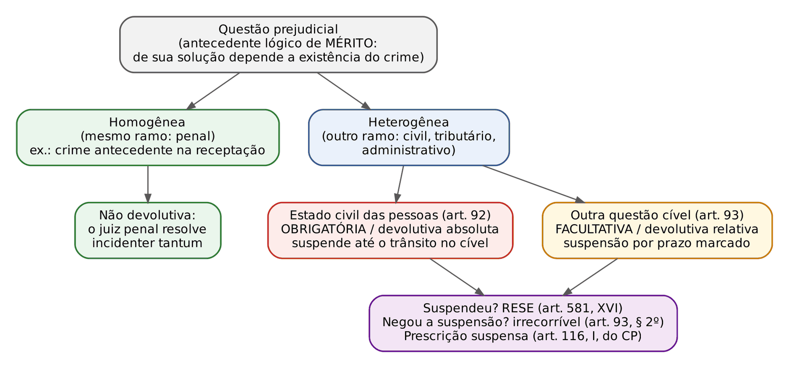
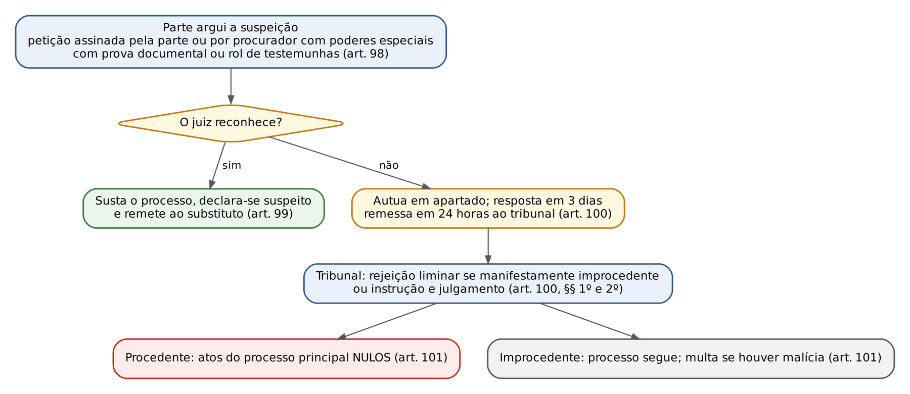
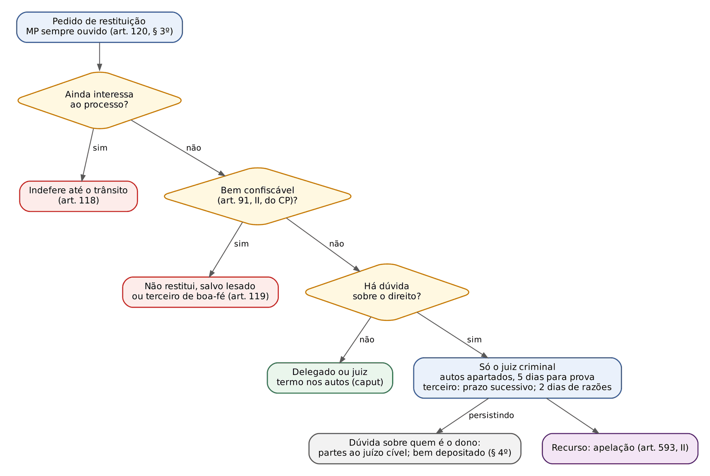
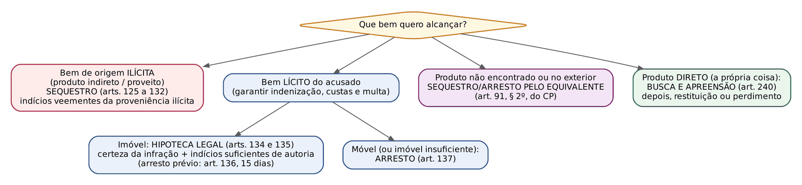
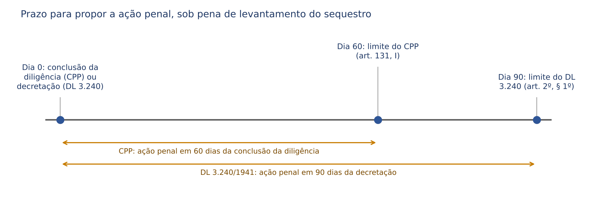
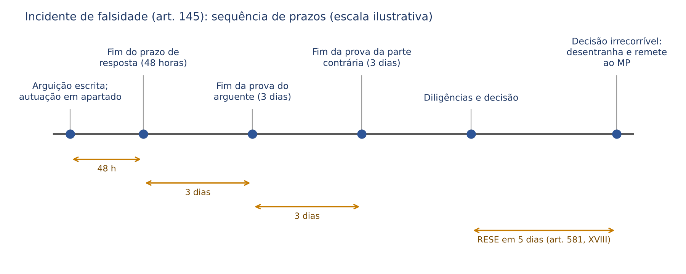
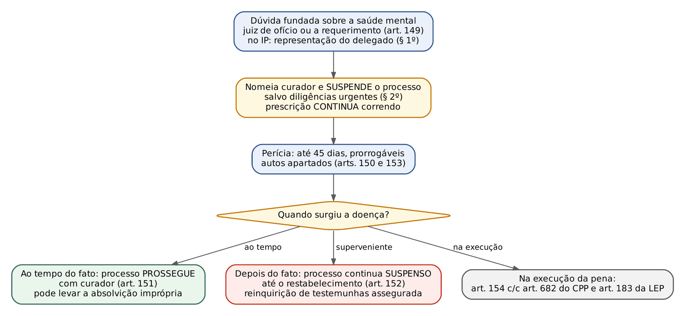

# CAPÍTULO 13 — QUESTÕES E PROCESSOS INCIDENTES

:::INCIDENCIA
TRF5 p. 9 e 11; TJRS p. 5; TJSC p. 8 e 19 (DL 3.240/1941 e Lei 15.358/2026). Nível A; 25 questões no lote (FGV 23, FCC 2).
O que mais cai: sequestro (requisito, legitimidade, momento, embargos, prazo de 60 dias, registro), restituição (quem decide, prazos de 5 e 2 dias, oitiva do MP), sequestro pelo equivalente x "alargado", perdimento extraordinário da Lei 15.358/2026, prazos e efeitos dos incidentes de falsidade e de insanidade.
:::

| Subtema | FGV | FCC | Padrão da cobrança |
|---|---|---|---|
| Questões prejudiciais | 0 | 1 | refazer a prova após a decisão cível (falso); recurso contra a suspensão |
| Exceções | 2 | 1 | qual exceção para duplicidade de processos; precedência da suspeição; poderes especiais |
| Restituição de coisas apreendidas | 2 | 0 | quem decide; prazo de 5 dias; oitiva obrigatória só do MP |
| Sequestro no CPP | 8 | 0 | literalidade dos arts. 125 a 131: "indícios veementes", "antes da denúncia", "de ofício", 60 dias, embargos de terceiro, registro |
| Sequestro na Lei de Drogas | 1 | 1 | 5 dias para provar a origem lícita; veículo do transporte não se libera |
| Equivalente x alargado | 3 | 0 | "sequestro alargado" não existe; perda alargada exige pedido do MP |
| Hipoteca legal e especialização | 1 | 0 | literalidade do art. 135 |
| Alienação, uso e destinação dos bens | 1 | 0 | arts. 133, 133-A e 144-A |
| Lei 15.358/2026 | 1 | 0 | interpostas pessoas; perdimento extraordinário sem condenação |
| Incidente de falsidade | 2 | 0 | 48 horas; remessa ao MP; ausência de coisa julgada |
| Incidente de insanidade | 2 | 0 | quem requer; 45 dias; doença ao tempo do fato x superveniente |

## 13.1 Panorama: o que são questões e processos incidentes

No caminho entre a denúncia e a sentença surgem pontos que precisam ser resolvidos ANTES ou AO LADO do mérito, sob pena de a decisão final ficar errada ou inútil. O Título VI do Livro I do CPP (arts. 92 a 154) reúne esses pontos sob o nome de "questões e processos incidentes".

A distinção do título é simples e cai em prova:

- Questão incidente é um PONTO controvertido que o juiz resolve dentro do próprio processo ou manda resolver em outro juízo, sem formar um procedimento próprio. O exemplo do CPP são as questões prejudiciais (arts. 92 a 94).
- Processo incidente é um PROCEDIMENTO acessório, normalmente em autos apartados, com rito, prazos e decisão próprios: todos os demais institutos do quadro abaixo.

Para o leitor que vem do cível, o mapa mental útil é este: o CPC de 2015 simplificou quase tudo isso (incompetência e impedimento alegados na contestação ou em petição simples, arguição de falsidade como questão incidental, tutela cautelar genérica do art. 301). O CPP de 1941 conservou a estrutura antiga, com "peças" separadas para cada incidente, prazos curtíssimos e recursos específicos. A intuição civilista ajuda a entender a lógica, mas ATRAPALHA na literalidade, que é exatamente o que a FGV cobra.

| Incidente | Seção | Natureza | Onde corre |
|---|---|---|---|
| Questão prejudicial | 13.2 | questão de mérito que condiciona a existência do crime | no próprio processo; pode suspendê-lo |
| Exceções | 13.3 | defesa processual indireta | autos apartados (art. 111) |
| Incompatibilidade e impedimento | 13.3.6 | afastamento do sujeito parcial | rito da suspeição (art. 112) |
| Conflito de jurisdição | remissão | definição do juízo competente | tribunal (ver Cap. 11) |
| Restituição | 13.4 | devolução de coisa apreendida | termo nos autos ou autos apartados |
| Medidas assecuratórias | 13.5 | cautelares reais (patrimoniais) | autos apartados (arts. 129 e 138) |
| Alienação antecipada e perdimento | 13.6 e 13.7 | destinação dos bens | autos apartados ou na sentença |
| Falsidade documental | 13.8 | verificação de autenticidade | autos apartados (art. 145, I) |
| Insanidade mental | 13.9 | verificação da imputabilidade e da capacidade processual | autos apartados (art. 153) |

## 13.2 Questões prejudiciais

### 13.2.1 Conceito e distinção da preliminar

Questão prejudicial é a questão de MÉRITO, autônoma (poderia ser objeto de processo próprio, como uma ação de nulidade de casamento), cuja solução condiciona a existência do crime.

Exemplo clássico: A é processado por bigamia (art. 235 do CP). Ele alega que o PRIMEIRO casamento é nulo e já ajuizou a ação de nulidade. Se o primeiro casamento for anulado, o crime é considerado inexistente (art. 235, § 2º, do CP). A validade do casamento é uma questão de Direito de Família, autônoma, e dela depende a existência do crime: é prejudicial.

A questão PRELIMINAR (nulidade da citação, inépcia, incompetência) é outra coisa:

| | Questão prejudicial | Questão preliminar |
|---|---|---|
| Natureza | de direito material (mérito) | de direito processual |
| Autonomia | pode ser objeto de processo próprio | não existe fora do processo |
| Quem decide | juízo penal ou extrapenal, conforme o caso | só o juízo criminal |
| Efeito | condiciona o teor da decisão de mérito | impede ou adia o exame do mérito |

### 13.2.2 Classificação

- Quanto à natureza: HOMOGÊNEA (comum ou imperfeita), quando pertence ao mesmo ramo do Direito do processo principal, isto é, ao Direito Penal (ex.: a existência do crime antecedente na receptação ou na lavagem; a exceção da verdade na calúnia); HETEROGÊNEA (perfeita ou jurisdicional), quando pertence a outro ramo (civil, tributário, administrativo).
- Quanto ao efeito: OBRIGATÓRIA (necessária), quando o juiz DEVE suspender o processo (art. 92); FACULTATIVA, quando PODE suspendê-lo (art. 93).
- Quanto ao juízo competente: DEVOLUTIVA ABSOLUTA (a questão tem de ser decidida no cível: art. 92); DEVOLUTIVA RELATIVA (pode ser decidida no cível ou, esgotado o prazo, pelo juiz penal: art. 93); NÃO DEVOLUTIVA (o próprio juiz criminal a decide, como ocorre com as homogêneas).

A homogênea nunca suspende o processo: o juiz criminal a resolve *incidenter tantum* (de passagem, como fundamento, sem coisa julgada sobre ela). O CPP só disciplina a suspensão para as heterogêneas.

### 13.2.3 Prejudicial obrigatória: estado civil das pessoas (art. 92)

:::LEI CPP, art. 92
Se a decisão sobre a existência da infração depender da solução de controvérsia, que o juiz repute séria e fundada, sobre o estado civil das pessoas, o curso da ação penal ficará suspenso até que no juízo cível seja a controvérsia dirimida por sentença passada em julgado, sem prejuízo, entretanto, da inquirição das testemunhas e de outras provas de natureza urgente.
Parágrafo único. Se for o crime de ação pública, o Ministério Público, quando necessário, promoverá a ação civil ou prosseguirá na que tiver sido iniciada, com a citação dos interessados.
:::

Requisitos, um a um:

- A questão versa sobre ESTADO CIVIL das pessoas: casamento, parentesco, filiação, idade, vida ou morte, cidadania. Propriedade, posse e crédito NÃO são estado civil (vão para o art. 93).
- Da solução depende a EXISTÊNCIA da infração (não basta afetar a pena).
- A controvérsia é SÉRIA e FUNDADA: alegação meramente protelatória não suspende nada.
- Não se exige ação cível já proposta: se não houver, e o crime for de ação pública, o MP a promove (parágrafo único).

Efeitos: o processo fica suspenso até o TRÂNSITO EM JULGADO da sentença cível, sem prazo máximo. Durante a suspensão, colhem-se as provas urgentes (testemunha idosa ou doente, perícia perecível). Quando a ação cível termina, o processo penal RETOMA de onde parou, aproveitando as provas já produzidas, e a decisão cível sobre o estado civil vincula o juiz criminal.

:::DICA Ponte com o CPC
No cível, a suspensão por prejudicial externa (art. 313, V, a, do CPC) não pode passar de 1 ano (art. 313, § 4º). No processo penal, a do art. 92 dura até o trânsito em julgado da ação cível, sem teto; só a do art. 93 tem prazo marcado pelo juiz. E não há aqui nada parecido com a coisa julgada sobre prejudicial incidental do art. 503, § 1º, do CPC: o juiz penal que resolve uma prejudicial homogênea o faz só como fundamento.
:::

### 13.2.4 Prejudicial facultativa: outras questões cíveis (art. 93)

Se a questão heterogênea NÃO é de estado civil (propriedade, posse, contrato, débito tributário), o juiz PODE suspender o processo, presentes, cumulativamente:

- a questão é da competência do juízo cível (em sentido amplo: inclui a Fazenda Pública e a Justiça do Trabalho);
- JÁ FOI PROPOSTA ação cível para resolvê-la (diferença essencial para o art. 92);
- a questão é de DIFÍCIL SOLUÇÃO;
- não versa sobre direito cuja prova a lei civil limite (ex.: fato que, pela lei civil, só se prova por documento público);
- a suspensão só vem DEPOIS da inquirição das testemunhas e das provas urgentes.

O juiz MARCA O PRAZO da suspensão, que pode ser razoavelmente prorrogado se a demora não for imputável à parte. Expirado o prazo sem decisão cível, o juiz criminal retoma a competência para resolver "de fato e de direito" toda a matéria (art. 93, § 1º). Se a ação penal for pública, o MP intervém na causa cível para lhe dar andamento (§ 3º). Do despacho que NEGA a suspensão não cabe recurso (§ 2º).

:::JURIS STJ, AgRg no AREsp 2.667.847-RS, 5ª Turma, j. 3/6/2025 (Informativo Extraordinário 27)
A suspensão da ação penal por crime contra a ordem tributária é admissível quando a discussão cível sobre o débito tributário (ex.: ação anulatória) apresenta plausibilidade e potencial de repercussão na esfera penal (art. 93 do CPP).
Gancho para a prova: o lançamento definitivo é condição para o crime material tributário (Súmula Vinculante 24); a discussão JUDICIAL posterior sobre o débito não impede a ação penal, mas pode justificar a suspensão facultativa.
:::

| | Art. 92 (obrigatória) | Art. 93 (facultativa) |
|---|---|---|
| Matéria | estado civil das pessoas | qualquer outra questão cível |
| Ação cível | não precisa estar proposta (o MP a promove) | precisa estar proposta |
| Suspensão | obrigatória | a critério do juiz |
| Duração | até o trânsito em julgado no cível | prazo fixado pelo juiz, prorrogável |
| Provas urgentes | colhidas durante a suspensão | colhidas ANTES de suspender |

### 13.2.5 Iniciativa, prescrição e recurso

A suspensão é decretada de ofício ou a requerimento das partes (art. 94). Enquanto o processo estiver suspenso por prejudicial, a prescrição também fica suspensa: "não corre" enquanto não resolvida, em outro processo, questão de que dependa o reconhecimento da existência do crime (art. 116, I, do CP; ver Apostila de Direito Penal, Cap. 22). É a diferença decisiva em relação ao incidente de insanidade (13.9), em que o processo se suspende mas a prescrição corre.

:::PROCESSO Qual recurso cabe — questões prejudiciais
| Decisão | Recurso | Fundamento |
|---|---|---|
| Suspende o processo (art. 92 ou 93) | recurso em sentido estrito (RESE) | art. 581, XVI |
| Nega a suspensão facultativa | irrecorrível; a matéria volta em preliminar de apelação ou em *habeas corpus* | art. 93, § 2º |
| Nega a suspensão obrigatória | sem recurso específico; prevalece a mesma solução (apelação futura ou HC) | silêncio da lei |
| Retoma o processo após o prazo (art. 93, § 1º) | sem recurso específico | idem |
O art. 581, XVI, costuma ser aplicado por analogia a outras suspensões sem recurso previsto (Cap. 28).
:::

:::QUESTAO FCC 2025 — DPE-RS — Defensor Público (Q3387021)
Três assertivas sobre questões e processos incidentes. Gabarito oficial: D — só a III (recusa do juiz por petição da própria parte ou de procurador com poderes especiais, com prova documental ou rol de testemunhas, art. 98).
Armadilhas: I diz que, resolvida a prejudicial de estado civil, o juízo criminal deve REFAZER a colheita das provas (falso: as provas urgentes colhidas durante a suspensão são aproveitadas, art. 92); II inclui a "conexão" no rol das exceções (falso: o art. 95 fala em ilegitimidade de parte, e não em conexão, que se resolve por outros meios — Cap. 11).
Correlata: Q3914516 (FGV 2026, TJ-MS, Cartórios, gabarito A — contra a decisão que suspende o processo por questão prejudicial cabe RESE; distratores: agravo de instrumento, apelação, recurso inominado e agravo interno, todos de matriz cível).
:::

:::SENTENCA Prejudicial na decisão do juiz
Onde entra: na interlocutória de suspensão e, se não houve suspensão, no mérito da sentença.
O que fundamentar: natureza da questão, seriedade, dependência da existência do crime, ação cível (art. 93), provas urgentes e prazo.
Redação-modelo: "A validade do primeiro casamento do acusado, objeto da ação de nulidade n. X, condiciona a própria existência do crime de bigamia (art. 235, § 2º, do CP) e constitui controvérsia séria sobre estado civil; suspendo o processo até o trânsito em julgado daquela ação (art. 92 do CPP), registrando a suspensão do prazo prescricional (art. 116, I, do CP)."
Erro que a banca pune: suspender por questão de propriedade como se fosse obrigatória; fixar prazo na suspensão do art. 92; esquecer que a prescrição fica suspensa.
:::

## 13.3 Exceções

### 13.3.1 Conceito, rol e classificação

Exceção, em sentido processual, é a defesa INDIRETA: o acusado não discute a acusação, mas aponta um obstáculo ao julgamento por aquele juiz ou naquele processo. O CPP admite cinco (art. 95): suspeição, incompetência de juízo, litispendência, ilegitimidade de parte e coisa julgada. O rol é cobrado literalmente: "conexão", "impedimento", "prescrição" e "nulidade" NÃO estão no art. 95 (o impedimento segue o rito da suspeição por força do art. 112; a prescrição é matéria de mérito declarável de ofício, art. 61 do CPP).

Classificação quanto ao efeito (Renato Brasileiro):

- DILATÓRIAS: só atrasam ou deslocam o processo (suspeição, incompetência, ilegitimidade de parte, quando sanável).
- PEREMPTÓRIAS: extinguem o processo sem julgamento do mérito (litispendência e coisa julgada).

Regras gerais: AUTOS APARTADOS, sem suspensão da ação penal, em regra (art. 111); várias exceções do art. 110 numa só petição (§ 1º); e a suspeição precede qualquer outra, salvo se fundada em motivo superveniente (art. 96), porque não adianta discutir competência perante juiz parcial.

:::QUESTAO FGV 2025 — MPU — Analista do MPU (Q3339811)
Processo com várias defesas, cada uma opondo uma exceção (incompetência, ilegitimidade, litispendência, coisa julgada e suspeição NÃO fundada em motivo superveniente). Qual precede? Gabarito oficial: E — a suspeição (art. 96).
Armadilha: a ressalva do motivo superveniente, posta no enunciado para confirmar a regra. Correlata: Q2515591 (FGV 2024, TJ-SC, gabarito A — art. 100; distratores: poderes "gerais", declaração "oral" e suspeição cedendo à incompetência).
:::

### 13.3.2 Exceção de suspeição

As HIPÓTESES de suspeição e de impedimento (arts. 252 a 256) estão no Cap. 12. Aqui interessa o RITO.

O juiz que se reconhece suspeito deve fazê-lo de ofício, POR ESCRITO, declarando o motivo legal, e remeter os autos ao substituto, intimadas as partes (art. 97). Se não o fizer, a parte o recusa:

Detalhes que a figura não mostra: os poderes especiais existem porque se imputa parcialidade a um magistrado (procuração geral não basta); a exceção não suspende o processo (art. 111), salvo se a parte contrária reconhecer a procedência da arguição e requerer a sustação (art. 102); a multa por malícia do art. 101 está em moeda antiga, sem aplicação prática.

Nos tribunais (art. 103), a suspeição não reconhecida é julgada pelo tribunal pleno, com o presidente como relator (o vice, se o recusado for o presidente).

Variações por sujeito, que a banca adora:

| Sujeito | Regra | Recurso |
|---|---|---|
| Juiz | rito dos arts. 98 a 101; julgamento pelo tribunal | não há RESE (a decisão é do tribunal) |
| Membro do MP | o juiz ouve o promotor e decide; pode admitir provas em 3 dias (art. 104) | SEM recurso (art. 104) |
| Peritos, intérpretes, serventuários | o juiz decide de plano, à vista da matéria e de prova imediata (art. 105) | sem recurso |
| Jurados | arguição ORAL na sessão; o juiz presidente decide de plano; tudo consta da ata (art. 106) | sem recurso próprio; a matéria vai à apelação |
| Autoridade policial | NÃO se opõe suspeição no inquérito; ela deve declarar-se suspeita (art. 107) | não há incidente |

:::PEGADINHA Delegado e suspeição
Na Q4012644 (FCC 2026, DPE-MA), a alternativa E, errada, dava ao delegado o poder de "representar" pela suspeição de juízes e promotores: essa legitimidade não existe. Contra o delegado suspeito, não há exceção (art. 107), mas cabe pedir sua substituição à chefia. Sobre o MP: Q2564498 (FCC 2024, TRF-3, gabarito A — o juiz decide em 3 dias, sem recurso).
:::

Preclusão: a suspeição deve ser alegada na primeira oportunidade em que a parte dela tem ciência, sob pena de preclusão; o impedimento, por gerar nulidade absoluta (parte da doutrina chega a falar em ato inexistente, porque o art. 252 diz que o juiz impedido "não poderá exercer jurisdição"), pode ser alegado a qualquer tempo. É o entendimento corrente do STJ e da doutrina (ver Cap. 27 sobre o regime das nulidades).

### 13.3.3 Exceção de incompetência

É a "declinatória de foro": o réu sustenta que o juízo não é o competente. Pode ser oposta verbalmente ou por escrito, no PRAZO DE DEFESA (art. 108), que hoje é o da resposta à acusação (10 dias, art. 396-A, § 1º, que remete expressamente aos arts. 95 a 112).

- Ouvido o MP, se aceita a declinatória, o feito vai ao juízo competente, onde, "ratificados os atos anteriores", o processo prossegue (art. 108, § 1º). A jurisprudência admite a ratificação inclusive de atos decisórios, como o recebimento da denúncia, pelo juízo competente.
- Recusada, o juiz continua no feito (art. 108, § 2º).
- O juiz pode e deve reconhecer a incompetência de ofício, em qualquer fase (art. 109). Na incompetência RELATIVA (territorial), porém, a falta de arguição oportuna gera prorrogação da competência (Cap. 9).

### 13.3.4 Litispendência, ilegitimidade de parte e coisa julgada

As três seguem, no que couber, o rito da incompetência (art. 110): arguição no prazo de defesa, autos apartados, oitiva da parte contrária, decisão.

- LITISPENDÊNCIA: o mesmo acusado responde a DOIS processos em curso pelo MESMO FATO (a identidade é do fato imputado, não da capitulação jurídica). Extingue-se o processo instaurado por último, em respeito ao *ne bis in idem* (proibição de dupla persecução pelo mesmo fato).
- COISA JULGADA: o fato já foi julgado por sentença definitiva. Só pode ser oposta em relação ao FATO PRINCIPAL que foi objeto da sentença (art. 110, § 2º): o que se decidiu incidentalmente não vincula. O regime da coisa julgada penal (limites, revisão só *pro reo*) está no Cap. 21.
- ILEGITIMIDADE DE PARTE: tanto *ad causam* (o MP oferece denúncia em crime de ação privada; o particular oferece queixa em crime de ação pública fora da hipótese subsidiária) quanto *ad processum* (querelante sem capacidade processual ou representação irregular). A primeira gera nulidade absoluta (art. 564, II); a segunda pode ser sanada a todo tempo, mediante ratificação dos atos (art. 568) — ver Caps. 6 e 27.

:::EXEMPLO Litispendência ou coisa julgada?
B foi denunciado na 1ª Vara Criminal por furto de um notebook em 10/3/2025. Depois, a mesma subtração, narrada como "apropriação" e distribuída como inquérito diverso, gerou denúncia na 3ª Vara. Ambos os processos estão em instrução.
Passo 1 — há identidade de réu e de fato? Sim; a capitulação diferente é irrelevante.
Passo 2 — algum processo terminou com sentença definitiva? Não. Logo, a exceção é de LITISPENDÊNCIA, e não de coisa julgada.
Passo 3 — consequência: extinção do segundo processo; se a 1ª Vara já tivesse sentenciado com trânsito, a exceção seria de coisa julgada.
É a estrutura da Q3028645 (FGV 2024, TRF-1, Oficial de Justiça Avaliador, gabarito C — litispendência, porque o outro processo, sobre os mesmos fatos, estava na fase de instrução).
:::

### 13.3.5 Quadro de procedimento, efeitos e recursos

:::PROCESSO Ficha das exceções
| Exceção | Prazo e forma | Quem decide | Efeito do acolhimento | Recurso contra o acolhimento | Recurso contra a rejeição |
|---|---|---|---|---|---|
| Suspeição do juiz | primeira oportunidade; petição com poderes especiais (art. 98) | o próprio juiz (se aceita) ou o tribunal | nulidade dos atos (art. 101) | não cabe RESE (art. 581, III, exclui a suspeição) | sem recurso; HC ou preliminar de apelação |
| Incompetência | prazo de defesa; oral ou escrita (art. 108) | juiz da causa, ouvido o MP | remessa ao juízo competente e ratificação | RESE (art. 581, II e III) | sem recurso; HC ou preliminar de apelação |
| Litispendência | prazo de defesa (art. 110) | juiz da causa | extinção do processo posterior | RESE (art. 581, III) | sem recurso; HC ou apelação |
| Ilegitimidade de parte | prazo de defesa | juiz da causa | anulação ou extinção; saneamento se *ad processum* | RESE (art. 581, III) | sem recurso; HC ou apelação |
| Coisa julgada | prazo de defesa; só sobre o fato principal (art. 110, § 2º) | juiz da causa | extinção do processo | RESE (art. 581, III) | sem recurso; HC ou apelação |
Regra mnemônica: o RESE do art. 581, III, cabe contra a decisão que julga PROCEDENTES as exceções, SALVO a de suspeição. A decisão que rejeita qualquer exceção não tem recurso próprio. A incompetência declarada de ofício também desafia RESE (art. 581, II).
:::

:::SENTENCA Exceções na prova prática
Onde entra: decididas em autos apartados, as exceções costumam voltar nas alegações finais; na sentença, enfrente-as como PRELIMINARES, antes do mérito.
O que fundamentar: identidade de fato e de réu; critério de competência; preclusão (incompetência relativa, suspeição).
Redação-modelo: "Rejeito a preliminar de litispendência: o processo n. X imputa ao acusado subtração ocorrida em 2/5/2025, fato diverso do narrado nesta denúncia, de modo que inexiste identidade de imputação."
Erro que a banca pune: tratar a identidade da capitulação como critério (o que importa é o fato); acolher coisa julgada sobre ponto decidido incidentalmente.
:::

### 13.3.6 Incompatibilidades, impedimentos e conflito de jurisdição

Juiz, MP, serventuários, peritos e intérpretes devem abster-se quando houver INCOMPATIBILIDADE ou IMPEDIMENTO; se não o fizerem, a parte argui pelo rito da suspeição (art. 112). A diferença conceitual mais aceita: impedimento é vínculo objetivo do sujeito com o PROCESSO (art. 252: atuou como advogado, parente das partes atuou no feito, julgou o caso em outra instância); incompatibilidade é vínculo entre sujeitos que atuam no mesmo órgão (art. 253: parentes não podem servir no mesmo juízo colegiado). Os casos estão no Cap. 12.

O conflito de jurisdição (arts. 113 a 117), positivo ou negativo, é outro meio de resolver questões de competência, ao lado da exceção; seu processamento e a definição do tribunal competente estão no Cap. 11.

## 13.4 Restituição de coisas apreendidas

### 13.4.1 A lógica: a coisa fica enquanto interessa ao processo

A apreensão de coisas (por busca e apreensão, art. 240, ou no flagrante, art. 6º, II — Cap. 15) tem finalidade PROBATÓRIA ou de garantia do futuro perdimento. Daí as duas perguntas que decidem qualquer pedido de restituição:

1. A coisa ainda INTERESSA ao processo? Antes do trânsito em julgado, as coisas apreendidas não podem ser restituídas enquanto interessarem ao processo (art. 118). Um celular que ainda será periciado não volta.
2. A coisa é CONFISCÁVEL? Mesmo depois do trânsito, não se restituem os instrumentos ilícitos em si e o produto ou proveito do crime (art. 119, que remete aos antigos arts. 74 e 100 do CP, hoje art. 91, II), SALVO se pertencerem ao lesado ou a terceiro de boa-fé. O regime material da perda está na Apostila de Direito Penal, Cap. 18.

Exemplo: no roubo cometido por C com a moto emprestada por D, que nada sabia, a moto já periciada volta a D (instrumento LÍCITO não se perde); o revólver sem registro nunca volta; o celular roubado volta à vítima.

### 13.4.2 Quem decide e como

:::LEI CPP, art. 120, caput e §§ 1º a 4º
A restituição, quando cabível, poderá ser ordenada pela autoridade policial ou juiz, mediante termo nos autos, desde que não exista dúvida quanto ao direito do reclamante.
§ 1º Se duvidoso esse direito, o pedido de restituição autuar-se-á em apartado, assinando-se ao requerente o prazo de 5 (cinco) dias para a prova. Em tal caso, só o juiz criminal poderá decidir o incidente.
§ 2º O incidente autuar-se-á também em apartado e só a autoridade judicial o resolverá, se as coisas forem apreendidas em poder de terceiro de boa-fé, que será intimado para alegar e provar o seu direito, em prazo igual e sucessivo ao do reclamante, tendo um e outro dois dias para arrazoar.
§ 3º Sobre o pedido de restituição será sempre ouvido o Ministério Público.
§ 4º Em caso de dúvida sobre quem seja o verdadeiro dono, o juiz remeterá as partes para o juízo cível, ordenando o depósito das coisas em mãos de depositário ou do próprio terceiro que as detinha, se for pessoa idônea.
:::

Coisas facilmente deterioráveis são avaliadas e leiloadas, depositando-se o dinheiro, ou entregues ao terceiro idôneo que as detinha (§ 5º).

:::QUESTAO FGV 2025 — TJ-GO — Residente Jurídico (Q3345962)
Verdadeiro ou falso sobre a restituição. Gabarito oficial: B (V – V – F).
I verdadeira: art. 118. II verdadeira: direito duvidoso, autos apartados, 5 dias e decisão só pelo juiz criminal. III falsa: o MP é SEMPRE ouvido, não "facultativamente".
No mesmo sentido: Q3171413 (FGV 2025, PC-MG, Delegado de Polícia, gabarito A — só a I; erradas a II, que trocou 5 por 10 dias, e a III, que manda ouvir "sempre" a autoridade policial e o MP, quando a lei só exige o MP).
:::

### 13.4.3 Destino das coisas não restituídas e de interesse cultural

- Não reclamados em 90 DIAS do trânsito (condenação OU absolvição), ou não pertencentes ao réu: leilão, saldo ao juízo de ausentes (art. 123).
- Coisas adquiridas com os proventos e as demais apreendidas não restituídas seguem o art. 133 (arts. 121 e 122).
- Instrumentos cuja perda foi decretada são inutilizados ou recolhidos a museu criminal, se houver interesse na conservação (art. 124).
- Obras de arte e bens de relevante valor cultural ou artístico perdidos, se o crime NÃO tiver vítima determinada, podem ser destinados a museus públicos (art. 124-A, incluído pela Lei 13.964/2019). Havendo vítima determinada, a obra lhe é restituída.

### 13.4.4 Recurso e jurisprudência

A decisão judicial que defere ou indefere a restituição encerra o incidente sem julgar o mérito: é decisão com força de definitiva, atacável por APELAÇÃO (art. 593, II), e não por RESE (fora do rol do art. 581). Contra o indeferimento do delegado, renova-se o pedido ao juiz; o mandado de segurança é admitido quando a apelação não tiver efeito útil.

:::JURIS STJ, AREsp 1.700.368-CE, 5ª Turma, j. 18/6/2024 (Informativo 817)
Em mandado de segurança impetrado contra decisão que negou a restituição de valores obtidos com a alienação antecipada de bens comprados com o produto de furto (o furto ao Banco Central em Fortaleza), a vítima é litisconsorte passiva necessária (art. 24 da Lei 12.016/2009 c/c art. 114 do CPC), sob pena de nulidade. Gancho: a vítima participa do incidente patrimonial porque tem interesse direto na reparação.
:::

:::PROCESSO Ficha — restituição de coisas apreendidas
| Item | Regra |
|---|---|
| Cabimento | coisa sem interesse ao processo (art. 118) e não confiscável, salvo lesado ou terceiro de boa-fé (art. 119) |
| Legitimidade | proprietário, possuidor, lesado, terceiro de boa-fé |
| Quem decide | delegado ou juiz, se não houver dúvida; só o juiz, se houver dúvida ou terceiro de boa-fé; o cível, se a dúvida for sobre o dono |
| Prazos | 5 dias para a prova; terceiro em prazo igual e sucessivo; 2 dias para razões; 90 dias após o trânsito para reclamar (art. 123) |
| Oitiva | MP sempre (art. 120, § 3º) |
| Recurso | apelação (art. 593, II); MS em situações excepcionais |
:::

:::SENTENCA Bens apreendidos na sentença
Onde entra: no dispositivo, em capítulo próprio sobre bens apreendidos.
O que fundamentar: para cada bem, se é instrumento ilícito, produto, proveito ou bem lícito, e quem é o lesado.
Redação-modelo: "Restitua-se à vítima o aparelho celular apreendido (fl. X), mediante termo; declaro o perdimento, em favor da União, da arma de fogo sem registro, a ser encaminhada ao Comando do Exército; o veículo de terceiro de boa-fé será restituído ao proprietário após o trânsito em julgado."
Erro que a banca pune: omitir a destinação dos bens; declarar o perdimento de instrumento lícito pertencente a terceiro de boa-fé fora das exceções legais (Apostila de Direito Penal, Cap. 18); mandar restituir antes do trânsito coisa que ainda interessa ao processo.
:::

## 13.5 Medidas assecuratórias

### 13.5.1 Para que servem e qual escolher

As medidas assecuratórias são as CAUTELARES REAIS do processo penal: recaem sobre o patrimônio, e não sobre a pessoa (as cautelares pessoais estão nos Caps. 18 e 19). Elas têm duas finalidades, que explicam todas as diferenças entre elas:

- Tirar do acusado o LUCRO do crime e garantir o perdimento: SEQUESTRO, sobre bens de ORIGEM ILÍCITA.
- Garantir a REPARAÇÃO DO DANO, as custas e a multa: HIPOTECA LEGAL e ARRESTO, sobre bens LÍCITOS.

Para o civilista: a hipoteca legal e o arresto lembram o arresto cautelar (hoje tutela de urgência do art. 301 do CPC), mas os requisitos de todas as medidas penais são fixados pela lei, e não pelo binômio genérico *fumus boni iuris* e *periculum in mora*.

O "produto DIRETO" (a coisa subtraída, o dinheiro desviado em espécie) não é sequestrado: é APREENDIDO e depois restituído ou perdido. O sequestro alcança o PROVENTO, o bem comprado com o produto; por isso o sequestro de móveis só cabe se não for caso de busca e apreensão (art. 132).

| | Sequestro | Hipoteca legal | Arresto |
|---|---|---|---|
| Base legal | arts. 125 a 133-A | arts. 134 e 135 | arts. 136 e 137 |
| Bens | imóveis e móveis de origem ILÍCITA (proventos) | imóveis LÍCITOS do acusado | imóvel (prévio à hipoteca) ou móveis penhoráveis LÍCITOS |
| Requisito | indícios VEEMENTES da proveniência ilícita (art. 126) | CERTEZA da infração e indícios SUFICIENTES de autoria (art. 134) | os mesmos da hipoteca |
| Momento | inquérito ou processo, ou antes da denúncia (art. 127) | "em qualquer fase do processo" (art. 134) | antes ou durante o processo (art. 136: "de início") |
| Legitimidade | juiz de ofício, MP, ofendido, representação do delegado | ofendido; MP se houver interesse da Fazenda ou se o ofendido for pobre e o requerer (art. 142) | idem |
| Finalidade | perdimento e reparação | reparação, custas e multa, com preferência da reparação (art. 140) | idem |
| Defesa | embargos (arts. 129 e 130) | contraditório na especialização (art. 135, § 3º) | idem |
| Extinção | art. 131 (60 dias, caução, absolvição ou extinção da punibilidade) | art. 141 (absolvição ou extinção da punibilidade irrecorríveis) | art. 136 (15 dias sem especialização) e art. 141 |
| Após o trânsito | venda em leilão (art. 133) | autos remetidos ao cível (art. 143) | idem |

### 13.5.2 Sequestro

:::LEI CPP, arts. 125 a 127
Art. 125. Caberá o sequestro dos bens imóveis, adquiridos pelo indiciado com os proventos da infração, ainda que já tenham sido transferidos a terceiro.
Art. 126. Para a decretação do sequestro, bastará a existência de indícios veementes da proveniência ilícita dos bens.
Art. 127. O juiz, de ofício, a requerimento do Ministério Público ou do ofendido, ou mediante representação da autoridade policial, poderá ordenar o sequestro, em qualquer fase do processo ou ainda antes de oferecida a denúncia ou queixa.
:::

Os elementos, um a um:

- Objeto: imóveis (art. 125) e móveis (art. 132) adquiridos com os PROVENTOS da infração. Não importa se já foram transferidos a terceiro: o sequestro os alcança "ainda que" transferidos, cabendo ao terceiro defender-se por embargos.
- Requisito: indícios VEEMENTES da proveniência ilícita. É mais que mera suspeita ("indícios mínimos" está errado) e menos que prova plena; não se exige "prova da existência do crime e indício suficiente de autoria" (esse é o padrão da preventiva, art. 312) nem "certeza da infração" (padrão da hipoteca legal). O STJ acrescenta que o requisito independe da capitulação: o sequestro cabe mesmo quando a denúncia foi recebida só por crime formal, como o de organização criminosa, se os bens provêm da atividade do grupo (AgRg no REsp 2.219.963-RJ, 5ª Turma, j. 3/3/2026, Informativo 880).
- Legitimidade e momento: os do art. 127. O delegado não "requer" nem "decreta": representa; o MP requer; só o juiz decreta, inclusive no inquérito.
- Procedimento: autos APARTADOS, com embargos de terceiro (art. 129); decretado o sequestro de imóvel, o juiz manda inscrevê-lo no Registro de Imóveis (art. 128), o que dá publicidade e impede a alegação de boa-fé por futuros adquirentes.
- Contraditório: em regra diferido; a medida é decretada sem ouvir o investigado, que se defende depois.

:::PEGADINHA Sequestro de ofício depois do Pacote Anticrime
O art. 127 ainda diz "de ofício", e a FGV cobra a literalidade como CERTA (Q4117000 e Q2367579). Parte da doutrina sustenta que, após o art. 3º-A do CPP (estrutura acusatória, Cap. 3), o juiz não pode decretar cautelares de ofício na fase investigatória, por coerência com a vedação da preventiva de ofício (Súmula 676 do STJ — ver Cap. 18). Na prova objetiva, marque a letra da lei; na discursiva ou na sentença, mencione a controvérsia. Onde implantado o juiz das garantias, é ele quem decide as medidas da fase investigatória (Cap. 3).
:::

:::QUESTAO FGV 2026 — MPE-MT — Promotor de Justiça Substituto (Q4117000)
Servidor desviou dinheiro por 4 anos e comprou quatro imóveis (um no Paraguai, outro transferido ao primo), joias e obras de arte de paradeiro desconhecido. Gabarito oficial: C — o MP pode pedir o sequestro antes da denúncia, sendo cabível também a decretação de ofício (art. 127).
Erradas: sequestro só de imóveis (art. 132); imóvel do primo inalcançável (art. 125: "ainda que transferidos"); exigência de prova do crime e indício suficiente de autoria; imóvel no exterior e joias desaparecidas como obstáculo (há o equivalente, 13.5.4, e a cooperação internacional, Cap. 32).
No mesmo sentido (literalidade dos arts. 125 a 129, com distratores "salvo se transferidos", "30 dias", "120 dias", "indícios mínimos", "embargos infringentes", "nos autos principais", vedação na fase pré-processual): Q2367579 (FGV 2024, MPE-GO, gabarito A — art. 127); Q3520646 (FGV 2025, TJ-ES, Cartórios, gabarito E — inscrição no Registro de Imóveis, art. 128); Q3914518 (FGV 2026, TJ-MS, Cartórios, gabarito D — I e III; a II trocou embargos de terceiro por infringentes).
:::

:::QUESTAO FGV 2025 — MPE-ES — Promotor de Justiça Substituto (Q3752770)
Cuidadora desviou 2.500.000 (dois milhões e quinhentos mil) reais de idosa e comprou quatro imóveis (um em nome da irmã); joias subtraídas estão num cofre; ela tem imóvel e carro anteriores aos crimes.
Passo 1 — imóveis comprados com o dinheiro: proventos; sequestro com indícios veementes, inclusive antes da denúncia. Gabarito oficial: A.
Passo 2 — imóvel em nome da irmã: também sequestrável (art. 125, "ainda que transferidos"); a irmã se defende por embargos (art. 130, II, se adquiriu a título oneroso e de boa-fé). Errada a B, que mandava os herdeiros ao cível.
Passo 3 — joias: são o próprio produto do crime; apreendem-se e restituem-se aos herdeiros (13.4). Errada a C, que indicava arresto "exclusivo de móveis".
Passo 4 — imóvel e carro anteriores ao crime: bens lícitos; alcançáveis por hipoteca legal e arresto para garantir a reparação (13.5.5). Erradas a D (inverteu sequestro e arresto) e a E (negou qualquer medida sobre bens lícitos).
:::

### 13.5.3 Embargos e levantamento do sequestro

O CPP prevê duas defesas diferentes, que a FGV cobra lado a lado:

| | Embargos de terceiro (art. 129) | Embargos do art. 130 |
|---|---|---|
| Quem | terceiro ESTRANHO ao crime, que alega que o bem nunca foi do acusado nem proveio do crime (ex.: o verdadeiro dono do imóvel registrado por engano) | I — o ACUSADO, alegando que o bem não foi adquirido com os proventos da infração; II — o TERCEIRO ADQUIRENTE a título ONEROSO, alegando boa-fé |
| Rito | o dos embargos de terceiro do CPC (arts. 674 e seguintes), aplicado subsidiariamente | o do CPP |
| Momento da decisão | pode ser decidido de imediato | NÃO pode ser julgado antes do trânsito em julgado da sentença CONDENATÓRIA (parágrafo único) |

A espera do art. 130 evita decisões contraditórias: a origem do bem e a boa-fé do adquirente dependem do que se apurar sobre o crime. O terceiro realmente estranho (art. 129) não precisa esperar.

:::QUESTAO FGV 2026 — TJ-MS — Cartórios, Remoção (Q3914318)
Sequestro de bens do acusado Caio e de Lucas, a quem parte dos bens foi transferida. Quem pode embargar e quando? Gabarito oficial: A — o acusado (bens não adquiridos com os proventos) e o terceiro adquirente a título ONEROSO de boa-fé, sem decisão antes do trânsito da sentença CONDENATÓRIA.
Armadilhas: incluir o adquirente a título GRATUITO (o donatário não está protegido: quem recebeu de graça não perde nada ao devolver); trocar "trânsito da condenatória" por "sentença absolutória"; excluir o acusado ou o terceiro.
:::

O sequestro é LEVANTADO (art. 131):

- I — se a ação penal não for intentada em 60 DIAS, contados da data em que ficar CONCLUÍDA A DILIGÊNCIA (não da decretação);
- II — se o terceiro a quem os bens foram transferidos prestar CAUÇÃO que assegure a perda (art. 91, II, b, do CP, referido pelo antigo art. 74);
- III — se for julgada extinta a punibilidade ou absolvido o réu, por sentença TRANSITADA EM JULGADO.

:::QUESTAO FGV 2026 — MPE-GO — Promotor de Justiça Substituto (Q3865780)
Sequestro decretado em procedimento investigatório do MP; passados 70 dias da conclusão da diligência, ainda não há denúncia. Gabarito oficial: B — o sequestro será levantado, porque a ação penal não foi intentada em 60 dias da conclusão da diligência (art. 131, I).
Passos: o termo inicial é a conclusão da diligência (dia 0); o limite é o dia 60; no dia 70, a medida perdeu a base legal. Erradas: "30 dias"; manutenção até extinção da punibilidade ou absolvição transitada (são causas autônomas, não condições para levantar).
:::

O prazo de 60 dias é a regra legal, mas o STJ exige também RAZOABILIDADE na duração de qualquer constrição: o juízo pode rever a medida diante de fatos supervenientes, e a constrição que se prolonga por anos sem perspectiva de julgamento pode ser levantada (EDcl nos EDcl no AgRg no AREsp 1.792.372/PR, 5ª Turma, j. 8/3/2022: sequestro e arresto levantados após três anos, com o recebimento da denúncia anulado e o processo sem reinício). Em sentido inverso, em investigações complexas a jurisprudência tem tolerado a superação dos 60 dias quando a demora é justificada; essa flexibilização deve ser fundamentada caso a caso.

:::JURIS STJ, RMS 71.903-SP, j. 6/8/2024 (Informativo 820)
No bloqueio universal do patrimônio do cliente, o art. 24-A do Estatuto da Advocacia (Lei 8.906/1994, incluído pela Lei 14.365/2022) garante ao advogado a liberação de até 20% dos bens bloqueados para honorários e despesas da defesa (ressalvados os crimes da Lei de Drogas). Sem indícios de fraude na fixação dos honorários, libera-se integralmente o valor acordado, desde que não exceda esse teto.
:::

### 13.5.4 Sequestro pelo equivalente: não existe "sequestro alargado"

Se o produto ou proveito não é encontrado ou está no exterior, perdem-se bens LÍCITOS equivalentes (art. 91, § 1º, do CP), e as medidas assecuratórias podem abrangê-los desde a investigação (§ 2º). O instituto material está na Apostila de Direito Penal, Cap. 18 (18.4.5 e 18.5). No plano PROCESSUAL:

- A medida cautelar pelo equivalente é o sequestro ou o arresto dos arts. 125 e seguintes, com a mesma legitimidade do art. 127: o OFENDIDO pode requerê-la, o delegado pode representar, o MP pode requerer, e só o juiz decreta.
- O CPP e o CP não criaram "sequestro alargado". O confisco alargado (art. 91-A do CP) é efeito da condenação, depende de pedido expresso do MP NA DENÚNCIA e é decidido na sentença; não pode ser decretado de ofício.

:::QUESTAO FGV 2025 — TRF 5ª Região — Juiz Substituto (Q3373867)
Luigi não tinha no Brasil bens ligados ao produto dos crimes (estavam no exterior); Filippo tinha patrimônio incompatível com a renda lícita. Gabarito oficial: E — o MP pode requerer o sequestro pelo EQUIVALENTE dos bens de Luigi.
Por que as outras estão erradas: "sequestro alargado" não existe; a perda alargada de Filippo não pode ser decretada de OFÍCIO (exige pedido na denúncia); o equivalente é remédio para produto não encontrado ou no exterior (caso de Luigi), não para incompatibilidade patrimonial (caso de Filippo).
No mesmo sentido: Q3425297 (FGV 2025, TRF-1, Juiz Federal Substituto, gabarito C — a VÍTIMA pode requerer o sequestro pelo equivalente; erradas: delegado "requerer" e juiz decretar de ofício "sequestro alargado", MP "decretar" o equivalente); Q3117554 (FGV 2024, TJ-PE, Juiz Substituto, gabarito C — perda alargada na sentença, mediante requerimento do MP; erradas: equivalente "pela desproporção", alargado de ofício, perda em sentença absolutória).
:::

### 13.5.5 Hipoteca legal e arresto

A hipoteca legal (art. 134) recai sobre imóveis LÍCITOS do acusado para garantir a indenização. Como atinge patrimônio sem relação com o crime, exige mais: CERTEZA da infração (materialidade) e indícios SUFICIENTES de autoria. A legitimidade é do OFENDIDO (e do MP nas hipóteses do art. 142: interesse da Fazenda Pública ou ofendido pobre que o requeira; sobre a legitimidade do MP nas ações de interesse do ofendido pobre onde há Defensoria Pública, ver Cap. 7).

O rito da ESPECIALIZAÇÃO (art. 135) é cobrado literalmente:

- o requerente estima o valor da responsabilidade civil e designa e estima os imóveis a hipotecar;
- a petição é instruída com as provas (ou a indicação delas), a relação dos demais imóveis do responsável e os documentos de domínio (§ 1º);
- o juiz manda arbitrar o valor e avaliar os imóveis; onde não houver avaliador judicial, por perito nomeado, que pode consultar os autos (§ 2º);
- ouvidas as partes em 2 DIAS (prazo que corre em cartório), o juiz pode corrigir o arbitramento excessivo ou deficiente (§ 3º);
- autoriza-se só a inscrição dos imóveis NECESSÁRIOS à garantia (§ 4º);
- o valor é liquidado definitivamente após a condenação (§ 5º);
- caução suficiente do réu, em dinheiro ou títulos da dívida pública, dispensa a inscrição (§ 6º).

:::QUESTAO FGV 2026 — MPE-GO — Promotor de Justiça Substituto (Q3865785)
Assertivas transcrevendo os §§ 1º a 3º do art. 135. Gabarito oficial: E — todas corretas (inclusive os 2 dias "em cartório").
:::

O ARRESTO tem duas funções:

- Arresto PRÉVIO do imóvel (art. 136): decretado "de início", antes da especialização, para evitar que o imóvel seja alienado enquanto corre o procedimento; é revogado se, em 15 DIAS, não for promovida a inscrição da hipoteca legal.
- Arresto de MÓVEIS (art. 137): quando o responsável não tem imóveis ou os tem em valor insuficiente, arrestam-se móveis penhoráveis. Coisas fungíveis e deterioráveis seguem o art. 120, § 5º (avaliação e leilão); das rendas dos móveis podem sair recursos para a manutenção do acusado e da família (§ 2º). O depósito e a administração seguem o regime do processo civil (art. 139), e a especialização e o arresto correm em autos apartados (art. 138).

Regras comuns que a banca combina com o sequestro:

- As garantias do ressarcimento alcançam também as DESPESAS processuais e as PENAS PECUNIÁRIAS, tendo PREFERÊNCIA sobre estas a reparação do dano ao ofendido (art. 140). Por isso a hipoteca e o arresto podem recair sobre bens lícitos para garantir multa e custas (Q2346692).
- O arresto é levantado e a hipoteca cancelada se o réu for ABSOLVIDO ou extinta a punibilidade por sentença IRRECORRÍVEL (art. 141).
- Transitada em julgado a condenação, os autos de hipoteca ou arresto vão ao JUIZ CÍVEL (art. 143), onde servem à execução da sentença penal como título (art. 63 — Cap. 7). As mesmas medidas podem ser requeridas diretamente no cível contra o responsável civil (art. 144).

:::QUESTAO FGV 2024 — Prefeitura de Caraguatatuba — Procurador (Q2346692)
Medida assecuratória sobre apartamento adquirido na constância do casamento (comunhão parcial) de réu por corrupção, lavagem e associação. Gabarito oficial: A — a medida pode recair sobre bens de origem LÍCITA para assegurar multa e custas (art. 140).
Armadilhas: a esposa não-ré não fica imune (a constrição recai sobre o bem, resguardada a meação no produto da alienação, por analogia ao art. 843 do CPC); a via dela são os embargos de terceiro (art. 129), não o MS, e a meação não protege proveito do crime; o réu precisa de advogado; a prova da origem lícita corre em autos apartados.
:::

:::JURIS STJ, 5ª Turma, Rel. Min. Joel Ilan Paciornik, j. 26/8/2026 (Informativo 902; processo em segredo de justiça)
As medidas assecuratórias penais podem ser integradas pelo CPC (art. 3º do CPP): admite-se a ADJUDICAÇÃO do imóvel sequestrado aos sucessores da vítima (art. 876 do CPC), pelo valor de avaliação e com a concordância deles, para efetivar a reparação fixada na sentença condenatória transitada em julgado. Não há direito líquido e certo do condenado ao leilão público quando a adjudicação atende à eficiência e à razoável duração do processo.
:::

### 13.5.6 Sequestro do Decreto-Lei 3.240/1941 (crimes contra a Fazenda Pública)

O DL 3.240/1941 (edital do TJSC) criou um sequestro ESPECIAL, mais amplo que o do CPP, para crimes que lesam o patrimônio público; convive com o CPP como norma especial.

:::JURIS STJ, AgRg no RMS 67.164-MG, 5ª Turma, j. 29/3/2022 (Informativo 732)
O sequestro do art. 4º do DL 3.240/1941 continua aplicável; pode recair sobre QUAISQUER bens do investigado, e não apenas sobre o produto ou proveito do crime; dispensa a prévia demonstração de *periculum in mora*, bastando indícios da prática criminosa; e garante não só o ressarcimento do prejuízo, mas também multas e custas.
:::

A Lei 15.327/2026 (de 6/1/2026, publicada em 7/1/2026 e em vigor na data da publicação, sobre descontos indevidos em benefícios do INSS) reescreveu boa parte do decreto:

| Item | DL 3.240/1941 (redação da Lei 15.327/2026) | CPP (arts. 125 a 133) |
|---|---|---|
| Crimes | infrações com prejuízo direto ou indireto à Fazenda Pública; crimes contra a administração pública; contra a fé pública; e, desde 2026, infrações que envolvam descontos indevidos em benefícios do INSS (art. 1º, I a IV) | qualquer crime |
| Bens | TODOS os bens do investigado ou acusado (art. 4º), inclusive: os de sua titularidade ou sob seu domínio e benefício na data da infração ou recebidos depois; os transferidos a terceiros gratuitamente ou por contraprestação irrisória desde o início da atividade criminal; os de pessoa jurídica de que seja sócio, associado, diretor ou representante legal, havendo indícios de uso no crime ou de benefício ilícito | só os proventos (origem ilícita) ou o equivalente |
| Requisito | "indícios veementes da RESPONSABILIDADE" (art. 3º) | indícios veementes da PROVENIÊNCIA ILÍCITA dos bens |
| Iniciativa | representação da autoridade policial ou requerimento do MP; decretação sem audiência da parte (art. 2º) | juiz de ofício, MP, ofendido, delegado |
| Prazo | ação penal em 90 dias da DECRETAÇÃO (art. 2º, § 1º), sob pena de cessação (art. 6º, I) | 60 dias da conclusão da diligência (art. 131, I) |
| Embargos | só por terceiros (art. 2º, § 2º) | acusado e terceiros (arts. 129 e 130) |
| Alienação antecipada | prevista (art. 7º-A), pelo procedimento do CPP | art. 144-A |
| Cessação | ação não iniciada ou reiniciada em 90 dias; absolvição ou extinção transitadas (art. 6º); não impede perdimento nem reparação civil (art. 7º) | art. 131 |

Repare que o novo art. 4º importou para o sequestro do decreto o conceito de patrimônio do confisco alargado (art. 91-A, § 1º, do CP): bens recebidos depois da infração e transferências gratuitas ou por preço irrisório desde o início da atividade criminosa.

:::DICA Como usar o DL 3.240 na prova
Crime contra a administração ou a Fazenda + bens LÍCITOS do investigado + pedido do MP ou representação do delegado = sequestro do DL 3.240, sem demonstrar que o bem veio do crime.
:::

### 13.5.7 Regimes especiais: Lei de Drogas, lavagem e Lei 15.358/2026

Leis especiais têm medidas próprias, que prevalecem no seu âmbito (procedimentos completos nos Caps. 25 e 26). O que a banca cruza com o CPP é o prazo para provar a origem lícita:

| Diploma | Medida e iniciativa | Prova da origem lícita | Particularidade |
|---|---|---|---|
| CPP | sequestro, hipoteca, arresto | por embargos (art. 130, I), julgados só após o trânsito | 60 dias para a ação penal |
| Lei 11.343/2006, art. 60 | apreensão e medidas assecuratórias a requerimento do MP ou do assistente, ou por representação do delegado, no inquérito ou na ação (a redação da Lei 13.840/2019 não repete o "de ofício" do texto original) | 5 DIAS após a decretação (§ 5º, Lei 14.322/2022); provada a origem lícita, o juiz libera (§ 6º) | EXCETO o veículo apreendido no transporte de droga, que segue os arts. 61 e 62 (Tema 647 do STF — Apostila de Direito Penal, Cap. 37) |
| Lei 9.613/1998, art. 4º | medidas sobre bens do investigado ou de interpostas pessoas | liberação total ou parcial se comprovada a licitude, mantidos os bens necessários à reparação, multa e custas (§ 2º) | alienação antecipada própria (art. 4º-A); detalhes no Cap. 26 |
| Lei 15.358/2026, art. 9º | catálogo amplo (inclusive criptoativos, Pix, bens no exterior e de interpostas pessoas), de ofício, a requerimento do MP ou por representação do delegado; contraditório diferido | 10 DIAS da intimação (§ 6º); comprovada a licitude, liberação, salvo armas (§ 7º) | perdimento EXTRAORDINÁRIO sem condenação (§ 8º — ver 13.7) |

:::QUESTAO FCC 2026 — MPE-AL — Analista do MP (Q4092730)
Sequestro de imóvel de investigado por tráfico, no inquérito. O que a defesa pode fazer nessa fase? Gabarito oficial: C — em 5 dias, apresentar ou requerer provas da origem lícita ao juízo que decretou a medida, que libera o bem se PROVADA a origem lícita (art. 60, §§ 5º e 6º, da Lei 11.343/2006).
Armadilhas: prazo de 10 dias com liberação "se houver dúvida" (a dúvida não basta: é preciso prova); correição parcial ou RESE (não são a via); "aguardar a denúncia" (a lei dá contraditório já na investigação).
Observação: o enunciado fala em indícios veementes da proveniência "lícita", lapso evidente do examinador (é ilícita), sem reflexo no gabarito.
:::

:::QUESTAO FGV 2025 — TJ-TO — Juiz Substituto (Q3453266)
Sequestro do veículo de Margareth, usado no transporte da droga, e de joias de Marcela, supostos proveitos do tráfico; ambas pedem a liberação provando a origem lícita. Gabarito oficial: E — provada a origem lícita, o juiz pode liberar os bens de Marcela, mas NÃO o veículo de Margareth.
Passos: a regra libera o bem de origem lícita comprovada (art. 60, § 6º); a exceção é o veículo do transporte, INSTRUMENTO do tráfico, cuja perda não depende da origem (arts. 61 e 62; art. 243, parágrafo único, da CF). Erradas as alternativas sobre "conversão em sequestro alargado" (figura inexistente — 13.5.4).
:::

### 13.5.8 Recurso e decisão

O CPP não prevê recurso específico contra a decisão que decreta ou nega sequestro, hipoteca ou arresto. Prevalece a APELAÇÃO (art. 593, II), por ser decisão com força de definitiva no incidente; o mandado de segurança é admitido quando a apelação não oferece proteção eficaz. NÃO cabem RESE (fora do rol do art. 581), correição parcial nem *habeas corpus* (não há risco à liberdade). A decisão nos embargos também é apelável. O quadro comparativo de 13.5.1 funciona como ficha de consulta das três medidas.

:::SENTENCA Decisão que decreta o sequestro
Onde entra: interlocutória em autos apartados, normalmente no inquérito; na sentença, a constrição vira perdimento ou é levantada.
O que fundamentar: indícios veementes de que CADA bem provém do crime (data de aquisição, renda, vínculo com o produto); legitimidade de quem pediu; proporcionalidade (sem bloqueio universal desnecessário); providências (apartado, registro, depositário, intimação para embargos).
Redação-modelo: "Há indícios veementes de que o imóvel de matrícula n. X foi adquirido em 15/3/2024 com valores desviados do Município, pois o pagamento de 800.000 (oitocentos mil) reais coincidiu com as transferências da conta pública e supera em muito a renda declarada; decreto o sequestro (arts. 125 e 126 do CPP) e determino sua inscrição no Registro de Imóveis (art. 128)."
Erro que a banca pune: decretar sequestro de bem lícito sem invocar o equivalente (art. 91, § 2º, do CP) ou o DL 3.240; exigir "prova da autoria"; esquecer o prazo de 60 dias e o registro.
:::

## 13.6 Alienação antecipada, uso provisório e destinação final

### 13.6.1 Por que vender antes do fim do processo

Carros, barcos e mercadorias viram sucata em anos de pátio, em prejuízo de quem vencer o processo. A alienação antecipada converte o bem em DINHEIRO, depositado em conta judicial e entregue ao vencedor no fim; não é antecipação de pena. O juiz "determinará" a venda: é dever, não faculdade.

:::LEI CPP, art. 144-A, caput e §§ 1º a 3º (Lei 12.694/2012)
Art. 144-A. O juiz determinará a alienação antecipada para preservação do valor dos bens sempre que estiverem sujeitos a qualquer grau de deterioração ou depreciação, ou quando houver dificuldade para sua manutenção.
§ 1º O leilão far-se-á preferencialmente por meio eletrônico.
§ 2º Os bens deverão ser vendidos pelo valor fixado na avaliação judicial ou por valor maior. Não alcançado o valor estipulado pela administração judicial, será realizado novo leilão, em até 10 (dez) dias contados da realização do primeiro, podendo os bens ser alienados por valor não inferior a 80% (oitenta por cento) do estipulado na avaliação judicial.
§ 3º O produto da alienação ficará depositado em conta vinculada ao juízo até a decisão final do processo, procedendo-se à sua conversão em renda para a União, Estado ou Distrito Federal, no caso de condenação, ou, no caso de absolvição, à sua devolução ao acusado.
:::

Detalhes dos §§ 4º a 6º:

- Dinheiro, inclusive MOEDA ESTRANGEIRA, títulos, valores mobiliários ou cheques emitidos como ordem de pagamento: o juízo determina a CONVERSÃO em moeda nacional e o depósito em conta judicial (§ 4º). Não há, no CPP, envio ao Banco Central (na Lei de Drogas, a moeda estrangeira tem regime próprio: Cap. 25).
- Veículos, embarcações e aeronaves: certificado de registro em favor do arrematante, LIVRE de multas, encargos e tributos anteriores, sem prejuízo da execução fiscal contra o antigo proprietário (§ 5º).
- Títulos e ações negociados em bolsa: valor da cotação oficial do dia (§ 6º).

Pisos diferentes nas leis especiais: na Lei de Lavagem, 75% da avaliação (art. 4º-A — Cap. 26); na Lei de Drogas, 50% (art. 61 — Cap. 25).

A Lei 15.358/2026 permite ao delegado representar e ao MP requerer, nos crimes de facção, o uso provisório ou, não havendo interesse, a alienação antecipada "até a decretação do perdimento" (art. 9º, § 10); na ação civil de perdimento, efetivada a constrição, o juiz delibera IMEDIATAMENTE sobre a alienação antecipada ou a nomeação de administrador (art. 22, § 3º). O DL 3.240/1941 passou a prevê-la no art. 7º-A (13.5.6).

### 13.6.2 Uso provisório por órgãos públicos (art. 133-A)

Em vez de vender, o juiz pode, constatado o INTERESSE PÚBLICO, autorizar o USO do bem sequestrado, apreendido ou sujeito a qualquer medida assecuratória (incluído pela Lei 13.964/2019):

- beneficiários: órgãos de segurança pública, sistemas prisional e socioeducativo, Força Nacional e Instituto Geral de Perícia (caput); demonstrado o interesse público, os demais órgãos (§ 2º);
- o órgão de segurança que PARTICIPOU da investigação ou repressão tem PRIORIDADE NA UTILIZAÇÃO (§ 1º);
- veículos, embarcações e aeronaves: certificado provisório ao órgão, isento de débitos anteriores (§ 3º);
- transitada em julgado a condenação com perdimento, ressalvado o direito do lesado ou do terceiro de boa-fé, o juiz PODE transferir definitivamente a propriedade ao órgão que custodiava o bem (§ 4º).

### 13.6.3 Destinação depois do trânsito (art. 133)

Transitada em julgado a sentença condenatória, o juiz, de ofício ou a requerimento do interessado ou do MP, determina a AVALIAÇÃO e a VENDA EM LEILÃO dos bens cujo perdimento foi decretado (art. 133). Do dinheiro, recolhe-se aos cofres públicos o que não couber ao lesado ou ao terceiro de boa-fé (§ 1º), e o valor vai ao FUNDO PENITENCIÁRIO NACIONAL, salvo previsão diversa em lei especial (§ 2º; na Lei de Drogas, o Funad). A jurisprudência admite, em vez do leilão, a adjudicação ao lesado pelo CPC (Informativo 902 — 13.5.5).

:::QUESTAO FGV 2025 — TRF 3ª Região — Juiz Federal Substituto (Q3179532)
Destinação de bens apreendidos. Gabarito oficial: E — transitada em julgado a condenação, o juiz, de ofício ou a requerimento do interessado ou do MP, determina a avaliação e a venda em leilão dos bens perdidos, destinando aos cofres públicos o que não couber ao lesado ou ao terceiro de boa-fé (art. 133 e § 1º).
Erradas: (A) a prioridade do órgão que investigou é na UTILIZAÇÃO, não na transferência definitiva (art. 133-A); (B) "somente" por dificuldade de manutenção; (C) moeda estrangeira ao Banco Central (converte-se e deposita-se); (D) preferência das custas e multas (é da reparação, art. 140).
:::

Recurso: o CPP não prevê recurso específico contra a decisão de alienação antecipada; aplica-se a apelação residual (art. 593, II), e na prática se usa o mandado de segurança para obter efeito suspensivo.

## 13.7 Perdimento de bens: mapa dos regimes

Perdimento (confisco) é a transferência definitiva do bem ao Estado: não é cautelar, é o resultado que as medidas assecuratórias preparam. Conteúdo material: Apostila de Direito Penal, Cap. 18. O quadro evita confundir os regimes:

| Regime | Pressuposto | Depende de condenação? | Iniciativa |
|---|---|---|---|
| Perda do art. 91, II, do CP | instrumentos ilícitos, produto e proveito | sim; efeito automático | na sentença |
| Perda pelo equivalente (art. 91, § 1º) | produto ou proveito não encontrado ou no exterior | sim | na sentença, inclusive de ofício |
| Confisco alargado (art. 91-A) | patrimônio incompatível; crime com pena máxima superior a 6 anos | sim | pedido do MP na denúncia |
| Instrumentos de organização criminosa e milícia (art. 91-A, § 5º) | instrumento usado pelo grupo, ainda que lícito | sim | na sentença |
| Lei de Drogas (art. 243, parágrafo único, da CF; art. 63) | bem apreendido em decorrência do tráfico | sim | na sentença (Cap. 25) |
| Lei 15.358/2026, art. 9º, § 8º (perdimento extraordinário) | origem ilícita CLARA de bem, direito ou valor, nos crimes de domínio social estruturado e de favorecimento (arts. 2º e 3º) | NÃO | juiz, no curso da investigação ou da ação penal |
| Lei 15.358/2026, art. 11 (medidas definitivas) | condenação transitada pelos arts. 2º e 3º, sem perdimento extraordinário anterior | sim | juiz, de ofício ou a requerimento do MP |
| Lei 15.358/2026, arts. 12 a 28 (ação civil autônoma de perdimento) | bem ligado aos crimes da lei | NÃO; só a absolvição que reconheça a INEXISTÊNCIA do fato a impede (art. 17) | entes federativos e MP (Cap. 26) |

No perdimento extraordinário (a novidade mais cobrada de 2026), ficam ressalvados o lesado e o terceiro que, de boa-fé, não tinham condições de conhecer a procedência ilícita (§ 9º); na absolvição, o valor custodiado é devolvido em até 3 dias úteis, com juros, se comprovada a origem lícita e não declarado o perdimento (§ 12). A constitucionalidade é discutida (perda sem condenação e ônus de provar a licitude); não se localizou decisão do STF a respeito.

:::QUESTAO FGV 2026 — PC-PR — Delegado de Polícia (Q4378284)
Facção com imóveis, veículos, criptoativos e participações societárias, alguns em nome de interpostas pessoas; o delegado representou por medidas assecuratórias e alienação antecipada; um proprietário alegou boa-fé e que o perdimento exigiria condenação definitiva. Gabarito oficial: C — as medidas alcançam bens do investigado, do acusado ou de interpostas pessoas, e o juiz pode decretar o perdimento extraordinário, independentemente de condenação, se clara a origem ilícita (art. 9º, I e § 8º).
Erradas: ilegitimidade do delegado (o caput e o § 10 lhe dão a representação); perdimento extraordinário só após o trânsito (é o oposto); boa-fé alegada impede "automaticamente" qualquer bloqueio (o § 9º protege quem prova a boa-fé, e só quanto ao perdimento); alienação antecipada só depois da sentença (o § 10 a admite "até a decretação do perdimento").
Correlata: Q4088256 (FGV 2026, MPE-RJ, gabarito D — perdimento extraordinário, a requerimento do MP, sem condenação; erradas a perda "alargada" nas alegações finais e o "sequestro alargado").
:::

## 13.8 Incidente de falsidade

### 13.8.1 Finalidade e rito

Quando uma parte sustenta que um DOCUMENTO juntado aos autos é falso (falsidade material, como a assinatura forjada, ou ideológica, como a declaração mentirosa em documento formalmente verdadeiro, segundo a doutrina majoritária), o CPP oferece um procedimento para verificar a autenticidade antes que o documento influencie a decisão. O objetivo é PROBATÓRIO: retirar dos autos a prova falsa e encaminhar o caso ao MP para apurar o crime de falso.

:::LEI CPP, arts. 145 a 148
Art. 145. Arguida, por escrito, a falsidade de documento constante dos autos, o juiz observará o seguinte processo:
I - mandará autuar em apartado a impugnação, e em seguida ouvirá a parte contrária, que, no prazo de 48 horas, oferecerá resposta;
II - assinará o prazo de 3 dias, sucessivamente, a cada uma das partes, para prova de suas alegações;
III - conclusos os autos, poderá ordenar as diligências que entender necessárias;
IV - se reconhecida a falsidade por decisão irrecorrível, mandará desentranhar o documento e remetê-lo, com os autos do processo incidente, ao Ministério Público.
Art. 146. A arguição de falsidade, feita por procurador, exige poderes especiais.
Art. 147. O juiz poderá, de ofício, proceder à verificação da falsidade.
Art. 148. Qualquer que seja a decisão, não fará coisa julgada em prejuízo de ulterior processo penal ou civil.
:::

Por que a lei é assim: os poderes especiais existem porque arguir falsidade é imputar crime a alguém; a remissão vai ao MP (não ao delegado, não à OAB) porque é ele o titular da ação pelo falso; e a falta de coisa julgada permite que o acusado do futuro processo por falsificação discuta tudo de novo. As diligências do inciso III são, em regra, perícias documentoscópicas e grafotécnicas (Cap. 14).

:::DICA Ponte com o CPC
No CPC, a falsidade é arguida na contestação, na réplica ou em 15 dias da juntada e, em regra, resolvida como questão incidental; mas, se a parte requerer, é decidida como questão PRINCIPAL e faz coisa julgada (arts. 430 a 433). No CPP, NUNCA faz coisa julgada (art. 148). Quem leva a lógica do art. 433 do CPC para a prova penal erra.
:::

### 13.8.2 Recurso e questões

Contra a decisão que julga o incidente de falsidade (procedente ou improcedente) cabe RECURSO EM SENTIDO ESTRITO (art. 581, XVIII), no prazo de 5 dias. É exatamente por haver recurso que o art. 145, IV, só manda desentranhar o documento depois da decisão "irrecorrível".

:::QUESTAO FGV 2025 — TJ-ES — Cartórios, Remoção (Q3520333)
O MP arguiu por escrito a falsidade de escritura pública juntada pela defesa. Gabarito oficial: C — só a III (a decisão não faz coisa julgada em prejuízo de ulterior processo penal ou civil).
Erradas: I (resposta em "cinco dias": são 48 horas); II (remessa ao Tribunal de Ética da OAB e ao CNMP: a remessa é ao MP).
No mesmo sentido: Q2489739 (FGV 2024, TJ-MS, Analista Judiciário, gabarito D — art. 148; erradas a remessa ao delegado, a decisão "em até cinco dias" logo após a autuação, a vedação da atuação de ofício e a dispensa de poderes especiais). Correlata sobre o recurso: Q2367577 (FGV 2024, MPE-GO, gabarito A — RESE em 5 dias contra a decisão que reconhece a falsidade).
:::

:::PROCESSO Ficha — incidente de falsidade
| Item | Regra |
|---|---|
| Objeto | documento constante dos autos |
| Legitimidade | qualquer parte (procurador com poderes especiais) ou o juiz de ofício |
| Forma | por escrito; autos apartados |
| Prazos | 48 horas para resposta; 3 dias sucessivos para prova de cada parte |
| Decisão | reconhecida a falsidade por decisão irrecorrível: desentranhamento e remessa ao MP |
| Efeito | sem coisa julgada para outro processo penal ou civil |
| Recurso | RESE (art. 581, XVIII) |
:::

## 13.9 Incidente de insanidade mental do acusado

### 13.9.1 Para que serve

A saúde mental do acusado importa em DOIS momentos diferentes, e é essa distinção que o incidente organiza:

- Ao TEMPO DO FATO: define a IMPUTABILIDADE (art. 26 do CP). O inimputável não recebe pena: é absolvido e submetido a medida de segurança (absolvição imprópria, art. 386, parágrafo único, III); o semi-imputável é condenado com redução de pena ou substituição por medida de segurança (art. 98 do CP). O conteúdo material está na Apostila de Direito Penal, Caps. 10 e 19.
- DURANTE O PROCESSO: define a CAPACIDADE de se defender; por isso a doença superveniente suspende o processo.

O exame pressupõe DÚVIDA fundada (art. 149): a mera alegação não obriga o juiz, que pode indeferir motivadamente; e o laudo não o vincula (art. 182 — Cap. 14).

### 13.9.2 Rito

- Iniciativa (art. 149): juiz DE OFÍCIO ou requerimento do MP, do defensor, do curador, do ASCENDENTE, DESCENDENTE, IRMÃO ou CÔNJUGE (a doutrina estende ao companheiro). No inquérito, o delegado REPRESENTA ao juiz (§ 1º), que, onde implantado, é o juiz das garantias (art. 3º-B, XIII — Cap. 3).
- Prescrição: CONTINUA CORRENDO durante a suspensão do processo, que não está entre as causas do art. 116 do CP (Apostila de Direito Penal, Cap. 22); a prejudicial suspende os dois (13.2.5).
- Exame (art. 150): o PRESO é internado em manicômio judiciário (hoje, hospital de custódia e tratamento psiquiátrico); o SOLTO, só se os peritos requererem, em estabelecimento designado pelo juiz. Sem prejuízo à marcha do processo, os autos podem ser entregues aos peritos (§ 2º).

A lógica dos dois desfechos é a pegadinha preferida:

| Conclusão do laudo | Consequência processual | Por quê |
|---|---|---|
| Inimputável AO TEMPO DO FATO e hoje capaz de acompanhar o processo, ou doença existente desde o fato | o processo PROSSEGUE, com curador (art. 151) | a inimputabilidade é tese de mérito; o processo precisa terminar para, se provado o fato, aplicar medida de segurança |
| Doença SUPERVENIENTE ao fato | o processo fica SUSPENSO até o restabelecimento (art. 152), com possível internação e direito de reinquirir testemunhas | o réu era imputável, mas agora não pode se defender |
| Doença na EXECUÇÃO da pena | art. 154: aplica-se o art. 682 do CPP (internação), hoje lido com o art. 183 da LEP (conversão em medida de segurança) | ver Cap. 31 e Apostila de Direito Penal, Cap. 19 |

:::ATENCAO A suspensão do art. 152 e a prescrição
Como a prescrição corre durante a suspensão do art. 152, a doença mental permanente do acusado pode levar à extinção da punibilidade. A internação do § 1º, por sua vez, é medida cautelar e se submete hoje à Lei 10.216/2001 e à Resolução CNJ 487/2023 (política antimanicomial — Apostila de Direito Penal, Cap. 19): internação só por indicação médica e pelo tempo necessário. A internação provisória como cautelar diversa da prisão (art. 319, VII) está no Cap. 19.
:::

:::QUESTAO FGV 2026 — PC-PI — Perito Médico Legista (Q3856230)
Três afirmativas sobre o art. 149. Gabarito oficial: C — II e III.
II: o exame pode ser ordenado no inquérito, mediante representação do delegado (§ 1º). III: ao determinar o exame, o juiz nomeia curador e suspende o processo já iniciado, salvo diligências que o adiamento prejudicaria (§ 2º). Errada a I: o juiz não age "exclusivamente de ofício"; há o rol de legitimados do caput.
Correlata: Q3865766 (FGV 2026, MPE-GO, gabarito E — a instauração do incidente de insanidade na investigação é competência do juiz das garantias; o recebimento da denúncia não é, conforme o STF nas ADIs 6.298 e outras — Cap. 3).
:::

:::QUESTAO FGV 2025 — DPE-PE — Defensor Público (Q3390872)
Réu por lesão grave diz no interrogatório que estava em surto ao tempo do fato; instaurado o incidente. Gabarito oficial: A — só a I (os autos podem ser entregues aos peritos se não houver prejuízo à marcha do processo, art. 150, § 2º).
Erradas: II (prazo de "trinta dias": são 45); III (se o laudo concluir pela inimputabilidade AO TEMPO DA INFRAÇÃO, o processo PROSSEGUE com curador, art. 151; ficar suspenso até o restabelecimento é a regra da doença SUPERVENIENTE, art. 152).
:::

### 13.9.3 Recurso e reflexos nas outras fases

Não há recurso contra a decisão que instaura ou indefere o incidente: o indeferimento imotivado diante de dúvida séria é cerceamento de defesa (preliminar de apelação); internação ou suspensão abusivas, *habeas corpus*. Reflexos:

- Absolvição sumária: vedada ao inimputável no procedimento comum (art. 397, II), porque a absolvição imprópria impõe medida de segurança (Cap. 22); no júri, só se a inimputabilidade for a única tese defensiva (art. 415, parágrafo único — Cap. 23).
- Dependência de drogas: o exame e as consequências seguem a Lei 11.343/2006 (Cap. 25).

:::PROCESSO Ficha — incidente de insanidade mental
| Item | Regra |
|---|---|
| Pressuposto | dúvida fundada sobre a integridade mental do acusado |
| Legitimidade | juiz de ofício; MP, defensor, curador, ascendente, descendente, irmão ou cônjuge; no IP, representação do delegado |
| Efeitos imediatos | nomeação de curador; suspensão do processo (salvo diligências urgentes); prescrição corre |
| Exame | até 45 dias, prorrogáveis; preso internado em hospital de custódia; solto, em estabelecimento designado se os peritos pedirem |
| Autos | apartados; apensados após o laudo |
| Desfechos | inimputável ao tempo do fato: prossegue com curador; doença superveniente: suspensão até restabelecimento |
| Recurso | sem recurso específico; preliminar de apelação ou HC |
:::

:::SENTENCA Insanidade na sentença e na decisão de instauração
Onde entra: na interlocutória que instaura o incidente e, na sentença, no exame da culpabilidade.
O que fundamentar: na instauração, os elementos concretos da dúvida (surtos, internações, comportamento em audiência); na sentença, materialidade e autoria ANTES da inimputabilidade (sem prova do fato, a absolvição é própria, sem medida de segurança), o laudo e a medida.
Redação-modelo: "Comprovados a materialidade e a autoria, o laudo de fl. X conclui que o acusado era, ao tempo do fato, inteiramente incapaz de entender o caráter ilícito da conduta (art. 26 do CP); absolvo-o impropriamente (art. 386, VI e parágrafo único, III, do CPP) e aplico medida de segurança de tratamento ambulatorial pelo prazo mínimo de 1 ano."
Erro que a banca pune: suspender o processo quando a doença é contemporânea ao fato; absolver impropriamente sem antes examinar materialidade e autoria; afirmar que o incidente suspende a prescrição.
:::

## 13.10 Resumo para revisão pré-prova

| Instituto | Regra | Exceções e detalhes | Fundamento |
|---|---|---|---|
| Prejudicial obrigatória | estado civil; controvérsia séria e fundada; suspende até o trânsito no cível | provas urgentes aproveitadas; MP promove a ação civil | art. 92 |
| Prejudicial facultativa | outra questão cível difícil, ação já proposta; prazo marcado | expirado o prazo, o juiz penal decide | art. 93 |
| Efeitos da prejudicial | prescrição suspensa; RESE contra a suspensão | negativa irrecorrível | art. 116, I, do CP; arts. 581, XVI, e 93, § 2º |
| Exceções | suspeição, incompetência, litispendência, ilegitimidade, coisa julgada; autos apartados, sem suspensão | conexão fora do rol; impedimento pelo rito da suspeição (art. 112) | arts. 95, 110 a 112 |
| Suspeição | precede as demais; poderes especiais; 3 dias e 24 horas; procedente anula os atos | MP, perito, serventuário: juiz decide sem recurso; jurado: oral; delegado: não se opõe | arts. 96 a 107 |
| Demais exceções | prazo de defesa; coisa julgada só do fato principal | identidade de fato, não de capitulação | arts. 108 a 110 |
| Recurso nas exceções | RESE contra o acolhimento, salvo suspeição | rejeição sem recurso | art. 581, II e III |
| Restituição | não antes do trânsito se interessa ao processo; nunca o confiscável, salvo lesado ou terceiro de boa-fé | dúvida ou terceiro: só o juiz (5 e 2 dias); dúvida sobre o dono: cível; MP sempre ouvido; apelação | arts. 118 a 124-A |
| Sequestro | proventos, ainda que transferidos; indícios veementes; antes da denúncia; registro | embargos do art. 130 só após o trânsito; levantamento em 60 dias da diligência | arts. 125 a 132 |
| Equivalente | bens lícitos se o produto sumiu ou está no exterior; vítima pode requerer | "sequestro alargado" não existe | art. 91, §§ 1º e 2º, do CP |
| Hipoteca e arresto | bens lícitos; certeza da infração e indícios suficientes de autoria | arresto prévio cai em 15 dias; reparação prefere a custas e multa; trânsito: autos ao cível | arts. 134 a 144 |
| DL 3.240/1941 | todos os bens; indícios veementes da responsabilidade; 90 dias da decretação | Fazenda, administração, fé pública, INSS; embargos só de terceiros | Lei 15.327/2026 |
| Leis especiais | drogas: 5 dias para provar licitude; Lei 15.358: 10 dias e perdimento extraordinário sem condenação | veículo do transporte de droga não se libera; terceiro de boa-fé ressalvado | Lei 11.343, art. 60; Lei 15.358, art. 9º |
| Alienação antecipada e uso | deterioração, depreciação ou difícil manutenção; 2º leilão em 10 dias por 80%; uso com prioridade do órgão que investigou | moeda estrangeira convertida; transferência definitiva após o trânsito | arts. 133, 133-A e 144-A |
| Falsidade | escrito; poderes especiais; 48 horas; 3 dias sucessivos; de ofício | remessa ao MP; sem coisa julgada; RESE | arts. 145 a 148; art. 581, XVIII |
| Insanidade | dúvida fundada; curador; processo suspenso, prescrição corre; 45 dias | ao tempo do fato: prossegue; superveniente: suspende | arts. 149 a 154 |

## 13.11 Artigos de lei incidentes

- Constituição Federal: art. 5º, LIV, LV e LVII; art. 243, parágrafo único.
- Código de Processo Penal: arts. 3º, 3º-A, 3º-B, XIII; 61; 92 a 154; 182; 240; 319, VII; 386, VI e parágrafo único, III; 396-A, § 1º; 397, II; 415, parágrafo único; 564, II; 568; 581, II, III, XVI e XVIII; 593, II; 682.
- Código Penal: arts. 26; 91, II, e §§ 1º e 2º; 91-A; 98; 116, I; 235, § 2º.
- Decreto-Lei 3.240/1941: arts. 1º a 7º-A (redação da Lei 15.327/2026).
- Lei 11.343/2006: arts. 60 a 63.
- Lei 9.613/1998: arts. 4º e 4º-A.
- Lei 15.358/2026: arts. 9º, 11, 12, 17 e 22, § 3º.
- Lei 8.906/1994: art. 24-A.
- Lei 7.210/1984: art. 183.
- Código de Processo Civil: arts. 114, 301, 313, V, a, e § 4º; 430 a 433; 503, § 1º; 674 e seguintes; 843; 876.

## 13.12 Julgados, temas e súmulas do capítulo

- STJ, AgRg no AREsp 2.667.847-RS (5ª T., j. 3/6/2025, Info Extra 27): suspensão facultativa da ação penal tributária pela discussão cível plausível do débito.
- STJ, AgRg no RMS 67.164-MG (5ª T., j. 29/3/2022, Info 732): DL 3.240/1941 vigente; sequestro de quaisquer bens, sem *periculum in mora*, garantindo também multa e custas.
- STJ, AgRg no REsp 2.219.963-RJ (5ª T., j. 3/3/2026, Info 880): sequestro cabível mesmo com denúncia recebida só pelo crime formal de organização criminosa.
- STJ, EDcl nos EDcl no AgRg no AREsp 1.792.372/PR (5ª T., j. 8/3/2022): razoabilidade na duração das medidas assecuratórias; levantamento após três anos sem perspectiva de julgamento.
- STJ, RMS 71.903-SP (j. 6/8/2024, Info 820): liberação de até 20% do patrimônio bloqueado para honorários (art. 24-A do EAOAB).
- STJ, AREsp 1.700.368-CE (5ª T., j. 18/6/2024, Info 817): vítima é litisconsorte necessária no MS sobre restituição de valores de alienação antecipada.
- STJ, 5ª Turma, processo em segredo, j. 26/8/2026 (Info 902): adjudicação do bem sequestrado à vítima pelo CPC, sem direito ao leilão.

- Remissões: Súmula Vinculante 24 (crime tributário material); Súmula 676 do STJ (Cap. 18); ADIs 6.298, 6.299, 6.300 e 6.305 (Cap. 3); Tema 647 do STF (Cap. 25 e Apostila de Direito Penal, Cap. 37); hipóteses de impedimento e suspeição (Cap. 12); conflito de jurisdição (Cap. 11); coisa julgada (Cap. 21); perda, equivalente e confisco alargado (Apostila de Direito Penal, Cap. 18); medida de segurança e política antimanicomial (Apostila de Direito Penal, Cap. 19); prescrição e art. 116 do CP (Apostila de Direito Penal, Cap. 22); lavagem e ação civil de perdimento da Lei 15.358/2026 (Cap. 26).

:::NOTA Notas de verificação
- CPP, arts. 92 a 154: conferidos na Legislação 360 (CPP 2025.1, Drive) e conferido no Planalto em 17/10/2026 (compilado): nenhuma alteração do Título VI em 2024 a 2026 (as últimas são da Lei 13.964/2019); boxes LEI dos arts. 92, 120, 125 a 127, 144-A e 145 conferidos.
- Lei 15.358/2026: lida na lei seca comentada do Drive (atualizada em 20/7/2026); sem decisão do STF localizada sobre o perdimento extraordinário (art. 9º, § 8º).
- DL 3.240/1941 (arts. 1º a 7º-A, redação da Lei 15.327/2026, de 6/1/2026, DOU de 7/1/2026) e Lei 11.343/2006, art. 60, caput e §§ 5º e 6º (Lei 14.322/2022): conferido no Planalto em 17/10/2026; ajustados no quadro de 13.5.6 o rol do art. 4º, III (sócio, associado, diretor ou representante legal) e o art. 6º, I (ação não iniciada ou reiniciada).
- Informativo 902 do STJ: número do processo não divulgado (segredo de justiça).
- Sem julgado numerado, a confirmar: preclusão da suspeição; ratificação de atos decisórios pelo juízo competente; flexibilização dos 60 dias do art. 131, I; apelação (e não RESE) contra decisões sobre restituição, medidas assecuratórias e alienação antecipada (majoritária, com divergência); meação e art. 843 do CPC (Q2346692).
- Q4092730 (FCC): erro material no enunciado ("lícita" por "ilícita"), sem reflexo no gabarito.
- Drive: compilado TRF6 e Sinopse TJSC lidos só na parte acessível pela ferramenta; Capez e CPP comentado não lidos.
:::
