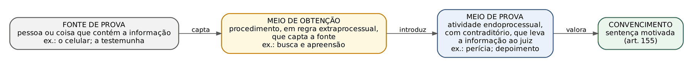
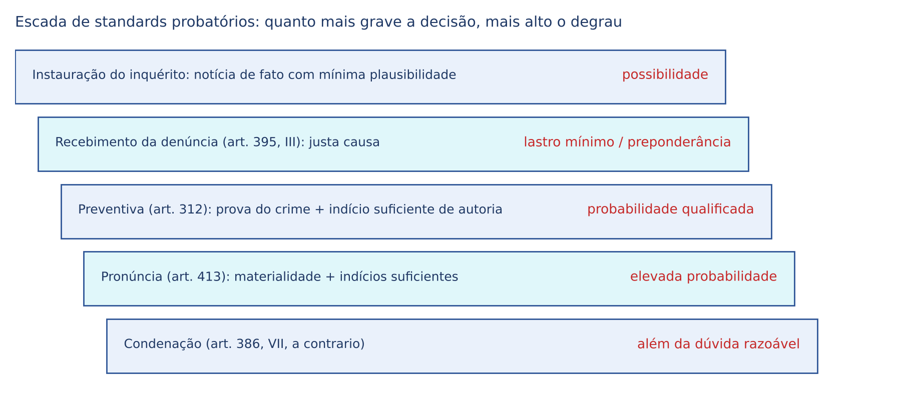
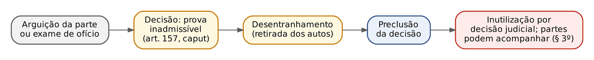
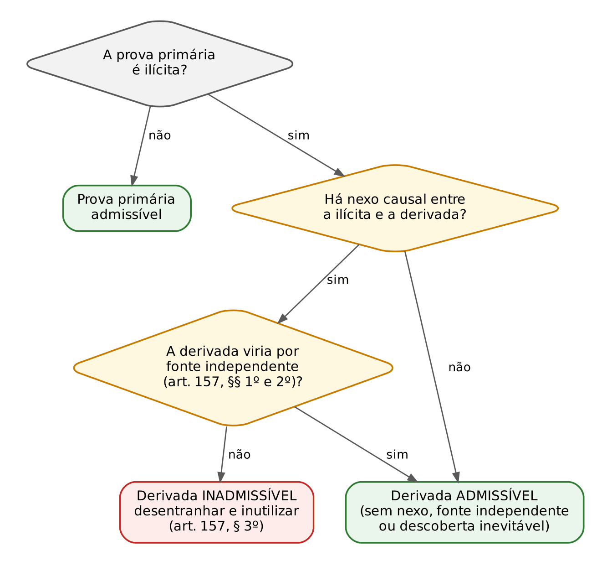
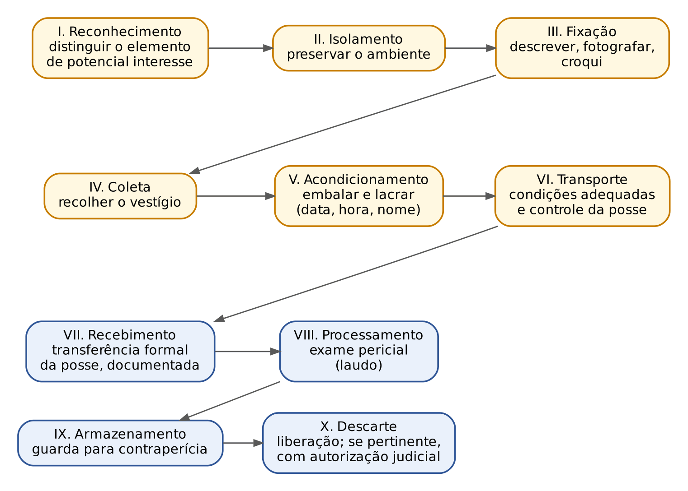
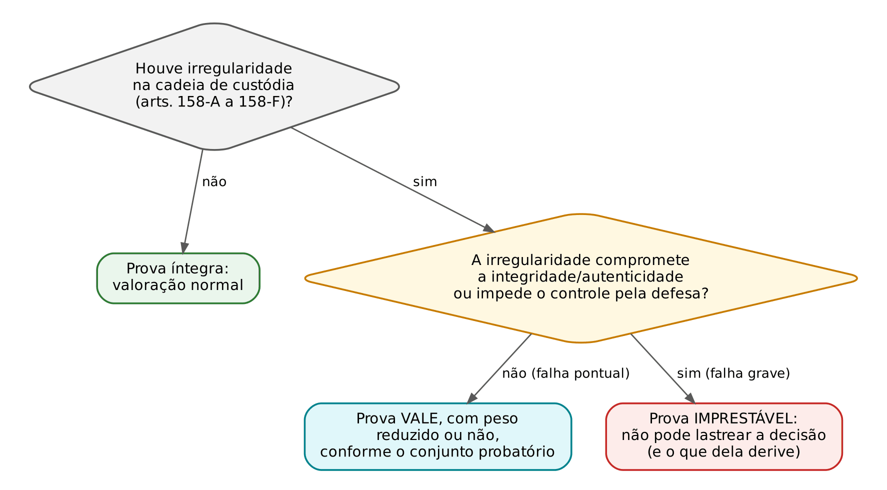
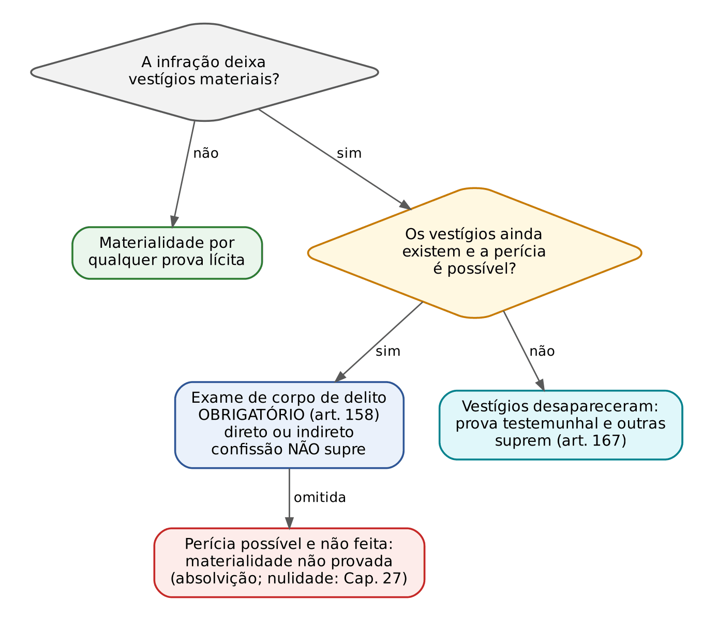
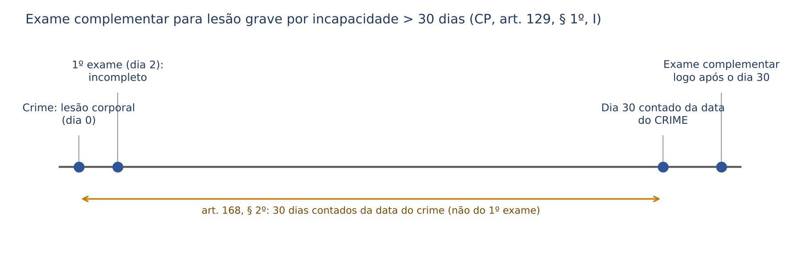

# CAPÍTULO 14 — PROVA I: TEORIA GERAL, VALORAÇÃO, STANDARDS, ÔNUS, PROVAS ILÍCITAS, PROVA EMPRESTADA, CADEIA DE CUSTÓDIA E PERÍCIAS

:::INCIDENCIA
Pontos: TRF5 p. 10; TJRS p. 6; TJSC p. 9. Nível A+. Lote: 35 questões (FGV 32, FCC 3).
O que mais cai: exame de corpo de delito e perícias (literalidade dos arts. 158 a 184), poderes instrutórios do juiz (art. 156, II), art. 155 (elementos informativos), consequências da quebra da cadeia de custódia e prova ilícita por derivação com suas exceções.
:::

| Subtema | FGV | FCC | Padrão de cobrança |
|---|---|---|---|
| Corpo de delito e perícias (arts. 158 a 184) | 11 | 1 | Literalidade (quesitos, assistente técnico, perito não oficial, exame complementar, art. 182) e casos de vestígios desaparecidos |
| Cadeia de custódia | 5 | 1 | Etapas do art. 158-B pelo nome; consequência da quebra segundo o STJ |
| Iniciativa probatória do juiz | 6 | 0 | Caso: o juiz pode requisitar laudo ou ouvir testemunha referida de ofício? |
| Art. 155 e sistemas de valoração | 5 | 1 | Condenação só com inquérito; argumento de reforço; persuasão racional |
| Provas ilícitas, derivação, emprestada | 6 | 0 | Caso de interceptação ilícita que leva à busca; fonte independente; § 5º do art. 157 |

## 14.1 Teoria geral da prova

### 14.1.1 Para que serve a prova e o que se prova

Prova é a atividade pela qual as partes e, supletivamente, o juiz levam ao processo elementos que permitem reconstruir um fato passado e verificar se a hipótese acusatória é verdadeira. A finalidade é formar o convencimento do juiz (o destinatário direto) e, de modo mais amplo, legitimar a decisão perante as partes e a sociedade. A doutrina contemporânea (Badaró, Aury Lopes Jr.) abandonou a ideia de "verdade real" como algo atingível: o processo trabalha com uma verdade processual, aproximativa, obtida por meios lícitos e sob contraditório. A expressão "busca da verdade real" ainda aparece em alternativas de prova, quase sempre como a armadilha que justificaria violar uma garantia: ela NUNCA autoriza prova ilícita, quebra de domicílio ou condenação baseada só no inquérito.

O objeto da prova são os fatos relevantes para a decisão: o fato imputado (com todas as suas circunstâncias, inclusive as que qualificam, majoram ou atenuam), a autoria, o elemento subjetivo e os fatos que interessam à pena. Não precisam ser provados: os fatos notórios (de conhecimento geral naquele meio e tempo, como o Natal ser em 25/12); os fatos axiomáticos ou intuitivos (o cadáver em decomposição dispensa prova de que a pessoa está morta, tanto que o art. 162, parágrafo único, dispensa a autópsia interna quando as lesões externas bastam); as presunções legais absolutas (por exemplo, a inimputabilidade do agente com menos de 18 anos); e os fatos inúteis ou impertinentes, que o juiz pode recusar (art. 400, § 1º; ver Cap. 22).

:::ATENCAO Intuição civilista que leva ao erro
No cível, o fato incontroverso não depende de prova (CPC, art. 374, III) e a revelia gera presunção de veracidade. No processo penal, NÃO: o fato confessado ou não contestado pela defesa continua dependendo de prova, porque está em jogo a liberdade e vigora a presunção de inocência. A confissão é só mais uma prova, que precisa ser confrontada com as demais (art. 197; ver Cap. 15), e a revelia do réu não gera confissão ficta (ver Cap. 20).
:::

Quanto ao direito, vale a regra de que o juiz conhece a lei (*iura novit curia*). Por aplicação analógica do art. 376 do CPC (o art. 3º do CPP admite analogia), a parte que alega direito municipal, estadual, estrangeiro ou consuetudinário pode ser chamada a provar o teor e a vigência. A situação mais frequente é a lei estrangeira nos casos de extraterritorialidade e de dupla incriminação (ver Cap. 32).

### 14.1.2 Fonte, meio de prova e meio de obtenção: a distinção que organiza todo o tema

As bancas usam com precisão três expressões que no cotidiano se confundem. A distinção é decisiva para entender por que algumas medidas exigem ordem judicial e contraditório diferido, e outras são produzidas na audiência.

| Conceito | O que é | Onde ocorre | Exemplos |
|---|---|---|---|
| Fonte de prova | A pessoa ou coisa da qual se extrai a informação; existe antes e independentemente do processo | Fora do processo | A testemunha, a vítima, o documento, o celular, o cadáver |
| Meio de obtenção de prova (ou de investigação) | Procedimento, em regra extraprocessual e com surpresa, destinado a captar fontes ou elementos de prova; muitas vezes sujeito a reserva de jurisdição | Em regra na investigação | Busca e apreensão, interceptação telefônica, infiltração, colaboração premiada, quebra de sigilos (Caps. 15 e 16) |
| Meio de prova | Atividade endoprocessual, com contraditório, pela qual a informação entra no processo e pode ser valorada | No processo (ou antecipada com contraditório) | Prova testemunhal, pericial, documental, interrogatório, acareação, reconhecimento |

Exemplo: o celular de A é uma fonte de prova; a busca e apreensão que o retira da casa de A é um meio de obtenção; a perícia de extração de dados e o laudo submetido às partes constituem o meio de prova. Se a busca for ilegal, o problema está no meio de obtenção e contamina o que dele derivar (14.7). O Superior Tribunal de Justiça e as bancas tratam a colaboração premiada como meio de obtenção de prova, e não como meio de prova (Lei 12.850/2013, art. 3º-A; ver Cap. 8).

Outras classificações aparecem em itens isolados: prova direta (recai sobre o próprio fato, como a testemunha que viu o disparo) x prova indireta ou indiciária (recai sobre fato diverso, do qual se infere o principal por raciocínio, como o indício do art. 239; ver Cap. 15); prova pessoal (afirmação de pessoa) x real (coisa ou vestígio); prova típica (com procedimento previsto em lei) x atípica (sem procedimento legal, admitida pela liberdade probatória, desde que lícita e não usada para contornar o procedimento típico). Parte da doutrina chama de prova irritual a prova típica produzida sem observar seu procedimento (ex.: reconhecimento sem as cautelas do art. 226) e de prova anômala a prova típica substituída por outra para burlar o rito (ex.: ouvir testemunha por "declaração escrita" juntada pela parte). Nenhuma das duas é válida como sucedâneo da prova regular.

A liberdade probatória é a regra: qualquer meio lícito pode ser usado, salvo quanto ao estado das pessoas, em que se observam as restrições da lei civil (art. 155, parágrafo único). Por isso a idade do réu se prova por documento hábil (Súmula 74 do STJ), e a morte do acusado, para extinguir a punibilidade, se prova pela certidão de óbito (art. 62).

### 14.1.3 Prova x elemento informativo

Elemento informativo é o dado colhido na investigação, sem contraditório e sem a participação obrigatória do juiz natural da causa; serve para formar a *opinio delicti* do Ministério Público e para fundamentar medidas cautelares. Prova, em sentido estrito, é o que se produz em juízo, sob contraditório e perante o juiz. A distinção, positivada pela Lei 11.690/2008 no art. 155, é a base de toda a disciplina do valor do inquérito.

| Elemento informativo | Prova |
|---|---|
| Colhido na investigação (inquérito, PIC) | Produzida em juízo |
| Sem contraditório (ou com contraditório só eventual) | Com contraditório e ampla defesa |
| Finalidade: justa causa para a ação, cautelares | Finalidade: fundamentar a sentença |
| Não pode, SOZINHO, fundamentar condenação | Pode fundamentar condenação |

## 14.2 Art. 155: o valor do inquérito na sentença

:::LEI CPP, art. 155
"O juiz formará sua convicção pela livre apreciação da prova produzida em contraditório judicial, não podendo fundamentar sua decisão exclusivamente nos elementos informativos colhidos na investigação, ressalvadas as provas cautelares, não repetíveis e antecipadas."
Parágrafo único. "Somente quanto ao estado das pessoas serão observadas as restrições estabelecidas na lei civil."
:::

A palavra-chave é "exclusivamente". O juiz pode usar elementos do inquérito como reforço de convicção, desde que a condenação se apoie em prova judicial suficiente por si só. O que não pode é condenar quando a única base é o inquérito (por exemplo, testemunhas que incriminaram o réu na delegacia e se retrataram em juízo, sem nenhuma outra prova judicial). O STJ firmou que provas produzidas no inquérito e reexaminadas na instrução sob contraditório não violam o art. 155 (Jurisprudência em Teses, ed. 105, tese 1).

As três ressalvas não são exceções ao contraditório, mas hipóteses de contraditório diferido (ou postergado): a prova é produzida antes, porque não pode esperar, e as partes a impugnam depois, em juízo.

| Ressalva | Por que não pode esperar | Exemplo | Contraditório |
|---|---|---|---|
| Prova cautelar | Risco de perecimento do objeto; exige urgência e, em regra, ordem judicial | Interceptação telefônica, busca e apreensão | Diferido: a defesa impugna o resultado depois |
| Prova não repetível | O objeto desaparece ou se modifica com o tempo; não há como refazer | Exame de corpo de delito em lesão corporal, exame de local | Diferido: quesitos complementares, assistente técnico, oitiva do perito |
| Prova antecipada | Produzida antes do momento normal, perante o juiz e com contraditório real | Testemunha enferma ou de viagem (art. 225); art. 366 (Súmula 455 do STJ; ver Cap. 20) | Real, no momento da produção |

As perícias e os documentos produzidos no inquérito têm eficácia probatória sem necessidade de repetição em juízo, justamente pelo contraditório diferido (Jurisprudência em Teses, ed. 105, tese 2). Na prática da sentença, o laudo de exame cadavérico feito no inquérito é prova plena, não elemento informativo.

:::JURIS STJ, Tema 1.260 (REsp 2.048.687, Terceira Seção, j. 12/8/2026)
Teses: a pronúncia não pode se basear exclusivamente em elementos informativos do inquérito, ressalvadas as provas cautelares, não repetíveis e antecipadas; o testemunho indireto (de "ouvir dizer"), ainda que colhido em juízo, é lícito, mas não basta, sozinho, para o *standard* da pronúncia; em contextos objetivamente demonstrados de intimidação, criminalidade organizada ou silenciamento da testemunha, o testemunho indireto qualificado pode ganhar maior relevo, sob controle judicial estrito. No mesmo período, a Quinta Turma afirmou que o contexto de intimidação por facções não supre o comando do art. 155 nem autoriza pronúncia fundada em testemunhos indiretos e elementos exclusivamente inquisitoriais sem corroboração judicial (AgRg no HC 1.088.780, j. 17/6/2026). O art. 155, portanto, vale também para decisões que não são a condenação (o procedimento da pronúncia está no Cap. 23).
:::

:::QUESTAO FGV 2026 — TJ-SC — Analista Jurídico (Q4150730)
Caso: na extorsão, o juiz determina perícia de ofício e, na sentença, condena exclusivamente com base nas declarações das testemunhas na delegacia, por julgá-las "mais espontâneas" do que as prestadas em juízo. Gabarito: B, a sentença é nula, pois não pode fundar-se exclusivamente em elementos informativos (art. 155). Armadilhas: "prova tarifada que dá valor absoluto ao inquérito", "íntima convicção como regra", "verdade real que autoriza condenar com base no inquérito" e "acusatório absoluto que veda perícia de ofício" (o art. 156, II, permite; ver 14.6). No mesmo sentido: Q2450551 (FGV 2024; gabarito E: só a terceira assertiva, cópia do art. 155, é verdadeira; a primeira atribui à íntima convicção a definição da persuasão racional) e Q2513029 (FGV 2024; a alternativa que tirava as ressalvas do art. 155 era falsa).
:::

:::QUESTAO FGV 2024 — TJ-AP — Analista Judiciário (Q2449104)
Caso: o juiz condena por furto qualificado contra os pedidos de absolvição do MP e da defesa, com base na prova judicial, e cita o inquérito como argumento de reforço. Gabarito: A, agiu corretamente. Dois ensinamentos: elemento do inquérito como reforço é permitido; e o juiz não está vinculado ao pedido de absolvição do MP (art. 385; a discussão sobre a recepção desse dispositivo pelo sistema acusatório está no Cap. 21). Armadilhas: "perempção" (instituto exclusivo da ação privada) e "vedação de condenar quando o MP pede absolvição".
:::

:::SENTENCA Art. 155 na fundamentação da autoria
Onde entra: no exame da autoria (e da materialidade, quando houver retratação). O que fundamentar: indicar a prova JUDICIAL que sustenta a conclusão e só depois mencionar o inquérito como corroboração. Redação-modelo: "A autoria está demonstrada pelos depoimentos colhidos em juízo, sob contraditório, das testemunhas X e Y, que confirmam a narrativa prestada na fase policial; os elementos do inquérito apenas corroboram o que a prova judicial já evidencia (CPP, art. 155)." Erro que a banca pune: condenar com base em declaração policial retratada em juízo sem outra prova judicial, ou usar laudo do inquérito como se fosse "elemento informativo" sem valor (ele é prova não repetível).
:::

## 14.3 Sistemas de valoração da prova

Sistema de valoração é o critério pelo qual o juiz atribui peso às provas. São três, e o Brasil adota os três em espaços diferentes.

| Sistema | Como funciona | Onde aparece no Brasil |
|---|---|---|
| Íntima convicção (certeza moral do juiz) | O julgador decide livremente e NÃO motiva | Jurados do Tribunal do Júri (CF, art. 5º, XXXVIII, b: sigilo das votações); o juiz presidente, ao contrário, motiva suas decisões |
| Prova legal ou tarifada | A lei fixa previamente o valor de cada prova ou exige prova específica | Resquícios: estado das pessoas (art. 155, parágrafo único; Súmula 74 do STJ); exame de corpo de delito obrigatório nas infrações que deixam vestígios, não supríveis pela confissão (art. 158); certidão de óbito (art. 62) |
| Persuasão racional (livre convencimento motivado) | O juiz valora livremente, mas com base na prova dos autos e com motivação racional e controlável | REGRA geral (CF, art. 93, IX; CPP, art. 155) |

Duas consequências práticas da persuasão racional: não há hierarquia prévia entre provas (a confissão não é "rainha das provas", e o laudo não vincula o juiz, que pode aceitá-lo ou rejeitá-lo no todo ou em parte, art. 182, chamado sistema liberatório); e o juiz só pode usar o que está nos autos, nunca o conhecimento privado dele sobre o fato (se o juiz presenciou o crime, é testemunha e fica impedido, art. 252, II; ver Cap. 12).

:::QUESTAO FCC 2026 — DPE-BA — Defensor Público (Q4037441)
A questão transcreveu trecho de Badaró: o juiz valora o grau de suporte que cada meio de prova dá a uma hipótese, e a força da inferência aumenta à medida que a hipótese supera os testes elaborados para falseá-la. Gabarito: E, probabilidade indutiva (ou lógica). Para fixar: a probabilidade estatística (ou frequencial) trabalha com frequências de eventos repetíveis e se aplica mal a fatos únicos; a probabilidade subjetiva mede o grau de crença do julgador; a probabilidade lógica ou indutiva, adotada pela epistemologia judiciária contemporânea, mede o grau de confirmação de uma hipótese pelas provas e pela resistência a hipóteses contrárias.
:::

:::QUESTAO FGV 2024 — PC-SC — Delegado (Q2360700)
O enunciado transcreve Malatesta (a convicção não pode fundar-se em apreciações subjetivas, mas deve ser tal que produziria a mesma convicção em qualquer cidadão razoável) e pergunta qual sistema geral de avaliação vigora. Gabarito: C, persuasão racional como regra, com o limite do art. 155 (sem fundamentar exclusivamente em elementos informativos, ressalvadas as provas cautelares, não repetíveis e antecipadas). Armadilhas: "identidade física do juiz" (A; o art. 399, § 2º, é princípio de vinculação do juiz que colheu a prova, não sistema de valoração); "sistema misto" ligado à vedação de iniciativa na investigação (B; confunde sistema processual com sistema de valoração); "certeza moral" estendida ao juiz presidente do Júri (D; só os jurados não motivam); "íntima convicção como regra" (E).
:::

## 14.4 Standards probatórios

### 14.4.1 O que é e por que existe

*Standard* probatório (ou modelo de constatação) é o grau de suficiência de prova exigido para que uma hipótese fática seja considerada provada numa determinada decisão. Ele responde à pergunta: "quanto de prova basta?". O tema ganhou espaço porque a persuasão racional diz COMO o juiz valora, mas não diz QUANDO a prova é suficiente; sem um *standard* explícito, a decisão fica entregue ao subjetivismo.

A lógica é de distribuição de riscos de erro. Toda decisão sobre fatos pode errar para dois lados (condenar um inocente ou absolver um culpado). Ao exigir prova "além de qualquer dúvida razoável" para condenar, o sistema aceita absolver mais culpados para condenar menos inocentes, opção que decorre da presunção de inocência (CF, art. 5º, LVII). No cível, em regra, basta a preponderância de provas (a hipótese mais provável vence); no penal, para condenar, o degrau é muito mais alto.

### 14.4.2 Standards diferenciados por fase

O *standard* sobe conforme a decisão afeta mais intensamente o acusado. A escada abaixo é a forma de memorizar.

| Decisão | Exigência legal | Standard (doutrina e STJ) |
|---|---|---|
| Instauração do inquérito | Notícia de crime com plausibilidade mínima | Mera possibilidade |
| Recebimento da denúncia | Justa causa: lastro probatório mínimo de materialidade e autoria (art. 395, III; ver Cap. 6) | Preponderância ou lastro mínimo; o STJ apontou a preponderância como o degrau do recebimento (REsp 2.091.647) |
| Prisão preventiva | Prova da existência do crime e indício suficiente de autoria (art. 312; ver Cap. 19) | Probabilidade (juízo provisório, com cautelaridade) |
| Pronúncia | Materialidade e indícios suficientes de autoria (art. 413; ver Cap. 23) | Elevada probabilidade; sem *in dubio pro societate* |
| Condenação | Certeza processual | Além da dúvida razoável; dúvida leva à absolvição (art. 386, VII) |

A posição relativa da preventiva e da pronúncia não é fixada em lei e varia na doutrina; o que é seguro afirmar é que ambas ficam acima do recebimento e abaixo da condenação.

:::JURIS STJ, REsp 2.091.647, Sexta Turma, j. 26/9/2023 (Informativo 791)
Pronúncia: rejeitado o *in dubio pro societate*. O *standard* da pronúncia fica entre a preponderância (suficiente para o recebimento da denúncia) e a prova além da dúvida razoável (reservada à condenação): exige-se elevada probabilidade de que o réu seja autor ou partícipe. A dúvida sobre a suficiência dos indícios resolve-se em favor do acusado pelo juiz; a dúvida sobre a autoria em si, superado esse patamar, fica para os jurados. O STF já o afastara antes (ARE 1.067.392; v. Cap. 23).
:::

:::PEGADINHA in dubio pro societate
A Jurisprudência em Teses do STJ (ed. 105, tese 4) ainda registra que, no oferecimento da denúncia, basta lastro mínimo e "prevalece o *in dubio pro societate*". Para a prova: no RECEBIMENTO da denúncia, a jurisprudência ainda tolera a expressão; na PRONÚNCIA, ela foi rejeitada pelo STF e pelo STJ. Em qualquer fase, porém, não basta a mera dúvida para avançar: é preciso atingir o *standard* daquela decisão.
:::

Um efeito importante dos *standards* aparece na prova inválida: ela não sustenta nenhum degrau da escada, nem mesmo os de exigência menor, como preventiva, recebimento da denúncia ou pronúncia. O STJ aplicou essa lógica ao reconhecimento de pessoas no Tema 1.258 (Q3742376, FGV 2025, TRF6, gabarito E; ver Cap. 15).

## 14.5 Ônus da prova

### 14.5.1 A regra do art. 156 e a presunção de inocência

O art. 156 diz que "a prova da alegação incumbirá a quem a fizer". Lido isoladamente, parece reproduzir a distribuição estática do processo civil (autor prova o fato constitutivo; réu, o impeditivo, modificativo ou extintivo). Mas a presunção de inocência, vista como regra probatória (ou regra de julgamento), muda a leitura: cabe à acusação provar, além da dúvida razoável, todos os elementos da imputação (materialidade, autoria, tipicidade objetiva e subjetiva). O réu não tem ônus de provar a inocência, e a dúvida resolve-se a favor dele (*in dubio pro reo*). O fundamento constitucional da presunção está no Cap. 1; aqui interessa a consequência probatória.

A posição dominante na jurisprudência e em manuais tradicionais (Capez, Nucci) ainda reparte o ônus: acusação prova o fato típico e a autoria; a defesa prova o álibi, as excludentes de ilicitude e de culpabilidade e as causas extintivas que alegar. A doutrina garantista (Aury Lopes Jr., Badaró) sustenta que todo o ônus é da acusação, inclusive a inexistência de excludente alegada com plausibilidade. A solução prática para a prova é o art. 386, VI, na redação da Lei 11.690/2008: o juiz absolve se existirem circunstâncias que excluam o crime ou isentem o réu de pena, "ou mesmo se houver fundada dúvida sobre sua existência". Ou seja, a defesa não precisa PROVAR a legítima defesa; basta gerar dúvida fundada sobre ela.

:::EXEMPLO Álibi e excludente: quem prova o quê
A é acusado de homicídio e alega (1) que estava em outra cidade e (2) subsidiariamente, que agiu em legítima defesa. Quanto ao álibi: a acusação continua com o ônus de provar a autoria; se o álibi é falso, isso não prova a autoria (o álibi desmentido é, no máximo, indício). Quanto à legítima defesa: se a prova deixa fundada dúvida sobre a agressão injusta, absolve-se com base no art. 386, VI, parte final; não se exige prova cabal da excludente.
:::

:::PEGADINHA Inversão e distribuição dinâmica do ônus
No processo penal NÃO existe inversão do ônus da prova contra o acusado, nem distribuição dinâmica do ônus pelo juiz (CPC, art. 373, § 1º, não se aplica em desfavor do réu). Foram falsas as alternativas que diziam que o juiz pode "redistribuir o ônus com base na gravidade do fato" (Q2513029, FGV 2024) ou "inverter excepcionalmente o ônus por despacho fundamentado" (Q4378261, FGV 2026, PC-PR).
:::

### 14.5.2 O ônus do Estado de provar que agiu licitamente

Uma aplicação moderna do ônus é a seguinte: quando a defesa traz versão verossímil de ilegalidade na obtenção da prova, cabe ao Estado demonstrar que agiu dentro da legalidade; por isso o STJ invalidou a confissão informal colhida em abordagem com indícios de maus-tratos (HC 915.025; v. Cap. 15). A mesma lógica rege a integridade da cadeia de custódia (14.10.4) e o consentimento para ingresso em domicílio (ver Cap. 15).

## 14.6 Iniciativa probatória do juiz

### 14.6.1 O art. 156, I e II, e o art. 3º-A

O art. 156 faculta ao juiz, de ofício: (I) ordenar, mesmo antes de iniciada a ação penal, a produção antecipada de provas urgentes e relevantes, observando necessidade, adequação e proporcionalidade; e (II) determinar, no curso da instrução ou antes de sentenciar, diligências para dirimir dúvida sobre ponto relevante. O Pacote Anticrime introduziu o art. 3º-A, que proíbe "a iniciativa do juiz na fase de investigação e a substituição da atuação probatória do órgão de acusação". Ao julgar as ADIs 6.298, 6.299, 6.300 e 6.305 (j. 24/8/2023), o STF deu interpretação conforme ao art. 3º-A para assentar que o juiz pode, pontualmente e nos limites legalmente autorizados, determinar diligências suplementares para dirimir dúvida sobre questão relevante para o julgamento do mérito (o conjunto das teses está nos Caps. 1 e 3).

O resultado é um quadro que divide o tempo do processo.

| Momento | O juiz pode agir de ofício? | Fundamento |
|---|---|---|
| Investigação | NÃO para produzir prova ou decretar medidas investigativas de ofício (o inciso I do art. 156 ficou esvaziado nessa fase); atua só se provocado, como juiz das garantias | Art. 3º-A; art. 282, § 2º (cautelares); STJ: viola o sistema acusatório deferir de ofício busca domiciliar e quebra de sigilo telemático na investigação (Informativo 868, j. 21/10/2025) |
| Instrução | SIM, de forma supletiva e pontual, para esclarecer dúvida sobre ponto relevante | Art. 156, II; art. 209 (testemunhas do juízo e referidas); art. 196 (novo interrogatório) |
| Antes da sentença | SIM, idem (requisitar laudo faltante, exame complementar) | Art. 156, II; art. 404 |
| Grau recursal | SIM: o tribunal pode reinterrogar o réu, reinquirir testemunhas ou determinar diligências | Art. 616 |

O limite é qualitativo: o juiz complementa, não protagoniza; a postura inquisitorial na inquirição gera nulidade (REsp 2.214.638; v. Cap. 15). Na audiência, as partes perguntam primeiro e diretamente (art. 212; ver Cap. 15); o juiz complementa ao final.

:::QUESTAO FGV 2025 — TJ-MS — Juiz Substituto (Q3786384)
Caso: estupro de vulnerável; nas alegações finais, o MP pede absolvição por dúvida sobre a materialidade, porque o laudo sexológico, realizado, não foi juntado. Gabarito: E, o juiz pode requisitar de ofício o laudo faltante, para dirimir dúvida sobre ponto relevante (art. 156, II), e condenar (art. 385). Passos: (1) o pedido de absolvição do MP não vincula o juiz; (2) a dúvida decorre de prova JÁ produzida e não juntada, típico caso de diligência supletiva; (3) não há preclusão para o juiz nem quebra de imparcialidade. No mesmo sentido: Q3373868 (FGV 2025, TRF5, Juiz Federal: laudos definitivos de armas e drogas não juntados; gabarito C), Q3086965 (FGV 2024, TJ-MT, Juiz: confronto balístico requisitado antes da pronúncia; gabarito C) e a primeira parte de Q4083767 (14.7.3).
:::

:::QUESTAO FGV 2026 — MPE-RJ — Promotor (Q4088259)
Caso: no latrocínio, o juiz ouve de ofício uma testemunha não arrolada e uma testemunha referida, condena com base nelas, e a Câmara, na apelação defensiva, reinterroga o réu e reouve as testemunhas. Gabarito: D, ambos podiam (arts. 209 e 616). Armadilhas: "violação da imparcialidade" e "*reformatio in pejus*" (reouvir testemunhas não agrava a situação do réu; a proibição recai sobre o resultado do julgamento, ver Cap. 28). No mesmo sentido: Q3117555 (FGV 2024, TJ-PE, Juiz: testemunhas referidas ouvidas de ofício; gabarito B).
:::

:::DICA Como a FGV monta essas questões
O padrão FGV é invariável: o MP deixou de requerer uma prova (laudo, confronto balístico, testemunha referida) e o juiz a determina de ofício. A resposta certa é quase sempre "pode, para dirimir dúvida sobre ponto relevante". As alternativas erradas apelam para "preclusão", "imparcialidade", "concordância prévia do MP ou da defesa" ou "vinculação ao pedido absolutório". Só desconfie se o juiz agir na INVESTIGAÇÃO ou se substituir a acusação na produção da prova principal (ex.: arrolar testemunhas que o MP não arrolou para suprir sua inércia completa).
:::

:::SENTENCA Diligência de ofício antes de sentenciar
Onde entra: no despacho de conversão do julgamento em diligência, depois das alegações finais. Redação-modelo: "Constatada a ausência nos autos do laudo de exame de corpo de delito, já realizado conforme ofício de fl. X, e sendo ponto relevante para o julgamento, converto o julgamento em diligência para requisitá-lo (CPP, art. 156, II), abrindo-se, após a juntada, vista às partes para manifestação." Erro que a banca pune: sentenciar sem dar às partes vista da prova nova (viola o contraditório) ou determinar prova que inova a acusação (ex.: buscar fatos não imputados).
:::

## 14.7 Provas ilícitas

### 14.7.1 Fundamento e conceito

A Constituição diz que "são inadmissíveis, no processo, as provas obtidas por meios ilícitos" (art. 5º, LVI). A lógica não é de busca da verdade, e sim de limite ao poder estatal: o Estado não pode punir usando aquilo que obteve violando direitos fundamentais, sob pena de estimular a violação (efeito dissuasório) e de comprometer a integridade judicial. Por isso a vedação vale em qualquer processo e em qualquer instância, e não só no penal.

:::LEI CPP, art. 157
"São inadmissíveis, devendo ser desentranhadas do processo, as provas ilícitas, assim entendidas as obtidas em violação a normas constitucionais ou legais."
§ 1º "São também inadmissíveis as provas derivadas das ilícitas, salvo quando não evidenciado o nexo de causalidade entre umas e outras, ou quando as derivadas puderem ser obtidas por uma fonte independente das primeiras."
§ 2º "Considera-se fonte independente aquela que por si só, seguindo os trâmites típicos e de praxe, próprios da investigação ou instrução criminal, seria capaz de conduzir ao fato objeto da prova."
§ 3º "Preclusa a decisão de desentranhamento da prova declarada inadmissível, esta será inutilizada por decisão judicial, facultado às partes acompanhar o incidente."
§ 5º (incluído pela Lei 13.964/2019) "O juiz que conhecer do conteúdo da prova declarada inadmissível não poderá proferir a sentença ou acórdão." DECLARADO INCONSTITUCIONAL pelo STF (ADIs 6.298, 6.299, 6.300 e 6.305, j. 24/8/2023).
:::

A doutrina clássica (a partir de Ada Pellegrini Grinover, com base em Nuvolone) distingue dentro do gênero "prova vedada" ou "ilegal":

| | Prova ilícita | Prova ilegítima |
|---|---|---|
| Norma violada | De direito material (constitucional ou legal): intimidade, domicílio, sigilo, integridade física | De direito processual |
| Momento do vício | Na OBTENÇÃO, em regra fora do processo | Na PRODUÇÃO, dentro do processo |
| Exemplos | Confissão sob tortura; interceptação sem ordem judicial; busca domiciliar sem mandado e sem flagrante; acesso a sigilo médico | Laudo assinado por um só perito não oficial (art. 159, § 1º); depoimento de quem deve guardar sigilo profissional sem desobrigação (art. 207); juntada de documento em plenário sem a antecedência do art. 479 |
| Consequência clássica | Inadmissibilidade e desentranhamento | Nulidade, regida pela teoria das nulidades (prejuízo, preclusão; ver Cap. 27) |

O art. 157, ao falar em violação de normas "constitucionais ou legais", gerou divergência. Parte da doutrina entende que a lei unificou o regime e qualquer violação legal torna a prova ilícita e inadmissível. Outra parte (majoritária, inclusive em Badaró e Renato Brasileiro) mantém a distinção: "normas legais" seriam as de natureza material, e a violação de regra processual continua tratada como nulidade. Para a prova objetiva, guarde as duas coisas: o conceito legal é amplo; a distinção doutrinária entre ilícita (material, obtenção) e ilegítima (processual, produção) continua a ser cobrada.

### 14.7.2 Consequências processuais: desentranhamento, inutilização e o § 5º

O procedimento é simples: a decisão declara a prova inadmissível, manda desentranhá-la e, preclusa essa decisão, a prova é inutilizada por decisão judicial, podendo as partes acompanhar o incidente (art. 157, § 3º). A espera pela preclusão existe para que a parte prejudicada possa impugnar a decisão antes da destruição, que é irreversível.

O reconhecimento pode ocorrer em qualquer fase: no recebimento da denúncia (rejeição por falta de justa causa quando só restam provas ilícitas, art. 395, III), na absolvição sumária, na sentença (normalmente como preliminar), em grau recursal ou em *habeas corpus*. Prova ilícita não preclui para a defesa: por atingir garantia constitucional, pode ser arguida a qualquer tempo, inclusive em revisão criminal.

Quanto ao § 5º, a ideia era impedir que o juiz "contaminado" pelo conhecimento da prova ilícita julgasse a causa (teoria da descontaminação do julgado). O STF declarou o dispositivo inconstitucional, entre outros motivos pela vagueza do critério e pelo risco de manipulação da competência (bastaria a parte juntar prova ilícita para afastar o juiz). Hoje, o juiz que conheceu da prova inadmissível PODE sentenciar, desde que não a utilize.

:::QUESTAO FGV 2024 — ENAM — 1º Exame Nacional da Magistratura (Q2459861)
Três assertivas: (I) sucessivas renovações de interceptação são lícitas se fundamentadas, ainda que sucintamente, diante da complexidade da investigação; (II) segundo o STF, o juiz que conhecer da prova inadmissível não pode sentenciar; (III) as derivadas não são admitidas, salvo ausência de nexo, fonte independente ou produção "comprovadamente de boa-fé". Gabarito: A, só a I. A II reproduz o § 5º, declarado inconstitucional; a III inclui a boa-fé, exceção que o CPP não prevê e que a jurisprudência brasileira não adotou (14.7.4). O tema das prorrogações da interceptação está no Cap. 16.
:::

:::PROCESSO Qual recurso cabe nas decisões sobre prova ilícita e pericial
| Decisão | Instrumento cabível |
|---|---|
| Rejeição da denúncia por estar lastreada só em provas ilícitas | RESE (art. 581, I) |
| Decisão interlocutória que declara a prova ilícita e manda desentranhar | Não há recurso típico (o rol do art. 581 não a prevê); a acusação usa mandado de segurança, e a matéria pode ser renovada em preliminar de apelação |
| Decisão que admite prova alegadamente ilícita ou indefere o desentranhamento | Não há recurso típico; a defesa usa *habeas corpus* (há risco à liberdade) ou suscita a questão em preliminar de apelação |
| Indeferimento de perícia (art. 184) ou de diligência | Irrecorrível de imediato; alegação de cerceamento de defesa em preliminar de apelação (ou HC, se manifesto) |
| Sentença que absolve ou condena com base na licitude ou ilicitude da prova | Apelação (art. 593, I) |
:::

### 14.7.3 Prova ilícita por derivação e suas limitações

Prova ilícita por derivação é a prova em si lícita, mas a que se chegou por meio de informação extraída de uma prova ilícita. É a teoria dos frutos da árvore envenenada (*fruits of the poisonous tree*), desenvolvida pela Suprema Corte dos EUA (casos *Silverthorne*, 1920, e *Nardone*, 1939), acolhida pelo STF desde os anos 1990 e positivada no art. 157, § 1º, pela Lei 11.690/2008. Se a derivada fosse admitida, a proibição seria inócua: bastaria à polícia torturar para descobrir onde está a arma e depois apreendê-la "legalmente".

Exemplo: a polícia intercepta o telefone de B sem ordem judicial (ilícita) e descobre que a droga está num galpão; obtém então mandado de busca (formalmente válido) e apreende a droga. A apreensão é derivada da interceptação ilícita, logo inadmissível. A ordem judicial posterior NÃO "lava" a ilicitude, porque o juiz decidiu com base em informação ilícita.

A própria construção norte-americana criou limitações à contaminação, e o CPP adotou parte delas.

| Limitação | Ideia central | Origem | Situação no Brasil |
|---|---|---|---|
| Ausência de nexo causal | A prova não guarda relação de causa e efeito com a ilícita | — | Expressa (art. 157, § 1º, primeira parte) |
| Fonte independente (*independent source*) | A prova foi obtida também por outra via, autônoma e lícita, que existiu concretamente | *Bynum*, 1960; *Murray*, 1988 | Expressa (art. 157, § 1º, segunda parte) |
| Descoberta inevitável (*inevitable discovery*) | A prova seria inevitavelmente descoberta pelos trâmites regulares da investigação, ainda que não tivesse havido a ilicitude | *Nix v. Williams*, 1984 | Doutrina majoritária: é o que descreve o § 2º, apesar do nome "fonte independente"; aplicada pelo STJ (HC 52.995, Sexta Turma, 2010), exigindo dados concretos, e não mera especulação |
| Nexo causal atenuado ou mancha purgada (*purged taint*) | Um ato posterior e voluntário (por exemplo, a confissão espontânea dias depois, assistida por advogado) dilui o vínculo com a ilicitude | *Wong Sun*, 1963 | Admitida por parte da doutrina e por julgados, com base na primeira parte do § 1º |
| Boa-fé (*good faith exception*) | O agente agiu crendo legitimamente na legalidade (ex.: mandado depois anulado) | *Leon*, 1984 | NÃO adotada pelo CPP; rejeitada pelas bancas como exceção legal |

:::DOUTRINA A confusão do § 2º
Renato Brasileiro, Aury Lopes Jr. e Pacelli observam que o § 2º, ao definir fonte independente como aquela que "seria capaz de conduzir ao fato objeto da prova" pelos trâmites típicos da investigação, descreve na verdade a descoberta inevitável (juízo hipotético, no futuro do pretérito), não a fonte independente (que é um dado histórico: a outra fonte efetivamente existiu). Aury critica a abertura, por permitir que quase tudo seja salvo por um juízo de probabilidade. Para a prova: a FGV costuma chamar de "fonte independente" a hipótese do § 2º e usar a expressão "à qual inevitavelmente se chegaria" como distrator em casos em que NÃO há outra via concreta.
:::

:::PASSO Como decidir uma alegação de prova derivada
1. Identifique a prova primária e diga por que é ilícita (qual norma material foi violada).
2. Identifique a prova questionada e trace o caminho entre elas: a informação ilícita foi a CAUSA da diligência que gerou a prova?
3. Se não há nexo, a prova é admissível (art. 157, § 1º, primeira parte).
4. Se há nexo, verifique se existia outra via concreta e lícita (fonte independente) ou se os trâmites regulares, com dados concretos dos autos, levariam inevitavelmente à prova (§ 2º).
5. Ausentes as exceções, declare a inadmissibilidade, determine o desentranhamento e examine o que sobra: há prova lícita suficiente para a condenação, para a pronúncia ou para o recebimento?
:::

:::QUESTAO FGV 2025 — TJ-SE — Juiz Substituto (Q3301272)
Caso: busca e apreensão com mandado localiza Fernando, foragido, com armas e drogas; descobre-se que a diligência se baseou em informações de prorrogação de interceptação sem autorização judicial e que, sem elas, não seria possível achar Fernando nem o material. Gabarito: E, a denúncia deve ser rejeitada, pois lastreada em provas ilícitas por derivação. Passos: prova primária ilícita (prorrogação sem ordem: violação do sigilo das comunicações); nexo causal expresso no enunciado ("sem as informações... não seria possível"); nenhuma fonte independente. Armadilhas: "a decisão judicial posterior supre a anterior" e "poderiam ser obtidas por fonte independente" (o enunciado nega). Correlatas com o mesmo desenho: Q3425292 (FGV 2025, TRF1, Juiz Federal; gabarito C) e Q3786385 (FGV 2025, TJ-MS, Juiz; gabarito A).
:::

:::QUESTAO FGV 2026 — TJ-GO — Juiz Substituto (Q3966684)
Caso: Josué, orientado pelo advogado, recusa-se a fornecer padrões gráficos; a polícia usa padrões dele já existentes no instituto de identificação e faz o laudo grafotécnico. Gabarito: B, a denúncia pode ser recebida, por se tratar de prova obtida por fonte independente. Raciocínio: a recusa é legítima (*nemo tenetur se detegere*: o investigado não é obrigado a produzir prova que exija comportamento ativo), mas o art. 174, II e III, autoriza a comparação com documentos já reconhecidos ou constantes de arquivos públicos. Não há prova ilícita a contaminar nada: nem a recusa nem o uso dos arquivos violaram direito. No mesmo sentido: Q4088252 (FGV 2026, MPE-RJ, Promotor; gabarito E).
:::

Alguns julgados recentes ajudam a calibrar o nexo causal:

- Consentimento ou ordem judicial posteriores não purgam a contaminação derivada de flagrante ilícito (AgRg no HC 1.041.047; v. Cap. 17).
- A eventual ilegalidade na execução da revista íntima incidental não contamina, por derivação, as provas apreendidas na busca domiciliar regular (STJ, REsp 2.159.111, Sexta Turma, j. 6/5/2025): o ato ilegal não foi causa da apreensão.
- O chip da operadora é fonte independente em relação à extração do aparelho (AgRg na Rcl 48.657; v. Cap. 17).
- Capturas de tela de WhatsApp obtidas sem consentimento nem ordem judicial são ilícitas, mas a posterior extração de dados do celular com autorização judicial pode ser classificada como fonte independente (STJ, HC 1.035.054, Sexta Turma, j. 18/11/2025; o tema da prova digital está no Cap. 17).

### 14.7.4 Prova ilícita em favor do réu e outras situações especiais

A vedação constitucional é uma garantia do indivíduo contra o Estado. Por isso a doutrina e a jurisprudência admitem a prova ilícita *pro reo*, quando é o único meio de demonstrar a inocência: o conflito entre a garantia violada (por exemplo, a intimidade de terceiro) e a liberdade de um inocente resolve-se pela proporcionalidade em favor deste. Há quem prefira dizer que o réu age em legítima defesa ou estado de necessidade, o que exclui a própria ilicitude da obtenção. Já a proporcionalidade *pro societate* (admitir prova ilícita para condenar porque o crime é grave) é rejeitada pela doutrina majoritária e pela jurisprudência dos tribunais superiores.

:::EXEMPLO Gravação clandestina para provar a inocência
C, acusado de extorsão, grava sem autorização de ninguém uma conversa entre a suposta vítima e um terceiro, na qual ela admite ter inventado a acusação. Ainda que a captação viole a intimidade dos interlocutores, a gravação é admissível para absolver C. Se fosse a acusação usando captação ilícita para condenar, a prova seria inadmissível. A gravação de conversa pelo próprio interlocutor é outro tema (Tema 237 do STF; ver Cap. 16).
:::

Outros pontos cobrados:

- Prova declarada ilícita é imprestável em QUALQUER esfera. Na Q2365407 (FGV 2024, PC-SC), o CADE condenou empresa por cartel com base em interceptações emprestadas do processo penal e declaradas nulas pelo Judiciário; gabarito D: a condenação administrativa não é válida.
- Sigilo profissional: a comunicação feita por profissional de saúde à polícia de fatos protegidos pelo sigilo médico, notadamente em casos de aborto, é prova ilícita e contamina por derivação os elementos subsequentes (STJ, HC 1.000.918, Sexta Turma, j. 15/4/2026); a ação penal fundada exclusivamente nesse tipo de prova deve ser trancada (STJ, Quinta Turma, j. 4/12/2024, processo em segredo de justiça).
- Violação de direitos da vítima: nos crimes sexuais, são nulas as provas obtidas com violação dos direitos fundamentais da vítima, com extensão aos derivados (Tema 1.451 do STF; v. Cap. 3).
- Busca domiciliar à noite e sem mandado para apreender documentos, fora de flagrante e sem consentimento, gera prova ilícita (Q4150727, FGV 2026, TJ-SC, gabarito E; os requisitos da busca estão no Cap. 15).

:::QUESTAO FGV 2026 — TJ-BA — Juiz Substituto (Q4083767)
Caso: no latrocínio, o MP junta trechos de interceptações telefônicas feitas sem autorização judicial em outro processo contra o mesmo réu e não requisita o laudo de confronto balístico. Gabarito: A, o juiz pode requisitar o laudo faltante (art. 156, II) e deve determinar o desentranhamento da prova juntada, por ilicitude. Dois ensinamentos: a prova emprestada não purifica a ilicitude da origem (14.9); e a ilicitude aqui é ORIGINÁRIA, não "derivada" (a alternativa C errava também ao vedar a requisição do laudo). Armadilha: "verdade real" como fundamento para admitir a interceptação.
:::

## 14.8 Serendipidade (encontro fortuito de provas)

Serendipidade, ou encontro fortuito, é a descoberta casual de elementos relativos a outro crime ou a outra pessoa durante diligência legitimamente autorizada para investigar fato diverso. Exemplo: o mandado de busca visa a arma de um homicídio, e os policiais encontram, à vista, drogas e caderno de contabilidade do tráfico (Q3951764, FGV 2026, TJ-PA, Juiz: gabarito A, princípio da serendipidade).

A doutrina classifica a serendipidade em graus:

| | Serendipidade de 1º grau | Serendipidade de 2º grau |
|---|---|---|
| Relação com o fato investigado | Há conexão ou continência | Não há conexão nem continência |
| Valor tradicionalmente atribuído | Prova válida | Para parte da doutrina, só notícia de crime (*notitia criminis*), apta a iniciar nova investigação |
| Jurisprudência atual | Válida | Também válida como prova, desde que a medida original seja lícita e não haja desvio de finalidade |

A jurisprudência do STF e do STJ admite amplamente o aproveitamento, inclusive sem conexão (na interceptação, STF, HC 129.678; v. Cap. 16). O STJ aplica a mesma lógica a buscas e apreensões, inclusive quando os documentos encontrados revelam indícios contra autoridade com foro, sem nulidade do que foi colhido antes de surgirem indícios concretos contra ela (AgRg no HC 820.933, Quinta Turma, j. 26/2/2024).

Os limites são dois e caem em prova: (1) a diligência original precisa ser LÍCITA (não há serendipidade a partir de busca ilegal); (2) não pode haver desvio de finalidade nem pesca probatória (*fishing expedition*): o mandado genérico, a "varredura" de casas vizinhas ou a interceptação usada como pretexto para devassar a vida do investigado tornam a prova ilícita (varreduras domiciliares: REsp 2.090.901; v. Cap. 15).

:::QUESTAO FGV 2026 — DPE-RJ — Defensor Público (Q4289369)
Caso: com base em ordem escrita do delegado (sem mandado judicial) e sem registro de consentimento, policiais entram na casa de Sérgio para buscar o celular roubado em poder da companheira dele; não a encontram, mas apreendem "fortuitamente" outro celular, furtado, de Sérgio. O MP oferece ANPP e Sérgio quer aceitar. Gabarito: A, a defesa deve opor-se à homologação e pedir o trancamento do inquérito, ante a manifesta ilicitude das provas. Raciocínio: o ingresso foi ilícito desde a origem (delegado não expede mandado de busca domiciliar); logo, não há serendipidade a invocar. A alternativa C ("validada pela serendipidade") é a armadilha. Correlata: Q4378287 (FGV 2026, PC-PR, gabarito A: encontro fortuito em interceptação regular, sem desvio, é lícito ainda que o homicídio não tenha conexão com o tráfico).
:::

A disciplina específica do encontro fortuito na interceptação (inclusive crimes punidos com detenção) está no Cap. 16; o acesso a dados de celular encontrado fortuitamente (Tema 977 do STF), no Cap. 17.

## 14.9 Prova emprestada

Prova emprestada é a prova produzida em um processo e transportada, por certidão ou cópia, para outro. No processo de destino ela ingressa sob a forma documental, mas conserva o valor da prova originária (um depoimento emprestado vale como depoimento, e não como mero documento), desde que atendidos os requisitos.

| Requisito | Conteúdo |
|---|---|
| Licitude na origem | Prova ilícita no processo de origem continua ilícita no de destino (Q4083767 e Q2365407) |
| Contraditório | A parte contra quem a prova é usada deve ter tido oportunidade de contraditá-la; para a doutrina mais rigorosa, ela deve ter participado da produção no processo de origem; a jurisprudência admite o contraditório exercido no processo de destino sobre a prova trasladada |
| Identidade de partes | Não é exigida de forma absoluta pela jurisprudência; basta que a parte prejudicada tenha contraditório efetivo (o STJ firmou essa orientação no EREsp 617.428, Corte Especial, 2014, em matéria cível, e a aplica ao processo penal) |
| Autorização judicial, quando a prova é sigilosa | Interceptação e dados sob reserva de jurisdição só podem ser compartilhados com autorização do juiz que os deferiu |

Pontos que caem:

- Interceptação telefônica produzida legitimamente no processo penal pode ser emprestada para o processo administrativo disciplinar (Súmula 591 do STJ: com autorização do juízo competente e respeitados contraditório e ampla defesa) e para a ação de improbidade (Jurisprudência em Teses do STJ). O inverso (prova colhida no cível ou no administrativo levada ao penal) também é possível, observados os mesmos requisitos. A interceptação, porém, só pode ser DECRETADA para investigação criminal (CF, art. 5º, XII; ver Cap. 16).
- A extinção sem resolução de mérito da ação cível de produção antecipada de provas, por inadequação da via, não invalida por si só as provas ali colhidas; ausente declaração de ilicitude, podem ser compartilhadas para fins penais (STJ, AgRg no RMS 77.635, Sexta Turma, j. 12/5/2026).
- Prova emprestada não se confunde com compartilhamento de dados de inteligência financeira (RIF; Tema 990 do STF; ver Cap. 5) nem com encontro fortuito (14.8).

:::ATENCAO Emprestar não convalida
A prova emprestada é ilícita se o for na origem (interceptação sem autorização em outro processo continua sem autorização) e é ineficaz contra quem não teve contraditório. Alternativas que dizem que a "prova emprestada é sempre ilegítima" (Q3786385, alternativa C) ou que "não pode ser usada em outro feito" (Q3301272, alternativa B) estão erradas: o empréstimo é admitido; o que se controla é a licitude e o contraditório.
:::

## 14.10 Cadeia de custódia

### 14.10.1 Conceito e razão de ser

Imagine que a faca encontrada ao lado do corpo chega ao laboratório com as digitais do réu. Como o juiz sabe que é a MESMA faca, e que ninguém a manuseou, trocou ou contaminou no caminho? A cadeia de custódia é a resposta: o registro documentado de cada mão por onde o vestígio passou, do local do crime até o descarte. A doutrina (Geraldo Prado, Aury Lopes Jr.) fala em princípio da mesmidade: a prova valorada deve ser exatamente a mesma que foi colhida. Sem a cadeia, a defesa não consegue controlar a fiabilidade da prova pericial, e o contraditório sobre a perícia vira formalidade.

O Pacote Anticrime (Lei 13.964/2019) positivou o instituto nos arts. 158-A a 158-F. O STJ já afirmava, antes disso, que a preservação da integridade da prova decorria do devido processo legal; por isso a exigência alcança também vestígios colhidos antes da vigência da lei (alternativa A da Q3531601 era falsa).

:::LEI CPP, art. 158-A
"Considera-se cadeia de custódia o conjunto de todos os procedimentos utilizados para manter e documentar a história cronológica do vestígio coletado em locais ou em vítimas de crimes, para rastrear sua posse e manuseio a partir de seu reconhecimento até o descarte."
§ 1º O início da cadeia de custódia dá-se com a preservação do local de crime ou com procedimentos policiais ou periciais nos quais seja detectada a existência de vestígio.
§ 2º "O agente público que reconhecer um elemento como de potencial interesse para a produção da prova pericial fica responsável por sua preservação."
§ 3º "Vestígio é todo objeto ou material bruto, visível ou latente, constatado ou recolhido, que se relaciona à infração penal."
:::

### 14.10.2 As dez etapas (art. 158-B)

As bancas cobram o NOME de cada etapa a partir da descrição legal. A divisão em fase externa (no local ou na vítima, até a chegada ao órgão pericial) e fase interna (no órgão pericial) é doutrinária e ajuda a memorizar.

| Etapa | Definição legal (síntese) | Palavra-gatilho |
|---|---|---|
| I. Reconhecimento | Distinguir um elemento como de potencial interesse para a prova pericial | "distinguiu" |
| II. Isolamento | Evitar que se altere o estado das coisas, isolando e preservando o ambiente imediato, mediato e relacionado | "evitar alteração", "preservar o ambiente" |
| III. Fixação | Descrição detalhada do vestígio como se encontra, com sua posição, podendo ser ilustrada por fotos, filmagens ou croqui; indispensável no laudo | "descrição", "croqui", "posição" |
| IV. Coleta | Recolher o vestígio, respeitando suas características e natureza | "recolher" |
| V. Acondicionamento | Embalar cada vestígio individualmente, conforme suas características físicas, químicas e biológicas, anotando data, hora e nome de quem coletou e acondicionou | "embalado de forma individualizada" |
| VI. Transporte | Transferir de um local a outro em condições adequadas (embalagem, veículo, temperatura), mantendo as características e o controle da posse | "transferir" |
| VII. Recebimento | Ato formal de transferência da posse, documentado (procedimento, origem, quem transportou, código de rastreamento, natureza do exame, protocolo, assinatura de quem recebeu) | "ato formal de transferência da posse" |
| VIII. Processamento | O exame pericial em si, com metodologia adequada, formalizado em laudo | "exame pericial em si" |
| IX. Armazenamento | Guarda em condições adequadas do material a ser processado, guardado para contraperícia, descartado ou transportado, vinculado ao número do laudo | "guarda", "contraperícia" |
| X. Descarte | Liberação do vestígio conforme a legislação e, quando pertinente, mediante autorização judicial | "liberação" |

:::QUESTAO FGV 2025 — MPU — Analista (Q3339449)
Caso: o agente público, no local do crime, "distinguiu um elemento como de potencial interesse para a produção da prova pericial". Gabarito: A, reconhecimento (art. 158-B, I). Distratores: isolamento e fixação (etapas seguintes) e processamento e recebimento (fase interna). No mesmo sentido, com redação idêntica: Q2365397 (FGV 2024, PC-SC; gabarito B, reconhecimento).
:::

### 14.10.3 Regras de procedimento (arts. 158-C a 158-F)

- Coleta preferencialmente por perito oficial, que encaminha o vestígio à central de custódia (art. 158-C). Todos os vestígios do inquérito ou do processo seguem esse regime, cabendo ao órgão central de perícia detalhar o cumprimento (§ 1º).
- É proibida a entrada em locais isolados e a remoção de vestígios antes da liberação pelo perito responsável, sob pena de configurar fraude processual (art. 158-C, § 2º).
- Recipientes selados com lacres de numeração individualizada; só o perito que vai analisar (ou, motivadamente, pessoa autorizada) pode abri-los; a cada rompimento, registram-se na ficha de acompanhamento de vestígio o nome e a matrícula do responsável, data, local, finalidade e o novo lacre; o lacre rompido é acondicionado DENTRO do novo recipiente (art. 158-D, §§ 1º a 5º).
- Todo Instituto de Criminalística deve ter central de custódia, vinculada ao órgão central de perícia oficial (art. 158-E). Nela: protocolo de entrada e saída com informações da ocorrência no inquérito (§ 2º); identificação de todas as pessoas que tiverem acesso ao vestígio armazenado, com registro da data e da hora do acesso (§ 3º); registro de todas as ações de tramitação, com responsável, destinação, data e horário (§ 4º).
- Após a perícia, o material volta à central e nela permanece; sem espaço ou condições, a autoridade policial ou judiciária determina o depósito em outro local, a requerimento do diretor do órgão central de perícia (art. 158-F).

:::QUESTAO FGV 2025 — CGE-SP — Auditor (Q3781277)
Três assertivas sobre a central de custódia. Gabarito: C, I e III. A I e a III reproduzem o art. 158-E, §§ 2º e 4º. A II é falsa porque acrescentou ao § 3º dois elementos que a lei não tem: o acesso "por meio de autorização judicial" e o registro da "finalidade" do acesso (a lei exige só identificação, data e hora). Lição: nas questões de literalidade da cadeia de custódia, a FGV troca ou acrescenta uma palavra; leia o § 3º do art. 158-E e o § 4º do art. 158-D lado a lado (a "finalidade" aparece no rompimento do lacre, não no acesso à central).
:::

:::QUESTAO FCC 2025 — DPE-AM — Defensor Público (Q3531601)
Gabarito: B, são inadmissíveis mensagens de e-mail que, embora obtidas em busca legalmente autorizada, ficaram desacompanhadas dos respectivos códigos *hash*, entendimento aplicado pelo STJ à prova digital (AgRg no HC 828.054; v. Cap. 17). Erros das demais: a preservação da cadeia é exigível mesmo antes de 2019; a falta de regulamentação específica não impede o controle da prova digital; o STJ NÃO afirma imprestabilidade automática; e a alternativa E descreve o acondicionamento, mas chama-o de "coleta".
:::

### 14.10.4 Consequências da quebra: a posição do STJ

É o ponto mais cobrado. Há três correntes:

| Corrente | Consequência da quebra | Quem sustenta |
|---|---|---|
| Ilicitude ou nulidade | A prova é inadmissível (ou nula), por violar procedimento legal que protege o contraditório ("forma é garantia") | Parte da doutrina garantista (Aury Lopes Jr., Geraldo Prado) |
| Mera irregularidade | A prova é válida; a falha, no máximo, gera responsabilidade administrativa | Posição minoritária, rejeitada pelas bancas |
| Valoração (posição intermediária) | A quebra não gera nulidade automática; o juiz sopesa a irregularidade com os demais elementos e decide sobre a confiabilidade da prova; falhas graves, que comprometem a integridade e a autenticidade ou inviabilizam o controle pela defesa, tornam a prova imprestável | STJ (posição dominante) |

:::JURIS STJ, HC 653.515, Sexta Turma, j. 23/11/2021 (Informativo 720)
Leading case: a inobservância dos arts. 158-A a 158-F não leva, por si só, à nulidade ou à inadmissibilidade da prova; as irregularidades devem ser sopesadas pelo magistrado com todos os elementos produzidos na instrução, para aferir se a prova é confiável. Desenvolvimentos posteriores: é nulo o laudo quando a mídia integral se tornou inacessível à defesa (RHC 218.358; v. Cap. 17). A Quinta Turma, em sentido mais flexível, entendeu que o manuseio do celular pela polícia antes da perícia, ainda que sem registro, não implica quebra da cadeia (HC 1.054.038, j. 10/3/2026; ver Cap. 17).
:::

Quem prova a integridade? Como a custódia do vestígio é do Estado, cabe à acusação demonstrar que a cadeia foi preservada quando a defesa aponta falha concreta. É ônus do Estado comprovar a integridade e a confiabilidade das fontes de prova que apresenta (AgRg no RHC 143.169; v. Cap. 17). A defesa não precisa provar a adulteração; basta demonstrar a falha relevante.

:::QUESTAO FGV 2026 — DPE-RJ — Defensor Público (Q4289368)
Caso: no homicídio, o PM recolhe a faca com um lenço, põe em saco plástico comum, leva no bolso, a arma é manuseada por vários agentes e segue dias depois, sem lacre, à perícia, que encontra fragmentos de digitais compatíveis com Paulo. Gabarito: E, a quebra não torna a prova automaticamente ilícita ou nula, mas afeta sua credibilidade e inverte o ônus: cabe à acusação demonstrar que a integridade foi mantida. Armadilhas: "ilicitude imediata com desentranhamento" (A), "mera irregularidade" (B), "ônus da defesa de provar a adulteração" (C). Na sentença, quebra dessa magnitude (manuseio por várias pessoas, sem lacre, por dias) tende a tornar o laudo imprestável para fundamentar a autoria.
:::

:::QUESTAO FGV 2026 — PC-PR — Delegado (Q4378296)
Caso: o perito recebe a droga com lacre violado e etiqueta incompleta (sem o nome do agente que arrecadou). Gabarito: E, depende do grau: irregularidades pontuais são sopesadas pelo juiz; violações graves, que ponham em dúvida a integridade e a autenticidade, levam à inadmissibilidade. No mesmo sentido, como correlata: Q3752769 (FGV 2025, MPE-ES, gabarito C: lacre rompido e substituído sem registro na ficha, com esclarecimento do policial em juízo, diz respeito à credibilidade da prova, e não gera nulidade).
:::

:::QUESTAO FGV 2024 — PC-SC — Delegado (Q2360703)
Três assertivas sobre vestígios e perícias. Gabarito: D, II e III. A I é falsa: ainda que a cadeia de custódia esteja íntegra, o juiz não fica adstrito ao laudo e pode rejeitá-lo no todo ou em parte (art. 182; cadeia íntegra garante a mesmidade, não vincula a valoração). A II é verdadeira: desaparecidos os vestígios da lesão, a materialidade pode ser demonstrada por fotografias da época, prontuários e fichas de atendimento (exame indireto e art. 167; na violência doméstica, Lei 11.340/2006, art. 12, § 3º). A III é verdadeira: cópia do art. 158-D, § 5º (o lacre rompido é acondicionado no interior do novo recipiente). Armadilha: a assertiva I mistura dois planos, a integridade da prova e o seu valor.
:::

:::SENTENCA Preliminar de quebra da cadeia de custódia
Onde entra: como preliminar ou no exame da materialidade e da autoria, conforme a prova atingida. O que fundamentar: (1) qual etapa falhou e o que diz a lei; (2) se a falha compromete a integridade e a autenticidade ou impede o controle pela defesa; (3) se há outras provas que confirmem a mesmidade (testemunho do agente que arrecadou, fotografias da fixação, numeração do lacre). Redação-modelo: "A irregularidade apontada (substituição do lacre sem registro na ficha de acompanhamento) não compromete a mesmidade do vestígio, pois a numeração, a descrição e as fotografias do auto de apreensão coincidem com o material periciado, e o agente esclareceu o ocorrido em juízo; rejeito a preliminar, sem prejuízo da valoração conjunta da prova (STJ, HC 653.515)." Erro que a banca pune: declarar nulidade automática por qualquer falha, ou, no extremo oposto, tratar a quebra como irrelevante sem examinar a confiabilidade.
:::

## 14.11 Exame de corpo de delito

### 14.11.1 Conceitos

Corpo de delito é o conjunto dos vestígios materiais deixados pela infração (o cadáver, a lesão, o arrombamento, a droga, o documento falso). Exame de corpo de delito é a perícia feita sobre esses vestígios para comprovar a materialidade. Daí a classificação das infrações em não transeuntes (deixam vestígios: homicídio, lesão, furto com rompimento de obstáculo, falsificação, tráfico) e transeuntes (não deixam: injúria verbal, ameaça oral).

:::LEI CPP, arts. 158 e 167
Art. 158. "Quando a infração deixar vestígios, será indispensável o exame de corpo de delito, direto ou indireto, não podendo supri-lo a confissão do acusado." Parágrafo único (Lei 13.721/2018): prioridade para o exame nos crimes que envolvam violência doméstica e familiar contra a mulher e violência contra criança, adolescente, idoso ou pessoa com deficiência.
Art. 167. "Não sendo possível o exame de corpo de delito, por haverem desaparecido os vestígios, a prova testemunhal poderá suprir-lhe a falta."
:::

O art. 158 é o resquício mais nítido de prova tarifada: a lei exige uma prova específica para a materialidade dos crimes que deixam vestígios e proíbe que a confissão a supra. O motivo histórico é evitar condenações baseadas em confissões falsas ou extorquidas.

| Exame direto | Exame indireto |
|---|---|
| Os peritos examinam pessoalmente os vestígios (o corpo, a lesão, o objeto) | Os vestígios desapareceram ou não podem ser examinados; o perito elabora o laudo a partir de outros dados (prontuários médicos, fotografias, filmagens, fichas de atendimento) |
| Regra quando o vestígio existe | Para parte da doutrina (Nucci, Capez), também a prova testemunhal do art. 167 é "exame indireto"; para outra parte (Aury, Badaró), indireto é só o feito por perito sobre dados indiretos, e o art. 167 é suprimento por outra prova |

:::QUESTAO FGV 2026 — PC-PR — Delegado (Q4378275)
Caso: a adolescente estuprada é atendida e medicada numa clínica; semanas depois registra a ocorrência e é encaminhada ao exame, mas os vestígios já desapareceram. Gabarito: E, deve ser feito o exame de corpo de delito indireto, com o perito oficial analisando os prontuários do dia, podendo-se colher prova testemunhal. Armadilhas: "impossibilidade de provar a materialidade" (A; o art. 167 existe para isso); "nomear o médico particular como perito" (B; há perito oficial disponível, e o médico assistente é testemunha); "a palavra da vítima dispensa a prova técnica" (C); "a confissão dispensa a perícia" (D; art. 158).
:::

### 14.11.2 Perícia possível e não realizada

A regra jurisprudencial é: se a infração deixou vestígios e a perícia ERA possível, sua ausência não pode ser suprida por testemunhas, documentos ou confissão; o art. 167 só se aplica quando os vestígios desapareceram ou as circunstâncias impediram o exame, com justificativa nos autos (Jurisprudência em Teses do STJ, ed. 111, tese 9). O STF admitiu o suprimento no incêndio em que o próprio réu deixou de registrar a ocorrência por sete dias, impedindo a perícia (HC 136.964, Primeira Turma, j. 18/2/2020).

:::QUESTAO FGV 2026 — TJ-BA — Juiz Substituto (Q4083761)
Caso: supressão de 4,5 hectares de Mata Atlântica (Lei 9.605/1998, art. 38-A); a perícia era possível, mas a acusação apoiou-se em auto de infração, relatório de fiscalização com fotografias georreferenciadas e confissão administrativa. A defesa pede absolvição por falta de exame de corpo de delito. Gabarito: A, tese acolhida: crime que deixa vestígios exige o exame, que não pode ser suprido por prova testemunhal, documental ou confissão quando a perícia era possível. É exatamente o que decidiu a Quinta Turma do STJ (AREsp 3.011.219, j. 10/2/2026). Armadilhas: "auto de infração com fé pública equivale a exame indireto", "a confissão administrativa supre pelo art. 167" (os vestígios não desapareceram) e "a lei ambiental afasta o art. 158 pela especialidade".
:::

:::ATENCAO Tendência de flexibilização: acompanhe
A Terceira Seção do STJ, em junho de 2026 (processo em segredo de justiça, j. 10/6/2026), admitiu, à luz da persuasão racional e do art. 167, a mitigação da exigência pericial não só quando desaparecem os vestígios, mas também, em caráter excepcional, quando o conjunto probatório, de elevada confiabilidade, coerência e convergência, demonstra a materialidade de forma cabal, e a perícia seria meramente confirmatória ou redundante. A regra continua sendo a do art. 158; para a prova objetiva, a resposta segura é a da Q4083761, salvo se o enunciado mencionar expressamente essa orientação. Há ainda o Tema 1.437 do STJ, afetado, que discute o art. 158 em conjunto com os arts. 48 e 50 da Lei de Drogas (ver Cap. 25).
:::

Aplicações recorrentes da regra (todas da Jurisprudência em Teses do STJ):

- Qualificadora do rompimento de obstáculo no furto (CP, art. 155, § 4º, I): exige laudo, salvo desaparecimento dos vestígios, quando testemunhas, confissão ou exame indireto podem supri-lo (ed. 105, tese 5). O art. 171 do CPP manda os peritos indicarem os instrumentos, os meios e a época presumida do fato.
- Arma de fogo no roubo (CP, art. 157, § 2º-A, I): a apreensão e a perícia são prescindíveis para a majorante quando o emprego da arma é provado por outros meios (ed. 111, tese 12). Aqui a arma não é corpo de delito do roubo, mas meio de execução.
- Lei de Drogas: laudo toxicológico definitivo é, em regra, imprescindível; o laudo de constatação provisório basta em situações excepcionais, se feito por perito oficial com certeza equivalente (ed. 111, teses 10 e 11). O procedimento dos laudos de constatação e definitivo está no Cap. 25.
- Lesão corporal: para o oferecimento da denúncia no rito sumaríssimo, o exame pode ser dispensado se a materialidade estiver aferida por boletim médico ou prova equivalente (Lei 9.099/1995, art. 77, § 1º); na violência doméstica, laudos e prontuários médicos de hospitais e postos de saúde são admitidos como meio de prova (Lei 11.340/2006, art. 12, § 3º). A lesão grave por incapacidade para as ocupações habituais por mais de 30 dias exige exame complementar (14.12.3).

:::SENTENCA Materialidade nos crimes que deixam vestígios
Onde entra: no tópico da materialidade, antes da autoria. O que fundamentar: indicar o laudo (número, data, conclusão) ou, se ausente, a causa da impossibilidade e a prova supletiva (art. 167). Redação-modelo: "A materialidade está comprovada pelo laudo de exame cadavérico n. X, que atesta morte por hemorragia decorrente de ferimento perfurocortante, corroborado pelo auto de apreensão da faca." Ausente o laudo de perícia possível: "Tratando-se de infração que deixa vestígios, e sendo possível o exame, sua ausência não pode ser suprida por outros meios (CPP, art. 158); não comprovada a materialidade, absolvo o réu com fundamento no art. 386, II, do CPP." Erro que a banca pune: tratar a confissão como prova da materialidade, ou absolver por "nulidade" sem dizer o fundamento do art. 386. A falta de exame como nulidade (art. 564, III, b) está no Cap. 27.
:::

## 14.12 Perícias em geral

### 14.12.1 Quem faz a perícia

:::LEI CPP, art. 159, caput e §§ 1º a 4º
Caput: o exame de corpo de delito e outras perícias "serão realizados por perito oficial, portador de diploma de curso superior".
§ 1º "Na falta de perito oficial, o exame será realizado por 2 (duas) pessoas idôneas, portadoras de diploma de curso superior preferencialmente na área específica, dentre as que tiverem habilitação técnica relacionada com a natureza do exame."
§ 2º "Os peritos não oficiais prestarão o compromisso de bem e fielmente desempenhar o encargo."
§ 3º "Serão facultadas ao Ministério Público, ao assistente de acusação, ao ofendido, ao querelante e ao acusado a formulação de quesitos e indicação de assistente técnico."
§ 4º "O assistente técnico atuará a partir de sua admissão pelo juiz e após a conclusão dos exames e elaboração do laudo pelos peritos oficiais, sendo as partes intimadas desta decisão."
:::

| | Perito oficial | Peritos não oficiais (louvados) | Assistente técnico |
|---|---|---|---|
| Quantos | UM basta (desde a Lei 11.690/2008) | DOIS, obrigatoriamente | Um ou mais por parte (mais de um na perícia complexa, § 7º) |
| Requisitos | Cargo público de perito, curso superior | Pessoas idôneas, curso superior preferencialmente na área | Indicado pela parte e admitido pelo juiz |
| Compromisso | NÃO presta (já tem o dever do cargo) | Presta compromisso (§ 2º) | Não; é auxiliar da parte, parcial |
| Natureza | Auxiliar do juízo, sujeito a suspeição (arts. 105 e 280; ver Cap. 12) | Idem | Parecer técnico da parte |

A Súmula 361 do STF ("nulo o exame realizado por um só perito") perdeu aplicação quanto ao perito oficial e continua a valer para os não oficiais. Na Lei de Drogas, a regra é diferente: o laudo de constatação pode ser firmado por um perito oficial ou, na falta, por UMA pessoa idônea (Lei 11.343/2006, art. 50, §§ 1º e 2º; ver Cap. 25).

:::QUESTAO FGV 2026 — PC-PI — Perito Médico Legista (Q3856219)
Literalidade do art. 159. Gabarito: B, cópia do § 3º (quesitos e assistente técnico facultados ao MP, ao assistente de acusação, ao ofendido, ao querelante e ao acusado). Erros: "uma pessoa idônea" (são duas, § 1º); "a parte designará um assistente habilitado em diversas áreas" (o § 7º permite mais de um perito oficial e mais de um assistente); "material disponibilizado à guarda das partes" (§ 6º: fica no órgão oficial, que mantém a guarda); "quesitos para o perito nomeado pelo Ministério Público" (o MP não nomeia perito). No mesmo sentido: Q3850356 (FGV 2026, PC-PI; gabarito D, o assistente atua a partir da admissão pelo juiz e após a conclusão do laudo, § 4º).
:::

O § 4º, lido literalmente, só permite a atuação do assistente técnico depois do laudo e na fase judicial; o STJ, porém, admite o assistente técnico do investigado já no inquérito (RHC 200.979; v. Cap. 5). Para questão de literalidade, marque o § 4º; para questão que pede jurisprudência, lembre esse julgado.

### 14.12.2 Contraditório sobre a perícia e valoração do laudo

| Regra | Dispositivo |
|---|---|
| Quesitos podem ser formulados pela autoridade e pelas partes até o ato da diligência | Art. 176 |
| Laudo com descrição minuciosa e respostas aos quesitos; prazo máximo de 10 dias, prorrogável excepcionalmente a requerimento dos peritos | Art. 160 e parágrafo único |
| No processo, as partes podem requerer a oitiva dos peritos para esclarecimentos ou respostas a quesitos, com mandado de intimação e quesitos encaminhados com antecedência mínima de 10 dias; as respostas podem vir em laudo complementar | Art. 159, § 5º, I |
| Assistentes técnicos podem apresentar pareceres no prazo fixado pelo juiz ou ser inquiridos em audiência | Art. 159, § 5º, II |
| A requerimento, o material que serviu de base à perícia é disponibilizado no órgão oficial, que mantém a guarda, na presença de perito oficial, para exame pelos assistentes, salvo impossibilidade de conservação | Art. 159, § 6º |
| Perícia complexa (mais de uma área): mais de um perito oficial e mais de um assistente técnico por parte | Art. 159, § 7º |
| Divergência entre peritos: cada um registra sua posição ou redige laudo separado, e a autoridade nomeia um terceiro; se este divergir de ambos, pode haver novo exame | Art. 180 |
| Formalidade omitida, omissões, obscuridades ou contradições: o juiz manda suprir, complementar ou esclarecer; pode ordenar novo exame por outros peritos | Art. 181 |
| O juiz não fica adstrito ao laudo, podendo aceitá-lo ou rejeitá-lo, no todo ou em parte | Art. 182 |
| Salvo o exame de corpo de delito, o juiz ou o delegado negará a perícia desnecessária ao esclarecimento da verdade | Art. 184 |

:::QUESTAO FCC 2026 — MPE-AL — Analista (Q4092727)
Caso: o MP quer ouvir em audiência o perito que examinou o celular do réu. Gabarito: B, deve requerer a oitiva para esclarecimentos ou respostas a quesitos, com mandado e quesitos encaminhados com antecedência mínima de 10 dias, podendo o perito responder em laudo complementar (art. 159, § 5º, I). Erros: "perito não pode ser ouvido" (pode); "deve ser arrolado como testemunha na denúncia, sob pena de preclusão" (o perito não é testemunha; o requerimento é próprio); "depende de concordância da parte contrária".
:::

:::QUESTAO FGV 2026 — TJ-SC — Médico (Q4150918)
Gabarito: D, o juiz não fica adstrito ao laudo, podendo rejeitá-lo no todo ou em parte (art. 182). É o sistema liberatório, expressão da persuasão racional (14.3). As alternativas erradas inventam limites: vinculação ao laudo do perito concursado, rejeição só parcial, rejeição só do assistente técnico. No mesmo sentido: Q3850355 (FGV 2026, PC-PI; gabarito A). A rejeição, porém, exige fundamentação técnica ou probatória: o juiz não substitui o perito por opinião leiga; contrapõe o laudo a outras provas ou a parecer técnico divergente.
:::

:::QUESTAO FGV 2026 — TRF2 — Juiz Federal (Q3996838)
Caso: na lavagem, laudo contábil do perito oficial aponta fraudes; parecer de especialista contratado pela defesa (não admitido formalmente como assistente) diverge; o perito oficial reafirma a análise invocando imparcialidade e credenciais. Gabarito: E, não há preponderância *a priori* entre o laudo oficial e a análise do especialista da parte: o juiz aprecia ambos, considerando o método empregado (a alternativa invocou o art. 479 do CPC, aplicável por analogia, art. 3º do CPP). Erros: "divergência gera, por si, dúvida razoável e absolvição" (A); "parecer não admitido é mero opinativo e não infirma o laudo" (B); "imparcialidade dá preponderância ao oficial" (C); "prevalece quem tem melhores credenciais" (D). O juiz decide pela qualidade do raciocínio técnico, não pelo título de quem o assina.
:::

:::QUESTAO FGV 2024 — TJ-SC — Analista Jurídico (Q2515318)
Caso: homicídio com perícia complexa, envolvendo várias áreas, e interesse das partes em indicar assistentes. Gabarito: C, pode haver mais de um perito oficial, e as partes podem indicar mais de um assistente (art. 159, § 7º). Erros: o material fica no órgão oficial na presença de perito oficial, não "do juiz, da acusação e da defesa" (§ 6º); o prazo do laudo é de 10, e não 15 dias (art. 160); quem presta compromisso é o perito NÃO oficial (§ 2º); o assistente atua a partir da ADMISSÃO pelo juiz, não da indicação (§ 4º).
:::

### 14.12.3 Exames em espécie

| Exame | Regra principal | Dispositivo |
|---|---|---|
| Momento | O exame de corpo de delito pode ser feito em qualquer dia e a qualquer hora | Art. 161 |
| Autópsia (necropsia) | Pelo menos 6 horas após o óbito, salvo evidência dos sinais de morte, declarada no auto; na morte violenta, basta o exame externo quando não houver infração a apurar ou quando as lesões externas permitirem precisar a causa da morte | Art. 162 |
| Exumação | Dia e hora previamente marcados, com auto circunstanciado; o administrador do cemitério indica a sepultura, sob pena de desobediência | Art. 163 |
| Fotografias | Cadáveres sempre fotografados na posição em que encontrados, assim como lesões externas e vestígios no local; lesões representadas por fotos, esquemas ou desenhos rubricados | Arts. 164 e 165 |
| Identidade do cadáver exumado | Reconhecimento pelo instituto de identificação ou por testemunhas, com auto de reconhecimento e de identidade | Art. 166 |
| Lesões corporais: exame complementar | Se o primeiro exame for incompleto, exame complementar por determinação da autoridade policial ou judiciária, de ofício ou a requerimento do MP, do ofendido, do acusado ou do defensor; os peritos têm presente o auto anterior para suprir ou retificar; para a incapacidade por mais de 30 dias, o exame é feito logo que decorram 30 dias contados da DATA DO CRIME; a falta do complementar pode ser suprida por prova testemunhal | Art. 168 |
| Local do crime | A autoridade providencia imediatamente que não se altere o estado das coisas até a chegada dos peritos; os peritos registram e discutem no laudo as alterações e suas consequências para a dinâmica dos fatos | Art. 169 |
| Laboratório | Guarda de material suficiente para eventual nova perícia | Art. 170 |
| Destruição ou rompimento de obstáculo e escalada | Descrever vestígios e indicar instrumentos, meios e época presumida | Art. 171 |
| Avaliação | Coisas destruídas, deterioradas ou produto do crime; se impossível a avaliação direta, por elementos dos autos e diligências | Art. 172 |
| Incêndio | Causa, lugar de início, perigo para a vida ou o patrimônio, extensão do dano e valor | Art. 173 |
| Grafotécnico | Intimação da pessoa; comparação com escritos reconhecidos ou de autenticidade indiscutível; requisição de documentos de arquivos públicos; ditado, se não houver escritos suficientes (a pessoa pode recusar-se a escrever: *nemo tenetur*) | Art. 174 |
| Instrumentos do crime | Exame para verificar a natureza e a eficiência | Art. 175 |
| Por precatória | Peritos nomeados no juízo deprecado; na ação privada, havendo acordo das partes, pelo deprecante; quesitos transcritos na precatória | Art. 177 |

:::QUESTAO FGV 2025 — MPU — Analista (Q3339450)
Caso: o policial ferido com arma branca faz o exame dois dias depois; constata-se que foi incompleto. Gabarito: E, no exame complementar os peritos terão presente o auto de corpo de delito, para suprir a deficiência ou retificá-lo (art. 168, § 1º). Erros: "uma pessoa idônea" na falta de perito oficial (são duas); "30 dias contados da perícia inicial" (contam-se da data do crime, § 2º); "não se admite requerimento do ofendido ou do acusado" (admite-se); "sem complementar, o auto inicial é inutilizado e a prova testemunhal não supre" (o § 3º diz o contrário).
:::

:::QUESTAO FGV 2026 — TJ-SC — Médico (Q4150919)
Gabarito: B, cópia do art. 158 (exame indispensável quando a infração deixa vestígios, não podendo supri-lo a confissão). As demais restringiam o exame a pessoas vivas ou mortas (o corpo de delito abrange coisas e lugares) ou diziam que a confissão supre. No mesmo sentido, a alternativa D da Q3850355 (falsa: "a confissão pode suprir"). Correlata: Q3304098 (FCC 2025, DPE-SP), em que era falsa a assertiva de que "a prova testemunhal e a confissão" suprem o exame (o art. 167 menciona só a prova testemunhal) e falsa a de que o juiz fica adstrito ao laudo.
:::

Por fim, nos crimes contra a propriedade imaterial que deixam vestígios, o exame pericial é condição para o recebimento da queixa (art. 525) e há regras próprias de apreensão e perícia dos bens (arts. 530-B a 530-D; Q2367587, FGV 2024, MPE-GO, gabarito E, cópia do art. 530-D); o procedimento está no Cap. 24.

:::NOTA Ficha de consulta rápida: perícia no processo penal
| Item | Regra |
|---|---|
| Quem determina | Delegado (art. 6º, VII) ou juiz; corpo de delito não pode ser negado (art. 184) |
| Quem faz | 1 perito oficial; na falta, 2 não oficiais compromissados (art. 159) |
| Prazo do laudo | 10 dias, prorrogável (art. 160, parágrafo único) |
| Quesitos | Até o ato da diligência (art. 176); MP, assistente, ofendido, querelante, acusado (art. 159, § 3º) |
| Assistente técnico | Admitido pelo juiz, após o laudo (art. 159, § 4º); STJ admite no inquérito (RHC 200.979; v. Cap. 5) |
| Oitiva do perito | Requerimento com 10 dias de antecedência (art. 159, § 5º, I) |
| Valor | Não vincula o juiz (art. 182) |
| Recurso contra indeferimento | Nenhum imediato; preliminar de apelação ou HC |
:::

## 14.13 Resumo para revisão pré-prova

| Instituto | Regra | Exceções e detalhes | Fundamento |
|---|---|---|---|
| Objeto da prova | Fatos relevantes, inclusive os não contestados e os confessados | Dispensam prova: notórios, axiomáticos, presunções absolutas, inúteis; direito estrangeiro, estadual, municipal e costumeiro pode ter de ser provado | CPP, art. 3º; CPC, art. 376 |
| Fonte x meio de obtenção x meio de prova | Fonte: pessoa ou coisa; obtenção: procedimento extraprocessual (busca, interceptação, colaboração); meio de prova: atividade endoprocessual com contraditório | Colaboração premiada é meio de obtenção | Doutrina; Lei 12.850/2013, art. 3º-A |
| Estado das pessoas | Restrições da lei civil | Idade por documento hábil; morte por certidão de óbito | Art. 155, parágrafo único; Súmula 74 do STJ; art. 62 |
| Art. 155 | Não se condena EXCLUSIVAMENTE com elementos do inquérito | Ressalvas: cautelares, não repetíveis e antecipadas (contraditório diferido); inquérito como reforço é válido; vale também para a pronúncia | Art. 155; Tema 1.260 do STJ |
| Sistemas de valoração | Persuasão racional (regra) | Íntima convicção: jurados; prova tarifada: resquícios (art. 158, estado das pessoas) | CF, art. 93, IX; art. 155; art. 182 |
| Standards | Condenação: além da dúvida razoável | Recebimento: lastro mínimo/preponderância; pronúncia: elevada probabilidade, sem *in dubio pro societate*; preventiva: prova do crime e indício suficiente | REsp 2.091.647; ARE 1.067.392; arts. 312, 386, VII, 395, III, 413 |
| Ônus da prova | Da acusação quanto à imputação; dúvida favorece o réu | Excludente: basta fundada dúvida (art. 386, VI); não há inversão nem distribuição dinâmica contra o réu; o Estado prova a licitude da obtenção quando questionada com verossimilhança | Arts. 156 e 386, VI; HC 915.025 do STJ |
| Iniciativa do juiz | Supletiva e pontual na instrução e antes da sentença (dúvida sobre ponto relevante) | Vedada na investigação; não pode substituir a acusação; postura inquisitorial anula o ato; tribunal pode reinterrogar e reinquirir | Arts. 3º-A (interpretação conforme), 156, 209, 616 |
| Prova ilícita | Inadmissível; desentranhamento; inutilização após a preclusão | Ilícita (material, obtenção) x ilegítima (processual, produção, regime de nulidade); § 5º do art. 157 inconstitucional; admissível *pro reo* | CF, art. 5º, LVI; art. 157; ADIs 6.298 e outras |
| Prova derivada | Inadmissível | Salvo: ausência de nexo, fonte independente, descoberta inevitável (§ 2º); nexo atenuado na doutrina; boa-fé NÃO | Art. 157, §§ 1º e 2º |
| Serendipidade | Válida, mesmo sem conexão (2º grau), na jurisprudência | Exige diligência original lícita e ausência de desvio de finalidade ou *fishing expedition* | STF, HC 129.678; STJ, AgRg no HC 820.933 |
| Prova emprestada | Admitida, com valor da prova originária | Exige licitude na origem e contraditório; identidade de partes não é absoluta; interceptação pode ir para PAD e improbidade | Súmula 591 do STJ |
| Cadeia de custódia | 10 etapas (reconhecimento a descarte); central de custódia; lacre rompido dentro do novo recipiente | Quebra não gera nulidade automática; valoração; falha grave (integridade, autenticidade, controle pela defesa) torna a prova imprestável; ônus do Estado | Arts. 158-A a 158-F; HC 653.515; RHC 218.358 |
| Corpo de delito | Infração com vestígios: exame indispensável, direto ou indireto; confissão não supre | Vestígios desaparecidos: prova testemunhal supre (art. 167); perícia possível e não feita: materialidade não provada (tendência de mitigação excepcional em 2026) | Arts. 158 e 167; AREsp 3.011.219 |
| Peritos | 1 oficial; na falta, 2 não oficiais compromissados | Lei de Drogas: 1 pessoa idônea; Súmula 361 do STF só para não oficiais | Art. 159; Lei 11.343/2006, art. 50 |
| Assistente técnico e quesitos | Quesitos até o ato da diligência; assistente admitido pelo juiz e após o laudo | STJ admite assistente no inquérito; perícia complexa: mais de um perito e de um assistente | Arts. 159, §§ 3º a 7º, 176; RHC 200.979 |
| Laudo | 10 dias, prorrogável; juiz não adstrito | Oitiva do perito com 10 dias de antecedência; divergência: terceiro perito; omissões: suprir ou novo exame | Arts. 159, § 5º, 160, 180 a 182 |
| Exame complementar | Lesão grave por incapacidade > 30 dias: exame logo após 30 dias contados da data do crime | Pode ser suprido por testemunhas; requerimento do MP, ofendido, acusado ou defensor | Art. 168 |

## 14.14 Artigos de lei incidentes

- Constituição Federal: art. 5º, XII, XXXVIII, LV, LVI e LVII; art. 93, IX.
- Código de Processo Penal: arts. 3º, 3º-A, 6º, VII, 62, 155 a 184 (em especial 155, 156, 157, 158, 158-A a 158-F, 159, 160, 162, 167, 168, 174, 176, 180, 181, 182 e 184), 196, 209, 252, II, 312, 385, 386, II, VI e VII, 395, III, 413, 525, 530-B a 530-D, 564, III, b, 581, I, 593, I, e 616.
- Código de Processo Civil (aplicação supletiva): arts. 373, 374, 376 e 479.
- Lei 11.343/2006: art. 50, §§ 1º e 2º.
- Lei 9.099/1995: art. 77, § 1º.
- Lei 11.340/2006: art. 12, § 3º.
- Lei 12.850/2013: art. 3º-A.
- Lei 9.605/1998: art. 38-A (exemplo jurisprudencial).
- Lei 14.245/2021 (proteção da vítima em audiência).

## 14.15 Julgados, temas e súmulas do capítulo

- STF, ADIs 6.298, 6.299, 6.300 e 6.305 (j. 24/8/2023), na parte do art. 157, § 5º: impedimento do juiz que conheceu da prova inadmissível declarado inconstitucional.
- STF, HC 136.964 (2020): materialidade do incêndio por outras provas quando justificada a impossibilidade da perícia.
- STJ, Tema 1.260 (REsp 2.048.687, 2026): pronúncia não pode basear-se só no inquérito; limites do testemunho indireto.
- STJ, REsp 2.091.647 (2023): *standard* da pronúncia é a elevada probabilidade.
- STJ, HC 653.515 (2021): quebra da cadeia de custódia não gera nulidade automática; valoração pelo juiz.
- STJ, REsp 2.159.111 (2025): ilegalidade na revista íntima não contamina a busca domiciliar regular.
- STJ, HC 1.000.918 (2026): comunicação à polícia com quebra de sigilo médico é prova ilícita.
- STJ, AgRg no HC 820.933 (2024): serendipidade em busca e apreensão; indícios contra autoridade com foro.
- STJ, AgRg no RMS 77.635 (2026): provas de produção antecipada cível extinta podem ser compartilhadas com o penal.
- STJ, Informativo 868 (2025): juiz não decreta de ofício busca e quebra de sigilo na investigação.
- STJ, AREsp 3.011.219 (2026): crime ambiental do art. 38-A exige exame de corpo de delito quando a perícia era possível.
- STJ, Terceira Seção, j. 10/6/2026 (segredo de justiça): mitigação excepcional da exigência pericial.
- STJ, Jurisprudência em Teses, ed. 105 (teses 1, 2, 4 e 5) e ed. 111 (teses 9 a 12).
- Súmulas 74 e 591 do STJ; Súmula 361 do STF.

- Remissões: Tema 1.258 do STJ e HC 598.886 (reconhecimento; Cap. 15); RE 583.937, Tema 237 (gravação por interlocutor; Cap. 16); Tema 977 do STF e acesso a celular (Cap. 17); RE 1.055.941, Tema 990 (Cap. 5); Súmula 455 do STJ (Cap. 20); Tema 1.437 do STJ e laudos da Lei de Drogas (Cap. 25); art. 564, III, b, e nulidades (Cap. 27); ADIs 6.298, 6.299, 6.300 e 6.305 (teses gerais e art. 3º-A), Tema 1.451 e ARE 1.541.125 (Cap. 3); RHC 200.979 (Cap. 5); HC 129.678 (Cap. 16); ARE 1.067.392 (Cap. 23); REsp 2.090.901, HC 915.025 e REsp 2.214.638 (Cap. 15); AgRg no RHC 143.169, RHC 218.358, AgRg no HC 828.054, AgRg na Rcl 48.657 e AgRg no HC 1.041.047 (Cap. 17).

:::NOTA Notas de verificação
1. Texto legal: arts. 155 a 184 conferidos no CPP da Legislação 360 (2025.1, Drive) e no Planalto (compilado consultado em 17/10/2026): não há alteração posterior à Lei 13.964/2019 nesses artigos. Confirmada pela mesma fonte a declaração de inconstitucionalidade do art. 157, § 5º, nas ADIs 6.298 e outras.
2. Gabaritos: Q2360700 (C) e Q2360703 (D) conferidos com o banco corrigido em 17/10/2026 (o registro anterior, A e B, estava deslocado); deixaram de ser gabaritos discutíveis.
3. Julgados de 2025 e 2026 (Tema 1.260, Informativos 868 a 898 e edição extraordinária 33, HC 1.000.918, AgRg no RMS 77.635, AREsp 3.011.219, julgado da Terceira Seção de 10/6/2026) foram tomados do Radar de Editais (informativos oficiais do STJ e lista de temas), sem leitura do inteiro teor. Na limpeza de 17/10/2026, os julgados cujo titular é outro capítulo (Tema 1.451, RHC 200.979, HC 129.678, ARE 1.067.392, REsp 2.090.901, HC 915.025, REsp 2.214.638, AgRg no RHC 143.169, RHC 218.358, AgRg no HC 828.054, AgRg na Rcl 48.657, AgRg no HC 1.041.047) foram reduzidos a remissão; a conferência deles fica com o titular.
4. REsp 2.091.647 e HC 653.515 conferidos em fontes secundárias (resumos de informativo); o relator do HC 653.515 não foi confirmado e por isso não foi citado.
5. Não conferidos em fonte primária, citados por segurança da memória: STJ, HC 52.995 (descoberta inevitável, 2010); STJ, EREsp 617.428 (prova emprestada sem identidade de partes, Corte Especial, 2014).
6. A ordem relativa entre preventiva e pronúncia na escada de *standards* é didática e doutrinária; a lei não a fixa.
7. O quadro de recursos contra decisões sobre prova ilícita (MS pela acusação, HC pela defesa) reflete a prática e a doutrina majoritária; não há previsão expressa no art. 581.
8. Fontes do Drive lidas: mapeamento FGV, Jurisprudência em Teses 2024 (eds. 105 e 111), caderno Dizer o Direito (RHC 200.979), compilado TRF6 (trecho sobre o § 5º e provas ilícitas), CPP Legislação 360. Os PDFs de Aury Lopes Jr., Capez e da Sinopse TJSC não puderam ser baixados (limite de tamanho do conector); as posições doutrinárias atribuídas a autores são as tradicionalmente conhecidas e, em caso de dúvida, foram atribuídas a "parte da doutrina".
:::
