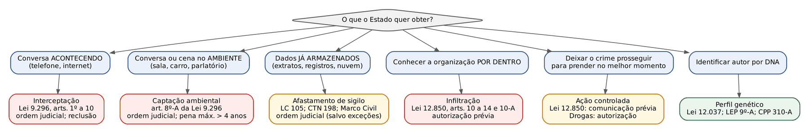
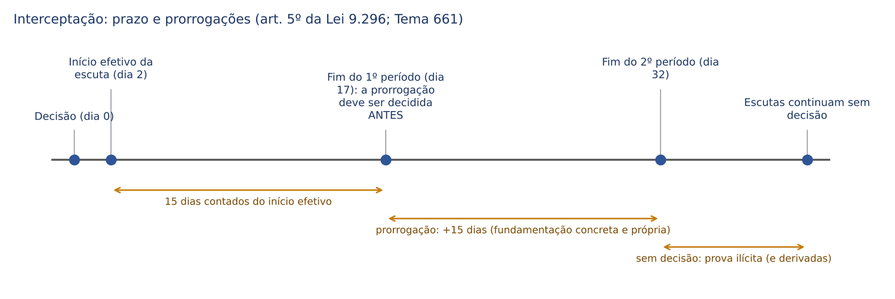
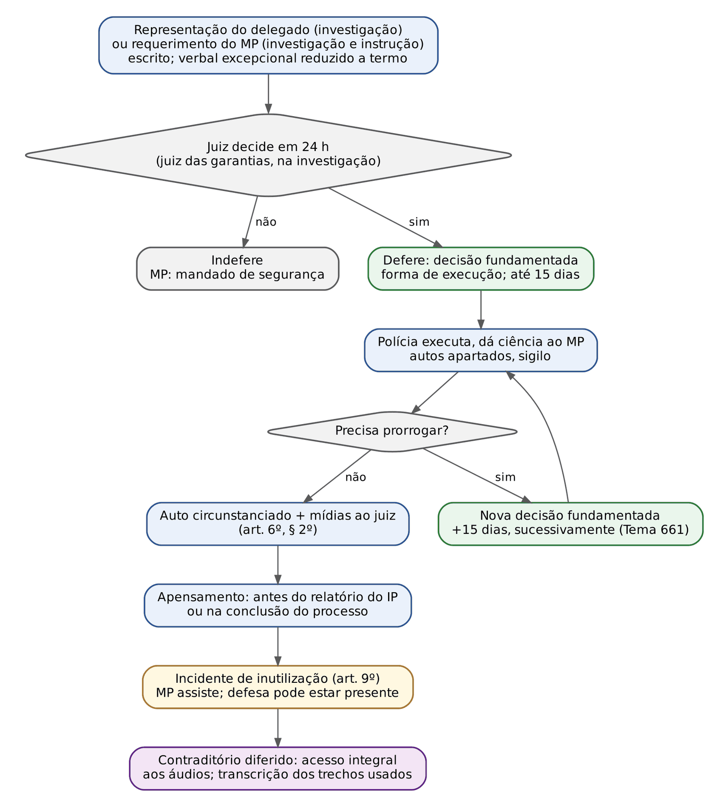
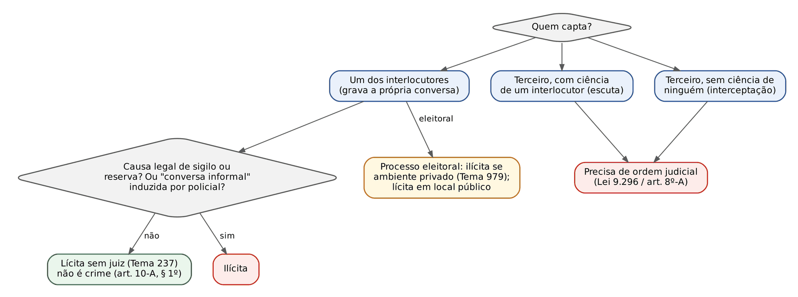
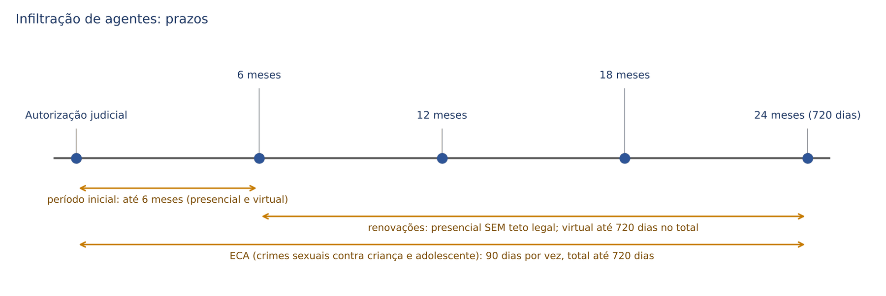

# CAPÍTULO 16 — PROVA III: MEIOS ESPECIAIS DE OBTENÇÃO DE PROVA: INTERCEPTAÇÃO TELEFÔNICA E TELEMÁTICA, CAPTAÇÃO AMBIENTAL, AFASTAMENTO DE SIGILOS, INFILTRAÇÃO POLICIAL E VIRTUAL, AÇÃO CONTROLADA, PROVA GENÉTICA E BANCOS DE PERFIS GENÉTICOS

:::INCIDENCIA
TRF5 p. 10; TJRS p. 10; TJSC p. 19. Nível A. Lote: 26 questões (FGV 24, FCC 2).
O que mais cai: literalidade da Lei 9.296/1996 (requisitos, legitimados, 24 horas, 15 dias, art. 8º-A), prorrogação sem decisão e derivação, serendipidade sem conexão, ação controlada (comunicação x autorização) e prazos da infiltração.
:::

| Subtema | FGV | FCC | Padrão |
|---|---|---|---|
| Interceptação: requisitos, legitimidade, procedimento, prazos | 4 | 1 | Literalidade dos arts. 2º a 6º; "reclusão"; pedido verbal; 24 h; 15 dias |
| Prorrogação sem decisão e prova derivada | 2 | 0 | Caso: escuta prorrogada sem juiz leva à busca; a busca cai por derivação |
| Encontro fortuito na interceptação | 3 | 0 | Crime não conexo descoberto: prova lícita, sem desvio de finalidade |
| Gravação por interlocutor | 1 | 1 | Tema 237; processo eleitoral (Tema 979); art. 8º-A, § 4º |
| Captação ambiental (art. 8º-A) | 5 | 0 | Pena máxima superior a 4 anos x reclusão; 15 dias; casa; requerimento |
| Dados, cadastros e localização | 2 | 0 | Art. 15 da Lei 12.850; art. 13-B do CPP |
| Infiltração presencial e virtual | 4 | 0 | Oitiva do MP; relatório ao juiz; 6 meses e 720 dias |
| Ação controlada | 3 | 0 | Comunicação PRÉVIA ao juiz, que fixa limites e comunica o MP |

## 16.1 A lógica comum dos meios especiais de obtenção de prova

O Cap. 14 (14.1.2) separou três coisas que o leitor civilista costuma misturar: fonte de prova (a pessoa ou a coisa), meio de prova (a atividade, com contraditório, pela qual a informação entra no processo) e meio de obtenção de prova (o procedimento, normalmente sigiloso e fora do processo, pelo qual o Estado CHEGA à fonte). Este capítulo trata dos meios de obtenção "especiais": aqueles que só funcionam se o investigado NÃO souber que estão acontecendo. A interceptação revelada ao alvo não capta nada; a infiltração anunciada mata o agente.

Daí a grande diferença em relação ao processo civil, em que a prova é, em regra, produzida com prévia ciência da parte contrária. Aqui o contraditório é DIFERIDO: o Estado colhe em segredo e, depois, a defesa tem acesso integral ao material e impugna legalidade, integridade e sentido. A interceptação feita "sem ouvir o investigado" não é nula por isso: a surpresa é da natureza da medida.

Como o preço dessa surpresa é alto (invade intimidade, sigilo das comunicações, domicílio), todas as medidas obedecem a um mesmo núcleo de garantias, que convém fixar desde já, porque é a régua de qualquer questão:

- Legalidade: só há meio especial com previsão legal; o rol legal define crimes, legitimados, prazos e forma.
- Reserva de jurisdição: em regra, só o juiz autoriza (interceptação, captação, infiltração, afastamento de sigilo). Exceções são expressas e estreitas (dados cadastrais; ação controlada da Lei 12.850, que exige só comunicação prévia).
- Subsidiariedade (necessidade): o meio invasivo só cabe se a prova não puder ser obtida por outros meios disponíveis. É a fórmula que se repete nos arts. 2º, II, e 8º-A, I, da Lei 9.296/1996 e no art. 10, § 2º, da Lei 12.850/2013.
- Proporcionalidade em sentido estrito: gravidade mínima do crime (reclusão; pena máxima superior a 4 anos; crimes de organização criminosa).
- Fundamentação concreta e prazo determinado: decisões genéricas, padronizadas ou por mera adesão ao pedido são nulas, e nenhuma medida dura indefinidamente sem nova decisão.
- Documentação e contraditório diferido: autos apartados, auto circunstanciado, acesso integral da defesa ao material.

Na investigação, quem decide é o juiz das garantias (art. 3º-B, XI, do CPP, que lista interceptação, afastamento de sigilos, busca e apreensão e outros meios de obtenção que restrinjam direitos fundamentais; ver 03.4). A figura abaixo é o mapa do capítulo: a pergunta que organiza tudo é "o que o Estado quer obter?".

Remissões de escopo: dados cadastrais, arts. 13-A e 13-B do CPP, Marco Civil da Internet, ronda virtual e infiltração virtual do ECA estão em 05.7 a 05.10; acesso a celular, espelhamento do WhatsApp Web, nuvem e geolocalização por área estão no Cap. 17; colaboração premiada, no Cap. 8 (08.4); teoria geral da prova ilícita, da derivação, da serendipidade, da prova emprestada e da cadeia de custódia, no Cap. 14.

## 16.2 Interceptação telefônica e telemática (Lei 9.296/1996)

### 16.2.1 O que a Constituição protege e o que a lei regula

O art. 5º, XII, da CF declara inviolável o sigilo "da correspondência e das comunicações telegráficas, de dados e das comunicações telefônicas, salvo, no último caso, por ordem judicial, nas hipóteses e na forma que a lei estabelecer para fins de investigação criminal ou instrução processual penal". Três consequências de prova saem dessa frase:

- A exceção constitucional expressa é a comunicação TELEFÔNICA ("no último caso"), e só para fins PENAIS. Não existe interceptação para instruir ação de família, de improbidade ou trabalhista. O que esses processos podem receber, com autorização do juízo criminal, é a prova já produzida, por empréstimo (Súmula 591 do STJ; ver 14.9).
- O que se protege é a comunicação EM CURSO (o fluxo). Os dados já armazenados (extratos, registros de chamadas, mensagens guardadas no aparelho ou na nuvem) não se obtêm por interceptação, e sim por quebra de sigilo de dados, com fundamento na proteção da intimidade (art. 5º, X) e, quando for o caso, em ordem judicial (ver 16.4 e 17.2).
- A Lei 9.296/1996 estendeu o regime à interceptação do fluxo de comunicações em sistemas de informática e telemática (art. 1º, parágrafo único): e-mail em trânsito, mensagens de aplicativo captadas no tráfego, comunicação de dados pela internet. Parte da doutrina chegou a sustentar a inconstitucionalidade dessa extensão (porque a CF só excepciona o "último caso"); prevalece a validade, e a FGV trata o parágrafo único como regra pacífica (Q2513049, alternativa A, errada por negar a aplicação à telemática).

Não são interceptação: a quebra de dados estáticos de conexão (Jurisprudência em Teses do STJ, ed. 281, tese 7), as mensagens já armazenadas em nuvem (Informativo 902 do STJ) e o acesso a celular apreendido (Tema 977), todos tratados no Cap. 17.

### 16.2.2 Terminologia: interceptação, escuta e gravação

A banca adora trocar os nomes. Dois critérios resolvem: QUEM capta (um terceiro ou um dos próprios interlocutores) e se ALGUM interlocutor sabe da captação. Combinando com o meio (telefone ou ambiente), surgem seis figuras:

| Figura | Quem capta | Algum interlocutor sabe? | Regime |
|---|---|---|---|
| Interceptação telefônica (em sentido estrito) | Terceiro | Nenhum | Lei 9.296: ordem judicial |
| Escuta telefônica | Terceiro | Um deles sabe e consente | Lei 9.296 (posição majoritária: continua sendo violação da comunicação do outro) |
| Gravação telefônica clandestina | Um dos interlocutores | Só quem grava | Fora da Lei 9.296; lícita, em regra (Tema 237; ver 16.3.1) |
| Interceptação ambiental | Terceiro, no ambiente | Nenhum | Captação ambiental do art. 8º-A: ordem judicial |
| Escuta ambiental | Terceiro, no ambiente | Um deles sabe | Art. 8º-A (e crime do art. 10 se sem autorização) |
| Gravação ambiental | Um dos interlocutores, no ambiente | Só quem grava | Lícita, em regra (Tema 237); não é crime (art. 10-A, § 1º) |

Exemplo: A e B conversam por telefone. Se a polícia capta a ligação sem que ninguém saiba, é interceptação. Se A, vítima de extorsão, autoriza a polícia a ouvir a extensão, é escuta (precisa de juiz). Se A simplesmente grava no próprio celular a ameaça de B, é gravação clandestina: não precisa de juiz.

### 16.2.3 Requisitos: o art. 2º lido "pelo avesso"

O art. 2º não diz quando cabe a interceptação; diz quando ela NÃO cabe. Lido pelo avesso, ele dá os três requisitos cumulativos.

:::LEI Lei 9.296/1996, art. 2º
Art. 2º Não será admitida a interceptação de comunicações telefônicas quando ocorrer qualquer das seguintes hipóteses:
I - não houver indícios razoáveis da autoria ou participação em infração penal;
II - a prova puder ser feita por outros meios disponíveis;
III - o fato investigado constituir infração penal punida, no máximo, com pena de detenção.
Parágrafo único. Em qualquer hipótese deve ser descrita com clareza a situação objeto da investigação, inclusive com a indicação e qualificação dos investigados, salvo impossibilidade manifesta, devidamente justificada.
:::

- Indícios razoáveis de autoria ou participação (*fumus comissi delicti*, a "fumaça" da prática do crime). Não basta a suspeita genérica nem a "interceptação de prospecção", feita para descobrir SE a pessoa está envolvida em algum crime. Também não basta a denúncia anônima isolada: a jurisprudência exige diligências preliminares que deem plausibilidade à notícia antes da medida invasiva (ver 04.4.4).
- Subsidiariedade: a prova não pode ser obtenível por outros meios disponíveis. A decisão precisa explicar POR QUE os meios ordinários (oitivas, campanas, documentos) não bastam no caso concreto (STJ, Sexta Turma, AgRg no RHC 183.085-SP, j. 16/4/2024, Informativo 809). Quando a defesa alega, depois, que havia outros meios, é dela o ônus de demonstrar quais eram e que estavam disponíveis na época (Jurisprudência em Teses do STJ, ed. 117, tese 5).
- Crime punido com RECLUSÃO. Crime apenado só com detenção (ou contravenção) não autoriza a medida. A lei não exige crime hediondo, organização criminosa nem pena mínima: basta a espécie reclusão.

O parágrafo único exige a descrição clara do fato e a qualificação dos investigados, mas com a ressalva "salvo impossibilidade manifesta, devidamente justificada" (é comum, no início, só se conhecer o número do telefone ou o apelido). A FGV cobrou exatamente a ressalva (Q2513049, alternativa C, errada por dizer "imprescindível" a qualificação).

:::PEGADINHA Reclusão para decretar; detenção pode ser aproveitada
O art. 2º, III, impede DECRETAR a interceptação para investigar crime só punido com detenção. Não impede USAR a prova de crime de detenção descoberto durante interceptação validamente decretada para crime de reclusão (STF, Plenário, HC 83.515, 2004; Jurisprudência em Teses do STJ, ed. 117, tese 6). E, se o crime de detenção é conexo ao de reclusão que justificou a medida, a decisão pode abrangê-lo. Ver 16.2.8.
:::

:::QUESTAO FGV 2024 — TJ-MT — Oficial de Justiça (Q3114508)
Pedia-se a afirmativa correta sobre interceptação. Gabarito: B, a medida só pode ser empregada para fatos definidos, em tese, como crimes punidos com reclusão (art. 2º, III).
Armadilhas: (A) inverte a subsidiariedade (diz que cabe quando outros meios são suficientes); (C) inventa limite de 6 meses "sob pena de nulidade" (não há teto legal; ver 16.2.5); (D) exige transcrição integral (não é exigida; ver 16.2.6); (E) exige degravação por dois peritos oficiais que deponham em juízo (não há essa exigência).
:::

### 16.2.4 Quem pede, quem decide, em quanto tempo

:::LEI Lei 9.296/1996, arts. 3º e 4º
Art. 3º A interceptação das comunicações telefônicas poderá ser determinada pelo juiz, de ofício ou a requerimento:
I - da autoridade policial, na investigação criminal;
II - do representante do Ministério Público, na investigação criminal e na instrução processual penal.
Art. 4º O pedido de interceptação de comunicação telefônica conterá a demonstração de que a sua realização é necessária à apuração de infração penal, com indicação dos meios a serem empregados.
§ 1º Excepcionalmente, o juiz poderá admitir que o pedido seja formulado verbalmente, desde que estejam presentes os pressupostos que autorizem a interceptação, caso em que a concessão será condicionada à sua redução a termo.
§ 2º O juiz, no prazo máximo de vinte e quatro horas, decidirá sobre o pedido.
:::

Legitimidade, em quadro:

| Quem | Na investigação | Na instrução (ação penal) |
|---|---|---|
| Autoridade policial (representação) | SIM | NÃO |
| Ministério Público (requerimento) | SIM | SIM |
| Juiz de ofício | Texto legal admite; incompatível com o art. 3º-A do CPP e com o modelo acusatório (posição dominante após as ADIs 6.298 e outras; ver 03.3.3) | Texto legal admite; doutrina majoritária também rejeita, por quebra da imparcialidade |
| Defesa, assistente, querelante, CPI | NÃO constam do rol | NÃO constam do rol |

Para a prova objetiva, a FGV e a FCC cobram o TEXTO do art. 3º (Q2513049 e Q4221397). Para a decisão que o juiz redige, a orientação segura é não decretar de ofício: a interceptação é medida cautelar de natureza probatória e o Pacote Anticrime retirou do juiz a iniciativa na fase investigatória. A defesa não é legitimada a pedir interceptação, o que não impede que prova clandestina favorável ao réu seja admitida (prova ilícita *pro reo*; ver 14.7.4).

Competência: a lei fala em "juiz competente da ação principal" (art. 1º). O STF e o STJ leem a expressão como reserva de jurisdição, não como regra rígida de competência: a decisão de juízo que, no momento, parecia competente à vista do fato suspeitado é válida, ainda que a competência depois se desloque (teoria do juízo aparente; STF, HC 81.260; v. Cap. 9). A especialização de varas em razão da matéria é tratada como competência relativa, de modo que o juiz competente pode ratificar as quebras deferidas pelo juízo de origem (STJ, Quinta Turma, AgRg no AREsp 2.717.611-PA, j. 14/10/2025). Interceptação de autoridade com foro, ou que alcance diálogos dela: ver 10.5.7.

:::QUESTAO FGV 2024 — MPE-GO — Promotor de Justiça Substituto (Q2367600)
Delegado estuda representar pela interceptação em investigação de dois latrocínios. Gabarito: B, excepcionalmente o juiz admite pedido verbal, presentes os pressupostos, condicionada a concessão à redução a termo (art. 4º, § 1º).
Armadilhas, todas com números trocados: (A) 10 dias (são 15); (C) resultado encaminhado "ao juiz e ao MP" (é ao juiz, art. 6º, § 2º); (D) o MP "deverá" acompanhar (o texto diz "poderá", art. 6º); (E) 48 horas (são 24).
No mesmo sentido, pela literalidade: FCC 2026 — SEFAZ-CE (Q4221397), gabarito A (art. 6º: a polícia conduz e dá ciência ao MP, que poderá acompanhar); FGV 2024 — Câmara dos Deputados (Q2513049), gabarito E (art. 3º).
:::

### 16.2.5 A decisão, o prazo e as prorrogações

:::LEI Lei 9.296/1996, art. 5º
Art. 5º A decisão será fundamentada, sob pena de nulidade, indicando também a forma de execução da diligência, que não poderá exceder o prazo de quinze dias, renovável por igual tempo uma vez comprovada a indispensabilidade do meio de prova.
:::

A literalidade sugere "15 + 15 = 30 dias e acabou". Não é assim que se aplica. O STF fixou, em repercussão geral, que a renovação pode ser sucessiva, sem número máximo, desde que cada decisão seja fundamentada.

:::JURIS STF, RE 625.263 (Tema 661), j. 17/3/2022
São lícitas as sucessivas renovações de interceptação telefônica, desde que, verificados os requisitos do artigo 2º da Lei nº 9.296/1996 e demonstrada a necessidade da medida diante de elementos concretos e a complexidade da investigação, a decisão judicial inicial e as prorrogações sejam devidamente motivadas, com justificativa legítima, ainda que sucinta, a embasar a continuidade das investigações. São ilegais as motivações padronizadas ou reproduções de modelos genéricos sem relação com o caso concreto.
:::

Parte da doutrina (entre outros, Aury Lopes Jr.) critica a leitura e sustenta o limite de 30 dias; para a prova, vale o Tema 661. O STJ acrescenta dois refinamentos que caem em sentença:

- Cada prorrogação precisa de fundamentação PRÓPRIA, referida à situação do momento em que é decidida: o que as escutas já revelaram e por que ainda são indispensáveis. Repetir trechos da decisão inicial não basta (STJ, Sexta Turma, AgRg no HC 910.860-PB, j. 12/11/2024).
- A fundamentação *per relationem* (por remissão à representação ou ao parecer) é admitida, desde que o juiz incorpore expressamente os fundamentos e enfrente o que houver de novo; a mera adesão ("acolho o pedido ministerial pelos seus fundamentos") é nula (STJ, Sexta Turma, AgRg no HC 741.194-RS, j. 13/3/2023, em quebra de sigilo bancário; Tema 1.306 do STJ, 2025, sobre a fundamentação por referência em geral).

Na contagem, prevalece no STJ que os 15 dias correm do INÍCIO EFETIVO da escuta, não da data da decisão. E, embora não haja teto, a duração desproporcional e sem justificativa já foi declarada ilegal (STJ, Sexta Turma, HC 76.686, 2008).

E se a escuta continua depois do prazo sem decisão? O material desse período é prova ilícita (sem ordem judicial, art. 5º, XII), e o que dele derivar também (art. 157, § 1º; ver 14.7.3). A decisão posterior que, com base nele, autoriza busca e apreensão NÃO purga o vício.

:::QUESTAO FGV 2025 — TRF1 — Juiz Federal Substituto (Q3425292)
Escuta prorrogada sem decisão judicial revela o paradeiro de Paulo Roberto e o arsenal e as drogas em sua casa; com base nisso, a polícia obtém mandado de busca, e o MP denuncia com base no que foi apreendido. Gabarito: C, provas ilícitas por derivação; a denúncia deve ser rejeitada, porque a busca decorre diretamente da prorrogação não autorizada.
Passos: (1) o período sem decisão é interceptação sem ordem judicial, logo ilícita; (2) a busca só foi pedida por causa do que ali se ouviu: nexo causal direto; (3) não há fonte independente nem descoberta inevitável demonstradas no enunciado.
Armadilhas: (A) a decisão da busca "supre" a falta da prorrogação (não supre); (B) flagrante de crime permanente legitimaria a entrada (o conhecimento do flagrante veio da prova ilícita); (D) e (E) chamam de "ilegítima" a prova obtida com violação constitucional fora do processo (é ilícita; a ilegítima viola norma processual na produção; ver 14.7.1) e invocam fonte independente sem base no caso.
No mesmo sentido: FGV 2025 — TJ-MS — Juiz Substituto (Q3786385), gabarito A (busca na casa de Pablo, baseada em diálogo captado na prorrogação sem decisão: inadmitida e desentranhada); correlatas no banco: Q4349522 (Cap. 8) e Q3301272 (Cap. 14).
:::

:::QUESTAO FGV 2025 — ENAM — Exame Nacional da Magistratura (Q3692359)
Três afirmativas sobre a jurisprudência do STF. Gabarito: D (II e III).
I, falsa: o STF declarou CONSTITUCIONAL o acesso direto de polícia e MP a dados cadastrais (qualificação, filiação e endereço) sem ordem judicial (ADI 4.906; ver 05.7.2). II, verdadeira: acesso aos dados do celular apreendido depende de consentimento ou de decisão judicial (Tema 977; ver 17.4). III, verdadeira: é a tese do Tema 661, inclusive a ilegalidade das motivações padronizadas.
:::

### 16.2.6 Execução, documentação e transcrição

Deferida a medida, a autoridade policial conduz a diligência, dando ciência ao MP, que PODERÁ acompanhá-la (art. 6º). A execução técnica é feita pelas operadoras, das quais a polícia pode requisitar serviços e técnicos (art. 7º); o acompanhamento por outros órgãos (por exemplo, a polícia militar em apoio) não invalida a medida, segundo o STF e o STJ. Encerrada a diligência, a polícia encaminha o resultado AO JUIZ, com auto circunstanciado que resume as operações (art. 6º, § 2º), e o juiz determina a providência do art. 8º, ciente o MP (art. 6º, § 3º).

Tudo corre em autos apartados, apensados aos do inquérito ou do processo, com sigilo das diligências, gravações e transcrições (art. 8º). O apensamento só ocorre imediatamente antes do relatório do inquérito ou na conclusão do processo para julgamento (art. 8º, parágrafo único, que ainda remete a artigos do CPP renumerados pela reforma de 2008).

A jurisprudência construiu, sobre esses artigos, regras que caem com frequência:

| Questão | Regra | Fonte |
|---|---|---|
| Transcrição integral é obrigatória? | NÃO. Basta transcrever os trechos que embasam a denúncia, desde que a defesa tenha acesso à íntegra das mídias; o juiz pode determinar transcrição maior | STF, Plenário, Inq 3.693, 2014; Jurisprudência em Teses do STJ, ed. 117, teses 9 e 10 |
| A degravação precisa ser feita por perito oficial? | NÃO | Mesmas teses |
| Perícia de voz é obrigatória? | NÃO, salvo dúvida plausível sobre a identidade do interlocutor | Jurisprudência em Teses do STJ, ed. 117, tese 8 |
| A acusação pode juntar só os áudios que escolheu? | NÃO. A seleção unilateral, sem acesso da defesa à integralidade, quebra a cadeia de custódia e a paridade de armas | STJ, Sexta Turma, REsp 1.795.341, 2019 (ver 14.10) |
| Negar cópia das mídias é cerceamento? | NÃO, se a defesa teve acesso integral ao conteúdo nos autos digitais | STJ, Sexta Turma, RHC 203.219-SP, j. 4/2/2025 (Informativo 839) |
| A polícia pode substituir o chip do investigado e passar a usar a linha? | NÃO. A lei não autoriza suspender o serviço nem colocar agente no lugar do titular | STJ, Sexta Turma, REsp 1.806.792, 2021 |
| Advogado interceptado ao falar com cliente investigado | Os diálogos valem contra o advogado se ele participa do crime; o sigilo profissional não imuniza a prática criminosa | STJ, Quinta Turma, RMS 33.677, 2014 |

### 16.2.7 Incidente de inutilização

A gravação que não interessar à prova é inutilizada por decisão judicial, durante o inquérito, a instrução ou depois dela, a requerimento do MP ou da parte interessada; o incidente é assistido pelo MP, facultada a presença do acusado ou de seu representante (art. 9º). A lógica é proteger a intimidade de quem foi ouvido sem relação com o crime (o filho que liga para a mãe do investigado, a conversa íntima). Não confunda com a inutilização da prova ILÍCITA (art. 157, § 3º, do CPP; ver 14.7.2): lá, a prova é imprestável; aqui, a prova é lícita, mas irrelevante.

O espólio do réu falecido pode contestar interceptações que repercutem sobre o patrimônio dos herdeiros em ação de improbidade (STJ, Quinta Turma, AREsp 2.384.044-SP, j. 11/6/2024).

O roteiro completo, do pedido ao contraditório diferido:

### 16.2.8 Encontro fortuito na interceptação

A teoria geral da serendipidade (graus, limites, *fishing expedition*) está em 14.8. Aqui interessa a aplicação à interceptação, que é onde a FGV mais a cobra: durante escuta autorizada para o crime X, capta-se diálogo sobre o crime Y, ou sobre a participação de pessoa não investigada.

- Prova lícita, ainda que Y não tenha conexão nem continência com X, desde que a interceptação original seja válida e não haja desvio de finalidade (STF, Primeira Turma, HC 129.678, j. 13/6/2017).
- O material não serve só como *notitia criminis*: pode embasar diretamente a denúncia e integrar a prova do novo crime.
- Não é preciso pedir ao juiz "ampliação do objeto" nem "homologação" do aproveitamento para que a prova seja lícita; continuar interceptando para investigar Y, porém, exige decisão que inclua Y.
- Crime Y punido com detenção: aproveitável (16.2.3).
- Pessoa com foro captada fortuitamente: a mera menção não desloca a competência; surgindo indícios concretos de sua participação, remessa imediata ao tribunal (ver 10.5.7).

:::QUESTAO FGV 2026 — TJ-PR — Juiz Substituto (Q3898935)
Na interceptação de Semprônio, autorizada para tráfico, ele narra com detalhes sua participação em homicídio qualificado sem conexão com o tráfico; o áudio embasa denúncia por homicídio. Gabarito: D, prova lícita (encontro fortuito a partir de medida validamente autorizada; irrelevante a ausência de conexão).
Armadilhas: (A) e (C) exigem conexão; (B) restringe o uso a notícia-crime; (E) exige que a polícia tivesse pedido "ampliação do objeto". Todas contrariam o HC 129.678.
No mesmo sentido: FGV 2026 — PC-PR — Delegado (Q4378287), gabarito A (compartilhamento do áudio com a delegacia de homicídios é lícito; erradas: "serendipidade só de primeiro grau", necessidade de homologação pelo juiz da interceptação, vedação de compartilhamento); FGV 2025 — TRF3 — Juiz Federal Substituto (Q3179529), gabarito A (válidas as provas de infração desconhecida, sem conexão, ausente desvio de finalidade).
:::

### 16.2.9 Os crimes dos arts. 10 e 10-A (nota)

:::NOTA Crimes da Lei 9.296/1996
O art. 10 pune com reclusão de 2 a 4 anos e multa quem realiza interceptação telefônica, de informática ou telemática, promove escuta ambiental ou quebra segredo da Justiça, sem autorização judicial ou com objetivos não autorizados em lei; o parágrafo único (Lei 13.869/2019) estende a pena ao juiz que determina a conduta com objetivo não autorizado. O art. 10-A pune a captação ambiental sem autorização quando exigida, NÃO havendo crime se quem capta é um dos interlocutores (§ 1º), e dobra a pena do funcionário que viola o sigilo (§ 2º). Competência, em regra, da Justiça Estadual. Visão penal: Apostila de Direito Penal, Cap. 49.
:::

### 16.2.10 Recursos, sentença e ficha de consulta

:::PROCESSO Qual recurso cabe nas decisões sobre interceptação
| Decisão | Recurso ou meio de impugnação |
|---|---|
| Indefere a interceptação ou a prorrogação | Não há recurso típico (o art. 581 não a prevê); o MP usa mandado de segurança, com pedido urgente |
| Defere a interceptação | Não há recurso (a medida é sigilosa); a defesa impugna depois, por *habeas corpus* (se houver risco à liberdade) ou em preliminar da resposta, das alegações finais e da apelação |
| Reconhece a ilicitude e manda desentranhar | Sem recurso típico; MS pelo MP; matéria renovável em apelação (ver 14.7.2) |
| Inutilização de gravação irrelevante (art. 9º) | Sem previsão; parte da doutrina admite apelação residual (art. 593, II), por ter força de definitiva |
| Sentença baseada na interceptação | Apelação (art. 593, I), com a preliminar de nulidade |
:::

:::SENTENCA Preliminar de nulidade da interceptação
Onde entra: nas preliminares da sentença, antes do mérito, quando a defesa alega nulidade da interceptação ou das prorrogações (é a preliminar mais comum em sentença de tráfico e de organização criminosa).
O que fundamentar, em ordem: (1) havia decisão para CADA período? (2) a decisão inicial apontou indícios concretos, crime de reclusão e a impossibilidade de outros meios? (3) cada prorrogação analisou o resultado parcial e justificou a continuidade? (4) a defesa teve acesso à íntegra das mídias? (5) se algum período for ilícito, o que dele deriva e o que é fonte independente.
Redação-modelo: "Rejeito a preliminar. A interceptação foi deferida por decisão que apontou indícios concretos da prática de tráfico, crime punido com reclusão, e demonstrou a insuficiência das diligências já realizadas; cada uma das quatro prorrogações examinou o resultado do período anterior e justificou concretamente a continuidade, na forma do Tema 661 do STF, e a defesa teve acesso à íntegra dos áudios."
Erro que a banca pune: declarar nula toda a interceptação por ter durado mais de 30 dias, ou, no extremo oposto, validar o período sem decisão porque "a busca posterior foi autorizada pelo juiz".
:::

| Ficha: interceptação | Conteúdo |
|---|---|
| Cabimento | Investigação ou instrução PENAL; crime punido com reclusão; indícios razoáveis; prova impossível por outros meios |
| Legitimidade | Delegado (investigação); MP (investigação e instrução); juiz de ofício: texto legal, mas incompatível com o art. 3º-A |
| Forma | Pedido escrito (verbal excepcional, reduzido a termo); decisão fundamentada em até 24 h; autos apartados e sigilo |
| Prazo | 15 dias, a contar do início efetivo; renovações sucessivas, cada uma fundamentada (Tema 661) |
| Documentação | Auto circunstanciado ao juiz; transcrição dos trechos usados; acesso integral da defesa às mídias |
| Vícios típicos | Período sem decisão; prorrogação padronizada; crime de detenção como fundamento; seleção unilateral de áudios |
| Impugnação | MS (MP, contra indeferimento); HC ou preliminar (defesa); apelação |

## 16.3 Gravação por interlocutor e captação ambiental

### 16.3.1 Gravação feita por um dos interlocutores (Tema 237)

Quem participa da conversa é dono dela tanto quanto o outro. Gravá-la, sem avisar, não "intercepta" nada: apenas documenta o que o próprio gravador já ouviu e poderia contar como testemunha. Por isso o STF assentou, em repercussão geral, a licitude dessa prova sem autorização judicial.

:::JURIS STF, RE 583.937 QO-RG (Tema 237), j. 19/11/2009
É lícita a prova consistente em gravação ambiental realizada por um dos interlocutores sem conhecimento do outro.
:::

O fundamento do acórdão ressalva a hipótese de causa legal de sigilo ou de reserva da conversação. Daí as exceções, que a banca usa para montar casos:

- Dever legal de sigilo de quem grava: o advogado que grava o cliente para entregá-lo à polícia, o médico ou psicólogo que grava a confissão do paciente. Aqui o problema não é a gravação, é a revelação de segredo profissional (ver 14.7.4, sobre sigilo médico).
- "Conversa informal" induzida por policial: a gravação clandestina, feita pelo agente, de conversa com o preso ou suspeito sem advertência do direito ao silêncio é um interrogatório sub-reptício, e o STF a considerou ilícita (Primeira Turma, HC 80.949, 2001). A garantia contra a autoincriminação não pode ser contornada por um gravador no bolso.
- Processo ELEITORAL: regime próprio (Tema 979, abaixo).

Fora dessas hipóteses, a gravação é lícita seja qual for o propósito: a vítima de extorsão que grava o extorsionário, a mãe que grava no próprio terminal a conversa do abusador com a filha (STJ, REsp 1.026.605, 2014), o advogado que grava o ato de que participou (STJ, HC 662.690-RJ, 2022: não há crime).

E o Pacote Anticrime? O art. 8º-A, § 4º, da Lei 9.296 (vetado e depois restaurado pelo Congresso, com a derrubada do veto em 2021) dispõe que a captação ambiental feita por um dos interlocutores sem o prévio conhecimento da autoridade policial ou do MP "poderá ser utilizada, em matéria de defesa, quando demonstrada a integridade da gravação". Lido isoladamente, sugeriria que a gravação clandestina só vale a favor do réu. A interpretação que prevalece é outra: o dispositivo assegura o uso defensivo (com a exigência de integridade), mas não revogou o Tema 237. O STJ reafirmou, já sob o Pacote, que é lícita a gravação ambiental por um dos interlocutores sem conhecimento do outro (Sexta Turma, HC 512.290-RJ, j. 18/8/2020), e o art. 10-A, § 1º, diz que não há crime quando a captação é feita por um dos interlocutores.

:::ATENCAO Literalidade x jurisprudência no § 4º do art. 8º-A
Em questão de LITERALIDADE ("de acordo com a Lei 9.296"), a resposta é o texto: uso "em matéria de defesa", com integridade demonstrada. A alternativa que diz "em matéria de acusação ou de defesa" foi dada como ERRADA pela FGV (Q2515593, C). Em questão de JURISPRUDÊNCIA ou de caso concreto, a gravação clandestina pela vítima continua lícita também para a acusação (Tema 237). Leia o comando da questão antes de responder.
:::

:::JURIS STF, RE 1.040.515 (Tema 979), j. 26/4/2024
(i) No processo eleitoral, é ilícita a prova colhida por meio de gravação ambiental clandestina, sem autorização judicial e com violação à privacidade e à intimidade dos interlocutores, ainda que realizada por um dos participantes, sem o conhecimento dos demais. (ii) A exceção à regra da ilicitude da gravação ambiental feita sem o conhecimento de um dos interlocutores e sem autorização judicial ocorre na hipótese de registro de fato ocorrido em local público desprovido de qualquer controle de acesso, pois, nesse caso, não há violação à intimidade ou quebra da expectativa de privacidade.
:::

O Tema 979 nasceu de ação eleitoral (o risco de "armadilhas" gravadas entre adversários políticos), e sua tese é restrita ao processo eleitoral; no processo penal comum, vale o Tema 237. Dentro do eleitoral, o critério decisivo é o LOCAL: ambiente privado, ilícita; local público sem controle de acesso, lícita.

:::QUESTAO FGV 2024 — TJ-PE — Juiz Substituto (Q3117559)
Candidatos a prefeito e vice conversam na praça de alimentação de um shopping sobre irregularidades no uso do Fundo de Financiamento de Campanha; Ivo, que participa da conversa, grava sem consentimento e leva ao promotor eleitoral. Gabarito: B, lícita, pela natureza do local, cujo acesso era desprovido de qualquer controle (Tema 979, item ii).
Passos: (1) matéria eleitoral, logo Tema 979, não Tema 237; (2) a regra eleitoral é a ilicitude da gravação clandestina; (3) a exceção é o local público sem controle de acesso, que é o caso.
Armadilha: (C) "lícita independentemente da natureza do local, por ter sido feita por interlocutor" é a resposta do Tema 237, que NÃO se aplica ao processo eleitoral.
:::

:::QUESTAO FCC 2025 — TRF4 — Analista Judiciário, Área Judiciária (Q3538774)
Investigado por extorsão mediante sequestro, Mauro capta, sem conhecimento da polícia ou do MP e sem autorização judicial, conversa que ele próprio mantém com um dos sequestradores e que demonstra sua inocência. Gabarito: A, não há crime, porque ele é um dos interlocutores (art. 10-A, § 1º), e a captação pode ser usada em sua defesa (art. 8º-A, § 4º).
Armadilhas: (B) e (D) veem crime do art. 10-A; (C) exige anuência do MP e convalidação judicial; (E) diz ilícita e inutilizável.
:::

### 16.3.2 Captação ambiental pelo Estado (art. 8º-A)

Captação ambiental é a gravação de sons, imagens ou sinais em um ambiente (escritório, carro, cela) por dispositivo instalado pelo Estado sem conhecimento dos presentes. A Lei 12.850/2013 a previa sem regulamentar; o Pacote Anticrime deu-lhe disciplina geral no art. 8º-A da Lei 9.296.

:::LEI Lei 9.296/1996, art. 8º-A
Art. 8º-A. Para investigação ou instrução criminal, poderá ser autorizada pelo juiz, a requerimento da autoridade policial ou do Ministério Público, a captação ambiental de sinais eletromagnéticos, ópticos ou acústicos, quando:
I - a prova não puder ser feita por outros meios disponíveis e igualmente eficazes; e
II - houver elementos probatórios razoáveis de autoria e participação em infrações criminais cujas penas máximas sejam superiores a 4 (quatro) anos ou em infrações penais conexas.
§ 1º O requerimento deverá descrever circunstanciadamente o local e a forma de instalação do dispositivo de captação ambiental.
§ 2º A instalação do dispositivo de captação ambiental poderá ser realizada, quando necessária, por meio de operação policial disfarçada ou no período noturno, exceto na casa, nos termos do inciso XI do caput do art. 5º da Constituição Federal.
§ 3º A captação ambiental não poderá exceder o prazo de 15 (quinze) dias, renovável por decisão judicial por iguais períodos, se comprovada a indispensabilidade do meio de prova e quando presente atividade criminal permanente, habitual ou continuada.
§ 4º A captação ambiental feita por um dos interlocutores sem o prévio conhecimento da autoridade policial ou do Ministério Público poderá ser utilizada, em matéria de defesa, quando demonstrada a integridade da gravação.
§ 5º Aplicam-se subsidiariamente à captação ambiental as regras previstas na legislação específica para a interceptação telefônica e telemática.
:::

Os §§ 2º e 4º foram vetados e restaurados pelo Congresso (derrubada de veto promulgada em 2021); por isso o texto compilado traz "§ 2º (VETADO)" seguido do § 2º vigente. A banca constrói as alternativas trocando os elementos do art. 8º-A com os da interceptação. O quadro abaixo é a forma mais eficiente de memorizar:

| Ponto | Interceptação (arts. 2º a 5º) | Captação ambiental (art. 8º-A) |
|---|---|---|
| Gravidade do crime | Crime punido com RECLUSÃO | Pena MÁXIMA SUPERIOR a 4 anos, ou infrações penais CONEXAS |
| Subsidiariedade | Prova não puder ser feita por outros meios disponíveis | Outros meios disponíveis "e igualmente eficazes" |
| Indícios | Indícios razoáveis de autoria ou participação | Elementos probatórios razoáveis de autoria e participação |
| Legitimados | Delegado (investigação), MP (investigação e instrução); texto admite de ofício | Delegado ou MP (texto NÃO prevê de ofício) |
| Conteúdo do pedido | Necessidade e meios a empregar | Descrição circunstanciada do LOCAL e da FORMA de instalação |
| Prazo | 15 dias, renovável comprovada a indispensabilidade | 15 dias, renovável por iguais períodos, se indispensável E presente atividade criminal permanente, habitual ou continuada |
| Instalação | Não se aplica | Operação disfarçada ou período noturno, EXCETO na casa |
| Regras subsidiárias | Lei 9.296 | As da interceptação (§ 5º): autos apartados, sigilo, inutilização, auto circunstanciado |

Leitura do § 2º: o dispositivo admite instalar o equipamento com policiais disfarçados (de técnicos de manutenção, por exemplo) ou à noite, mas NÃO na "casa" no sentido constitucional, porque o art. 5º, XI, só permite o ingresso noturno, sem consentimento, em flagrante delito, desastre ou para prestar socorro. Durante o dia, com ordem judicial, a instalação em domicílio é possível; à noite, não. Lembre que "casa" abrange o compartimento não aberto ao público onde alguém exerce profissão, como o escritório (art. 150, § 4º, II, do CP).

:::QUESTAO FGV 2026 — PC-PI — Delegado de Polícia (Q3848994)
Três afirmativas sobre a captação ambiental. Gabarito: B (só II): prazo de 15 dias, renovável por iguais períodos, se comprovada a indispensabilidade e presente atividade criminal permanente, habitual ou continuada (§ 3º).
Armadilhas: I troca o critério de gravidade ("puníveis com reclusão", que é o da interceptação; o correto é pena máxima superior a 4 anos ou conexas); III embaralha o § 2º (instalação "no período diurno, exceto na casa, quando poderá ocorrer à noite": o texto permite operação disfarçada OU período noturno, exceto na casa).
No mesmo sentido, pela literalidade do art. 8º-A: FGV 2025 — MPU — Analista (Q3339453), gabarito B (incisos I e II); FGV 2024 — TJ-SC — Oficial de Justiça (Q2515593), gabarito E (§ 1º; erradas: penas "iguais ou superiores" a 4 anos, 10 dias, uso "em matéria de acusação ou de defesa", "inclusive na casa"); FGV 2025 — DPE-PE — Defensor (Q3390868), gabarito C (só o § 4º; erradas a casa e os 10 dias).
:::

:::QUESTAO FGV 2025 — CGE-SP — Auditor de Controle (Q3781234)
Gabarito: D, a captação ambiental é meio de OBTENÇÃO de prova admitido em QUALQUER fase da persecução penal (art. 3º, caput e II, da Lei 12.850/2013; o art. 8º-A fala em "investigação ou instrução criminal").
Armadilhas: chamar a captação de "meio de prova" (é meio de obtenção; o meio de prova é o documento ou a perícia que dela resulta em juízo) e restringi-la a antes ou depois do recebimento da denúncia.
:::

Captações que NÃO dependem do art. 8º-A:

- Imagens de câmera instalada em via pública ou de câmeras de segurança de estabelecimento: não há expectativa de privacidade no espaço público, e o monitoramento policial por câmera na rua é diligência legítima que dispensa autorização judicial e não configura ação controlada (STJ, Quinta Turma, AgRg no RHC 203.030-SC, j. 1/4/2025, Informativo 848).
- Gravação por um dos interlocutores (16.3.1).

A alternativa segundo a qual a captação ambiental "sempre exige autorização judicial, independentemente do local" é falsa (Q3179527, alternativa E, comentada em 05.7.1).

:::NOTA Monitoramento em estabelecimentos prisionais
A Lei 15.358/2026 incluiu na LEP o art. 41-A: os encontros no parlatório ou por meio virtual entre presos vinculados a organizações criminosas ultraviolentas, grupos paramilitares ou milícias privadas e seus visitantes podem ser monitorados por captação audiovisual e gravação, a requerimento do delegado, do MP ou da administração penitenciária; nos presídios federais, aplicam-se as regras da Lei 11.671/2008. O art. 41-B cuida da conversa entre advogado e cliente: só pode ser monitorada se autorizada por razões fundadas de conluio criminoso reconhecidas judicialmente, e o conteúdo é examinado com exclusividade por um "juízo de controle", distinto do juízo da instrução, que decide sobre licitude, pertinência e inutilização antes de qualquer remessa; o que for indeferido ou declarado ilícito não pode ser acessado pelo juiz da causa. Em linha com isso, o STJ declarou ilegal a autorização genérica e irrestrita para gravar entrevistas entre defensores e presos no sistema penitenciário federal: a captação no atendimento advocatício exige decisão específica, motivada, proporcional, baseada em elementos concretos, com prazo determinado e observância do art. 8º-A (Quinta Turma, EDcl no AgRg no REsp 1.954.331-RN, j. 1/9/2026, Informativo 900). Desenvolvimento da Lei 15.358/2026: Cap. 26; execução penal: Cap. 31.
:::

## 16.4 Afastamento de sigilos: bancário, fiscal, de dados telefônicos e de registros

### 16.4.1 Natureza: intimidade, não comunicação

O sigilo bancário e o fiscal não estão no inciso XII do art. 5º da CF (que protege comunicações), e sim no inciso X (intimidade e vida privada). Consequências: não se aplica a Lei 9.296 (nem a exigência de crime de reclusão), e a reserva de jurisdição não é absoluta. Podem afastar o sigilo bancário: o juiz; a CPI, por deliberação fundamentada (art. 58, § 3º, da CF; ver 05.4); e, nos termos do art. 6º da LC 105/2001, a administração tributária em procedimento fiscal formal, sem ordem judicial (Tema 225 do STF; ver 05.5). O MP e a polícia NÃO podem requisitar diretamente extratos bancários de investigados (a exceção tradicionalmente aceita pelo STF envolve operações com recursos públicos), e o compartilhamento de RIF do COAF e de procedimento fiscal com os órgãos de persecução segue o Tema 990 (ver 05.5.2; não é "quebra" de sigilo).

O art. 1º, § 4º, da LC 105/2001 autoriza a quebra "quando necessária para apuração de ocorrência de qualquer ilícito, em qualquer fase do inquérito ou do processo judicial", com rol exemplificativo de crimes; não há restrição a crimes de reclusão. O sigilo fiscal tem disciplina no art. 198 do CTN, que excepciona a requisição de autoridade judiciária no interesse da justiça (§ 1º, I).

### 16.4.2 O que a decisão de quebra deve conter

O afastamento de sigilo é medida cautelar probatória e se submete ao dever de fundamentação concreta (art. 93, IX, da CF; art. 315 do CPP por analogia). Na prática, a decisão bem feita indica:

- O fato investigado e os indícios que ligam o titular da conta ao fato (não se quebra sigilo de toda uma família ou empresa "para ver o que aparece").
- A pertinência e a necessidade: por que os dados bancários ou fiscais são relevantes para aquele fato e por que não há meio menos gravoso.
- A delimitação subjetiva (quais pessoas e contas) e temporal (qual período), compatível com o fato.
- O destino do material: sigilo, autos apartados, acesso da defesa.

A decisão que se limita a "acolher integralmente o pedido do MP" é nula, assim como as provas dela derivadas, ressalvadas as independentes (STJ, Sexta Turma, AgRg no HC 741.194-RS, j. 13/3/2023). Indícios de outro crime surgidos na análise dos dados podem ser aproveitados (encontro fortuito; STJ, Sexta Turma, HC 282.096-SP, j. 24/4/2014; ver 14.8).

:::SENTENCA Decisão de afastamento de sigilo bancário e fiscal (fase de investigação)
Onde entra: decisão interlocutória do juiz das garantias, ou preliminar da sentença quando a defesa a impugna.
Redação-modelo: "Os elementos colhidos (depoimentos de fls. e notas fiscais emitidas sem lastro) indicam que a empresa X, administrada pelo investigado A, recebeu 2.400.000,00 (dois milhões e quatrocentos mil) reais do Município sem contraprestação. Afasto o sigilo bancário e fiscal de A e da empresa X, exclusivamente quanto ao período de 1/1/2024 a 31/12/2025, por ser o único meio apto a rastrear o destino dos recursos, mantendo-se o material em autos apartados e sob sigilo."
Erro que a banca pune: decisão sem delimitação temporal ou subjetiva, ou por mera adesão ao pedido.
:::

### 16.4.3 Dados telefônicos, registros de conexão e localização

Conhecer QUEM ligou para QUEM, QUANDO, por QUANTO TEMPO e de ONDE (qual estação rádio base, a ERB, atendeu o aparelho) não é interceptar: é obter dados já registrados pela operadora, protegidos pela intimidade (art. 5º, X). Não se aplica a Lei 9.296 (nem o requisito da reclusão), mas o acesso, em regra, depende de ordem judicial. O mesmo vale para registros de conexão e de acesso a aplicações de internet, cuja guarda e fornecimento seguem o Marco Civil da Internet (arts. 13, 15 e 22 da Lei 12.965/2014; ver 05.9.3 e 17.3.2). O quadro abaixo situa cada dado; o desenvolvimento está nos capítulos indicados.

| Dado | Exemplo | Ordem judicial? | Onde estudar |
|---|---|---|---|
| Cadastral | Nome, filiação, endereço do titular da linha ou do IP | NÃO (delegado e MP: art. 15 da Lei 12.850; art. 17-B da Lei 9.613, ADI 4.906; art. 13-A do CPP; art. 10, § 3º, do Marco Civil) | 05.7.2 e 05.8.1 |
| Registros telefônicos (extrato de ligações, ERB pretérita) | Ligações de A no dia do crime e antenas utilizadas | SIM (as operadoras guardam por 5 anos, art. 17 da Lei 12.850, mas o acesso ao conteúdo dos registros exige decisão) | 05.7.2 |
| Registros de conexão e de acesso a aplicações | IP, data e hora de login | SIM (art. 22 do Marco Civil) | 05.9.3 |
| Sinais de localização em tempo real no tráfico de pessoas | Posição atual do celular do traficante | SIM, mas sem decisão em 12 h a autoridade requisita diretamente, comunicando o juiz (art. 13-B do CPP) | 05.8.2 |
| Dados de área (todos os aparelhos em certo local e hora) e por palavra-chave | Quem esteve perto da cena do crime | SIM, com fundamentação e delimitação; Tema 1.148 do STF pendente | 17.3.3 |

:::QUESTAO FGV 2026 — TJ-PA — Juiz Substituto (Q3951765)
Tráfico de pessoas; a autoridade pede ao juiz que as operadoras disponibilizem sinais de localização da vítima. Gabarito: E, não havendo manifestação judicial em 12 horas, a autoridade requisita diretamente às operadoras, com imediata comunicação ao juiz (art. 13-B, § 4º, do CPP).
Armadilhas: prazos trocados (o fornecimento é por até 30 dias, renovável uma vez; acima de 60 dias, ordem judicial) e regras falsas de instauração do inquérito (72 horas). Desenvolvimento: 05.8.2. Correlata no banco: Q3996841 (Cap. 10), em que a requisição direta, após o silêncio judicial, foi considerada válida.
:::

## 16.5 Infiltração de agentes

### 16.5.1 Conceito e figuras vizinhas

Infiltração é a técnica pela qual um policial, ocultando sua identidade e suas intenções, ingressa em uma organização criminosa e passa a conviver com seus integrantes para colher informações sobre a estrutura, os membros e os crimes do grupo. A doutrina (Renato Brasileiro de Lima, entre outros) destaca três traços: dissimulação (oculta a condição de policial), engano (a operação se apoia numa encenação) e interação (relação direta e continuada com os investigados). O último traço é o que a distingue das figuras vizinhas, que a banca coloca lado a lado:

| Figura | O que faz | Precisa de juiz? | Efeito na prova |
|---|---|---|---|
| Agente infiltrado | Integra-se ao grupo, por tempo prolongado, para colher prova de crimes que o grupo já pratica | SIM, autorização prévia, circunstanciada, motivada e sigilosa | Válida se autorizada; sem autorização, ilícita |
| Agente de inteligência | Coleta dados genéricos, de forma episódica, sem se integrar ao grupo nem mirar investigado determinado | NÃO | Lícita; mas se, sem autorização, passa a interagir com alvos e colher provas, vira infiltração ilícita (STF, HC 147.837, 2019; ver 05.9.4) |
| Agente provocador | Induz alguém a cometer crime que não cometeria, e ao mesmo tempo torna a consumação impossível | Nunca autorizável | Flagrante preparado: crime impossível (Súmula 145 do STF; ver 18.6.4) |
| Agente policial disfarçado | Apresenta-se como comprador de droga ou arma a quem já tem conduta criminal preexistente | NÃO | Tipo penal próprio (art. 33, § 1º, IV, da Lei 11.343; arts. 17, § 2º, e 18, parágrafo único, da Lei 10.826); exige elementos razoáveis de conduta criminal preexistente (ver 05.9.4) |

A infiltração é prevista na Lei 12.850/2013 (arts. 10 a 14, presencial; arts. 10-A a 10-D, virtual), na Lei de Drogas (art. 53, I: mediante autorização judicial e ouvido o MP), na Lei de Lavagem (art. 1º, § 6º, incluído pela Lei 13.964/2019: admite-se a ação controlada e a infiltração para apurar a lavagem) e no ECA (infiltração virtual nos crimes contra a dignidade sexual de criança e adolescente, arts. 190-A a 190-E; ver 05.10.1). A Lei 15.358/2026 manda aplicar aos crimes nela previstos os meios de obtenção do Capítulo II da Lei 12.850 (art. 32; ver Cap. 26).

### 16.5.2 Infiltração presencial na Lei 12.850/2013

:::LEI Lei 12.850/2013, art. 10
Art. 10. A infiltração de agentes de polícia em tarefas de investigação, representada pelo delegado de polícia ou requerida pelo Ministério Público, após manifestação técnica do delegado de polícia quando solicitada no curso de inquérito policial, será precedida de circunstanciada, motivada e sigilosa autorização judicial, que estabelecerá seus limites.
§ 1º Na hipótese de representação do delegado de polícia, o juiz competente, antes de decidir, ouvirá o Ministério Público.
§ 2º Será admitida a infiltração se houver indícios de infração penal de que trata o art. 1º e se a prova não puder ser produzida por outros meios disponíveis.
§ 3º A infiltração será autorizada pelo prazo de até 6 (seis) meses, sem prejuízo de eventuais renovações, desde que comprovada sua necessidade.
§ 4º Findo o prazo previsto no § 3º, o relatório circunstanciado será apresentado ao juiz competente, que imediatamente cientificará o Ministério Público.
§ 5º No curso do inquérito policial, o delegado de polícia poderá determinar aos seus agentes, e o Ministério Público poderá requisitar, a qualquer tempo, relatório da atividade de infiltração.
:::

Decompondo o regime em passos:

- Iniciativa: representação do delegado (o juiz OUVE o MP antes de decidir) ou requerimento do MP (com manifestação técnica do delegado, se o pedido é feito no curso de inquérito, porque é a polícia que sabe se tem agente apto e se a operação é viável). NÃO há infiltração decretada de ofício.
- Agente: só policial ("agentes de polícia"). Particular ou colaborador não é agente infiltrado.
- Pedido (art. 11): demonstração da necessidade, alcance das tarefas, e, quando possível, nomes ou apelidos dos investigados e local da infiltração.
- Distribuição sigilosa (art. 12): sem informações que indiquem a operação ou identifiquem o agente; o juiz decide em 24 horas, após manifestação do MP quando o pedido é do delegado (§ 1º).
- Prazo e relatórios: os do box acima; note que a presencial NÃO tem teto (a virtual tem: 720 dias) e que o relatório final vai AO JUIZ.
- Defesa: os autos da infiltração acompanham a denúncia e são disponibilizados à defesa, preservada a identidade do agente (art. 12, § 2º). É o contraditório diferido.
- Risco: havendo indícios seguros de risco iminente ao agente, a operação é sustada por requisição do MP ou pelo delegado, com ciência imediata ao MP e ao juiz (art. 12, § 3º).

Responsabilidade do infiltrado (art. 13): responde pelos excessos desproporcionais à finalidade da investigação, mas não é punível o crime praticado no curso da investigação quando inexigível conduta diversa (parágrafo único; a natureza da isenção é discutida, mas o texto aponta a inexigibilidade, causa de exclusão da culpabilidade). Exemplo: o infiltrado que, sob ameaça de ser descoberto e morto, transporta droga do grupo não é punido; o que mata um rival para ganhar prestígio responde pelo homicídio. O art. 14 assegura ao agente recusar ou fazer cessar a atuação, ter identidade alterada e proteção, e não ter nome, imagem e voz revelados.

:::QUESTAO FGV 2025 — CGE-SP — Auditor de Controle (Q3781245)
Verdadeiro ou falso sobre a infiltração na Lei 12.850. Gabarito: B (V, F, F).
I, verdadeira: até 6 meses, sem prejuízo de renovações, comprovada a necessidade (art. 10, § 3º). II, falsa: o relatório final vai ao JUIZ, que cientifica o MP (não o contrário). III, falsa: na infiltração presencial, o delegado DETERMINA aos agentes e só o MP REQUISITA (art. 10, § 5º); a inclusão do juiz entre os que requisitam é regra da infiltração VIRTUAL (art. 10-A, § 6º).
:::

:::QUESTAO FGV 2025 — TJ-TO — Juiz Substituto (Q3453269)
Infiltração deferida pelo juiz, a pedido do delegado, sem oitiva prévia do MP; depois, ação controlada sem comunicação prévia ao juiz ou ao MP. Gabarito: C, a ação controlada deve ser previamente comunicada ao juiz, que, se for o caso, estabelece seus limites e comunica o MP (art. 8º, § 1º).
Passos: (1) infiltração a pedido do delegado exige oitiva do MP antes da decisão (art. 10, § 1º): irregular; (2) a ação controlada exige comunicação prévia ao juiz: irregular; (3) logo, erradas as alternativas que validam uma ou ambas as medidas (B, D, E) e a que inverte os destinatários da comunicação (A: comunica-se ao juiz, não ao MP).
:::

:::QUESTAO FGV 2025 — TJ-MS — Juiz Substituto (Q3786387)
Após infiltração bem-sucedida, Robson (não líder, o primeiro a colaborar, revelando infrações desconhecidas do MP) firma colaboração; depois colaboram o líder Rogério e Raimundo, que só revelam coautores. Gabarito: D, o MP pode pactuar o não oferecimento de denúncia em relação a Robson.
O núcleo é de colaboração premiada (art. 4º, § 4º, da Lei 12.850: o prêmio da não denúncia exige infração de cuja existência o MP não tinha prévio conhecimento, colaborador que não seja o líder e que seja o primeiro a prestar efetiva colaboração; ver 08.4.5). Ponto deste capítulo: o êxito da infiltração NÃO impede acordos posteriores (alternativa A, errada); os meios de obtenção de prova se somam.
:::

### 16.5.3 Infiltração virtual (arts. 10-A a 10-D)

O Pacote Anticrime criou a infiltração de policiais na internet para investigar os crimes da Lei 12.850 e os conexos, praticados por organizações criminosas (art. 10-A). O regime repete o da presencial, com diferenças que são a matéria das questões:

| Ponto | Presencial (art. 10) | Virtual (art. 10-A) |
|---|---|---|
| Pedido | Necessidade, alcance das tarefas, nomes ou apelidos e local (art. 11) | Necessidade, alcance das tarefas, nomes ou apelidos e, quando possível, dados de conexão ou cadastrais que permitam identificar os investigados |
| Prazo | Até 6 meses, renovável, sem teto | Até 6 meses, renovável por ordem fundamentada, total até 720 dias (§ 4º) |
| Relatório final | Relatório circunstanciado ao juiz, que cientifica o MP | Relatório circunstanciado + TODOS os atos eletrônicos registrados, gravados e armazenados, ao juiz, que cientifica o MP (§ 5º) |
| Relatório parcial | Delegado determina; MP requisita | Delegado determina; MP E JUIZ requisitam (§ 6º) |
| Nulidade | Regra geral | Expressa: "É nula a prova obtida sem a observância do disposto neste artigo" (§ 7º) |
| Isenção do agente | Art. 13, parágrafo único | Art. 10-C: não comete crime o policial que oculta a identidade na internet para colher indícios; responde pelos excessos |

Complementos: o art. 10-A, § 1º, define dados de conexão (hora, data, início, término, duração, IP e terminal de origem) e dados cadastrais (nome e endereço do usuário a quem o IP ou o código de acesso foi atribuído); as informações da operação vão diretamente ao juiz, que zela pelo sigilo (art. 10-B); concluída a investigação, os atos eletrônicos vão ao juiz e ao MP com o relatório e são reunidos em autos apartados, apensados ao processo, preservadas a identidade do agente e a intimidade dos envolvidos (art. 10-D); os órgãos de registro podem incluir, por requisição judicial sigilosa, dados para dar consistência à identidade fictícia (art. 11, parágrafo único).

O STJ admite ações encobertas e infiltração no ambiente digital desde que observadas a proporcionalidade (utilidade e necessidade) e a subsidiariedade (Jurisprudência em Teses do STJ, ed. 279, tese 1). A ronda virtual em ambientes públicos não é infiltração e dispensa ordem judicial (05.9.4 e 05.10.2); o espelhamento do WhatsApp Web, que a Quinta Turma equiparou à infiltração quando judicialmente autorizado, está em 17.5.

:::QUESTAO FGV 2024 — MPE-GO — Promotor de Justiça Substituto (Q2367599)
Gabarito: A, a transcrição do art. 10-A, caput (infiltração virtual para os crimes da Lei 12.850 e conexos praticados por organizações criminosas, demonstrada a necessidade e indicados o alcance das tarefas, os nomes ou apelidos e, quando possível, os dados de conexão ou cadastrais).
Armadilhas numéricas: (B) decisão "em 5 dias" (são 24 horas, art. 12, § 1º); (C) o juiz cientifica o MP "em 5 dias" (é "imediatamente"); (D) relatório em "24 horas" (a lei não fixa esse prazo para o relatório parcial); (E) 180 dias com teto de 360 (são até 6 meses, com teto de 720 dias).
No mesmo sentido: FGV 2026 — MPE-MT — Promotor (Q4117003), alternativa D, falsa (a infiltração virtual tem prazo). Gabarito daquela questão: A, acesso do delegado a dados cadastrais sem ordem judicial (05.7.2); erradas também o silêncio "preservado" do colaborador (ele renuncia, art. 4º, § 14), a dispensa de advogado (art. 4º, § 15; 08.4.6) e o controle "a posteriori" da ação controlada (16.6).
:::

## 16.6 Ação controlada

### 16.6.1 Conceito: adiar o flagrante para colher mais prova

Quando a polícia vê um crime acontecendo, o art. 301 do CPP manda prender em flagrante. A ação controlada é a autorização legal para NÃO agir naquele momento: a intervenção é retardada, mantendo-se a atividade criminosa sob observação, para que a prisão e as apreensões ocorram no momento mais eficaz, quando se puder alcançar mais integrantes, o chefe, o depósito ou o dinheiro. É o chamado flagrante diferido, retardado ou prorrogado (ver 18.6.4). Exemplo: em vez de prender A na entrega de 50 quilos de cocaína, a polícia acompanha a carga até o galpão de B, financiador do grupo, e prende ambos ali.

### 16.6.2 Os três regimes: Lei 12.850, Lei de Drogas e Lei de Lavagem

:::LEI Lei 12.850/2013, arts. 8º e 9º
Art. 8º Consiste a ação controlada em retardar a intervenção policial ou administrativa relativa à ação praticada por organização criminosa ou a ela vinculada, desde que mantida sob observação e acompanhamento para que a medida legal se concretize no momento mais eficaz à formação de provas e obtenção de informações.
§ 1º O retardamento da intervenção policial ou administrativa será previamente comunicado ao juiz competente que, se for o caso, estabelecerá os seus limites e comunicará ao Ministério Público.
§ 2º A comunicação será sigilosamente distribuída de forma a não conter informações que possam indicar a operação a ser efetuada.
§ 3º Até o encerramento da diligência, o acesso aos autos será restrito ao juiz, ao Ministério Público e ao delegado de polícia, como forma de garantir o êxito das investigações.
§ 4º Ao término da diligência, elaborar-se-á auto circunstanciado acerca da ação controlada.
Art. 9º Se a ação controlada envolver transposição de fronteiras, o retardamento da intervenção policial ou administrativa somente poderá ocorrer com a cooperação das autoridades dos países que figurem como provável itinerário ou destino do investigado, de modo a reduzir os riscos de fuga e extravio do produto, objeto, instrumento ou proveito do crime.
:::

Pontos de leitura cuidadosa:

- COMUNICAÇÃO, não autorização. A lei não pede que o juiz autorize; pede que seja PREVIAMENTE comunicado. O STJ confirmou que a ação controlada da Lei 12.850 independe de autorização judicial, bastando a comunicação prévia (Sexta Turma, HC 512.290-RJ, j. 18/8/2020). Mas "prévia" é prévia: comunicação posterior, "assim que possível" ou só com a denúncia, NÃO atende à lei.
- O DESTINATÁRIO é o juiz, que, "se for o caso", estabelece limites e comunica o MP. A banca inverte: "comunica-se ao MP, que comunica ao juiz" está errado.
- Transnacionalidade (art. 9º): só com cooperação das autoridades dos países do provável itinerário ou destino. A "entrega vigiada" (remessa ilícita que sai, atravessa ou entra no território sob controle das autoridades, na definição da Convenção de Palermo) é a modalidade internacional típica (ver 05.7.1).

| Ponto | Lei 12.850/2013 (arts. 8º e 9º) | Lei 11.343/2006 (art. 53, II) | Lei 9.613/1998 (arts. 1º, § 6º, e 4º-B) |
|---|---|---|---|
| Crimes | Ação de organização criminosa ou a ela vinculada | Crimes da Lei de Drogas | Lavagem de capitais |
| Controle judicial | Comunicação PRÉVIA ao juiz, que pode fixar limites e comunica o MP | AUTORIZAÇÃO judicial, ouvido o MP | O juiz, ouvido o MP, pode SUSPENDER a ordem de prisão ou as medidas assecuratórias se a execução imediata comprometer as investigações (art. 4º-B); o art. 1º, § 6º, admite a ação controlada sem detalhar o rito |
| Requisito específico | Observação e acompanhamento; auto circunstanciado ao final | Conhecimento do itinerário provável e identificação dos agentes do delito ou de colaboradores (parágrafo único) | Risco de comprometimento das investigações |
| Objeto | Intervenção policial ou administrativa | Não atuação sobre portadores de drogas, precursores ou produtos, em território brasileiro | Ordem de prisão e medidas assecuratórias |

E se a ação controlada da Lei 12.850 é feita SEM comunicação prévia? A lei não comina nulidade, e parte da doutrina vê mera irregularidade funcional; a FGV, porém, trata a medida como INVÁLIDA (Q3532368, abaixo), porque o retardamento sem comunicação não tem a cobertura legal que afasta o dever de prender do art. 301. Na objetiva, siga a banca; na discursiva, exponha a divergência e o critério do prejuízo (Cap. 27).

Não confunda com a mera vigilância: monitorar o investigado por câmera instalada na via pública não é ação controlada e não depende de comunicação nem de autorização (STJ, Informativo 848; 16.3.2).

:::QUESTAO FGV 2025 — MPE-RJ — Promotor de Justiça Substituto (Q3532368)
Ação controlada comunicada só ao MP; o juiz só soube com a denúncia. Dois colaboradores: Roberto (revelou a estrutura) e Robson (líder, revelou crimes desconhecidos), ambos com prêmio de não denúncia. Gabarito: E, a ação controlada é inválida, pois deveria ter sido previamente comunicada ao juízo, e o juiz não poderá homologar nenhum dos dois acordos.
Passos: (1) art. 8º, § 1º: comunicação prévia ao JUIZ; comunicar o MP não supre; (2) não denúncia (art. 4º, § 4º): Roberto não revelou infração desconhecida, e Robson é o líder; nenhum preenche os requisitos (ver 08.4.5).
Armadilhas: (B), (C) e (D) validam a ação controlada por ter sido comunicada ao "titular da ação penal".
:::

:::QUESTAO FGV 2025 — PC-MG — Delegado de Polícia Substituto (Q3171420)
Verdadeiro ou falso sobre a ação controlada. Gabarito: B (V, F, V).
I, verdadeira: conceito do art. 8º, caput. II, falsa: o retardamento é previamente COMUNICADO ao juiz, não "previamente autorizado". III, verdadeira: transposição de fronteiras exige cooperação das autoridades dos países do itinerário ou destino (art. 9º).
No mesmo sentido: FGV 2024 — TRF1 — Analista, Inspetor de Polícia Judicial (Q3037175), gabarito D (retardamento da intervenção contra organização transnacional é ação controlada, que pressupõe comunicação prévia ao juiz, que fixa limites e comunica o MP; erradas: chamar a técnica de colaboração ou infiltração e exigir "autorização" ouvido o MP).
:::

:::SENTENCA Ação controlada e infiltração na sentença
Onde entra: preliminar de nulidade arguida pela defesa em processo por organização criminosa, tráfico ou lavagem.
O que verificar: na ação controlada da Lei 12.850, a data da comunicação ao juiz (anterior ao retardamento?) e o auto circunstanciado; na de drogas, a autorização judicial prévia, com itinerário e agentes conhecidos; na infiltração, a decisão prévia e circunstanciada, a oitiva do MP quando o pedido foi do delegado, os prazos e renovações e o acesso da defesa aos autos da infiltração.
Redação-modelo: "Rejeito a preliminar. O retardamento da intervenção policial foi comunicado a este Juízo em 3/2/2026, antes da diligência, com distribuição sigilosa e ciência ao Ministério Público, e o auto circunstanciado foi juntado ao término, na forma do art. 8º da Lei 12.850/2013, que não exige autorização judicial."
Erro que a banca pune: exigir autorização judicial na ação controlada da Lei 12.850 ou, inversamente, dispensá-la na Lei de Drogas.
:::

## 16.7 Prova genética e bancos de perfis genéticos

### 16.7.1 Duas finalidades, quatro portas de entrada

O exame de DNA compara o perfil genético de um vestígio (sangue, sêmen, saliva) com o de uma pessoa. Há duas finalidades, e confundi-las é o erro mais comum:

- Prova de um crime determinado: colhe-se material do suspeito para confrontar com o vestígio de um fato já investigado. É perícia (ver 14.12) e esbarra no direito de não produzir prova contra si (16.7.2).
- Identificação e banco de dados: colhe-se o perfil de pessoas presas ou condenadas para armazená-lo e confrontá-lo, no futuro, com vestígios de crimes não esclarecidos. É identificação criminal, não prova de um fato específico.

A lei abre quatro portas para a coleta:

| Porta | Base legal | Quem | Como | Ordem judicial? |
|---|---|---|---|---|
| Identificação criminal na investigação | Lei 12.037/2009, art. 3º, IV, e art. 5º, § 1º (antigo parágrafo único, da Lei 12.654/2012, renumerado pela Lei 15.295/2025) | Investigado (mesmo civilmente identificado) | Quando essencial às investigações | SIM: despacho da autoridade judiciária, de ofício ou a pedido da polícia, do MP ou da defesa |
| Denúncia recebida ou flagrante por crimes graves | Lei 12.037/2009, art. 3º, VII, e art. 5º, §§ 1º e 2º (Lei 15.295/2025) | Acusado cuja denúncia foi recebida, ou preso em flagrante, por crime com grave violência contra a pessoa, contra a liberdade sexual ou sexual contra vulnerável, dos arts. 240 a 241-C do ECA ou de organização criminosa armada (art. 2º da Lei 12.850) | Identificação criminal que INCLUI a coleta de material biológico | Decorre da lei (o fato gerador é o recebimento da denúncia ou o flagrante) |
| Custodiado em flagrante | CPP, art. 310-A (Lei 15.272/2025) | Preso em flagrante por crimes com violência ou grave ameaça, contra a dignidade sexual, hediondos ou de integrante de organização criminosa armada | MP ou delegado DEVEM requerer ao juiz a coleta; coleta preferencialmente na própria custódia ou em até 10 dias dela (§ 1º) | SIM (requerimento ao juiz); ver 18.7.4 |
| Condenado | LEP, art. 9º-A (redação da Lei 15.295/2025) | Condenado à pena de reclusão em regime inicial FECHADO | Obrigatória, no ingresso no estabelecimento prisional, por técnica adequada e indolor | NÃO: decorre da lei |

:::LEI LEP, art. 9º-A (redação da Lei 15.295/2025, com os parágrafos mais cobrados)
Art. 9º-A. O condenado à pena de reclusão em regime inicial fechado será submetido obrigatoriamente à identificação do perfil genético, mediante extração de DNA (ácido desoxirribonucleico), por técnica adequada e indolor, por ocasião do ingresso no estabelecimento prisional.
§ 2º A autoridade policial, federal ou estadual, poderá requerer ao juiz competente, no caso de inquérito instaurado, o acesso ao banco de dados de identificação de perfil genético.
§ 3º Deve ser viabilizado ao titular de dados genéticos o acesso aos seus dados constantes nos bancos de perfis genéticos, bem como a todos os documentos da cadeia de custódia que gerou esse dado, de maneira que possa ser contraditado pela defesa.
§ 5º A amostra biológica coletada só poderá ser utilizada para o único e exclusivo fim de permitir a identificação pelo perfil genético, não estando autorizadas as práticas de fenotipagem genética.
§ 8º Constitui falta grave a recusa do condenado em submeter-se ao procedimento de identificação do perfil genético.
:::

:::ATENCAO Mudança de 2025: o rol do art. 9º-A ficou mais amplo
Até a Lei 15.295/2025, a coleta obrigatória alcançava o condenado por crime doloso com violência grave contra a pessoa, por crime contra a vida, contra a liberdade sexual ou sexual contra vulnerável (redação de 2019). Agora o critério é formal: pena de RECLUSÃO em regime inicial FECHADO, qualquer que seja o crime. Material anterior a 2026, inclusive questões e julgados, usa o rol antigo. A mesma lei acrescentou: coleta por agente público treinado, com cadeia de custódia (§ 7º); laudo por perito oficial (§ 9º); descarte da amostra após a identificação, guardando-se material para eventual nova perícia (§ 6º); e, nos hediondos e equiparados, processamento dos vestígios de locais de crime e inclusão no banco em até 30 dias, se possível (§ 10). A Lei 15.295, de 19/12/2025, publicada em 22/12/2025, entrou em vigor 30 dias depois (21/1/2026) e também alterou a Lei 12.037 (art. 3º, VII, e art. 5º, §§ 1º e 2º; quadro acima).
:::

O banco de perfis genéticos (Lei 12.037/2009):

- Gerido por unidade oficial de perícia criminal (art. 5º-A); no plano nacional, o Banco Nacional de Perfis Genéticos integra a Rede Integrada de Bancos de Perfis Genéticos, regulamentada por decreto.
- As informações não podem revelar traços somáticos ou comportamentais, salvo a determinação genética de gênero (art. 5º-A, § 1º); a LEP veda a fenotipagem (art. 9º-A, § 5º). O DNA armazenado serve para IDENTIFICAR, não para descrever a aparência ou a "propensão" de alguém.
- Dados sigilosos, com responsabilidade civil, penal e administrativa por uso indevido (art. 5º-A, § 2º); a coincidência de perfis ("*match*") deve constar de laudo assinado por perito oficial (§ 3º).
- Acesso para investigação: requerimento ao juiz, com inquérito instaurado (LEP, art. 9º-A, § 2º).
- Exclusão do perfil (art. 7º-A, redação de 2019): na absolvição; na condenação, a requerimento, 20 anos após o cumprimento da pena.

### 16.7.2 DNA e o direito de não produzir prova contra si

O *nemo tenetur se detegere* (ninguém é obrigado a se descobrir, isto é, a produzir prova contra si) protege o investigado contra a obrigação de COLABORAR ativamente com a acusação. Daí a distinção que organiza o tema, formulada pela doutrina das intervenções corporais (Renato Brasileiro de Lima, Aury Lopes Jr., Gustavo Badaró):

- Intervenção INVASIVA (penetra o corpo: coleta de sangue, extração de material da boca contra a vontade): não pode ser imposta para provar crime determinado sem previsão legal específica. A recusa não gera presunção de culpa, nem crime de desobediência.
- Intervenção NÃO INVASIVA ou material DESCARTADO: fio de cabelo caído, saliva no copo ou na ponta de cigarro abandonados, material deixado na cena. Pode ser recolhido e periciado sem consentimento, porque não se exige do investigado nenhum comportamento ativo. O STF admitiu o exame de DNA da placenta, material descartado após o parto, sem consentimento da extraditanda (Rcl 2.040 QO, 2002).

E a coleta compulsória do condenado (art. 9º-A da LEP)? O STJ entende que não viola o *nemo tenetur*, porque a identificação genética não se destina a provar o crime pelo qual a pessoa foi condenada, e sim a identificá-la, e que a recusa é falta grave (Sexta Turma, HC 879.757-GO, j. 20/8/2024, Informativo 822). Parte da doutrina (Aury Lopes Jr., entre outros) sustenta a inconstitucionalidade, por transformar o condenado em fonte permanente de prova contra si. No STF, a constitucionalidade está em julgamento no RE 973.837 (Tema 905 da repercussão geral, relator Ministro Gilmar Mendes), iniciado em agosto de 2025 e suspenso após as sustentações orais, sem tese fixada na última verificação.

Valor probatório: o *match* com o banco é forte elemento de autoria, mas não dispensa a cadeia de custódia do vestígio e da amostra (arts. 158-A a 158-F do CPP; ver 14.10) nem o contraditório sobre o laudo; o titular tem direito de acessar seus dados e os documentos da cadeia de custódia (art. 9º-A, § 3º). Um *match* isolado, com cadeia de custódia rompida ou amostra contaminada, pode não sustentar condenação.

:::EXEMPLO Três situações com DNA
(1) A, investigado por estupro, recusa-se a fornecer saliva. O delegado, durante o depoimento, recolhe o copo em que A bebeu água e o envia à perícia: lícito (material descartado, nenhuma colaboração ativa exigida). (2) O juiz, a pedido do MP, determina a coleta de sangue de A à força: ilícito; a recusa de A não pode ser interpretada contra ele. O caminho legal é a identificação criminal do art. 3º, IV, da Lei 12.037, com coleta não invasiva (esfregaço bucal), por decisão fundamentada. (3) B, condenado a 6 anos de reclusão em regime inicial fechado por roubo, recusa a coleta ao ingressar no presídio: comete falta grave (art. 9º-A, § 8º, da LEP), com as consequências na execução (ver Apostila de Direito Penal, Caps. 23 e 24).
:::

## 16.8 Resumo para revisão pré-prova

Quadro comparativo dos meios especiais (medida, autorização, requisitos, prazo, crimes):

| Medida | Autorização judicial? | Requisitos | Prazo | Crimes |
|---|---|---|---|---|
| Interceptação telefônica e telemática | SIM, prévia (decisão em 24 h) | Indícios razoáveis; prova impossível por outros meios; descrição do fato e dos investigados | 15 dias, renováveis sucessivamente com fundamentação (Tema 661) | Punidos com reclusão |
| Captação ambiental pelo Estado | SIM, prévia | Prova impossível por outros meios igualmente eficazes; elementos razoáveis de autoria; descrição do local e da forma de instalação | 15 dias, renováveis se indispensável e se a atividade criminosa for permanente, habitual ou continuada | Pena máxima superior a 4 anos, ou conexos |
| Gravação por interlocutor | NÃO | Ausência de causa legal de sigilo; no eleitoral, só em local público sem controle de acesso | Não se aplica | Qualquer |
| Afastamento de sigilo bancário e fiscal | SIM (ou CPI; Receita, art. 6º da LC 105) | Fundamentação concreta; pertinência; delimitação subjetiva e temporal | Período delimitado na decisão | Qualquer ilícito (LC 105, art. 1º, § 4º) |
| Registros telefônicos e de conexão | SIM | Fundamentação concreta | Período delimitado | Qualquer |
| Dados cadastrais | NÃO | Só qualificação, filiação e endereço | Não se aplica | Lei 12.850, Lei 9.613, art. 13-A do CPP |
| Infiltração presencial | SIM, prévia, circunstanciada, motivada e sigilosa; MP ouvido se o pedido é do delegado | Indícios de crime da Lei 12.850; subsidiariedade | Até 6 meses, renováveis, sem teto | Organização criminosa (e Drogas, art. 53, I; Lavagem, art. 1º, § 6º) |
| Infiltração virtual | SIM, idem | Idem, mais alcance das tarefas e dados de conexão ou cadastrais | Até 6 meses, total até 720 dias | Crimes da Lei 12.850 e conexos, por organização criminosa |
| Ação controlada (Lei 12.850) | NÃO; comunicação PRÉVIA ao juiz | Observação e acompanhamento; auto circunstanciado; cooperação internacional se transnacional | Até o momento mais eficaz | Organização criminosa |
| Ação controlada (Lei de Drogas) | SIM, ouvido o MP | Itinerário provável e identificação dos agentes ou colaboradores | Fixado na autorização | Crimes da Lei 11.343 |
| Perfil genético do condenado | NÃO (coleta obrigatória por lei); SIM para acesso ao banco | Condenação a reclusão em regime inicial fechado | Exclusão 20 anos após o cumprimento da pena (a requerimento) | Qualquer, desde que reclusão e regime inicial fechado |

Pontos complementares:

| Instituto | Regra | Exceções e detalhes | Fundamento |
|---|---|---|---|
| Objeto da interceptação | Comunicação em fluxo, só para fins penais | Dados armazenados, registros e nuvem não são interceptação | CF, art. 5º, XII; Lei 9.296, art. 1º |
| Legitimidade e forma | Delegado na investigação; MP na investigação e na instrução; pedido verbal excepcional; decisão em 24 h | De ofício: texto admite, art. 3º-A repele; defesa não é legitimada | Lei 9.296, arts. 3º e 4º |
| Prorrogação | Sucessiva, cada uma com fundamentação própria; prazo conta do início efetivo | Período sem decisão: prova ilícita e derivadas; a busca posterior não purga | Tema 661; CPP, art. 157, § 1º |
| Documentação | Auto circunstanciado ao juiz; autos apartados; transcrição dos trechos usados | Acesso integral às mídias; seleção unilateral quebra a cadeia de custódia | Lei 9.296, arts. 6º a 9º |
| Encontro fortuito | Lícito sem conexão; serve como prova | Medida original válida, sem desvio; crime de detenção aproveitável | STF, HC 129.678; ver 14.8 |
| Gravação por interlocutor | Lícita sem juiz | Sigilo profissional; conversa informal com policial; eleitoral em ambiente privado; § 4º do art. 8º-A na literalidade | Temas 237 e 979; art. 10-A, § 1º |
| Infiltração: relatórios | Final ao juiz, que cientifica o MP | Parcial: delegado determina, MP requisita (no virtual, também o juiz) | Lei 12.850, arts. 10 e 10-A |
| Agentes | Infiltrado: autorizado | Provocador: flagrante preparado; disfarçado: conduta preexistente; inteligência: sem interação com alvos | Súmula 145 do STF; HC 147.837 |
| Ação controlada sem comunicação | Banca: inválida | Doutrina: irregularidade; prejuízo | Lei 12.850, art. 8º, § 1º |
| DNA e *nemo tenetur* | Intervenção invasiva não se impõe para provar crime determinado | Material descartado é utilizável; coleta do condenado validada pelo STJ; Tema 905 pendente | STF, Rcl 2.040; STJ, HC 879.757 |

## 16.9 Artigos de lei incidentes

- Constituição Federal: art. 5º, X, XI, XII, LVI e LXIII; art. 58, § 3º; art. 136, § 1º, I; art. 139, III.
- CPP: arts. 3º-A; 3º-B, XI; 13-A; 13-B; 157; 158-A a 158-F; 301; 310-A.
- Lei 9.296/1996: arts. 1º a 10-A.
- Lei 12.850/2013: arts. 3º; 4º, §§ 4º, 14 e 15; 8º a 17.
- Lei 11.343/2006: arts. 33, § 1º, IV; 53.
- Lei 9.613/1998: arts. 1º, § 6º; 4º-B; 17-B.
- Lei 10.826/2003: arts. 17, § 2º; 18, parágrafo único.
- LC 105/2001: arts. 1º, § 4º; 3º; 6º. CTN: art. 198.
- Lei 12.965/2014 (Marco Civil da Internet): arts. 10, 13, 15 e 22.
- Lei 12.037/2009: arts. 3º, IV e VII; 5º, §§ 1º e 2º; 5º-A; 7º-A a 7º-C.
- LEP (Lei 7.210/1984): arts. 9º-A; 41-A; 41-B; 50, VIII.
- Lei 15.358/2026: art. 32. Leis 15.272/2025 e 15.295/2025.
- ECA: arts. 190-A a 190-E (remissão).

## 16.10 Julgados, temas e súmulas do capítulo

- STF, Tema 237 (RE 583.937): gravação por interlocutor lícita.
- STF, Tema 979 (RE 1.040.515): eleitoral; ambiente privado x local público.
- STF, Tema 661 (RE 625.263): renovações sucessivas fundamentadas.
- STF, Tema 905 (RE 973.837): DNA de condenados; pendente.
- STF, HC 129.678: encontro fortuito sem conexão.
- STF, HC 83.515: crime de detenção na interceptação.
- STF, Inq 3.693: transcrição integral dispensável.
- STF, HC 80.949: conversa informal gravada por policial é ilícita.
- STF, Rcl 2.040 QO: DNA de material descartado.
- STJ, HC 512.290-RJ (Informativo 677): gravação após o Pacote; ação controlada só comunicada.
- STJ, AgRg no HC 910.860-PB: prorrogação com fundamentação própria.
- STJ, AgRg no RHC 183.085-SP (Informativo 809): elementos concretos e subsidiariedade.
- STJ, AgRg no HC 741.194-RS: quebra por adesão ao pedido é nula.
- STJ, REsp 1.795.341: seleção unilateral de áudios.
- STJ, RHC 203.219-SP (Informativo 839): acesso digital às mídias basta.
- STJ, REsp 1.806.792: vedada substituição do chip.
- STJ, RMS 33.677: advogado partícipe interceptado.
- STJ, AREsp 2.384.044-SP (Informativo 816): legitimidade do espólio.
- STJ, AgRg no AREsp 2.717.611-PA: vara especializada; ratificação.
- STJ, HC 76.686: duração desproporcional.
- STJ, HC 282.096-SP: encontro fortuito em sigilo bancário.
- STJ, EDcl no AgRg no REsp 1.954.331-RN (Informativo 900): captação advogado-preso.
- STJ, AgRg no RHC 203.030-SC (Informativo 848): câmera em via pública.
- STJ, HC 879.757-GO (Informativo 822): DNA do condenado; falta grave.
- STJ, HC 662.690-RJ e REsp 1.026.605: gravações por participante.
- Jurisprudência em Teses do STJ, ed. 117 (teses 5, 6, 8, 9 e 10), ed. 279 (tese 1) e ed. 281 (tese 7).

Remissões a outros capítulos: Súmula 591 do STJ, serendipidade (teoria geral), derivação e cadeia de custódia (Cap. 14); ADI 4.906, Temas 225 e 990, arts. 13-A e 13-B, HC 147.837 e ronda virtual (Cap. 5); Tema 977, Tema 1.148, Informativo 902 e espelhamento do WhatsApp Web (Cap. 17); colaboração premiada (Cap. 8); Súmula 145 do STF e flagrante diferido (Cap. 18); foro e encontro fortuito de autoridade (Cap. 10); STF, HC 81.260, juízo aparente (Cap. 9); Lei 15.358/2026 (Cap. 26).

:::NOTA Notas de verificação
Conferido no Planalto em 17/10/2026: Lei 9.296, arts. 8º-A a 10-A (§§ 2º e 4º do art. 8º-A vetados e restaurados); LEP, arts. 9º-A (Lei 15.295/2025), 41-A e 41-B (Lei 15.358/2026); Lei 12.037, arts. 5º-A a 7º-C; Lei 9.613, arts. 1º, § 6º, e 4º-B; Lei 11.343, arts. 33, § 1º, IV, e 53. Conferido no Planalto em 17/10/2026: Lei 9.296, arts. 2º a 6º; Lei 12.850, arts. 8º a 10; Lei 15.295/2025 (de 19/12/2025, DOU de 22/12/2025, vigência em 30 dias, art. 3º) e Lei 12.037, arts. 3º, VII, e 5º, §§ 1º e 2º, por ela incluídos (ERRO corrigido: o quadro de 16.7.1 citava o "parágrafo único" do art. 5º, hoje § 1º, e omitia a porta do art. 3º, VII); CPP, art. 310-A (coleta "preferencialmente" na custódia ou em 10 dias; corrigido o quadro, que dizia "na custódia ou logo depois"). Arts. 7º a 9º da Lei 9.296 e 11 a 17 da Lei 12.850: lei seca do Drive (julho de 2026), sem alteração posterior localizada.
A confirmar: (1) Tema 905 sem tese até a última notícia localizada (fevereiro de 2026); (2) contagem dos 15 dias pelo início efetivo, sem julgado conferido; (3) HC 76.686, HC 80.949, Rcl 2.040 e HC 83.515 citados por fontes secundárias, sem inteiro teor; (4) exceção dos recursos públicos à vedação de requisição direta de dados bancários pelo MP, sem número.
Gabaritos: nenhum item do lote foi afetado pela correção de 17/10/2026. Q2515593 (C) e Q3390868 seguem a literalidade do art. 8º-A, § 4º, mais restrita que o Tema 237; Q3532368 adota a "invalidade" da ação controlada sem comunicação prévia, sem cominação legal expressa (ressalva em 16.6.2).
:::
